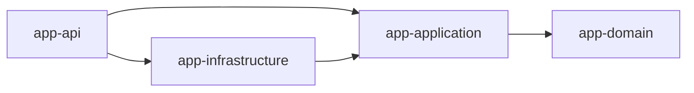

# Módulo 8: Build tools — Maven y Gradle


## Aprende construyendo

### Tema 1: pom.xml vs build.gradle.kts · Básico · 45 min

**Prerrequisito:** JDK 27, Maven o Gradle y un editor. Comprueba `java --version` y `mvn --version`.

**Al terminar podrás:** crear un proyecto Maven desde cero y declarar una dependencia externa fijada por versión.

#### Aprende

Un equipo necesita compilar, probar y publicar el mismo artefacto en su máquina local y en CI, con dependencias exactamente reproducibles, no versiones que puedan resolver a un artefacto distinto según el día.

**¿Por qué es importante?** Porque un build reproducible es parte del producto y de la cadena de suministro.

Maven declara dependencias en un archivo `pom.xml` estructurado en XML: `<dependency><groupId>com.fasterxml.jackson.core</groupId><artifactId>jackson-databind</artifactId><version>2.21.5</version></dependency>`, un formato completamente declarativo donde el orden de las secciones sigue una convención estricta impuesta por Maven, con relativamente poca flexibilidad para lógica de configuración condicional o dinámica dentro del propio archivo de configuración.

Gradle, usando su Kotlin DSL, declara las mismas dependencias con una sintaxis considerablemente más concisa (`implementation("com.fasterxml.jackson.core:jackson-databind:2.21.5")`) y, al ser efectivamente código Kotlin ejecutable (no solo datos declarativos estáticos), permite expresar lógica de configuración condicional o programática cuando resulta necesaria (por ejemplo, aplicar cierta configuración solo bajo ciertas condiciones específicas del entorno de build), una flexibilidad que el XML puramente declarativo de Maven no ofrece con la misma naturalidad, aunque a cambio de una curva de aprendizaje inicial ligeramente mayor para quien no está familiarizado con Kotlin como lenguaje de configuración.

**Analogía:** `pom.xml` es como un formulario impreso con casillas fijas y un orden estricto predefinido, apropiado para casos estándar pero rígido ante necesidades especiales; el DSL de Gradle es como una hoja de cálculo programable donde se pueden escribir fórmulas y lógica condicional según se necesite, ofreciendo mayor flexibilidad a costa de requerir familiaridad con su sintaxis de programación.

**Conceptos clave:** declaración de dependencias, XML declarativo frente a DSL de Kotlin.

Fijar versiones exactas de cada dependencia es un requisito del proyecto integrador de este track: un build que resuelve a una versión distinta en cada máquina no es reproducible ni auditable.

**Cuándo no usarlo:** para un script de un solo archivo sin dependencias externas, ni Maven ni Gradle aportan nada; `java` ejecutando directamente el archivo (sin build tool) es suficiente y más simple.

**Implicación práctica:** Gradle (Kotlin DSL) ofrece mayor flexibilidad para lógica de configuración condicional que el XML puramente declarativo de Maven, a cambio de una curva de aprendizaje ligeramente mayor y menor previsibilidad estructural que la rigidez estándar de Maven.

**Configuración del ejemplo:**

```xml
<dependencies>
  <dependency>
    <groupId>com.fasterxml.jackson.core</groupId>
    <artifactId>jackson-databind</artifactId>
    <version>2.21.5</version>
  </dependency>
</dependencies>
```
```kotlin
dependencies {
    implementation("com.fasterxml.jackson.core:jackson-databind:2.21.5")
    testImplementation("org.junit.jupiter:junit-jupiter:5.11.4")
}
```

#### Practica

**Desde cero:** parte de una carpeta vacía y prepara la estructura de un proyecto Maven mínimo. El arquetipo clásico `maven-archetype-quickstart` genera un POM con Java 7 y JUnit 3.8.1, que el compilador y el plugin de pruebas actuales ya rechazan; por eso el POM del ejemplo declara la versión de Java y la dependencia de forma explícita.

```bash
mkdir ejemplo-build-maven
cd ejemplo-build-maven
mkdir -p src/main/java/academia/build
```

**Crea** `pom.xml` con la dependencia fijada a una versión exacta:

```xml
<project xmlns="http://maven.apache.org/POM/4.0.0">
  <modelVersion>4.0.0</modelVersion>
  <groupId>academia.build</groupId>
  <artifactId>app</artifactId>
  <version>1.0-SNAPSHOT</version>
  <properties>
    <maven.compiler.release>27</maven.compiler.release>
    <project.build.sourceEncoding>UTF-8</project.build.sourceEncoding>
  </properties>
  <dependencies>
    <dependency>
      <groupId>com.fasterxml.jackson.core</groupId>
      <artifactId>jackson-databind</artifactId>
      <version>2.21.5</version>
    </dependency>
  </dependencies>
</project>
```

**Crea** `src/main/java/academia/build/App.java` que use esa dependencia para que el build no sea solo declarativo:

```java
package academia.build;

import com.fasterxml.jackson.databind.ObjectMapper;

public final class App {
    record Entrega(String numero, String estado) {}

    public static void main(String[] args) throws Exception {
        ObjectMapper mapper = new ObjectMapper();
        System.out.println(mapper.writeValueAsString(new Entrega("E-001", "EN_RUTA")));
    }
}
```

**Ejecuta el ejemplo** (Maven resuelve Jackson y arma el classpath):

```bash
mvn -B -q clean compile dependency:build-classpath -Dmdep.outputFile=cp.txt
java -cp "target/classes:$(cat cp.txt)" academia.build.App
```

**Resultado esperado:** imprime `{"numero":"E-001","estado":"EN_RUTA"}`. `mvn dependency:tree` muestra `jackson-databind:jar:2.21.5:compile` y sus dos dependencias transitivas (`jackson-annotations` y `jackson-core`) resueltas desde Maven Central.

**Fallo deliberado:** cambia la versión de `jackson-databind` a `99.99.99` y ejecuta `mvn -B compile`.

**Pista:** Maven falla antes de compilar con `Could not find artifact com.fasterxml.jackson.core:jackson-databind:jar:99.99.99 in central`, nombrando la coordenada exacta que no pudo resolver. **Resultado esperado:** restaurar `2.21.5` devuelve el build a verde.

**Si falla.** Si Maven no encuentra `javac`, revisa que `JAVA_HOME` apunte al JDK y no al JRE. Si la versión `99.99.99` no falla, hay una copia local corrupta de ese artefacto en `~/.m2`. Si `dependency:build-classpath` no genera `cp.txt`, el plugin `maven-dependency-plugin` no llegó a ejecutarse porque la compilación falló antes.

#### Aplica

Crea el mismo proyecto pero con Gradle (`gradle init` y el wrapper `./gradlew`) y declara la misma dependencia en `build.gradle.kts`; compara ambas sintaxis lado a lado. Si no tienes Gradle instalado, deja el `build.gradle.kts` escrito y documenta los comandos pendientes de ejecutar.

**Checklist de salida.**

- [ ] `pom.xml` fija `jackson-databind` a `2.21.5`.
- [ ] `mvn -B clean compile` termina en `BUILD SUCCESS`.
- [ ] `App` imprime el JSON de la entrega.
- [ ] `mvn dependency:tree` muestra la versión `2.21.5`.
- [ ] La versión `99.99.99` produce un fallo de resolución con la coordenada exacta.
- [ ] `build.gradle.kts` declara la misma dependencia con `implementation`.

**Si falla.** Si el proyecto Gradle no arranca, comprueba que existe `gradlew` en la raíz antes de usar `./gradlew`. Si la dependencia Gradle no resuelve, verifica que `repositories { mavenCentral() }` esté declarado en `build.gradle.kts`.

Guarda ambos proyectos (Maven y Gradle), la dependencia fijada y el fallo de resolución provocado; como siguiente paso estudia el ciclo de vida de build.

**Errores comunes:** versiones flotantes, scopes incorrectos, plugin sin fijar y módulos acoplados circularmente.

**Fuente oficial:** [Maven — Guides](https://maven.apache.org/guides/) y [Gradle — User Manual](https://docs.gradle.org/current/userguide/userguide.html).

---

### Tema 2: Ciclo de vida de build y scopes · Intermedio · 45 min

**Prerrequisito:** JDK 27, Maven y un editor. Comprueba `java --version` y `mvn --version`.

**Al terminar podrás:** demostrar que una dependencia con scope de test no participa del classpath de ejecución del artefacto de producción.

#### Aprende

Un equipo descubre en una auditoría de seguridad que su despliegue incluye una librería de testing con una vulnerabilidad conocida, porque alguien declaró esa dependencia sin scope y quedó disponible en tiempo de ejecución.

**¿Por qué es importante?** Porque un artefacto de producción con dependencias de testing embebidas aumenta su superficie de ataque sin necesidad.

Maven define un ciclo de vida de build compuesto por fases secuenciales estándar y predefinidas: `mvn clean compile test package` ejecuta, en orden, la limpieza de artefactos de builds anteriores, la compilación del código fuente, la ejecución de las pruebas, y el empaquetado del resultado final (típicamente un `.jar`), donde cada fase posterior implica automáticamente la ejecución de todas las fases anteriores necesarias (invocar `package` directamente ejecuta también `compile` y `test` primero, sin necesidad de invocarlas explícitamente por separado).

Las dependencias declaradas para un proyecto pueden restringirse a un scope específico según en qué momento del ciclo de vida son necesarias: `testImplementation` en Gradle (o `<scope>test</scope>` en Maven) declara que una dependencia (como JUnit) es necesaria únicamente para compilar y ejecutar las pruebas, no para el artefacto final de producción, garantizando que esa dependencia no forme parte del classpath de ejecución del artefacto final que efectivamente se despliega, reduciendo su tamaño y evitando exponer dependencias de testing (que podrían tener sus propias vulnerabilidades de seguridad o simplemente peso innecesario) en el artefacto que efectivamente llega a producción.

**Analogía:** el ciclo de vida de build es como una línea de producción con etapas secuenciales obligatorias (limpiar, ensamblar, probar, empaquetar), donde solicitar el producto empaquetado final automáticamente implica que todas las etapas anteriores necesarias ya se completaron; un scope de dependencia es como especificar que cierta herramienta solo se necesita durante el control de calidad interno de la línea de producción, sin que esa herramienta específica se incluya dentro de la caja final que efectivamente se envía al cliente.

**Conceptos clave:** fases secuenciales, `mvn clean compile test package`, dependencias por scope.

Verificar los scopes de dependencia antes de empaquetar es un paso de calidad que el proyecto integrador de este track exige en su pipeline de build.

**Cuándo no usarlo:** en un prototipo descartable de un solo archivo sin dependencias de test, distinguir scopes es sobreingeniería; solo importa una vez que hay una suite de pruebas real.

**Implicación práctica:** Separar dependencias por scope (compile, test, runtime) evita incluir dependencias innecesarias en el artefacto final de producción, reduciendo su tamaño y su superficie de exposición a vulnerabilidades no relevantes para producción.

**Prueba en terminal:**

```bash
mvn clean compile test package   # ciclo de vida: limpia, compila, prueba, empaqueta
```

#### Practica

**Sobre el proyecto del Tema 1**, agrega una prueba real y su dependencia con scope `test`. Añade a `App.java` un método que la prueba pueda verificar:

```java
    public static int sumar(int a, int b) {
        return a + b;
    }
```

**Crea** `src/test/java/academia/build/AppTest.java`:

```java
package academia.build;

import org.junit.jupiter.api.Test;

import static org.junit.jupiter.api.Assertions.assertEquals;

class AppTest {
    @Test
    void sumaDosMasDos() {
        assertEquals(4, App.sumar(2, 2));
    }
}
```

**Agrega** a `pom.xml` la dependencia de pruebas, el plugin de Surefire y la estructura de directorios de test. El archivo completo queda así:

```xml
<project xmlns="http://maven.apache.org/POM/4.0.0">
  <modelVersion>4.0.0</modelVersion>
  <groupId>academia.build</groupId>
  <artifactId>app</artifactId>
  <version>1.0-SNAPSHOT</version>
  <properties>
    <maven.compiler.release>27</maven.compiler.release>
    <project.build.sourceEncoding>UTF-8</project.build.sourceEncoding>
  </properties>
  <dependencies>
    <dependency>
      <groupId>com.fasterxml.jackson.core</groupId>
      <artifactId>jackson-databind</artifactId>
      <version>2.21.5</version>
    </dependency>
    <dependency>
      <groupId>org.junit.jupiter</groupId>
      <artifactId>junit-jupiter</artifactId>
      <version>5.11.4</version>
      <scope>test</scope>
    </dependency>
  </dependencies>
  <build>
    <plugins>
      <plugin>
        <groupId>org.apache.maven.plugins</groupId>
        <artifactId>maven-surefire-plugin</artifactId>
        <version>3.6.0</version>
      </plugin>
    </plugins>
  </build>
</project>
```

```bash
mkdir -p src/test/java/academia/build
```

**Ejecuta el ciclo completo:**

```bash
mvn clean compile test package
```

**Resultado esperado:** la consola informa `Tests run: 1, Failures: 0, Errors: 0, Skipped: 0` y `BUILD SUCCESS`. El `.jar` queda en `target/app-1.0-SNAPSHOT.jar`; al listarlo con `jar tf target/app-1.0-SNAPSHOT.jar` aparecen `academia/build/App.class` y el `pom.xml` embebido, pero ninguna clase `org/junit/...`: un `.jar` estándar empaqueta solo las clases del propio proyecto.

**Fallo deliberado:** compara el árbol de dependencias con y sin el scope. Ejecuta el árbol de runtime y después elimina la línea `<scope>test</scope>` del `pom.xml`:

```bash
mvn -B dependency:tree -Dscope=runtime
```

**Pista:** con `<scope>test</scope>`, el árbol de runtime muestra solo `jackson-databind`; si quitas el scope, `junit-jupiter` aparece como `compile` y pasa a formar parte del classpath de ejecución. **Resultado esperado:** el scope decide qué dependencias están disponibles al ejecutar, aunque el `.jar` plano no las incluya en ninguno de los dos casos; el riesgo real aparece al construir un fat jar, un repackage de Spring Boot o una imagen de contenedor que arme el classpath completo.

**Si falla.** Si Surefire rechaza la versión de JUnit, fija `5.11.4` o superior; las versiones 3.8.1 que generan los arquetipos antiguos ya no están soportadas. Si la prueba no se encuentra, confirma que vive en `src/test/java` y que la clase y el método son accesibles. Si `jar tf` muestra JUnit incluso con scope `test`, el proyecto está usando un plugin de empaquetado con dependencias (shade o spring-boot-maven-plugin), no el `maven-jar-plugin` estándar.

#### Aplica

El proyecto ya declara `jackson-databind` sin scope: verifica en el árbol de runtime que aparece por ser necesaria en ejecución, y documenta la diferencia frente a la dependencia de test.

**Checklist de salida.**

- [ ] `mvn clean compile test package` termina en `BUILD SUCCESS`.
- [ ] La prueba se ejecuta y el informe dice `Tests run: 1`.
- [ ] El `.jar` generado contiene `academia/build/App.class`.
- [ ] El árbol de runtime no incluye `junit-jupiter` con scope `test`.
- [ ] Al quitar el scope, `junit-jupiter` aparece como `compile`.
- [ ] Explicas por qué el `.jar` plano no incluye ninguna dependencia.

**Si falla.** Si `dependency:tree` no muestra ningún árbol, ejecuta el comando sobre el directorio que contiene el `pom.xml`. Si el scope no cambia nada, revisa que hayas editado la dependencia de JUnit y no otra.

Guarda ambos árboles de dependencias (con y sin scope test) y el pom.xml modificado; como siguiente paso divide el proyecto en módulos.

**Errores comunes:** declarar dependencias de test sin scope, asumir que `package` no ejecuta `test` antes, y omitir `clean` entre builds con cambios de dependencias.

**Fuente oficial:** [Maven — Introduction to the Lifecycle](https://maven.apache.org/guides/introduction/introduction-to-the-lifecycle.html).

---

### Tema 3: Proyectos multi-módulo · Intermedio · 50 min

**Prerrequisito:** JDK 27, Maven y un editor. Comprueba `java --version` y `mvn --version`.

**Al terminar podrás:** dividir un proyecto Maven en dos módulos (`core` y `api`) con una dependencia explícita entre ellos.

#### Aprende

Un proyecto de un solo módulo crece hasta que cualquier cambio en la lógica de dominio obliga a recompilar y volver a probar toda la capa HTTP también; separar `core` de `api` en módulos de build distintos hace explícito qué depende de qué y permite compilar y probar cada uno por separado.

**¿Por qué es importante?** Un proyecto multi-módulo impone límites explícitos de dependencia entre subproyectos, verificados por la herramienta de build, previniendo dependencias accidentales en direcciones no deseadas dentro de la arquitectura del proyecto.

Un proyecto multi-módulo divide una aplicación grande en subproyectos independientes que se compilan como parte de un mismo build coordinado, pero con límites explícitos entre ellos: un módulo `core` conteniendo la lógica de dominio central, y un módulo `api` que depende de `core` para exponer esa lógica a través de HTTP, con la configuración raíz compartida (`build.gradle.kts` en la raíz del proyecto) coordinando cómo se construyen ambos módulos juntos, mientras cada módulo mantiene su propio conjunto de dependencias específicas, declaradas explícitamente según lo que ese módulo particular efectivamente necesita, sin heredar automáticamente dependencias de otros módulos que no declaró explícitamente requerir.

Esta estructura refleja a nivel de proyecto completo el mismo principio de límites explícitos estudiado para JPMS en el Módulo 10: separar `core` de `api` en módulos de build distintos (no solo en paquetes distintos dentro de un único módulo) impone una verificación adicional a nivel de herramienta de build de que `api` efectivamente declara su dependencia hacia `core` de forma explícita, y previene que código de `core` acceda accidentalmente a tipos definidos únicamente en `api` (una dirección de dependencia que normalmente no tendría sentido en una arquitectura por capas bien diseñada), dado que `core`, al no declarar una dependencia hacia `api`, simplemente no tiene acceso a su código en tiempo de compilación.

**Analogía:** un proyecto multi-módulo es como una empresa organizada en departamentos separados con presupuestos y recursos propios declarados explícitamente, donde un departamento que necesita recursos de otro debe solicitarlos formalmente (declarar la dependencia), en vez de que todos los departamentos compartan automáticamente todos los recursos de todos los demás sin ninguna distinción ni control.

**Conceptos clave:** separación de responsabilidades entre módulos, dependencias explícitas entre ellos.

La estructura `core`/`api` de este tema es, en miniatura, la misma separación que el Proyecto integrador (Módulo 13) exige entre la lógica de dominio y la capa que la expone.

**Cuándo no usarlo:** para una aplicación pequeña de un solo equipo y despliegue único, un multi-módulo añade sobrecarga de configuración sin beneficio; un solo módulo con paquetes bien organizados es suficiente hasta que el proyecto realmente lo justifique.

**Implicación práctica:** Separar módulos de build impone, a nivel de herramienta, los mismos límites arquitectónicos que el equipo diseñó a nivel de capas.

**Diagrama:**



#### Practica

**Desde cero:** parte de una carpeta vacía y crea la jerarquía de directorios de los tres POM (padre, `core` y `api`):

```bash
mkdir ejemplo-multimodulo && cd ejemplo-multimodulo
mkdir -p core/src/main/java/academia/build/core
mkdir -p api/src/main/java/academia/build/api
```

**Crea** el `pom.xml` raíz con `<modules><module>core</module><module>api</module></modules>`:

```xml
<project xmlns="http://maven.apache.org/POM/4.0.0">
  <modelVersion>4.0.0</modelVersion>
  <groupId>academia.build</groupId>
  <artifactId>padre</artifactId>
  <version>1.0-SNAPSHOT</version>
  <packaging>pom</packaging>
  <modules>
    <module>core</module>
    <module>api</module>
  </modules>
</project>
```

**Crea** `core/pom.xml`:

```xml
<project xmlns="http://maven.apache.org/POM/4.0.0">
  <modelVersion>4.0.0</modelVersion>
  <parent>
    <groupId>academia.build</groupId>
    <artifactId>padre</artifactId>
    <version>1.0-SNAPSHOT</version>
  </parent>
  <artifactId>core</artifactId>
  <properties>
    <maven.compiler.release>27</maven.compiler.release>
  </properties>
</project>
```

**Crea** `core/src/main/java/academia/build/core/Saludo.java`:

```java
package academia.build.core;

public final class Saludo {
    public String texto() {
        return "Hola desde core";
    }
}
```

**Crea** `api/pom.xml` con la dependencia explícita hacia `core`:

```xml
<project xmlns="http://maven.apache.org/POM/4.0.0">
  <modelVersion>4.0.0</modelVersion>
  <parent>
    <groupId>academia.build</groupId>
    <artifactId>padre</artifactId>
    <version>1.0-SNAPSHOT</version>
  </parent>
  <artifactId>api</artifactId>
  <properties>
    <maven.compiler.release>27</maven.compiler.release>
  </properties>
  <dependencies>
    <dependency>
      <groupId>academia.build</groupId>
      <artifactId>core</artifactId>
      <version>1.0-SNAPSHOT</version>
    </dependency>
  </dependencies>
</project>
```

**Crea** `api/src/main/java/academia/build/api/App.java`, que usa la clase de `core`:

```java
package academia.build.api;

import academia.build.core.Saludo;

public final class App {
    public static void main(String[] args) {
        System.out.println(new Saludo().texto());
    }
}
```

**Ejecuta el ejemplo** desde la raíz. `-pl api -am` (also-make) construye primero `core` porque `api` depende de él; después ejecuta la aplicación con ambas salidas:

```bash
mvn -B -pl api -am compile
java -cp "api/target/classes:core/target/classes" academia.build.api.App
```

**Resultado esperado:** el resumen del reactor muestra `core ... SUCCESS` antes de `api ... SUCCESS`, y la ejecución imprime `Hola desde core`.

**Fallo deliberado:** elimina el bloque `<dependencies>` de `api/pom.xml` y vuelve a compilar `api` referenciando la clase de `core`.

**Pista:** la compilación falla con `package academia.build.core does not exist`, porque `core` ya no está en el classpath de compilación de `api`. **Resultado esperado:** restaurar la dependencia explícita corrige el fallo.

**Si falla.** Si `-pl api -am` no encuentra `core`, revisa que el POM raíz liste ambos módulos y que lo ejecutes desde la raíz. Si la aplicación no arranca, confirma las dos rutas de `target/classes` en el `-cp`. Si `core` compila pero `api` no ve sus clases, la versión declarada en la dependencia no coincide con la del POM raíz.

#### Aplica

Agrega un tercer módulo `infra` que dependa de `api`, y documenta por qué `core` no debería depender nunca de `infra` ni de `api`.

**Checklist de salida.**

- [ ] El POM raíz declara `core` y `api` como módulos.
- [ ] `core` compila solo con su POM.
- [ ] `api` declara la dependencia hacia `core` con la misma versión del padre.
- [ ] `mvn -pl api -am compile` muestra `core` antes que `api`.
- [ ] Sin la dependencia, `api` falla con `package ... does not exist`.
- [ ] El módulo `infra` declara su dependencia hacia `api`.

**Si falla.** Si el reactor compila `api` antes que `core`, la dependencia no está declarada o `-am` no se pasó. Si el nuevo módulo `infra` provoca un ciclo, la dirección de dependencia elegida contradice la arquitectura por capas.

Guarda la estructura de los tres módulos, el pom.xml raíz y el fallo de compilación provocado al romper la dependencia; como siguiente paso conecta el multi-módulo a un pipeline de CI.

**Errores comunes:** dependencias circulares entre módulos, olvidar `-am` al compilar un módulo específico, y permitir que `core` dependa de módulos que deberían depender de él.

**Fuente oficial:** [Maven — Guide to Multiple Modules](https://maven.apache.org/guides/mini/guide-multiple-modules.html).

---

### Tema 4: Maven y Gradle lado a lado — el mismo proyecto en dos herramientas · Avanzado · 50 min

**Prerrequisito:** JDK 27 y Maven instalados; Gradle solo si quieres ejecutar el tramo equivalente. Comprueba `java --version`, `mvn --version` y, si está instalado, `gradle --version`.

**Al terminar podrás:** construir el mismo proyecto con Maven y con Gradle, traducir cualquier comando de uno al otro con una tabla de equivalencias, y decidir cuál usar según el contexto.

#### Aprende

Casi todo proyecto Java que encontrarás usa Maven **o** Gradle, no los dos, y rara vez eliges tú: lo heredas. Un backend corporativo suele venir en Maven; un proyecto Android o Spring moderno, en Gradle. Saber leer y operar ambos —aunque prefieras uno— es lo que te permite entrar a cualquier repositorio sin quedarte bloqueado en el primer `./gradlew build` que no reconoces.

**¿Por qué es importante?** Porque en un trabajo real no eliges la herramienta de build: la heredas del proyecto. Operar ambas con fluidez es lo que te hace productivo en cualquier repositorio Java desde el primer día.

Maven y Gradle resuelven el mismo problema (compilar, resolver dependencias, probar, empaquetar) con dos filosofías: Maven es **convención sobre configuración** (estructura fija, XML declarativo, previsible); Gradle es **configuración programable** (Kotlin DSL, tareas componibles, caché incremental más agresiva). Ambos leen de los mismos repositorios (Maven Central), así que una misma dependencia se declara distinto pero resuelve el mismo artefacto.

**Analogía:** es como conducir un coche automático (Maven: menos decisiones, comportamiento predecible) frente a uno manual (Gradle: más control y rendimiento, a cambio de aprender a usar el embrague). El destino es el mismo; cambia cómo llegas.

**Conceptos clave:** equivalencia de comandos, wrapper (`./gradlew`, `./mvnw`), convención (Maven) frente a configuración programable (Gradle).

Este tema comparativo es la base para el proyecto integrador de este track: el build debe ser reproducible con la herramienta que el proyecto adopte, y la evidencia se entrega con el wrapper, no con una instalación global.

**Cuándo no usarlo:** no mantengas los dos sistemas de build en paralelo en un mismo proyecto real (dos archivos de build que se desincronizan es una fuente de errores); elige uno. Este tema enseña ambos para que sepas leerlos, no para que los uses juntos en producción.

**Tabla de equivalencias de comandos (referencia para todo el track):**

| Tarea | Maven | Gradle (Kotlin DSL) |
|---|---|---|
| Compilar | `mvn compile` | `./gradlew compileJava` |
| Ejecutar pruebas | `mvn test` | `./gradlew test` |
| Empaquetar (.jar) | `mvn package` | `./gradlew build` |
| Limpiar artefactos | `mvn clean` | `./gradlew clean` |
| Limpiar + empaquetar | `mvn clean package` | `./gradlew clean build` |
| Correr un test | `mvn test -Dtest=MiTest` | `./gradlew test --tests MiTest` |
| Saltar pruebas | `mvn package -DskipTests` | `./gradlew build -x test` |
| Ver árbol de dependencias | `mvn dependency:tree` | `./gradlew dependencies` |
| Instalar en repo local | `mvn install` | `./gradlew publishToMavenLocal` |
| Ejecutar la app (Spring Boot) | `mvn spring-boot:run` | `./gradlew bootRun` |

> `./gradlew` (el *wrapper*) ejecuta la versión exacta de Gradle fijada en el proyecto, sin instalar nada global; su equivalente conceptual en Maven es `./mvnw`. Úsalos siempre en vez de `gradle`/`mvn` globales para builds reproducibles.

#### Practica

El mismo resultado se obtiene con una u otra herramienta. El tramo Maven se ejecuta sobre el proyecto del Tema 1 y el tramo Gradle se deja escrito para ejecutarlo con el wrapper.

```bash
# --- Con Maven (proyecto del Tema 1) ---
cd ejemplo-build-maven
mvn -B clean test package          # limpia, prueba y empaqueta

# --- Con Gradle (mismo resultado, en una carpeta aparte) ---
cd ..
mkdir ejemplo-build-gradle && cd ejemplo-build-gradle
gradle init --type java-application --dsl kotlin --test-framework junit-jupiter \
  --project-name app --package academia.build
./gradlew clean build              # limpia, prueba y empaqueta (equivalente)
```

**Resultado esperado:** el build de Maven termina en verde y produce `target/app-1.0-SNAPSHOT.jar`. El tramo Gradle, una vez generado el wrapper, produce `build/libs/app.jar`; si Gradle no está instalado en la máquina, ese tramo queda pendiente de ejecutar.

**Fallo deliberado y diagnóstico:** dentro de `ejemplo-build-maven` ejecuta `./gradlew build`.

**Pista:** falla con `no such file or directory: ./gradlew`, porque el wrapper no existe hasta que se genera en un proyecto Gradle. Confirma que cada herramienta solo entiende su propio archivo de build (`pom.xml` vs `build.gradle.kts` y `gradlew`), y que por eso identificar cuál usa un repo es lo primero que haces al clonarlo.

**Si falla.** Si `mvn clean test package` falla en el proyecto del Tema 1, la prueba del Tema 2 no está agregada. Si quieres ejecutar Gradle y no está instalado, instálalo o copia un wrapper desde otro proyecto Gradle; `gradle init` necesita el binario global la primera vez.

#### Aplica

Toma cualquier comando `mvn` de los temas anteriores de este módulo y tradúcelo a su equivalente Gradle usando la tabla; ejecútalo en tu proyecto Gradle y confirma que produce el mismo efecto. Entrega al menos tres pares de comandos equivalentes con su salida.

**Checklist de salida.**

- [ ] `mvn clean test package` produce `target/app-1.0-SNAPSHOT.jar`.
- [ ] `./gradlew build` produce `build/libs/app.jar` cuando el wrapper existe.
- [ ] `./gradlew build` dentro del proyecto Maven falla por falta de wrapper.
- [ ] La tabla traduce al menos cinco comandos entre ambas herramientas.
- [ ] Explicas la diferencia entre `target/` y `build/`.
- [ ] Documentas qué comandos quedaron pendientes de ejecutar.

**Si falla.** Si el `.jar` de Gradle se llama distinto, revisa `project-name` y la tarea `jar` en `build.gradle.kts`. Si un comando de la tabla no existe en tu versión de Gradle, consulta el manual de esa versión antes de cambiar la tabla.

Guarda los dos proyectos (Maven y Gradle), los dos `.jar` generados y tu tabla de al menos tres comandos equivalentes verificados; como siguiente paso, cualquier tema del track que muestre un comando `mvn` ya sabes traducirlo a Gradle.

**Errores comunes:** usar `gradle`/`mvn` global en vez del wrapper; buscar `target/` en un proyecto Gradle (está en `build/`); asumir que un comando de un sistema funciona en el otro.

**Fuente oficial:** [Maven — Guides](https://maven.apache.org/guides/), [Gradle — User Manual](https://docs.gradle.org/current/userguide/userguide.html) y [Gradle — Migrating from Maven](https://docs.gradle.org/current/userguide/migrating_from_maven.html).

---


## Construcción guiada del capítulo

**Objetivo del laboratorio:** construir un proyecto multi-módulo con Gradle (o Maven) con dependencias bien acotadas.

**Requisitos previos:** Módulos 0-7 completados.

| Paso | Acción | Código | Explicación |
|---|---|---|---|
| 1 | Crear un proyecto con Maven y otro con Gradle | Ver Tema 1 | Compara la estructura generada |
| 2 | Agregar una dependencia externa en ambos | Ver Tema 1 | Ejecuta el build en ambos casos |
| 3 | Ejecutar el ciclo de vida completo de Maven | `mvn clean compile test package` | Verifica el orden de las fases |
| 4 | Configurar un scope test-only | Ver Tema 2 | Verifica que no va al artefacto final |
| 5 | Estructurar un proyecto multi-módulo | Ver Tema 3 | `core` + `api` dependiente de `core` |

**Verificación:** el laboratorio se considera exitoso si el artefacto final de producción no incluye dependencias declaradas con scope de test, y si el módulo `api` compila correctamente su dependencia explícita hacia `core`.

**Errores comunes y soluciones**

- **Declarar una dependencia de testing sin el scope apropiado.** Usa `testImplementation`/`<scope>test</scope>` para que no se incluya en el artefacto final.
- **Permitir que un módulo `core` dependa de un módulo `api`.** Verifica que la dirección de dependencia refleje la arquitectura por capas deseada.
- **Confundir la sintaxis entre `pom.xml` y `build.gradle.kts`.** Practica ambos formatos hasta sentirte cómodo con sus diferencias sintácticas.

---
