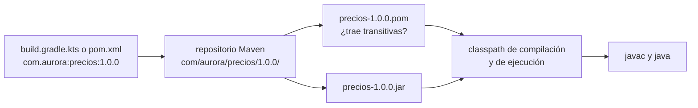
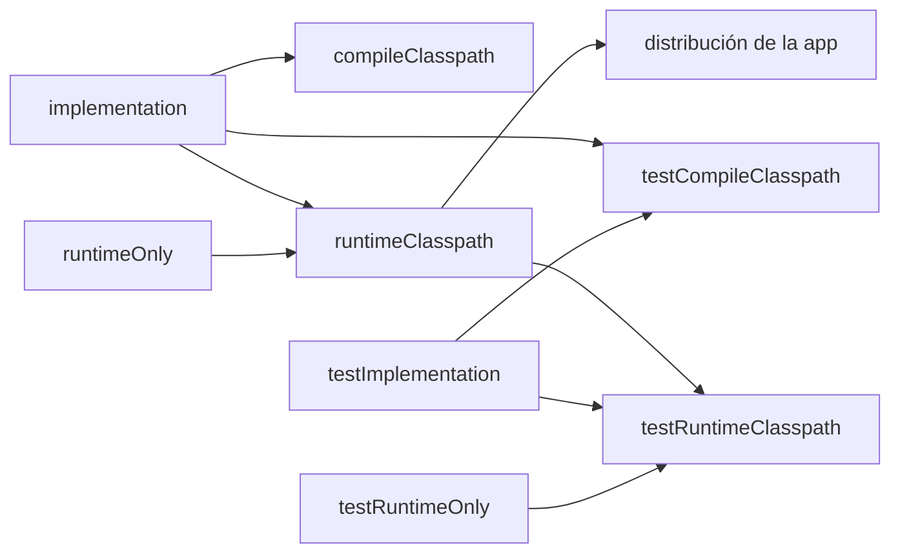
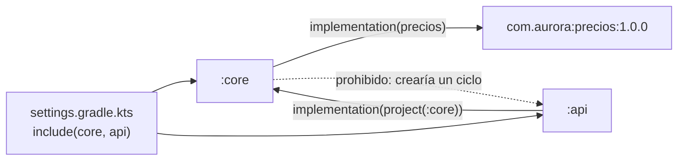
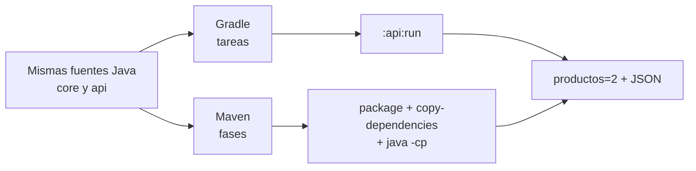

# Módulo 8: Build tools — Maven y Gradle

**Entorno original (2026-11-23):** macOS arm64, JDK 27.0.1.0.2 (Temurin), Gradle 9.9.1 con toolchain Java 25 y Maven 3.10.0, en `~/labs/aurora-m8`. Las salidas del proyecto `tienda-aurora-build-tools` (Temas 2 y 4) son de esa ejecución.

**Entorno de las salidas nuevas (2026-11-24):** Linux x86_64, Gradle 8.14.3 ejecutado sobre OpenJDK 21.0.13, toolchain OpenJDK 25.0.5 para compilar y ejecutar, y Maven 3.9.11, en `/home/estudiante/labs` (tu `~/labs`). Ese equipo no tenía acceso a Maven Central. Por eso los ejemplos nuevos usan solo el JDK, dependencias entre tus propios proyectos y un repositorio Maven local que tú mismo publicas. Las líneas `BUILD SUCCESSFUL in …`, las fechas y los tiempos cambian en cada corrida. Con Gradle 9.9.1 algunas líneas de ayuda (`* Try:`) se redactan distinto.

Un build tool responde a una pregunta concreta: cómo transformar código fuente, dependencias y reglas en un artefacto reproducible. El mecanismo es un grafo: entradas (fuentes, dependencias, configuración) producen salidas (clases, tests ejecutados, jars). Maven representa ese grafo con un modelo declarativo en XML y un ciclo de vida de fases; Gradle lo representa con tareas y una DSL ejecutable. Existen porque “compilar” no es solo invocar `javac`: hay que resolver versiones, decidir qué dependencia vive en cada classpath, ejecutar verificaciones y empaquetar siempre igual en la máquina local y en CI.

La implicación práctica es que el build pasa a ser código de proyecto: cambia el resultado, tiene versiones y requiere revisión. La confusión frecuente es tratar al build tool como un detalle de entorno (“el IDE ya compila”). Cuando el build cambia la salida de negocio, o cuando un artefacto arrastra dependencias de test, el problema está en la declaración del build, no en Java.

En este módulo el mismo código Java se construye con las dos herramientas dentro de un único árbol, `tienda-aurora-build-tools`. La herramienta principal del curso es **Gradle con Kotlin DSL**; Maven aparece donde el tema compara.

Al terminar este módulo podrás:
- explicar qué hace un build tool comparándolo con compilar a mano con `javac` y `java -cp`;
- declarar dependencias por sus coordenadas y resolverlas desde un repositorio Maven;
- elegir la configuración correcta (`implementation`, `runtimeOnly`, `testImplementation`) y comprobarla con reportes;
- dividir un proyecto en módulos `core` y `api` sin ciclos;
- construir y ejecutar el mismo proyecto con Gradle y con Maven, y obtener la misma salida.

**Esquema del módulo:** Tema 1, `pom.xml` frente a `build.gradle.kts`; Tema 2, ciclo de vida y scopes; Tema 3, proyectos multi-módulo; Tema 4, Maven y Gradle lado a lado.

**Qué necesitas saber antes:** paquetes y `main` (Módulo 0), records (Módulo 1, Tema 5), excepciones checked (Módulo 3, Tema 1) y Jackson (Módulo 6, Tema 2). De Fundamentos: terminal y rutas (Módulo 0) y prueba unitaria e integración continua (Módulo 4, Temas 2 y 4).

## Visual del módulo

**Visual:** [Maven y Gradle construyen el mismo proyecto multi-módulo con fases/tareas y salida de negocio idéntica](/visuals/temas/java/modulo-8-build-tools.html)

Lectura: Maven y Gradle son dos modelos de build; el comportamiento de negocio debe permanecer igual.

## Aprende construyendo

### Tema 1: pom.xml vs build.gradle.kts · Básico · 60 min

<details open>
<summary><strong>Capa 1 — Lectura</strong></summary>

#### Objetivos
Al terminar este tema podrás:
- compilar a mano un programa que usa una librería externa y explicar qué parte de ese trabajo automatiza un build tool;
- leer las coordenadas `groupId:artifactId:version` en un `pom.xml` y en un `build.gradle.kts`;
- publicar una librería propia en un repositorio Maven local y consumirla por sus coordenadas;
- generar el Gradle wrapper y explicar por qué fija la versión de la herramienta.

**Conceptos clave:** build tool, classpath, dependencia, dependencia transitiva, coordenadas, repositorio Maven, `pom.xml`, `build.gradle.kts`, Kotlin DSL, plugin, Gradle wrapper

#### El problema
En el Módulo 6 la clase `Catalogo` de Tienda Aurora convirtió productos a JSON con Jackson. Funcionó porque Gradle
consiguió la librería por ti. Ahora tienes que compilarla en una máquina nueva, sin IDE. ¿De dónde sale el código de
Jackson, cuántos archivos necesitas y cómo te aseguras de que tu compañero use exactamente los mismos?

#### Glosario del tema

**build tool**
- **Definición técnica:** programa que automatiza la construcción de un proyecto: resuelve dependencias, compila, ejecuta pruebas y empaqueta, a partir de un archivo de configuración versionado.
- **En palabras sencillas:** la receta escrita y el cocinero que la sigue igual cada vez, en cualquier cocina.
- **Dónde se rompe la comparación:** el cocinero no improvisa; si la receta omite un ingrediente, el build falla en vez de adivinar.
- **Ejemplo:** `gradle run` compila `Caja.java`, descarga o localiza `precios-1.0.0.jar` y ejecuta el programa: imprime `neto=14.90 total=17.73`.
- **Error típico:** creer que «el IDE ya compila»: el IDE lee el mismo archivo de build; si el archivo está mal, CI también falla.

**classpath**
- **Definición técnica:** lista ordenada de carpetas y archivos `.jar` donde `javac` y la JVM buscan clases; se pasa con `-cp` (o `-classpath`).
- **En palabras sencillas:** la lista de estantes donde Java busca cada pieza que tu código nombra.
- **Dónde se rompe la comparación:** hay dos listas distintas, la de compilar y la de ejecutar; una pieza puede estar en una y faltar en la otra.
- **Ejemplo:** `java -cp "out:libs/*" com.aurora.build.api.TiendaAuroraApiApp` busca clases en `out` y en todos los jars de `libs`.
- **Error típico:** olvidar la carpeta de tus propias clases en `-cp`: la JVM responde `Could not find or load main class`.

**dependencia**
- **Definición técnica:** librería externa que tu código necesita para compilar o ejecutarse, identificada por nombre y versión.
- **En palabras sencillas:** una pieza que no fabricas tú y que tu programa usa.
- **Dónde se rompe la comparación:** la pieza trae sus propias piezas (dependencias transitivas) y cada una tiene versión.
- **Ejemplo:** `implementation("com.aurora:precios:1.0.0")` declara que `tienda` usa la librería `precios`.
- **Error típico:** copiar jars a mano a una carpeta `libs/`: nadie sabe después qué versión es ni de dónde salió.

**dependencia transitiva**
- **Definición técnica:** dependencia que no declaras tú sino que llega porque una de tus dependencias la declara en su propio descriptor (POM o metadatos de Gradle).
- **En palabras sencillas:** pides una pieza y viene con los tornillos que necesita.
- **Dónde se rompe la comparación:** los tornillos tienen versión propia; si dos piezas piden versiones distintas, el build elige una.
- **Ejemplo:** declarar solo `jackson-databind` trae `jackson-core` y `jackson-annotations`; el `dependency:tree` del Tema 2 los muestra debajo con `+-` y `\-`.
- **Error típico:** compilar solo con `jackson-databind-2.16.1.jar`: `javac` falla con `class file for com.fasterxml.jackson.core.Versioned not found`.

**coordenadas**
- **Definición técnica:** identificador único de un artefacto en un repositorio, formado por `groupId` (organización), `artifactId` (nombre) y `version`; Gradle lo escribe como `grupo:nombre:versión`.
- **En palabras sencillas:** la dirección completa de una pieza: empresa, producto y edición.
- **Dónde se rompe la comparación:** la dirección también decide la carpeta física: `com.aurora:precios:1.0.0` vive en `com/aurora/precios/1.0.0/`.
- **Ejemplo:** el POM publicado de `precios` declara `<groupId>com.aurora</groupId>`, `<artifactId>precios</artifactId>` y `<version>1.0.0</version>`.
- **Error típico:** pedir una versión que nadie publicó: Gradle responde `Could not find com.aurora:precios:1.0.1.`

**repositorio Maven**
- **Definición técnica:** almacén de artefactos organizado por coordenadas (carpetas `grupo/nombre/versión/`) con un `.jar`, un `.pom` y metadatos; Maven Central es el público y una carpeta local también sirve.
- **En palabras sencillas:** una bodega con estantes ordenados por empresa, producto y edición.
- **Dónde se rompe la comparación:** la bodega no se revisa sola: lo que publicas con una versión no debería cambiar nunca.
- **Ejemplo:** `gradle publish` creó `repo-aurora/com/aurora/precios/1.0.0/precios-1.0.0.jar` y su `precios-1.0.0.pom`.
- **Error típico:** declarar la dependencia y olvidar el bloque `repositories`: Gradle no sabe en qué bodega buscar.

**`pom.xml`**
- **Definición técnica:** Project Object Model de Maven: archivo XML que declara coordenadas, dependencias, propiedades, módulos y plugins de un proyecto.
- **En palabras sencillas:** la ficha técnica del proyecto, escrita en un formulario fijo.
- **Dónde se rompe la comparación:** no es solo descripción: Maven ejecuta el ciclo de vida a partir de lo que dice ese formulario.
- **Ejemplo:** `mvn validate` sobre un `pom.xml` con `com.aurora:demo:1.0.0` imprime `Building demo 1.0.0` y `BUILD SUCCESS`.
- **Error típico:** escribir la versión de una dependencia en cada módulo; se desalinean. Va una vez en `<properties>` del POM padre.

**`build.gradle.kts`**
- **Definición técnica:** script de build de Gradle escrito en Kotlin; configura plugins, repositorios, dependencias y tareas del proyecto.
- **En palabras sencillas:** la receta de Gradle, escrita como un programa corto.
- **Dónde se rompe la comparación:** al ser código, permite lógica (`if`, bucles); eso da poder y también builds difíciles de leer.
- **Ejemplo:** `plugins { application }` más `application { mainClass = "com.aurora.tienda.Caja" }` habilitan `gradle run`.
- **Error típico:** copiar sintaxis de un `build.gradle` (Groovy) en un `.kts`: falla la compilación del script.

**Kotlin DSL**
- **Definición técnica:** lenguaje específico de dominio construido sobre Kotlin que Gradle usa en archivos `.gradle.kts`; el script se compila y tiene tipos.
- **En palabras sencillas:** un vocabulario de Gradle con reglas de gramática estrictas, como un formulario que revisa cada casilla.
- **Dónde se rompe la comparación:** el revisor es el compilador de Kotlin: sus mensajes hablan de tipos, no de dependencias.
- **Ejemplo:** `implementation("com.aurora:precios:1.0.0")` lleva paréntesis porque es una llamada a función.
- **Error típico:** escribir `implementation "com.aurora:precios:1.0.0"` (estilo Groovy): Kotlin responde `Unexpected tokens (use ';' to separate expressions on the same line)`.

**plugin**
- **Definición técnica:** módulo de Gradle o Maven que añade tareas, convenciones y configuraciones al build; en Maven, cada fase del ciclo de vida la ejecuta un plugin.
- **En palabras sencillas:** una herramienta que enchufas al taller y trae sus propios botones.
- **Dónde se rompe la comparación:** un plugin también impone convenciones, como dónde busca tus fuentes (`src/main/java`).
- **Ejemplo:** con `plugins { application }`, `gradle tasks --group application` lista `run - Runs this project as a JVM application`.
- **Error típico:** llamar a `gradle run` sin el plugin `application`: la tarea `run` no existe.

**Gradle wrapper**
- **Definición técnica:** scripts `gradlew`/`gradlew.bat` más `gradle/wrapper/gradle-wrapper.properties`, que descargan y usan la versión exacta de Gradle declarada en `distributionUrl`.
- **En palabras sencillas:** una nota pegada al proyecto que dice «constrúyeme con esta versión del cocinero» y la trae si falta.
- **Dónde se rompe la comparación:** fija Gradle, no el JDK; la versión de Java se fija aparte con un toolchain (Tema 4).
- **Ejemplo:** `gradle wrapper` escribió `distributionUrl=https\://services.gradle.org/distributions/gradle-8.14.3-bin.zip`.
- **Error típico:** ejecutar `gradle` (el instalado en tu máquina) en vez de `./gradlew`: cada persona construye con otra versión.

#### ► CÓMO FUNCIONA
**Mecanismo.** `pom.xml` es un modelo declarativo: coordenadas (`groupId`, `artifactId`, `version`), `<modules>`, `<dependencies>`, `<properties>` y plugins ligados a fases. `build.gradle.kts` es un script Kotlin que configura un grafo de tareas: cada tarea declara entradas, salidas y dependencias con otras tareas. Los plugins aportan tareas y convenciones en ambos casos.

**Por qué existe.** Necesitamos una descripción del build que una persona y una máquina puedan ejecutar sin depender del IDE. Maven eligió la convención y un vocabulario fijo; Gradle eligió la programabilidad y el cálculo incremental.

**Implicaciones.** En Maven, la estructura estándar (`src/main/java`, `src/test/java`) hace que gran parte del build sea implícito. En Gradle, `subprojects { ... }` centraliza la configuración, pero esa misma flexibilidad permite builds difíciles de leer. Un script de build merece revisión de código; un POM merece revisión de versiones y scopes.

El recorrido de una dependencia es siempre el mismo, con cualquiera de las dos herramientas:



Sin build tool, cada flecha la haces tú a mano. El Problema resuelto 1.1 lo hace así para que veas cuánto trabajo es.

#### Problema resuelto 1.1
Compila y ejecuta `Catalogo` y `TiendaAuroraApiApp` solo con `javac` y `java`, sin Gradle ni Maven.

**Razonamiento:**
1. `javac` solo ve el JDK y las rutas que le pases en `-cp`; Jackson no viene en el JDK.
2. Hay que conseguir los jars de Jackson, ponerlos en una carpeta y pasarlos en el classpath al compilar y al ejecutar.
3. Para ver qué exige cada paso, prueba primero sin jars, luego con uno y luego con los tres.

Los tres archivos fuente están en `~/labs/m8-manual/src`. `Producto.java`:

```java
package com.aurora.build.core;
import java.math.BigDecimal;
public record Producto(String sku, String nombre, BigDecimal precio) {}
```

`Catalogo.java` (los números de línea de los errores se refieren a este archivo):

```java
package com.aurora.build.core;
import com.fasterxml.jackson.core.JsonProcessingException;
import com.fasterxml.jackson.databind.ObjectMapper;
import java.math.BigDecimal;
import java.util.List;
public final class Catalogo {
    private final ObjectMapper mapper = new ObjectMapper();
    public List<Producto> productos() {
        return List.of(
                new Producto("CAF-100", "Cafe Aurora", new BigDecimal("14.90")),
                new Producto("MOL-200", "Molino Manual", new BigDecimal("79.90"))
        );
    }
    public String comoJson() {
        try {
            return mapper.writeValueAsString(productos());
        } catch (JsonProcessingException e) {
            throw new IllegalStateException("No se pudo serializar catálogo", e);
        }
    }
}
```

`TiendaAuroraApiApp.java`:

```java
package com.aurora.build.api;
import com.aurora.build.core.Catalogo;
public final class TiendaAuroraApiApp {
    public static void main(String[] args) {
        Catalogo catalogo = new Catalogo();
        System.out.println("productos=" + catalogo.productos().size());
        System.out.println(catalogo.comoJson());
    }
}
```

Primer intento, sin ningún jar:

```text
$ cd ~/labs/m8-manual
$ javac -d out $(find src -name '*.java')
src/com/aurora/build/core/Catalogo.java:2: error: package com.fasterxml.jackson.core does not exist
import com.fasterxml.jackson.core.JsonProcessingException;
                                 ^
src/com/aurora/build/core/Catalogo.java:3: error: package com.fasterxml.jackson.databind does not exist
import com.fasterxml.jackson.databind.ObjectMapper;
                                     ^
src/com/aurora/build/core/Catalogo.java:7: error: cannot find symbol
    private final ObjectMapper mapper = new ObjectMapper();
                  ^
  symbol:   class ObjectMapper
  location: class Catalogo
src/com/aurora/build/core/Catalogo.java:7: error: cannot find symbol
    private final ObjectMapper mapper = new ObjectMapper();
                                            ^
  symbol:   class ObjectMapper
  location: class Catalogo
src/com/aurora/build/core/Catalogo.java:17: error: cannot find symbol
        } catch (JsonProcessingException e) {
                 ^
  symbol:   class JsonProcessingException
  location: class Catalogo
5 errors
```

Segundo intento. Copias a `libs/` los tres jars de Jackson que tenías a mano (versión 2.16.1, no la 2.19.0 del curso: justo el
problema de copiar a mano) y compilas solo con `jackson-databind`:

```text
$ ls libs
jackson-annotations-2.16.1.jar
jackson-core-2.16.1.jar
jackson-databind-2.16.1.jar
$ javac -cp libs/jackson-databind-2.16.1.jar -d out $(find src -name '*.java')
src/com/aurora/build/core/Catalogo.java:2: error: package com.fasterxml.jackson.core does not exist
import com.fasterxml.jackson.core.JsonProcessingException;
                                 ^
src/com/aurora/build/core/Catalogo.java:16: error: cannot access Versioned
            return mapper.writeValueAsString(productos());
                         ^
  class file for com.fasterxml.jackson.core.Versioned not found
src/com/aurora/build/core/Catalogo.java:17: error: cannot find symbol
        } catch (JsonProcessingException e) {
                 ^
  symbol:   class JsonProcessingException
  location: class Catalogo
3 errors
```

Tercer intento, con todos los jars al compilar. Después ejecutas, primero con los tres y luego olvidando uno:

```text
$ javac -cp "libs/*" -d out $(find src -name '*.java')
$ java -cp "out:libs/*" com.aurora.build.api.TiendaAuroraApiApp
productos=2
[{"sku":"CAF-100","nombre":"Cafe Aurora","precio":14.90},{"sku":"MOL-200","nombre":"Molino Manual","precio":79.90}]
$ java -cp "out:libs/jackson-databind-2.16.1.jar:libs/jackson-core-2.16.1.jar" com.aurora.build.api.TiendaAuroraApiApp
Exception in thread "main" java.lang.NoClassDefFoundError: com/fasterxml/jackson/annotation/JsonView
	at com.fasterxml.jackson.databind.introspect.JacksonAnnotationIntrospector.<clinit>(JacksonAnnotationIntrospector.java:37)
	at com.fasterxml.jackson.databind.ObjectMapper.<clinit>(ObjectMapper.java:400)
	at com.aurora.build.core.Catalogo.<init>(Catalogo.java:7)
	at com.aurora.build.api.TiendaAuroraApiApp.main(TiendaAuroraApiApp.java:5)
Caused by: java.lang.ClassNotFoundException: com.fasterxml.jackson.annotation.JsonView
```

**Explicación por partes.**
- Primer intento: las líneas 2 y 3 de `Catalogo.java` importan paquetes que no están en ningún estante del classpath.
- Segundo intento: `ObjectMapper` ya aparece, pero su clase extiende tipos de `jackson-core` (`Versioned`). `databind` depende de `core`: es una **dependencia transitiva**.
- `"libs/*"` va entre comillas para que la terminal no lo expanda; Java lo interpreta como «todos los jars de `libs`».
- Ejecutar sin `jackson-annotations` compila bien pero falla en runtime: la clase `JsonView` se necesita al cargar `ObjectMapper`.
- La última traza dice `Catalogo.java:7`: la línea que crea el `ObjectMapper`.

Un build tool hace estos tres intentos por ti: lee las coordenadas, baja los jars correctos con sus transitivas y arma los dos
classpaths. La misma dependencia se declara así en Maven:

```xml
<dependency>
  <groupId>com.fasterxml.jackson.core</groupId>
  <artifactId>jackson-databind</artifactId>
  <version>${jackson.version}</version>
</dependency>
```

Y así en Gradle:

```kotlin
dependencies {
    implementation("com.fasterxml.jackson.core:jackson-databind:2.19.0")
}
```

Son fragmentos del `core/pom.xml` y del `core/build.gradle.kts` completos del Problema resuelto 4.1. Maven es más verboso y explicita la coordenada completa; Gradle es compacto. Ninguno garantiza corrección por sí mismo: lo importante es que la versión esté declarada y sea la misma en todos los entornos.

#### Problema resuelto 1.2
Publica una librería propia, `com.aurora:precios:1.0.0`, en un repositorio Maven local y úsala desde otro proyecto solo
por sus coordenadas.

**Razonamiento:**
1. La librería necesita coordenadas: `group` y `version` en el build, y `rootProject.name` como `artifactId`.
2. El plugin `maven-publish` sabe escribir el jar y el POM en la estructura de carpetas de un repositorio Maven.
3. El consumidor declara el repositorio (dónde buscar) y la dependencia (qué buscar). Nada de copiar jars.

`~/labs/m8-precios/settings.gradle.kts`:

```kotlin
rootProject.name = "precios"
```

`~/labs/m8-precios/build.gradle.kts`:

```kotlin
plugins {
    `java-library`
    `maven-publish`
}

group = "com.aurora"
version = "1.0.0"

java {
    toolchain { languageVersion = JavaLanguageVersion.of(25) }
}

publishing {
    publications {
        create<MavenPublication>("libreria") { from(components["java"]) }
    }
    repositories {
        maven { url = uri(layout.projectDirectory.dir("../repo-aurora")) }
    }
}
```

`~/labs/m8-precios/src/main/java/com/aurora/precios/Iva.java`:

```java
package com.aurora.precios;
import java.math.BigDecimal;
import java.math.RoundingMode;
public final class Iva {
    private static final BigDecimal TASA = new BigDecimal("0.19");
    private Iva() {}
    public static BigDecimal conIva(BigDecimal neto) {
        return neto.add(neto.multiply(TASA)).setScale(2, RoundingMode.HALF_UP);
    }
}
```

```text
$ cd ~/labs/m8-precios
$ gradle publish
> Task :compileJava
> Task :processResources NO-SOURCE
> Task :classes
> Task :jar
> Task :generateMetadataFileForLibreriaPublication
> Task :generatePomFileForLibreriaPublication
> Task :publishLibreriaPublicationToMavenRepository
> Task :publish

BUILD SUCCESSFUL in 2m 26s
5 actionable tasks: 5 executed
$ cd ~/labs
$ find repo-aurora -type f -not -name '*.md5' -not -name '*.sha*' | sort
repo-aurora/com/aurora/precios/1.0.0/precios-1.0.0.jar
repo-aurora/com/aurora/precios/1.0.0/precios-1.0.0.module
repo-aurora/com/aurora/precios/1.0.0/precios-1.0.0.pom
repo-aurora/com/aurora/precios/maven-metadata.xml
$ cat repo-aurora/com/aurora/precios/1.0.0/precios-1.0.0.pom
<?xml version="1.0" encoding="UTF-8"?>
<project xsi:schemaLocation="http://maven.apache.org/POM/4.0.0 https://maven.apache.org/xsd/maven-4.0.0.xsd" xmlns="http://maven.apache.org/POM/4.0.0"
    xmlns:xsi="http://www.w3.org/2001/XMLSchema-instance">
  <!-- This module was also published with a richer model, Gradle metadata,  -->
  <!-- which should be used instead. Do not delete the following line which  -->
  <!-- is to indicate to Gradle or any Gradle module metadata file consumer  -->
  <!-- that they should prefer consuming it instead. -->
  <!-- do_not_remove: published-with-gradle-metadata -->
  <modelVersion>4.0.0</modelVersion>
  <groupId>com.aurora</groupId>
  <artifactId>precios</artifactId>
  <version>1.0.0</version>
</project>
```

Ahora el consumidor. `~/labs/m8-tienda/settings.gradle.kts`:

```kotlin
rootProject.name = "tienda"
```

`~/labs/m8-tienda/build.gradle.kts`:

```kotlin
plugins {
    application
}

repositories {
    maven { url = uri("../repo-aurora") }
}

dependencies {
    implementation("com.aurora:precios:1.0.0")
}

java {
    toolchain { languageVersion = JavaLanguageVersion.of(25) }
}

application {
    mainClass = "com.aurora.tienda.Caja"
}
```

`~/labs/m8-tienda/src/main/java/com/aurora/tienda/Caja.java`:

```java
package com.aurora.tienda;
import com.aurora.precios.Iva;
import java.math.BigDecimal;
public final class Caja {
    public static void main(String[] args) {
        BigDecimal neto = new BigDecimal("14.90");
        System.out.println("neto=" + neto + " total=" + Iva.conIva(neto));
    }
}
```

```text
$ cd ~/labs/m8-tienda
$ gradle run
> Task :compileJava
> Task :processResources NO-SOURCE
> Task :classes

> Task :run
neto=14.90 total=17.73

BUILD SUCCESSFUL in 11s
2 actionable tasks: 2 executed
$ gradle -q dependencies --configuration runtimeClasspath

------------------------------------------------------------
Root project 'tienda'
------------------------------------------------------------

runtimeClasspath - Runtime classpath of source set 'main'.
\--- com.aurora:precios:1.0.0

A web-based, searchable dependency report is available by adding the --scan option.
$ gradle -q tasks --group application

------------------------------------------------------------
Tasks runnable from root project 'tienda'
------------------------------------------------------------

Application tasks
-----------------
run - Runs this project as a JVM application

To see all tasks and more detail, run gradle tasks --all

To see more detail about a task, run gradle help --task <task>
```

**Explicación por partes.**
- `precios/build.gradle.kts`, líneas 2–3: los plugins `java-library` y `maven-publish` aportan las tareas `jar` y `publish`. Las comillas invertidas son sintaxis de Kotlin para esos dos nombres.
- Líneas 6–7: `group` y `version` completan las coordenadas; el `artifactId` sale de `rootProject.name`.
- Línea 10: el toolchain pide Java 25 para compilar, aunque Gradle corra sobre otro JDK. El Tema 4 explica este término.
- Líneas 13–20: una publicación con el componente Java (jar + metadatos) y un repositorio que es solo una carpeta.
- El POM publicado repite las coordenadas: cualquier herramienta (Maven incluida) puede leerlo. `precios` no tiene dependencias, por eso el POM no trae `<dependencies>`.
- `tienda/build.gradle.kts`, líneas 5–7 dicen **dónde** buscar; líneas 9–11, **qué** buscar. El reporte `runtimeClasspath` confirma que se resolvió.
- `17.73` es `14.90 × 1.19 = 17.731`, redondeado a dos decimales con `HALF_UP`.
- La primera corrida de Gradle tardó 2 min 26 s porque arrancó el daemon y compiló los scripts Kotlin; la siguiente, 11 s.

Por último, el wrapper. Dentro de `~/labs/m8-tienda`:

```text
$ gradle wrapper -q
$ find . -path ./build -prune -o -path ./.gradle -prune -o -type f -print | sort
./build.gradle.kts
./gradle/wrapper/gradle-wrapper.jar
./gradle/wrapper/gradle-wrapper.properties
./gradlew
./gradlew.bat
./settings.gradle.kts
./src/main/java/com/aurora/tienda/Caja.java
$ cat gradle/wrapper/gradle-wrapper.properties
distributionBase=GRADLE_USER_HOME
distributionPath=wrapper/dists
distributionUrl=https\://services.gradle.org/distributions/gradle-8.14.3-bin.zip
networkTimeout=10000
validateDistributionUrl=true
zipStoreBase=GRADLE_USER_HOME
zipStorePath=wrapper/dists
```

Sin `--gradle-version`, el wrapper fija la versión que lo generó (aquí 8.14.3). El curso fija 9.9.1 con
`gradle wrapper --gradle-version 9.9.1`; esa opción consulta `services.gradle.org`, así que necesita red. Desde ese momento
todos construyen con `./gradlew`, que descarga esa versión exacta la primera vez.

> **Error común.** Escribir una dependencia con sintaxis de Groovy en un archivo `.kts`. Con
> `implementation "com.aurora:precios:1.0.0"` en la línea 10, Gradle muestra
> `Line 10:     implementation "com.aurora:precios:1.0.0"` con `^ Unexpected tokens (use ';' to separate expressions on the same line)`.
> Kotlin ve dos expresiones pegadas. Corrige con paréntesis: `implementation("com.aurora:precios:1.0.0")`.

> **Error común.** Pedir una versión que el repositorio no tiene. Con `precios:1.0.1`, Gradle responde
> `Could not find com.aurora:precios:1.0.1.` y `Searched in the following locations:` seguido de
> `file:/home/estudiante/labs/repo-aurora/com/aurora/precios/1.0.1/precios-1.0.1.pom`. Lee la ruta: te dice qué carpeta
> buscó. Si la carpeta no existe, la versión o el grupo están mal escritos.

> **Buena práctica.** Elige Maven si el equipo valora convención fija y builds predecibles sin programar nada; elige Gradle si necesitas lógica de build personalizada o cálculo incremental — y en cualquier caso, fija la versión de la herramienta con el wrapper (`mvnw`/`gradlew`), no con lo que haya instalado cada máquina. Versiona `gradlew`, `gradlew.bat` y la carpeta `gradle/wrapper/` junto con el código.

> **Ingeniería de software.** “Gradle es siempre más moderno y mejor” es una confusión común. La herramienta que el equipo sabe mantener, con wrapper y versiones fijadas, suele ser mejor que una migración por moda.

#### Checkpoint 1.1
En el Problema resuelto 1.1 el programa compiló con los tres jars, pero falló al ejecutarse sin `jackson-annotations`.
¿Por qué `javac` no lo detectó?

Respuesta: porque `Catalogo` no nombra ninguna clase de `jackson-annotations`; `javac` solo carga lo que necesita para
revisar tu código. `JsonView` se necesita cuando la JVM inicializa `ObjectMapper`, en tiempo de ejecución. Compilar y
ejecutar usan classpaths distintos, y un build tool arma los dos a partir de las dependencias transitivas.

</details>

<details>
<summary><strong>Capa 2 — Construcción</strong></summary>

#### Paso 1 · Compila a mano
Crea `~/labs/m8-manual/src` con los tres archivos del Problema resuelto 1.1. Ejecuta `javac -d out $(find src -name '*.java')`
y cuenta los errores: deben ser 5. Si consigues los jars de Jackson, repite con `-cp "libs/*"` y ejecuta con `java -cp "out:libs/*"`.

#### Paso 2 · Publica la librería
Crea `~/labs/m8-precios` con sus dos archivos de build e `Iva.java`. Ejecuta `gradle publish` y comprueba con `find` que
existen `precios-1.0.0.jar` y `precios-1.0.0.pom` dentro de `~/labs/repo-aurora/com/aurora/precios/1.0.0/`.

#### Paso 3 · Consume por coordenadas
Crea `~/labs/m8-tienda` y ejecuta `gradle run`. Debe imprimir `neto=14.90 total=17.73`. Ejecuta
`gradle -q dependencies --configuration runtimeClasspath` y encuentra `com.aurora:precios:1.0.0` en el árbol.

#### Paso 4 · Rompe y repara
Cambia la versión a `1.0.1`, ejecuta `gradle -q run` y lee la ruta que buscó. Restaura `1.0.0`. Luego quita los paréntesis de
`implementation` y lee el error de Kotlin. Repara, ejecuta `gradle wrapper` y abre `gradle-wrapper.properties`.

#### Resumen
- Un **build tool** automatiza resolver dependencias, compilar, probar y empaquetar a partir de un archivo versionado.
- El **classpath** es la lista de lugares donde Java busca clases; el de compilar y el de ejecutar pueden diferir.
- Una **dependencia** se identifica por **coordenadas** `groupId:artifactId:version`; sus **dependencias transitivas** llegan solas.
- Un **repositorio Maven** guarda artefactos en carpetas `grupo/nombre/versión/` con su jar y su POM.
- **`pom.xml`** declara el proyecto en XML; **`build.gradle.kts`** lo configura con código **Kotlin DSL**.
- Los **plugins** aportan tareas y convenciones; sin `application` no hay `run`.
- El **Gradle wrapper** fija la versión de Gradle para todo el equipo.

#### Ejercicio verificable 1
Básico. Las librerías `com.aurora:auditoria:1.0.0` y `com.aurora:datos-prueba:1.0.0` se publican en el Tema 2 en el mismo
repositorio. Escribe la ruta exacta del jar de cada una dentro de `repo-aurora`.

Respuesta esperada: `repo-aurora/com/aurora/auditoria/1.0.0/auditoria-1.0.0.jar` y
`repo-aurora/com/aurora/datos-prueba/1.0.0/datos-prueba-1.0.0.jar`. Los puntos del `groupId` se vuelven carpetas; el
`artifactId` y la versión aparecen en la carpeta y en el nombre del archivo.

#### Ejercicio verificable 2
Intermedio. En `tienda`, comenta el bloque `repositories` completo y ejecuta `gradle -q run`. ¿Qué cambia en el mensaje
frente al de la versión inexistente?

Respuesta esperada: el build falla con `Cannot resolve external dependency com.aurora:precios:1.0.0 because no repositories are defined.`
Ya no aparece `Searched in the following locations`: Gradle no tenía dónde buscar. Ese es el diagnóstico: sin lista de
lugares, el problema es `repositories`, no la coordenada.

#### Ejercicio verificable 3
Reto. Publica `precios` con `version = "1.1.0"` sin borrar la 1.0.0. Abre `repo-aurora/com/aurora/precios/maven-metadata.xml`.
¿Qué versiones lista y cuál marca como `release`? ¿Qué versión usa `tienda` si no cambias su build?

Respuesta esperada: el bloque `<versions>` lista `1.0.0` y `1.1.0`; `<latest>` y `<release>` son `1.1.0`. `tienda` sigue
usando `1.0.0`, porque declara la versión exacta: publicar una versión nueva no cambia a quien no la pide.

#### En el trabajo
En una empresa el repositorio Maven suele ser un servidor interno (Nexus, Artifactory, GitHub Packages) que hace de espejo
de Maven Central y guarda las librerías propias. Los equipos publican `core` o `clientes-api` con coordenadas y versión, y
los demás servicios las consumen igual que consumes `precios`. Los cambios al `build.gradle.kts` o al `pom.xml` pasan por
pull request: un número de versión cambiado puede romper producción tanto como una línea de Java.

</details>

### Tema 2: Ciclo de vida de build y scopes · Intermedio · 60 min

<details open>
<summary><strong>Capa 1 — Lectura</strong></summary>

#### Objetivos
Al terminar este tema podrás:
- enumerar las fases del ciclo de vida de Maven y predecir qué fases ejecuta `mvn package`;
- leer el grafo de tareas de Gradle con `--dry-run` y relacionar tareas con fases;
- elegir entre `implementation`, `runtimeOnly`, `testImplementation` y `testRuntimeOnly` según dónde se usa la librería;
- comprobar con `dependencies`, `dependency:tree` y el contenido del jar qué dependencia llegó a cada classpath.

**Conceptos clave:** ciclo de vida, fase, tarea, grafo de tareas, scope, configuración de dependencias, BOM

#### El problema
Tienda Aurora usa tres librerías propias: `precios` calcula el IVA, `auditoria` registra ventas y `datos-prueba` trae valores
para las pruebas. Las tres son dependencias, pero no se usan igual. Si todas van a todas partes, el artefacto final carga
código de pruebas y cualquier clase puede importar cosas que no debería. ¿Cómo le dices al build **cuándo** se necesita
cada una, y cómo compruebas que te hizo caso?

Este tema usa **dependencia**, **classpath**, **plugin** y **repositorio Maven** (Tema 1) y **prueba unitaria** (Fundamentos, Módulo 4, Tema 2).

#### Glosario del tema

**ciclo de vida**
- **Definición técnica:** secuencia fija de fases que Maven recorre para construir un proyecto; el ciclo `default` va de `validate` a `deploy`.
- **En palabras sencillas:** la lista de estaciones de una línea de ensamblaje, siempre en el mismo orden.
- **Dónde se rompe la comparación:** las estaciones están vacías hasta que un plugin se engancha a ellas; la fase sola no hace nada.
- **Ejemplo:** `mvn compile` en un proyecto `jar` sin red se detiene en `maven-resources-plugin`: antes de `compile` corre `process-resources`.
- **Error típico:** ejecutar `mvn test` y luego `mvn package` creyendo que son pasos separados; `package` vuelve a pasar por `test`.

**fase**
- **Definición técnica:** etapa con nombre dentro de un ciclo de vida de Maven (`validate`, `compile`, `test`, `package`, `verify`, `install`, `deploy`); invocar una ejecuta también todas las anteriores.
- **En palabras sencillas:** pedir la estación 5 obliga a pasar por la 1, 2, 3 y 4.
- **Dónde se rompe la comparación:** puedes saltar el trabajo de una fase con propiedades, como `-DskipTests`, aunque la fase se recorra.
- **Ejemplo:** `mvn validate` sobre `com.aurora:ciclo:1.0.0` termina en `BUILD SUCCESS` sin descargar plugins: `validate` no tiene plugins enganchados en un `jar`.
- **Error típico:** confundir `install` con «instalar el programa»: copia el artefacto al repositorio local `~/.m2`, nada más.

**tarea**
- **Definición técnica:** unidad de trabajo de Gradle con nombre (`compileJava`, `jar`, `test`, `run`), entradas, salidas y dependencias hacia otras tareas.
- **En palabras sencillas:** una orden de trabajo con lo que recibe, lo que entrega y qué órdenes deben terminar antes.
- **Dónde se rompe la comparación:** si entradas y salidas no cambiaron, Gradle no repite la tarea y la marca `UP-TO-DATE`.
- **Ejemplo:** `gradle run` ejecutó `:compileJava` y `:classes` antes de `:run`.
- **Error típico:** usar `--rerun-tasks` siempre «por si acaso»: anulas el cálculo incremental y cada build tarda lo máximo.

**grafo de tareas**
- **Definición técnica:** grafo dirigido sin ciclos que Gradle calcula antes de ejecutar: cada tarea pedida arrastra las tareas de las que depende.
- **En palabras sencillas:** el plano de qué órdenes van antes de cuáles; Gradle lo dibuja y luego trabaja.
- **Dónde se rompe la comparación:** no es una lista fija como las fases de Maven: cambia según los plugins y lo que pidas.
- **Ejemplo:** `gradle build --dry-run` lista 14 tareas, de `:compileJava` a `:build`, todas `SKIPPED` porque solo muestra el plan.
- **Error típico:** creer que el orden de las tareas en la línea de comandos manda; manda el grafo.

**scope**
- **Definición técnica:** en Maven, atributo `<scope>` de una dependencia (`compile`, `provided`, `runtime`, `test`) que decide en qué classpaths entra.
- **En palabras sencillas:** la etiqueta que dice «esta pieza va al taller, a la caja de envío o a ambos».
- **Dónde se rompe la comparación:** el scope también se hereda: una dependencia `test` de tu dependencia nunca te llega.
- **Ejemplo:** `mvn -pl core dependency:tree -Dscope=test` marca `junit-jupiter:jar:5.13.4:test` y `jackson-databind:jar:2.19.0:compile`.
- **Error típico:** dejar JUnit sin `<scope>test</scope>`: queda en el scope `compile` y viaja con el artefacto.

**configuración de dependencias**
- **Definición técnica:** en Gradle, conjunto con nombre de dependencias (`implementation`, `runtimeOnly`, `testImplementation`, `testRuntimeOnly`) del que se derivan los classpaths de compilación y ejecución de cada conjunto de fuentes.
- **En palabras sencillas:** cajones con etiqueta; cada classpath se arma sacando piezas de ciertos cajones.
- **Dónde se rompe la comparación:** un mismo cajón alimenta varios classpaths: `implementation` llega a compilación, ejecución y pruebas.
- **Ejemplo:** con `runtimeOnly("com.aurora:auditoria:1.0.0")`, `auditoria` aparece en `runtimeClasspath` y no en `compileClasspath`.
- **Error típico:** declarar una librería de pruebas con `implementation`: se cuela en el artefacto de producción.

**BOM**
- **Definición técnica:** Bill of Materials: POM especial que solo fija versiones de una familia de artefactos; se importa con `platform(...)` en Gradle o `<scope>import</scope>` en Maven.
- **En palabras sencillas:** la lista de precios oficial de un proveedor: dice qué versión de cada pieza va junta.
- **Dónde se rompe la comparación:** la lista no compra nada: sin declarar `junit-jupiter`, el BOM no agrega ninguna dependencia.
- **Ejemplo:** con `testImplementation(platform("org.junit:junit-bom:5.13.4"))`, la línea `testImplementation("org.junit.jupiter:junit-jupiter")` no lleva versión y resuelve `-> 5.13.4`.
- **Error típico:** fijar a mano versiones distintas de piezas de JUnit (`jupiter` 5.13 con `platform-launcher` de otra línea): fallan en runtime al descubrir pruebas.

#### ► CÓMO FUNCIONA
**Mecanismo.** El ciclo default de Maven encadena fases: `validate`, `compile`, `test`, `package`, `verify`, `install`, `deploy`. `mvn package` ejecuta las fases previas. Gradle no tiene fases: tiene tareas (`compileJava`, `test`, `jar`, `build`, `run`) con relaciones definidas por plugins. Los scopes son conjuntos de classpath: Maven usa `<scope>test</scope>`, `<scope>runtime</scope>`, etc.; Gradle usa configuraciones como `implementation`, `runtimeOnly`, `testImplementation` y `testRuntimeOnly`.

**Por qué existe.** Separar clasificaciones evita que una dependencia necesaria solo para probar o solo en ejecución contamine la compilación o el artefacto. Afecta al tamaño del paquete, a la superficie de seguridad y a la claridad de los contratos.

Cada configuración alimenta classpaths distintos. Esta es la tabla que comprobarás con reportes reales:

| Configuración Gradle | Scope Maven parecido | Compilar `main` | Ejecutar `main` | Compilar pruebas | Ejecutar pruebas |
|---|---|---|---|---|---|
| `implementation` | `compile` | sí | sí | sí | sí |
| `runtimeOnly` | `runtime` | no | sí | no | sí |
| `testImplementation` | `test` | no | no | sí | sí |
| `testRuntimeOnly` | `test` (sin equivalente exacto) | no | no | no | sí |



#### Problema resuelto 2.1
Muestra qué trabajo hace cada herramienta cuando le pides construir: el grafo de tareas de Gradle y las fases de Maven.

**Razonamiento:**
1. `--dry-run` hace que Gradle calcule el grafo y lo imprima sin ejecutar nada.
2. En Maven, `validate` no necesita plugins; `compile` sí. Ejecutar ambas sin red muestra dónde empieza el trabajo real.
3. La salida original de `mvn test` confirma que esa fase compila y prueba antes de terminar.

Usa el proyecto `caja` del Problema resuelto 2.2 (su build está más abajo). Dentro de `~/labs/m8-scopes`:

```text
$ gradle build --dry-run
:compileJava SKIPPED
:processResources SKIPPED
:classes SKIPPED
:jar SKIPPED
:startScripts SKIPPED
:distTar SKIPPED
:distZip SKIPPED
:assemble SKIPPED
:compileTestJava SKIPPED
:processTestResources SKIPPED
:testClasses SKIPPED
:test SKIPPED
:check SKIPPED
:build SKIPPED

BUILD SUCCESSFUL in 776ms
```

Ahora Maven, con el `pom.xml` mínimo de `~/labs/m8-ciclo`:

```xml
<project xmlns="http://maven.apache.org/POM/4.0.0">
  <modelVersion>4.0.0</modelVersion>
  <groupId>com.aurora</groupId>
  <artifactId>ciclo</artifactId>
  <version>1.0.0</version>
</project>
```

```text
$ cd ~/labs/m8-ciclo
$ mvn -B validate
[INFO] Scanning for projects...
[INFO] 
[INFO] --------------------------< com.aurora:ciclo >--------------------------
[INFO] Building ciclo 1.0.0
[INFO]   from pom.xml
[INFO] --------------------------------[ jar ]---------------------------------
[INFO] ------------------------------------------------------------------------
[INFO] BUILD SUCCESS
[INFO] ------------------------------------------------------------------------
[INFO] Total time:  0.114 s
[INFO] Finished at: 2026-11-24T03:00:38-05:00
[INFO] ------------------------------------------------------------------------
$ mvn -B -o compile
[INFO] Scanning for projects...
[INFO] 
[INFO] --------------------------< com.aurora:ciclo >--------------------------
[INFO] Building ciclo 1.0.0
[INFO]   from pom.xml
[INFO] --------------------------------[ jar ]---------------------------------
[WARNING] The POM for org.apache.maven.plugins:maven-resources-plugin:jar:3.3.1 is missing, no dependency information available
[INFO] ------------------------------------------------------------------------
[INFO] BUILD FAILURE
[INFO] ------------------------------------------------------------------------
[INFO] Total time:  0.114 s
[INFO] Finished at: 2026-11-24T03:00:40-05:00
[INFO] ------------------------------------------------------------------------
[ERROR] Plugin org.apache.maven.plugins:maven-resources-plugin:3.3.1 or one of its dependencies could not be resolved:
[ERROR] 	Cannot access central (https://repo.maven.apache.org/maven2) in offline mode and the artifact org.apache.maven.plugins:maven-resources-plugin:jar:3.3.1 has not been downloaded from it before.
[ERROR] -> [Help 1]
[ERROR] 
[ERROR] To see the full stack trace of the errors, re-run Maven with the -e switch.
[ERROR] Re-run Maven using the -X switch to enable full debug logging.
[ERROR] 
[ERROR] For more information about the errors and possible solutions, please read the following articles:
[ERROR] [Help 1] http://cwiki.apache.org/confluence/display/MAVEN/PluginResolutionException
```

Con red, en el equipo original, `mvn test` recorrió todas las fases hasta `test` en los módulos del Problema resuelto 4.1
(resumen del reactor y del test):

```text
[INFO] Tests run: 1, Failures: 0, Errors: 0, Skipped: 0
[INFO] tienda-aurora-build-tools .......................... SUCCESS [  0.001 s]
[INFO] core ............................................... SUCCESS [  1.211 s]
[INFO] api ................................................ SUCCESS [  0.149 s]
[INFO] BUILD SUCCESS
[INFO] Total time:  1.430 s
[INFO] Finished at: 2026-11-23T03:18:05-05:00
```

**Explicación por partes.**
- La lista de Gradle es el grafo ya ordenado: `jar` necesita `classes`, y `test` necesita `testClasses`. `build` depende de `assemble` y de `check`.
- `startScripts`, `distTar` y `distZip` vienen del plugin `application`; sin ese plugin no aparecen.
- `validate` terminó sin descargar nada. `compile` necesitó primero `maven-resources-plugin`: la fase `process-resources` va antes que `compile`.
- `-o` es modo sin conexión: Maven solo usa lo que ya tiene en `~/.m2`. En ese equipo el plugin nunca se había descargado.
- `Tests run: 1` es el `CatalogoTest` de `core`; Maven lo ejecutó porque `test` va después de `compile` en el ciclo.

> **Buena práctica.** No ejecutes `gradle build` en `caja` todavía: con Gradle 8.14.3 y sin JUnit configurado, la tarea
> `test` intentó tratar `CajaDatos` como prueba y terminó con `CajaDatos > initializationError FAILED`. Usa
> `gradle assemble testClasses`, que compila todo sin ejecutar pruebas. El Módulo 9 configura JUnit Platform.

#### Problema resuelto 2.2
`caja` usa `precios` en su código, carga `auditoria` por nombre solo al ejecutarse y usa `datos-prueba` solo en sus pruebas.
Declara cada una con la configuración correcta y demuestra dónde quedó cada una.

**Razonamiento:**
1. `precios` se nombra en un `import`: hace falta al compilar y al ejecutar, así que va en `implementation`.
2. `auditoria` se carga con `Class.forName`, como un driver JDBC: el compilador nunca la ve. Va en `runtimeOnly`.
3. `datos-prueba` solo la importa código de `src/test/java`: va en `testImplementation`.
4. La prueba no es leer el build: son los reportes de `dependencies` y el contenido de la distribución.

Primero publica las dos librerías nuevas en el mismo repositorio. `~/labs/m8-libs/settings.gradle.kts`:

```kotlin
rootProject.name = "m8-libs"
include("auditoria", "datos-prueba")
```

`~/labs/m8-libs/build.gradle.kts`:

```kotlin
subprojects {
    apply(plugin = "java-library")
    apply(plugin = "maven-publish")
    group = "com.aurora"
    version = "1.0.0"
    extensions.configure<JavaPluginExtension> {
        toolchain { languageVersion = JavaLanguageVersion.of(25) }
    }
    extensions.configure<PublishingExtension> {
        publications { create<MavenPublication>("libreria") { from(components["java"]) } }
        repositories { maven { url = uri(rootDir.resolve("../repo-aurora")) } }
    }
}
```

`~/labs/m8-libs/auditoria/src/main/java/com/aurora/auditoria/RegistroConsola.java`:

```java
package com.aurora.auditoria;
public final class RegistroConsola implements Runnable {
    @Override public void run() { System.out.println("auditoria: venta registrada"); }
}
```

`~/labs/m8-libs/datos-prueba/src/main/java/com/aurora/datosprueba/Netos.java`:

```java
package com.aurora.datosprueba;
import java.math.BigDecimal;
public final class Netos {
    private Netos() {}
    public static final BigDecimal CAFE = new BigDecimal("14.90");
}
```

```text
$ cd ~/labs/m8-libs
$ gradle -q publish
$ cd ~/labs
$ find repo-aurora -name '*.jar' | sort
repo-aurora/com/aurora/auditoria/1.0.0/auditoria-1.0.0.jar
repo-aurora/com/aurora/datos-prueba/1.0.0/datos-prueba-1.0.0.jar
repo-aurora/com/aurora/precios/1.0.0/precios-1.0.0.jar
```

Ahora el consumidor. `~/labs/m8-scopes/settings.gradle.kts`:

```kotlin
rootProject.name = "caja"
```

`~/labs/m8-scopes/build.gradle.kts`:

```kotlin
plugins {
    application
}

repositories {
    maven { url = uri("../repo-aurora") }
}

dependencies {
    implementation("com.aurora:precios:1.0.0")
    runtimeOnly("com.aurora:auditoria:1.0.0")
    testImplementation("com.aurora:datos-prueba:1.0.0")
}

java {
    toolchain { languageVersion = JavaLanguageVersion.of(25) }
}

application {
    mainClass = "com.aurora.tienda.Caja"
}
```

`~/labs/m8-scopes/src/main/java/com/aurora/tienda/Caja.java`:

```java
package com.aurora.tienda;
import com.aurora.precios.Iva;
import java.math.BigDecimal;
public final class Caja {
    public static void main(String[] args) throws ReflectiveOperationException {
        BigDecimal neto = new BigDecimal("14.90");
        System.out.println("neto=" + neto + " total=" + Iva.conIva(neto));
        Class<?> clase = Class.forName("com.aurora.auditoria.RegistroConsola");
        Runnable auditor = (Runnable) clase.getDeclaredConstructor().newInstance();
        auditor.run();
    }
}
```

`~/labs/m8-scopes/src/test/java/com/aurora/tienda/CajaDatos.java`:

```java
package com.aurora.tienda;
import com.aurora.datosprueba.Netos;
import java.math.BigDecimal;
final class CajaDatos {
    static BigDecimal netoDeCafe() { return Netos.CAFE; }
}
```

Ejecuta el programa y pide un reporte por cada classpath (se omiten las líneas en blanco y el encabezado del proyecto):

```text
$ cd ~/labs/m8-scopes
$ gradle -q run
neto=14.90 total=17.73
auditoria: venta registrada
$ gradle -q dependencies --configuration compileClasspath
compileClasspath - Compile classpath for source set 'main'.
\--- com.aurora:precios:1.0.0
$ gradle -q dependencies --configuration runtimeClasspath
runtimeClasspath - Runtime classpath of source set 'main'.
+--- com.aurora:precios:1.0.0
\--- com.aurora:auditoria:1.0.0
$ gradle -q dependencies --configuration testCompileClasspath
testCompileClasspath - Compile classpath for source set 'test'.
+--- com.aurora:precios:1.0.0
\--- com.aurora:datos-prueba:1.0.0
$ gradle -q dependencies --configuration testRuntimeClasspath
testRuntimeClasspath - Runtime classpath of source set 'test'.
+--- com.aurora:precios:1.0.0
+--- com.aurora:auditoria:1.0.0
\--- com.aurora:datos-prueba:1.0.0
```

Por último, construye la distribución de la aplicación y mira qué jars viajan con ella:

```text
$ gradle -q assemble testClasses
$ gradle -q installDist
$ find build/install -type f | sort
build/install/caja/bin/caja
build/install/caja/bin/caja.bat
build/install/caja/lib/auditoria-1.0.0.jar
build/install/caja/lib/caja.jar
build/install/caja/lib/precios-1.0.0.jar
$ unzip -l build/libs/caja.jar
Archive:  build/libs/caja.jar
  Length      Date    Time    Name
---------  ---------- -----   ----
        0  2026-11-24 02:53   META-INF/
       25  2026-11-24 02:53   META-INF/MANIFEST.MF
        0  2026-11-24 02:53   com/
        0  2026-11-24 02:53   com/aurora/
        0  2026-11-24 02:53   com/aurora/tienda/
     1918  2026-11-24 02:53   com/aurora/tienda/Caja.class
---------                     -------
     1943                     6 files
```

**Explicación por partes.**
- `build.gradle.kts`, línea 10: `precios` va en `implementation` porque `Caja.java` la importa en la línea 2.
- Línea 11: `auditoria` va en `runtimeOnly`. `Caja.java` la nombra como texto en la línea 8; el compilador no la necesita.
- Línea 12: `datos-prueba` solo aparece en los dos classpaths de pruebas, como dice la tabla de Cómo funciona.
- La carpeta `lib/` de la distribución sale de `runtimeClasspath`: trae `precios` y `auditoria`, y nunca `datos-prueba`.
- `caja.jar` solo contiene `Caja.class`: `CajaDatos.class` se compiló en `build/classes/java/test` y no entra al jar.

> **Error común.** Importar una clase declarada con `runtimeOnly`. Si `Caja.java` escribe `import com.aurora.auditoria.RegistroConsola;`,
> `gradle -q compileJava` responde `error: package com.aurora.auditoria does not exist` y `cannot find symbol ... class RegistroConsola`.
> La librería existe, pero no está en `compileClasspath`. Si de verdad la importas, pásala a `implementation`.

> **Error común.** Quitar la línea `runtimeOnly` porque «el código compila igual». Compila, pero `gradle -q run` imprime
> `neto=14.90 total=17.73` y luego `Exception in thread "main" java.lang.ClassNotFoundException: com.aurora.auditoria.RegistroConsola`
> con `at com.aurora.tienda.Caja.main(Caja.java:8)`. El fallo aparece en producción, no en tu compilación.

#### Problema resuelto 2.3
Comprueba los scopes de JUnit del proyecto original `tienda-aurora-build-tools` en los dos builds.

**Razonamiento:**
1. En el Problema resuelto 4.1, `core/build.gradle.kts` declara JUnit con un BOM, `testImplementation` y `testRuntimeOnly`.
2. Si la separación funciona, el launcher solo aparece en el classpath de **ejecución** de pruebas.
3. En Maven, `dependency:tree` marca cada nodo con su scope, y el jar final no debe contener nada de JUnit.

**Implicaciones observables en este proyecto.** `junit-platform-launcher` está declarado con `testRuntimeOnly`. Se ejecutaron los reportes de dependencias y se filtraron las líneas JUnit:

```bash
cd ~/labs/aurora-m8
./gradlew -q :core:dependencies --configuration testCompileClasspath | grep -E 'junit|platform|opentest|apiguardian'
./gradlew -q :core:dependencies --configuration testRuntimeClasspath | grep -E 'junit|platform|opentest|apiguardian'
```

En `testCompileClasspath` aparece `org.junit.jupiter:junit-jupiter -> 5.13.4` con `junit-jupiter-api` y `junit-jupiter-params`, pero no el launcher. En `testRuntimeClasspath` aparece, además:

```text
\--- org.junit.platform:junit-platform-launcher -> 1.13.4
     +--- org.junit:junit-bom:5.13.4 (*)
     \--- org.junit.platform:junit-platform-engine:1.13.4 (*)
```

La consecuencia es concreta: el launcher está en el classpath de ejecución de tests y no en el de compilación. El código de `CatalogoTest` no puede importarlo, y Gradle no lo necesita para compilar.

En Maven se ejecutó:

```bash
cd ~/labs/aurora-m8
mvn -pl core dependency:tree -Dscope=test
```

Salida filtrada:

```text
[INFO] +- com.fasterxml.jackson.core:jackson-databind:jar:2.19.0:compile
[INFO] |  +- com.fasterxml.jackson.core:jackson-annotations:jar:2.19.0:compile
[INFO] |  \- com.fasterxml.jackson.core:jackson-core:jar:2.19.0:compile
[INFO] \- org.junit.jupiter:junit-jupiter:jar:5.13.4:test
[INFO]    +- org.junit.jupiter:junit-jupiter-api:jar:5.13.4:test
[INFO]    |  +- org.junit.platform:junit-platform-commons:jar:1.13.4:test
[INFO]    +- org.junit.jupiter:junit-jupiter-params:jar:5.13.4:test
[INFO]    \- org.junit.jupiter:junit-jupiter-engine:jar:5.13.4:test
[INFO]       \- org.junit.platform:junit-platform-engine:jar:1.13.4:test
```

Y el contenido de `core/target/core-1.0.0.jar` solo incluye `Catalogo.class`, `Producto.class` y los metadatos de Maven. La misma separación existe en los dos builds, aunque se escriba distinto:

```kotlin
testImplementation(platform("org.junit:junit-bom:5.13.4"))
testImplementation("org.junit.jupiter:junit-jupiter")
testRuntimeOnly("org.junit.platform:junit-platform-launcher")
```

```xml
<dependency>
  <groupId>org.junit.jupiter</groupId>
  <artifactId>junit-jupiter</artifactId>
  <scope>test</scope>
</dependency>
```

**Explicación por partes.**
- `-> 5.13.4` significa que la versión no estaba escrita en esa línea: la puso el BOM.
- Las líneas de `jackson-annotations` y `jackson-core` cuelgan de `jackson-databind`: son sus dependencias transitivas, con scope `compile`.
- Las piezas de JUnit heredan `test`: ninguna llega al jar ni al classpath de ejecución de la aplicación.
- La versión de Maven no lleva `<version>` porque el POM padre importa el BOM en `<dependencyManagement>` (Problema resuelto 4.1).

> **Prevenir errores.** Creer que `runtimeOnly`/`<scope>runtime</scope>` es una etiqueta decorativa es una confusión común. No lo es: cambia el classpath. Un driver JDBC declarado con `runtimeOnly` compila sin la clase del driver y falla en runtime si se quita; una librería de test declarada con `implementation` se filtra al artefacto. La comprobación no es leer el archivo, sino mirar `dependencies`/`dependency:tree` y el jar resultante.

#### Checkpoint 2.1
Si mueves `auditoria` de `runtimeOnly` a `implementation`, ¿qué reporte cambia y qué ganas o pierdes?

Respuesta: cambia `compileClasspath`, que pasa a listar `com.aurora:precios:1.0.0` y `com.aurora:auditoria:1.0.0`.
`runtimeClasspath` y la carpeta `lib/` siguen igual. Pierdes la barrera: cualquier clase de `main` podría importar
`RegistroConsola` y quedar atada a esa implementación.

</details>

<details>
<summary><strong>Capa 2 — Construcción</strong></summary>

#### Paso 1 · Mira el plan antes de ejecutar
En `~/labs/m8-scopes` ejecuta `gradle build --dry-run` y señala qué tareas vienen del plugin `application`. En `~/labs/m8-ciclo`
ejecuta `mvn validate` y luego `mvn compile`; con red, la segunda descarga los plugins de cada fase.

#### Paso 2 · Publica las librerías
Crea `~/labs/m8-libs` con `auditoria` y `datos-prueba`. Ejecuta `gradle -q publish` y comprueba los tres jars en `repo-aurora`.

#### Paso 3 · Declara y verifica cada configuración
Crea `~/labs/m8-scopes`. Ejecuta `gradle -q run` y los cuatro reportes de `dependencies`. Compara cada reporte con la tabla de
Cómo funciona, fila por fila.

#### Paso 4 · Rompe a propósito
Importa `RegistroConsola` en `Caja.java` y lee el error de compilación. Restaura. Borra la línea `runtimeOnly`, ejecuta
`gradle -q run` y lee la excepción. Restaura y termina con `gradle -q installDist` y `find build/install -type f`.

#### Resumen
- El **ciclo de vida** de Maven es una secuencia fija de **fases**; pedir una fase ejecuta todas las anteriores.
- Gradle trabaja con **tareas** y calcula un **grafo de tareas**; `--dry-run` lo muestra sin ejecutarlo.
- Un **scope** de Maven o una **configuración de dependencias** de Gradle decide en qué classpath entra cada librería.
- `implementation` va a todo; `runtimeOnly` solo a ejecución; `testImplementation` y `testRuntimeOnly` solo a pruebas.
- Un **BOM** fija versiones de una familia sin agregar dependencias.
- Se comprueba con `dependencies`, `dependency:tree`, la carpeta `lib/` de la distribución y el contenido del jar.

#### Ejercicio verificable 1
Básico. Sin ejecutar nada, ¿qué fases recorre `mvn package` en un proyecto `jar`, y en qué orden?

Respuesta esperada: `validate`, `compile`, `test` y `package` (con sus fases intermedias como `process-resources` y
`test-compile`). Por eso `mvn package` también ejecuta las pruebas, salvo que pases `-DskipTests`.

#### Ejercicio verificable 2
Intermedio. Cambia `runtimeOnly("com.aurora:auditoria:1.0.0")` por `implementation(...)` en `caja` y ejecuta
`gradle -q dependencies --configuration compileClasspath`. Escribe el árbol que obtienes.

Respuesta esperada:

```text
compileClasspath - Compile classpath for source set 'main'.
+--- com.aurora:precios:1.0.0
\--- com.aurora:auditoria:1.0.0
```

`auditoria` ya se puede importar. Vuelve a `runtimeOnly` para conservar la barrera.

#### Ejercicio verificable 3
Reto. Declara `datos-prueba` con `implementation` en vez de `testImplementation` y ejecuta `gradle -q installDist`. ¿Qué
archivo nuevo aparece en `build/install/caja/lib/` y por qué es un defecto aunque todo funcione?

Respuesta esperada: aparece `datos-prueba-1.0.0.jar`. Es código de pruebas viajando a producción: aumenta el tamaño, expone
datos ficticios y permite que el código de `main` lo importe por error. Restaura `testImplementation` y el jar desaparece.

#### En el trabajo
Los equipos de seguridad escanean el classpath de ejecución de cada servicio buscando librerías con vulnerabilidades
conocidas. Cada jar que se cuela por un scope mal elegido es una alerta más que alguien debe revisar. Por eso en las
revisiones de código se pregunta «¿por qué `implementation` y no `runtimeOnly`?» y se adjunta la salida de `dependencies`.
Los BOM de Spring Boot o de JUnit son la forma estándar de alinear decenas de versiones con una sola línea.

</details>

### Tema 3: Proyectos multi-módulo · Intermedio · 50 min

<details open>
<summary><strong>Capa 1 — Lectura</strong></summary>

#### Objetivos
Al terminar este tema podrás:
- declarar un build multi-módulo con `settings.gradle.kts` y con `<modules>` en Maven;
- hacer que `api` dependa de `core` con una dependencia de proyecto y explicar en qué orden se construyen;
- distinguir `implementation` de `api` en una librería y predecir qué clases ve el módulo consumidor;
- reconocer el error de una dependencia circular en Gradle y en Maven, y corregirlo.

**Conceptos clave:** proyecto multi-módulo, `settings.gradle.kts`, dependencia de proyecto, configuración `api`, dependencia circular, reactor

#### El problema
El código de Tienda Aurora creció: las reglas del catálogo y la aplicación que las expone viven en el mismo proyecto. Nada
impide que una regla de negocio importe una clase de la capa de entrada, y con el tiempo todo depende de todo. ¿Cómo
haces que el **build** prohíba esas importaciones, en vez de confiar en la disciplina de cada persona?

Este tema usa **coordenadas**, **repositorio Maven** y **classpath** (Tema 1) y **configuración de dependencias**, **tarea** y
**fase** (Tema 2).

#### Glosario del tema

**proyecto multi-módulo**
- **Definición técnica:** build con varios subproyectos (módulos), cada uno con sus fuentes, dependencias y artefacto, coordinados desde un proyecto raíz.
- **En palabras sencillas:** un edificio con varios departamentos; cada uno tiene su puerta y sus llaves.
- **Dónde se rompe la comparación:** las puertas solo se abren en la dirección declarada: si `api` depende de `core`, `core` no ve `api`.
- **Ejemplo:** `gradle -q projects` en `tienda-aurora-multi` lista `Project ':api'` y `Project ':core'`.
- **Error típico:** crear un módulo `common` que todos importan y donde cae todo; vuelve el proyecto plano con más carpetas.

**`settings.gradle.kts`**
- **Definición técnica:** archivo que Gradle evalúa primero; define el nombre del proyecto raíz y, con `include(...)`, qué subproyectos forman el build.
- **En palabras sencillas:** el directorio del edificio: qué departamentos existen y cómo se llaman.
- **Dónde se rompe la comparación:** listar un módulo no crea dependencias; solo lo hace visible para el build.
- **Ejemplo:** `include("core", "api")` registra las carpetas `core/` y `api/` como `:core` y `:api`.
- **Error típico:** crear la carpeta `core/` y olvidar el `include`: Gradle ignora su `build.gradle.kts` y `project(":core")` falla.

**dependencia de proyecto**
- **Definición técnica:** dependencia hacia otro módulo del mismo build, declarada con `project(":core")` en Gradle o con las coordenadas del módulo hermano en Maven.
- **En palabras sencillas:** un departamento que usa lo que produce el de al lado, sin pasar por la bodega externa.
- **Dónde se rompe la comparación:** el build construye primero al proveedor: `:core:compileJava` corre antes que `:api:compileJava`.
- **Ejemplo:** `implementation(project(":core"))` en `api/build.gradle.kts`; el reporte de `api` muestra `\--- project :core`.
- **Error típico:** depender del jar publicado de `core` en vez de `project(":core")`: los cambios locales no se ven hasta publicar.

**configuración `api`**
- **Definición técnica:** configuración del plugin `java-library` cuyas dependencias se exponen a los consumidores en su classpath de compilación; las de `implementation` solo llegan a su classpath de ejecución.
- **En palabras sencillas:** `api` es una pieza que entregas a tu cliente; `implementation` es una herramienta que usas por dentro.
- **Dónde se rompe la comparación:** la herramienta interna igual viaja en la caja al ejecutar; solo queda oculta al compilar.
- **Ejemplo:** con `api("com.aurora:precios:1.0.0")` en `core`, el `compileClasspath` de `api` muestra `\--- project :core` y debajo `\--- com.aurora:precios:1.0.0`.
- **Error típico:** usar `api` para todo «para que compile»: cada librería interna pasa a ser parte del contrato público.

**dependencia circular**
- **Definición técnica:** ciclo en el grafo de dependencias (A depende de B y B de A); ni Gradle ni Maven pueden ordenar la construcción y fallan.
- **En palabras sencillas:** dos departamentos que esperan cada uno el trabajo del otro para empezar.
- **Dónde se rompe la comparación:** no se resuelve esperando: hay que cambiar el diseño.
- **Ejemplo:** si `core` declara `implementation(project(":api"))`, Gradle responde `Circular dependency between the following tasks:`.
- **Error típico:** «arreglarlo» copiando la clase que se necesita en ambos módulos; el ciclo queda escondido y las copias divergen.

**reactor**
- **Definición técnica:** componente de Maven que lee los `<modules>`, ordena los módulos según sus dependencias y los construye en ese orden.
- **En palabras sencillas:** el jefe de obra de Maven: decide qué departamento se construye primero.
- **Dónde se rompe la comparación:** el orden en que escribes `<modules>` no manda; manda el grafo de dependencias.
- **Ejemplo:** con `<module>api</module>` escrito antes que `<module>core</module>`, `Reactor Build Order` lista `core` y después `api`.
- **Error típico:** ejecutar `mvn -pl api package` sin `-am`: Maven no construye `core` y busca su jar en el repositorio.

#### ► CÓMO FUNCIONA
**Mecanismo.** Gradle declara la pertenencia al build en `settings.gradle.kts` con `include("core", "api")`; Maven la declara en el POM padre con `<modules>`. La dirección de la dependencia se escribe después: `implementation(project(":core"))` o `com.aurora:core:${project.version}`.

**Por qué existe.** Un multi-módulo convierte una regla arquitectónica en una restricción del build: `core` no puede importar `api` porque no declara esa dependencia. Un classpath plano no ofrecería esa barrera.

**Implicaciones.** Se puede compilar y testear `core` sin levantar la aplicación. Los contratos entre módulos se vuelven visibles: si `Catalogo.comoJson()` expusiera `JsonProcessingException`, `api` tendría que declarar Jackson para compilar. Traducirla a `IllegalStateException` mantiene el límite limpio. Un ciclo `core → api → core` deja de ser una mala costumbre y pasa a ser un error de resolución.



#### Problema resuelto 3.1
Divide la tienda en `core` (reglas) y `api` (programa) con Gradle, y ejecuta `api` sin publicar `core`.

**Razonamiento:**
1. `settings.gradle.kts` registra los dos módulos; el `build.gradle.kts` raíz pone la configuración común una sola vez.
2. `core` usa `precios` por dentro, así que la declara con `implementation`.
3. `api` depende de `core` con `project(":core")` y tiene el `main`, así que lleva el plugin `application`.

`~/labs/m8-multi/settings.gradle.kts`:

```kotlin
rootProject.name = "tienda-aurora-multi"
include("core", "api")
```

`~/labs/m8-multi/build.gradle.kts`:

```kotlin
subprojects {
    apply(plugin = "java-library")
    repositories { maven { url = uri(rootDir.resolve("../repo-aurora")) } }
    extensions.configure<JavaPluginExtension> {
        toolchain { languageVersion = JavaLanguageVersion.of(25) }
    }
}
```

`~/labs/m8-multi/core/build.gradle.kts`:

```kotlin
dependencies {
    implementation("com.aurora:precios:1.0.0")
}
```

`~/labs/m8-multi/api/build.gradle.kts`:

```kotlin
plugins { application }
dependencies { implementation(project(":core")) }
application { mainClass = "com.aurora.multi.api.ApiApp" }
```

`~/labs/m8-multi/core/src/main/java/com/aurora/multi/core/Catalogo.java`:

```java
package com.aurora.multi.core;
import com.aurora.precios.Iva;
import java.math.BigDecimal;
import java.util.List;
public final class Catalogo {
    public List<String> skus() { return List.of("CAF-100", "MOL-200"); }
    public BigDecimal precioFinal(BigDecimal neto) { return Iva.conIva(neto); }
}
```

`~/labs/m8-multi/api/src/main/java/com/aurora/multi/api/ApiApp.java`:

```java
package com.aurora.multi.api;
import com.aurora.multi.core.Catalogo;
import java.math.BigDecimal;
public final class ApiApp {
    public static void main(String[] args) {
        Catalogo catalogo = new Catalogo();
        System.out.println("skus=" + catalogo.skus());
        System.out.println("final=" + catalogo.precioFinal(new BigDecimal("79.90")));
    }
}
```

```text
$ cd ~/labs/m8-multi
$ gradle -q projects

Projects:

------------------------------------------------------------
Root project 'tienda-aurora-multi'
------------------------------------------------------------

Root project 'tienda-aurora-multi'
+--- Project ':api'
\--- Project ':core'

To see a list of the tasks of a project, run gradle <project-path>:tasks
For example, try running gradle :api:tasks
$ gradle :api:run
> Task :core:compileJava
> Task :api:compileJava
> Task :api:processResources NO-SOURCE
> Task :api:classes
> Task :core:processResources NO-SOURCE
> Task :core:classes
> Task :core:jar
> Task :api:run
skus=[CAF-100, MOL-200]
final=95.08
BUILD SUCCESSFUL in 5s
4 actionable tasks: 4 executed
```

Los reportes de `api` muestran qué ve de `core` al compilar y al ejecutar (sin encabezado ni líneas en blanco):

```text
$ gradle -q :api:dependencies --configuration compileClasspath
compileClasspath - Compile classpath for source set 'main'.
\--- project :core
$ gradle -q :api:dependencies --configuration runtimeClasspath
runtimeClasspath - Runtime classpath of source set 'main'.
\--- project :core
     \--- com.aurora:precios:1.0.0
```

**Explicación por partes.**
- `settings.gradle.kts`, línea 2: sin este `include`, `project(":core")` no existiría.
- `build.gradle.kts` raíz, líneas 1–7: `subprojects` aplica `java-library`, el repositorio y el toolchain a los dos módulos sin repetirlos.
- `:core:compileJava` corre antes que `:api:compileJava`: la dependencia de proyecto entra al grafo de tareas.
- `:core:jar` se ejecuta porque `:api:run` necesita el jar de `core` en su classpath de ejecución.
- `final=95.08` es `79.90 × 1.19 = 95.081`, redondeado. `api` lo obtiene a través de `core`, sin conocer `precios`.
- `precios` aparece bajo `:core` solo en `runtimeClasspath`: con `implementation`, `api` no puede importarla.

#### Problema resuelto 3.2
Comprueba las tres barreras que da el build: `core` no ve `api`, `api` no ve lo interno de `core` y un ciclo no compila.

**Razonamiento:**
1. Si `core` importa una clase de `api`, `javac` no la encuentra: `core` no declara esa dependencia.
2. Si `api` importa `Iva` directamente, falla: `precios` es `implementation` de `core`, no parte de su contrato.
3. Si alguien «arregla» lo primero declarando `project(":api")` en `core`, aparece un ciclo.

Primera barrera. Agregas a `core` el archivo `core/src/main/java/com/aurora/multi/core/Usa.java`:

```java
package com.aurora.multi.core;
import com.aurora.multi.api.ApiApp;
final class Usa { ApiApp app; }
```

```text
$ gradle -q :core:compileJava
/home/estudiante/labs/m8-multi/core/src/main/java/com/aurora/multi/core/Usa.java:2: error: package com.aurora.multi.api does not exist
import com.aurora.multi.api.ApiApp;
                           ^
/home/estudiante/labs/m8-multi/core/src/main/java/com/aurora/multi/core/Usa.java:3: error: cannot find symbol
final class Usa { ApiApp app; }
                  ^
  symbol:   class ApiApp
  location: class Usa
2 errors
```

Después de los errores de `javac`, Gradle agrega su propio bloque `FAILURE: Build failed with an exception.` con la tarea que falló.

Segunda barrera. Borras `Usa.java` y cambias `ApiApp.java` para usar `Iva` directamente:

```java
package com.aurora.multi.api;
import com.aurora.multi.core.Catalogo;
import com.aurora.precios.Iva;
import java.math.BigDecimal;
public final class ApiApp {
    public static void main(String[] args) {
        Catalogo catalogo = new Catalogo();
        System.out.println("skus=" + catalogo.skus());
        System.out.println("final=" + Iva.conIva(new BigDecimal("79.90")));
    }
}
```

```text
$ gradle -q :api:compileJava
/home/estudiante/labs/m8-multi/api/src/main/java/com/aurora/multi/api/ApiApp.java:3: error: package com.aurora.precios does not exist
import com.aurora.precios.Iva;
                         ^
/home/estudiante/labs/m8-multi/api/src/main/java/com/aurora/multi/api/ApiApp.java:9: error: cannot find symbol
        System.out.println("final=" + Iva.conIva(new BigDecimal("79.90")));
                                      ^
  symbol:   variable Iva
  location: class ApiApp
2 errors
```

Si `core` declara `api("com.aurora:precios:1.0.0")` en lugar de `implementation(...)`, el mismo `ApiApp` compila y ejecuta:

```text
$ gradle -q :api:run
skus=[CAF-100, MOL-200]
final=95.08
$ gradle -q :api:dependencies --configuration compileClasspath
compileClasspath - Compile classpath for source set 'main'.
\--- project :core
     \--- com.aurora:precios:1.0.0
```

Tercera barrera. Restauras `ApiApp.java` y `core/build.gradle.kts`, y luego agregas a `core` la línea
`implementation(project(":api"))`:

```text
$ gradle -q :api:run

FAILURE: Build failed with an exception.

* What went wrong:
Circular dependency between the following tasks:
:api:compileJava
\--- :core:compileJava
     \--- :api:compileJava (*)

(*) - details omitted (listed previously)


* Try:
> Run with --stacktrace option to get the stack trace.
> Run with --info or --debug option to get more log output.
> Run with --scan to get full insights.
> Get more help at https://help.gradle.org.

BUILD FAILED in 4s
```

**Explicación por partes.**
- `Usa.java:2`: la barrera de dirección. `core` no puede depender de quien depende de él.
- `ApiApp.java:3` y `:9`: la barrera de contrato. `precios` es un detalle interno de `core` mientras sea `implementation`.
- Pasarla a `api` la vuelve parte del contrato: el reporte la muestra ahora en el `compileClasspath` de `api`.
- `(*)` marca un nodo ya listado: el árbol vuelve a `:api:compileJava` y por eso no hay orden posible.

> **Error común.** Corregir `package com.aurora.precios does not exist` en `api` cambiando todo a `api(...)` en `core`. Compila,
> pero ahora `api` queda atada a `precios`. Si `api` de verdad necesita el IVA, pídelo a `core` (`catalogo.precioFinal`) o
> declara `precios` en `api` con su propia línea `implementation`, para que la dependencia sea explícita.

> **Ingeniería de software.** Crear módulos “por orden” o vaciar todo en un `common` que todos importan es una confusión común. Eso reproduce el classpath plano con más carpetas. Cada módulo necesita una responsabilidad y una dirección de dependencia justificables.

#### Problema resuelto 3.3
Declara el mismo par de módulos en Maven y observa cómo el reactor decide el orden y cómo reporta un ciclo.

**Razonamiento:**
1. El POM padre usa `<packaging>pom</packaging>` y lista los módulos; cada módulo declara al padre en `<parent>`.
2. `api` declara a `core` por sus coordenadas, con `${project.version}` para no repetir la versión.
3. `mvn validate` no necesita plugins: basta para ver el orden del reactor sin compilar.

`~/labs/m8-reactor/pom.xml` (los módulos se listan a propósito en orden inverso):

```xml
<project xmlns="http://maven.apache.org/POM/4.0.0">
  <modelVersion>4.0.0</modelVersion>
  <groupId>com.aurora</groupId>
  <artifactId>tienda-aurora-multi</artifactId>
  <version>1.0.0</version>
  <packaging>pom</packaging>
  <modules>
    <module>api</module>
    <module>core</module>
  </modules>
</project>
```

`~/labs/m8-reactor/core/pom.xml`:

```xml
<project xmlns="http://maven.apache.org/POM/4.0.0">
  <modelVersion>4.0.0</modelVersion>
  <parent>
    <groupId>com.aurora</groupId>
    <artifactId>tienda-aurora-multi</artifactId>
    <version>1.0.0</version>
  </parent>
  <artifactId>core</artifactId>
</project>
```

`~/labs/m8-reactor/api/pom.xml`:

```xml
<project xmlns="http://maven.apache.org/POM/4.0.0">
  <modelVersion>4.0.0</modelVersion>
  <parent>
    <groupId>com.aurora</groupId>
    <artifactId>tienda-aurora-multi</artifactId>
    <version>1.0.0</version>
  </parent>
  <artifactId>api</artifactId>
  <dependencies>
    <dependency>
      <groupId>com.aurora</groupId>
      <artifactId>core</artifactId>
      <version>${project.version}</version>
    </dependency>
  </dependencies>
</project>
```

```text
$ cd ~/labs/m8-reactor
$ mvn -B validate
[INFO] Scanning for projects...
[INFO] ------------------------------------------------------------------------
[INFO] Reactor Build Order:
[INFO] 
[INFO] tienda-aurora-multi                                                [pom]
[INFO] core                                                               [jar]
[INFO] api                                                                [jar]
[INFO] 
[INFO] -------------------< com.aurora:tienda-aurora-multi >-------------------
[INFO] Building tienda-aurora-multi 1.0.0                                 [1/3]
[INFO]   from pom.xml
[INFO] --------------------------------[ pom ]---------------------------------
[INFO] 
[INFO] --------------------------< com.aurora:core >---------------------------
[INFO] Building core 1.0.0                                                [2/3]
[INFO]   from core/pom.xml
[INFO] --------------------------------[ jar ]---------------------------------
[INFO] 
[INFO] ---------------------------< com.aurora:api >---------------------------
[INFO] Building api 1.0.0                                                 [3/3]
[INFO]   from api/pom.xml
[INFO] --------------------------------[ jar ]---------------------------------
[INFO] ------------------------------------------------------------------------
[INFO] Reactor Summary for tienda-aurora-multi 1.0.0:
[INFO] 
[INFO] tienda-aurora-multi ................................ SUCCESS [  0.006 s]
[INFO] core ............................................... SUCCESS [  0.002 s]
[INFO] api ................................................ SUCCESS [  0.001 s]
[INFO] ------------------------------------------------------------------------
[INFO] BUILD SUCCESS
[INFO] ------------------------------------------------------------------------
[INFO] Total time:  0.146 s
[INFO] Finished at: 2026-11-24T02:55:08-05:00
[INFO] ------------------------------------------------------------------------
```

Ahora agregas a `core/pom.xml` una dependencia hacia `com.aurora:api:${project.version}`:

```text
$ mvn -B -q validate
[ERROR] [ERROR] The projects in the reactor contain a cyclic reference: Edge between 'Vertex{label='com.aurora:core:1.0.0'}' and 'Vertex{label='com.aurora:api:1.0.0'}' introduces to cycle in the graph com.aurora:api:1.0.0 --> com.aurora:core:1.0.0 --> com.aurora:api:1.0.0 @ 
[ERROR] The projects in the reactor contain a cyclic reference: Edge between 'Vertex{label='com.aurora:core:1.0.0'}' and 'Vertex{label='com.aurora:api:1.0.0'}' introduces to cycle in the graph com.aurora:api:1.0.0 --> com.aurora:core:1.0.0 --> com.aurora:api:1.0.0 -> [Help 1]
[ERROR] 
[ERROR] To see the full stack trace of the errors, re-run Maven with the -e switch.
[ERROR] Re-run Maven using the -X switch to enable full debug logging.
[ERROR] 
[ERROR] For more information about the errors and possible solutions, please read the following articles:
[ERROR] [Help 1] http://cwiki.apache.org/confluence/display/MAVEN/ProjectCycleException
```

**Explicación por partes.**
- `Reactor Build Order` pone `core` antes que `api` aunque el padre los liste al revés: el reactor ordena por dependencias.
- `[1/3]`, `[2/3]`, `[3/3]` son los tres proyectos del reactor, el padre incluido.
- El mensaje del ciclo nombra la arista culpable (`core` → `api`) y el recorrido completo `api --> core --> api`.

> **Prevenir errores.** Antes de agregar una dependencia entre módulos, dibuja la flecha. Si ya existe la flecha contraria, no
> la agregues: mueve la clase compartida al módulo de más abajo o extrae una interfaz a `core`.

#### Checkpoint 3.1
En el Problema resuelto 3.1, `api` no puede importar `Iva`, pero el programa imprime `final=95.08`, calculado con `Iva`.
¿Cómo es posible?

Respuesta: `precios` está en el `runtimeClasspath` de `api` (debajo de `project :core`), así que la clase existe al
ejecutar. Lo que `implementation` quita es la visibilidad al **compilar**: `api` solo puede llamar a `Catalogo`, y es
`Catalogo` quien llama a `Iva`.

</details>

<details>
<summary><strong>Capa 2 — Construcción</strong></summary>

#### Paso 1 · Crea los dos módulos
Crea `~/labs/m8-multi` con `settings.gradle.kts`, el `build.gradle.kts` raíz y los de `core` y `api`. Escribe `Catalogo.java`
y `ApiApp.java`. Ejecuta `gradle -q projects` y `gradle :api:run`.

#### Paso 2 · Lee el orden
En la salida de `gradle :api:run`, marca en qué línea corre `:core:compileJava` y en cuál `:api:compileJava`. Compara los
reportes `compileClasspath` y `runtimeClasspath` de `api`.

#### Paso 3 · Prueba las barreras
Agrega `Usa.java` a `core` y compila; bórralo. Importa `Iva` en `ApiApp` y compila; restaura. Agrega
`implementation(project(":api"))` a `core` y lee el ciclo; restaura.

#### Paso 4 · El mismo par en Maven
Crea `~/labs/m8-reactor` con los tres POM. Ejecuta `mvn validate` y lee `Reactor Build Order`. Agrega el ciclo en
`core/pom.xml`, lee el error y restaura.

#### Resumen
- Un **proyecto multi-módulo** separa responsabilidades y deja que el build imponga la dirección de las dependencias.
- **`settings.gradle.kts`** declara qué módulos existen; `<modules>` hace lo mismo en el POM padre.
- Una **dependencia de proyecto** (`project(":core")`) hace que Gradle construya primero al proveedor.
- La **configuración `api`** expone una dependencia al consumidor; `implementation` la mantiene interna.
- Una **dependencia circular** hace fallar el build en Gradle y en Maven.
- El **reactor** de Maven ordena los módulos por sus dependencias, no por el orden en que los escribes.

#### Ejercicio verificable 1
Básico. En `m8-multi`, ¿qué tarea de qué módulo se ejecuta primero cuando pides `gradle :api:run`, y por qué?

Respuesta esperada: `:core:compileJava`. `api` declara `implementation(project(":core"))`, así que compilar `api` exige
tener compiladas las clases de `core`.

#### Ejercicio verificable 2
Intermedio. Construye la distribución de `api` con `gradle -q :api:installDist` y lista los archivos. ¿Qué jars trae
`lib/` y de dónde sale cada uno?

Respuesta esperada:

```text
api/build/install/api/bin/api
api/build/install/api/bin/api.bat
api/build/install/api/lib/api.jar
api/build/install/api/lib/core.jar
api/build/install/api/lib/precios-1.0.0.jar
```

`api.jar` es el propio módulo, `core.jar` sale de la dependencia de proyecto y `precios-1.0.0.jar` es la transitiva
`implementation` de `core`: oculta al compilar, presente al ejecutar.

#### Ejercicio verificable 3
Reto. Un compañero propone que `core` imprima mensajes usando `ApiApp` y declara `implementation(project(":api"))` en `core`.
Explica el error que verá y propone un diseño sin ciclo.

Respuesta esperada: Gradle falla con `Circular dependency between the following tasks:` y el árbol
`:api:compileJava` → `:core:compileJava` → `:api:compileJava (*)`. Diseño sin ciclo: `core` define una interfaz (por
ejemplo `Notificador`) y `api` la implementa y se la pasa a `Catalogo` por el constructor. La flecha sigue de `api` a `core`.

#### En el trabajo
Los servicios de una empresa suelen tener módulos como `dominio`, `aplicacion`, `infraestructura` y `web`. El build es
quien impide que el dominio importe clases de Spring o de la base de datos. Cuando aparece un ciclo, la revisión no lo
resuelve copiando código: se discute qué módulo es dueño de cada concepto. En Maven, `mvn -pl web -am package` construye un
módulo con todo lo que necesita, y es una orden habitual en CI.

</details>

### Tema 4: Maven y Gradle lado a lado — el mismo proyecto en dos herramientas · Avanzado · 70 min

<details open>
<summary><strong>Capa 1 — Lectura</strong></summary>

#### Objetivos
Al terminar este tema podrás:
- construir `tienda-aurora-build-tools` con Gradle y con Maven a partir de las mismas fuentes;
- ejecutar el `main` con `gradle :api:run` y con un classpath armado a partir de Maven, y obtener la misma salida;
- fijar la versión de Java con un toolchain y diagnosticar `UnsupportedClassVersionError`;
- traducir una orden de Gradle a su equivalente en Maven, y al revés.

**Conceptos clave:** artefacto, toolchain, `installDist`, `dependency:copy-dependencies`

#### El problema
Tienda Aurora recibe un equipo nuevo que solo conoce Maven, mientras el resto del curso usa Gradle. Alguien propone
«migrar todo» antes de seguir. Antes de decidir, necesitas una prueba: ¿el mismo código produce la misma salida con las dos
herramientas? Si la salida cambia, el problema está en el build, no en Java.

Este tema usa todo lo anterior del módulo: **coordenadas** y **wrapper** (Tema 1), **fase**, **tarea**, **scope** y **BOM**
(Tema 2), y **reactor** y **dependencia de proyecto** (Tema 3).

#### Glosario del tema

**artefacto**
- **Definición técnica:** archivo que produce un build y que se identifica por coordenadas: un `.jar` de clases, un `.pom`, una distribución `.zip`.
- **En palabras sencillas:** el producto empacado que sale de la fábrica, con su etiqueta.
- **Dónde se rompe la comparación:** un jar normal no trae sus dependencias dentro; la caja necesita otras cajas al lado.
- **Ejemplo:** `mvn -q -DskipTests package` generó `core-1.0.0.jar` y `api-1.0.0.jar`; `caja.jar` contiene solo `com/aurora/tienda/Caja.class`.
- **Error típico:** ejecutar solo el jar de `api` sin `core` ni Jackson en el classpath; la JVM termina con `NoClassDefFoundError`.

**toolchain**
- **Definición técnica:** configuración de Gradle (`java { toolchain { languageVersion = … } }`) que elige el JDK con el que se compila, se prueba y se ejecuta, independiente del JDK que corre Gradle.
- **En palabras sencillas:** decirle al taller qué máquina exacta usar para fabricar, aunque el capataz trabaje con otra.
- **Dónde se rompe la comparación:** el toolchain no viaja con el artefacto: quien ejecute el jar necesita un Java igual o más nuevo.
- **Ejemplo:** con `languageVersion = JavaLanguageVersion.of(25)`, `javap -v` de `Iva.class` muestra `major version: 69`, que corresponde a Java 25.
- **Error típico:** pedir una versión que no está instalada: `Cannot find a Java installation on your machine (…) matching: {languageVersion=26, …}. Toolchain auto-provisioning is not enabled.`

**`installDist`**
- **Definición técnica:** tarea del plugin `application` que copia en `build/install/<nombre>/` un script de arranque (`bin/`) y todos los jars del `runtimeClasspath` (`lib/`).
- **En palabras sencillas:** arma la caja lista para entregar: el programa, sus piezas y la instrucción para encenderlo.
- **Dónde se rompe la comparación:** el script usa el Java de `JAVA_HOME` o del `PATH`, no el del toolchain.
- **Ejemplo:** en `caja`, `lib/` contiene `auditoria-1.0.0.jar`, `caja.jar` y `precios-1.0.0.jar`.
- **Error típico:** ejecutar `bin/caja` con un Java más viejo que el toolchain: `UnsupportedClassVersionError`.

**`dependency:copy-dependencies`**
- **Definición técnica:** goal del `maven-dependency-plugin` que copia a una carpeta los jars de las dependencias de un módulo, filtrables por scope con `-DincludeScope`.
- **En palabras sencillas:** pedirle a Maven que ponga en una mesa todas las piezas que el programa necesita para funcionar.
- **Dónde se rompe la comparación:** copia jars del repositorio; un módulo hermano del reactor no está ahí hasta que lo instalas.
- **Ejemplo:** con `-DincludeScope=runtime` copió a `core/target/deps/` los tres jars de Jackson y ninguno de JUnit.
- **Error típico:** ejecutarlo como `mvn -pl api -am dependency:copy-dependencies`: falla con `Path com/aurora/core/1.0.0/core-1.0.0.jar NOT allowed from central`.

#### ► CÓMO FUNCIONA
**Mecanismo.** Las fuentes Java son idénticas; cambia la descripción del build y el comando que lo ejecuta. Gradle ejecuta tareas (`test`, `:api:run`); Maven ejecuta fases (`test`, `package`) y necesita un classpath explícito para ejecutar `main` cuando no se configura `exec:java`.

**Por qué existe.** Comparar los dos modelos con el mismo código separa lo que es del dominio de lo que es del entorno. Si la salida cambia al cambiar de herramienta, hay una dependencia accidental del build.

| Quieres… | Gradle (Kotlin DSL) | Maven |
|---|---|---|
| Declarar módulos | `include("core", "api")` en `settings.gradle.kts` | `<modules>` en el POM padre |
| Configuración común | `subprojects { … }` o un plugin de convención | POM padre con `<properties>` y `<pluginManagement>` |
| Fijar la herramienta | `./gradlew` | `./mvnw` |
| Fijar Java | toolchain `languageVersion = 25` | `<maven.compiler.release>25</maven.compiler.release>` |
| Compilar y probar | `./gradlew test` | `mvn test` |
| Empaquetar | `./gradlew assemble` | `mvn package` |
| Ejecutar el `main` | `./gradlew :api:run` | classpath con `dependency:copy-dependencies` y `java -cp` |
| Ver dependencias | `./gradlew :core:dependencies` | `mvn -pl core dependency:tree` |



#### Problema resuelto 4.1
Construye `tienda-aurora-build-tools` con las dos herramientas desde el mismo árbol y compara la salida del programa.

**Razonamiento:**
1. Los dos builds viven en el mismo directorio para que la comparación sea del build, no del código.
2. `core` tiene el dominio, Jackson y un test; `api` depende de `core` y contiene el `main`.
3. Gradle ejecuta el `main` con `:api:run`. Maven no tiene esa tarea: hay que copiar las dependencias de runtime y armar el classpath.
4. La prueba final es que ambas salidas sean idénticas, línea por línea.

Directorio de trabajo: `~/labs/aurora-m8`. Nombre declarado en ambos builds: `tienda-aurora-build-tools`.

```text
~/labs/aurora-m8/
├── settings.gradle.kts
├── build.gradle.kts
├── pom.xml
├── core/
│   ├── build.gradle.kts
│   ├── pom.xml
│   └── src/main/java/com/aurora/build/core/
└── api/
    ├── build.gradle.kts
    ├── pom.xml
    └── src/main/java/com/aurora/build/api/
```

Prerrequisitos que se comprueban antes de empezar:

```bash
java -version
gradle --version
mvn -v
```

Bootstrap:

```bash
mkdir -p tienda-aurora-build-tools/core/src/main/java/com/aurora/build/core
mkdir -p tienda-aurora-build-tools/core/src/test/java/com/aurora/build/core
mkdir -p tienda-aurora-build-tools/api/src/main/java/com/aurora/build/api
cd tienda-aurora-build-tools
gradle wrapper --gradle-version 9.9.1
```

El nombre del directorio y el `rootProject.name`/`artifactId` coinciden: `tienda-aurora-build-tools`. Usar `tienda-aurora-build` en el bootstrap y `tienda-aurora-build-tools` en los archivos de build genera dos nombres distintos para un mismo proyecto y confunde los reportes.

**Fuentes Java compartidas.** `~/labs/aurora-m8/core/src/main/java/com/aurora/build/core/Producto.java`:

```java
package com.aurora.build.core;
import java.math.BigDecimal;
public record Producto(String sku, String nombre, BigDecimal precio) {}
```

`Producto` es el dato de dominio que se serializa.

`~/labs/aurora-m8/core/src/main/java/com/aurora/build/core/Catalogo.java`:

```java
package com.aurora.build.core;
import com.fasterxml.jackson.core.JsonProcessingException;
import com.fasterxml.jackson.databind.ObjectMapper;
import java.math.BigDecimal;
import java.util.List;
public final class Catalogo {
    private final ObjectMapper mapper = new ObjectMapper();
    public List<Producto> productos() {
        return List.of(
                new Producto("CAF-100", "Cafe Aurora", new BigDecimal("14.90")),
                new Producto("MOL-200", "Molino Manual", new BigDecimal("79.90"))
        );
    }
    public String comoJson() {
        try {
            return mapper.writeValueAsString(productos());
        } catch (JsonProcessingException e) {
            throw new IllegalStateException("No se pudo serializar catálogo", e);
        }
    }
}
```

La excepción checked de Jackson se traduce a `IllegalStateException`: `api` no necesita conocer la librería que usa `core`.

`~/labs/aurora-m8/core/src/test/java/com/aurora/build/core/CatalogoTest.java`:

```java
package com.aurora.build.core;
import org.junit.jupiter.api.Test;
import static org.junit.jupiter.api.Assertions.*;
class CatalogoTest {
    @Test void contieneProductos() {
        assertEquals(2, new Catalogo().productos().size());
    }
}
```

El Módulo 9 explica `@Test` y `assertEquals`; aquí basta saber que es una prueba unitaria de `core`.

`~/labs/aurora-m8/api/src/main/java/com/aurora/build/api/TiendaAuroraApiApp.java`:

```java
package com.aurora.build.api;
import com.aurora.build.core.Catalogo;
public final class TiendaAuroraApiApp {
    public static void main(String[] args) {
        Catalogo catalogo = new Catalogo();
        System.out.println("productos=" + catalogo.productos().size());
        System.out.println(catalogo.comoJson());
    }
}
```

**Build Gradle.** `~/labs/aurora-m8/settings.gradle.kts`:

```kotlin
rootProject.name = "tienda-aurora-build-tools"
include("core", "api")
```

`~/labs/aurora-m8/build.gradle.kts`:

```kotlin
plugins {
    base
}

allprojects {
    group = "com.aurora"
    version = "1.0.0"
    repositories { mavenCentral() }
}

subprojects {
    apply(plugin = "java-library")
    extensions.configure<JavaPluginExtension> {
        toolchain { languageVersion = JavaLanguageVersion.of(25) }
    }
    tasks.withType<JavaCompile>().configureEach {
        options.encoding = "UTF-8"
        options.compilerArgs.addAll(listOf("-Xlint:all", "-Werror"))
    }
    tasks.withType<Test>().configureEach { useJUnitPlatform() }
}
```

`~/labs/aurora-m8/core/build.gradle.kts`:

```kotlin
dependencies {
    implementation("com.fasterxml.jackson.core:jackson-databind:2.19.0")
    testImplementation(platform("org.junit:junit-bom:5.13.4"))
    testImplementation("org.junit.jupiter:junit-jupiter")
    testRuntimeOnly("org.junit.platform:junit-platform-launcher")
}
```

`~/labs/aurora-m8/api/build.gradle.kts`:

```kotlin
plugins { application }
dependencies { implementation(project(":core")) }
application { mainClass = "com.aurora.build.api.TiendaAuroraApiApp" }
```

**Build Maven.** `~/labs/aurora-m8/pom.xml`:

```xml
<project xmlns="http://maven.apache.org/POM/4.0.0"
         xmlns:xsi="http://www.w3.org/2001/XMLSchema-instance"
         xsi:schemaLocation="http://maven.apache.org/POM/4.0.0 https://maven.apache.org/xsd/maven-4.0.0.xsd">
  <modelVersion>4.0.0</modelVersion>
  <groupId>com.aurora</groupId>
  <artifactId>tienda-aurora-build-tools</artifactId>
  <version>1.0.0</version>
  <packaging>pom</packaging>
  <modules>
    <module>core</module>
    <module>api</module>
  </modules>
  <properties>
    <maven.compiler.release>25</maven.compiler.release>
    <project.build.sourceEncoding>UTF-8</project.build.sourceEncoding>
    <junit.version>5.13.4</junit.version>
    <jackson.version>2.19.0</jackson.version>
  </properties>
  <dependencyManagement>
    <dependencies>
      <dependency>
        <groupId>org.junit</groupId>
        <artifactId>junit-bom</artifactId>
        <version>${junit.version}</version>
        <type>pom</type>
        <scope>import</scope>
      </dependency>
    </dependencies>
  </dependencyManagement>
  <build>
    <pluginManagement>
      <plugins>
        <plugin>
          <groupId>org.apache.maven.plugins</groupId>
          <artifactId>maven-surefire-plugin</artifactId>
          <version>3.5.2</version>
        </plugin>
      </plugins>
    </pluginManagement>
  </build>
</project>
```

`~/labs/aurora-m8/core/pom.xml`:

```xml
<project xmlns="http://maven.apache.org/POM/4.0.0"
         xmlns:xsi="http://www.w3.org/2001/XMLSchema-instance"
         xsi:schemaLocation="http://maven.apache.org/POM/4.0.0 https://maven.apache.org/xsd/maven-4.0.0.xsd">
  <modelVersion>4.0.0</modelVersion>
  <parent>
    <groupId>com.aurora</groupId>
    <artifactId>tienda-aurora-build-tools</artifactId>
    <version>1.0.0</version>
  </parent>
  <artifactId>core</artifactId>
  <dependencies>
    <dependency>
      <groupId>com.fasterxml.jackson.core</groupId>
      <artifactId>jackson-databind</artifactId>
      <version>${jackson.version}</version>
    </dependency>
    <dependency>
      <groupId>org.junit.jupiter</groupId>
      <artifactId>junit-jupiter</artifactId>
      <scope>test</scope>
    </dependency>
  </dependencies>
</project>
```

`~/labs/aurora-m8/api/pom.xml`:

```xml
<project xmlns="http://maven.apache.org/POM/4.0.0"
         xmlns:xsi="http://www.w3.org/2001/XMLSchema-instance"
         xsi:schemaLocation="http://maven.apache.org/POM/4.0.0 https://maven.apache.org/xsd/maven-4.0.0.xsd">
  <modelVersion>4.0.0</modelVersion>
  <parent>
    <groupId>com.aurora</groupId>
    <artifactId>tienda-aurora-build-tools</artifactId>
    <version>1.0.0</version>
  </parent>
  <artifactId>api</artifactId>
  <dependencies>
    <dependency>
      <groupId>com.aurora</groupId>
      <artifactId>core</artifactId>
      <version>${project.version}</version>
    </dependency>
  </dependencies>
</project>
```

**Comandos con Gradle**, todos desde `~/labs/aurora-m8`:

```bash
cd ~/labs/aurora-m8
./gradlew test --rerun-tasks
./gradlew -q :api:run
```

Salida de `./gradlew test --rerun-tasks` (segmento con las tareas del build):

```text
> Task :core:compileJava
> Task :api:compileJava
> Task :core:compileTestJava
> Task :core:test
> Task :api:test NO-SOURCE

BUILD SUCCESSFUL in 946ms
5 actionable tasks: 5 executed
```

El XML de resultados, `core/build/test-results/test/TEST-com.aurora.build.core.CatalogoTest.xml`, registra `tests="1" skipped="0" failures="0" errors="0"`.

Salida de `./gradlew -q :api:run`:

```text
productos=2
[{"sku":"CAF-100","nombre":"Cafe Aurora","precio":14.90},{"sku":"MOL-200","nombre":"Molino Manual","precio":79.90}]
```

**Comandos con Maven:**

```bash
cd ~/labs/aurora-m8
mvn test
mvn -q -DskipTests package
mvn -q -pl core dependency:copy-dependencies -DincludeScope=runtime -DoutputDirectory=target/deps
java -cp "api/target/classes:core/target/classes:core/target/deps/*" com.aurora.build.api.TiendaAuroraApiApp
```

La salida de `mvn test` está en el Problema resuelto 2.1 (`Tests run: 1, Failures: 0, Errors: 0, Skipped: 0` y `BUILD SUCCESS`).
Ejecución de la app con el classpath de runtime copiado:

```text
productos=2
[{"sku":"CAF-100","nombre":"Cafe Aurora","precio":14.90},{"sku":"MOL-200","nombre":"Molino Manual","precio":79.90}]
```

`core/target/deps/` contiene `jackson-annotations-2.19.0.jar`, `jackson-core-2.19.0.jar` y `jackson-databind-2.19.0.jar`. No aparece ningún jar de JUnit.

**Explicación por partes.**
- `build.gradle.kts` raíz: `allprojects` pone coordenadas y repositorio en los tres proyectos; `subprojects` aplica `java-library`, el toolchain 25, `-Xlint:all -Werror` y JUnit Platform a `core` y `api`.
- `-Werror` convierte cualquier advertencia del compilador en error: el build no acepta código con avisos.
- El POM padre hace el mismo trabajo con `<properties>` (versión de Java, codificación, versiones), `<dependencyManagement>` (el BOM) y `<pluginManagement>` (Surefire 3.5.2, el plugin que ejecuta pruebas en la fase `test`).
- `:api:test NO-SOURCE`: `api` no tiene pruebas; la tarea existe pero no tiene nada que hacer.
- `mvn -q -DskipTests package` genera los artefactos sin repetir las pruebas.
- El `java -cp` de Maven usa `core/target/classes` directamente, y las dependencias de runtime copiadas desde `core`.

**Implicaciones.** La salida observada en ambos builds fue idéntica. La elección de herramienta es una decisión de mantenimiento: convención y XML predecible frente a flexibilidad y DSL programable. En equipos existentes, la herramienta que se entiende y se puede mantener con disciplina suele ser la correcta.

> **Error común.** Copiar las dependencias desde el módulo `api` con el reactor completo. `mvn -pl api -am dependency:copy-dependencies`
> falla con `Path com/aurora/core/1.0.0/core-1.0.0.jar NOT allowed from central`: el plugin intenta resolver el módulo hermano
> como artefacto externo de Maven Central. Copia las dependencias desde `core` y usa `core/target/classes` en el classpath,
> como en los comandos de arriba.

> **Ingeniería de software.** Esperar que Gradle y Maven produzcan comportamientos de negocio distintos es una confusión común. Lo que difiere es la forma de declarar y ejecutar el proceso; el resultado observable del programa debe ser el mismo.

#### Problema resuelto 4.2
La distribución de `caja` (Tema 2) funcionó con `gradle run`. Un compañero ejecuta `bin/caja` en su máquina y falla.
Diagnostica el problema con el toolchain.

**Razonamiento:**
1. `gradle run` usa el JDK del toolchain (25). El script `bin/caja` usa el Java que encuentre en `JAVA_HOME`.
2. Cada versión de Java escribe un número de versión en el archivo `.class`; una JVM más vieja rechaza números mayores.
3. Para confirmarlo, mira el número con `javap` y ejecuta el script con dos `JAVA_HOME` distintos.

```text
$ cd ~/labs/m8-precios
$ javap -v -cp build/classes/java/main com.aurora.precios.Iva | grep major
  major version: 69
$ cd ~/labs/m8-scopes
$ JAVA_HOME=/usr/lib/jvm/java-21-openjdk-amd64 build/install/caja/bin/caja
Error: LinkageError occurred while loading main class com.aurora.tienda.Caja
	java.lang.UnsupportedClassVersionError: com/aurora/tienda/Caja has been compiled by a more recent version of the Java Runtime (class file version 69.0), this version of the Java Runtime only recognizes class file versions up to 65.0
$ JAVA_HOME=/usr/lib/jvm/java-25-openjdk-amd64 build/install/caja/bin/caja
neto=14.90 total=17.73
auditoria: venta registrada
```

Ahora pide en `tienda/build.gradle.kts` un toolchain que no está instalado, `JavaLanguageVersion.of(26)`:

```text
$ cd ~/labs/m8-tienda
$ gradle -q run -Porg.gradle.java.installations.auto-download=false

FAILURE: Build failed with an exception.

* What went wrong:
Could not determine the dependencies of task ':run'.
> Could not resolve all dependencies for configuration ':runtimeClasspath'.
   > Failed to calculate the value of task ':compileJava' property 'javaCompiler'.
      > Cannot find a Java installation on your machine (Linux 6.18.44-fc-v819 amd64) matching: {languageVersion=26, vendor=any vendor, implementation=vendor-specific, nativeImageCapable=false}. Toolchain auto-provisioning is not enabled.

* Try:
> Learn more about toolchain auto-detection and auto-provisioning at https://docs.gradle.org/8.14.3/userguide/toolchains.html#sec:auto_detection.
> Run with --stacktrace option to get the stack trace.
> Run with --info or --debug option to get more log output.
> Run with --scan to get full insights.
> Get more help at https://help.gradle.org.

BUILD FAILED in 6s
```

**Explicación por partes.**
- `major version: 69` es Java 25; `65` es Java 21. La regla es versión de Java + 44.
- `class file version 69.0` frente a `up to 65.0`: la clase pide Java 25 y la JVM es Java 21. Compilar estuvo bien; ejecutar con ese Java, no.
- Las rutas de `JAVA_HOME` son las de Linux. En macOS se obtienen con `/usr/libexec/java_home -v 25`.
- El error del toolchain 26 aparece antes de compilar: Gradle buscó un JDK 26 entre los instalados y no lo encontró.
- `-Porg.gradle.java.installations.auto-download=false` impide que Gradle intente descargar un JDK; sin esa opción, y con un resolvedor de toolchains configurado, podría bajarlo.

> **Error común.** Ejecutar un artefacto compilado con un toolchain nuevo sobre un Java viejo. El mensaje literal es
> `java.lang.UnsupportedClassVersionError: com/aurora/tienda/Caja has been compiled by a more recent version of the Java Runtime (class file version 69.0), this version of the Java Runtime only recognizes class file versions up to 65.0`.
> Léelo como «necesito Java 25, me diste Java 21». Corrige el Java de ejecución; no bajes el toolchain sin decidirlo con el equipo.

> **Buena práctica.** Fija las tres versiones en archivos versionados: Gradle en `gradle-wrapper.properties`, Java en el
> toolchain (o `<maven.compiler.release>` en Maven) y cada librería en el build o en un BOM. Lo que no está escrito depende
> de la máquina de quien construye.

#### Checkpoint 4.1
El build de Maven declara `<maven.compiler.release>25</maven.compiler.release>`, pero no tiene toolchain. ¿Qué JDK compila
en Maven, y qué pasa si es Java 21?

Respuesta: compila el JDK que ejecuta Maven (el de `JAVA_HOME`). `release` le pide a `javac` generar clases para Java 25;
un `javac` de Java 21 no conoce esa versión. Con el JDK 21, `javac --release 25 A.java` responde
`error: release version 25 not supported`, y Maven falla con ese mensaje. Por eso el entorno original corrió Maven sobre JDK 27, que
sí puede compilar para 25.

</details>

<details>
<summary><strong>Capa 2 — Construcción</strong></summary>

#### Paso 1 · Prepara el árbol
Crea `~/labs/aurora-m8` con el bootstrap del Problema resuelto 4.1 y escribe los cuatro archivos Java, los cuatro archivos de
Gradle y los tres POM. Comprueba que el directorio y `rootProject.name` se llaman igual.

#### Paso 2 · Construye con Gradle
Ejecuta `./gradlew test --rerun-tasks` y busca `:core:test` y `:api:test NO-SOURCE`. Ejecuta `./gradlew -q :api:run` y guarda
la salida en `gradle.txt` con `> gradle.txt`.

#### Paso 3 · Construye con Maven
Ejecuta `mvn test`, `mvn -q -DskipTests package` y el `dependency:copy-dependencies` desde `core`. Ejecuta el `java -cp` y guarda
la salida en `maven.txt`. Lista `core/target/deps/` y confirma que no hay jars de JUnit.

#### Paso 4 · Compara y diagnostica
Ejecuta `diff gradle.txt maven.txt`: no debe imprimir nada. Luego ejecuta `javap -v` sobre una clase compilada y lee
`major version`. Si tienes dos JDK, reproduce el `UnsupportedClassVersionError` con `JAVA_HOME`.

#### Resumen
- Un **artefacto** es el producto del build identificado por coordenadas; un jar normal no incluye sus dependencias.
- El **toolchain** fija el JDK de compilación y ejecución en Gradle; quien ejecute el artefacto necesita ese Java o uno más nuevo.
- **`installDist`** arma una carpeta con `bin/` y los jars del `runtimeClasspath` en `lib/`.
- **`dependency:copy-dependencies`** cumple ese papel en Maven, copiando jars por scope.
- Las mismas fuentes dieron la misma salida con Gradle y con Maven: lo que cambia es cómo se declara y se ejecuta el build.
- `UnsupportedClassVersionError` significa «compilado para un Java más nuevo que el que lo ejecuta».

#### Ejercicio verificable 1
Básico. Traduce a Maven: `./gradlew test`, `./gradlew assemble` y `./gradlew :core:dependencies`.

Respuesta esperada: `mvn test`, `mvn package -DskipTests` (o `mvn package`, que además prueba) y
`mvn -pl core dependency:tree`.

#### Ejercicio verificable 2
Intermedio. `class file version 61.0` aparece en un error. ¿Para qué Java se compiló esa clase, y sirve ejecutarla con Java 25?

Respuesta esperada: `61 − 44 = 17`, Java 17. Sí sirve: una JVM más nueva ejecuta clases de versiones anteriores. El error
solo aparece en la dirección contraria.

#### Ejercicio verificable 3
Reto. Agrega a `core/build.gradle.kts` del proyecto original una segunda librería de runtime (por ejemplo, un driver) con
`runtimeOnly`. ¿Qué cambia en `./gradlew -q :api:run`, en `installDist` de `api` y en el `core/target/deps/` de Maven si la
declaras con `<scope>runtime</scope>`?

Respuesta esperada: la salida de `:api:run` no cambia, porque nadie la usa. La carpeta `lib/` de `installDist` gana ese jar,
porque `runtimeOnly` entra en el `runtimeClasspath`. En Maven, `dependency:copy-dependencies -DincludeScope=runtime` también la
copia a `core/target/deps/`. En los dos builds queda fuera del classpath de compilación.

#### En el trabajo
En CI, el pipeline ejecuta `./gradlew build` o `mvn verify` en una máquina limpia con el JDK declarado: si funciona ahí, el
build no depende de nadie. Las migraciones entre Maven y Gradle se validan exactamente así, comparando la salida y el
contenido de los artefactos antes y después. Y la imagen de contenedor que ejecuta el servicio declara el mismo Java que el
toolchain, para que `UnsupportedClassVersionError` no llegue a producción.

</details>

## Laboratorio integrador: proyecto multi-módulo con dependencias bien acotadas

Este laboratorio une los cuatro temas y cubre los ejercicios declarados para el módulo. No hay técnicas nuevas: cada
entregable remite al tema donde se explicó.

#### Entregables
1. **Dos estructuras generadas.** Un proyecto creado con `gradle init` (Kotlin DSL) y otro con `mvn archetype:generate`. Una tabla compara dónde quedan fuentes, pruebas y archivo de build (Tema 1).
2. **Una dependencia externa en los dos formatos.** Jackson declarado en `build.gradle.kts` y en `pom.xml`, y el build ejecutado con ambos (Tema 1 y Problema resuelto 4.1).
3. **Ciclo de vida completo de Maven.** La salida de `mvn clean compile test package`, con la explicación de qué fase generó cada archivo de `target/` (Tema 2).
4. **Dependencia solo de prueba.** JUnit con `testImplementation` y `<scope>test</scope>`, y la evidencia de que no está en el artefacto: `jar tf` o `unzip -l` y el reporte `dependencies` (Tema 2).
5. **Multi-módulo `core` y `api`.** `api` depende de `core`; `core` no conoce `api`; el reporte de `api` muestra `project :core` (Tema 3).
6. **Misma salida en las dos herramientas.** `diff` vacío entre la salida de `./gradlew -q :api:run` y la del `java -cp` armado con Maven (Tema 4).

#### Verificación real del proyecto de referencia
Ejecutado el 2026-11-23 en `~/labs/aurora-m8` (macOS arm64, JDK 27.0.1.0.2, Gradle 9.9.1 con toolchain Java 25, Maven 3.10.0).

| Comando (desde `~/labs/aurora-m8`) | Resultado observado |
|---|---|
| `./gradlew test --rerun-tasks` | `BUILD SUCCESSFUL`; `core` 1 test, 0 fallas; `api:test NO-SOURCE` |
| `./gradlew -q :api:run` | `productos=2` y el JSON de los dos productos |
| `mvn test` | `Tests run: 1, Failures: 0, Errors: 0, Skipped: 0`; `BUILD SUCCESS` |
| `mvn -q -DskipTests package` | exitoso; `core-1.0.0.jar` y `api-1.0.0.jar` generados |
| `mvn -q -pl core dependency:copy-dependencies -DincludeScope=runtime -DoutputDirectory=target/deps` | exitoso; 3 jars de Jackson copiados |
| `java -cp "api/target/classes:core/target/classes:core/target/deps/*" com.aurora.build.api.TiendaAuroraApiApp` | `productos=2` y el mismo JSON |

Los reportes de dependencias de Gradle y el `dependency:tree` de Maven se ejecutaron para demostrar los scopes; sus líneas
relevantes están transcritas en el Problema resuelto 2.3. Los proyectos `m8-manual`, `m8-precios`, `m8-tienda`, `m8-libs`,
`m8-scopes`, `m8-multi`, `m8-ciclo` y `m8-reactor` se ejecutaron el 2026-11-24 con el entorno declarado al inicio.

#### Criterio de terminado
Desde un clon limpio, `./gradlew test` y `mvn test` terminan en verde, `diff` entre las dos salidas del programa no imprime
nada y ningún jar de JUnit aparece en `lib/` ni en `target/deps/`.

## Errores comunes y diagnóstico

| Síntoma | Causa probable | Diagnóstico | Corrección |
|---|---|---|---|
| Build falla en otra máquina | Wrapper o toolchain sin fijar | Versiones distintas entre entornos | Wrapper 9.9.1 + toolchain 25 + versiones declaradas |
| Dependencia no encontrada | Repositorio, coordenada o red incompletos | `Could not find …` con la ruta buscada, o `no repositories are defined` | Revisar `repositories`, coordenadas y caché |
| Ciclo de módulos | Dependencia bidireccional | `Circular dependency between the following tasks` o `ProjectCycleException` | Invertir la dependencia o extraer una API común |
| Tests no corren | JUnit Platform sin configurar | `NO-SOURCE` o “No tests found” | `useJUnitPlatform()` y configuraciones `test*` correctas |
| JUnit aparece en el artefacto | Dependencia de test declarada como `implementation`/`compile` | `jar tf` muestra jars de test | `testImplementation`/`testRuntimeOnly` o `<scope>test</scope>` |
| `ClassNotFoundException` al ejecutar | Librería de runtime sin declarar | Compila bien y falla al cargar la clase por nombre | Declararla con `runtimeOnly` o `<scope>runtime</scope>` |
| `UnsupportedClassVersionError` | Java de ejecución más viejo que el toolchain | `class file version 69.0` frente a `up to 65.0` | Ejecutar con el Java declarado |
| `mvn -pl api -am dependency:copy-dependencies` falla con `Path com/aurora/core/1.0.0/core-1.0.0.jar NOT allowed from central` | El plugin intenta resolver el módulo hermano como artefacto externo | Error observado al ejecutar ese comando en este reactor | Copiar dependencias desde `core` y usar `core/target/classes` en el classpath |
| Salida distinta entre builds | Configuración dependiente del entorno | Comparar `api:run` con el `java -cp` de Maven | Mover esa configuración al archivo de build |

## Cierre del módulo

Maven y Gradle son dos interfaces para el mismo contrato: construir software de forma repetible. Lee sus archivos como mapas de coordenadas, scopes, módulos y tareas/fases. Cuando entiendes ese mapa, cambiar de herramienta deja de ser una migración mística y pasa a ser una traducción.

#### Resumen por tema
- **Tema 1.** Un **build tool** reemplaza los `javac -cp` a mano: resuelve **dependencias** y **dependencias transitivas** por **coordenadas** desde un **repositorio Maven**, y el **Gradle wrapper** fija la versión de la herramienta.
- **Tema 2.** Maven recorre **fases** de un **ciclo de vida**; Gradle ejecuta un **grafo de tareas**. Los **scopes** y las **configuraciones** deciden qué classpath recibe cada librería.
- **Tema 3.** Un **proyecto multi-módulo** convierte la arquitectura en reglas del build: dirección única, contratos con `api`/`implementation` y ciclos prohibidos.
- **Tema 4.** El mismo código produce la misma salida con las dos herramientas; el **toolchain** y los **artefactos** se verifican, no se suponen.

#### Autoevaluación con respuestas
1. ¿Qué ventaja tiene Gradle (Kotlin DSL) sobre el XML de Maven, y qué desventaja?
   Respuesta: ventaja, el build es código con tipos, compacto y con cálculo incremental; permite lógica cuando hace falta.
   Desventaja, esa misma libertad produce builds difíciles de leer, y los errores del script hablan el idioma de Kotlin.
2. ¿Por qué separar dependencias por scope (compile, test, runtime) importa para el tamaño del artefacto final?
   Respuesta: solo lo que está en el classpath de ejecución viaja con la aplicación. En `caja`, `datos-prueba` con
   `implementation` agregó `datos-prueba-1.0.0.jar` a `lib/`; con `testImplementation` desapareció.
3. ¿Qué significa `-> 5.13.4` en un reporte de dependencias de Gradle?
   Respuesta: que la línea se declaró sin versión, o con otra, y la versión final la decidió algo más, aquí el BOM de JUnit.
4. ¿Por qué el reactor construyó `core` antes que `api` si el POM los listaba al revés?
   Respuesta: porque `api` declara una dependencia hacia `core`; el reactor ordena por el grafo de dependencias.

#### Checklist
- Puedo identificar coordenadas, dependencias, plugins y módulos en Maven y Gradle.
- Distingo dependencias de compilación, runtime y test, y sé comprobarlo con reportes.
- Entiendo el ciclo de vida Maven y el modelo de tareas Gradle.
- Puedo estructurar un multi-módulo sin ciclos.
- Sé ejecutar y verificar el mismo proyecto en ambas herramientas.

#### En el trabajo
El build es el primer código que ejecuta cualquier persona nueva del equipo y el que ejecuta CI miles de veces. Por eso se
revisa como código: versiones fijas, scopes justificados, módulos con dirección clara y un wrapper versionado. Saber leer
`dependencies`, `dependency:tree` y los errores de resolución es lo que separa a quien «reinstala todo hasta que funciona» de
quien encuentra la línea culpable en minutos.
