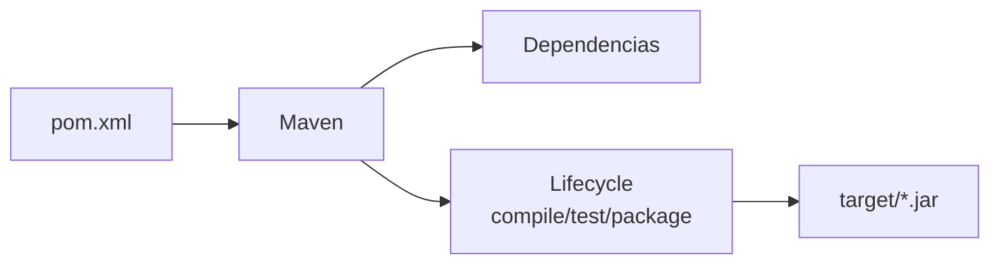
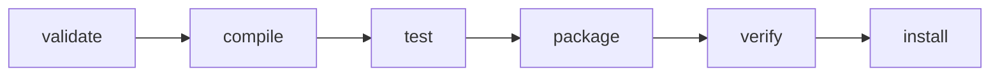
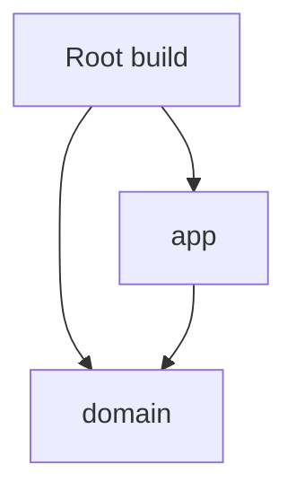

# Módulo 8: Build tools — Maven y Gradle

Compilar con `javac` enseña el ciclo básico, pero un proyecto real necesita dependencias, tests, empaquetado, versiones, plugins, CI y reproducibilidad. Maven y Gradle resuelven ese problema. No son solo “comandos”: son modelos de build. Entenderlos evita builds frágiles y dependencias incontroladas.

**Contexto Tienda Aurora.** Este módulo aporta bases para Tienda Aurora: los conceptos aquí se aplican en el monolito modular y luego en los microservicios.

**Entorno de referencia verificado (2026-05-22):** JDK 27.0.1.0.2, Maven 3.10.0, Gradle 9.8.2.

## Aprende construyendo

### Tema 1: pom.xml vs build.gradle.kts · Básico · 40 min

**Caso guía.** empaquetar una app Java simple con estructura estándar y salida reproducible.

Maven y el POM

**Definición.** Maven es una herramienta de build basada en convención sobre configuración. El `pom.xml` declara coordenadas, dependencias, plugins y propiedades.

**Cómo funciona por dentro.** Maven resuelve dependencias desde repositorios, construye un modelo efectivo (POM + herencia + perfiles) y ejecuta fases del lifecycle. Las coordenadas `groupId:artifactId:version` identifican el artefacto.



**Cuándo usar / cuándo no.** Úsalo cuando valoras convención, ecosistema y builds declarativos. No metas lógica compleja en XML si la convención ya no alcanza.

**Ejemplo mínimo enfocado (ejecutable).**

```bash
mkdir -p java-m8-maven/src/main/java/com/academia
cd java-m8-maven
```

Crea el archivo `pom.xml`:

```xml
<project xmlns="http://maven.apache.org/POM/4.0.0"
         xmlns:xsi="http://www.w3.org/2001/XMLSchema-instance"
         xsi:schemaLocation="http://maven.apache.org/POM/4.0.0 http://maven.apache.org/xsd/maven-4.0.0.xsd">
  <modelVersion>4.0.0</modelVersion>
  <groupId>com.academia</groupId>
  <artifactId>demo</artifactId>
  <version>1.0.0</version>
  <properties>
    <maven.compiler.release>21</maven.compiler.release>
  </properties>
</project>
```

Crea el archivo `src/main/java/com/academia/App.java`:

```java
package com.academia;

public class App {
  public static void main(String[] args) {
    System.out.println("Maven OK");
  }
}
```

```bash
mvn -q -DskipTests package
java -cp target/demo-1.0.0.jar com.academia.App
```

**Error común.** No fijar versión de Java/compiler. Síntoma: build diferente entre máquinas. Corrección: `maven.compiler.release` y JDK compatible.

**Verificación (Maven 3.10.0, JDK 27, 2026-05-22).** `Maven OK`.

Gradle y `build.gradle.kts`

**Definición.** Gradle es una herramienta de build basada en tareas y un DAG de ejecución, con DSL Groovy/Kotlin.

**Cómo funciona por dentro.** Gradle evalúa scripts, construye un grafo de tareas y ejecuta solo lo necesario usando incrementalidad/caché. El wrapper fija la versión del build.

**Ejemplo mínimo enfocado (ejecutable).**

```bash
mkdir -p java-m8-gradle/src/main/java/com/academia
cd java-m8-gradle
```

Crea el archivo `build.gradle.kts`:

```kotlin
plugins {
    application
    java
}
repositories { mavenCentral() }
application { mainClass.set("com.academia.App") }
```

> Nota: en proyectos reales fija toolchain (`java { toolchain { languageVersion.set(JavaLanguageVersion.of(21)) } }`). En este mínimo usamos el JDK actual para evitar depender de un JDK 21 instalado localmente.

Crea el archivo `settings.gradle.kts`:

```kotlin
rootProject.name = "demo-gradle"
```

Crea el archivo `src/main/java/com/academia/App.java`:

```java
package com.academia;

public class App {
  public static void main(String[] args) {
    System.out.println("Gradle OK");
  }
}
```

```bash
gradle -q run
```

**Error común.** Lógica excesiva en build script. Corrección: mantener scripts declarativos; extraer plugins/buildSrc cuando crezca.

**Verificación (Gradle 9.8.2, JDK 27, 2026-05-22).** `Gradle OK`.

### Tema 2: Ciclo de vida de build y scopes · Intermedio · 40 min

**Caso guía.** necesitas compilar, testear y empaquetar; las dependencias de test no deben ir a runtime.

Lifecycle Maven y scopes

**Definición.** Maven tiene lifecycles (default, clean, site). En default: `validate`, `compile`, `test`, `package`, `verify`, `install`, `deploy`. Los scopes (`compile`, `provided`, `runtime`, `test`, `system` obsoleto) controlan el classpath.



**Ejemplo mínimo enfocado (ejecutable).**

```bash
mvn -q -DskipTests package
```

**Error común.** Usar `compile` para dependencias solo de test. Corrección: `test` scope. Usar `provided` para APIs provistas por el contenedor.

**Verificación.** `mvn -q test` compila y ejecuta tests; `package` genera artefacto.

Gradle tasks y configurations

**Definición.** Gradle modela trabajo como tareas con dependencias. Las configurations (`implementation`, `testImplementation`, `runtimeOnly`, etc.) definen dependencias y classpaths.

**Ejemplo mínimo enfocado (ejecutable).**

```bash
gradle -q tasks --all | head
```

**Error común.** Confundir `implementation` con `api`. Corrección: `api` expone transitivamente a consumidores; `implementation` encapsula.

**Verificación (Gradle 9.8.2, 2026-05-22).** Lista tareas disponibles.

### Tema 3: Proyectos multi-módulo · Intermedio · 40 min

**Caso guía.** separar `domain` y `app` evita acoplamiento y permite builds por módulo.

Multi-módulo Maven/Gradle

**Definición.** Un build multi-módulo agrupa varios subproyectos con un build raíz. Maven usa `<modules>` y POM padre; Gradle usa `settings.gradle.kts` e `include`.

**Cómo funciona por dentro.** El reactor (Maven) o el grafo (Gradle) determina orden por dependencias inter-módulo. Permite reutilizar código y acotar compilación/tests.



**Ejemplo mínimo enfocado (ejecutable Maven).**

```bash
mkdir -p java-m8-mm/domain/src/main/java/com/academia/domain
mkdir -p java-m8-mm/app/src/main/java/com/academia/app
cd java-m8-mm
```

Crea el archivo `pom.xml`:

```xml
<project xmlns="http://maven.apache.org/POM/4.0.0" xmlns:xsi="http://www.w3.org/2001/XMLSchema-instance"
 xsi:schemaLocation="http://maven.apache.org/POM/4.0.0 http://maven.apache.org/xsd/maven-4.0.0.xsd">
  <modelVersion>4.0.0</modelVersion>
  <groupId>com.academia</groupId><artifactId>root</artifactId><version>1.0.0</version><packaging>pom</packaging>
  <modules><module>domain</module><module>app</module></modules>
</project>
```

Crea el archivo `domain/pom.xml`:

```xml
<project xmlns="http://maven.apache.org/POM/4.0.0" xmlns:xsi="http://www.w3.org/2001/XMLSchema-instance"
 xsi:schemaLocation="http://maven.apache.org/POM/4.0.0 http://maven.apache.org/xsd/maven-4.0.0.xsd">
  <modelVersion>4.0.0</modelVersion>
  <parent><groupId>com.academia</groupId><artifactId>root</artifactId><version>1.0.0</version></parent>
  <artifactId>domain</artifactId>
  <properties><maven.compiler.release>21</maven.compiler.release></properties>
</project>
```

Crea el archivo `domain/src/main/java/com/academia/domain/Saludo.java`:

```java
package com.academia.domain;
public class Saludo { public static String msg(){ return "DOM"; } }
```

Crea el archivo `app/pom.xml`:

```xml
<project xmlns="http://maven.apache.org/POM/4.0.0" xmlns:xsi="http://www.w3.org/2001/XMLSchema-instance"
 xsi:schemaLocation="http://maven.apache.org/POM/4.0.0 http://maven.apache.org/xsd/maven-4.0.0.xsd">
  <modelVersion>4.0.0</modelVersion>
  <parent><groupId>com.academia</groupId><artifactId>root</artifactId><version>1.0.0</version></parent>
  <artifactId>app</artifactId>
  <properties><maven.compiler.release>21</maven.compiler.release></properties>
  <dependencies><dependency><groupId>com.academia</groupId><artifactId>domain</artifactId><version>1.0.0</version></dependency></dependencies>
</project>
```

Crea el archivo `app/src/main/java/com/academia/app/Main.java`:

```java
package com.academia.app;
import com.academia.domain.Saludo;
public class Main { public static void main(String[] args){ System.out.println(Saludo.msg()); } }
```

```bash
mvn -q -DskipTests package
java -cp domain/target/domain-1.0.0.jar:app/target/app-1.0.0.jar com.academia.app.Main
```

**Error común.** Dependencias cíclicas entre módulos. Síntoma: build falla o diseño rígido. Corrección: extraer contrato común/módulo core.

**Verificación (Maven 3.10.0, JDK 27, 2026-05-22).** `DOM`.

### Tema 4: Maven y Gradle lado a lado — el mismo proyecto en dos herramientas · Avanzado · 40 min

**Caso guía.** comparar la misma app empaquetada con Maven y con Gradle.

Equivalencia conceptual

**Definición.** Ambos resuelven dependencias, compilan, prueban y empaquetan. Maven se orienta a lifecycle/fases; Gradle a tareas/DAG.

**Cuándo elegir.** Maven: convención y previsibilidad. Gradle: flexibilidad, incrementalidad, DSL potente. En equipos, la consistencia y mantenibilidad pesan más que la moda.

**Ejemplo mínimo enfocado.** Usa los proyectos de Tema 1: ambos imprimen `Maven OK` / `Gradle OK`.

**Error común.** Migrar build por moda sin medir costo. Corrección: evaluar ecosistema, CI, caché, conocimiento del equipo.

**Verificación (2026-05-22).** Ambos builds ejecutados en el entorno: Maven 3.10.0, Gradle 9.8.2.

## Cierre

Un build es parte del producto. La reproducibilidad, el control de dependencias y el ciclo de vida claro son requisitos técnicos, no burocracia.

## Checklist

- Puedo explicar coordenadas Maven y configurations Gradle.
- Distingo fases/tareas y scopes/configurations.
- Sé armar un multi-módulo simple sin ciclos.
- Uso wrappers/versiones para reproducibilidad.
