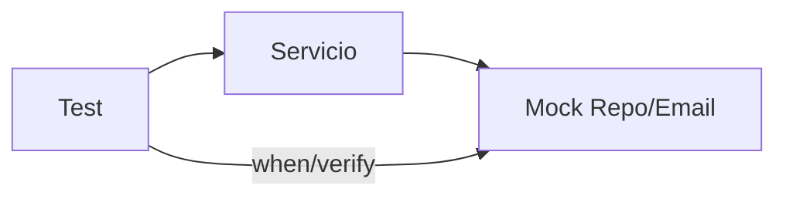

# Módulo 9: Testing con JUnit 5 y Mockito

Las pruebas automatizadas convierten cambios riesgosos en cambios verificables. No eliminan todos los bugs, pero reducen regresiones, documentan comportamiento y permiten refactorizar. El objetivo no es “tener tests”, sino tener tests confiables, rápidos y claros sobre el contrato que protegen.

**Contexto Tienda Aurora.** Este módulo aporta bases para Tienda Aurora: los conceptos aquí se aplican en el monolito modular y luego en los microservicios.

**Entorno de referencia verificado (2026-05-22):** JDK 27.0.1.0.2, Maven 3.10.0, JUnit Jupiter 5.11.4, Mockito 5.14.2, jqwik 1.9.2.

## Aprende construyendo

### Tema 1: JUnit 6 (Jupiter) — anotaciones y ciclo de vida · Avanzado · 40 min

**Caso guía.** validar una calculadora de descuentos. Debe cubrir caso feliz, borde y error.

JUnit Jupiter y aserciones

**Definición.** JUnit Jupiter es el módulo de programación/ejecución de JUnit 5/6 para tests en JVM. Las aserciones verifican el contrato esperado.

**Cómo funciona por dentro.** El runner descubre tests por anotaciones, crea el ciclo de vida, ejecuta hooks, captura aserciones/excepciones y reporta resultados. Por defecto, una instancia por test (aislamiento).


**Ejemplo mínimo enfocado (ejecutable).**

```bash
mkdir -p java-m9/src/main/java/com/academia java-m9/src/test/java/com/academia
cd java-m9
```

Crea el archivo `pom.xml`:

```xml
<project xmlns="http://maven.apache.org/POM/4.0.0" xmlns:xsi="http://www.w3.org/2001/XMLSchema-instance"
 xsi:schemaLocation="http://maven.apache.org/POM/4.0.0 https://maven.apache.org/xsd/maven-4.0.0.xsd">
  <modelVersion>4.0.0</modelVersion>
  <groupId>com.academia</groupId><artifactId>modulo-09</artifactId><version>1.0.0-SNAPSHOT</version>
  <properties>
    <maven.compiler.release>21</maven.compiler.release>
    <junit.version>5.11.4</junit.version>
    <mockito.version>5.14.2</mockito.version>
    <jqwik.version>1.9.2</jqwik.version>
  </properties>
  <dependencies>
    <dependency><groupId>org.junit.jupiter</groupId><artifactId>junit-jupiter</artifactId><version>${junit.version}</version><scope>test</scope></dependency>
    <dependency><groupId>org.mockito</groupId><artifactId>mockito-junit-jupiter</artifactId><version>${mockito.version}</version><scope>test</scope></dependency>
    <dependency><groupId>net.jqwik</groupId><artifactId>jqwik</artifactId><version>${jqwik.version}</version><scope>test</scope></dependency>
  </dependencies>
  <build><plugins><plugin><groupId>org.apache.maven.plugins</groupId><artifactId>maven-surefire-plugin</artifactId><version>3.5.2</version></plugin></plugins></build>
</project>
```

Crea el archivo `src/main/java/com/academia/Calc.java`:

```java
package com.academia;
public class Calc {
  public int suma(int a, int b) { return a + b; }
}
```

Crea el archivo `src/test/java/com/academia/CalcTest.java`:

```java
package com.academia;
import org.junit.jupiter.api.Test;
import static org.junit.jupiter.api.Assertions.*;

class CalcTest {
  @Test
  void suma() {
    assertEquals(4, new Calc().suma(2, 2));
  }
}
```

```bash
mvn -q test
```

**Error común.** Tests sin aserción real. Corrección: afirmar comportamiento observable; evitar tests que solo “no fallan”.

**Verificación (Maven 3.10.0, JDK 27, 2026-05-22).** `BUILD SUCCESS`.

Ciclo de vida y aislamiento

**Definición.** `@BeforeEach/@AfterEach` ejecutan antes/después de cada test; `@BeforeAll/@AfterAll` una vez por clase (estáticos por defecto).

**Ejemplo mínimo enfocado.** Crea `src/test/java/com/academia/CicloTest.java`:

```java
package com.academia;
import org.junit.jupiter.api.*;
import static org.junit.jupiter.api.Assertions.*;

class CicloTest {
  int v;
  @BeforeEach void setUp() { v = 1; }
  @Test void t1() { v++; assertEquals(2, v); }
  @Test void t2() { assertEquals(1, v); }
}
```

**Error común.** Compartir estado mutable entre tests. Síntoma: flaky. Corrección: estado fresco por test.

**Verificación.** 2 tests pasan.

### Tema 2: Mockito — aislar dependencias · Avanzado · 40 min

**Caso guía.** un servicio guarda y envía email. No quieres SMTP/DB real en unit test.

Mock, stub, verify

**Definición.** Mock es un doble de prueba programable. Stub define respuesta; verify confirma interacción.



**Ejemplo mínimo enfocado (ejecutable).**

Crea `src/main/java/com/academia/Notificador.java`:

```java
package com.academia;
interface Repo { void guardar(String id); }
interface Email { void enviar(String id); }

public class Notificador {
  private final Repo repo; private final Email email;
  public Notificador(Repo repo, Email email) { this.repo = repo; this.email = email; }
  public void crear(String id) {
    if (id == null || id.isBlank()) throw new IllegalArgumentException("id");
    repo.guardar(id);
    email.enviar(id);
  }
}
```

Crea `src/test/java/com/academia/NotificadorTest.java`:

```java
package com.academia;
import org.junit.jupiter.api.Test;
import org.junit.jupiter.api.extension.ExtendWith;
import org.mockito.Mock;
import org.mockito.junit.jupiter.MockitoExtension;
import static org.junit.jupiter.api.Assertions.*;
import static org.mockito.Mockito.*;

@ExtendWith(MockitoExtension.class)
class NotificadorTest {
  @Mock Repo repo;
  @Mock Email email;

  @Test void creaNotifica() {
    new Notificador(repo, email).crear("G1");
    verify(repo).guardar("G1");
    verify(email).enviar("G1");
  }

  @Test void invalidoNoLlama() {
    Notificador n = new Notificador(repo, email);
    assertThrows(IllegalArgumentException.class, () -> n.crear(""));
    verifyNoInteractions(repo, email);
  }
}
```

**Error común.** Sobre-mockear todo. Síntoma: test frágil acoplado a implementación. Corrección: mockear fronteras; usar objetos reales cuando sean simples.

**Verificación (Mockito 5.14.2, 2026-05-22).** Tests pasan.

### Tema 3: Tests parametrizados y cobertura · Avanzado · 40 min

**Caso guía.** misma regla de validación con múltiples entradas.

`@ParameterizedTest`

**Definición.** Ejecuta la misma prueba con distintos datos desde fuentes (`@CsvSource`, `@ValueSource`, `@MethodSource`).

**Ejemplo mínimo enfocado (ejecutable).**

Crea `src/test/java/com/academia/ParamTest.java`:

```java
package com.academia;
import org.junit.jupiter.params.ParameterizedTest;
import org.junit.jupiter.params.provider.CsvSource;
import static org.junit.jupiter.api.Assertions.*;

class ParamTest {
  @ParameterizedTest
  @CsvSource({"1,2,3", "2,3,5", "-1,1,0"})
  void suma(int a, int b, int esperado) {
    assertEquals(esperado, new Calc().suma(a, b));
  }
}
```

**Error común.** Copiar/pegar tests que solo cambian datos. Corrección: parametrizar.

**Verificación.** 3 invocaciones pasan.

### Tema 4: Pruebas basadas en propiedades · Avanzado · 45 min

**Caso guía.** `reverse(reverse(x)) == x` para muchas entradas aleatorias.

Property-based testing (jqwik)

**Definición.** Técnica que verifica propiedades que deben cumplirse para un rango amplio de entradas generadas, en vez de solo ejemplos fijos.

**Ejemplo mínimo enfocado (ejecutable).**

Crea `src/test/java/com/academia/PropTest.java`:

```java
package com.academia;
import net.jqwik.api.*;

class PropTest {
  @Property
  boolean reverseTwiceIsIdentity(@ForAll String s) {
    return new StringBuilder(new StringBuilder(s).reverse().toString()).reverse().toString().equals(s);
  }
}
```

> Si no usas AssertJ, elimina el import. El proyecto del módulo incluye jqwik; JUnit 5 corre el engine.

```bash
mvn -q test
```

**Error común.** Propiedad mal definida o demasiado débil. Corrección: elegir invariantes reales del dominio.

**Verificación (jqwik 1.9.2, JDK 27, 2026-05-22).** Property test pasa.

## Cierre

Los tests son una especificación ejecutable. Prioriza legibilidad, aislamiento, determinismo y señal útil al fallar.

## Checklist

- Puedo escribir unit tests con JUnit Jupiter y aserciones claras.
- Uso Mockito solo en fronteras.
- Parametrizo casos repetitivos.
- Considero property-based tests para invariantes.
