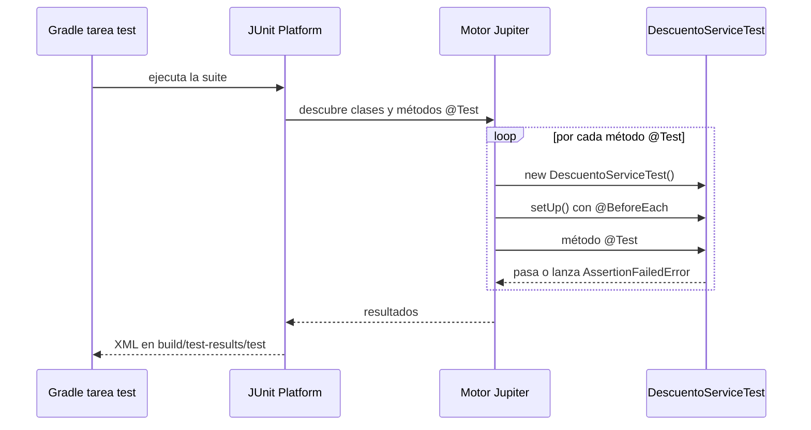
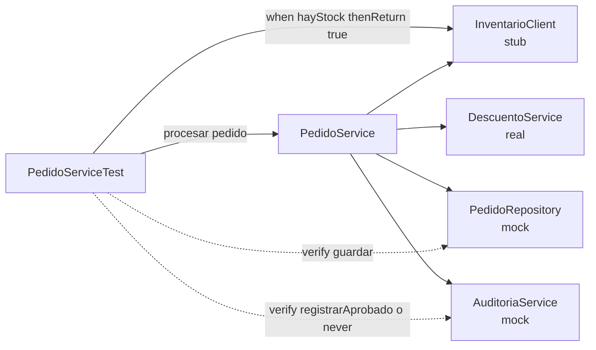
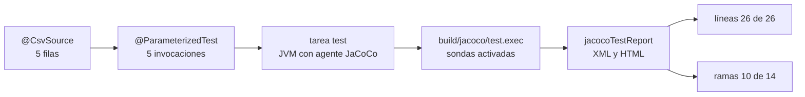
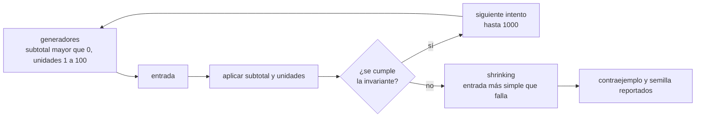

# Módulo 9: Pruebas con JUnit 5 (Jupiter), Mockito y calidad

**Entorno original (2026-11-23):** macOS arm64, JDK 27.0.1.0.2 (Temurin), Gradle 9.9.1, toolchain Java 25, JUnit Jupiter 5.13.4, Mockito 5.17.0, jqwik 1.9.2 y JaCoCo incluido en Gradle, en `~/labs/aurora-m9`. Todas las salidas de JUnit, Mockito, jqwik y JaCoCo de este módulo son de esa ejecución.

**Entorno de las salidas nuevas (2026-11-24):** Linux x86_64, OpenJDK 25.0.5, en `/home/estudiante/labs/m9-demos` (tu `~/labs/m9-demos`). Ese equipo no tenía acceso a Maven Central, así que no pudo descargar JUnit, Mockito, jqwik ni JaCoCo. Por eso los ejemplos nuevos son **modelos en Java puro** que se ejecutan con `java Archivo.java`: imitan el mecanismo de cada herramienta para que lo veas por dentro. Cada uno lo dice en su primera línea, y ninguno se presenta como salida de JUnit.

Una prueba unitaria es una ejecución pequeña y aislada que compara el comportamiento observable de una unidad con un resultado esperado. Su mecanismo es una aserción: si la condición no se cumple, el test falla. Existe porque el cambio de código tiene un costo que crece con la incertidumbre; una suite rápida convierte esa incertidumbre en feedback inmediato sobre el diseño. Si un servicio necesita cinco dobles complicados, el problema suele ser el acoplamiento, no la falta de mocks.

La implicación es que las pruebas son código de proyecto: hay que elegir qué se aísla, qué se ejecuta realmente y qué se mide. La confusión habitual es confundir “se ejecutó código” con “se verificó comportamiento”, o confundir cobertura de líneas con cobertura de decisiones. En este módulo se construye `tienda-aurora-testing` en `~/labs/aurora-m9` y se usa JUnit Jupiter 5.13.4 (el BOM declarado en el build), Mockito 5.17.0, jqwik 1.9.2 y JaCoCo.

Al terminar este módulo podrás:
- escribir pruebas con `@Test`, `@BeforeEach` y aserciones de JUnit Jupiter, y leer sus resultados;
- aislar un servicio de sus dependencias con mocks y stubs de Mockito, y verificar sus interacciones;
- convertir una tabla de casos en un `@ParameterizedTest` y medir cobertura de líneas y de ramas con JaCoCo;
- expresar una regla como propiedad, acotar sus generadores y leer un contraejemplo.

**Esquema del módulo:** Tema 1, JUnit Jupiter y su ciclo de vida; Tema 2, Mockito; Tema 3, tests parametrizados y cobertura; Tema 4, pruebas basadas en propiedades.

**Qué necesitas saber antes:** de Fundamentos, **prueba unitaria**, **prueba de integración**, **preparación de cada prueba** (la *fixture*), **doble de prueba** y **cobertura** (Módulo 4, Tema 2) e **integración continua** (Módulo 4, Tema 4). Del curso Java: records e interfaces (Módulo 1), excepciones (Módulo 3) y **configuración de dependencias**, **BOM** y **tarea** (Módulo 8, Tema 2). Este módulo no repite esas fichas: las enlaza y explica lo propio de Java.

## Visual del módulo

**Visual:** [JUnit, Mockito, tests parametrizados y propiedades](/visuals/temas/java/modulo-9-testing.html)

Lectura: Reglas unitarias, dobles para dependencias, tablas de casos y propiedades para invariantes.

## Proyecto verificado

Directorio: `~/labs/aurora-m9`. El build declara JUnit con `org.junit:junit-bom:5.13.4`; no hay JUnit 6 en este proyecto.

```text
~/labs/aurora-m9/
├── build.gradle.kts
├── settings.gradle.kts
├── src/main/java/com/aurora/testing/
│   ├── dominio/      Pedido.java, ResultadoPedido.java
│   └── servicio/     DescuentoService.java, PedidoService.java, puertos
└── src/test/
    ├── java/com/aurora/testing/servicio/   3 clases de test
    └── resources/mockito-extensions/       org.mockito.plugins.MockMaker
```

Prerrequisitos y bootstrap:

```bash
java -version
gradle --version
mkdir -p tienda-aurora-testing/src/main/java/com/aurora/testing/{dominio,servicio}
mkdir -p tienda-aurora-testing/src/test/java/com/aurora/testing/servicio
mkdir -p tienda-aurora-testing/src/test/resources/mockito-extensions
cd tienda-aurora-testing
gradle wrapper --gradle-version 9.9.1
```

Cada archivo del proyecto aparece completo en el tema donde se explica: el build y `DescuentoService` en el Tema 1, el dominio,
los puertos y `PedidoService` en el Tema 2, y cada clase de prueba en el tema de su herramienta.

## Aprende construyendo

### Tema 1: JUnit Jupiter 5.13.4 — anotaciones y ciclo de vida · Básico · 60 min

<details open>
<summary><strong>Capa 1 — Lectura</strong></summary>

#### Objetivos
Al terminar este tema podrás:
- configurar JUnit Jupiter en un build de Gradle con un BOM y `useJUnitPlatform()`;
- escribir pruebas con `@Test`, `assertEquals` y `assertThrows`, y preparar el objeto bajo prueba con `@BeforeEach`;
- explicar por qué JUnit crea una instancia nueva de la clase de prueba para cada método;
- leer el resultado de una suite en los XML de `build/test-results/test/`.

**Conceptos clave:** JUnit 5, JUnit Platform, `@Test`, aserción, `assertThrows`, `@BeforeEach`, ciclo de vida de la prueba

#### El problema
Tienda Aurora aplica un 10 % de descuento desde 5 unidades. La regla vive en `DescuentoService` y la usan los pedidos, la
caja y los reportes. En Fundamentos escribiste tus primeras pruebas JUnit para métodos sueltos; ahora la regla vive en un servicio de un proyecto real. ¿Cómo organizas y ejecutas esas pruebas con las herramientas del ecosistema Java, y cómo sabes que una prueba no contamina a la siguiente?

Este tema usa **prueba unitaria**, **caso límite** y **fixture** (Fundamentos, Módulo 1, Tema 1 y Módulo 4, Tema 2), y
`testImplementation`, `testRuntimeOnly` y **BOM** (Módulo 8, Tema 2).

#### Glosario del tema

**JUnit 5**
- **Definición técnica:** framework de pruebas para Java formado por JUnit Platform (motor de ejecución), JUnit Jupiter (API de anotaciones y aserciones) y JUnit Vintage (compatibilidad con JUnit 4).
- **En palabras sencillas:** el revisor automático de Java: tú escribes métodos de prueba y la herramienta los encuentra, los ejecuta y te reporta.
- **Dónde se rompe la comparación:** JUnit no descubre las pruebas por el nombre del método sino por anotación; un método sin `@Test` no se ejecuta.
- **Ejemplo:** el build declara `org.junit:junit-bom:5.13.4` y la suite de `aurora-m9` registró 11 pruebas con 0 fallas.
- **Error típico:** suponer la versión por el nombre comercial; la versión real está en el build, aquí `junit-bom:5.13.4`.

**JUnit Platform**
- **Definición técnica:** capa de JUnit 5 que lanza motores de prueba (Jupiter, jqwik y otros) y reporta sus resultados a Gradle, Maven o el IDE; el `junit-platform-launcher` es su punto de entrada.
- **En palabras sencillas:** el estadio donde juegan varios equipos; cada motor trae sus reglas, el estadio cuenta los resultados.
- **Dónde se rompe la comparación:** el estadio no abre solo: en Gradle hay que pedirlo con `useJUnitPlatform()`.
- **Ejemplo:** en `aurora-m9`, Jupiter ejecutó `DescuentoServiceTest` y jqwik ejecutó `DescuentoPropertyTest` en la misma corrida de `test`.
- **Error típico:** olvidar `useJUnitPlatform()`: Gradle no encuentra las pruebas de Jupiter y la tarea no ejecuta ninguna.

**`@Test`**
- **Definición técnica:** anotación de `org.junit.jupiter.api` que marca un método sin parámetros como prueba; JUnit lo descubre por reflexión y lo ejecuta.
- **En palabras sencillas:** una etiqueta que dice «este método es una prueba, ejecútalo».
- **Dónde se rompe la comparación:** la etiqueta solo sirve en métodos que no sean `private` ni `static` y que devuelvan `void`.
- **Ejemplo:** `@Test void sinDescuentoParaPocasUnidades()` llama `service.aplicar(new BigDecimal("100.00"), 2)` y pasa.
- **Error típico:** importar `org.junit.Test` (JUnit 4) en vez de `org.junit.jupiter.api.Test`: el motor de Jupiter no lo ve.

**aserción**
- **Definición técnica:** llamada que compara un resultado con lo esperado y lanza `AssertionFailedError` si no coincide; en Jupiter vienen como métodos estáticos de `org.junit.jupiter.api.Assertions`.
- **En palabras sencillas:** el `assert` de Fundamentos, con mensajes que muestran el valor esperado y el obtenido.
- **Dónde se rompe la comparación:** `assertEquals` usa `equals`; con `BigDecimal`, `90` y `90.00` no son iguales.
- **Ejemplo:** `assertEquals(new BigDecimal("90.00"), total)` en `aplicaDiezPorCientoDesdeCincoUnidades`.
- **Error típico:** invertir los argumentos: el primero es el esperado. Al revés, el mensaje de falla miente sobre qué se esperaba.

**`assertThrows`**
- **Definición técnica:** aserción que ejecuta una lambda, exige que lance una excepción del tipo indicado y la devuelve para revisarla.
- **En palabras sencillas:** «compruébame que esto falla, y de la forma correcta».
- **Dónde se rompe la comparación:** acepta subclases: si pides `RuntimeException` y sale `IllegalArgumentException`, pasa igual.
- **Ejemplo:** `assertThrows(IllegalArgumentException.class, () -> service.aplicar(new BigDecimal("-1"), 1))` y luego `assertEquals("subtotal inválido", error.getMessage())`.
- **Error típico:** escribir `try`/`catch` a mano sin `fail()`: si no hay excepción, la prueba pasa en silencio.

**`@BeforeEach`**
- **Definición técnica:** anotación de un método que JUnit ejecuta antes de cada `@Test` de la clase; `@AfterEach` es su pareja de limpieza.
- **En palabras sencillas:** la preparación de cada prueba que viste en Fundamentos: alguien arma la mesa antes de cada prueba.
- **Dónde se rompe la comparación:** no lo pide cada prueba: corre para todas las pruebas de la clase, las use o no.
- **Ejemplo:** `@BeforeEach void setUp() { service = new DescuentoService(); }`.
- **Error típico:** meter en `@BeforeEach` preparación que solo usa una prueba: las demás pagan el costo y nadie entiende qué necesita cada una.

**ciclo de vida de la prueba**
- **Definición técnica:** orden en que JUnit crea la instancia de la clase de prueba y llama a `@BeforeAll`, `@BeforeEach`, el `@Test`, `@AfterEach` y `@AfterAll`; por defecto crea una instancia nueva por cada método.
- **En palabras sencillas:** cada prueba recibe un escritorio limpio; nada de lo que dejó la anterior sigue ahí.
- **Dónde se rompe la comparación:** los campos `static` y lo preparado en `@BeforeAll` sí se comparten entre pruebas.
- **Ejemplo:** el modelo `MiniRunner` del Problema resuelto 1.2 imprime `instancia #1`, `#2` y `#3`, una por prueba.
- **Error típico:** guardar estado en un campo `static` «para no repetir»: las pruebas pasan o fallan según el orden.

#### ► CÓMO FUNCIONA

##### 1. La idea en lenguaje sencillo

Antes de despachar, una bodega revisa cada paquete con una lista: peso correcto, dirección completa, guía impresa. La revisión es rápida, siempre igual y la hace alguien que no armó el paquete. Si algo falla, el paquete no sale y el reporte dice qué punto de la lista no se cumplió.

Una prueba automática es esa lista para tu código. Llamas a `DescuentoService` con datos conocidos y comparas lo que devuelve con lo que debería devolver. Si 5 unidades de `100.00` no dan `90.00`, la regla se rompió y lo sabes antes de que llegue a producción.

JUnit es quien encuentra esas pruebas, las ejecuta una por una y te entrega el reporte. Además, garantiza que cada prueba empiece desde cero: lo que hizo una no contamina a la siguiente.

##### 2. Definición formal y vocabulario

**JUnit 5** no es una sola librería, sino tres piezas. **JUnit Platform** define cómo se descubren y ejecutan pruebas en la JVM y cómo se reportan a Gradle, Maven o el IDE. **JUnit Jupiter** es el modelo de programación: las anotaciones y aserciones que escribes. JUnit Vintage ejecuta pruebas antiguas de JUnit 4.

En Jupiter, **`@Test`** marca un método como prueba. Una **aserción** compara un valor obtenido con uno esperado y, si no coinciden, lanza `org.opentest4j.AssertionFailedError`. **`assertThrows`** es la aserción que exige una excepción.

**`@BeforeEach`** marca el método que prepara cada prueba: la fixture que conociste en Fundamentos. El **ciclo de vida de la prueba** es el orden exacto en que JUnit crea la instancia, llama a esos métodos y registra el resultado.

##### 3. Cómo funciona por dentro, paso a paso

Cuando ejecutas `./gradlew test`, ocurre esto:

1. Gradle compila `src/test/java` con el `testCompileClasspath` y arranca una JVM aparte para las pruebas.
2. `useJUnitPlatform()` le indica que use el **launcher** de JUnit Platform, que llegó por `testRuntimeOnly`.
3. El launcher busca **motores de prueba** en el classpath. Cada motor se registra con el mecanismo `ServiceLoader` de Java. En `aurora-m9` encuentra Jupiter y jqwik.
4. En la fase de **descubrimiento**, cada motor recorre las clases y, por reflexión, se queda con los métodos que lleva su anotación.
5. En la fase de **ejecución**, Jupiter aplica el ciclo de vida a cada método, como muestra el diagrama.
6. Cada resultado vuelve al launcher, y Gradle lo escribe en los XML de `build/test-results/test/`.



Observa el bucle: la instancia se crea **dentro** de él. Por eso el campo `service` de la prueba siempre empieza recién asignado:

```java
private DescuentoService service;

@BeforeEach
void setUp() {
    service = new DescuentoService();
}
```

Si una prueba cambiara `service`, ese cambio moriría con su instancia. El modelo `MiniRunner` del Problema resuelto 1.2 lo hace visible: imprime `instancia #1`, `#2` y `#3`, una por prueba.

Dentro de la prueba, la aserción es una llamada normal que puede lanzar una excepción:

```java
assertEquals(new BigDecimal("90.00"), total);
```

Si `total` vale otra cosa, `assertEquals` lanza `AssertionFailedError` con el esperado y el obtenido. Jupiter la atrapa, marca la prueba como fallida y sigue con la siguiente. Cualquier otra excepción inesperada también hace fallar la prueba, con su propio mensaje y su traza.

##### 4. Reglas, variantes y casos límite

Un método `@Test` no puede ser `private` ni `static` y debe devolver `void`. La clase de prueba no necesita ser `public`: Jupiter acepta clases y métodos con visibilidad de paquete.

`@BeforeAll` y `@AfterAll` corren una vez por clase. Por defecto deben ser `static`, porque todavía no existe ninguna instancia. Con `@TestInstance(Lifecycle.PER_CLASS)` cambias el ciclo a una sola instancia por clase y pueden dejar de ser `static`.

El orden entre métodos es determinista, pero la documentación de JUnit lo describe como «intencionalmente no obvio». Si una prueba necesita que otra corra antes, tienes un defecto de diseño. `@TestMethodOrder` existe para casos especiales, no para tapar dependencias.

En `assertEquals(esperado, obtenido)` el orden importa: el primer argumento es el esperado. Con `BigDecimal`, la comparación usa `equals`, que también compara la escala; lo muestra el modelo `Escala.java`.

`assertThrows` pasa también con subclases del tipo pedido. Si necesitas el tipo exacto, Jupiter ofrece `assertThrowsExactly` desde la versión 5.8.

Este módulo usa la línea 5.13 de Jupiter, que funciona desde Java 8; en ella Platform se numera aparte, por eso el launcher resolvió `1.13.4`. JUnit 6.0.0, publicado en septiembre de 2025, exige Java 17 y unifica el número de versión de todas sus piezas.

##### 5. Relación con lo que ya sabes y lo que viene

En Fundamentos, Módulo 4, Tema 2, escribiste pruebas unitarias y conociste la fixture. Aquí ves cómo las organiza el ecosistema Java. La configuración `testImplementation`, `testRuntimeOnly` y el BOM vienen del Módulo 8, Tema 2.

Las anotaciones funcionan gracias a la reflexión: Java puede leer en tiempo de ejecución qué anotaciones tiene un método si se declararon con retención `RUNTIME`. `MiniRunner` usa exactamente esa técnica con sus propias anotaciones `@Prueba` y `@Antes`.

No confundas la aserción de JUnit con la instrucción `assert` de Java. `assert` solo se evalúa si la JVM arranca con `-ea`; las aserciones de JUnit se evalúan siempre.

El Tema 2 añade una extensión, `MockitoExtension`, que se engancha a este mismo ciclo de vida. El Tema 3 reemplaza varias pruebas iguales por una tabla con `@ParameterizedTest`. El Tema 4 suma un segundo motor, jqwik, sobre la misma plataforma.

#### Problema resuelto 1.1
Prueba la regla de descuento con JUnit Jupiter: un caso sin descuento, uno con descuento y una entrada inválida.

**Razonamiento:**
1. La regla tiene un borde en 5 unidades: prueba 2 (sin descuento) y 5 (con descuento).
2. Una entrada inválida debe lanzar `IllegalArgumentException` con un mensaje claro: eso se comprueba con `assertThrows`.
3. `DescuentoService` no guarda estado, pero cada prueba recibe una instancia nueva desde `@BeforeEach`.
4. El build necesita el BOM, `junit-jupiter`, el launcher en runtime y `useJUnitPlatform()`.

**`settings.gradle.kts`**

```kotlin
rootProject.name = "tienda-aurora-testing"
```

**`build.gradle.kts`**

```kotlin
plugins {
    java
    jacoco
}

group = "com.aurora"
version = "1.0.0"

java {
    toolchain { languageVersion = JavaLanguageVersion.of(25) }
}

repositories { mavenCentral() }

dependencies {
    testImplementation(platform("org.junit:junit-bom:5.13.4"))
    testImplementation("org.junit.jupiter:junit-jupiter")
    testImplementation("org.mockito:mockito-core:5.17.0")
    testImplementation("org.mockito:mockito-junit-jupiter:5.17.0")
    testImplementation("net.jqwik:jqwik:1.9.2")
    testRuntimeOnly("org.junit.platform:junit-platform-launcher")
}

tasks.test {
    useJUnitPlatform()
    finalizedBy(tasks.jacocoTestReport)
}

tasks.jacocoTestReport {
    dependsOn(tasks.test)
    reports {
        xml.required.set(true)
        html.required.set(true)
    }
}

tasks.withType<JavaCompile>().configureEach {
    options.encoding = "UTF-8"
    options.compilerArgs.addAll(listOf("-Xlint:all", "-Werror"))
}
```

Las líneas 3, 26 y 29–35 (JaCoCo) se explican en el Tema 3; las de Mockito y jqwik, en los Temas 2 y 4.

**`src/main/java/com/aurora/testing/servicio/DescuentoService.java`**

```java
package com.aurora.testing.servicio;
import java.math.BigDecimal;
import java.math.RoundingMode;
public final class DescuentoService {
    public BigDecimal aplicar(BigDecimal subtotal, int unidades) {
        if (subtotal == null || subtotal.signum() < 0) throw new IllegalArgumentException("subtotal inválido");
        if (unidades <= 0) throw new IllegalArgumentException("unidades inválidas");
        BigDecimal porcentaje = unidades >= 5 ? new BigDecimal("0.10") : BigDecimal.ZERO;
        BigDecimal descuento = subtotal.multiply(porcentaje);
        return subtotal.subtract(descuento).setScale(2, RoundingMode.HALF_UP);
    }
}
```

Es una regla pura: no necesita mocks. Las líneas 6 y 7 contienen validaciones; más adelante se comprueba con JaCoCo que no todas sus ramas están cubiertas.

**`src/test/java/com/aurora/testing/servicio/DescuentoServiceTest.java`**

```java
package com.aurora.testing.servicio;

import org.junit.jupiter.api.BeforeEach;
import org.junit.jupiter.api.Test;
import org.junit.jupiter.params.ParameterizedTest;
import org.junit.jupiter.params.provider.CsvSource;

import java.math.BigDecimal;

import static org.junit.jupiter.api.Assertions.*;

class DescuentoServiceTest {

    private DescuentoService service;

    @BeforeEach
    void setUp() {
        service = new DescuentoService();
    }

    @Test
    void sinDescuentoParaPocasUnidades() {
        BigDecimal total = service.aplicar(new BigDecimal("100.00"), 2);
        assertEquals(new BigDecimal("100.00"), total);
    }

    @Test
    void aplicaDiezPorCientoDesdeCincoUnidades() {
        BigDecimal total = service.aplicar(new BigDecimal("100.00"), 5);
        assertEquals(new BigDecimal("90.00"), total);
    }

    @Test
    void rechazaSubtotalInvalido() {
        IllegalArgumentException error = assertThrows(IllegalArgumentException.class,
                () -> service.aplicar(new BigDecimal("-1"), 1));
        assertEquals("subtotal inválido", error.getMessage());
    }

    @ParameterizedTest
    @CsvSource({
            "100.00,1,100.00",
            "100.00,4,100.00",
            "100.00,5,90.00",
            "50.00,6,45.00",
            "19.99,5,17.99"
    })
    void calculaTotalesEsperados(String subtotal, int unidades, String esperado) {
        assertEquals(new BigDecimal(esperado), service.aplicar(new BigDecimal(subtotal), unidades));
    }
}
```

El método parametrizado de las líneas 40–50 se explica en el Tema 3. Ejecución en el equipo original:

```bash
cd ~/labs/aurora-m9
./gradlew -q test --rerun-tasks
```

La ejecución terminó con exit 0. Los XML de `build/test-results/test/` registran:

```text
<testsuite name="com.aurora.testing.servicio.DescuentoPropertyTest" tests="1" skipped="0" failures="0" errors="0" time="0.101">
<testsuite name="com.aurora.testing.servicio.DescuentoServiceTest" tests="8" skipped="0" failures="0" errors="0" time="0.047">
<testsuite name="com.aurora.testing.servicio.PedidoServiceTest" tests="2" skipped="0" failures="0" errors="0" time="0.276">
```

Son 11 tests JUnit, 0 fallas.

**Explicación por partes.**
- `build.gradle.kts`, líneas 16–17: el BOM fija la versión y `junit-jupiter` llega sin número, como en el Módulo 8.
- Línea 21: el launcher va en `testRuntimeOnly` porque solo hace falta para ejecutar, nunca para compilar las pruebas.
- Línea 25: `useJUnitPlatform()` le dice a la tarea `test` de Gradle que use JUnit Platform.
- `DescuentoServiceTest`, línea 10: el `import static` trae `assertEquals`, `assertThrows` y las demás aserciones sin prefijo.
- Líneas 16–19: `setUp` corre antes de cada prueba y deja un `DescuentoService` nuevo en el campo `service`.
- Líneas 35–36: `assertThrows` ejecuta la lambda, exige la excepción y la devuelve; la línea 37 revisa su mensaje.
- `-q` oculta el progreso; el resultado se lee en los XML. `tests="8"` en `DescuentoServiceTest` son 3 `@Test` más 5 filas parametrizadas.

#### Problema resuelto 1.2
JUnit no se pudo descargar en el equipo de las salidas nuevas. Para ver el mecanismo del ciclo de vida por dentro, escribe
un modelo pequeño en Java puro que descubra métodos anotados y ejecute cada uno en una instancia nueva.

**Razonamiento:**
1. JUnit usa reflexión: lee los métodos de la clase y se queda con los que llevan la anotación de prueba.
2. Por cada prueba crea una instancia, llama al método «antes» y después a la prueba; si sale una `AssertionError`, la cuenta como falla.
3. Si cada prueba recibe su propia instancia, una prueba que agrega un item no afecta a la siguiente.

`~/labs/m9-demos/MiniRunner.java`:

```java
// MiniRunner.java — modelo reducido de lo que hace JUnit Jupiter (no es JUnit)
import java.lang.annotation.ElementType;
import java.lang.annotation.Retention;
import java.lang.annotation.RetentionPolicy;
import java.lang.annotation.Target;
import java.lang.reflect.InvocationTargetException;
import java.lang.reflect.Method;
import java.util.ArrayList;
import java.util.Arrays;
import java.util.Comparator;
import java.util.List;

public class MiniRunner {
    @Retention(RetentionPolicy.RUNTIME) @Target(ElementType.METHOD) @interface Prueba {}
    @Retention(RetentionPolicy.RUNTIME) @Target(ElementType.METHOD) @interface Antes {}

    static class CarritoPruebas {
        static int instancias = 0;
        private final List<String> items = new ArrayList<>();
        CarritoPruebas() { instancias++; }

        @Antes void preparar() { items.add("CAF-100"); }

        @Prueba void agregaUnSegundoItem() {
            items.add("MOL-200");
            verificar(items.size() == 2, "esperaba 2 items, hay " + items.size());
        }
        @Prueba void empiezaConUnItem() {
            verificar(items.size() == 1, "esperaba 1 item, hay " + items.size());
        }
        @Prueba void exigeCarritoVacio() {
            verificar(items.isEmpty(), "esperaba carrito vacío, hay " + items);
        }
        static void verificar(boolean condicion, String mensaje) {
            if (!condicion) throw new AssertionError(mensaje);
        }
    }

    public static void main(String[] args) throws ReflectiveOperationException {
        Class<CarritoPruebas> clase = CarritoPruebas.class;
        Method[] metodos = clase.getDeclaredMethods();
        Arrays.sort(metodos, Comparator.comparing(Method::getName));
        int ok = 0, fallas = 0;
        for (Method prueba : metodos) {
            if (!prueba.isAnnotationPresent(Prueba.class)) continue;
            CarritoPruebas instancia = clase.getDeclaredConstructor().newInstance();
            for (Method m : metodos) if (m.isAnnotationPresent(Antes.class)) m.invoke(instancia);
            try {
                prueba.invoke(instancia);
                ok++;
                System.out.println("PASA  " + prueba.getName() + " (instancia #" + CarritoPruebas.instancias + ")");
            } catch (InvocationTargetException e) {
                fallas++;
                System.out.println("FALLA " + prueba.getName() + " (instancia #" + CarritoPruebas.instancias + "): " + e.getCause().getMessage());
            }
        }
        System.out.println(ok + " pasan, " + fallas + " fallan");
    }
}
```

```text
$ cd ~/labs/m9-demos
$ java MiniRunner.java
PASA  agregaUnSegundoItem (instancia #1)
PASA  empiezaConUnItem (instancia #2)
FALLA exigeCarritoVacio (instancia #3): esperaba carrito vacío, hay [CAF-100]
2 pasan, 1 fallan
```

**Explicación por partes.**
- Líneas 14–15: dos anotaciones propias, `@Prueba` y `@Antes`, hacen el papel de `@Test` y `@BeforeEach`. `RUNTIME` permite leerlas por reflexión.
- Línea 20: el constructor cuenta instancias; así se ve cuántas se crearon.
- Líneas 41–42: se ordenan los métodos por nombre. Java no garantiza el orden de `getDeclaredMethods`, y JUnit tampoco promete un orden obvio.
- Líneas 46–47: por cada prueba, una instancia nueva y luego el método `@Antes`. Es el ciclo de vida por defecto de Jupiter.
- `empiezaConUnItem` pasa aunque `agregaUnSegundoItem` corrió antes y agregó `MOL-200`: esa instancia ya no existe.
- `exigeCarritoVacio` falla a propósito: `preparar` siempre deja `CAF-100`. El modelo cuenta la falla y sigue con las demás, como JUnit.

> **Error común.** Comparar `BigDecimal` con `assertEquals` sin cuidar la escala. `assertEquals` usa `equals`, que compara
> valor **y** escala. El modelo `Escala.java` imprime `equals: false` y `compareTo: 0` para `90` frente a `90.00`: valen lo
> mismo, pero no son iguales para `equals`. Por eso las pruebas de `DescuentoService` esperan `new BigDecimal("90.00")`,
> con la escala 2 que produce `setScale(2, …)`.

El modelo `~/labs/m9-demos/Escala.java` y su salida:

```java
// Escala.java — por qué assertEquals con BigDecimal compara también la escala
import java.math.BigDecimal;

public class Escala {
    public static void main(String[] args) {
        BigDecimal esperado = new BigDecimal("90");
        BigDecimal obtenido = new BigDecimal("90.00");
        System.out.println("equals: " + esperado.equals(obtenido));
        System.out.println("compareTo: " + esperado.compareTo(obtenido));
        System.out.println("escalas: " + esperado.scale() + " y " + obtenido.scale());
    }
}
```

```text
$ java Escala.java
equals: false
compareTo: 0
escalas: 0 y 2
```

> **Buena práctica.** `@BeforeEach` debe ser simple y determinista. `@BeforeAll` introduce estado compartido y acoplamiento entre tests. Un test con varias responsabilidades falla sin indicar cuál se rompió; un test sin aserciones útiles puede pasar aunque el comportamiento sea incorrecto.

> **Prevenir errores.** Suponer la versión de JUnit por el nombre comercial del producto es una confusión común. La versión ejecutada se lee en el build: aquí `org.junit:junit-bom:5.13.4`; las clases importadas son `org.junit.jupiter.api.*`. Si ves `import org.junit.Test;`, es JUnit 4.

#### Checkpoint 1.1
Si `DescuentoServiceTest` guardara `service` en un campo `static` y lo creara en `@BeforeAll`, ¿cambiaría el resultado de
las 8 pruebas actuales? ¿Por qué igual es mala idea?

Respuesta: no cambiaría, porque `DescuentoService` no guarda estado entre llamadas. Es mala idea porque el día que el
servicio guarde algo (una caché, un contador), las pruebas compartirán ese estado y el resultado dependerá del orden.

</details>

<details>
<summary><strong>Capa 2 — Construcción</strong></summary>

#### Paso 1 · Prepara el proyecto
Ejecuta el bootstrap. Escribe `settings.gradle.kts` y `build.gradle.kts`. Con red, `./gradlew -q dependencies --configuration testRuntimeClasspath`
debe listar `junit-jupiter` y `junit-platform-launcher`.

#### Paso 2 · Escribe la regla y sus pruebas
Escribe `DescuentoService.java` y `DescuentoServiceTest.java`. Ejecuta `./gradlew test` y abre
`build/test-results/test/TEST-com.aurora.testing.servicio.DescuentoServiceTest.xml`: busca `tests="8"` y `failures="0"`.

#### Paso 3 · Mira fallar una prueba
Cambia `"90.00"` por `"90"` en `aplicaDiezPorCientoDesdeCincoUnidades` y ejecuta `./gradlew test`. Lee el valor esperado y el
obtenido en el reporte. Restaura `"90.00"`.

#### Paso 4 · Mira el ciclo de vida por dentro
En `~/labs/m9-demos`, ejecuta `java MiniRunner.java` y `java Escala.java`. Agrega a `CarritoPruebas` una prueba que agregue dos
items y verifique que hay 3; debe pasar con una instancia nueva.

#### Resumen
- **JUnit 5** es Platform (ejecuta), Jupiter (API) y Vintage (JUnit 4); el build fija su versión con un BOM.
- **JUnit Platform** lanza los motores; en Gradle se activa con `useJUnitPlatform()`.
- **`@Test`** marca una prueba; una **aserción** como `assertEquals(esperado, obtenido)` la hace fallar si no coincide.
- **`assertThrows`** exige una excepción y la devuelve para revisar su mensaje.
- **`@BeforeEach`** es la fixture de Java: corre antes de cada prueba.
- El **ciclo de vida de la prueba** crea una instancia nueva por método; los campos `static` sí se comparten.
- `assertEquals` con `BigDecimal` compara también la escala.

#### Ejercicio verificable 1
Básico. Agrega una prueba `@Test` para 10 unidades con subtotal `200.00`. ¿Qué valor esperas y cómo lo escribes?

Respuesta esperada: `assertEquals(new BigDecimal("180.00"), service.aplicar(new BigDecimal("200.00"), 10));`. El 10 % de
200.00 es 20.000; el total, con `setScale(2)`, es `180.00`. La suite pasa a `tests="9"` en `DescuentoServiceTest`.

#### Ejercicio verificable 2
Intermedio. Escribe la prueba que falta para `unidades = 0`, comprobando tipo y mensaje de la excepción.

Respuesta esperada:

```java
@Test
void rechazaUnidadesInvalidas() {
    IllegalArgumentException error = assertThrows(IllegalArgumentException.class,
            () -> service.aplicar(new BigDecimal("100.00"), 0));
    assertEquals("unidades inválidas", error.getMessage());
}
```

El mensaje sale de la línea 7 de `DescuentoService`. El Tema 3 muestra que esa es justo la rama que JaCoCo marca sin cubrir.

#### Ejercicio verificable 3
Reto. En `MiniRunner`, cambia `items` a `private static final List<String> items` y ejecuta. ¿Qué pruebas fallan y qué
demuestra?

Respuesta esperada: con la lista compartida, `preparar` agrega `CAF-100` en cada prueba y los items se acumulan. Con el orden
por nombre, `agregaUnSegundoItem` ve 2 items y pasa, pero `empiezaConUnItem` encuentra 3 y falla, y `exigeCarritoVacio`
sigue fallando, ahora con cuatro items. La salida termina en `1 pasan, 2 fallan`, con la línea
`FALLA empiezaConUnItem (instancia #2): esperaba 1 item, hay 3`. Demuestra que el estado `static` rompe el aislamiento
que da la instancia nueva por prueba.

#### En el trabajo
En un equipo Java, `./gradlew test` corre en cada pull request y los XML de `build/test-results` alimentan el reporte de CI.
Las pruebas unitarias de reglas como `DescuentoService` son las más baratas y las primeras en avisar. Cuando una falla, el
reporte de JUnit muestra el valor esperado y el obtenido: por eso importa el orden de los argumentos y un nombre de
método que diga qué regla se rompió.

</details>

### Tema 2: Mockito — aislar dependencias · Intermedio · 60 min

<details open>
<summary><strong>Capa 1 — Lectura</strong></summary>

#### Objetivos
Al terminar este tema podrás:
- distinguir un stub de un mock, primero escritos a mano y después con Mockito;
- crear dobles con `@Mock` y `@ExtendWith(MockitoExtension.class)` y programarlos con `when(...).thenReturn(...)`;
- comprobar interacciones con `verify`, `never()` y `verifyNoMoreInteractions`;
- decidir qué dependencia se reemplaza por un doble y cuál se usa real.

**Conceptos clave:** puerto, Mockito, mock, stub, `verify`, `@Mock`, `@ExtendWith`

#### El problema
`PedidoService` aprueba un pedido si el inventario tiene stock, aplica el descuento, guarda el resultado y, si se aprobó,
avisa a auditoría. En producción, el inventario es un servicio remoto y el repositorio es una base de datos. Una prueba
unitaria no puede depender de que la red y la base estén arriba. ¿Cómo pruebas el servicio sin ellas, y cómo compruebas
que llamó al repositorio y que **no** llamó a auditoría cuando no debía?

Este tema usa **doble de prueba**, **prueba unitaria** y **prueba de integración** (Fundamentos, Módulo 4, Tema 2), interfaces
(Módulo 1, Tema 3) y `@Test`, aserción y **ciclo de vida de la prueba** (Tema 1 de este módulo).

#### Glosario del tema

**puerto**
- **Definición técnica:** interfaz que define lo que un servicio necesita del exterior (datos, red, avisos) sin decir cómo se implementa; en producción la implementa un adaptador real y en pruebas un doble.
- **En palabras sencillas:** un enchufe con forma estándar: el servicio no sabe si al otro lado hay una base de datos o un doble.
- **Dónde se rompe la comparación:** el enchufe no garantiza el comportamiento: dos implementaciones pueden cumplir la forma y diferir en lo que hacen.
- **Ejemplo:** `InventarioClient` declara `boolean hayStock(String clienteId, int unidades)`; `PedidoService` lo recibe en su constructor.
- **Error típico:** que el servicio cree su dependencia con `new` adentro; entonces ninguna prueba puede reemplazarla.

**Mockito**
- **Definición técnica:** librería de Java que crea en tiempo de ejecución objetos que implementan una interfaz o extienden una clase, con respuestas programables y registro de llamadas.
- **En palabras sencillas:** una fábrica de dobles: le dices de qué tipo, qué responder, y después le preguntas qué le hicieron.
- **Dónde se rompe la comparación:** el doble no sabe nada de las reglas reales; responde lo que le programaste, aunque sea imposible.
- **Ejemplo:** el build declara `mockito-core:5.17.0` y `mockito-junit-jupiter:5.17.0` con `testImplementation`; `PedidoServiceTest` registró `tests="2"` con 0 fallas.
- **Error típico:** usarla para clases puras y baratas como `DescuentoService`: la prueba duplica la lógica y se rompe en cada refactor.

**mock**
- **Definición técnica:** doble de prueba que registra las llamadas que recibe para que la prueba compruebe después con qué argumentos y cuántas veces se le llamó.
- **En palabras sencillas:** un testigo que anota todo lo que le pidieron; al final le preguntas.
- **Dónde se rompe la comparación:** si la prueba no le pregunta (`verify`), el testigo anota en vano y nada se comprueba.
- **Ejemplo:** el `RepositoryMock` escrito a mano terminó con `llamadas=[guardar(PED-1)]`; en Mockito, `verify(repository).guardar(resultado)`.
- **Error típico:** verificar cada llamada interna del servicio: la prueba queda atada a la implementación y no al comportamiento.

**stub**
- **Definición técnica:** doble de prueba que devuelve respuestas preparadas a ciertas llamadas, sin registrar nada; en Mockito se programa con `when(llamada).thenReturn(valor)`.
- **En palabras sencillas:** un actor que solo dice su línea: si le preguntan por stock, responde «sí».
- **Dónde se rompe la comparación:** en Mockito el mismo objeto puede ser stub y mock a la vez: responde y además registra.
- **Ejemplo:** `when(inventario.hayStock("CLI-1", 5)).thenReturn(true)`; a mano, `new InventarioStub(true)`.
- **Error típico:** programar un stub con argumentos distintos a los que usa el servicio: Mockito devuelve `false` por defecto y la prueba falla sin razón aparente.

**`verify`**
- **Definición técnica:** método estático de Mockito que comprueba que un mock recibió una llamada con ciertos argumentos; `never()`, `times(n)` y `verifyNoMoreInteractions(...)` restringen cuántas y cuáles.
- **En palabras sencillas:** preguntarle al testigo: «¿te pidieron guardar este resultado? ¿y nada más?».
- **Dónde se rompe la comparación:** `verify` no revisa el resultado del servicio: para eso siguen las aserciones de JUnit.
- **Ejemplo:** `verify(auditoria, never()).registrarAprobado(any(), any());` en el pedido sin stock.
- **Error típico:** verificar una llamada que ya programaste con `when` y que el resultado ya demuestra: es ruido.

**`@Mock`**
- **Definición técnica:** anotación de Mockito sobre un campo de la clase de prueba; la extensión de Mockito crea el mock y lo asigna antes de cada prueba.
- **En palabras sencillas:** «pon aquí un doble de este tipo, nuevo para cada prueba».
- **Dónde se rompe la comparación:** la anotación sola no hace nada: alguien tiene que procesarla, y ese alguien es la extensión.
- **Ejemplo:** `@Mock private InventarioClient inventario;` en `PedidoServiceTest`.
- **Error típico:** anotar con `@Mock` y olvidar la extensión: el campo queda en `null` y la prueba termina en `NullPointerException`.

**`@ExtendWith`**
- **Definición técnica:** anotación de JUnit Jupiter que registra una extensión en la clase de prueba; `MockitoExtension` crea los `@Mock`, los reinicia entre pruebas y avisa de stubs que nadie usó.
- **En palabras sencillas:** el ayudante que conectas a JUnit para que prepare los dobles antes de cada prueba.
- **Dónde se rompe la comparación:** cada extensión es un enganche al ciclo de vida del Tema 1; no cambia cómo se escriben las aserciones.
- **Ejemplo:** `@ExtendWith(MockitoExtension.class)` sobre `class PedidoServiceTest`.
- **Error típico:** declararla en una clase y copiar los `@Mock` a otra que no la tiene: allí todos los campos quedan en `null`.

#### ► CÓMO FUNCIONA

##### 1. La idea en lenguaje sencillo

Para ensayar el despacho de una bodega no hace falta un camión real ni un cliente real. Basta con alguien que haga de transportadora y responda «recibido», y con un cuaderno donde se anote qué se le entregó. Al final revisas el cuaderno: ¿se entregó el paquete correcto, una sola vez?

`PedidoService` depende de tres cosas externas: un inventario remoto, una base de datos y un servicio de auditoría. Una prueba unitaria no puede esperar a que la red y la base estén arriba. Necesitas sustitutos que respondan lo que tú decidas y que anoten lo que el servicio les pidió.

Mockito fabrica esos sustitutos. Le dices de qué interfaz, qué debe responder y, al terminar, le preguntas qué llamadas recibió. La regla de negocio que estás probando, en cambio, se ejecuta de verdad.

##### 2. Definición formal y vocabulario

Un **puerto** es una interfaz que describe lo que el servicio necesita del exterior, sin decir cómo se implementa. `InventarioClient`, `PedidoRepository` y `AuditoriaService` son puertos. En producción los implementa un adaptador real; en una prueba, un doble.

Un **stub** es un doble que devuelve respuestas preparadas. Un **mock** es un doble que registra las llamadas para que la prueba las verifique después. Son roles, no tipos de objeto: en Mockito el mismo doble puede cumplir los dos.

**Mockito** es la librería que crea esos dobles en tiempo de ejecución. **`@Mock`** marca un campo que debe recibir un doble nuevo. **`@ExtendWith`** registra en JUnit la extensión `MockitoExtension`, que procesa esas anotaciones. **`verify`** comprueba que una llamada ocurrió, con qué argumentos y cuántas veces.

##### 3. Cómo funciona por dentro, paso a paso

Un doble es un objeto que implementa la interfaz, pero cuyos métodos no tienen lógica de negocio. Cada llamada pasa por un manejador central que decide qué responder y la anota. Java trae un mecanismo propio para construir objetos así, `java.lang.reflect.Proxy`:

```java
List<String> llamadas = new ArrayList<>();
InventarioClient doble = (InventarioClient) Proxy.newProxyInstance(
    InventarioClient.class.getClassLoader(), new Class<?>[] {InventarioClient.class},
    (proxy, metodo, argumentos) -> { llamadas.add(metodo.getName() + List.of(argumentos)); return false; });
System.out.println("respuesta=" + doble.hayStock("CLI-9", 3) + " llamadas=" + llamadas);
```

`newProxyInstance` crea en tiempo de ejecución una clase que implementa `InventarioClient`. Cada llamada llega a la lambda, que la anota y responde `false`. Ejecutado dentro de un `main`, imprime:

```text
respuesta=false llamadas=[hayStock[CLI-9, 3]]
```

Mockito no usa `Proxy`: genera las clases con la librería **Byte Buddy**. La idea, sin embargo, es la misma. En `PedidoServiceTest` sucede esto:

1. Antes de cada prueba, `MockitoExtension` busca los campos con `@Mock` y asigna a cada uno un doble nuevo de su tipo.
2. `when(inventario.hayStock("CLI-1", 5))` llama al doble. La llamada devuelve el valor por defecto, pero Mockito la guarda como «la última invocación».
3. `.thenReturn(true)` toma esa última invocación y le asocia una respuesta. Desde ahí, esa llamada con esos argumentos devuelve `true`.
4. `service.procesar(pedido)` ejecuta el código real. Cada llamada a un doble busca una respuesta programada y queda registrada.
5. `verify(repository).guardar(resultado)` busca en el registro una llamada con argumentos iguales según `equals`. Si no la encuentra, falla.
6. Al terminar, la extensión revisa si quedaron stubs sin usar y descarta los dobles. La siguiente prueba recibe otros.



El diagrama resume los tres tiempos de una prueba con dobles: preparar (crear dobles y programar respuestas), actuar (llamar al servicio) y comprobar (aserciones sobre el resultado y `verify` sobre las interacciones).

##### 4. Reglas, variantes y casos límite

Una llamada sin respuesta programada devuelve un valor vacío: `false`, `0`, `null`, una colección vacía o `Optional.empty()`. Por eso un stub con argumentos equivocados no lanza error: devuelve `false` y la prueba falla por otro lado.

`MockitoExtension` trabaja por defecto con **stubs estrictos**. Si programas un `when` que ninguna llamada usa, la prueba falla con `UnnecessaryStubbingException`. Así detecta pruebas que ya no prueban lo que dicen.

Los comparadores de argumentos, como `any()` o `eq(...)`, tienen una regla: si usas uno en una llamada, todos los argumentos de esa llamada deben ser comparadores. Mezclar valores sueltos y comparadores lanza `InvalidUseOfMatchersException`.

`verify` acepta un modo: `times(n)`, `never()`, `atLeastOnce()`. Sin modo, exige exactamente una llamada. `verifyNoMoreInteractions` falla si el doble recibió alguna llamada que no verificaste.

Desde Mockito 5, el fabricante de dobles por defecto es el **inline mock maker**. Redefine clases existentes mediante un agente de instrumentación, y así puede imitar clases `final`. La alternativa `mock-maker-subclass`, que usa este proyecto, crea subclases: no puede imitar clases `final` ni métodos `static`. Mockito 5 exige Java 11 o posterior.

##### 5. Relación con lo que ya sabes y lo que viene

En el Módulo 1, Tema 3, viste interfaces. Aquí son la pieza clave: si `PedidoService` recibiera clases concretas creadas con `new`, ninguna prueba podría reemplazarlas. Recibirlas por el constructor es lo que hace posible el doble.

La extensión de Mockito se engancha al ciclo de vida del Tema 1: crea dobles nuevos por cada instancia de prueba, igual que `@BeforeEach` crea un servicio nuevo.

No confundas mock con prueba de integración. Un mock confirma que el servicio llamó al puerto como esperabas; no confirma que el inventario real responda así. Por eso Fundamentos, Módulo 4, Tema 2, separa los dos tipos de prueba.

El Tema 3 mide qué partes del código ejecutaron estas pruebas. En el Módulo 10, Tema 3, verás que los frameworks que usan reflexión, como Mockito, necesitan permisos explícitos cuando el código vive en módulos.

#### Problema resuelto 2.1
Antes de usar Mockito, escribe a mano un stub del inventario y un mock del repositorio, y úsalos para probar las dos
ramas de un servicio de pedidos reducido.

**Razonamiento:**
1. El servicio recibe sus dependencias como interfaces (puertos); así la prueba puede pasarle cualquier implementación.
2. El stub solo necesita devolver `true` o `false`. El mock necesita además anotar cada llamada a `guardar`.
3. Con stock, debe haber exactamente una llamada `guardar(PED-1)`; sin stock, ninguna.

`~/labs/m9-demos/DoblesAMano.java`:

```java
// DoblesAMano.java — un stub y un mock escritos a mano, sin Mockito
import java.util.ArrayList;
import java.util.List;

public class DoblesAMano {
    interface InventarioClient { boolean hayStock(String clienteId, int unidades); }
    interface PedidoRepository { void guardar(String pedidoId); }

    static final class PedidoService {
        private final InventarioClient inventario;
        private final PedidoRepository repository;
        PedidoService(InventarioClient inventario, PedidoRepository repository) {
            this.inventario = inventario;
            this.repository = repository;
        }
        boolean procesar(String pedidoId, String clienteId, int unidades) {
            boolean aprobado = inventario.hayStock(clienteId, unidades);
            if (aprobado) repository.guardar(pedidoId);
            return aprobado;
        }
    }

    // Stub: solo devuelve una respuesta preparada.
    static final class InventarioStub implements InventarioClient {
        private final boolean respuesta;
        InventarioStub(boolean respuesta) { this.respuesta = respuesta; }
        public boolean hayStock(String clienteId, int unidades) { return respuesta; }
    }

    // Mock: además registra cada llamada para verificarla después.
    static final class RepositoryMock implements PedidoRepository {
        final List<String> llamadas = new ArrayList<>();
        public void guardar(String pedidoId) { llamadas.add("guardar(" + pedidoId + ")"); }
    }

    public static void main(String[] args) {
        RepositoryMock repo = new RepositoryMock();
        PedidoService conStock = new PedidoService(new InventarioStub(true), repo);
        System.out.println("aprobado=" + conStock.procesar("PED-1", "CLI-1", 5));
        System.out.println("llamadas=" + repo.llamadas);

        RepositoryMock repoVacio = new RepositoryMock();
        PedidoService sinStock = new PedidoService(new InventarioStub(false), repoVacio);
        System.out.println("aprobado=" + sinStock.procesar("PED-2", "CLI-2", 1));
        System.out.println("llamadas=" + repoVacio.llamadas);
        if (!repoVacio.llamadas.isEmpty()) throw new AssertionError("no debía guardar");
    }
}
```

```text
$ cd ~/labs/m9-demos
$ java DoblesAMano.java
aprobado=true
llamadas=[guardar(PED-1)]
aprobado=false
llamadas=[]
```

**Explicación por partes.**
- Líneas 6–7: los dos puertos. `PedidoService` (líneas 9–21) solo conoce esas interfaces.
- Líneas 24–28: el stub guarda una respuesta fija y la devuelve sin mirar los argumentos.
- Líneas 31–34: el mock agrega a `llamadas` un texto por cada `guardar`; es lo que Mockito hace por ti.
- Línea 46: la comprobación del mock. Si el servicio guardara sin stock, el programa terminaría con `AssertionError: no debía guardar`.
- Escribir un doble por interfaz y por respuesta escala mal; Mockito los genera con una línea.

#### Problema resuelto 2.2
Prueba el `PedidoService` real de Tienda Aurora con Mockito: un pedido con stock se aprueba, se guarda y se audita; uno
sin stock se guarda rechazado y **no** se audita.

**Razonamiento:**
1. `InventarioClient`, `PedidoRepository` y `AuditoriaService` son puertos: se reemplazan con `@Mock`.
2. `DescuentoService` es una regla pura y barata: se usa real, así la prueba también comprueba el descuento.
3. El inventario se programa con `when` (stub); el repositorio y la auditoría se comprueban con `verify` (mock).
4. En el caso rechazado, lo importante es una ausencia: `verify(auditoria, never())`.

**`src/main/java/com/aurora/testing/dominio/Pedido.java`**

```java
package com.aurora.testing.dominio;
import java.math.BigDecimal;
import java.util.Objects;
public record Pedido(String id, String clienteId, BigDecimal subtotal, int unidades) {
    public Pedido {
        Objects.requireNonNull(id); Objects.requireNonNull(clienteId); Objects.requireNonNull(subtotal);
        if (subtotal.signum() < 0) throw new IllegalArgumentException("subtotal negativo");
        if (unidades <= 0) throw new IllegalArgumentException("unidades inválidas");
    }
}
```

**`src/main/java/com/aurora/testing/dominio/ResultadoPedido.java`**

```java
package com.aurora.testing.dominio;
import java.math.BigDecimal;
public record ResultadoPedido(String pedidoId, BigDecimal total, boolean aprobado) {}
```

**`src/main/java/com/aurora/testing/servicio/InventarioClient.java`**

```java
package com.aurora.testing.servicio;
public interface InventarioClient { boolean hayStock(String clienteId, int unidades); }
```

**`src/main/java/com/aurora/testing/servicio/PedidoRepository.java`**

```java
package com.aurora.testing.servicio;
import com.aurora.testing.dominio.ResultadoPedido;
public interface PedidoRepository { void guardar(ResultadoPedido resultado); }
```

**`src/main/java/com/aurora/testing/servicio/AuditoriaService.java`**

```java
package com.aurora.testing.servicio;
import com.aurora.testing.dominio.Pedido;
import java.math.BigDecimal;
public interface AuditoriaService { void registrarAprobado(Pedido pedido, BigDecimal total); }
```

Las interfaces son puertos: en producción las implementaría una base de datos o un servicio remoto; en tests las reemplaza un doble.

**`src/main/java/com/aurora/testing/servicio/PedidoService.java`**

```java
package com.aurora.testing.servicio;
import com.aurora.testing.dominio.Pedido;
import com.aurora.testing.dominio.ResultadoPedido;
import java.math.BigDecimal;
import java.util.Objects;
public final class PedidoService {
    private final DescuentoService descuentoService;
    private final InventarioClient inventario;
    private final PedidoRepository repository;
    private final AuditoriaService auditoria;
    public PedidoService(DescuentoService descuentoService, InventarioClient inventario, PedidoRepository repository, AuditoriaService auditoria) {
        this.descuentoService = Objects.requireNonNull(descuentoService);
        this.inventario = Objects.requireNonNull(inventario);
        this.repository = Objects.requireNonNull(repository);
        this.auditoria = Objects.requireNonNull(auditoria);
    }
    public ResultadoPedido procesar(Pedido pedido) {
        Objects.requireNonNull(pedido, "pedido");
        boolean aprobado = inventario.hayStock(pedido.clienteId(), pedido.unidades());
        BigDecimal total = descuentoService.aplicar(pedido.subtotal(), pedido.unidades());
        ResultadoPedido resultado = new ResultadoPedido(pedido.id(), total, aprobado);
        repository.guardar(resultado);
        if (aprobado) {
            auditoria.registrarAprobado(pedido, total);
        }
        return resultado;
    }
}
```

**`src/test/resources/mockito-extensions/org.mockito.plugins.MockMaker`**

```text
mock-maker-subclass
```

**`src/test/java/com/aurora/testing/servicio/PedidoServiceTest.java`**

```java
package com.aurora.testing.servicio;

import com.aurora.testing.dominio.Pedido;
import com.aurora.testing.dominio.ResultadoPedido;
import org.junit.jupiter.api.Test;
import org.junit.jupiter.api.extension.ExtendWith;
import org.mockito.Mock;
import org.mockito.junit.jupiter.MockitoExtension;

import java.math.BigDecimal;

import static org.junit.jupiter.api.Assertions.*;
import static org.mockito.Mockito.*;

@ExtendWith(MockitoExtension.class)
class PedidoServiceTest {

    @Mock private InventarioClient inventario;
    @Mock private PedidoRepository repository;
    @Mock private AuditoriaService auditoria;

    @Test
    void apruebaPedidoCuandoHayStock() {
        Pedido pedido = new Pedido("PED-1", "CLI-1", new BigDecimal("100.00"), 5);
        when(inventario.hayStock("CLI-1", 5)).thenReturn(true);
        PedidoService service = new PedidoService(new DescuentoService(), inventario, repository, auditoria);

        ResultadoPedido resultado = service.procesar(pedido);

        assertTrue(resultado.aprobado());
        assertEquals(new BigDecimal("90.00"), resultado.total());
        verify(inventario).hayStock("CLI-1", 5);
        verify(repository).guardar(resultado);
        verify(auditoria).registrarAprobado(pedido, new BigDecimal("90.00"));
        verifyNoMoreInteractions(auditoria);
    }

    @Test
    void rechazaPedidoSinAuditoriaCuandoNoHayStock() {
        Pedido pedido = new Pedido("PED-2", "CLI-2", new BigDecimal("50.00"), 1);
        when(inventario.hayStock("CLI-2", 1)).thenReturn(false);
        PedidoService service = new PedidoService(new DescuentoService(), inventario, repository, auditoria);

        ResultadoPedido resultado = service.procesar(pedido);

        assertFalse(resultado.aprobado());
        assertEquals(new BigDecimal("50.00"), resultado.total());
        verify(repository).guardar(resultado);
        verify(auditoria, never()).registrarAprobado(any(), any());
    }
}
```

Resultado en el equipo original (fragmento de los XML de `build/test-results/test/`):

```text
<testsuite name="com.aurora.testing.servicio.PedidoServiceTest" tests="2" skipped="0" failures="0" errors="0" time="0.276">
```

**Explicación por partes.**
- `PedidoService`, líneas 11–16: recibe sus cuatro dependencias por el constructor y rechaza `null`. Eso hace posible el doble.
- `PedidoServiceTest`, línea 15: `@ExtendWith(MockitoExtension.class)` conecta Mockito al ciclo de vida de JUnit.
- Líneas 18–20: tres `@Mock`, nuevos para cada prueba. `DescuentoService` no se mockea: se crea real en las líneas 26 y 42.
- Línea 25: el stub. Si el servicio preguntara por otro cliente o cantidad, Mockito devolvería `false`, el valor por defecto de `boolean`.
- Líneas 30–31: aserciones de JUnit sobre el resultado; `90.00` demuestra que el descuento real se aplicó.
- Líneas 32–35: `verify` sobre el inventario, el repositorio y la auditoría; `verifyNoMoreInteractions(auditoria)` prohíbe cualquier otra llamada a auditoría.
- Línea 49: `never()` comprueba la ausencia. `any()` acepta cualquier argumento: no debe haber ninguna llamada.
- `mock-maker-subclass`: el archivo de `src/test/resources` elige cómo Mockito fabrica los dobles. Se añadió para que funcionara con JDK 27.

**Implicaciones.** Los mocks hacen el test rápido y determinista, pero solo verifican lo que el test declara. Un mock con un contrato mal asumido produce un test verde y una falla en producción; por eso los contratos de integración reales necesitan pruebas de integración o de contrato además de mocks. El archivo `mock-maker-subclass` se añadió para que la creación de dobles funcione en este JDK 27.

> **Error común.** Olvidar `@ExtendWith(MockitoExtension.class)`. Nadie crea los `@Mock`, los campos quedan en `null` y la
> primera llamada falla con `java.lang.NullPointerException: Cannot invoke "com.aurora.testing.servicio.InventarioClient.hayStock(String, int)" because "this.inventario" is null`.
> El mensaje lo genera la JVM, no Mockito. Lee `because "this.inventario" is null`: el campo del doble nunca se asignó.
> Agrega la extensión.

El modelo de abajo reproduce ese fallo en Java puro. Está en `~/labs/m9-demos/npe/com/aurora/testing/servicio/PedidoServiceTest.java`:

```java
package com.aurora.testing.servicio;

// Reproduce en Java puro lo que pasa si olvidas @ExtendWith(MockitoExtension.class):
// nadie inicializa el campo anotado con @Mock y queda en null.
interface InventarioClient { boolean hayStock(String clienteId, int unidades); }

public class PedidoServiceTest {
    private InventarioClient inventario;   // con Mockito llevaría @Mock

    void apruebaPedidoCuandoHayStock() {
        inventario.hayStock("CLI-1", 5);   // equivale a when(inventario.hayStock("CLI-1", 5))
    }

    public static void main(String[] args) {
        new PedidoServiceTest().apruebaPedidoCuandoHayStock();
    }
}
```

```text
$ cd ~/labs/m9-demos/npe
$ javac -d out com/aurora/testing/servicio/PedidoServiceTest.java && java -cp out com.aurora.testing.servicio.PedidoServiceTest
Exception in thread "main" java.lang.NullPointerException: Cannot invoke "com.aurora.testing.servicio.InventarioClient.hayStock(String, int)" because "this.inventario" is null
	at com.aurora.testing.servicio.PedidoServiceTest.apruebaPedidoCuandoHayStock(PedidoServiceTest.java:11)
	at com.aurora.testing.servicio.PedidoServiceTest.main(PedidoServiceTest.java:15)
```

> **Buena práctica.** Mockear todo, incluida `DescuentoService`, que es pura y barata, es una confusión común. Eso duplica la lógica en el test y hace que un refactor interno rompa pruebas aunque el comportamiento observable siga correcto. Mockea puertos (red, base de datos, reloj); usa reales las reglas puras.

> **Prevenir errores.** Por cada puerto que reemplazas con un mock, anota qué supuesto haces sobre el sistema real (por ejemplo, «`hayStock` nunca lanza excepción»). Cada supuesto necesita una prueba de integración o de contrato que lo confirme.

#### Checkpoint 2.1
En `apruebaPedidoCuandoHayStock`, ¿qué doble actúa como stub, cuáles como mock y cuál como ambos?

Respuesta: `inventario` es stub (línea 25, `when … thenReturn(true)`) y además se verifica en la línea 32, así que actúa
como ambos. `repository` y `auditoria` son mocks puros: no se les programa respuesta, solo se verifican sus llamadas.

</details>

<details>
<summary><strong>Capa 2 — Construcción</strong></summary>

#### Paso 1 · Dobles a mano
En `~/labs/m9-demos` ejecuta `java DoblesAMano.java`. Cambia `procesar` para que guarde siempre, aunque no haya stock, y
ejecuta otra vez: debe terminar con `AssertionError: no debía guardar`. Restaura.

#### Paso 2 · Dominio y puertos
En `~/labs/aurora-m9` escribe `Pedido`, `ResultadoPedido`, los tres puertos y `PedidoService`. Ejecuta `./gradlew compileJava`.

#### Paso 3 · Pruebas con Mockito
Crea el archivo `mock-maker-subclass` y `PedidoServiceTest.java`. Ejecuta `./gradlew test` y busca `tests="2"` en el XML de
`PedidoServiceTest`.

#### Paso 4 · Rompe las interacciones
Comenta la línea `auditoria.registrarAprobado(pedido, total);` de `PedidoService` y ejecuta las pruebas: debe fallar el
`verify(auditoria)` de la primera. Restaura. Luego quita `@ExtendWith` y lee la `NullPointerException`.

#### Resumen
- Un **puerto** es una interfaz que el servicio recibe por constructor; es lo que permite usar dobles.
- **Mockito** fabrica dobles en tiempo de ejecución y registra las llamadas que reciben.
- Un **stub** responde lo programado con `when(...).thenReturn(...)`; un **mock** se comprueba con **`verify`**.
- `never()` y `verifyNoMoreInteractions` comprueban lo que **no** debe pasar.
- **`@Mock`** declara el doble y **`@ExtendWith`** con `MockitoExtension` lo crea antes de cada prueba.
- Las reglas puras se usan reales; los mocks no reemplazan las pruebas de integración.

#### Ejercicio verificable 1
Básico. En `DoblesAMano`, ¿qué imprime `procesar("PED-3", "CLI-3", 2)` con `new InventarioStub(true)` y un `RepositoryMock`
nuevo?

Respuesta esperada: `aprobado=true` y `llamadas=[guardar(PED-3)]`. El stub ignora cliente y unidades: responde `true` siempre.

#### Ejercicio verificable 2
Intermedio. Agrega a `PedidoServiceTest` una prueba con 5 unidades, subtotal `200.00` y sin stock. ¿Qué afirmas y qué verificas?

Respuesta esperada: `when(inventario.hayStock("CLI-3", 5)).thenReturn(false)`; `assertFalse(resultado.aprobado())`;
`assertEquals(new BigDecimal("180.00"), resultado.total())`, porque el descuento se aplica aunque se rechace;
`verify(repository).guardar(resultado)` y `verify(auditoria, never()).registrarAprobado(any(), any())`.

#### Ejercicio verificable 3
Reto. Un compañero mockea también `DescuentoService` con `when(descuento.aplicar(any(), anyInt())).thenReturn(new BigDecimal("90.00"))`.
¿Qué defecto real deja de detectar la prueba `apruebaPedidoCuandoHayStock`?

Respuesta esperada: cualquier defecto de la regla de descuento, por ejemplo que el umbral pase de 5 a 6 unidades. La prueba
seguiría en verde porque el doble responde `90.00` siempre. Además, `DescuentoService` es `final`: con
`mock-maker-subclass`, Mockito no puede extenderla, así que ni siquiera podría crear ese doble sin cambiar de mock maker.

#### En el trabajo
En servicios con Spring, casi cada clase de aplicación recibe repositorios y clientes HTTP por constructor, y sus pruebas
unitarias usan Mockito exactamente así. Los equipos maduros acompañan esos mocks con pruebas de integración contra una base
real en contenedor y con pruebas de contrato contra los otros servicios. En una revisión de código, un `verify` de cada
llamada interna es señal de una prueba frágil; un `never()` sobre un efecto costoso (cobrar, enviar un correo) es una
prueba valiosa.

</details>

### Tema 3: Tests parametrizados y cobertura · Intermedio · 55 min

<details open>
<summary><strong>Capa 1 — Lectura</strong></summary>

#### Objetivos
Al terminar este tema podrás:
- convertir una tabla de casos en un `@ParameterizedTest` con `@CsvSource`;
- configurar JaCoCo en Gradle y generar su reporte XML y HTML;
- distinguir cobertura de instrucciones, de líneas y de ramas leyendo los contadores reales;
- elegir la siguiente prueba a escribir a partir de una rama sin cubrir.

**Conceptos clave:** `@ParameterizedTest`, `@CsvSource`, JaCoCo, cobertura de instrucciones, cobertura de ramas

#### El problema
La regla de descuento tiene bordes: 4 unidades no descuentan y 5 sí; `19.99` obliga a redondear. Escribir un método por cada
borde repite el mismo código cinco veces. Y aunque todas las pruebas pasen, no sabes qué partes de `DescuentoService` nunca
se ejecutaron. ¿Cómo escribes muchos casos sin repetir código, y cómo encuentras lo que ninguna prueba tocó?

Este tema usa **cobertura** y **caso límite** (Fundamentos, Módulo 4, Tema 2 y Módulo 1, Tema 1), **tarea** (Módulo 8, Tema 2)
y `@Test`, aserción y `assertThrows` (Tema 1 de este módulo).

#### Glosario del tema

**`@ParameterizedTest`**
- **Definición técnica:** anotación de `junit-jupiter-params` que marca un método con parámetros para ejecutarse una vez por cada conjunto de argumentos que entrega una fuente.
- **En palabras sencillas:** una sola prueba que se repite por cada fila de una tabla.
- **Dónde se rompe la comparación:** cada fila cuenta como una prueba separada en el reporte; si falla una fila, las demás siguen.
- **Ejemplo:** `calculaTotalesEsperados(String subtotal, int unidades, String esperado)` se ejecutó 5 veces; con los 3 `@Test`, `DescuentoServiceTest` registró `tests="8"`.
- **Error típico:** ponerle `@Test` además de `@ParameterizedTest`: JUnit intenta ejecutarlo también sin argumentos y falla.

**`@CsvSource`**
- **Definición técnica:** fuente de argumentos de JUnit Jupiter que toma una lista de cadenas con valores separados por comas y convierte cada columna al tipo del parámetro.
- **En palabras sencillas:** la tabla de casos escrita dentro de la prueba, una fila por línea.
- **Dónde se rompe la comparación:** la coma separa columnas, así que un decimal con coma (`19,99`) se parte en dos valores.
- **Ejemplo:** la fila `"19.99,5,17.99"` llega como `subtotal="19.99"`, `unidades=5`, `esperado="17.99"`.
- **Error típico:** declarar el parámetro como `double` para un precio: se pierde la escala y la comparación con `BigDecimal` falla. Recíbelo como `String`.

**JaCoCo**
- **Definición técnica:** herramienta de cobertura para la JVM que instrumenta el bytecode mientras corren las pruebas y escribe contadores de instrucciones, ramas, líneas, métodos y clases; Gradle la integra con el plugin `jacoco`.
- **En palabras sencillas:** un contador pegado a cada instrucción y a cada desvío del código, que anota si alguien pasó por ahí.
- **Dónde se rompe la comparación:** anota visitas, no comprobaciones: una prueba sin aserciones también marca código como cubierto.
- **Ejemplo:** `jacocoTestReport` escribió `build/reports/jacoco/test/jacocoTestReport.xml` con `LINE missed 0 covered 26`.
- **Error típico:** leer un reporte viejo: si la tarea no corrió después de `test`, los números no son los del código actual. Por eso el build usa `finalizedBy`.

**cobertura de instrucciones**
- **Definición técnica:** proporción de instrucciones de bytecode ejecutadas por las pruebas; es el contador más fino de JaCoCo y no depende del formato del código fuente.
- **En palabras sencillas:** de todos los pasos pequeños que la JVM puede dar, cuántos dio al menos una vez.
- **Dónde se rompe la comparación:** una línea puede tener instrucciones ejecutadas y otras no: `DescuentoService` línea 7 tiene 5 perdidas y 2 cubiertas.
- **Ejemplo:** el proyecto quedó en `INSTRUCTION missed 15 covered 141`, es decir 90 %.
- **Error típico:** comparar porcentajes de instrucciones entre proyectos distintos: el compilador genera cantidades distintas para el mismo código.

**cobertura de ramas**
- **Definición técnica:** proporción de salidas de cada decisión (`if`, `? :`, `&&`, `||`, `switch`) ejecutadas por las pruebas; cada condición tiene al menos dos ramas.
- **En palabras sencillas:** en cada cruce de caminos, cuántas de las salidas recorriste.
- **Dónde se rompe la comparación:** recorrer todas las salidas no prueba todas las combinaciones de condiciones juntas.
- **Ejemplo:** `BRANCH missed 4 covered 10` (71 %) mientras `LINE missed 0 covered 26` (100 %).
- **Error típico:** celebrar el 100 % de líneas: la línea `if (unidades <= 0)` se ejecuta siempre, pero su rama `throw` nunca.

#### ► CÓMO FUNCIONA

##### 1. La idea en lenguaje sencillo

Una transportadora cobra distinto según el peso: hasta 4 kg una tarifa, desde 5 kg otra. Para revisar la tabla de tarifas no escribes cinco procedimientos distintos. Escribes uno solo, «pesa, consulta, compara», y lo aplicas a cada fila de una tabla de casos.

Después de revisar, queda otra pregunta: ¿qué partes del proceso nunca se usaron? Si ninguna prueba pesó un paquete vacío, nadie sabe qué pasa con él. Un contador en cada puerta del proceso te diría por cuáles pasó alguien y por cuáles no.

Este tema trae las dos herramientas. `@ParameterizedTest` convierte la tabla de casos de `DescuentoService` en una sola prueba que se repite por fila. JaCoCo es el contador: dice qué instrucciones y qué ramas de tu código ejecutaron las pruebas.

##### 2. Definición formal y vocabulario

**`@ParameterizedTest`** marca un método con parámetros que JUnit ejecuta una vez por cada conjunto de argumentos. Los argumentos los entrega una **fuente**. **`@CsvSource`** es una fuente que lee filas de texto con columnas separadas por comas. Vive en el artefacto `junit-jupiter-params`, que llega dentro de `junit-jupiter`.

**JaCoCo** (Java Code Coverage) es una herramienta que mide qué partes del bytecode se ejecutaron mientras corrían las pruebas. Gradle la integra con el plugin `jacoco`.

JaCoCo reporta varios contadores. La **cobertura de instrucciones** cuenta instrucciones de bytecode ejecutadas. La **cobertura de ramas** cuenta las salidas de cada decisión (`if`, `switch`, `? :`, `&&`, `||`) que se recorrieron. Además informa líneas, métodos, clases y complejidad ciclomática.

##### 3. Cómo funciona por dentro, paso a paso

Para `@ParameterizedTest`, el motor Jupiter hace esto:

1. Descubre el método por su anotación, como hace con `@Test`.
2. Lee la fuente. `@CsvSource` entrega cinco cadenas; cada una es una **invocación**.
3. Parte cada fila por la coma y convierte cada columna al tipo del parámetro. `"5"` se convierte en el `int 5`.
4. Por cada fila aplica el ciclo de vida completo del Tema 1: instancia nueva, `@BeforeEach`, el método con sus argumentos.
5. Registra cada invocación como una prueba separada. Por eso `DescuentoServiceTest` reporta `tests="8"`: tres `@Test` más cinco filas.

```java
@CsvSource({ "100.00,4,100.00", "100.00,5,90.00" })
void calculaTotalesEsperados(String subtotal, int unidades, String esperado) {
    assertEquals(new BigDecimal(esperado), service.aplicar(new BigDecimal(subtotal), unidades));
}
```

Este fragmento recorta la tabla a dos filas: justo el borde entre 4 y 5 unidades. El cuerpo no cambia; solo cambian los datos.

Para la cobertura, Gradle y JaCoCo hacen esto:

1. El plugin `jacoco` añade un **agente Java** (`-javaagent`) a la JVM que ejecuta la tarea `test`.
2. Cuando la JVM carga cada clase, el agente la modifica en memoria. Inserta **sondas**: marcas booleanas que se activan al pasar por un punto del código.
3. Las pruebas corren normalmente. Cada sonda activada registra que ese tramo se ejecutó.
4. Al terminar la JVM, el agente escribe las sondas en un archivo binario, por defecto `build/jacoco/test.exec`.
5. `jacocoTestReport` cruza ese archivo con las clases compiladas y las fuentes, y produce el XML y el HTML.



¿Por qué una línea cubierta puede esconder ramas sin cubrir? Mira la línea 6 de `DescuentoService`:

```java
if (subtotal == null || subtotal.signum() < 0) throw new IllegalArgumentException("subtotal inválido");
```

Hay dos condiciones, y cada una tiene salida verdadera y falsa: cuatro ramas. Las pruebas recorrieron tres. Ninguna pasó `null`. La línea figura como ejecutada, pero el reporte dice `branch missed/covered 1 3`.

##### 4. Reglas, variantes y casos límite

`@CsvSource` tiene reglas de texto precisas. La comilla simple delimita valores que contienen comas. Un valor vacío entre comillas, `''`, llega como cadena vacía; un valor vacío sin comillas llega como `null`. Desde Jupiter 5.8.1 admite `textBlock` para escribir la tabla como bloque de texto.

La conversión implícita cubre los tipos primitivos, `String`, enumeraciones, fechas de `java.time` y también `BigDecimal`. Este curso recibe los precios como `String` para que veas la conversión explícita; un parámetro `BigDecimal` también conservaría la escala del texto.

Hay otras fuentes: `@ValueSource` para un solo parámetro, `@MethodSource` para argumentos calculados por un método y `@EnumSource` para recorrer una enumeración. No combines `@ParameterizedTest` con `@Test` en el mismo método.

JaCoCo considera una línea «parcialmente cubierta» si se ejecutó alguna de sus instrucciones, pero no todas. El HTML la pinta amarilla. La cobertura de líneas depende del formato del código; la de instrucciones, no.

Cobertura no es verificación. Una prueba sin aserciones activa las mismas sondas que una buena. Por eso el número sirve para encontrar código que nadie ejecuta, no para certificar que el código funciona.

Gradle ofrece la tarea `jacocoTestCoverageVerification` para hacer fallar el build bajo un mínimo. Úsala con ramas de reglas de negocio, no con un 100 % de líneas global.

##### 5. Relación con lo que ya sabes y lo que viene

En Fundamentos, Módulo 4, Tema 2, conociste la cobertura como idea. Aquí la mides sobre bytecode real. Los casos límite que elegiste allí (justo antes y justo después del borde) son las filas de esta tabla.

La tarea `jacocoTestReport` y el enlace `finalizedBy` son tareas del Módulo 8, Tema 2. El agente que instrumenta clases es la misma técnica que usa el inline mock maker de Mockito, visto en el Tema 2.

No confundas una prueba parametrizada con una prueba basada en propiedades. Aquí tú escribes cada fila y su resultado esperado. En el Tema 4, jqwik genera cientos de entradas y tú escribes una regla que todas deben cumplir.

El Módulo 11, Tema 2, mide otra cosa con otra herramienta: no qué código se ejecutó, sino cuánto tiempo y memoria gastó, con Java Flight Recorder.

#### Problema resuelto 3.1
Escribe la tabla de casos de `DescuentoService` una sola vez y ejecútala fila por fila. Agrega la fila que falta: unidades en 0.

**Razonamiento:**
1. Los cinco casos de borde comparten cuerpo: llamar `aplicar` y comparar con el esperado. Solo cambian los datos.
2. JUnit lo resuelve con `@ParameterizedTest` y `@CsvSource`; el modelo de abajo muestra el mismo mecanismo en Java puro.
3. Una fila con `unidades = 0` debe terminar en el mensaje `unidades inválidas`, no en un total.

La tabla real del proyecto es el método de las líneas 40–50 de `DescuentoServiceTest` (Tema 1):

```java
@ParameterizedTest
@CsvSource({
        "100.00,1,100.00",
        "100.00,4,100.00",
        "100.00,5,90.00",
        "50.00,6,45.00",
        "19.99,5,17.99"
})
void calculaTotalesEsperados(String subtotal, int unidades, String esperado) {
    assertEquals(new BigDecimal(esperado), service.aplicar(new BigDecimal(subtotal), unidades));
}
```

El modelo `~/labs/m9-demos/TablaDeCasos.java` recorre las mismas filas más la fila inválida:

```java
// TablaDeCasos.java — la idea de @CsvSource escrita a mano: un cuerpo, muchas filas
import java.math.BigDecimal;
import java.math.RoundingMode;

public class TablaDeCasos {
    static BigDecimal aplicar(BigDecimal subtotal, int unidades) {
        if (subtotal == null || subtotal.signum() < 0) throw new IllegalArgumentException("subtotal inválido");
        if (unidades <= 0) throw new IllegalArgumentException("unidades inválidas");
        BigDecimal porcentaje = unidades >= 5 ? new BigDecimal("0.10") : BigDecimal.ZERO;
        BigDecimal descuento = subtotal.multiply(porcentaje);
        return subtotal.subtract(descuento).setScale(2, RoundingMode.HALF_UP);
    }

    public static void main(String[] args) {
        String[] filas = {
                "100.00,1,100.00",
                "100.00,4,100.00",
                "100.00,5,90.00",
                "50.00,6,45.00",
                "19.99,5,17.99",
                "100.00,0,unidades inválidas"
        };
        int indice = 1;
        for (String fila : filas) {
            String[] c = fila.split(",");
            String obtenido;
            try {
                obtenido = aplicar(new BigDecimal(c[0]), Integer.parseInt(c[1])).toPlainString();
            } catch (IllegalArgumentException e) {
                obtenido = e.getMessage();
            }
            String estado = obtenido.equals(c[2]) ? "PASA " : "FALLA";
            System.out.printf("[%d] %s subtotal=%s unidades=%s -> %s%n", indice++, estado, c[0], c[1], obtenido);
        }
    }
}
```

```text
$ cd ~/labs/m9-demos
$ java TablaDeCasos.java
[1] PASA  subtotal=100.00 unidades=1 -> 100.00
[2] PASA  subtotal=100.00 unidades=4 -> 100.00
[3] PASA  subtotal=100.00 unidades=5 -> 90.00
[4] PASA  subtotal=50.00 unidades=6 -> 45.00
[5] PASA  subtotal=19.99 unidades=5 -> 17.99
[6] PASA  subtotal=100.00 unidades=0 -> unidades inválidas
```

**Explicación por partes.**
- Líneas 6–12: copia literal de `DescuentoService.aplicar`, para que el modelo pruebe la misma regla.
- Líneas 15–22: las filas. Las cinco primeras son las del `@CsvSource` real; la sexta es la que el proyecto no tiene.
- Líneas 24–25: `split(",")` hace lo que `@CsvSource` hace por ti: partir la fila en columnas.
- Líneas 27–31: la fila 6 termina en la excepción; el modelo compara su mensaje. En JUnit, esa fila va en una prueba con `assertThrows`.
- `[5]`: `19.99 × 0.90 = 17.991`, que con `HALF_UP` a dos decimales queda `17.99`.
- En JUnit cada fila aparece como una prueba con nombre propio, `[1]`, `[2]`… dentro de `calculaTotalesEsperados`.

#### Problema resuelto 3.2
Mide la cobertura de la suite completa del proyecto con JaCoCo y encuentra qué decisiones no probó ninguna prueba.

**Razonamiento:**
1. El build del Tema 1 aplica el plugin `jacoco` (línea 3) y encadena `jacocoTestReport` tras `test` (líneas 26 y 29–35).
2. La fila `Total` del HTML da el panorama; los contadores del XML, el detalle; el reporte por línea, la ubicación exacta.
3. Una línea con ramas perdidas es la siguiente prueba a escribir.

El plugin `jacoco` instrumenta las clases durante la ejecución de tests y `jacocoTestReport` convierte los datos binarios en XML y HTML. `finalizedBy` garantiza que el reporte se genere incluso cuando la tarea `test` ya estaba al día.

```bash
cd ~/labs/aurora-m9
./gradlew -q test --rerun-tasks
```

El reporte se generó en `build/reports/jacoco/test/html/index.html` y `build/reports/jacoco/test/jacocoTestReport.xml`. La fila `Total` del HTML muestra:

```text
Total  15 of 156  90%  4 of 14  71%  4  13  0  26  0  6  0  4
```

Los contadores del XML, que dan el mismo resultado con más detalle:

```text
INSTRUCTION  missed 15  covered 141
BRANCH       missed 4   covered 10
LINE         missed 0   covered 26
METHOD       missed 0   covered 6
CLASS        missed 0   covered 4
```

Las líneas con branches sin cubrir, según el reporte generado, son:

```text
DescuentoService.java  line 6  instr missed/covered 0 10  branch missed/covered 1 3
DescuentoService.java  line 7  instr missed/covered 5 2   branch missed/covered 1 1
Pedido.java            line 7  instr missed/covered 5 3   branch missed/covered 1 1
Pedido.java            line 8  instr missed/covered 5 2   branch missed/covered 1 1
```

**Explicación por partes.**
- Fila `Total`: `15 of 156` instrucciones perdidas (90 % cubierto) y `4 of 14` ramas perdidas (71 %). Luego vienen complejidad (`4` perdidas de `13`), líneas (`0` de `26`), métodos (`0` de `6`) y clases (`0` de `4`).
- La rama de `DescuentoService` en la línea 7 (`if (unidades <= 0)`) nunca entra: ningún test pasa `unidades` igual a 0 o negativo.
- `DescuentoService` línea 6 tiene 4 ramas (`subtotal == null` y `signum() < 0`, verdadero y falso). Se perdió una: ninguna prueba pasa `null`.
- En `Pedido`, las líneas 7 y 8 corresponden a `subtotal negativo` y `unidades inválidas`. Ninguna prueba construye un `Pedido` inválido, así que sus ramas `throw` no se recorren.
- Las 5 instrucciones perdidas de cada línea son el `throw` con su mensaje: crear la excepción cuesta varias instrucciones de bytecode.

**Implicaciones medidas en este proyecto.** Las líneas están al 100% (26 de 26), pero las ramas están al 71% (10 de 14). Esa diferencia es la prueba de que “todas las líneas ejecutadas” no implica “todas las decisiones probadas”: la línea `if (unidades <= 0)` se ejecuta, pero su rama `throw` no. La cobertura de instrucciones es 90% (141 de 156) y la de ramas 71%. Si se quiere cerrar esa brecha, el siguiente test a escribir es `assertThrows` con `unidades = 0`.

> **Error común.** Leer solo la columna de líneas. El mismo reporte dice `LINE missed 0 covered 26` y
> `BRANCH missed 4 covered 10`. Si te quedas con el 100 % de líneas, no ves que `if (unidades <= 0)` nunca lanzó su
> excepción en ninguna prueba. Mira siempre las ramas de las reglas de negocio y de error.

> **Buena práctica.** Fijar 100% de cobertura de líneas como objetivo es una confusión común. Se alcanza ejecutando sentencias sin aseverar nada. Un objetivo útil es cubrir ramas de reglas de negocio y de error, y revisar qué significan los números: aquí 0 líneas perdidas conviven con 4 ramas perdidas.

> **Prevenir errores.** Recibe precios del `@CsvSource` como `String` y conviértelos con `new BigDecimal(texto)`, como hace
> `calculaTotalesEsperados`. Así la escala del texto (`"90.00"`) llega intacta a la comparación.

#### Checkpoint 3.1
Si agregas la prueba `rechazaUnidadesInvalidas` del Ejercicio verificable 2 del Tema 1, ¿cuál de las cuatro líneas del
reporte de ramas desaparece y cuál queda?

Respuesta: desaparece `DescuentoService.java line 7`, porque la rama `throw` de `unidades <= 0` se recorre. Siguen
`DescuentoService.java line 6` (falta `subtotal` nulo) y las dos de `Pedido.java`, que ninguna prueba de `DescuentoService` toca.

</details>

<details>
<summary><strong>Capa 2 — Construcción</strong></summary>

#### Paso 1 · La tabla a mano
En `~/labs/m9-demos` ejecuta `java TablaDeCasos.java`. Cambia el esperado de la fila 3 a `91.00` y comprueba que esa fila
imprime `FALLA` y las demás siguen. Restaura.

#### Paso 2 · La tabla con JUnit
En `DescuentoServiceTest`, revisa el método `calculaTotalesEsperados`. Ejecuta `./gradlew test` y confirma `tests="8"` en el
XML de esa clase.

#### Paso 3 · Genera el reporte
Ejecuta `./gradlew test --rerun-tasks`. Abre `build/reports/jacoco/test/html/index.html`, entra a `DescuentoService.java` y
busca las líneas marcadas en amarillo: son las de ramas parciales.

#### Paso 4 · Cierra una rama
Agrega `rechazaUnidadesInvalidas` (Tema 1, Ejercicio verificable 2). Ejecuta de nuevo y compara la fila `Total` con la de
este tema: debe bajar el número de ramas perdidas.

#### Resumen
- **`@ParameterizedTest`** repite un cuerpo de prueba por cada conjunto de argumentos; cada fila cuenta como una prueba.
- **`@CsvSource`** escribe la tabla de casos dentro de la prueba; recibe precios como `String`.
- **JaCoCo** instrumenta el bytecode durante `test`; `jacocoTestReport` produce XML y HTML.
- La **cobertura de instrucciones** cuenta pasos de bytecode; la **cobertura de ramas** cuenta salidas de cada decisión.
- En este proyecto, 100 % de líneas convive con 71 % de ramas.
- Una rama sin cubrir es la próxima prueba a escribir, no un número a maquillar.

#### Ejercicio verificable 1
Básico. Agrega dos filas al `@CsvSource`: 3 unidades con `80.00`, y 10 unidades con `80.00`. ¿Qué esperado escribes en cada una?

Respuesta esperada: `"80.00,3,80.00"` y `"80.00,10,72.00"`. Con 3 unidades no hay descuento; con 10, `80.00 × 0.90 = 72.00`.
`DescuentoServiceTest` pasa a `tests="10"`.

#### Ejercicio verificable 2
Intermedio. Según el reporte por línea, ¿cuántas instrucciones perdidas quedarían si una prueba cubriera las ramas `throw`
de `DescuentoService` línea 7 y de `Pedido` líneas 7 y 8?

Respuesta esperada: `15 − 5 − 5 − 5 = 0`. Las 15 instrucciones perdidas del total están en esas tres líneas; la línea 6 de
`DescuentoService` no tiene instrucciones perdidas (`0 10`), solo una rama. Es un cálculo a partir del reporte: confírmalo
ejecutando las pruebas.

#### Ejercicio verificable 3
Reto. Escribe una prueba que lleve la cobertura de ramas de `DescuentoService` al 100 % sin agregar ninguna aserción, y
explica por qué es una mala prueba.

Respuesta esperada: llamar `service.aplicar(null, 1)` y `service.aplicar(new BigDecimal("1"), 0)` dentro de `try`/`catch`
vacíos recorre las dos ramas que faltan. JaCoCo las marca como cubiertas, pero la prueba no comprueba ni el tipo ni el
mensaje de la excepción: si el código dejara de lanzarla, seguiría en verde. La versión correcta usa `assertThrows` y revisa el mensaje.

#### En el trabajo
Muchos equipos publican el XML de JaCoCo en su herramienta de calidad (SonarQube, Codecov) y la usan en el pull request:
«estas líneas nuevas no tienen pruebas». Las reglas sanas exigen cobertura sobre el código **nuevo**, no un porcentaje
global, y la revisión mira las ramas de error. Las pruebas parametrizadas son la forma habitual de documentar tablas de
negocio (tarifas, impuestos, descuentos) que el área de producto puede leer y ampliar.

</details>

### Tema 4: Pruebas basadas en propiedades: reglas que se cumplen para cualquier entrada · Avanzado · 55 min

<details open>
<summary><strong>Capa 1 — Lectura</strong></summary>

#### Objetivos
Al terminar este tema podrás:
- expresar una regla de negocio como invariante que se cumple para cualquier entrada válida;
- escribir una propiedad con jqwik usando `@Property`, `@ForAll` y restricciones como `@Positive` e `@IntRange`;
- acotar los generadores al contrato del método y explicar qué pasa si no se acotan;
- leer un contraejemplo y su versión reducida (shrinking).

**Conceptos clave:** prueba basada en propiedades, invariante, generador, jqwik, `@Property`, `@ForAll`, shrinking

#### El problema
Las pruebas del Tema 3 revisan seis filas elegidas por ti. Pero el descuento se aplica a miles de subtotales distintos cada
día, con decimales que nadie escribiría en una tabla. Hay reglas que deben cumplirse **siempre**: el total nunca es negativo
y nunca supera el subtotal. ¿Cómo pruebas «siempre» sin escribir mil filas?

Este tema usa **caso límite** (Fundamentos, Módulo 1, Tema 1), **JUnit Platform**, aserción y `@Test` (Tema 1) y
**cobertura de ramas** (Tema 3).

#### Glosario del tema

**prueba basada en propiedades**
- **Definición técnica:** prueba que afirma una propiedad general y la comprueba contra muchas entradas generadas automáticamente, en lugar de contra ejemplos fijos.
- **En palabras sencillas:** en vez de revisar seis casos que elegiste, describes la regla y dejas que la máquina pruebe cientos.
- **Dónde se rompe la comparación:** la máquina solo prueba lo que el generador sabe producir; no reemplaza pensar los bordes.
- **Ejemplo:** `totalNuncaEsNegativoNiMayorQueSubtotal` se ejecutó con `tries = 1000` y `checks = 1000`.
- **Error típico:** escribir una propiedad que repite la implementación (`total == subtotal * 0.9`): si la fórmula está mal, la prueba también.

**invariante**
- **Definición técnica:** condición que debe ser verdadera para toda entrada válida y en todo estado observable del sistema.
- **En palabras sencillas:** una regla que nunca tiene excepciones, como «el total no puede ser negativo».
- **Dónde se rompe la comparación:** «toda entrada» significa toda entrada **válida**; fuera del contrato el método puede rechazarla.
- **Ejemplo:** `total.signum() >= 0` y `total.compareTo(subtotal.setScale(2, HALF_UP)) <= 0`.
- **Error típico:** comparar contra el subtotal sin redondear: un subtotal `0.005` redondea a `0.01` y la propiedad falla por el redondeo, no por el negocio.

**generador**
- **Definición técnica:** componente que produce valores aleatorios de un tipo dentro de un dominio; en jqwik se elige por el tipo del parámetro y se acota con anotaciones.
- **En palabras sencillas:** una máquina que inventa entradas, con perillas para decir entre qué valores.
- **Dónde se rompe la comparación:** la máquina favorece bordes (0, 1, máximos), no es un sorteo uniforme.
- **Ejemplo:** `@ForAll @IntRange(min = 1, max = 100) int unidades` genera unidades entre 1 y 100.
- **Error típico:** dejar un `double` sin acotar: puede llegar `NaN` o infinito, y `BigDecimal.valueOf` lanza `NumberFormatException: Infinite or NaN`.

**jqwik**
- **Definición técnica:** motor de pruebas basadas en propiedades para la JVM que corre sobre JUnit Platform, junto a Jupiter, en la misma tarea `test`.
- **En palabras sencillas:** el equipo de pruebas por propiedades que juega en el mismo estadio que JUnit Jupiter.
- **Dónde se rompe la comparación:** no usa `@Test` ni el ciclo de vida de Jupiter; tiene sus propias anotaciones.
- **Ejemplo:** el build declara `testImplementation("net.jqwik:jqwik:1.9.2")` y su resultado aparece en `TEST-…DescuentoPropertyTest.xml`.
- **Error típico:** anotar el método con `@Test` en vez de `@Property`: Jupiter lo trata como prueba normal y no sabe resolver los parámetros `@ForAll`.

**`@Property`**
- **Definición técnica:** anotación de jqwik que marca un método como propiedad; por defecto lo ejecuta 1000 veces con argumentos generados.
- **En palabras sencillas:** «esto debe cumplirse para todas las entradas que te invente».
- **Dónde se rompe la comparación:** los intentos pueden descartarse si una suposición no se cumple; `checks` puede quedar por debajo de `tries`.
- **Ejemplo:** `@Property void totalNuncaEsNegativoNiMayorQueSubtotal(…)` reportó `tries = 1000` y `checks = 1000`.
- **Error típico:** bajar `tries` a 10 para que la suite corra más rápido: casi no explora nada.

**`@ForAll`**
- **Definición técnica:** anotación de jqwik sobre un parámetro de una propiedad que pide generar un valor de ese tipo en cada intento.
- **En palabras sencillas:** «inventa un valor para este parámetro cada vez».
- **Dónde se rompe la comparación:** sin restricciones, el valor cubre todo el tipo, incluidos negativos, cero y extremos.
- **Ejemplo:** `@ForAll @Positive double subtotalRaw` genera solo `double` mayores que 0.
- **Error típico:** olvidarla en un parámetro: jqwik no sabe de dónde sacar ese valor y la propiedad falla sin llegar a probar nada.

**shrinking**
- **Definición técnica:** proceso que, tras encontrar una entrada que rompe la propiedad, busca entradas más simples que también la rompan y reporta la más pequeña.
- **En palabras sencillas:** cuando encuentras el error con un número enorme, buscas el número más chico que todavía lo produce.
- **Dónde se rompe la comparación:** «más simple» lo define el generador; el caso reducido no siempre es el mínimo absoluto.
- **Ejemplo:** el modelo `PropiedadAMano` encontró la falla con `subtotal=979.122` y la redujo a `subtotal=489.561`.
- **Error típico:** depurar con el contraejemplo original en vez del reducido: tiene ruido que no explica la falla.

#### ► CÓMO FUNCIONA

##### 1. La idea en lenguaje sencillo

Una empresa de envíos puede revisar seis paquetes elegidos a mano y concluir que la báscula funciona. Pero hay reglas que deben cumplirse con **cualquier** paquete: el peso nunca es negativo y la tarifa con descuento nunca supera la tarifa sin descuento. Para confiar en eso, conviene pesar cientos de paquetes al azar, no seis.

Las pruebas de los Temas 1 y 3 son ejemplos: tú eliges la entrada y escribes el resultado esperado. Una prueba basada en propiedades invierte el trabajo. Tú escribes la regla general y una máquina inventa las entradas.

Si la máquina encuentra una entrada que rompe la regla, no te entrega el caso enorme y confuso que encontró primero. Lo simplifica hasta el caso más pequeño que todavía falla, para que entiendas la causa.

##### 2. Definición formal y vocabulario

Una **prueba basada en propiedades** afirma una **invariante** y la comprueba contra muchas entradas generadas. La invariante de este tema es: para todo subtotal positivo y toda cantidad de 1 a 100, el total no es negativo y no supera el subtotal redondeado.

Un **generador** produce valores de un tipo dentro de un dominio. **jqwik** es un motor de pruebas por propiedades que corre sobre JUnit Platform. Su anotación **`@Property`** marca el método; **`@ForAll`** pide un valor generado para cada parámetro.

El **shrinking** es la reducción del contraejemplo: tras encontrar una entrada que falla, jqwik busca entradas más simples que sigan fallando y reporta la menor que encontró.

##### 3. Cómo funciona por dentro, paso a paso

Cuando la tarea `test` llega a `DescuentoPropertyTest`, ocurre esto:

1. JUnit Platform encuentra dos motores en el classpath: Jupiter y jqwik. jqwik reclama los métodos con `@Property`.
2. jqwik crea una instancia de la clase para la propiedad. Todos los intentos de esa propiedad comparten esa instancia.
3. Para cada parámetro elige un generador según su tipo y sus restricciones. `@ForAll @IntRange(min = 1, max = 100) int` produce enteros entre 1 y 100.
4. Inicia un generador pseudoaleatorio con una **semilla**: un número que determina toda la secuencia de valores.
5. Repite hasta 1000 veces: genera los argumentos, llama al método y observa si lanzó una excepción. Una aserción fallida es una excepción.
6. Si un intento falla, detiene la generación y empieza el shrinking. Prueba variantes más simples del caso y se queda con las que siguen fallando.
7. Reporta el contraejemplo original, el reducido y la semilla. Si nada falla, reporta `tries` y `checks`.



La semilla es lo que vuelve reproducible una prueba aleatoria. Dos generadores con la misma semilla producen la misma secuencia:

```java
Random primera = new Random(42);
Random repeticion = new Random(42);
for (int i = 0; i < 3; i++) {
    System.out.println(primera.nextInt(1, 101) + " = " + repeticion.nextInt(1, 101));
}
```

Dentro de un `main`, este fragmento imprime:

```text
31 = 31
64 = 64
49 = 49
```

Por eso el modelo `PropiedadAMano` usa `new Random(42)`: cada corrida falla en el mismo intento 6, con el mismo `subtotal=979.122`.

La propiedad de jqwik dice lo mismo que ese modelo, en menos líneas:

```java
@Property
void totalNuncaEsNegativoNiMayorQueSubtotal(
        @ForAll @Positive double subtotalRaw,
        @ForAll @IntRange(min = 1, max = 100) int unidades) {
```

Las anotaciones de los parámetros son el generador. El cuerpo es la invariante, escrita con aserciones de Jupiter.

##### 4. Reglas, variantes y casos límite

Por defecto, `@Property` ejecuta 1000 intentos. Puedes cambiarlo con `@Property(tries = …)` o en `junit-platform.properties`.

El generador no es un sorteo uniforme. jqwik mezcla **casos borde** en la corrida: valores como 0, 1, los mínimos y los máximos del dominio. Su documentación llama a ese modo `EdgeCasesMode.MIXIN` y es el predeterminado.

Si el dominio tiene menos valores distintos que los intentos pedidos, el modo de generación predeterminado, `AUTO`, cambia a generación exhaustiva: prueba todos los valores una vez.

Una **suposición** descarta un intento sin fallar la prueba. Por eso existen dos contadores: `tries` (llamadas) y `checks` (llamadas no descartadas). Si se descartan demasiadas, jqwik reporta la propiedad como fallida.

El shrinking tiene un límite. En el modo predeterminado, `ShrinkingMode.BOUNDED`, se detiene a los 10 segundos. El caso reducido es el más simple que encontró, no necesariamente el mínimo absoluto.

Tras una falla, la siguiente corrida prueba primero el último caso reducido: el modo `AfterFailureMode.SAMPLE_FIRST`. Así confirmas rápido si tu corrección funcionó.

Una propiedad no debe repetir la implementación. Si escribes `total == subtotal × 0.9`, copias la fórmula y sus errores. Afirma relaciones que deben cumplirse sin importar la fórmula: límites, orden, ida y vuelta.

##### 5. Relación con lo que ya sabes y lo que viene

Los casos límite de Fundamentos siguen siendo necesarios. jqwik los mezcla en la generación, pero las filas de borde que elegiste en el Tema 3 documentan reglas exactas, como «5 unidades sí descuentan».

jqwik es el segundo motor sobre la JUnit Platform del Tema 1. Comparte la tarea `test` y el reporte XML, pero no usa `@Test` ni `@BeforeEach`: tiene su propio ciclo de vida.

No confundas una propiedad con una prueba parametrizada. En `@ParameterizedTest` tú escribes cada entrada y su resultado. En `@Property` escribes una regla y la máquina elige las entradas.

Tampoco confundas cantidad de intentos con cobertura. Como muestra la Buena práctica de este tema, 1000 intentos válidos nunca tocan las ramas de validación. Para esas ramas sigues necesitando las pruebas con `assertThrows` del Tema 1.

#### Problema resuelto 4.1
Antes de usar jqwik, escribe a mano una prueba por propiedades: genera 1000 entradas con semilla fija, comprueba el
invariante con la regla correcta y con una versión defectuosa, y reduce el contraejemplo.

**Razonamiento:**
1. El invariante: el total no es negativo y no supera el subtotal redondeado a dos decimales.
2. El generador: subtotales de `0.001` a `999.999` (tres decimales para forzar redondeos) y unidades de 1 a 100. La semilla `42` hace la corrida repetible.
3. La versión defectuosa redondea con `RoundingMode.UP` en lugar de `HALF_UP`: puede subir el total por encima del subtotal.
4. Para reducir, divide el subtotal a la mitad mientras siga fallando.

`~/labs/m9-demos/PropiedadAMano.java`:

```java
// PropiedadAMano.java — una prueba basada en propiedades escrita a mano (sin jqwik)
import java.math.BigDecimal;
import java.math.RoundingMode;
import java.util.Random;

public class PropiedadAMano {
    interface Regla { BigDecimal aplicar(BigDecimal subtotal, int unidades); }

    static BigDecimal correcta(BigDecimal subtotal, int unidades) {
        BigDecimal porcentaje = unidades >= 5 ? new BigDecimal("0.10") : BigDecimal.ZERO;
        return subtotal.subtract(subtotal.multiply(porcentaje)).setScale(2, RoundingMode.HALF_UP);
    }

    static BigDecimal conDefecto(BigDecimal subtotal, int unidades) {
        BigDecimal porcentaje = unidades >= 5 ? new BigDecimal("0.10") : BigDecimal.ZERO;
        return subtotal.subtract(subtotal.multiply(porcentaje)).setScale(2, RoundingMode.UP);
    }

    static boolean cumple(Regla regla, BigDecimal subtotal, int unidades) {
        BigDecimal total = regla.aplicar(subtotal, unidades);
        return total.signum() >= 0 && total.compareTo(subtotal.setScale(2, RoundingMode.HALF_UP)) <= 0;
    }

    static void probar(String nombre, Regla regla) {
        Random azar = new Random(42);
        for (int intento = 1; intento <= 1000; intento++) {
            BigDecimal subtotal = BigDecimal.valueOf(azar.nextInt(1, 1_000_000), 3);
            int unidades = azar.nextInt(1, 101);
            if (!cumple(regla, subtotal, unidades)) {
                System.out.println(nombre + ": falla en el intento " + intento
                        + " con subtotal=" + subtotal + " unidades=" + unidades);
                while (subtotal.compareTo(new BigDecimal("0.001")) > 0
                        && !cumple(regla, subtotal.divide(BigDecimal.TWO, 3, RoundingMode.DOWN), unidades)) {
                    subtotal = subtotal.divide(BigDecimal.TWO, 3, RoundingMode.DOWN);
                }
                System.out.println(nombre + ": caso reducido subtotal=" + subtotal + " unidades=" + unidades
                        + " total=" + regla.aplicar(subtotal, unidades));
                return;
            }
        }
        System.out.println(nombre + ": 1000 intentos, 0 fallas");
    }

    public static void main(String[] args) {
        probar("correcta", PropiedadAMano::correcta);
        probar("conDefecto", PropiedadAMano::conDefecto);
    }
}
```

```text
$ cd ~/labs/m9-demos
$ java PropiedadAMano.java
correcta: 1000 intentos, 0 fallas
conDefecto: falla en el intento 6 con subtotal=979.122 unidades=3
conDefecto: caso reducido subtotal=489.561 unidades=3 total=489.57
```

**Explicación por partes.**
- Líneas 9–12 y 14–17: las dos reglas solo difieren en el modo de redondeo de la última línea.
- Líneas 19–22: el invariante. Se compara con `compareTo`, no con `equals`, para que la escala no importe (Tema 1).
- Líneas 25–28: el generador. `BigDecimal.valueOf(n, 3)` convierte un entero en un número con tres decimales: `979122` → `979.122`.
- Línea 29 en adelante: al primer fallo se detiene, como jqwik.
- Líneas 32–35: la reducción del modelo es ingenua: divide a la mitad mientras siga fallando. Se detuvo en `489.561` porque la mitad, `244.780`, ya cumple.
- `489.57 > 489.56`: `UP` subió el tercer decimal. Con 3 unidades no hay descuento, así que el total superó al subtotal.

#### Problema resuelto 4.2
Escribe la misma propiedad con jqwik sobre el `DescuentoService` real del proyecto.

**Razonamiento:**
1. `@Property` reemplaza el bucle de 1000 intentos; `@ForAll` reemplaza al generador escrito a mano.
2. `@Positive` y `@IntRange(min = 1, max = 100)` acotan las entradas al contrato válido de `aplicar`.
3. El subtotal llega como `double` y se convierte con `BigDecimal.valueOf`; el invariante se comprueba con aserciones de Jupiter.

**`src/test/java/com/aurora/testing/servicio/DescuentoPropertyTest.java`**

```java
package com.aurora.testing.servicio;

import net.jqwik.api.ForAll;
import net.jqwik.api.Property;
import net.jqwik.api.constraints.IntRange;
import net.jqwik.api.constraints.Positive;

import java.math.BigDecimal;

import static org.junit.jupiter.api.Assertions.*;

class DescuentoPropertyTest {

    private final DescuentoService service = new DescuentoService();

    @Property
    void totalNuncaEsNegativoNiMayorQueSubtotal(
            @ForAll @Positive double subtotalRaw,
            @ForAll @IntRange(min = 1, max = 100) int unidades) {
        BigDecimal subtotal = BigDecimal.valueOf(subtotalRaw);
        BigDecimal total = service.aplicar(subtotal, unidades);
        assertTrue(total.signum() >= 0);
        assertTrue(total.compareTo(subtotal.setScale(2, java.math.RoundingMode.HALF_UP)) <= 0);
    }
}
```

Resultado en el equipo original, en el XML de `build/test-results/test/`:

```text
<testsuite name="com.aurora.testing.servicio.DescuentoPropertyTest" tests="1" skipped="0" failures="0" errors="0" time="0.101">
```

La salida de jqwik incluida en el XML de la propiedad indica:

```text
tries = 1000                  | # of calls to property
checks = 1000                 | # of not rejected calls
```

**Explicación por partes.**
- Línea 16: `@Property` hace que jqwik, no Jupiter, ejecute el método. Las dos conviven sobre JUnit Platform.
- Líneas 18–19: cada parámetro lleva `@ForAll` y su restricción. Juntas definen el dominio válido.
- Línea 14: el servicio se crea una vez en un campo `final`. Es seguro porque `DescuentoService` no guarda estado.
- Líneas 22–23: las aserciones son las de Jupiter (`assertTrue`); jqwik las acepta.
- `tries = 1000` y `checks = 1000`: se generaron 1000 entradas y ninguna se descartó.
- `tests="1"`: para el reporte, la propiedad cuenta como una sola prueba, aunque haya corrido 1000 veces.

**Implicaciones.** La propiedad depende de los generadores: acotar `unidades` a 1..100 y exigir `subtotalRaw` positivo define el dominio válido. Permitir NaN, infinitos o escalas absurdas probaría un contrato distinto. Las propiedades complementan, no reemplazan, los tests de ejemplo.

> **Error común.** Generar `double` sin acotar. `@ForAll double` puede entregar `NaN` o infinito, y `BigDecimal.valueOf`
> falla antes de llegar a la regla con `java.lang.NumberFormatException: Infinite or NaN`. La propiedad fallaría por una
> entrada que el negocio nunca recibe. Acota con `@Positive` (y, si hace falta, un máximo) para probar el contrato real.

El modelo `~/labs/m9-demos/Nan.java` y su salida:

```java
// Nan.java — qué pasa si el generador entrega NaN o infinito
import java.math.BigDecimal;

public class Nan {
    public static void main(String[] args) {
        for (double valor : new double[] {19.99, Double.POSITIVE_INFINITY, Double.NaN}) {
            try {
                System.out.println(valor + " -> " + BigDecimal.valueOf(valor));
            } catch (NumberFormatException e) {
                System.out.println(valor + " -> " + e);
            }
        }
    }
}
```

```text
$ java Nan.java
19.99 -> 19.99
Infinity -> java.lang.NumberFormatException: Infinite or NaN
NaN -> java.lang.NumberFormatException: Infinite or NaN
```

> **Buena práctica.** Creer que una propiedad con 1000 intentos sustituye la cobertura de ramas es una confusión común. En este proyecto la propiedad se ejecuta y aporta confianza sobre el invariante, pero JaCoCo sigue marcando las ramas de validación de `DescuentoService` como no cubiertas porque el generador nunca produce valores inválidos.

> **Prevenir errores.** Fija la semilla cuando reproduzcas una falla. jqwik informa la semilla de la corrida que falló; con
> ella repites exactamente las mismas entradas, igual que `new Random(42)` en el modelo.

#### Checkpoint 4.1
En `PropiedadAMano`, ¿por qué el primer contraejemplo tiene 3 unidades y no 5 o más?

Respuesta: con menos de 5 unidades no hay descuento: el total es el mismo subtotal, y `UP` lo sube un centavo cada vez que
el tercer decimal está entre 1 y 4 (`979.122` → `979.13`, frente a `979.12` con `HALF_UP`). Con 5 o más, el 10 % de
descuento deja margen: el centavo extra solo supera al subtotal cuando este es menor que `0.15`, y el generador casi nunca
produce valores tan pequeños.

</details>

<details>
<summary><strong>Capa 2 — Construcción</strong></summary>

#### Paso 1 · La propiedad a mano
En `~/labs/m9-demos` ejecuta `java PropiedadAMano.java` y `java Nan.java`. Cambia la semilla a otro número: `correcta` sigue
en 0 fallas, `conDefecto` falla en otro intento y con otro subtotal.

#### Paso 2 · La propiedad con jqwik
En `~/labs/aurora-m9` escribe `DescuentoPropertyTest.java`. Ejecuta `./gradlew test` y abre el XML de esa clase: busca
`tries = 1000` y `checks = 1000`.

#### Paso 3 · Haz fallar la propiedad
En `DescuentoService`, cambia `RoundingMode.HALF_UP` por `RoundingMode.UP` y ejecuta `./gradlew test`. Lee el contraejemplo
reducido que reporta jqwik y su semilla. Restaura.

#### Paso 4 · Compara con la cobertura
Con la propiedad ya en verde, abre el reporte de JaCoCo del Tema 3. Confirma que las ramas de validación siguen sin cubrir.

#### Resumen
- Una **prueba basada en propiedades** comprueba una regla general contra muchas entradas generadas.
- Un **invariante** es una condición que se cumple para toda entrada válida.
- Un **generador** produce las entradas; sus restricciones definen el contrato que pruebas.
- **jqwik** corre sobre JUnit Platform con **`@Property`** y **`@ForAll`**, 1000 intentos por defecto.
- El **shrinking** reduce el contraejemplo a uno más simple que también falla.
- Las propiedades complementan los ejemplos y la cobertura de ramas; no los reemplazan.

#### Ejercicio verificable 1
Básico. En `DescuentoPropertyTest`, cambias `@IntRange(min = 1, max = 100)` por `@IntRange(min = 0, max = 100)`. ¿Qué pasa
y qué te dice sobre el contrato?

Respuesta esperada: la propiedad falla cuando el generador entrega `unidades = 0`: `aplicar` lanza
`IllegalArgumentException` con el mensaje `unidades inválidas` (Tema 3, fila 6 de `TablaDeCasos`). No es un defecto: 0 está
fuera del contrato. Ese caso se prueba aparte con `assertThrows`.

#### Ejercicio verificable 2
Intermedio. En `PropiedadAMano`, agrega al invariante: «si `unidades < 5`, el total es igual al subtotal redondeado»
(`compareTo == 0`). Ejecuta. ¿Cambian los resultados?

Respuesta esperada: no cambian. `correcta: 1000 intentos, 0 fallas`; `conDefecto` sigue fallando en el intento 6 con
`subtotal=979.122 unidades=3` y se reduce a `489.561`. El nuevo invariante es más estricto, pero la semilla 42 encuentra
primero la misma entrada.

#### Ejercicio verificable 3
Reto. Escribe una segunda propiedad para `DescuentoService` que compruebe la regla de rechazo: para cualquier `unidades`
entre `-100` y `0`, `aplicar` lanza `IllegalArgumentException`. ¿Qué rama del Tema 3 queda cubierta?

Respuesta esperada:

```java
@Property
void rechazaUnidadesNoPositivas(@ForAll @IntRange(min = -100, max = 0) int unidades) {
    assertThrows(IllegalArgumentException.class,
            () -> service.aplicar(new BigDecimal("10.00"), unidades));
}
```

Cubre la rama `throw` de `DescuentoService` línea 7, la misma que señalaba JaCoCo. El generador ahora apunta al borde de error,
no al dominio válido.

#### En el trabajo
Las propiedades aparecen donde un error cuesta dinero: cálculos de precios, conversiones de moneda, serialización (lo que
se escribe y se lee debe ser igual) y algoritmos con muchas entradas posibles. En un pull request, una propiedad bien
acotada documenta el contrato mejor que diez ejemplos. Cuando falla en CI, el reporte trae la semilla y el contraejemplo
reducido: es lo primero que se pega en el ticket.

</details>

## Laboratorio integrador: suite de pruebas para un servicio con dependencias externas

El laboratorio une los cuatro temas en `tienda-aurora-testing` y cubre los ejercicios declarados para el módulo. No hay
técnicas nuevas: cada entregable remite al tema donde se explicó.

#### Entregables
1. **Prueba simple.** Un `@Test` con `assertEquals` para `DescuentoService.aplicar` (Tema 1, Problema resuelto 1.1).
2. **Preparación común.** Un `@BeforeEach` que crea el objeto bajo prueba antes de cada test (Tema 1).
3. **Servicio aislado.** `PedidoServiceTest` con `@Mock` para los puertos, `DescuentoService` real y `verify` sobre el repositorio, incluido un `never()` (Tema 2, Problema resuelto 2.2).
4. **Tabla de cinco casos.** Un `@ParameterizedTest` con `@CsvSource` de al menos cinco filas, con los bordes 4 y 5 unidades (Tema 3).
5. **Cobertura con una rama identificada.** El reporte de JaCoCo generado y la rama sin probar señalada por archivo y línea, más la prueba que la cubre (Tema 3, Problema resuelto 3.2).
6. **Una propiedad acotada.** Una propiedad de jqwik con generadores restringidos al contrato válido (Tema 4).

#### Verificación real del proyecto de referencia
Ejecutado el 2026-11-23 en `~/labs/aurora-m9` (macOS arm64, JDK 27.0.1.0.2, Gradle 9.9.1, toolchain Java 25, JUnit Jupiter 5.13.4, Mockito 5.17.0, jqwik 1.9.2, JaCoCo incluido en Gradle).

| Comando (desde `~/labs/aurora-m9`) | Resultado observado |
|---|---|
| `./gradlew -q test --rerun-tasks` | exit 0; 3 suites, 11 tests, 0 fallas, 0 errores, 0 omitidos |
| Lectura de `build/test-results/test/TEST-*.xml` | `DescuentoServiceTest` 8, `PedidoServiceTest` 2, `DescuentoPropertyTest` 1 |
| jqwik en el XML de la propiedad | `tries = 1000`, `checks = 1000` |
| `jacocoTestReport` (vía `finalizedBy`) | `build/reports/jacoco/test/jacocoTestReport.xml` y HTML generados |
| Contadores JaCoCo | ramas 10/14 (71%), líneas 26/26 (100%), instrucciones 141/156 (90%) |

No se ejecutó mutation testing ni un umbral de cobertura automático; los números transcritos son los del reporte generado
en esa corrida. Los modelos `MiniRunner`, `Escala`, `DoblesAMano`, `TablaDeCasos`, `PropiedadAMano`, `Nan` y el de
`npe/` se ejecutaron el 2026-11-24 con OpenJDK 25.0.5.

#### Criterio de terminado
`./gradlew test` termina en verde desde un clon limpio, el XML de cada clase muestra `failures="0"`, el reporte de JaCoCo
existe y la rama que señalaste aparece cubierta después de tu prueba nueva.

## Errores comunes y diagnóstico

| Síntoma | Causa probable | Diagnóstico | Corrección |
|---|---|---|---|
| Test flaky | Dependencia de tiempo, orden, IO o red | Falla intermitente entre corridas | Aislar, fijar reloj, limpiar estado, evitar sleeps |
| Mock oculta un bug real | Mockear demasiado o asumir mal el contrato | Pasa el test, falla en integración | Usar el objeto real cuando sea barato; añadir tests de contrato |
| Cobertura alta, poca confianza | Aserciones débiles o solo cobertura de líneas | 100% de líneas con 71% de ramas en este proyecto | Aserciones sobre comportamiento y tests de ramas de error |
| Ramas sin cubrir tras parametrizar | Las fuentes solo producen entradas válidas | Reporte JaCoCo por línea | Añadir casos inválidos explícitos, por ejemplo `unidades = 0` |
| `NullPointerException` con `because "this.inventario" is null` | Falta `@ExtendWith(MockitoExtension.class)` | Los campos `@Mock` siguen en `null` | Agregar la extensión a la clase de prueba |
| `MockitoException` al crear dobles | Mock maker incompatible con el JDK | Falla al inicializar `@Mock` | `mock-maker-subclass` en `src/test/resources/mockito-extensions/` |
| `assertEquals` falla con `BigDecimal` del mismo valor | Escalas distintas (`90` frente a `90.00`) | `equals` es `false` y `compareTo` es `0` | Esperar la misma escala o comparar con `compareTo` |
| Propiedad sin sentido | Generador fuera del contrato | Contraejemplos con NaN/infinitos/escalas extremas | Restringir con `@Positive`, `@IntRange` y conversiones controladas |
| `@BeforeEach` ilegible | Setup complejo compartido | El test no se entiende sin leer la configuración | Arrange explícito dentro del test y helpers con nombre claro |

## Cierre del módulo

Una suite útil es rápida, legible y sensible a regresiones reales. JUnit da estructura, Mockito aísla bordes, los parametrizados cubren tablas de casos, jqwik explora invariantes y JaCoCo muestra qué zonas no se ejecutaron. El criterio sigue siendo probar comportamiento que importe y leer los números con precisión.

#### Resumen por tema
- **Tema 1.** **JUnit 5** descubre métodos **`@Test`**, crea una instancia nueva para cada uno y ejecuta **`@BeforeEach`** antes; las **aserciones** y **`assertThrows`** deciden si pasa.
- **Tema 2.** **Mockito** reemplaza **puertos** con **stubs** (`when … thenReturn`) y **mocks** (`verify`); las reglas puras se usan reales.
- **Tema 3.** **`@ParameterizedTest`** con **`@CsvSource`** convierte una tabla en pruebas; **JaCoCo** mide instrucciones, líneas y **ramas**, y las ramas muestran lo que falta.
- **Tema 4.** Una **prueba basada en propiedades** comprueba un **invariante** con **generadores** acotados; el **shrinking** simplifica el contraejemplo.

#### Autoevaluación con respuestas
1. ¿Qué diferencia hay entre un mock y un stub en el contexto de Mockito?
   Respuesta: un stub devuelve respuestas programadas (`when(inventario.hayStock("CLI-1", 5)).thenReturn(true)`); un mock
   registra las llamadas para comprobarlas con `verify(repository).guardar(resultado)`. En Mockito el mismo objeto puede
   cumplir los dos papeles, como `inventario` en `apruebaPedidoCuandoHayStock`.
2. ¿Por qué aislar el test de sus dependencias externas (con mocks) hace el test más rápido y confiable?
   Respuesta: porque no espera red ni base de datos y siempre recibe la misma respuesta: falla solo si cambia la lógica del
   servicio. El límite es que confía en el contrato supuesto del puerto; eso se cubre con pruebas de integración.
3. ¿Por qué `tests="8"` en `DescuentoServiceTest` si la clase tiene cuatro métodos de prueba?
   Respuesta: tres `@Test` y un `@ParameterizedTest` con cinco filas; cada fila cuenta como una prueba.
4. Las líneas están al 100 %. ¿Está probada la regla `unidades <= 0`?
   Respuesta: no. La línea se ejecuta, pero su rama `throw` nunca: `BRANCH missed 4 covered 10`.

#### Checklist
- Escribo tests con Arrange/Act/Assert claro.
- Mockeo dependencias externas, no reglas puras simples.
- Uso parametrizados para tablas de casos.
- Uso propiedades para invariantes generales con generadores acotados al contrato.
- Genero y leo el reporte JaCoCo, distinguiendo cobertura de líneas y de ramas.

#### En el trabajo
En un equipo Java, la suite de JUnit corre en cada pull request y es la condición para fusionar. Las pruebas unitarias con
Mockito cubren la lógica de aplicación en segundos, las de integración cruzan las fronteras reales y el reporte de JaCoCo
señala el código nuevo sin probar. Lo que se discute en revisión no es el porcentaje, sino si las aserciones protegen las
reglas que cuestan dinero cuando fallan.
