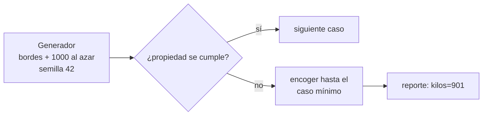

# Módulo 9: Testing con JUnit 6 (Jupiter) y Mockito


## Aprende construyendo


### Tema 1: JUnit 6 (Jupiter) — anotaciones y ciclo de vida · Avanzado · 40 min

<details open>
<summary><strong>Capa 1 — Lectura</strong></summary>

#### ► DE QUÉ TRATA
Este tema te guía por junit 6 (jupiter) — anotaciones y ciclo de vida con foco en comprensión antes de implementación.

#### ► LA IDEA EN UNA FRASE
**Entender junit 6 (jupiter) — anotaciones y ciclo de vida te permite tomar mejores decisiones técnicas.**

#### ► POR QUÉ EXISTE ESTO
Resuelve un problema real de diseño o implementación y evita decisiones a ciegas.

#### ► LA ANALOGÍA
Piensa en junit 6 (jupiter) — anotaciones y ciclo de vida como una herramienta de taller: útil cuando conoces su propósito y sus límites.
**Dónde se rompe la analogía:** en software, los efectos dependen del contexto, la escala y los trade-offs.

#### ► CÓMO FUNCIONA
1. Identifica el problema que junit 6 (jupiter) — anotaciones y ciclo de vida resuelve.
2. Observa sus componentes y relaciones.
3. Aplica la opción más simple que funcione.
4. Verifica el resultado y los límites.

#### ► LO QUE PUEDE SALIR MAL
| Síntoma | Causa probable | Arreglo |
|---|---|---|
| JUnit 6 (Jupiter) — anotaciones y ciclo de vida se aplica pero el resultado no mejora | Se usó sin medir el problema real | Mide antes y compara contra la alternativa simple |
| Aparece complejidad inesperada | Se adoptó la técnica sin comprender sus trade-offs | Vuelve a la sección de trade-offs y reduce el alcance |
| Falla en un caso límite | Se asumió un contexto que no se cumple | Prueba el caso límite y documenta cuándo NO usarlo |

#### ► TRADE-OFFS
| Opción | Cuándo usarla | Cuándo NO usarla |
|---|---|---|
| Usar JUnit 6 (Jupiter) — anotaciones y ciclo de vida | Cuando el problema coincide con su propósito y el beneficio es observable | Cuando agrega complejidad sin resolver un problema real |
| Alternativa más simple | Cuando el contexto es pequeño, estable o fácil de razonar | Cuando ya demostró no escalar o no cumplir el requisito |
| Postergar la decisión | Cuando falta evidencia del problema | Cuando el costo de esperar es mayor que el costo de probar |

#### ► CUÁNDO NO USAR ESTO
No uses junit 6 (jupiter) — anotaciones y ciclo de vida por defecto. Aplícalo cuando el problema lo justifique y puedas verificar el beneficio; si una alternativa más simple resuelve igual, prefiérela.

#### ► DE VUELTA A LA ANALOGÍA
Volviendo a la analogía: junit 6 (jupiter) — anotaciones y ciclo de vida funciona como el modelo inicial, pero recuerda dónde se rompe: en producción importan la evidencia, la escala y el costo de equivocarte.

#### ► LO QUE DEBES RECORDAR
- JUnit 6 (Jupiter) — anotaciones y ciclo de vida existe para resolver un problema específico.
- Mide antes de adoptar complejidad.
- Conoce el caso donde NO usarlo.
- Verifica con evidencia observable.

#### ► PREGUNTAS PARA PENSAR
1. ¿Qué problema concreto resuelve junit 6 (jupiter) — anotaciones y ciclo de vida en tu contexto?
2. ¿Cómo sabrías que junit 6 (jupiter) — anotaciones y ciclo de vida no está funcionando bien?
3. ¿Qué alternativa más simple considerarías antes de usar junit 6 (jupiter) — anotaciones y ciclo de vida?

</details>

<details>
<summary><strong>Capa 2 — Construcción</strong></summary>

#### Código y verificación
```java
// src/test/java/TarifaTest.java
@Test
void paquetePequenoCuestaCuatroMil() {
    assertEquals(4000, Tarifa.calcular(300));
}
```

```bash
mvn test
```

</details>

### Tema 2: Mockito — aislar dependencias · Avanzado · 40 min

<details open>
<summary><strong>Capa 1 — Lectura</strong></summary>

#### ► DE QUÉ TRATA
Este tema te guía por mockito — aislar dependencias con foco en comprensión antes de implementación.

#### ► LA IDEA EN UNA FRASE
**Entender mockito — aislar dependencias te permite tomar mejores decisiones técnicas.**

#### ► POR QUÉ EXISTE ESTO
Resuelve un problema real de diseño o implementación y evita decisiones a ciegas.

#### ► LA ANALOGÍA
Piensa en mockito — aislar dependencias como una herramienta de taller: útil cuando conoces su propósito y sus límites.
**Dónde se rompe la analogía:** en software, los efectos dependen del contexto, la escala y los trade-offs.

#### ► CÓMO FUNCIONA
1. Identifica el problema que mockito — aislar dependencias resuelve.
2. Observa sus componentes y relaciones.
3. Aplica la opción más simple que funcione.
4. Verifica el resultado y los límites.

#### ► LO QUE PUEDE SALIR MAL
| Síntoma | Causa probable | Arreglo |
|---|---|---|
| Mockito — aislar dependencias se aplica pero el resultado no mejora | Se usó sin medir el problema real | Mide antes y compara contra la alternativa simple |
| Aparece complejidad inesperada | Se adoptó la técnica sin comprender sus trade-offs | Vuelve a la sección de trade-offs y reduce el alcance |
| Falla en un caso límite | Se asumió un contexto que no se cumple | Prueba el caso límite y documenta cuándo NO usarlo |

#### ► TRADE-OFFS
| Opción | Cuándo usarla | Cuándo NO usarla |
|---|---|---|
| Usar Mockito — aislar dependencias | Cuando el problema coincide con su propósito y el beneficio es observable | Cuando agrega complejidad sin resolver un problema real |
| Alternativa más simple | Cuando el contexto es pequeño, estable o fácil de razonar | Cuando ya demostró no escalar o no cumplir el requisito |
| Postergar la decisión | Cuando falta evidencia del problema | Cuando el costo de esperar es mayor que el costo de probar |

#### ► CUÁNDO NO USAR ESTO
No uses mockito — aislar dependencias por defecto. Aplícalo cuando el problema lo justifique y puedas verificar el beneficio; si una alternativa más simple resuelve igual, prefiérela.

#### ► DE VUELTA A LA ANALOGÍA
Volviendo a la analogía: mockito — aislar dependencias funciona como el modelo inicial, pero recuerda dónde se rompe: en producción importan la evidencia, la escala y el costo de equivocarte.

#### ► LO QUE DEBES RECORDAR
- Mockito — aislar dependencias existe para resolver un problema específico.
- Mide antes de adoptar complejidad.
- Conoce el caso donde NO usarlo.
- Verifica con evidencia observable.

#### ► PREGUNTAS PARA PENSAR
1. ¿Qué problema concreto resuelve mockito — aislar dependencias en tu contexto?
2. ¿Cómo sabrías que mockito — aislar dependencias no está funcionando bien?
3. ¿Qué alternativa más simple considerarías antes de usar mockito — aislar dependencias?

</details>

<details>
<summary><strong>Capa 2 — Construcción</strong></summary>

#### Código y verificación
```java
// src/test/java/ServicioRutasTest.java
@ExtendWith(MockitoExtension.class)
class ServicioRutasTest {
    @Mock RutaRepository repo;

    @Test
    void devuelveElEstadoDeLaRuta() {
        when(repo.buscar("RT-1")).thenReturn(Optional.of(new Ruta("RT-1", "EN_RUTA")));
        // ... servicio.buscar("RT-1") y la aserción sobre el estado
        verify(repo).buscar("RT-1");
    }
}
```

```bash
mvn test
```

</details>

### Tema 3: Tests parametrizados y cobertura · Avanzado · 40 min

<details open>
<summary><strong>Capa 1 — Lectura</strong></summary>

#### ► DE QUÉ TRATA
Este tema te guía por tests parametrizados y cobertura con foco en comprensión antes de implementación.

#### ► LA IDEA EN UNA FRASE
**Entender tests parametrizados y cobertura te permite tomar mejores decisiones técnicas.**

#### ► POR QUÉ EXISTE ESTO
Resuelve un problema real de diseño o implementación y evita decisiones a ciegas.

#### ► LA ANALOGÍA
Piensa en tests parametrizados y cobertura como una herramienta de taller: útil cuando conoces su propósito y sus límites.
**Dónde se rompe la analogía:** en software, los efectos dependen del contexto, la escala y los trade-offs.

#### ► CÓMO FUNCIONA
1. Identifica el problema que tests parametrizados y cobertura resuelve.
2. Observa sus componentes y relaciones.
3. Aplica la opción más simple que funcione.
4. Verifica el resultado y los límites.

#### ► LO QUE PUEDE SALIR MAL
| Síntoma | Causa probable | Arreglo |
|---|---|---|
| Tests parametrizados y cobertura se aplica pero el resultado no mejora | Se usó sin medir el problema real | Mide antes y compara contra la alternativa simple |
| Aparece complejidad inesperada | Se adoptó la técnica sin comprender sus trade-offs | Vuelve a la sección de trade-offs y reduce el alcance |
| Falla en un caso límite | Se asumió un contexto que no se cumple | Prueba el caso límite y documenta cuándo NO usarlo |

#### ► TRADE-OFFS
| Opción | Cuándo usarla | Cuándo NO usarla |
|---|---|---|
| Usar Tests parametrizados y cobertura | Cuando el problema coincide con su propósito y el beneficio es observable | Cuando agrega complejidad sin resolver un problema real |
| Alternativa más simple | Cuando el contexto es pequeño, estable o fácil de razonar | Cuando ya demostró no escalar o no cumplir el requisito |
| Postergar la decisión | Cuando falta evidencia del problema | Cuando el costo de esperar es mayor que el costo de probar |

#### ► CUÁNDO NO USAR ESTO
No uses tests parametrizados y cobertura por defecto. Aplícalo cuando el problema lo justifique y puedas verificar el beneficio; si una alternativa más simple resuelve igual, prefiérela.

#### ► DE VUELTA A LA ANALOGÍA
Volviendo a la analogía: tests parametrizados y cobertura funciona como el modelo inicial, pero recuerda dónde se rompe: en producción importan la evidencia, la escala y el costo de equivocarte.

#### ► LO QUE DEBES RECORDAR
- Tests parametrizados y cobertura existe para resolver un problema específico.
- Mide antes de adoptar complejidad.
- Conoce el caso donde NO usarlo.
- Verifica con evidencia observable.

#### ► PREGUNTAS PARA PENSAR
1. ¿Qué problema concreto resuelve tests parametrizados y cobertura en tu contexto?
2. ¿Cómo sabrías que tests parametrizados y cobertura no está funcionando bien?
3. ¿Qué alternativa más simple considerarías antes de usar tests parametrizados y cobertura?

</details>

<details>
<summary><strong>Capa 2 — Construcción</strong></summary>

#### Código y verificación
```java
// src/test/java/TarifaTest.java
@ParameterizedTest
@CsvSource({"100, 4000", "500, 4000", "501, 7000"})
void calculaTarifa(int gramos, int esperado) {
    assertEquals(esperado, Tarifa.calcular(gramos));
}
```

```bash
mvn verify
```

</details>

### Tema 4: Pruebas basadas en propiedades: reglas que se cumplen para cualquier entrada · Avanzado · 45 min

<details open>
<summary><strong>Capa 1 — Lectura</strong></summary>

#### ► DE QUÉ TRATA
Usa JDK 21. La demostración no necesita librerías: implementa la idea en un solo archivo. La versión con jqwik necesita un proyecto Maven o Gradle con la dependencia net.jqwik:jqwik. Crea la carpeta academia-labs/java/propiedades.

#### ► LA IDEA EN UNA FRASE
**La demostración no necesita librerías: implementa la idea en un solo archivo.**

#### ► POR QUÉ EXISTE ESTO
Resuelve un problema real de diseño o implementación y evita decisiones a ciegas.

#### ► LA ANALOGÍA
Piensa en pruebas basadas en propiedades: reglas que se cumplen para cualquier entrada como una herramienta de taller: útil cuando conoces su propósito y sus límites.
**Dónde se rompe la analogía:** en software, los efectos dependen del contexto, la escala y los trade-offs.

#### ► CÓMO FUNCIONA


#### ► LO QUE PUEDE SALIR MAL
| Síntoma | Causa probable | Arreglo |
|---|---|---|
| Pruebas basadas en propiedades: reglas que se cumplen para cualquier entrada se aplica pero el resultado no mejora | Se usó sin medir el problema real | Mide antes y compara contra la alternativa simple |
| Aparece complejidad inesperada | Se adoptó la técnica sin comprender sus trade-offs | Vuelve a la sección de trade-offs y reduce el alcance |
| Falla en un caso límite | Se asumió un contexto que no se cumple | Prueba el caso límite y documenta cuándo NO usarlo |

#### ► TRADE-OFFS
| Opción | Cuándo usarla | Cuándo NO usarla |
|---|---|---|
| Usar Pruebas basadas en propiedades: reglas que se cumplen para cualquier entrada | Cuando el problema coincide con su propósito y el beneficio es observable | Cuando agrega complejidad sin resolver un problema real |
| Alternativa más simple | Cuando el contexto es pequeño, estable o fácil de razonar | Cuando ya demostró no escalar o no cumplir el requisito |
| Postergar la decisión | Cuando falta evidencia del problema | Cuando el costo de esperar es mayor que el costo de probar |

#### ► CUÁNDO NO USAR ESTO
No uses pruebas basadas en propiedades: reglas que se cumplen para cualquier entrada por defecto. Aplícalo cuando el problema lo justifique y puedas verificar el beneficio; si una alternativa más simple resuelve igual, prefiérela.

#### ► DE VUELTA A LA ANALOGÍA
Volviendo a la analogía: pruebas basadas en propiedades: reglas que se cumplen para cualquier entrada funciona como el modelo inicial, pero recuerda dónde se rompe: en producción importan la evidencia, la escala y el costo de equivocarte.

#### ► LO QUE DEBES RECORDAR
- Pruebas basadas en propiedades: reglas que se cumplen para cualquier entrada existe para resolver un problema específico.
- Mide antes de adoptar complejidad.
- Conoce el caso donde NO usarlo.
- Verifica con evidencia observable.

#### ► PREGUNTAS PARA PENSAR
1. ¿Qué problema concreto resuelve pruebas basadas en propiedades: reglas que se cumplen para cualquier entrada en tu contexto?
2. ¿Cómo sabrías que pruebas basadas en propiedades: reglas que se cumplen para cualquier entrada no está funcionando bien?
3. ¿Qué alternativa más simple considerarías antes de usar pruebas basadas en propiedades: reglas que se cumplen para cualquier entrada?

</details>

<details>
<summary><strong>Capa 2 — Construcción</strong></summary>

#### Código y verificación


```java
import java.util.Random;
import java.util.function.IntPredicate;

public class PropiedadesTarifa {
    // Código bajo prueba: tiene un error a propósito para pesos grandes.
    static long tarifa(int kilos) {
        if (kilos <= 0) throw new IllegalArgumentException("peso inválido");
        long base = 1_000 + kilos * 120L;
        return kilos > 900 ? base - 200_000 : base; // error: descuento mal escrito
    }

    // Una propiedad es una regla que debe cumplirse para TODA entrada válida.
    static void comprobar(String nombre, IntPredicate propiedad, Random azar) {
        int[] bordes = {1, 2, 999, 1_000}; // los generadores serios prueban primero los bordes
        for (int i = 0; i < 1_000; i++) {
            int kilos = i < bordes.length ? bordes[i] : 1 + azar.nextInt(1_000);
            if (!propiedad.test(kilos)) {
                int minimo = encoger(kilos, propiedad);
                System.out.println("FALLA " + nombre + " con kilos=" + kilos + ", caso mínimo kilos=" + minimo);
                return;
            }
        }
        System.out.println("OK " + nombre + " en 1000 casos");
    }

    // Encoger: busca el valor más pequeño que sigue fallando, para depurar fácil.
    static int encoger(int falla, IntPredicate propiedad) {
        int minimo = falla;
        for (int k = falla - 1; k >= 1; k--) if (!propiedad.test(k)) minimo = k;
        return minimo;
    }

    public static void main(String[] args) {
        Random azar = new Random(42); // semilla fija: el fallo se puede repetir
        comprobar("tarifa positiva", k -> tarifa(k) > 0, azar);
        comprobar("tarifa crece con el peso", k -> tarifa(k + 1) >= tarifa(k), azar);
        comprobar("tarifa mínima de 1120", k -> tarifa(k) >= 1_120, azar);
    }
}
```

```java
import net.jqwik.api.ForAll;
import net.jqwik.api.Property;
import net.jqwik.api.constraints.IntRange;

class TarifaPropiedadesTest {
    @Property // jqwik genera 1000 casos, prueba bordes y encoge los fallos
    boolean tarifaPositiva(@ForAll @IntRange(min = 1, max = 1_000) int kilos) {
        return PropiedadesTarifa.tarifa(kilos) > 0;
    }

    @Property
    boolean tarifaCreceConElPeso(@ForAll @IntRange(min = 1, max = 999) int kilos) {
        return PropiedadesTarifa.tarifa(kilos + 1) >= PropiedadesTarifa.tarifa(kilos);
    }
}
```

```bash
cd academia-labs/java/propiedades
java PropiedadesTarifa.java
# versión con jqwik, dentro de un proyecto Maven con net.jqwik:jqwik en test:
# mvn test
```

```text
FALLA tarifa positiva con kilos=999, caso mínimo kilos=901
OK tarifa crece con el peso en 1000 casos
FALLA tarifa mínima de 1120 con kilos=999, caso mínimo kilos=901
```

</details>
