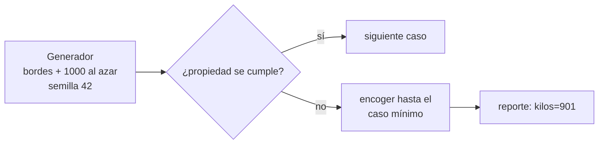

# Módulo 9: Testing con JUnit 6 (Jupiter) y Mockito


## Aprende construyendo

### Tema 1: JUnit 6 (Jupiter) — anotaciones y ciclo de vida · Avanzado · 40 min

**¿Por qué es importante?** una prueba repetible descubre cuando un cambio rompe una regla antes de que el fallo llegue al usuario.

**Preparación común del módulo:** usa el proyecto Maven del Módulo 8; para estos ejercicios añade JUnit Jupiter `6.0.2` y Maven Surefire `3.5.5` al `pom.xml`, con JUnit en scope `test`. JUnit 6 requiere Java 17 o superior. Fuente: [guía oficial de JUnit](https://docs.junit.org/current/user-guide/).

#### Subtema 1.1: Escribe y ejecuta tu primera prueba · 10 min

**1. Contexto**

Una tarifa de envío no puede ser negativa. El test comprueba esa regla con un ejemplo que cualquiera puede volver a correr.

**2. Hazlo tú**

Crea `src/main/java/Tarifa.java` con `static int calcular(int gramos) { return gramos <= 500 ? 4000 : 7000; }`. Crea `src/test/java/TarifaTest.java` con `@Test void paquetePequenoCuestaCuatroMil() { assertEquals(4000, Tarifa.calcular(300)); }`. Ejecuta `mvn test`.

**Resultado esperado:** Surefire detecta una prueba y muestra `BUILD SUCCESS`.

**Fallo deliberado:** cambia el esperado a `5000`. **Diagnóstico:** compara el valor esperado y el real en el reporte de prueba; restaura el resultado correcto.

**3. Entiende**

`@Test` marca un método de prueba. `assertEquals` compara el resultado observado con la regla acordada.

**4. Cierra**

Guarda el test y el reporte ubicado en `target/surefire-reports`.

#### Subtema 1.2: Prepara datos para cada prueba · 10 min

**1. Contexto**

Una prueba debe comenzar con una tarifa limpia y no depender del orden en que se ejecutan otros tests.

**2. Hazlo tú**

En `src/test/java/TarifaTest.java`, crea un campo `Tarifa tarifa`; agrega `@BeforeEach void preparar() { tarifa = new Tarifa(); }` si convertiste Tarifa en clase, y prueba dos entradas distintas en métodos separados. Ejecuta `mvn test`.

**Resultado esperado:** cada test pasa por su preparación, aunque el motor los ejecute en orden distinto.

**Fallo deliberado:** guarda el último precio en un campo `static` compartido entre tests. **Diagnóstico:** un test modifica el estado del otro; elimina la dependencia compartida o crea datos por prueba.

**3. Entiende**

`@BeforeEach` prepara el contexto de cada método; no se debe usar para ocultar una dependencia entre tests.

**4. Cierra**

Conserva dos tests independientes y explica qué estado vuelve a crear la preparación.

#### Subtema 1.3: Comprueba errores esperados · 10 min

**1. Contexto**

Una guía con peso negativo debe rechazarse en el momento de crearla.

**2. Hazlo tú**

Crea `src/main/java/Guia.java` con constructor que lance `IllegalArgumentException` si `peso <= 0`. En `src/test/java/GuiaTest.java` usa `assertThrows(IllegalArgumentException.class, () -> new Guia(-1))`. Ejecuta `mvn test`.

**Resultado esperado:** el test pasa porque el caso inválido lanza el tipo esperado.

**Fallo deliberado:** captura la excepción dentro del lambda y no la vuelvas a lanzar. **Diagnóstico:** `assertThrows` reporta que no se produjo la excepción; deja que el test observe el error.

**3. Entiende**

Una prueba de error debe comprobar el tipo de fallo que forma parte del contrato, no cualquier excepción accidental.

**4. Cierra**

Guarda el test válido y el fallo deliberado. Fuente: [anotaciones y assertions JUnit](https://docs.junit.org/current/user-guide/).

#### Fragmento real

```java
// src/test/java/TarifaTest.java
@Test
void paquetePequenoCuestaCuatroMil() {
    assertEquals(4000, Tarifa.calcular(300));
}
```

Ejecuta:

```bash
mvn test
```

**Conexión con el proyecto integrador:** cada regla del motor de asignación de entregas (tu proyecto integrador) necesita un test como este antes de confiar en que la lógica no se rompió con el siguiente cambio.

**Límite:** un test de este tamaño prueba una sola regla aislada; no detecta errores de integración entre varias reglas ni problemas de concurrencia, que exigen pruebas distintas (módulos posteriores).

#### Practica

Modifica `Tarifa.calcular` para que el límite sea `<` en vez de `<=` y ejecuta `mvn test` de nuevo; confirma cuál de los tres casos deja de pasar y por qué.

### Tema 2: Mockito — aislar dependencias · Avanzado · 40 min

**¿Por qué es importante?** una prueba de servicio debe poder comprobar una regla de negocio sin arrancar una base de datos ni llamar una API real.

**Preparación:** añade `org.mockito:mockito-junit-jupiter:5.24.0` con scope `test` al mismo `pom.xml`. Referencia: [versiones oficiales Mockito](https://github.com/mockito/mockito/releases).

#### Subtema 2.1: Simula un repositorio · 10 min

**1. Contexto**

`ServicioRutas` consulta un repositorio; en esta prueba no quieres conectar PostgreSQL.

**2. Hazlo tú**

Crea `src/main/java/Ruta.java` como `record Ruta(String guia, String estado) {}` y `src/main/java/RutaRepository.java` con `Optional<Ruta> buscar(String guia)`. Crea `src/main/java/ServicioRutas.java` que delegue la búsqueda. En `src/test/java/ServicioRutasTest.java` usa `@ExtendWith(MockitoExtension.class)`, `@Mock RutaRepository repo`, prepara `when(repo.buscar("RT-1")).thenReturn(Optional.of(new Ruta("RT-1", "EN_RUTA")))` y comprueba el estado. Ejecuta `mvn test`.

**Resultado esperado:** el test pasa sin crear conexión de base de datos.

**Fallo deliberado:** llama `repo.buscar("RT-2")` en el servicio. **Diagnóstico:** el stub solo define `RT-1`; configura la respuesta que corresponda al escenario o corrige la entrada.

**3. Entiende**

El mock sustituye el colaborador externo; la regla que se prueba sigue siendo código real.

**4. Cierra**

Conserva la prueba y marca cuál dependencia fue simulada.

#### Subtema 2.2: Verifica una interacción necesaria · 10 min

**1. Contexto**

Un servicio debe solicitar la guía una sola vez para responder una consulta.

**2. Hazlo tú**

En `src/test/java/ServicioRutasTest.java`, llama `servicio.buscar("RT-1")` y usa `verify(repo).buscar("RT-1")`. Ejecuta `mvn test`.

**Resultado esperado:** Mockito confirma la llamada con el argumento exacto.

**Fallo deliberado:** elimina la llamada real al repositorio en `ServicioRutas.buscar`. **Diagnóstico:** el resultado puede seguir pasando si solo compruebas datos prefabricados; la verificación detecta que la colaboración esperada no ocurrió.

**3. Entiende**

Verifica interacciones cuando forman parte del comportamiento (por ejemplo, publicar un evento); evita verificar cada llamada interna sin motivo.

**4. Cierra**

Explica en una frase por qué esa llamada es visible para quien usa el servicio.

#### Subtema 2.3: Simula un error externo · 10 min

**1. Contexto**

La base de datos puede fallar; la capa de servicio debe traducir el error a un resultado claro.

**2. Hazlo tú**

En `src/test/java/ServicioRutasTest.java`, prepara `when(repo.buscar("RT-1")).thenThrow(new IllegalStateException("DB caída"))`. Añade al servicio un manejo específico que devuelva un error de dominio o propague una excepción documentada; comprueba esa decisión con `assertThrows`. Corre `mvn test`.

**Resultado esperado:** la falla externa se reproduce de forma determinista y el test observa el contrato del servicio.

**Fallo deliberado:** devuelve `Optional.empty()` para cualquier `RuntimeException`. **Diagnóstico:** una caída no significa que la ruta no exista; separa “no encontrado” de “servicio indisponible”.

**3. Entiende**

El mock permite probar fallos raros sin apagar servicios reales; no demuestra por sí solo que la integración real funciona.

**4. Cierra**

Guarda el resultado esperado y el error distinguido. Fuente: [documentación Mockito](https://github.com/mockito/mockito).

#### Fragmento real

```java
// src/test/java/ServicioRutasTest.java
@ExtendWith(MockitoExtension.class)
class ServicioRutasTest {
    @Mock RutaRepository repo;

    @Test
    void devuelveElEstadoDeLaRuta() {
        when(repo.buscar("RT-1")).thenReturn(Optional.of(new Ruta("RT-1", "EN_RUTA")));
        // ... servicio.buscar("RT-1") y la aserción sobre el estado
        verify(repo).buscar("RT-1");
    }
}
```

Ejecuta:

```bash
mvn test
```

**Conexión con el proyecto integrador:** en el motor de asignación de entregas, mockear el repositorio de rutas/guías es lo que te permite probar la lógica de asignación sin levantar la base de datos real en cada ejecución del test.

**Límite:** un mock prueba que tu servicio llama al colaborador como esperas; no prueba que el repositorio real (JDBC, JPA) se comporte igual — eso exige una prueba de integración aparte (módulo 16).

#### Practica

Modifica el stub para que `repo.buscar("RT-1")` devuelva `Optional.empty()` en vez de una ruta, corre `mvn test` y decide qué debería responder `servicio.buscar` ante ese caso.

### Tema 3: Tests parametrizados y cobertura · Avanzado · 40 min

**¿Por qué es importante?** una regla con límites debe comprobar entradas representativas; la cobertura ayuda a encontrar código aún no ejercitado, pero no demuestra que el test sea correcto.

**Preparación:** añade al build Maven el plugin JaCoCo `0.8.14` con dos ejecuciones: `prepare-agent` y `report` asociado a la fase `verify`. Esta versión soporta oficialmente Java 25. En el Tema 3 usarás `mvn verify` para producir `target/site/jacoco/index.html`. Fuente: [historial oficial de JaCoCo](https://www.jacoco.org/jacoco/trunk/doc/changes.html).

#### Subtema 3.1: Comprueba varios casos con CSV · 10 min

**1. Contexto**

La tarifa cambia al superar los 500 gramos; un test separado para cada peso repite estructura.

**2. Hazlo tú**

En `src/test/java/TarifaTest.java`, crea `@ParameterizedTest @CsvSource({"100, 4000", "500, 4000", "501, 7000"}) void calculaTarifa(int gramos, int esperado) { assertEquals(esperado, Tarifa.calcular(gramos)); }`. Ejecuta `mvn test`.

**Resultado esperado:** JUnit reporta tres ejecuciones con datos distintos.

**Fallo deliberado:** omite el límite exacto `500`. **Diagnóstico:** el test no comprueba si la regla usa `<` o `<=`; conserva casos justo antes, en y después del límite.

**3. Entiende**

`@CsvSource` alimenta los parámetros. Cada fila se evalúa como una invocación independiente.

**4. Cierra**

Conserva las tres filas y explica por qué `500` es un caso importante.

#### Subtema 3.2: Encuentra una rama no probada · 10 min

**1. Contexto**

El cálculo tiene una rama para peso inválido que los casos de tarifa normal no visitan.

**2. Hazlo tú**

En `src/main/java/Tarifa.java` agrega el rechazo de gramos negativos. Añade en `src/test/java/TarifaTest.java` un test con `assertThrows`. Ejecuta `mvn test` y observa cuál rama se ejecuta con JaCoCo activado en el POM del Módulo 9.

**Resultado esperado:** la prueba pasa y la nueva rama queda recorrida.

**Fallo deliberado:** borra el caso negativo y revisa `target/site/jacoco/index.html`. **Diagnóstico:** la rama queda sin cubrir; agrega la entrada, no cambies el código solo para subir el porcentaje.

**3. Entiende**

Cobertura señala ejecución de líneas o ramas; no prueba que los resultados afirmados sean los correctos.

**4. Cierra**

Anota la rama que faltaba y el test que la ejercita.

#### Subtema 3.3: Lee una métrica sin perseguir el porcentaje · 10 min

**1. Contexto**

Un test puede ejecutar todas las líneas y aun así comprobar el resultado equivocado.

**2. Hazlo tú**

Ejecuta `mvn verify` y abre `target/site/jacoco/index.html`, producido por la configuración JaCoCo común de este tema. En `src/test/java/TarifaTest.java`, cambia temporalmente el valor esperado de un caso a uno incorrecto y vuelve a correr `mvn verify`.

**Resultado esperado:** el porcentaje puede seguir alto, pero el test falla ante el resultado incorrecto.

**Fallo deliberado:** fija como meta 100% sin revisar expectativas. **Diagnóstico:** cobertura mide qué código se ejecutó, no si la prueba detecta errores relevantes.

**3. Entiende**

Combina cobertura de ramas con límites, errores y comportamiento de negocio explicable.

**4. Cierra**

Guarda el reporte y explica un límite de esa métrica. Fuentes: [JUnit User Guide](https://docs.junit.org/current/user-guide/) y [JaCoCo Java 25](https://www.jacoco.org/jacoco/trunk/doc/changes.html).

#### Fragmento real

```java
// src/test/java/TarifaTest.java
@ParameterizedTest
@CsvSource({"100, 4000", "500, 4000", "501, 7000"})
void calculaTarifa(int gramos, int esperado) {
    assertEquals(esperado, Tarifa.calcular(gramos));
}
```

Ejecuta:

```bash
mvn verify
```

**Conexión con el proyecto integrador:** las tarifas y reglas de asignación del proyecto integrador tienen varios casos límite (peso exacto, cero guías, capacidad llena); `@CsvSource` evita escribir un método de test por cada combinación.

**Límite:** un reporte de cobertura al 100% no certifica que las aserciones sean correctas (Subtema 3.3); solo dice qué líneas se ejecutaron, no si el test habría detectado un resultado equivocado.

#### Practica

Modifica el valor esperado de la fila `"501, 7000"` a `"501, 4000"` (incorrecto a propósito), ejecuta `mvn test` y confirma que JUnit reporta la fila fallida con ambos valores.

---

### Tema 4: Pruebas basadas en propiedades: reglas que se cumplen para cualquier entrada · Avanzado · 45 min

**Prerrequisito:** temas «JUnit 6 (Jupiter) — anotaciones y ciclo de vida» y «Tests parametrizados y cobertura» de este módulo.

**Al finalizar podrás:** escribir propiedades (reglas que deben cumplirse para toda entrada válida), comprobarlas con mil entradas generadas con una semilla fija y reducir un fallo al caso mínimo; después, expresarlas con jqwik.

**¿Por qué es importante?** Un test con ejemplos solo prueba los casos que se te ocurrieron. Una prueba de propiedades genera cientos de casos, incluidos los bordes, y encuentra errores que nadie imaginó, como un descuento mal escrito para pesos grandes.

#### Paso 1 · Objetivo y preparación

Usa JDK 21. La demostración no necesita librerías: implementa la idea en un solo archivo. La versión con jqwik necesita un proyecto Maven o Gradle con la dependencia `net.jqwik:jqwik`. Crea la carpeta `academia-labs/java/propiedades`.

#### Paso 2 · Contexto y caso real

Las pruebas de tarifas de RutaFlow tenían cinco ejemplos y todas pasaban. En producción, un envío de 950 kilos se cobró con valor negativo. Ninguno de los ejemplos pasaba de 100 kilos.

#### Paso 3 · Teoría, modelo mental y analogía

**Conceptos clave:** propiedad, generador, semilla, caso borde, encogimiento (*shrinking*), contraejemplo mínimo, jqwik.

Una **propiedad** es una regla general: «la tarifa siempre es positiva», «si el peso aumenta, la tarifa no baja». La prueba:

1. **Genera** muchas entradas válidas (con una **semilla** fija para poder repetir un fallo).
2. Prueba primero los **bordes** (1, el máximo, valores alrededor de límites), donde suelen estar los errores.
3. Si una entrada falla, **encoge**: busca la entrada más pequeña que también falla, para depurar con el caso más simple.

Una propiedad que pasa no demuestra que el código sea correcto: solo que los casos generados no encontraron un error. Si un error ocurre en un único valor exacto, el generador puede no visitarlo. Por eso las librerías como **jqwik** sesgan la generación hacia los bordes.

**Analogía:** los tests de ejemplos son revisar tres tornillos del puente; las propiedades son revisar mil tornillos al azar más todos los de las uniones. La analogía falla en que, aunque revises mil, un tornillo flojo justo donde no miraste sigue ahí.

**Límite de uso:** no reemplaza a los tests de ejemplos, que documentan casos importantes del negocio. Escribir buenas propiedades cuesta: si te descubres repitiendo la implementación dentro de la propiedad, no estás probando nada.



#### Paso 4 · Demostración guiada desde cero

Archivo `academia-labs/java/propiedades/PropiedadesTarifa.java`:

```java
import java.util.Random;
import java.util.function.IntPredicate;

public class PropiedadesTarifa {
    // Código bajo prueba: tiene un error a propósito para pesos grandes.
    static long tarifa(int kilos) {
        if (kilos <= 0) throw new IllegalArgumentException("peso inválido");
        long base = 1_000 + kilos * 120L;
        return kilos > 900 ? base - 200_000 : base; // error: descuento mal escrito
    }

    // Una propiedad es una regla que debe cumplirse para TODA entrada válida.
    static void comprobar(String nombre, IntPredicate propiedad, Random azar) {
        int[] bordes = {1, 2, 999, 1_000}; // los generadores serios prueban primero los bordes
        for (int i = 0; i < 1_000; i++) {
            int kilos = i < bordes.length ? bordes[i] : 1 + azar.nextInt(1_000);
            if (!propiedad.test(kilos)) {
                int minimo = encoger(kilos, propiedad);
                System.out.println("FALLA " + nombre + " con kilos=" + kilos + ", caso mínimo kilos=" + minimo);
                return;
            }
        }
        System.out.println("OK " + nombre + " en 1000 casos");
    }

    // Encoger: busca el valor más pequeño que sigue fallando, para depurar fácil.
    static int encoger(int falla, IntPredicate propiedad) {
        int minimo = falla;
        for (int k = falla - 1; k >= 1; k--) if (!propiedad.test(k)) minimo = k;
        return minimo;
    }

    public static void main(String[] args) {
        Random azar = new Random(42); // semilla fija: el fallo se puede repetir
        comprobar("tarifa positiva", k -> tarifa(k) > 0, azar);
        comprobar("tarifa crece con el peso", k -> tarifa(k + 1) >= tarifa(k), azar);
        comprobar("tarifa mínima de 1120", k -> tarifa(k) >= 1_120, azar);
    }
}
```

Archivo `academia-labs/java/propiedades/src/test/java/TarifaPropiedadesTest.java`:

```java
import net.jqwik.api.ForAll;
import net.jqwik.api.Property;
import net.jqwik.api.constraints.IntRange;

class TarifaPropiedadesTest {
    @Property // jqwik genera 1000 casos, prueba bordes y encoge los fallos
    boolean tarifaPositiva(@ForAll @IntRange(min = 1, max = 1_000) int kilos) {
        return PropiedadesTarifa.tarifa(kilos) > 0;
    }

    @Property
    boolean tarifaCreceConElPeso(@ForAll @IntRange(min = 1, max = 999) int kilos) {
        return PropiedadesTarifa.tarifa(kilos + 1) >= PropiedadesTarifa.tarifa(kilos);
    }
}
```

Ejecútalo:

```bash
cd academia-labs/java/propiedades
java PropiedadesTarifa.java
# versión con jqwik, dentro de un proyecto Maven con net.jqwik:jqwik en test:
# mvn test
```

**Explicación por bloques:** `tarifa` tiene un error: para más de 900 kilos resta 200 000 en lugar de aplicar un descuento pequeño. `comprobar` prueba primero cuatro bordes y luego entradas al azar con semilla 42. En cuanto una entrada falla, `encoger` recorre hacia abajo para hallar el menor peso que también falla: 901, el límite exacto del error. La segunda propiedad pasa aunque el código está mal, porque solo falla en `kilos = 900` y ningún caso generado fue exactamente ese. La clase de jqwik expresa las mismas propiedades con anotaciones; la librería se encarga de generar, sesgar hacia bordes y encoger.


**Resultado esperado:**

```text
FALLA tarifa positiva con kilos=999, caso mínimo kilos=901
OK tarifa crece con el peso en 1000 casos
FALLA tarifa mínima de 1120 con kilos=999, caso mínimo kilos=901
```

**Fallo deliberado:** cambia `new Random(42)` por `new Random()` y ejecuta cinco o seis veces. **Error esperado:** la primera y la tercera propiedad fallan siempre con `kilos=999`, porque los bordes se prueban antes que los valores al azar; la segunda a veces pasa y a veces muestra `FALLA tarifa crece con el peso con kilos=900, caso mínimo kilos=900`, según si el azar visita el 900. **Diagnóstico:** sin semilla fija el mismo código pasa o falla según la ejecución, y no puedes repetir un fallo para depurarlo. Las librerías imprimen la semilla del fallo para reproducirlo; aquí, déjala fija.

#### Paso 5 · Práctica guiada

1. **Reproducción:** ejecuta el archivo y explica por qué el caso mínimo es 901.
2. **Variación:** agrega 900 a la lista de bordes y observa que la segunda propiedad ahora falla.
3. **Diagnóstico:** reproduce el fallo deliberado sin semilla.
4. **Integración:** corrige `tarifa` (por ejemplo, 10 % de descuento sobre 900 kilos) y comprueba que las tres propiedades pasan.
5. **Diseño:** escribe dos propiedades más para la tarifa de RutaFlow que no repitan la fórmula dentro de la prueba.

**Pista:** una buena propiedad compara relaciones (mayor, igual, inversa), no recalcula el resultado.

#### Paso 6 · Práctica independiente

Escribe una propiedad para una función `codificar`/`decodificar` de códigos de envío: decodificar lo codificado debe devolver el original para cualquier texto de 1 a 20 caracteres alfanuméricos.

#### Paso 7 · Cierre

- [ ] Explicas qué es una propiedad, un borde y el encogimiento.
- [ ] El programa imprime las tres líneas esperadas.
- [ ] Explicas por qué la segunda propiedad pasa con código incorrecto.
- [ ] Escribiste propiedades que no repiten la implementación.

Si fallas dos o más, vuelve al Paso 3. **Errores comunes:** generar sin semilla reproducible, olvidar los bordes y escribir propiedades que copian la fórmula. **Siguiente paso:** el módulo 15 integra jqwik junto a JUnit Jupiter en el build de Maven y Gradle.

**Transferencia al proyecto integrador «RutaFlow»:** agrega pruebas de propiedades con jqwik a las tarifas de RutaFlow: positiva, monótona respecto al peso y con tope máximo.

**Fuente oficial:** [jqwik — User Guide](https://jqwik.net/docs/current/user-guide.html) y [JUnit — User Guide](https://docs.junit.org/current/user-guide/).

## Construcción guiada del capítulo

**Objetivo del laboratorio:** construir una suite de pruebas unitarias con mocks para un servicio con dependencias externas, incluyendo tests parametrizados y cobertura.

**Requisitos previos:** Módulos 0-8 completados.

| Paso | Acción | Código | Explicación |
|---|---|---|---|
| 1 | Escribir un test básico con `@Test` | Ver Tema 1 | Con una aserción simple |
| 2 | Usar `@BeforeEach` para estado compartido | Ver Tema 1 | Verifica el aislamiento entre pruebas |
| 3 | Mockear una dependencia con Mockito | Ver Tema 2 | `when` + `verify` |
| 4 | Escribir un test parametrizado con 5 casos | Ver Tema 3 | `@ParameterizedTest` |
| 5 | Generar un reporte de cobertura con JaCoCo | Ver Tema 3 | Identifica una rama sin probar |

**Verificación:** el laboratorio se considera exitoso si la suite de pruebas se ejecuta sin depender de ninguna infraestructura externa real, y si el reporte de JaCoCo identifica al menos una rama de código específica que carece de cobertura, corregida posteriormente con una prueba adicional.

**Errores comunes y soluciones**

- **Compartir estado mutable entre pruebas sin `@BeforeEach`.** Reinicia el estado compartido antes de cada prueba individual.
- **Confundir un stub (`when`) con una verificación (`verify`).** `when` configura comportamiento simulado; `verify` confirma que una interacción efectivamente ocurrió.
- **Duplicar el mismo cuerpo de prueba para múltiples casos de datos.** Usa `@ParameterizedTest` para evitar esa duplicación.

---
