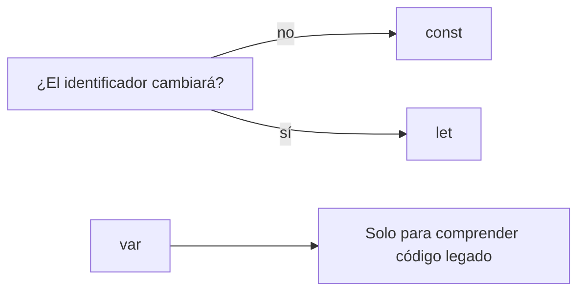
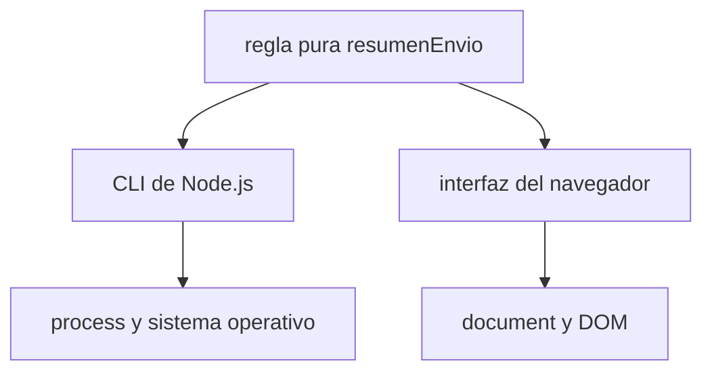

# Módulo 0: Fundamentos de JavaScript con ejemplos independientes

Cada tema comienza en su propia carpeta vacía. El proyecto integrador existe aparte y no es requisito para estudiar estas lecciones.

## Mapa de la ruta

«JavaScript: fundamentos y temas avanzados» tiene 15 módulos en 4 etapas. Cada etapa se apoya en la anterior; usa la tabla para saltar a un módulo concreto.


| Módulo | Etapa | Qué aprendes |
|---|---|---|
| 0 | Fundamentos | [Fundamentos del lenguaje y el entorno](/curso/javascript/0) |
| 1 | Fundamentos | [Operadores, control de flujo y funciones](/curso/javascript/1) |
| 2 | Fundamentos | [Scope, closures y el modelo de ejecución](/curso/javascript/2) |
| 3 | Fundamentos | [Objetos, prototipos y clases](/curso/javascript/3) |
| 4 | Fundamentos | [Arrays y estructuras de datos funcionales](/curso/javascript/4) |
| 5 | Aplicación | [Asincronía I: Event Loop y Promesas](/curso/javascript/5) |
| 6 | Aplicación | [Asincronía II: async/await y fetch](/curso/javascript/6) |
| 7 | Aplicación | [Módulos modernos y herramientas de build](/curso/javascript/7) |
| 8 | Aplicación | [El DOM y eventos del navegador](/curso/javascript/8) |
| 9 | Integración | [Testing y calidad de código](/curso/javascript/9) |
| 10 | Integración | [Patrones avanzados y rendimiento](/curso/javascript/10) |
| 11 | Experto | [TypeScript esencial para devs de JavaScript](/curso/javascript/11) |
| 12 | Experto | [Proyecto integrador: SPA sin framework](/curso/javascript/12) |
| 13 | Experto | [JavaScript en producción: seguridad, memoria y compatibilidad](/curso/javascript/13) |
| 14 | Experto | [JavaScript Master: TypeScript, WASM y cómputo emergente](/curso/javascript/14) |

## Aprende construyendo

Cada tema se estudia en su propia carpeta y termina con una comprobación ejecutable; el orden importa porque cada uno reutiliza el modelo del anterior.

## Antes de comenzar: preparación del entorno

Instala [Node.js LTS](https://nodejs.org/en/download), [Visual Studio Code](https://code.visualstudio.com/) y [Git](https://git-scm.com/downloads). En Windows abre PowerShell; en macOS o Linux abre Terminal. Verifica:

```bash
node --version
npm --version
git --version
```

Las tres instrucciones deben mostrar una versión. Si `node` no se reconoce, cierra y abre la terminal; si continúa, reinstala Node.js LTS y permite que el instalador actualice `PATH`.

Crea el proyecto exactamente así:

```bash
mkdir academia-javascript
cd academia-javascript
npm init -y
mkdir src
```

```text
academia-javascript/
├── package.json
└── src/
```


### Tema 1: Variables — `const`, `let` y `var` · Básico · 30 min

<details open>
<summary><strong>Capa 1 — Lectura</strong></summary>

#### ► DE QUÉ TRATA
Al finalizar podrás elegir const o let, explicar alcance, reasignación y mutación, y reconocer por qué var causa errores difíciles de ver.

#### ► LA IDEA EN UNA FRASE
**Al finalizar podrás elegir const o let, explicar alcance, reasignación y mutación, y reconocer por qué var causa errores difíciles de ver.**

#### ► POR QUÉ EXISTE ESTO
Resuelve un problema real de diseño o implementación y evita decisiones a ciegas.

#### ► LA ANALOGÍA
Piensa en variables — `const`, `let` y `var` como una herramienta de taller: útil cuando conoces su propósito y sus límites.
**Dónde se rompe la analogía:** en software, los efectos dependen del contexto, la escala y los trade-offs.

#### ► CÓMO FUNCIONA


#### ► LO QUE PUEDE SALIR MAL
| Síntoma | Causa probable | Arreglo |
|---|---|---|
| Variables — `const`, `let` y `var` se aplica pero el resultado no mejora | Se usó sin medir el problema real | Mide antes y compara contra la alternativa simple |
| Aparece complejidad inesperada | Se adoptó la técnica sin comprender sus trade-offs | Vuelve a la sección de trade-offs y reduce el alcance |
| Falla en un caso límite | Se asumió un contexto que no se cumple | Prueba el caso límite y documenta cuándo NO usarlo |

#### ► TRADE-OFFS
| Opción | Cuándo usarla | Cuándo NO usarla |
|---|---|---|
| Usar Variables — `const`, `let` y `var` | Cuando el problema coincide con su propósito y el beneficio es observable | Cuando agrega complejidad sin resolver un problema real |
| Alternativa más simple | Cuando el contexto es pequeño, estable o fácil de razonar | Cuando ya demostró no escalar o no cumplir el requisito |
| Postergar la decisión | Cuando falta evidencia del problema | Cuando el costo de esperar es mayor que el costo de probar |

#### ► CUÁNDO NO USAR ESTO
No uses variables — `const`, `let` y `var` por defecto. Aplícalo cuando el problema lo justifique y puedas verificar el beneficio; si una alternativa más simple resuelve igual, prefiérela.

#### ► DE VUELTA A LA ANALOGÍA
Volviendo a la analogía: variables — `const`, `let` y `var` funciona como el modelo inicial, pero recuerda dónde se rompe: en producción importan la evidencia, la escala y el costo de equivocarte.

#### ► LO QUE DEBES RECORDAR
- Variables — `const`, `let` y `var` existe para resolver un problema específico.
- Mide antes de adoptar complejidad.
- Conoce el caso donde NO usarlo.
- Verifica con evidencia observable.

#### ► PREGUNTAS PARA PENSAR
1. ¿Qué problema concreto resuelve variables — `const`, `let` y `var` en tu contexto?
2. ¿Cómo sabrías que variables — `const`, `let` y `var` no está funcionando bien?
3. ¿Qué alternativa más simple considerarías antes de usar variables — `const`, `let` y `var`?

</details>

<details>
<summary><strong>Capa 2 — Construcción</strong></summary>

#### Código y verificación


```bash
mkdir ejemplo-variables
cd ejemplo-variables
npm init -y
mkdir src
```

```javascript
// La guía identifica siempre la misma entrega: no se reasigna.
const guia = 'RF-001';

// El estado sí avanza durante el recorrido.
let estado = 'creado';

// const protege la referencia, no congela el objeto.
const envio = { guia, pesoKg: 2 };
envio.pesoKg = 2.5;
estado = 'en-ruta';

console.log(`${envio.guia} | ${estado} | ${envio.pesoKg} kg`);
```

```bash
node src/01-variables.js
```

</details>

### Tema 2: Tipos primitivos y `typeof` · Básico · 30 min

<details open>
<summary><strong>Capa 1 — Lectura</strong></summary>

#### ► DE QUÉ TRATA
Al finalizar podrás reconocer los siete tipos primitivos, inspeccionarlos con typeof y validar correctamente null, arrays y números inválidos.

#### ► LA IDEA EN UNA FRASE
**Al finalizar podrás reconocer los siete tipos primitivos, inspeccionarlos con typeof y validar correctamente null, arrays y números inválidos.**

#### ► POR QUÉ EXISTE ESTO
Resuelve un problema real de diseño o implementación y evita decisiones a ciegas.

#### ► LA ANALOGÍA
Piensa en tipos primitivos y `typeof` como una herramienta de taller: útil cuando conoces su propósito y sus límites.
**Dónde se rompe la analogía:** en software, los efectos dependen del contexto, la escala y los trade-offs.

#### ► CÓMO FUNCIONA
1. Identifica el problema que tipos primitivos y `typeof` resuelve.
2. Observa sus componentes y relaciones.
3. Aplica la opción más simple que funcione.
4. Verifica el resultado y los límites.

#### ► LO QUE PUEDE SALIR MAL
| Síntoma | Causa probable | Arreglo |
|---|---|---|
| Tipos primitivos y `typeof` se aplica pero el resultado no mejora | Se usó sin medir el problema real | Mide antes y compara contra la alternativa simple |
| Aparece complejidad inesperada | Se adoptó la técnica sin comprender sus trade-offs | Vuelve a la sección de trade-offs y reduce el alcance |
| Falla en un caso límite | Se asumió un contexto que no se cumple | Prueba el caso límite y documenta cuándo NO usarlo |

#### ► TRADE-OFFS
| Opción | Cuándo usarla | Cuándo NO usarla |
|---|---|---|
| Usar Tipos primitivos y `typeof` | Cuando el problema coincide con su propósito y el beneficio es observable | Cuando agrega complejidad sin resolver un problema real |
| Alternativa más simple | Cuando el contexto es pequeño, estable o fácil de razonar | Cuando ya demostró no escalar o no cumplir el requisito |
| Postergar la decisión | Cuando falta evidencia del problema | Cuando el costo de esperar es mayor que el costo de probar |

#### ► CUÁNDO NO USAR ESTO
No uses tipos primitivos y `typeof` por defecto. Aplícalo cuando el problema lo justifique y puedas verificar el beneficio; si una alternativa más simple resuelve igual, prefiérela.

#### ► DE VUELTA A LA ANALOGÍA
Volviendo a la analogía: tipos primitivos y `typeof` funciona como el modelo inicial, pero recuerda dónde se rompe: en producción importan la evidencia, la escala y el costo de equivocarte.

#### ► LO QUE DEBES RECORDAR
- Tipos primitivos y `typeof` existe para resolver un problema específico.
- Mide antes de adoptar complejidad.
- Conoce el caso donde NO usarlo.
- Verifica con evidencia observable.

#### ► PREGUNTAS PARA PENSAR
1. ¿Qué problema concreto resuelve tipos primitivos y `typeof` en tu contexto?
2. ¿Cómo sabrías que tipos primitivos y `typeof` no está funcionando bien?
3. ¿Qué alternativa más simple considerarías antes de usar tipos primitivos y `typeof`?

</details>

<details>
<summary><strong>Capa 2 — Construcción</strong></summary>

#### Código y verificación
```bash
mkdir ejemplo-tipos
cd ejemplo-tipos
npm init -y
mkdir src
```

```javascript
const envio = {
  guia: 'RF-001',                 // string
  pesoKg: 2.5,                    // number
  entregado: false,               // boolean
  conductor: null,                // ausencia intencional
  observacion: undefined,         // todavía no asignada
  idInterno: Symbol('envio'),      // identificador único
  eventos: 9_007_199_254_740_993n // bigint
};

for (const [campo, valor] of Object.entries(envio)) {
  console.log(campo, typeof valor);
}
console.log('conductor ausente:', envio.conductor === null);
```

```bash
node src/02-tipos.js
```

</details>

### Tema 3: Conversión, coerción e igualdad · Básico · 35 min

<details open>
<summary><strong>Capa 1 — Lectura</strong></summary>

#### ► DE QUÉ TRATA
Al finalizar convertirás datos externos explícitamente y elegirás === para evitar decisiones ocultas.

#### ► LA IDEA EN UNA FRASE
**Al finalizar convertirás datos externos explícitamente y elegirás === para evitar decisiones ocultas.**

#### ► POR QUÉ EXISTE ESTO
Resuelve un problema real de diseño o implementación y evita decisiones a ciegas.

#### ► LA ANALOGÍA
Piensa en conversión, coerción e igualdad como una herramienta de taller: útil cuando conoces su propósito y sus límites.
**Dónde se rompe la analogía:** en software, los efectos dependen del contexto, la escala y los trade-offs.

#### ► CÓMO FUNCIONA
1. Identifica el problema que conversión, coerción e igualdad resuelve.
2. Observa sus componentes y relaciones.
3. Aplica la opción más simple que funcione.
4. Verifica el resultado y los límites.

#### ► LO QUE PUEDE SALIR MAL
| Síntoma | Causa probable | Arreglo |
|---|---|---|
| Conversión, coerción e igualdad se aplica pero el resultado no mejora | Se usó sin medir el problema real | Mide antes y compara contra la alternativa simple |
| Aparece complejidad inesperada | Se adoptó la técnica sin comprender sus trade-offs | Vuelve a la sección de trade-offs y reduce el alcance |
| Falla en un caso límite | Se asumió un contexto que no se cumple | Prueba el caso límite y documenta cuándo NO usarlo |

#### ► TRADE-OFFS
| Opción | Cuándo usarla | Cuándo NO usarla |
|---|---|---|
| Usar Conversión, coerción e igualdad | Cuando el problema coincide con su propósito y el beneficio es observable | Cuando agrega complejidad sin resolver un problema real |
| Alternativa más simple | Cuando el contexto es pequeño, estable o fácil de razonar | Cuando ya demostró no escalar o no cumplir el requisito |
| Postergar la decisión | Cuando falta evidencia del problema | Cuando el costo de esperar es mayor que el costo de probar |

#### ► CUÁNDO NO USAR ESTO
No uses conversión, coerción e igualdad por defecto. Aplícalo cuando el problema lo justifique y puedas verificar el beneficio; si una alternativa más simple resuelve igual, prefiérela.

#### ► DE VUELTA A LA ANALOGÍA
Volviendo a la analogía: conversión, coerción e igualdad funciona como el modelo inicial, pero recuerda dónde se rompe: en producción importan la evidencia, la escala y el costo de equivocarte.

#### ► LO QUE DEBES RECORDAR
- Conversión, coerción e igualdad existe para resolver un problema específico.
- Mide antes de adoptar complejidad.
- Conoce el caso donde NO usarlo.
- Verifica con evidencia observable.

#### ► PREGUNTAS PARA PENSAR
1. ¿Qué problema concreto resuelve conversión, coerción e igualdad en tu contexto?
2. ¿Cómo sabrías que conversión, coerción e igualdad no está funcionando bien?
3. ¿Qué alternativa más simple considerarías antes de usar conversión, coerción e igualdad?

</details>

<details>
<summary><strong>Capa 2 — Construcción</strong></summary>

#### Código y verificación
```bash
mkdir ejemplo-conversion
cd ejemplo-conversion
npm init -y
mkdir src
```

```javascript
function convertirId(texto) {
  const id = Number(texto);
  if (!Number.isInteger(id) || id <= 0) {
    throw new TypeError(`ID inválido: ${texto}`);
  }
  return id;
}

const idHttp = '101';
const idGuardado = 101;
console.log('sin convertir:', idHttp === idGuardado);
console.log('convertido:', convertirId(idHttp) === idGuardado);
```

```bash
node src/03-conversion.js
```

</details>

### Tema 4: Template literals y mensajes seguros · Básico · 30 min

<details open>
<summary><strong>Capa 1 — Lectura</strong></summary>

#### ► DE QUÉ TRATA
Al finalizar construirás mensajes legibles con interpolación, valores opcionales y funciones pequeñas.

#### ► LA IDEA EN UNA FRASE
**Al finalizar construirás mensajes legibles con interpolación, valores opcionales y funciones pequeñas.**

#### ► POR QUÉ EXISTE ESTO
Resuelve un problema real de diseño o implementación y evita decisiones a ciegas.

#### ► LA ANALOGÍA
Piensa en template literals y mensajes seguros como una herramienta de taller: útil cuando conoces su propósito y sus límites.
**Dónde se rompe la analogía:** en software, los efectos dependen del contexto, la escala y los trade-offs.

#### ► CÓMO FUNCIONA
1. Identifica el problema que template literals y mensajes seguros resuelve.
2. Observa sus componentes y relaciones.
3. Aplica la opción más simple que funcione.
4. Verifica el resultado y los límites.

#### ► LO QUE PUEDE SALIR MAL
| Síntoma | Causa probable | Arreglo |
|---|---|---|
| Template literals y mensajes seguros se aplica pero el resultado no mejora | Se usó sin medir el problema real | Mide antes y compara contra la alternativa simple |
| Aparece complejidad inesperada | Se adoptó la técnica sin comprender sus trade-offs | Vuelve a la sección de trade-offs y reduce el alcance |
| Falla en un caso límite | Se asumió un contexto que no se cumple | Prueba el caso límite y documenta cuándo NO usarlo |

#### ► TRADE-OFFS
| Opción | Cuándo usarla | Cuándo NO usarla |
|---|---|---|
| Usar Template literals y mensajes seguros | Cuando el problema coincide con su propósito y el beneficio es observable | Cuando agrega complejidad sin resolver un problema real |
| Alternativa más simple | Cuando el contexto es pequeño, estable o fácil de razonar | Cuando ya demostró no escalar o no cumplir el requisito |
| Postergar la decisión | Cuando falta evidencia del problema | Cuando el costo de esperar es mayor que el costo de probar |

#### ► CUÁNDO NO USAR ESTO
No uses template literals y mensajes seguros por defecto. Aplícalo cuando el problema lo justifique y puedas verificar el beneficio; si una alternativa más simple resuelve igual, prefiérela.

#### ► DE VUELTA A LA ANALOGÍA
Volviendo a la analogía: template literals y mensajes seguros funciona como el modelo inicial, pero recuerda dónde se rompe: en producción importan la evidencia, la escala y el costo de equivocarte.

#### ► LO QUE DEBES RECORDAR
- Template literals y mensajes seguros existe para resolver un problema específico.
- Mide antes de adoptar complejidad.
- Conoce el caso donde NO usarlo.
- Verifica con evidencia observable.

#### ► PREGUNTAS PARA PENSAR
1. ¿Qué problema concreto resuelve template literals y mensajes seguros en tu contexto?
2. ¿Cómo sabrías que template literals y mensajes seguros no está funcionando bien?
3. ¿Qué alternativa más simple considerarías antes de usar template literals y mensajes seguros?

</details>

<details>
<summary><strong>Capa 2 — Construcción</strong></summary>

#### Código y verificación
```bash
mkdir ejemplo-template
cd ejemplo-template
npm init -y
mkdir src
```

```javascript
function resumenEnvio(envio) {
  const destino = envio.destino ?? 'sin destino';
  return `Guía ${envio.guia}: ${envio.estado}\nDestino: ${destino}\nPeso: ${envio.pesoKg} kg`;
}

console.log(resumenEnvio({ guia: 'RF-001', estado: 'en-ruta', pesoKg: 2.5 }));
```

```bash
node src/04-resumen.js
```

</details>

### Tema 5: JavaScript en navegador y Node.js · Intermedio · 40 min

<details open>
<summary><strong>Capa 1 — Lectura</strong></summary>

#### ► DE QUÉ TRATA
Al finalizar distinguirás el lenguaje de su entorno y ejecutarás la misma regla del proyecto desde terminal y navegador.

#### ► LA IDEA EN UNA FRASE
**Al finalizar distinguirás el lenguaje de su entorno y ejecutarás la misma regla del proyecto desde terminal y navegador.**

#### ► POR QUÉ EXISTE ESTO
Resuelve un problema real de diseño o implementación y evita decisiones a ciegas.

#### ► LA ANALOGÍA
Piensa en javascript en navegador y node.js como una herramienta de taller: útil cuando conoces su propósito y sus límites.
**Dónde se rompe la analogía:** en software, los efectos dependen del contexto, la escala y los trade-offs.

#### ► CÓMO FUNCIONA


#### ► LO QUE PUEDE SALIR MAL
| Síntoma | Causa probable | Arreglo |
|---|---|---|
| JavaScript en navegador y Node.js se aplica pero el resultado no mejora | Se usó sin medir el problema real | Mide antes y compara contra la alternativa simple |
| Aparece complejidad inesperada | Se adoptó la técnica sin comprender sus trade-offs | Vuelve a la sección de trade-offs y reduce el alcance |
| Falla en un caso límite | Se asumió un contexto que no se cumple | Prueba el caso límite y documenta cuándo NO usarlo |

#### ► TRADE-OFFS
| Opción | Cuándo usarla | Cuándo NO usarla |
|---|---|---|
| Usar JavaScript en navegador y Node.js | Cuando el problema coincide con su propósito y el beneficio es observable | Cuando agrega complejidad sin resolver un problema real |
| Alternativa más simple | Cuando el contexto es pequeño, estable o fácil de razonar | Cuando ya demostró no escalar o no cumplir el requisito |
| Postergar la decisión | Cuando falta evidencia del problema | Cuando el costo de esperar es mayor que el costo de probar |

#### ► CUÁNDO NO USAR ESTO
No uses javascript en navegador y node.js por defecto. Aplícalo cuando el problema lo justifique y puedas verificar el beneficio; si una alternativa más simple resuelve igual, prefiérela.

#### ► DE VUELTA A LA ANALOGÍA
Volviendo a la analogía: javascript en navegador y node.js funciona como el modelo inicial, pero recuerda dónde se rompe: en producción importan la evidencia, la escala y el costo de equivocarte.

#### ► LO QUE DEBES RECORDAR
- JavaScript en navegador y Node.js existe para resolver un problema específico.
- Mide antes de adoptar complejidad.
- Conoce el caso donde NO usarlo.
- Verifica con evidencia observable.

#### ► PREGUNTAS PARA PENSAR
1. ¿Qué problema concreto resuelve javascript en navegador y node.js en tu contexto?
2. ¿Cómo sabrías que javascript en navegador y node.js no está funcionando bien?
3. ¿Qué alternativa más simple considerarías antes de usar javascript en navegador y node.js?

</details>

<details>
<summary><strong>Capa 2 — Construcción</strong></summary>

#### Código y verificación


```bash
mkdir ejemplo-entorno-js
cd ejemplo-entorno-js
npm init -y
npm pkg set type=module
mkdir src web
```

```javascript
export function resumenEnvio(envio) {
  const destino = envio.destino ?? 'sin destino';
  return `Guía ${envio.guia}: ${envio.estado}\nDestino: ${destino}\nPeso: ${envio.pesoKg} kg`;
}
```

```javascript
import { resumenEnvio } from './resumen.js';
console.log(resumenEnvio({ guia: 'RF-001', estado: 'en-ruta', pesoKg: 2.5 }));
```

```html
<!doctype html>
<html lang="es">
  <head>
    <meta charset="utf-8">
    <title>Resumen de envío</title>
  </head>
  <body>
    <h1>Resumen de envío</h1>
    <output id="estado" style="white-space: pre-line"></output>
    <script type="module" src="./app.js"></script>
  </body>
</html>
```

```javascript
import { resumenEnvio } from '../src/resumen.js';
const salida = document.querySelector('#estado');
salida.textContent = resumenEnvio({ guia: 'RF-001', estado: 'en-ruta', pesoKg: 2.5 });
```

</details>
