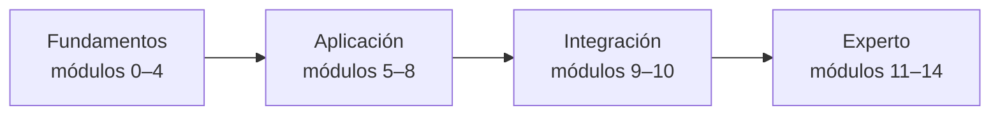
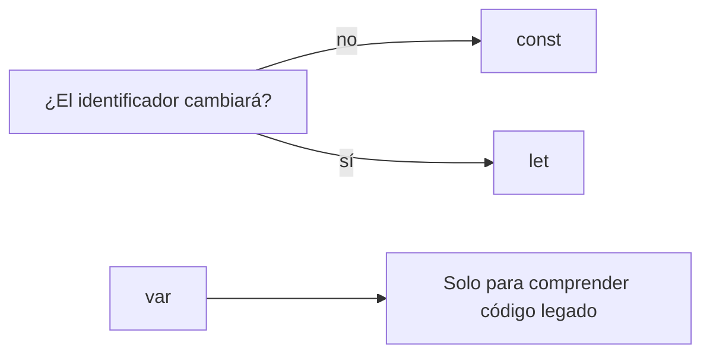
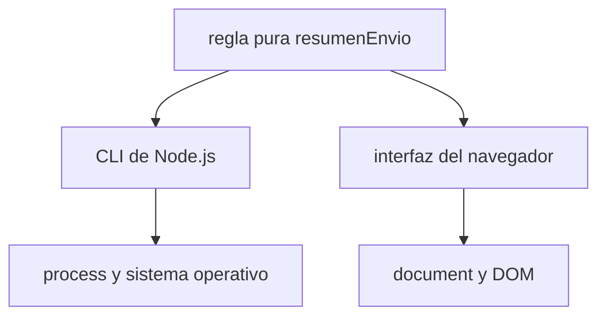

# Módulo 0: Fundamentos de JavaScript con ejemplos independientes

Cada tema comienza en su propia carpeta vacía. El proyecto integrador existe aparte y no es requisito para estudiar estas lecciones.

## Mapa de la ruta

«JavaScript: fundamentos y temas avanzados» tiene 15 módulos en 4 etapas. Cada etapa se apoya en la anterior; usa la tabla para saltar a un módulo concreto.



| Módulo | Etapa | Qué aprendes |
|---|---|---|
| 0 | Fundamentos | [Fundamentos del lenguaje y el entorno](/curso/javascript/0) |
| 1 | Fundamentos | [Operadores, control de flujo y funciones](/curso/javascript/1) |
| 2 | Fundamentos | [Scope, closures y el modelo de ejecución](/curso/javascript/2) |
| 3 | Fundamentos | [Objetos, prototipos y clases](/curso/javascript/3) |
| 4 | Fundamentos | [Arrays y estructuras de datos funcionales](/curso/javascript/4) |
| 5 | Aplicación | [Asincronía I: Event Loop y Promesas](/curso/javascript/5) |
| 6 | Aplicación | [Asincronía II: async/await y fetch](/curso/javascript/6) |
| 7 | Aplicación | [Módulos modernos y herramientas de build](/curso/javascript/7) |
| 8 | Aplicación | [El DOM y eventos del navegador](/curso/javascript/8) |
| 9 | Integración | [Testing y calidad de código](/curso/javascript/9) |
| 10 | Integración | [Patrones avanzados y rendimiento](/curso/javascript/10) |
| 11 | Experto | [TypeScript esencial para devs de JavaScript](/curso/javascript/11) |
| 12 | Experto | [Proyecto integrador: SPA sin framework](/curso/javascript/12) |
| 13 | Experto | [JavaScript en producción: seguridad, memoria y compatibilidad](/curso/javascript/13) |
| 14 | Experto | [JavaScript Master: APIs avanzadas del navegador, WASM y cómputo emergente](/curso/javascript/14) |

## Aprende construyendo

Cada tema se estudia en su propia carpeta y termina con una comprobación ejecutable; el orden importa porque cada uno reutiliza el modelo del anterior.

## Antes de comenzar: preparación del entorno

Instala [Node.js 24 LTS](https://nodejs.org/en/download) (la versión de referencia de la academia, ver `docs/VERSIONES.md`), [Visual Studio Code](https://code.visualstudio.com/) y [Git](https://git-scm.com/downloads). En Windows abre PowerShell; en macOS o Linux abre Terminal. Verifica:

```bash
node --version
npm --version
git --version
```

Las tres instrucciones deben mostrar una versión; `node --version` debe empezar por `v24`. Todo el curso usa Node 24 LTS y solo indica otra versión cuando un tema lo justifica. Si `node` no se reconoce, cierra y abre la terminal; si continúa, reinstala Node.js LTS y permite que el instalador actualice `PATH`.

Crea el proyecto exactamente así:

```bash
mkdir academia-javascript
cd academia-javascript
npm init -y
mkdir src
```

```text
academia-javascript/
├── package.json
└── src/
```

### Tema 1: Variables — `const`, `let` y `var`

#### Paso 1 · Objetivo y preparación

Al finalizar podrás elegir `const` o `let`, explicar alcance, reasignación y mutación, y reconocer por qué `var` causa errores difíciles de ver.

**Conocimiento previo:** abrir una terminal, crear un archivo y ejecutar `node archivo.js`.

#### Paso 2 · Contexto y caso real

**¿Por qué es importante?** Un servicio necesita conservar una guía, cambiar el estado de una entrega y actualizar algunos datos. Si todos los valores pudieran cambiar desde cualquier lugar, sería difícil saber quién produjo un error. Declarar una variable expresa tanto un dato como la intención de modificarlo.

#### Paso 3 · Teoría con analogía

Una variable es una etiqueta que permite encontrar un valor. `const` fija la etiqueta al mismo valor; `let` permite reemplazar el valor asociado; `var` usa alcance de función y puede escapar de un bloque. Imagina casilleros: `const` impide cambiar de casillero, aunque un objeto guardado dentro todavía pueda actualizarse.

**Conceptos clave:** `const` no permite reasignación; `let` sí; ambas tienen alcance de bloque y zona muerta temporal. `var` tiene alcance de función y se inicializa como `undefined` durante el *hoisting*. Usa `const` por defecto y `let` solo cuando exista una reasignación deliberada.



#### Paso 4 · Demostración guiada desde cero

Crea desde una carpeta vacía `ejemplo-variables/src/01-variables.js`:

```bash
mkdir ejemplo-variables
cd ejemplo-variables
npm init -y
mkdir src
```

`npm` es el comando que gestiona paquetes y proyectos de Node.js; `npm init -y` es el subcomando que crea un `package.json` inicial aceptando los valores por defecto.

```javascript
// La guía identifica siempre la misma entrega: no se reasigna.
const guia = 'RF-001';

// El estado sí avanza durante el recorrido.
let estado = 'creado';

// const protege la referencia, no congela el objeto.
const envio = { guia, pesoKg: 2 };
envio.pesoKg = 2.5;
estado = 'en-ruta';

console.log(`${envio.guia} | ${estado} | ${envio.pesoKg} kg`);
```

Ejecuta desde `ejemplo-variables/`:

```bash
node src/01-variables.js
```

`node` es el comando que ejecuta un archivo JavaScript con el runtime de Node.js, fuera del navegador.

**Resultado esperado:** `RF-001 | en-ruta | 2.5 kg`.

**Fallo deliberado:** añade `guia = 'RF-002'`. Node mostrará `TypeError: Assignment to constant variable`. El error indica que intentaste cambiar la referencia protegida; no significa que `const` vuelva inmutable un objeto.

#### Paso 5 · Práctica guiada

Agrega `let intentos = 0`, increméntalo dos veces e inclúyelo en la salida. **Pista:** usa `intentos += 1`. Antes de ejecutar, predice el número final.

#### Paso 6 · Práctica independiente

Crea `const conductor = { nombre: 'Ana', disponible: true }`; cambia únicamente `disponible` y muestra el objeto. Después intenta reasignar `conductor` y explica con tus palabras por qué una operación funciona y la otra falla.

#### Paso 7 · Cierre

Aprendiste a comunicar intención con `const` y `let`. El próximo tema explica qué clases de valores guardan esas variables. Demuestra el aprendizaje entregando la salida correcta, el `TypeError` provocado y una explicación de dos frases. Fuente oficial: [MDN — declaraciones y variables](https://developer.mozilla.org/es/docs/Web/JavaScript/Guide/Grammar_and_types#declaraciones).

**Errores comunes:** creer que `const` congela objetos; usar `let` para todo; declarar `var` dentro de un `if` esperando alcance de bloque.

**Transferencia al proyecto integrador «Seguimiento público accesible»:** Declara la guía consultada y el estado de carga con el alcance adecuado. Prueba dos búsquedas consecutivas y demuestra qué valores cambian y qué referencias permanecen constantes durante una consulta.

**Límites y decisión de uso:** Const impide reasignar la referencia, no modificar las propiedades del objeto referenciado. Para snapshots, crea estructuras nuevas y controla mutaciones anidadas; la [referencia de const](https://developer.mozilla.org/en-US/docs/Web/JavaScript/Reference/Statements/const) distingue ambos comportamientos.

### Tema 2: Tipos primitivos y `typeof`

#### Paso 1 · Objetivo y preparación

Al finalizar podrás reconocer los siete tipos primitivos, inspeccionarlos con `typeof` y validar correctamente `null`, arrays y números inválidos.

**Conocimiento previo:** variables con `const` y `let`.

#### Paso 2 · Contexto y caso real

**¿Por qué es importante?** En una aplicación una guía es texto, un peso es número y una entrega puede no tener conductor. Confundir esas categorías produce cálculos incorrectos y validaciones que aceptan datos imposibles.

#### Paso 3 · Teoría con analogía

Los tipos son categorías de equipaje: cada una admite operaciones diferentes. JavaScript tiene `string`, `number`, `boolean`, `undefined`, `null`, `symbol` y `bigint`. Objetos, arrays y funciones no son primitivos. `typeof null` devuelve históricamente `'object'`; por eso `null` se comprueba directamente. Para arrays usa `Array.isArray` y para `NaN`, `Number.isNaN`.

#### Paso 4 · Demostración guiada desde cero

Desde una carpeta vacía crea `ejemplo-tipos` y `src/02-tipos.js`:

```bash
mkdir ejemplo-tipos
cd ejemplo-tipos
npm init -y
mkdir src
```

```javascript
const envio = {
  guia: 'RF-001',                 // string
  pesoKg: 2.5,                    // number
  entregado: false,               // boolean
  conductor: null,                // ausencia intencional
  observacion: undefined,         // todavía no asignada
  idInterno: Symbol('envio'),      // identificador único
  eventos: 9_007_199_254_740_993n // bigint
};

for (const [campo, valor] of Object.entries(envio)) {
  console.log(campo, typeof valor);
}
console.log('conductor ausente:', envio.conductor === null);
```

```bash
node src/02-tipos.js
```

**Resultado esperado:** aparecen `string`, `number`, `boolean`, `object`, `undefined`, `symbol` y `bigint`; la última línea dice `true`.

**Fallo deliberado:** añade `console.log(JSON.stringify(envio))`. Obtendrás `TypeError: Do not know how to serialize a BigInt`. El diagnóstico es que JSON no representa `bigint`; convierte ese campo conscientemente a texto antes de serializar.

#### Paso 5 · Práctica guiada

Agrega `paradas: []` y predice `typeof envio.paradas`. **Pista:** después comprueba `Array.isArray(envio.paradas)`.

#### Paso 6 · Práctica independiente

Escribe `describirTipo(valor)` para distinguir `null`, array y los resultados normales de `typeof`. Prueba al menos nueve valores sin copiar una tabla de respuestas.

#### Paso 7 · Cierre

Ya puedes inspeccionar un dato antes de operar con él. El siguiente tema muestra por qué JavaScript a veces convierte tipos automáticamente. Entrega la salida, el fallo de `BigInt` y los nueve casos de tu función. Fuente oficial: [MDN — tipos y estructuras](https://developer.mozilla.org/es/docs/Web/JavaScript/Guide/Data_structures).

Distinguir estos tipos primitivos es la base para el proyecto integrador de este track (SPA sin framework, Módulo 12): cada dato que llegue de una API o de un formulario (texto, número, ausencia) deberá inspeccionarse igual antes de guardarlo en el estado de la aplicación.

**Cuándo no usarlo:** inspeccionar manualmente cada `typeof` en cada punto del código no escala en una aplicación grande; para eso existen los validadores de esquema (Módulo 9) que centralizan esta comprobación en la frontera, en vez de repetirla dispersa por todo el código.

**Errores comunes:** asumir que `typeof null` es `'null'`; detectar arrays con `typeof`; mezclar `number` y `bigint` en una operación.

### Tema 3: Conversión, coerción e igualdad

#### Paso 1 · Objetivo y preparación

Al finalizar convertirás datos externos explícitamente y elegirás `===` para evitar decisiones ocultas.

**Conocimiento previo:** tipos primitivos y `Number.isNaN`.

#### Paso 2 · Contexto y caso real

**¿Por qué es importante?** Los campos HTML y muchos parámetros HTTP llegan como texto. El proyecto puede recibir `'101'` aunque el identificador interno sea el número `101`. Compararlos sin una frontera clara puede encontrar la entrega equivocada.

#### Paso 3 · Teoría con analogía

La coerción implícita es un traductor que interviene sin que se lo pidas. `==` puede convertir operandos antes de comparar; `===` exige tipo y valor iguales. En código profesional convierte una vez al entrar (`Number`, `String`, `Boolean`) y luego opera con tipos conocidos.

#### Paso 4 · Demostración guiada desde cero

Desde una carpeta vacía crea `ejemplo-conversion` y `src/03-conversion.js`:

```bash
mkdir ejemplo-conversion
cd ejemplo-conversion
npm init -y
mkdir src
```

```javascript
function convertirId(texto) {
  const id = Number(texto);
  if (!Number.isInteger(id) || id <= 0) {
    throw new TypeError(`ID inválido: ${texto}`);
  }
  return id;
}

const idHttp = '101';
const idGuardado = 101;
console.log('sin convertir:', idHttp === idGuardado);
console.log('convertido:', convertirId(idHttp) === idGuardado);
```

```bash
node src/03-conversion.js
```

**Resultado esperado:** `sin convertir: false` y `convertido: true`.

**Explicación:** `idHttp` es una cadena y `idGuardado` un número; `===` compara tipo y valor, por eso el primer resultado es `false`. `Number` convierte una vez, pero también acepta `''` y `'   '` como `0`; por eso la validación exige `Number.isInteger` y un límite positivo antes de confiar en el valor. `parseInt('101abc')` devolvería `101` y ocultaría un dato inválido en la frontera.

**Fallo deliberado:** llama `convertirId('RF-101')`. El error debe conservar el dato rechazado. No lo “corrijas” usando `parseInt`, porque aceptaría parcialmente textos como `'101abc'`.

#### Paso 5 · Práctica guiada

Prueba `''`, `'0'`, `'7'` y `'7.5'`. **Pista:** escribe primero tu predicción y luego registra éxito o mensaje de error.

#### Paso 6 · Práctica independiente

Crea `convertirPeso(texto)` que acepte decimales positivos y rechace vacío, `NaN`, cero e infinito. Integra la función en el objeto de entrega del Tema 1.

#### Paso 7 · Cierre

Aprendiste a validar en la frontera y mantener comparaciones predecibles. El siguiente tema construye mensajes legibles usando plantillas. Evidencia: tabla de cinco entradas con predicción y resultado. Fuente oficial: [MDN — igualdad estricta](https://developer.mozilla.org/es/docs/Web/JavaScript/Reference/Operators/Strict_equality).

Convertir explícitamente en la frontera (nunca confiar en `==`) es exactamente el hábito que necesitará el proyecto integrador (SPA sin framework, Módulo 12) al leer valores de un formulario HTML o de la respuesta de una API, donde todo llega como texto.

**Cuándo no usarlo:** convertir manualmente campo por campo como aquí es razonable para un puñado de valores; en un formulario con muchos campos o reglas de validación cruzadas, una librería de validación de esquemas (Módulo 9) es más mantenible que funciones `convertirX` repetidas.

**Errores comunes:** usar `==` para evitar convertir; aceptar el resultado `NaN`; confundir `Number('')`, que produce cero, con una entrada válida.

### Tema 4: Template literals y mensajes seguros

#### Paso 1 · Objetivo y preparación

Al finalizar construirás mensajes legibles con interpolación, valores opcionales y funciones pequeñas.

**Conocimiento previo:** objetos, conversión y funciones básicas.

#### Paso 2 · Contexto y caso real

**¿Por qué es importante?** Los conductores y operadores del proyecto necesitan mensajes claros sobre cada entrega. Concatenar muchas piezas con `+` dificulta ver espacios, unidades y valores faltantes.

#### Paso 3 · Teoría con analogía

Un template literal es una plantilla de etiqueta con espacios reservados. Usa acentos graves y `${expresión}`. Puede ocupar varias líneas. La interpolación convierte valores a texto, pero no escapa HTML automáticamente: para insertar datos de usuarios en una página usa `textContent`, no `innerHTML`.

#### Paso 4 · Demostración guiada desde cero

Desde una carpeta vacía crea `ejemplo-template` y `src/04-resumen.js`:

```bash
mkdir ejemplo-template
cd ejemplo-template
npm init -y
mkdir src
```

```javascript
function resumenEnvio(envio) {
  const destino = envio.destino ?? 'sin destino';
  return `Guía ${envio.guia}: ${envio.estado}\nDestino: ${destino}\nPeso: ${envio.pesoKg} kg`;
}

console.log(resumenEnvio({ guia: 'RF-001', estado: 'en-ruta', pesoKg: 2.5 }));
```

```bash
node src/04-resumen.js
```

**Resultado esperado:** tres líneas; la segunda termina en `sin destino`.

**Explicación:** la plantilla conserva saltos de línea y espacios sin concatenar; `${envio.pesoKg}` convierte el número a texto, pero la unidad `kg` se escribe aparte porque el dato no la incluye. `??` solo sustituye `null` o `undefined`; si el peso fuera `0`, seguiría mostrándose como `0 kg`, mientras que `||` lo reemplazaría por el valor por defecto. La interpolación no escapa HTML: `textContent` sigue siendo necesario al insertar el resultado en el DOM.

**Fallo deliberado:** reemplaza `??` por `||` y prueba un valor permitido igual a `0`. Observa que `||` también reemplaza valores *falsy* válidos; restaura `??` cuando solo quieras tratar `null` o `undefined`.

#### Paso 5 · Práctica guiada

Agrega conductor opcional. **Pista:** usa `envio.conductor?.nombre ?? 'sin asignar'` y prueba con y sin objeto.

#### Paso 6 · Práctica independiente

Construye `resumenRuta` con número de paradas, distancia y conductor. Luego muestra el resultado en un `<output>` usando `textContent` y explica por qué no elegiste `innerHTML`.

#### Paso 7 · Cierre

Ahora puedes presentar datos sin perder legibilidad ni confundir ausencia con cero. El siguiente tema separa el lenguaje de las APIs de cada entorno. Evidencia: salidas con destino ausente, vacío y definido. Fuente oficial: [MDN — template literals](https://developer.mozilla.org/es/docs/Web/JavaScript/Reference/Template_literals).

Renderizar datos con `textContent` en vez de interpolar HTML crudo es exactamente la regla que seguirá cada vista del proyecto integrador (SPA sin framework, Módulo 12): sin un framework que escape automáticamente, la app debe evitar `innerHTML` con datos que vengan de un usuario o de la API.

**Cuándo no usarlo:** un template literal simple como este no reemplaza un motor de plantillas cuando el HTML generado es grande o repetitivo; en ese caso conviene una función de renderizado dedicada (Módulo 3) en vez de concatenar strings de HTML completos a mano.

**Errores comunes:** usar comillas normales; asumir que interpolar hace seguro el HTML; emplear `||` cuando cero o cadena vacía son datos válidos.

### Tema 5: JavaScript en navegador y Node.js

#### Paso 1 · Objetivo y preparación

Al finalizar distinguirás el lenguaje de su entorno y ejecutarás la misma regla del proyecto desde terminal y navegador.

**Conocimiento previo:** módulos, funciones y DOM básico; si aún no conoces DOM, sigue literalmente la demostración.

#### Paso 2 · Contexto y caso real

**¿Por qué es importante?** JavaScript puede calcular el resumen tanto en backend como en frontend, pero `document` solo existe en navegador y `process` pertenece a Node.js. Saber dónde vive una API evita copiar código que nunca podrá ejecutarse en ese entorno.

#### Paso 3 · Teoría con analogía

JavaScript es el idioma; navegador y Node.js son lugares donde se habla. Comparten sintaxis y objetos estándar, pero el navegador aporta DOM y almacenamiento web, mientras Node aporta archivos, procesos y red del servidor. Una regla pura puede compartirse; un adaptador dependiente del entorno debe permanecer en el borde.



#### Paso 4 · Demostración guiada desde cero

Desde una carpeta vacía crea `ejemplo-entorno-js`, ejecuta `npm init -y`, crea `src` y `web`, y añade `"type": "module"` a `package.json` (el comando `npm pkg set` lo hace por ti):

```bash
mkdir ejemplo-entorno-js
cd ejemplo-entorno-js
npm init -y
npm pkg set type=module
mkdir src web
```

Crea `src/resumen.js` con la función del tema anterior, ahora exportada:

```javascript
export function resumenEnvio(envio) {
  const destino = envio.destino ?? 'sin destino';
  return `Guía ${envio.guia}: ${envio.estado}\nDestino: ${destino}\nPeso: ${envio.pesoKg} kg`;
}
```

Crea `src/cli.js`:

```javascript
import { resumenEnvio } from './resumen.js';
console.log(resumenEnvio({ guia: 'RF-001', estado: 'en-ruta', pesoKg: 2.5 }));
```

Crea también `web/index.html`:

```html
<!doctype html>
<html lang="es">
  <head>
    <meta charset="utf-8">
    <title>Resumen de envío</title>
  </head>
  <body>
    <h1>Resumen de envío</h1>
    <output id="estado" style="white-space: pre-line"></output>
    <script type="module" src="./app.js"></script>
  </body>
</html>
```

Y `web/app.js`:

```javascript
import { resumenEnvio } from '../src/resumen.js';
const salida = document.querySelector('#estado');
salida.textContent = resumenEnvio({ guia: 'RF-001', estado: 'en-ruta', pesoKg: 2.5 });
```

Sirve la carpeta —no abras el HTML con doble clic—:

```bash
node src/cli.js
npx serve .
```

`npx` es el comando que ejecuta un paquete sin instalarlo globalmente (acá, `serve`, un servidor estático simple).

**Resultado esperado:** terminal y `<output id="estado">` (abre `http://localhost:3000/web/` en el navegador) muestran el mismo resumen.

**Fallo deliberado:** escribe `document.querySelector` en `src/cli.js`; Node informa `ReferenceError: document is not defined`. El cálculo no falla: el adaptador está en el entorno incorrecto.

#### Paso 5 · Práctica guiada

Recibe la guía mediante `process.argv[2]` en la CLI. **Pista:** valida ausencia antes de llamar la función y muestra `Uso: node src/cli.js <guía>`.

#### Paso 6 · Práctica independiente

Agrega un formulario web que reciba guía y estado, pero conserva `resumenEnvio` sin referencias a `document` ni `process`. Demuestra la misma regla con una prueba de Node.

#### Paso 7 · Cierre

Completaste un primer incremento del proyecto ejecutable en dos entornos. El siguiente módulo profundiza en operadores, control de flujo y funciones sobre estas mismas herramientas. Fuentes oficiales: [Node.js ECMAScript modules](https://nodejs.org/api/esm.html) y [MDN — DOM](https://developer.mozilla.org/es/docs/Web/API/Document_Object_Model).

**Errores comunes:** abrir módulos con `file://`; importar una ruta incorrecta; usar `document` en Node; mezclar reglas del dominio con la actualización del DOM.

**Transferencia al proyecto integrador «Seguimiento público accesible»:** Separa el renderizado del widget de la transformación de datos. Ejecuta esa transformación en Node y en el navegador con la misma entrada; solo la capa visual debe depender de document.

**Límites y decisión de uso:** Compartir lenguaje no implica compartir APIs: document pertenece al navegador y los módulos de archivos al entorno que los proporciona. Aísla dependencias de plataforma y prueba cada destino que anuncie soportar el paquete.

### Tema 6: Números, strings y fechas con la biblioteca estándar

**Duración estimada:** 40 min (3 subtemas de 10–15 min).
**¿Por qué es importante?** Casi todo dato de RutaFlow es un precio, un texto que alguien escribió o una hora de entrega. Los tres tienen trampas conocidas: `0.1 + 0.2` no da `0.3`, los strings no cambian aunque llames `toUpperCase()` y los meses de `Date` empiezan en 0. Aprenderlas aquí evita errores que después parecen «bugs raros».

**Prerrequisitos:** Temas 2 (tipos primitivos), 3 (conversión) y 4 (template literals) de este módulo. Node 24 LTS. Proyecto continuo: la etiqueta de entrega de RutaFlow que luego validarás (Módulo 1) y transformarás en lote (Módulo 4).

```bash
mkdir -p academia-labs/javascript/numeros-strings-fechas && cd academia-labs/javascript/numeros-strings-fechas
```

#### Subtema 6.1: Números: precisión, conversión y `Math` · 15 min

**1. Contexto**
La tarifa de una entrega suma tres montos con decimales. Si sumas `number` con decimales y comparas, el total puede quedar a un pelo del valor correcto.

**2. Hazlo tú**
Crea `numeros.js`:

```javascript
console.log(0.1 + 0.2);
console.log(0.1 + 0.2 === 0.3);

const tarifaBase = 19.99;
const recargo = 5.01;
const seguro = 0.1;
const totalCentavos = Math.round(tarifaBase * 100) + Math.round(recargo * 100) + Math.round(seguro * 100);
console.log(totalCentavos, (totalCentavos / 100).toFixed(2));

console.log(Number('12.5'), Number('12.5kg'), Number.parseFloat('12.5kg'), Number(''));
console.log(Number.isNaN(Number('abc')), Number.isInteger(4.0), Number.isSafeInteger(2 ** 53));
console.log(Math.round(2.5), Math.round(-2.5), Math.floor(-2.5), Math.trunc(-2.5), Math.ceil(2.1));
console.log(Math.max(3, 9, 4), 7 % 3, 2 ** 10);
```

```bash
node numeros.js
```

**Resultado esperado:**

```text
0.30000000000000004
false
2510 25.10
12.5 NaN 12.5 0
true true false
3 -2 -3 -2 3
9 1 1024
```

**Fallo deliberado:** cambia `Math.round(tarifaBase * 100)` por `Math.trunc(tarifaBase * 100)`. **Resultado:** `2509 25.09`, un centavo menos. **Diagnóstico:** ejecuta `node -p "19.99 * 100"`: da `1998.9999999999998`; `trunc` corta los decimales y pierde el centavo. Para pasar a centavos, redondea; restaura `Math.round`.

**3. Entiende**
`number` es un decimal binario de 64 bits (IEEE 754): `0.1` no tiene representación exacta, igual que 1/3 no la tiene en decimal. Para dinero, trabaja en **enteros de centavos** y convierte a texto solo al mostrar con `toFixed(2)` (que devuelve un **string**). `Number(texto)` exige que todo el texto sea número (`'12.5kg'` → `NaN`; `''` → `0`, cuidado), mientras `Number.parseFloat` lee hasta donde puede. Comprueba `NaN` con `Number.isNaN`, porque `NaN === NaN` es `false`. `Math.round` redondea hacia +∞ en los empates (`-2.5` → `-2`); `Math.trunc` corta hacia cero. **Límite:** por encima de `Number.MAX_SAFE_INTEGER` (2⁵³ − 1) los enteros pierden exactitud; para identificadores enormes usa `bigint` (Tema 2) o string.

**4. Cierra**
Guarda la salida y anota por qué `Number('')` es una trampa al leer formularios.

#### Subtema 6.2: Strings: limpiar, cortar y buscar · 10 min

**1. Contexto**
Una persona escribe la etiqueta a mano con espacios y minúsculas: `'  bo-004512 | Calle 45 # 12-30 | chapinero  '`. Antes de guardarla hay que normalizarla.

**2. Hazlo tú**
Crea `strings.js`:

```javascript
const crudo = '  bo-004512 | Calle 45 # 12-30 | chapinero  ';
const limpio = crudo.trim();
console.log(limpio.length, JSON.stringify(limpio));

const partes = limpio.split(' | ');
const guia = partes[0].toUpperCase();
const direccion = partes[1];
const barrio = partes[2][0].toUpperCase() + partes[2].slice(1);
console.log(guia, '/', direccion, '/', barrio);

console.log(guia.startsWith('BO-'), direccion.includes('#'), guia.at(-1), guia.slice(3), guia.slice(-3));
console.log(String(7).padStart(4, '0'), 'a-b-c'.replaceAll('-', '/'), 'Zona Norte'.indexOf('Sur'));

const etiqueta = 'bo-004512';
etiqueta.toUpperCase();
console.log(etiqueta);
```

```bash
node strings.js
```

**Resultado esperado:**

```text
40 "bo-004512 | Calle 45 # 12-30 | chapinero"
BO-004512 / Calle 45 # 12-30 / Chapinero
true true 2 004512 512
0007 a/b/c -1
bo-004512
```

**Fallo deliberado:** cambia el separador de `split(' | ')` por `split(',')`. **Error esperado:** `TypeError: Cannot read properties of undefined (reading '0')`. **Diagnóstico:** sin comas, `split` devuelve un array de **un** elemento y `partes[2]` es `undefined`; imprime `partes` y usa el separador real del texto.

**3. Entiende**
Los strings son **inmutables**: cada método (`trim`, `toUpperCase`, `slice`, `replaceAll`, `padStart`) devuelve un string **nuevo**; por eso la última línea imprime `bo-004512` sin cambios: el resultado se descartó. `slice` admite índices negativos para contar desde el final, igual que `at(-1)`. `indexOf` devuelve `-1` si no encuentra, mientras `includes`/`startsWith` devuelven booleanos y se leen mejor en un `if`. **Límite:** `length` cuenta unidades UTF-16, no letras que ves: algunos emoji ocupan 2; si necesitas contar caracteres visibles para un límite de interfaz, usa `Intl.Segmenter` (Módulo 13).

**4. Cierra**
Guarda la salida. La etiqueta queda normalizada en tres partes listas para validar.

#### Subtema 6.3: Fechas: instantes, zonas horarias y aritmética · 15 min

**1. Contexto**
RutaFlow guarda la salida y la llegada de cada entrega, calcula cuánto tardó y muestra la hora al cliente en Bogotá y al socio en Madrid.

**2. Hazlo tú**
Crea `fechas.js`:

```javascript
const salida = new Date('2026-11-18T08:30:00Z');
const llegada = new Date('2026-11-18T14:05:00Z');
console.log(salida.toISOString());
console.log(salida.getUTCFullYear(), salida.getUTCMonth(), salida.getUTCDate());

const minutos = (llegada.getTime() - salida.getTime()) / 60_000;
console.log(`duración: ${minutos} min`);

console.log(salida.toLocaleString('es-CO', { timeZone: 'America/Bogota', dateStyle: 'medium', timeStyle: 'short' }));
console.log(salida.toLocaleString('es-ES', { timeZone: 'Europe/Madrid', dateStyle: 'medium', timeStyle: 'short' }));

const manana = new Date(salida);
manana.setUTCDate(manana.getUTCDate() + 1);
console.log(salida.toISOString().slice(0, 10), manana.toISOString().slice(0, 10));

console.log(new Date(Date.UTC(2026, 0, 31)).toISOString().slice(0, 10));
console.log(String(new Date('ayer')), Number.isNaN(new Date('ayer').getTime()));
```

```bash
node fechas.js
```

**Resultado esperado** (el formato local puede variar un poco según la versión de ICU de tu Node):

```text
2026-11-18T08:30:00.000Z
2026 10 18
duración: 335 min
18/11/2026, 3:30 a. m.
18 nov 2026, 9:30
2026-11-18 2026-11-19
2026-01-31
Invalid Date true
```

**Fallo deliberado:** cambia `Date.UTC(2026, 0, 31)` por `Date.UTC(2026, 1, 31)` creyendo que `1` es enero. **Resultado:** `2026-03-03`. **Diagnóstico:** los meses de `Date` van de 0 (enero) a 11 (diciembre), y un día fuera de rango no lanza error: «31 de febrero» se desborda a marzo. Valida rangos tú mismo y restaura el `0`.

**3. Entiende**
Un `Date` es un **instante**: milisegundos desde 1970-01-01 UTC (`getTime()`). Restar dos instantes da milisegundos; divide entre `60_000` para minutos (el `_` solo separa dígitos). La zona horaria aparece **al mostrar**: `toLocaleString` con `timeZone` traduce el mismo instante a la hora de Bogotá (UTC−5) o de Madrid (UTC+1 en noviembre). Usa siempre texto ISO con `Z` u offset al crear fechas; `new Date('2026-11-18')` se interpreta como medianoche UTC y en Bogotá `getDate()` da `17`. `setUTCDate` **muta** el objeto, por eso se copia antes con `new Date(salida)`. **Límite:** `Date` no representa «solo una fecha» ni «una hora en una zona» y es mutable; la API `Temporal` resuelve esos casos y la verás en el Módulo 13 con detección de soporte.

**4. Cierra**
Guarda la salida y escribe en una línea qué hora verá un cliente de Bogotá si la entrega sale a las `08:30Z`.

**Hito del tema:**

- [ ] Ejecuté los tres archivos y obtuve las salidas esperadas.
- [ ] Reproduje el centavo perdido con `Math.trunc` y lo expliqué con `19.99 * 100`.
- [ ] Demostré que `toUpperCase()` no cambia el string original.
- [ ] Expliqué por qué `Date.UTC(2026, 1, 31)` da 3 de marzo y no un error.

**Ejercicio:** escribe `etiqueta.js` que, a partir de `const linea = ' bo-77 | 2026-11-18T16:45:00Z | 12.5 ';`, imprima exactamente `BO-000077 · 18/11/26, 11:45 a. m. · $12.50`. La guía lleva el prefijo y el número rellenado a 6 cifras; la hora se muestra en Bogotá; el monto con dos decimales. Escribe tu predicción de la hora de Bogotá antes de ejecutar.

<details>
<summary>Solución — ábrela después de intentarlo</summary>

```javascript
const linea = ' bo-77 | 2026-11-18T16:45:00Z | 12.5 ';
const partes = linea.trim().split(' | ');

const prefijo = partes[0].slice(0, 2).toUpperCase();
const numero = partes[0].slice(3);
const guia = `${prefijo}-${numero.padStart(6, '0')}`;

const hora = new Date(partes[1]).toLocaleString('es-CO', {
  timeZone: 'America/Bogota',
  dateStyle: 'short',
  timeStyle: 'short',
});

const centavos = Math.round(Number(partes[2]) * 100);
const monto = `$${(centavos / 100).toFixed(2)}`;

console.log(`${guia} · ${hora} · ${monto}`);
```

Salida:

```text
BO-000077 · 18/11/26, 11:45 a. m. · $12.50
```

Si tu hora salió `4:45 p. m.` en un equipo configurado en UTC, mostraste la hora sin convertir: falta `timeZone`. Si usaste `Number(partes[2]).toFixed(2)` directamente también funciona aquí; pasar a centavos importa cuando además sumas montos.

</details>

**Fuentes oficiales:** [MDN: Numbers and strings](https://developer.mozilla.org/en-US/docs/Web/JavaScript/Guide/Numbers_and_strings), [MDN: Representing dates & times](https://developer.mozilla.org/en-US/docs/Web/JavaScript/Guide/Representing_dates_times) y [MDN: `Date`](https://developer.mozilla.org/en-US/docs/Web/JavaScript/Reference/Global_Objects/Date).

## Ruta de proyecto progresivo desde carpeta vacía

Conserva `academia-javascript/` para los siguientes módulos. Cada tema agrega una capacidad al mismo proyecto; no vuelvas a ejecutar `npm init` ni crees proyectos desechables. Antes de avanzar confirma que `node src/cli.js` y la interfaz web siguen mostrando el mismo resultado. Guarda el hito con Git solo cuando puedas reproducir éxito y fallo desde una terminal nueva.
