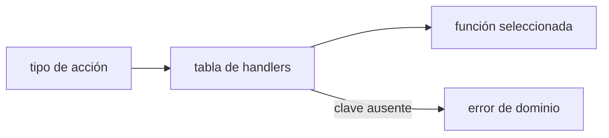
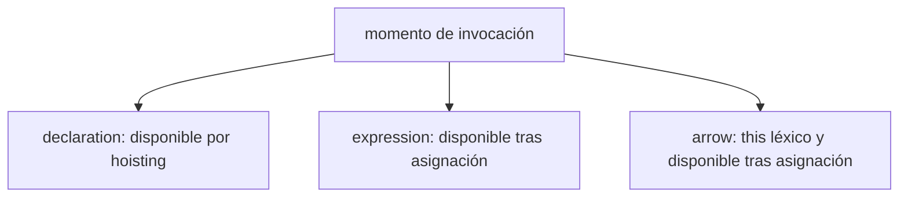
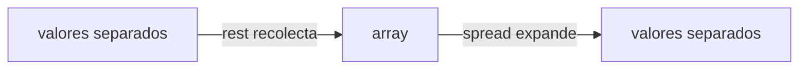
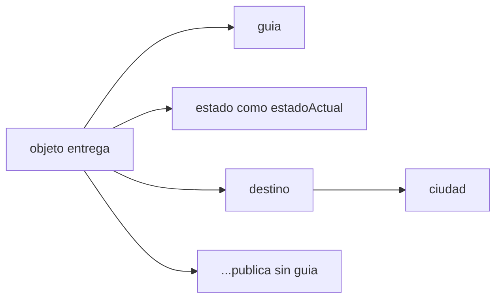
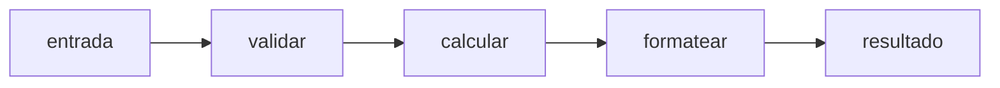
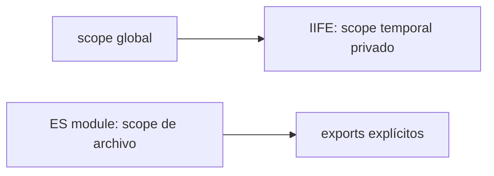

# Módulo 1: Operadores, control de flujo y funciones


## Aprende construyendo


### Tema 1: Control de flujo — if, switch y loops · Básico · 30 min

<details open>
<summary><strong>Capa 1 — Lectura</strong></summary>

#### ► DE QUÉ TRATA
Al finalizar podrás elegir entre if, switch, tablas de funciones y bucles para expresar reglas sin ramas ocultas.

#### ► CÓMO FUNCIONA


</details>

<details>
<summary><strong>Capa 2 — Construcción</strong></summary>

#### Código y verificación


```bash
mkdir ejemplo-estados
cd ejemplo-estados
npm init -y
mkdir src
```

```javascript
const transiciones = {
  creado: { asignar: 'asignado', cancelar: 'cancelado' },
  asignado: { iniciar: 'en-ruta', cancelar: 'cancelado' },
  'en-ruta': { entregar: 'entregado' },
};

function aplicar(estado, accion) {
  // ?. evita leer una acción sobre un estado sin transiciones.
  const siguiente = transiciones[estado]?.[accion];
  if (!siguiente) throw new Error(`Transición inválida: ${estado} -> ${accion}`);
  return siguiente;
}

let estado = 'creado';
for (const accion of ['asignar', 'iniciar', 'entregar']) {
  estado = aplicar(estado, accion);
  console.log(estado);
}
```

```bash
node src/estados.js
```

</details>

### Tema 2: Tres formas de escribir una función · Básico · 35 min

<details open>
<summary><strong>Capa 1 — Lectura</strong></summary>

#### ► DE QUÉ TRATA
Al finalizar podrás elegir declaración, expresión o función flecha según hoisting y this.

#### ► CÓMO FUNCIONA


</details>

<details>
<summary><strong>Capa 2 — Construcción</strong></summary>

#### Código y verificación


```bash
mkdir ejemplo-funciones
cd ejemplo-funciones
npm init -y
mkdir src
```

```javascript
function calcularTarifa(pesoKg) { // declaración: disponible por hoisting
  return pesoKg * 7.4;
}
const formatearDinero = function (valor) { // expresión: disponible tras asignación
  return `$${valor.toFixed(2)}`;
};
const presentar = (envio) => // flecha: útil para transformar cada elemento
  `${envio.guia}: ${formatearDinero(calcularTarifa(envio.pesoKg))}`;

console.log(presentar({ guia: 'RF-1', pesoKg: 2.5 }));
```

```bash
node src/funciones.js
```

</details>

### Tema 3: Parámetros por defecto y rest/spread · Intermedio · 35 min

<details open>
<summary><strong>Capa 1 — Lectura</strong></summary>

#### ► DE QUÉ TRATA
Al finalizar podrás definir valores opcionales, recolectar argumentos con rest y expandir arrays u objetos con spread sin confundir copia superficial con clonación profunda.

#### ► CÓMO FUNCIONA


</details>

<details>
<summary><strong>Capa 2 — Construcción</strong></summary>

#### Código y verificación


```bash
mkdir ejemplo-parametros
cd ejemplo-parametros
npm init -y
mkdir src
```

```javascript
// Rest reúne todos los cargos restantes en un array real.
function calcularTotal(moneda = 'COP', ...cargos) {
  const total = cargos.reduce((acumulado, cargo) => acumulado + cargo, 0);
  return { moneda, total };
}

const envioOriginal = { guia: 'RF-2', estado: 'creado' };
const tarifa = calcularTotal(undefined, ...[12_000, 3_500, 1_000]);

// Spread crea otro objeto de primer nivel; el original permanece igual.
const envioActualizado = { ...envioOriginal, tarifa };
console.log(envioOriginal);
console.log(envioActualizado);
```

```bash
node src/parametros.js
```

</details>

### Tema 4: Desestructuración, valores por defecto y rest · Intermedio · 40 min

<details open>
<summary><strong>Capa 1 — Lectura</strong></summary>

#### ► DE QUÉ TRATA
Al finalizar podrás extraer valores de objetos y arrays con desestructuración, renombrar, dar valores por defecto, usar rest para copiar sin ciertos campos y diseñar funciones con parámetros de opciones. Prerrequisito: Tema 2 de este módulo (parámetros por defecto y rest/spread).

#### ► CÓMO FUNCIONA


</details>

<details>
<summary><strong>Capa 2 — Construcción</strong></summary>

#### Código y verificación


```bash
mkdir desestructuracion && cd desestructuracion
```

```javascript
const entrega = {
  guia: 'BO-004512',
  destino: { ciudad: 'Bogotá', barrio: 'Chapinero' },
  paquetes: [{ kilos: 2 }, { kilos: 5 }, { kilos: 1 }],
  estado: 'en ruta',
};

// Objetos: extraer, renombrar, valor por defecto y anidado
const { guia, estado: estadoActual, prioridad = 'normal', destino: { ciudad } } = entrega;
console.log(guia, estadoActual, prioridad, ciudad);

// Arrays: por posición, saltar elementos y rest
const [primero, , tercero, ...resto] = entrega.paquetes;
console.log(primero.kilos, tercero.kilos, resto.length);

// Rest en objetos: copiar sin un campo (por ejemplo, para no exponerlo)
const { guia: _oculta, ...publica } = entrega;
console.log(Object.keys(publica));

// Parámetros desestructurados con valores por defecto: una API de opciones legible
function cotizar({ kilos, ciudad = 'Bogotá', express = false } = {}) {
  return (ciudad === 'Bogotá' ? 5000 : 9000) + kilos * 1200 + (express ? 3000 : 0);
}
console.log(cotizar({ kilos: 2 }), cotizar({ kilos: 2, express: true, ciudad: 'Cali' }));

// Intercambio de variables sin temporal
let a = 'Ana', b = 'Beto';
[a, b] = [b, a];
console.log(a, b);

// Recorrer pares clave-valor
for (const [zona, total] of Object.entries({ Norte: 12, Sur: 7 })) {
  console.log(`${zona}: ${total}`);
}
```

```bash
node desestructuracion.js
```

```text
BO-004512 en ruta normal Bogotá
2 1 0
[ 'destino', 'paquetes', 'estado' ]
7400 14400
Beto Ana
Norte: 12
Sur: 7
```

</details>

### Tema 5: Funciones de orden superior · Intermedio · 40 min

<details open>
<summary><strong>Capa 1 — Lectura</strong></summary>

#### ► DE QUÉ TRATA
Al finalizar podrás recibir y devolver funciones para componer reglas pequeñas, y separar reglas puras de controles temporales como debounce.

#### ► CÓMO FUNCIONA


</details>

<details>
<summary><strong>Capa 2 — Construcción</strong></summary>

#### Código y verificación


```bash
mkdir ejemplo-composicion
cd ejemplo-composicion
npm init -y
mkdir src
```

```javascript
// Recibe funciones y devuelve otra función: es de orden superior.
const pipe = (...pasos) => (entrada) =>
  pasos.reduce((resultado, paso) => paso(resultado), entrada);

const validarPeso = (pesoKg) => {
  if (!Number.isFinite(pesoKg) || pesoKg <= 0) {
    throw new TypeError('El peso debe ser positivo');
  }
  return pesoKg;
};
const calcularBase = (pesoKg) => pesoKg * 7.4;
const aplicarRecargo = (total) => total * 1.1;

const calcularTarifa = pipe(validarPeso, calcularBase, aplicarRecargo);
console.log(calcularTarifa(2.5).toFixed(2));
```

```bash
node src/composicion.js
```

</details>

### Tema 6: IIFE y el objeto arguments · Intermedio · 35 min

<details open>
<summary><strong>Capa 1 — Lectura</strong></summary>

#### ► DE QUÉ TRATA
Al finalizar podrás leer una IIFE y arguments en código legado, explicar sus límites y migrarlos a módulos ESM y parámetros rest.

#### ► CÓMO FUNCIONA


</details>

<details>
<summary><strong>Capa 2 — Construcción</strong></summary>

#### Código y verificación


```bash
mkdir ejemplo-legado
cd ejemplo-legado
npm init -y
mkdir src
```

```javascript
const tarifas = (function () {
  let consultas = 0; // queda encerrada en el scope de la IIFE
  return {
    total: function () {
      consultas += 1;
      const cargos = Array.from(arguments); // arguments no es un array real
      return cargos.reduce((suma, cargo) => suma + cargo, 0);
    },
    consultas: () => consultas,
  };
})();

console.log(tarifas.total(10, 20, 5));
console.log(tarifas.consultas());
```

```bash
node src/legado.cjs
```

</details>
