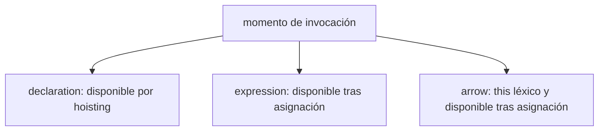
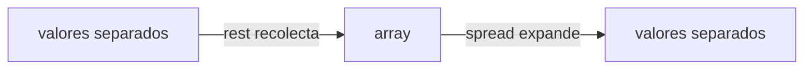
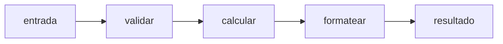
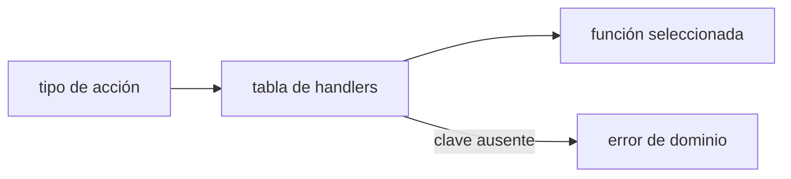
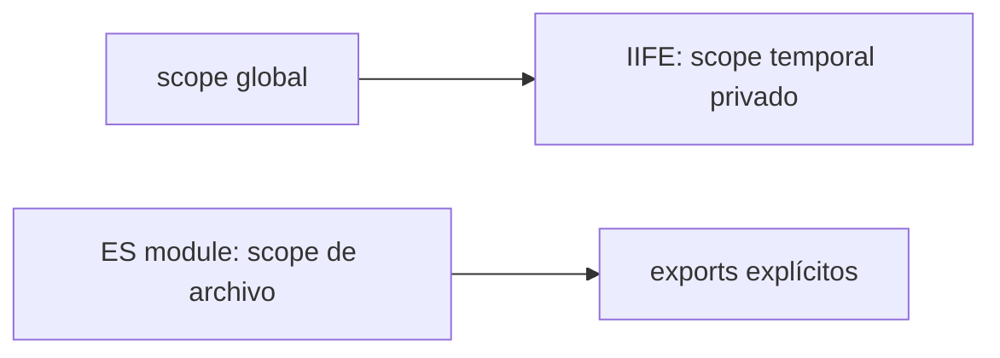
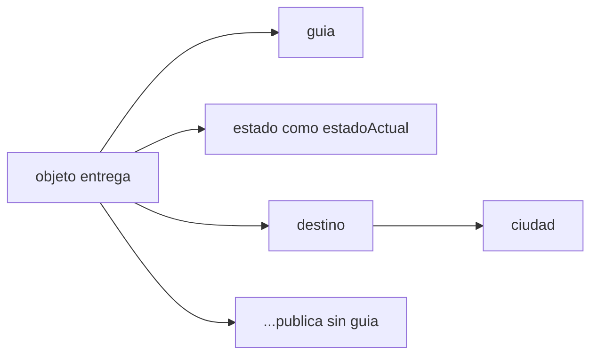

# Módulo 1: Operadores, control de flujo y funciones


## Aprende construyendo

### Tema 1: Tres formas de escribir una función

#### Paso 1 · Objetivo y preparación

Al finalizar podrás elegir declaración, expresión o función flecha según hoisting y `this`.

**Conocimiento previo:** variables, alcance y ejecución con Node.js.

#### Paso 2 · Contexto y caso real

**¿Por qué es importante?** Una aplicación calcula tarifas, formatea resultados y transforma entregas. Una sintaxis mal elegida puede ejecutarse antes de inicializarse o perder el receptor de `this`.

#### Paso 3 · Teoría con analogía

**Conceptos clave:** function declaration, function expression, arrow function, hoisting de funciones.

JavaScript ofrece tres sintaxis distintas para crear una función, y cada una tiene un comportamiento ligeramente distinto que conviene dominar con precisión. La function declaration (`function sumar(a, b) { return a + b; }`) se hoistea completa, no solo su nombre: esto significa que se puede invocar `sumar(2, 3)` en una línea de código anterior a donde está escrita la declaración, porque el motor de JavaScript procesa y registra la función completa antes de ejecutar el resto del script línea por línea. Esta propiedad permite, por ejemplo, organizar un archivo con la función principal al inicio y sus funciones auxiliares debajo, sin que el orden de lectura importe para la ejecución.

La function expression (`const sumar2 = function(a, b) { return a + b; };`) asigna una función anónima (o, opcionalmente, nombrada) a una variable, y sigue las reglas normales de hoisting de esa variable: si se usa `const` o `let`, la función no está disponible hasta que la línea de asignación se ejecuta (está en la Temporal Dead Zone hasta entonces, como se vio en el Módulo 0). Esta diferencia de comportamiento respecto a la declaración es importante: código que depende de invocar una function expression antes de su línea de definición fallará, mientras que el mismo código con una function declaration funcionaría sin problema.

Las arrow functions (`const sumar3 = (a, b) => a + b;`), introducidas en ES6, son la forma más concisa y tienen una diferencia semántica fundamental respecto a las dos anteriores, más allá de la sintaxis: no tienen su propio `this`. Una arrow function captura el valor de `this` del scope léxico donde fue definida (el mismo mecanismo de los closures que se estudiará en profundidad en el Módulo 2), en vez de que `this` dependa de cómo se invoca la función. Esta propiedad hace a las arrow functions especialmente útiles dentro de callbacks (por ejemplo, dentro de un método de un objeto que necesita preservar el `this` del objeto contenedor), pero inapropiadas para definir métodos de objeto que sí necesitan que `this` apunte dinámicamente al objeto sobre el que se invocan.

Elegir entre las tres formas no es arbitrario: usar function declarations para funciones de nivel superior que se quieren organizar libremente en el archivo (aprovechando el hoisting), function expressions cuando se necesita asignar condicionalmente distintas implementaciones a una misma variable, y arrow functions para callbacks concisos y para cualquier contexto donde se necesite preservar el `this` léxico externo, es la práctica más común y bien fundamentada en JavaScript moderno.

**Analogía:** una function declaration es como un empleado permanente ya contratado y en nómina desde el primer día de la empresa (disponible desde el inicio, sin importar en qué línea del organigrama aparezca escrito); una function expression es como un contratista que empieza a trabajar exactamente el día en que se firma su contrato (disponible solo a partir de esa línea); una arrow function es como un empleado que, sin importar a qué departamento lo transfieran, sigue reportando siempre al mismo jefe original con quien fue contratado (el `this` léxico no cambia según dónde se invoque).

**Diagrama:**



#### Paso 4 · Demostración guiada desde cero

Desde una carpeta vacía crea `ejemplo-funciones`, ejecuta `npm init -y`, crea `src` y después `src/funciones.js`:

```bash
mkdir ejemplo-funciones
cd ejemplo-funciones
npm init -y
mkdir src
```

```javascript
function calcularTarifa(pesoKg) { // declaración: disponible por hoisting
  return pesoKg * 7.4;
}
const formatearDinero = function (valor) { // expresión: disponible tras asignación
  return `$${valor.toFixed(2)}`;
};
const presentar = (envio) => // flecha: útil para transformar cada elemento
  `${envio.guia}: ${formatearDinero(calcularTarifa(envio.pesoKg))}`;

console.log(presentar({ guia: 'RF-1', pesoKg: 2.5 }));
```

Ejecuta desde la raíz del proyecto:

```bash
node src/funciones.js
```

**Resultado esperado:** `RF-1: $18.50`.

**Fallo deliberado:** invoca `formatearDinero(10)` antes de declararla. El `ReferenceError` señala la zona muerta temporal; no lo ocultes cambiando arbitrariamente la sintaxis.

#### Paso 5 · Práctica guiada

Transforma dos entregas con `envios.map(presentar)`. **Pista:** `presentar` ya recibe cada elemento; predice ambas líneas antes de ejecutar.

#### Paso 6 · Práctica independiente

Crea un objeto `centro` con propiedad `nombre` y método `describir`. Provoca el fallo usando una flecha y corrígelo con método abreviado. Explica por qué las transformaciones sí conservan flechas.

#### Paso 7 · Cierre

Ya eliges sintaxis por comportamiento. El siguiente tema combina parámetros por defecto con rest y spread. Fuente oficial: [MDN — funciones](https://developer.mozilla.org/es/docs/Web/JavaScript/Guide/Functions).

**Errores comunes:** usar flechas como métodos con `this` dinámico; invocar una expresión antes de inicializarla; escoger sintaxis solo por brevedad.

**Transferencia al proyecto integrador «Seguimiento público accesible»:** Implementa la presentación del estado de entrega como función independiente. Compara declaración, expresión y función flecha sin cambiar su contrato; las pruebas deben devolver las mismas etiquetas para los estados conocidos.

### Tema 2: Parámetros por defecto y rest/spread

#### Paso 1 · Objetivo y preparación

Al finalizar podrás definir valores opcionales, recolectar argumentos con rest y expandir arrays u objetos con spread sin confundir copia superficial con clonación profunda.

**Conocimiento previo:** funciones, arrays, objetos y diferencia entre reasignación y mutación.

#### Paso 2 · Contexto y caso real

**¿Por qué es importante?** Una tarifa combina cargos variables y una moneda predeterminada. Además, el estado de una entrega debe actualizarse sin alterar accidentalmente el objeto recibido por otra parte de la aplicación.

#### Paso 3 · Teoría con analogía

**Conceptos clave:** valores por defecto, rest para recolectar argumentos, spread para expandir.

Los parámetros por defecto permiten especificar un valor que se usará automáticamente cuando el argumento correspondiente no se proporciona (o se pasa explícitamente como `undefined`): `function crearUsuario(nombre, rol = "lector")` asigna `"lector"` a `rol` si se invoca `crearUsuario("Ana")` sin segundo argumento. Esto reemplaza el patrón anterior a ES6, mucho más verboso, de verificar manualmente `rol = rol || "lector";` dentro del cuerpo de la función (patrón que además tenía un bug sutil: fallaba si el valor válido proporcionado era `0`, `""` o `false`, valores falsy legítimos que el operador `||` interpretaba incorrectamente como "ausentes").

El operador rest (`...args` en la posición de un parámetro) recolecta un número variable de argumentos sueltos en un único array dentro del cuerpo de la función: `function total(...montos) { return montos.reduce((acc, m) => acc + m, 0); }` permite invocar `total(10, 20, 30)` con cualquier cantidad de argumentos, todos disponibles como el array `montos`. El operador spread (`...algo` en la posición de un argumento de llamada, o dentro de un literal de array/objeto) hace exactamente lo contrario: expande un iterable existente en elementos individuales, ya sea para pasarlos como argumentos separados a una función, para combinar arrays (`[...arr1, ...arr2]`), o para clonar y extender objetos sin mutarlos (`{...objetoOriginal, propiedadNueva: valor}`).

Es importante no confundir rest y spread simplemente porque comparten la misma sintaxis visual (`...`): la diferencia está en el contexto donde aparecen. En la definición de una función (`function f(...args)`), es rest, y recolecta; en una llamada a función o dentro de un literal (`f(...arr)`, `[...arr]`), es spread, y expande. Este par de operadores, introducidos ambos en ES6 y extendidos progresivamente a más contextos en versiones posteriores del lenguaje, reemplazó patrones mucho más verbosos que existían anteriormente, como usar el objeto `arguments` (que se discutirá en el Tema 5) o `Array.prototype.slice.call(...)` para lograr efectos similares.

Combinar parámetros por defecto con rest en la misma función es perfectamente válido y frecuente: `function log(nivel = "info", ...mensajes)` permite invocar tanto `log()` como `log("error", "algo falló", "detalle adicional")` con un comportamiento predecible en ambos casos, siempre que el parámetro rest se coloque, como exige la sintaxis del lenguaje, al final de la lista de parámetros.

**Analogía:** un parámetro por defecto es como un formulario que ya viene con un valor precompletado en un campo opcional, que el usuario puede sobreescribir si lo desea; rest es como una caja de recolección que junta todo lo que sobra de una lista variable de artículos en un solo paquete; spread es la acción inversa, sacar todos los artículos de un paquete existente y esparcirlos individualmente sobre la mesa.

**Diagrama:**



#### Paso 4 · Demostración guiada desde cero

Desde una carpeta vacía crea `ejemplo-parametros`, ejecuta `npm init -y`, crea `src` y después `src/parametros.js`:

```bash
mkdir ejemplo-parametros
cd ejemplo-parametros
npm init -y
mkdir src
```

```javascript
// Rest reúne todos los cargos restantes en un array real.
function calcularTotal(moneda = 'COP', ...cargos) {
  const total = cargos.reduce((acumulado, cargo) => acumulado + cargo, 0);
  return { moneda, total };
}

const envioOriginal = { guia: 'RF-2', estado: 'creado' };
const tarifa = calcularTotal(undefined, ...[12_000, 3_500, 1_000]);

// Spread crea otro objeto de primer nivel; el original permanece igual.
const envioActualizado = { ...envioOriginal, tarifa };
console.log(envioOriginal);
console.log(envioActualizado);
```

Ejecuta desde `ejemplo-parametros/`:

```bash
node src/parametros.js
```

**Resultado esperado:** el objeto original no contiene `tarifa`; el nuevo muestra `{ moneda: 'COP', total: 16500 }`.

**Fallo deliberado:** reemplaza `undefined` por `null`. El valor por defecto no se activa y la moneda queda `null`. Esto no es un error del motor: los parámetros por defecto solo sustituyen ausencia o `undefined`.

#### Paso 5 · Práctica guiada

Agrega un cargo opcional por seguro y calcula de nuevo el total. **Pista:** prepara un array `cargos` y expándelo al llamar la función; no pases el array como un único cargo. Predice el resultado antes de ejecutar.

#### Paso 6 · Práctica independiente

Añade `direccion: { ciudad: 'Bogotá' }`, copia el envío con spread y cambia la ciudad en la copia. Explica por qué también cambia el original y corrige copiando explícitamente `direccion`. Demuestra ambos comportamientos con salidas diferentes.

#### Paso 7 · Cierre

Ahora distingues rest —recolecta— de spread —expande o copia un nivel— y sabes cuándo actúa un valor por defecto. El siguiente tema usa funciones como datos para componer reglas. Fuente oficial: [MDN — rest parameters](https://developer.mozilla.org/es/docs/Web/JavaScript/Reference/Functions/rest_parameters) y [spread syntax](https://developer.mozilla.org/es/docs/Web/JavaScript/Reference/Operators/Spread_syntax).

**Errores comunes:** colocar rest antes del último parámetro; pasar un array sin expandir; creer que spread clona todos los niveles; esperar que `null` active el valor por defecto.

**Transferencia al proyecto integrador «Seguimiento público accesible»:** Permite configurar idioma y campos visibles del widget con valores por defecto. Prueba opciones omitidas y explícitas, verificando que combinar configuraciones no modifica el objeto original del consumidor.

### Tema 3: Funciones de orden superior

#### Paso 1 · Objetivo y preparación

Al finalizar podrás recibir y devolver funciones para componer reglas pequeñas, y separar reglas puras de controles temporales como `debounce`.

**Conocimiento previo:** callbacks, rest parameters, arrays y manejo básico de errores.

#### Paso 2 · Contexto y caso real

**¿Por qué es importante?** Una aplicación calcula una tarifa en etapas: validar, calcular base, aplicar recargo y formatear. Una función monolítica dificulta identificar qué etapa falló; una composición muestra el recorrido del dato.

#### Paso 3 · Teoría con analogía

**Conceptos clave:** función que recibe función, función que devuelve función, composición.

Una función de orden superior es, por definición, cualquier función que reciba otra función como argumento, devuelva una función como resultado, o ambas cosas a la vez. Este concepto, tomado directamente de la programación funcional, es posible en JavaScript precisamente porque las funciones son "ciudadanos de primera clase": se pueden asignar a variables, pasar como argumentos y devolver como resultados, exactamente igual que cualquier otro valor del lenguaje como un número o un string.

`debounce(fn, ms)` es el ejemplo canónico de una función de orden superior extremadamente útil en la práctica: recibe una función `fn` y un tiempo `ms`, y devuelve una nueva función que, cada vez que se invoca, cancela cualquier temporizador pendiente de una invocación anterior y programa una nueva ejecución de `fn` solo si transcurre el tiempo `ms` completo sin que se vuelva a invocar la función devuelta. Este patrón resuelve un problema práctico muy común: evitar ejecutar una operación costosa (como una búsqueda contra un servidor) en cada pulsación de tecla de un campo de búsqueda, ejecutándola solo una vez que el usuario deja de escribir.

`pipe(...fns)` es otro ejemplo instructivo: recibe un número variable de funciones (usando rest, como se vio en el Tema 2) y devuelve una nueva función que, al invocarse con un valor `x`, aplica cada función de la lista en orden, pasando el resultado de una como entrada de la siguiente (`pipe(f, g, h)(x)` es equivalente a `h(g(f(x)))`). Este patrón de composición permite construir transformaciones complejas encadenando funciones pequeñas y bien definidas, en vez de escribir una única función monolítica que hace todo a la vez, mejorando tanto la legibilidad como la capacidad de probar cada paso de forma independiente.

El valor real de las funciones de orden superior no está en su elegancia sintáctica, sino en que permiten eliminar duplicación de código extrayendo un patrón de comportamiento común (como "esperar antes de ejecutar" en `debounce`, o "encadenar transformaciones" en `pipe`) en una única función reutilizable, parametrizada exactamente en los puntos donde varía cada caso de uso específico (qué función ejecutar, cuánto esperar, qué funciones encadenar).

**Analogía:** una función de orden superior es como una máquina que fabrica otras máquinas personalizadas: le entregas una especificación (la función `fn`) y algunos parámetros (como `ms`), y te devuelve una máquina nueva y lista para usar, con ese comportamiento específico ya incorporado, sin que tengas que construir esa máquina desde cero cada vez.

**Diagrama:**



#### Paso 4 · Demostración guiada desde cero

Desde una carpeta vacía crea `ejemplo-composicion`, ejecuta `npm init -y`, crea `src` y después `src/composicion.js`:

```bash
mkdir ejemplo-composicion
cd ejemplo-composicion
npm init -y
mkdir src
```

```javascript
// Recibe funciones y devuelve otra función: es de orden superior.
const pipe = (...pasos) => (entrada) =>
  pasos.reduce((resultado, paso) => paso(resultado), entrada);

const validarPeso = (pesoKg) => {
  if (!Number.isFinite(pesoKg) || pesoKg <= 0) {
    throw new TypeError('El peso debe ser positivo');
  }
  return pesoKg;
};
const calcularBase = (pesoKg) => pesoKg * 7.4;
const aplicarRecargo = (total) => total * 1.1;

const calcularTarifa = pipe(validarPeso, calcularBase, aplicarRecargo);
console.log(calcularTarifa(2.5).toFixed(2));
```

```bash
node src/composicion.js
```

**Resultado esperado:** `20.35`.

**Fallo deliberado:** invierte `validarPeso` y `calcularBase`, y ejecuta con `-1`. El error aparece después de calcular un dato inválido; con efectos externos ese orden sería peligroso. Valida antes de transformar.

#### Paso 5 · Práctica guiada

Agrega `redondear = total => Math.round(total)` al final. **Pista:** predice la diferencia entre redondear antes y después del recargo; ejecuta ambos órdenes.

#### Paso 6 · Práctica independiente

Implementa `debounce(fn, 100)` en `src/interaccion.js`, llámalo cinco veces y demuestra con un contador que ejecuta una sola vez. Añade `cancel()` y prueba que una búsqueda cancelada no cambia el contador.

#### Paso 7 · Cierre

Ya compones transformaciones puras y mantienes temporizadores en el borde. El siguiente tema modela decisiones y estados. Fuente oficial: [MDN — funciones de primera clase](https://developer.mozilla.org/es/docs/Glossary/First-class_Function).

**Errores comunes:** componer al revés; devolver un tipo incompatible; esconder efectos dentro de una regla; probar debounce sin controlar el tiempo.

**Transferencia al proyecto integrador «Seguimiento público accesible»:** Recibe como argumento la función que presenta un evento de seguimiento. Sustitúyela en una prueba y comprueba que el widget conserva el orden del historial sin conocer su formato visual.

### Tema 4: Control de flujo — if, switch y loops

#### Paso 1 · Objetivo y preparación

Al finalizar podrás elegir entre `if`, `switch`, tablas de funciones y bucles para expresar reglas sin ramas ocultas.

**Conocimiento previo:** objetos, funciones, arrays y operadores de comparación estricta.

#### Paso 2 · Contexto y caso real

**¿Por qué es importante?** Una aplicación debe impedir transiciones inválidas, como pasar una entrega cancelada a entregada. La estructura de control debe mostrar las reglas permitidas y fallar de forma explícita ante una acción desconocida.

#### Paso 3 · Teoría con analogía

**Conceptos clave:** `if/else`, `switch`, bucles, objetos de mapeo como alternativa a `switch`.

`if/else` y `switch` son las estructuras de control de flujo condicional más básicas de JavaScript, y funcionan de forma prácticamente idéntica a como lo hacen en la mayoría de lenguajes de programación con sintaxis similar a C. Sin embargo, un `switch` con muchos casos (cuatro o más) suele volverse difícil de leer y de mantener, especialmente cuando cada caso ejecuta una lógica sustancialmente distinta; en JavaScript, una alternativa idiomática y frecuentemente más legible es reemplazar el `switch` por un objeto literal que mapea cada posible valor a la función correspondiente, invocando la función seleccionada dinámicamente mediante acceso por corchetes (`objeto[clave]`).

Este patrón de "objeto de mapeo" (lookup table) tiene ventajas concretas sobre un `switch` extenso: es más fácil de extender (añadir un caso nuevo es simplemente añadir una entrada al objeto, sin tocar ninguna estructura de control existente), es más fácil de testear de forma aislada (cada función del objeto puede probarse independientemente sin necesidad de ejecutar el `switch` completo), y elimina el riesgo de olvidar un `break` en un caso de `switch`, un error extremadamente común que provoca que la ejecución "caiga" (fall through) accidentalmente al siguiente caso.

En cuanto a los bucles, JavaScript ofrece varias formas: `for` clásico (con contador explícito), `while` y `do...while` (basados en condición), y las formas más modernas `for...of` (para iterar sobre los valores de cualquier iterable: arrays, strings, Maps, Sets) y `for...in` (para iterar sobre las claves enumerables de un objeto, generalmente desaconsejado para arrays porque también itera sobre propiedades heredadas del prototipo si existen). Elegir el bucle correcto según el tipo de dato que se recorre —`for...of` para iterables, métodos funcionales como `map`/`filter` (Módulo 4) cuando se transforma una colección— produce código más legible que forzar siempre el mismo `for` clásico con índice numérico para cualquier situación.

Aunque los bucles siguen siendo necesarios en muchos contextos (especialmente cuando se necesita `break` o `continue` con lógica compleja, algo que los métodos funcionales de array no permiten de forma directa), gran parte del código JavaScript moderno prefiere los métodos funcionales sobre arrays (que se estudiarán en profundidad en el Módulo 4) por su mayor expresividad y menor propensión a errores de índice fuera de rango.

**Analogía:** un `switch` extenso es como un mostrador de atención al cliente con un único empleado que memoriza de memoria qué hacer para cada uno de veinte tipos de solicitud distintos, revisando mentalmente cada caso uno por uno hasta encontrar el correcto; un objeto de mapeo es como un mostrador con veinte casilleros claramente etiquetados, donde el cliente (o el código) simplemente consulta directamente el casillero correspondiente a su solicitud, sin recorrer los demás.

**Implicación práctica:** Reconocer cuándo un `switch` extenso se beneficiaría de convertirse en un objeto de mapeo, y elegir el tipo de bucle apropiado según la estructura de datos, son señales de código JavaScript idiomático y mantenible, frente a código que simplemente "funciona" pero es difícil de extender con seguridad.

**Diagrama:**



#### Paso 4 · Demostración guiada desde cero

Desde una carpeta vacía crea `ejemplo-estados`, ejecuta `npm init -y`, crea `src` y después `src/estados.js`:

```bash
mkdir ejemplo-estados
cd ejemplo-estados
npm init -y
mkdir src
```

```javascript
const transiciones = {
  creado: { asignar: 'asignado', cancelar: 'cancelado' },
  asignado: { iniciar: 'en-ruta', cancelar: 'cancelado' },
  'en-ruta': { entregar: 'entregado' },
};

function aplicar(estado, accion) {
  // ?. evita leer una acción sobre un estado sin transiciones.
  const siguiente = transiciones[estado]?.[accion];
  if (!siguiente) throw new Error(`Transición inválida: ${estado} -> ${accion}`);
  return siguiente;
}

let estado = 'creado';
for (const accion of ['asignar', 'iniciar', 'entregar']) {
  estado = aplicar(estado, accion);
  console.log(estado);
}
```

```bash
node src/estados.js
```

**Resultado esperado:** `asignado`, `en-ruta` y `entregado`, en ese orden.

**Fallo deliberado:** agrega `cancelar` después de `entregar`. El error debe indicar `entregado -> cancelar`; no agregues una transición solo para silenciarlo, porque el estado final es una regla del dominio.

#### Paso 5 · Práctica guiada

Agrega el estado `en-bodega` entre `asignado` y `en-ruta`. **Pista:** modifica datos de la tabla, no la función `aplicar`; predice qué secuencia anterior dejará de ser válida.

#### Paso 6 · Práctica independiente

Implementa `procesarAcciones(estadoInicial, acciones)` que devuelva todos los estados visitados sin mutar el array recibido. Prueba camino feliz, acción desconocida y acción válida desde estado incorrecto.

#### Paso 7 · Cierre

Ya puedes convertir reglas de transición en datos verificables. El siguiente tema reconoce patrones antiguos y los migra a módulos modernos. Fuente oficial: [MDN — control flow](https://developer.mozilla.org/es/docs/Web/JavaScript/Guide/Control_flow_and_error_handling).

**Errores comunes:** olvidar `break`; usar `for...in` para valores de un array; aceptar silenciosamente claves desconocidas; mezclar reglas con impresión en consola.

**Transferencia al proyecto integrador «Seguimiento público accesible»:** Modela los estados pendiente, en tránsito y entregado sin ramas ambiguas. Prueba un estado desconocido y demuestra que se muestra una alternativa controlada en vez de anunciar una entrega inexistente.

### Tema 5: IIFE y el objeto arguments

#### Paso 1 · Objetivo y preparación

Al finalizar podrás leer una IIFE y `arguments` en código legado, explicar sus límites y migrarlos a módulos ESM y parámetros rest.

**Conocimiento previo:** scope, funciones, rest y configuración `type: module`.

#### Paso 2 · Contexto y caso real

**¿Por qué es importante?** Una aplicación puede integrar bibliotecas antiguas que protegen variables con IIFE o reciben argumentos mediante `arguments`. Comprenderlas permite migrar sin romper comportamiento, pero no obliga a repetir esos patrones en código nuevo.

#### Paso 3 · Teoría con analogía

**Conceptos clave:** Immediately Invoked Function Expression, encapsulación, `arguments` frente a rest.

Una IIFE (Immediately Invoked Function Expression) es una función que se define y se invoca inmediatamente en la misma expresión, típicamente envuelta entre paréntesis para forzar al parser a interpretarla como una expresión y no como una declaración: `(function() { console.log("ejecutado de inmediato"); })();`. Antes de que `let`/`const` introdujeran el scope de bloque (Módulo 0) y los módulos ESM (Módulo 7) introdujeran un scope de archivo aislado, las IIFE eran la técnica principal para crear un scope privado y evitar contaminar el scope global con variables temporales, un patrón extremadamente común en el JavaScript anterior a 2015.

Aunque las IIFE han perdido buena parte de su relevancia práctica con la llegada de módulos ESM (cada módulo ya tiene su propio scope aislado por defecto, sin necesidad de envolver el código en una función autoejecutada), siguen apareciendo en código legado y en ciertos patrones específicos, como ejecutar código de inicialización asíncrono en el nivel superior de un script antes de que existiera el top-level `await`.

El objeto `arguments` es una estructura similar a un array (pero no un array real: no tiene métodos como `map` o `filter` directamente) disponible automáticamente dentro de cualquier función declarada con `function` (no disponible dentro de arrow functions), que contiene todos los argumentos con los que se invocó la función, sin importar cuántos parámetros formales se hayan declarado. Antes de la introducción del operador rest en ES6, `arguments` era la única forma de acceder a un número variable de argumentos, típicamente requiriendo convertirlo primero en un array real con `Array.prototype.slice.call(arguments)` para poder usar métodos de array sobre él.

En JavaScript moderno, el operador rest (Tema 2) ha reemplazado prácticamente por completo la necesidad de usar `arguments` directamente: `function f(...args)` produce un array real desde el inicio, con todos los métodos de array disponibles de inmediato, sin necesidad de conversión adicional, y además funciona de forma consistente incluso dentro de arrow functions (donde `arguments` simplemente no existe, heredándose en su lugar del scope contenedor si lo hay). Por esta razón, el código nuevo debería preferir siempre rest sobre `arguments`, reservando el conocimiento de este último principalmente para entender y mantener código legado existente.

**Analogía:** una IIFE es como una habitación temporal montada y desmontada en el mismo instante para una reunión privada de un solo uso, sin dejar rastro visible en el resto del edificio; `arguments` es como una bolsa genérica que automáticamente recoge todo lo que alguien te entrega en la puerta, sin etiquetar ni organizar nada, mientras que rest es una caja etiquetada y organizada específicamente para ese propósito desde el diseño mismo de la función.

**Diagrama:**



#### Paso 4 · Demostración guiada desde cero

Desde una carpeta vacía crea `ejemplo-legado`, ejecuta `npm init -y`, crea `src` y después `src/legado.cjs`:

```bash
mkdir ejemplo-legado
cd ejemplo-legado
npm init -y
mkdir src
```

```javascript
const tarifas = (function () {
  let consultas = 0; // queda encerrada en el scope de la IIFE
  return {
    total: function () {
      consultas += 1;
      const cargos = Array.from(arguments); // arguments no es un array real
      return cargos.reduce((suma, cargo) => suma + cargo, 0);
    },
    consultas: () => consultas,
  };
})();

console.log(tarifas.total(10, 20, 5));
console.log(tarifas.consultas());
```

```bash
node src/legado.cjs
```

**Resultado esperado:** `35` y `1`; `consultas` no existe en el scope global.

**Fallo deliberado:** reemplaza `Array.from(arguments)` por `arguments.map(...)`. Aparece `TypeError` porque `arguments` es similar a un array, pero no hereda sus métodos. Rest crea un array real y evita la conversión.

#### Paso 5 · Práctica guiada

Reemplaza `function () { ...arguments }` por `(...cargos) =>`. **Pista:** conserva primero las mismas salidas; separar refactorización y cambio de comportamiento facilita detectar una regresión.

#### Paso 6 · Práctica independiente

Crea `src/tarifas.js` con export nombrado `crearCalculadoraTarifas`, estado privado mediante closure y rest. Escribe un import en `src/usar-tarifas.js` y demuestra que dos calculadoras mantienen contadores independientes.

#### Paso 7 · Cierre

Completaste funciones y control de flujo distinguiendo patrones vigentes de legado. El siguiente módulo profundiza en closures, `this` y prototipos. Fuentes oficiales: [MDN — IIFE](https://developer.mozilla.org/en-US/docs/Glossary/IIFE) y [`arguments`](https://developer.mozilla.org/es/docs/Web/JavaScript/Reference/Functions/arguments).

**Errores comunes:** creer que `arguments` es un array; buscarlo dentro de una arrow; migrar sintaxis y comportamiento a la vez; usar IIFE donde un módulo ya proporciona aislamiento.

---

**Transferencia al proyecto integrador «Seguimiento público accesible»:** Encapsula un widget de prueba para que no exponga variables globales al sitio anfitrión. Monta dos instancias y verifica que sus guías y manejadores no se sobrescriben entre sí.

### Tema 6: Desestructuración, valores por defecto y rest

#### Paso 1 · Objetivo y preparación
Al finalizar podrás extraer valores de objetos y arrays con desestructuración, renombrar, dar valores por defecto, usar rest para copiar sin ciertos campos y diseñar funciones con parámetros de opciones. Prerrequisito: Tema 2 de este módulo (parámetros por defecto y rest/spread).

#### Paso 2 · Contexto y caso real
El seguimiento público de RutaFlow recibe objetos JSON con la entrega, el destino y los paquetes. Escribir `entrega.destino.ciudad` diez veces es ruido, y devolver la entrega completa expondría campos internos. La desestructuración es la sintaxis que verás en cada componente de React, cada handler de Express y cada respuesta de `fetch`: un caso real diario.

#### Paso 3 · Teoría, modelo mental y analogía
La **desestructuración** asigna variables a partir de la forma de un objeto (`const { guia } = entrega`) o de la posición en un array (`const [primero] = lista`). Puedes **renombrar** (`estado: estadoActual`), dar **valor por defecto** (solo se aplica si el valor es `undefined`), entrar en objetos **anidados** y recoger lo que sobra con **rest** (`...resto`). En parámetros permite funciones con opciones con nombre; el `= {}` final evita fallar si se llama sin argumentos.

**Analogía:** es desempacar una caja con etiquetas: tomas solo lo que necesitas por su nombre y el resto queda junto en otra caja.

**Diagrama:**



**¿Por qué es importante?** porque es sintaxis de uso diario y la causa de muchos `TypeError` cuando llegan datos incompletos.
**Fuente oficial:** [MDN: Destructuring assignment](https://developer.mozilla.org/es/docs/Web/JavaScript/Reference/Operators/Destructuring_assignment).
**Conceptos clave:** desestructuración de objetos y arrays, renombrado, valor por defecto, anidamiento, rest en objetos, parámetros de opciones.
**Cuándo no usarlo:** no desestructures estructuras muy profundas en una sola línea: si un nivel puede faltar, combina con encadenamiento opcional (`?.`) o valida antes.

**Transferencia al proyecto integrador «Seguimiento público accesible»:** desestructura la respuesta del API de seguimiento y muestra solo los campos públicos, dejando fuera los internos con rest.
Como **siguiente** paso, aplica lo aprendido en el proyecto integrador del track y compara el resultado con lo que esperabas.
**Errores comunes:** desestructurar un parámetro de opciones sin el `= {}` final, provocando `TypeError: Cannot destructure property ... of 'undefined'` en la primera llamada sin argumentos; confundir el valor por defecto con una validación: solo se activa cuando el valor es exactamente `undefined`, nunca con `null` o cadena vacía.

#### Paso 4 · Demostración guiada desde cero
**Ejemplo independiente (desde cero):** este tema se reproduce en una **carpeta vacía**, como **proyecto nuevo**, sin estado de otros temas.

```bash
mkdir desestructuracion && cd desestructuracion
```

Crea `desestructuracion.js`:

```javascript
const entrega = {
  guia: 'BO-004512',
  destino: { ciudad: 'Bogotá', barrio: 'Chapinero' },
  paquetes: [{ kilos: 2 }, { kilos: 5 }, { kilos: 1 }],
  estado: 'en ruta',
};

// Objetos: extraer, renombrar, valor por defecto y anidado
const { guia, estado: estadoActual, prioridad = 'normal', destino: { ciudad } } = entrega;
console.log(guia, estadoActual, prioridad, ciudad);

// Arrays: por posición, saltar elementos y rest
const [primero, , tercero, ...resto] = entrega.paquetes;
console.log(primero.kilos, tercero.kilos, resto.length);

// Rest en objetos: copiar sin un campo (por ejemplo, para no exponerlo)
const { guia: _oculta, ...publica } = entrega;
console.log(Object.keys(publica));

// Parámetros desestructurados con valores por defecto: una API de opciones legible
function cotizar({ kilos, ciudad = 'Bogotá', express = false } = {}) {
  return (ciudad === 'Bogotá' ? 5000 : 9000) + kilos * 1200 + (express ? 3000 : 0);
}
console.log(cotizar({ kilos: 2 }), cotizar({ kilos: 2, express: true, ciudad: 'Cali' }));

// Intercambio de variables sin temporal
let a = 'Ana', b = 'Beto';
[a, b] = [b, a];
console.log(a, b);

// Recorrer pares clave-valor
for (const [zona, total] of Object.entries({ Norte: 12, Sur: 7 })) {
  console.log(`${zona}: ${total}`);
}
```

**Ejecuta el ejemplo:**

```bash
node desestructuracion.js
```

**Resultado esperado:**

```text
BO-004512 en ruta normal Bogotá
2 1 0
[ 'destino', 'paquetes', 'estado' ]
7400 14400
Beto Ana
Norte: 12
Sur: 7
```

`prioridad` no existe en el objeto, así que tomó el valor por defecto `'normal'`. El nombre `_oculta` con guion bajo indica una variable que se extrae solo para dejarla fuera.

**Fallo deliberado:** En `cotizar` quita el `= {}` final del parámetro y llama `cotizar()` sin argumentos. Obtienes `TypeError: Cannot destructure property 'kilos' of 'undefined' as it is undefined.`: no se puede desestructurar `undefined`. El valor por defecto del parámetro completo lo evita.

#### Paso 5 · Práctica guiada
Escribe `resumen({ guia, destino: { barrio }, paquetes })` que devuelva un texto con la guía, el barrio y el total de kilos. **Pista:** desestructura en la firma y calcula los kilos con `paquetes.reduce((t, { kilos }) => t + kilos, 0)`, desestructurando también dentro del callback.

#### Paso 6 · Práctica independiente
Toma una respuesta de una API pública de tu elección y extrae con una sola desestructuración anidada tres campos de distintos niveles, con valores por defecto para los opcionales.

#### Paso 7 · Cierre


### Tema 7: Errores síncronos: `throw`, `try/catch/finally`, subclases de `Error` y `cause`

**Duración estimada:** 40 min (4 subtemas de 10 min).
**¿Por qué es importante?** Una función que recibe datos malos tiene dos opciones: devolver un valor falso que alguien olvidará revisar o **detenerse y avisar**. `throw` y `try/catch` son ese aviso, y todo lo que verás después (promesas que rechazan, `await` dentro de `try/catch`, middleware de errores en Node, fronteras de error en React) se apoya en este tema.

**Prerrequisitos:** Tema 1 de este módulo (funciones), Tema 4 (control de flujo) y Módulo 0 Tema 2 (`typeof`). Necesitas Node 24 LTS (`node --version` debe mostrar `v24.x`). Proyecto continuo: el validador de guías y pesos de RutaFlow que usarás en el resto del curso.

Crea la carpeta del tema:

```bash
mkdir -p academia-labs/javascript/errores && cd academia-labs/javascript/errores
```

#### Subtema 7.1: Lanza un error con `throw` · 10 min

**1. Contexto**
`cotizar(kilos)` del Tema 2 acepta `-2` o `'cinco'` y devuelve un precio absurdo sin quejarse. Un dato inválido debe frenar la ejecución en el punto donde se detecta, no tres funciones después.

**2. Hazlo tú**
Crea `lanzar.js`:

```javascript
function validarPeso(kilos) {
  if (typeof kilos !== 'number' || Number.isNaN(kilos)) {
    throw new TypeError(`kilos debe ser un número, llegó ${JSON.stringify(kilos)}`);
  }
  if (kilos <= 0) {
    throw new RangeError(`kilos debe ser mayor que 0, llegó ${kilos}`);
  }
  return kilos;
}

console.log(validarPeso(3));
console.log('antes del fallo');
validarPeso(-2);
console.log('esta línea nunca se imprime');
```

```bash
node lanzar.js
echo "código de salida: $?"
```

**Resultado esperado** (las rutas cambian en tu equipo):

```text
3
antes del fallo
/…/errores/lanzar.js:6
    throw new RangeError(`kilos debe ser mayor que 0, llegó ${kilos}`);
    ^

RangeError: kilos debe ser mayor que 0, llegó -2
    at validarPeso (/…/errores/lanzar.js:6:11)
    at Object.<anonymous> (/…/errores/lanzar.js:13:1)
    …
código de salida: 1
```

**Fallo deliberado:** cambia `throw new RangeError(...)` por `throw 'kilos inválidos'`. **Resultado:** Node imprime solo `kilos inválidos` y la sugerencia ``(Use `node --trace-uncaught ...` to show where the exception was thrown)``, sin ninguna línea `at …`. **Diagnóstico:** un string no es un `Error`, así que no tiene `stack` ni `name`; lanza siempre instancias de `Error` (o de sus subclases) y restaura la línea.

**3. Entiende**
`throw` detiene la función en esa línea y sube por la pila de llamadas buscando un `try/catch`. Si no lo encuentra, Node imprime el error con su **stack trace** (la lista de funciones `at …` desde la más interna) y termina con código 1. El motor ya trae tipos según la causa: `TypeError` para un tipo equivocado, `RangeError` para un valor fuera de rango, `SyntaxError` para texto que no se puede interpretar (por ejemplo, `JSON.parse('{roto')`) y `ReferenceError` para una variable que no existe. **Límite:** `throw` puede lanzar cualquier valor, pero solo un `Error` trae `stack`, `name` y `message`.

**4. Cierra**
Guarda la salida y señala en el stack la línea de `validarPeso` y la línea que la llamó. Queda lista una función que se niega a seguir con datos inválidos.

#### Subtema 7.2: Captura con `try/catch` y limpia con `finally` · 10 min

**1. Contexto**
El validador no debe tumbar todo el lote: si una de tres entregas trae un peso malo, quieres registrar el problema y seguir con las demás.

**2. Hazlo tú**
Crea `capturar.js` (copia `validarPeso` del subtema anterior al inicio del archivo):

```javascript
// pega aquí validarPeso del subtema 7.1

const entradas = [3, -2, 'cinco'];
for (const entrada of entradas) {
  try {
    const kilos = validarPeso(entrada);
    console.log(`ok: ${kilos} kg`);
  } catch (error) {
    if (error instanceof RangeError) {
      console.log(`fuera de rango -> ${error.message}`);
    } else if (error instanceof TypeError) {
      console.log(`tipo inválido -> ${error.message}`);
    } else {
      throw error; // no es un error que sepamos tratar: que siga subiendo
    }
  } finally {
    console.log(`  revisada: ${JSON.stringify(entrada)}`);
  }
}

function leerConfig(texto) {
  try {
    return JSON.parse(texto);
  } catch {
    return {};
  } finally {
    console.log('finally corre incluso después de return');
  }
}
console.log(leerConfig('{"zona":"Norte"}'), leerConfig('{roto'));
```

```bash
node capturar.js
```

**Resultado esperado:**

```text
ok: 3 kg
  revisada: 3
fuera de rango -> kilos debe ser mayor que 0, llegó -2
  revisada: -2
tipo inválido -> kilos debe ser un número, llegó "cinco"
  revisada: "cinco"
finally corre incluso después de return
finally corre incluso después de return
{ zona: 'Norte' } {}
```

**Fallo deliberado:** dentro del `try` escribe `validarPezo(entrada)` (con z). **Resultado:** el programa termina con `ReferenceError: validarPezo is not defined` después de imprimir `revisada: 3`. **Diagnóstico:** el `catch` solo trata `RangeError` y `TypeError`; el `else { throw error; }` deja pasar el error de programación en vez de esconderlo como «dato inválido». Corrige el nombre.

**3. Entiende**
`try` ejecuta el bloque; si algo dentro lanza, salta al `catch` con el valor lanzado; `finally` corre **siempre**, haya error, `return` o ninguno de los dos, por eso es el sitio para cerrar o registrar. `catch` sin paréntesis (`catch {`) sirve cuando no usas el error. Comprobar el tipo con `instanceof` y relanzar lo desconocido evita el antipatrón de tragarse cualquier fallo. **Límite:** `try/catch` solo captura lo que ocurre **mientras** se ejecuta el bloque; un error dentro de un `setTimeout` o de una promesa ocurre después y se trata en el Módulo 6 con `await` dentro de `try/catch`.

**4. Cierra**
Anota qué imprimió `finally` para cada entrada. El lote ya procesa entradas malas sin detenerse.

#### Subtema 7.3: Crea errores propios con `extends Error` · 10 min

**1. Contexto**
`RangeError` no dice «guía inválida de RutaFlow». Quien llama necesita distinguir los errores del dominio (que se muestran al usuario) de los fallos de programación (que se corrigen en el código).

**2. Hazlo tú**
Crea `propios.js`:

```javascript
class EntregaError extends Error {
  constructor(message, options) {
    super(message, options);
    this.name = this.constructor.name;
  }
}

class GuiaInvalidaError extends EntregaError {
  constructor(guia, options) {
    super(`guía inválida: ${guia}`, options);
    this.guia = guia;
  }
}

function validarGuia(guia) {
  if (!/^[A-Z]{2}-\d{6}$/.test(guia)) {
    throw new GuiaInvalidaError(guia);
  }
  return guia;
}

for (const guia of ['BO-004512', 'x1']) {
  try {
    console.log('válida', validarGuia(guia));
  } catch (error) {
    console.log(`${error.name}: ${error.message}`);
    console.log('  ¿es EntregaError?', error instanceof EntregaError);
    console.log('  guía recibida:', error.guia);
  }
}
```

```bash
node propios.js
```

**Resultado esperado:**

```text
válida BO-004512
GuiaInvalidaError: guía inválida: x1
  ¿es EntregaError? true
  guía recibida: x1
```

**Fallo deliberado:** en `GuiaInvalidaError` mueve `this.guia = guia;` **antes** de `super(...)`. **Error esperado:** `ReferenceError: Must call super constructor in derived class before accessing 'this' or returning from derived constructor`. **Diagnóstico:** en una subclase, `this` no existe hasta que `super()` construye el `Error`; llama a `super` primero. Prueba también a borrar `this.name = this.constructor.name`: la salida cambia a `Error: guía inválida: x1` y pierdes el nombre útil.

**3. Entiende**
`extends Error` hereda `message` y `stack`, e `instanceof` funciona con toda la jerarquía: un `GuiaInvalidaError` también es `EntregaError` y `Error`. Asignar `name` hace que el stack y los registros muestren la clase real. Añade campos propios (`guia`) en lugar de esconder datos dentro del texto del mensaje. La expresión regular `/^[A-Z]{2}-\d{6}$/` se explica en el Módulo 4; aquí solo valida el formato. **Límite:** no crees una clase por cada `if`; una jerarquía corta (error base del dominio y dos o tres casos que quien llama trata distinto) basta.

**4. Cierra**
Guarda la salida. El proyecto ya tiene un error base de dominio y un caso concreto.

#### Subtema 7.4: Encadena la causa con `{ cause }` · 10 min

**1. Contexto**
Cuando `JSON.parse` falla al leer una entrega, el mensaje «Expected property name…» no dice **qué** se estaba haciendo; y si lo reemplazas por «no se pudo leer la entrega», pierdes el detalle técnico.

**2. Hazlo tú**
Agrega a `propios.js`, debajo del bucle:

```javascript
function cargarEntrega(json) {
  let datos;
  try {
    datos = JSON.parse(json);
  } catch (error) {
    throw new EntregaError('no se pudo leer la entrega', { cause: error });
  }
  return { guia: validarGuia(datos.guia), destino: datos.destino };
}

for (const json of ['{"guia":"BO-004512","destino":"Chapinero"}', '{roto']) {
  try {
    console.log('cargada', cargarEntrega(json));
  } catch (error) {
    console.log(`${error.name}: ${error.message}`);
    console.log('  causa:', error.cause.name, '-', error.cause.message);
  }
}
```

```bash
node propios.js
```

**Resultado esperado** (las cuatro primeras líneas son las del subtema anterior):

```text
cargada { guia: 'BO-004512', destino: 'Chapinero' }
EntregaError: no se pudo leer la entrega
  causa: SyntaxError - Expected property name or '}' in JSON at position 1 (line 1 column 2)
```

**Fallo deliberado:** en el `constructor` de `EntregaError` cambia `super(message, options)` por `super(message)`. **Error esperado:** `TypeError: Cannot read properties of undefined (reading 'name')` en la línea de `causa`. **Diagnóstico:** la opción `cause` solo llega a `Error` si la subclase reenvía `options` a `super`; restaura el segundo argumento.

**3. Entiende**
`new Error(mensaje, { cause })` (ES2022) guarda el error original en la propiedad `cause` sin mezclarlo en el texto. Cada capa añade **qué estaba haciendo** y conserva **por qué falló**; si imprimes el error con `console.log(error)`, Node muestra también `[cause]`. **Límite:** `cause` no viaja solo al navegador ni a un registro remoto: en el Módulo 13 aprenderás a decidir qué detalles se registran y cuáles nunca se muestran al usuario.

**4. Cierra**
Guarda la salida con la causa. El validador de RutaFlow ya distingue errores de dominio, errores de formato y fallos de programación.

**Hito del tema:**

- [ ] Ejecuté `lanzar.js` y señalé en el stack trace la función que lanzó.
- [ ] `capturar.js` procesa las tres entradas y relanza un error que no sabe tratar.
- [ ] Provoqué el `ReferenceError` de `super` y expliqué por qué ocurre.
- [ ] Expliqué con mis palabras qué aporta `cause` frente a reescribir el mensaje.

**Ejercicio:** escribe `parsearPeso(texto)` que reciba un string como `'2.5kg'`, devuelva el número `2.5` y lance `PesoInvalidoError` (subclase de `EntregaError`, con un campo `texto`) cuando el formato no termine en `kg` o el número no sea positivo. Si `Number(...)` produce `NaN`, el error debe llevar como `cause` un `TypeError` con el detalle. Antes de abrir la solución, escribe qué imprime `parsearPeso('abckg')`.

<details>
<summary>Solución — ábrela después de intentarlo</summary>

```javascript
class EntregaError extends Error {
  constructor(message, options) {
    super(message, options);
    this.name = this.constructor.name;
  }
}

class PesoInvalidoError extends EntregaError {
  constructor(texto, options) {
    super(`peso inválido: ${texto}`, options);
    this.texto = texto;
  }
}

function parsearPeso(texto) {
  if (!texto.endsWith('kg')) throw new PesoInvalidoError(texto);
  const kilos = Number(texto.slice(0, -2));
  if (Number.isNaN(kilos)) {
    throw new PesoInvalidoError(texto, { cause: new TypeError(`"${texto.slice(0, -2)}" no es un número`) });
  }
  if (kilos <= 0) throw new PesoInvalidoError(texto);
  return kilos;
}

for (const t of ['2.5kg', '3lb', 'abckg', '-1kg']) {
  try {
    console.log(t, '->', parsearPeso(t));
  } catch (error) {
    console.log(t, '->', `${error.name}: ${error.message}`, error.cause ? `(causa: ${error.cause.message})` : '');
  }
}
```

Salida:

```text
2.5kg -> 2.5
3lb -> PesoInvalidoError: peso inválido: 3lb 
abckg -> PesoInvalidoError: peso inválido: abckg (causa: "abc" no es un número)
-1kg -> PesoInvalidoError: peso inválido: -1kg 
```

Compara: si tu versión devolvía `NaN` o `null` en vez de lanzar, quien llama debía acordarse de revisarlo; con el error, olvidarlo es imposible.

</details>

**Fuentes oficiales:** [MDN: Control flow and error handling](https://developer.mozilla.org/en-US/docs/Web/JavaScript/Guide/Control_flow_and_error_handling), [MDN: `Error`](https://developer.mozilla.org/en-US/docs/Web/JavaScript/Reference/Global_Objects/Error) y [MDN: `Error.cause`](https://developer.mozilla.org/en-US/docs/Web/JavaScript/Reference/Global_Objects/Error/cause).


## Construcción guiada del capítulo

**Objetivo del laboratorio:** construir una pequeña biblioteca de funciones utilitarias de orden superior, aplicando las tres formas de función, parámetros modernos y composición.

**Requisitos previos:** Node.js instalado, conocimiento del Módulo 0 (tipos, template literals).

| Paso | Acción | Código | Explicación |
|---|---|---|---|
| 1 | Escribir `sumar` en sus tres formas | `function sumar(a,b){}`, `const sumar2 = function(a,b){}`, `const sumar3 = (a,b)=>a+b` | Compara comportamiento de hoisting invocando cada una antes de su definición |
| 2 | Función con parámetro por defecto y rest | `function total(impuesto = 0, ...montos)` | Combina ambos mecanismos en una sola función |
| 3 | Combinar arrays y clonar objetos con spread | `[...a, ...b]`, `{...obj, nuevaProp: 1}` | Verifica que el original no se muta |
| 4 | Implementar `debounce(fn, ms)` | Ver Tema 3 | Pruébalo con `console.log` disparado por múltiples llamadas rápidas |
| 5 | Implementar `pipe(...fns)` | Ver Tema 3 | Verifica `pipe(f,g,h)(x) === h(g(f(x)))` con funciones simples |
| 6 | Reescribir un switch de 4 casos como objeto de mapeo | Ver Tema 4 | Compara legibilidad y facilidad de extensión |

**Verificación:** el laboratorio se considera exitoso si `pipe(x => x+1, x => x*2)(3)` devuelve `8`, y si `debounce` invocado 5 veces en rápida sucesión solo ejecuta la función una vez, tras el último de los 5 disparos.

**Errores comunes y soluciones**

- **Usar una arrow function como método de objeto y esperar que `this` apunte al objeto.** Recuerda que las arrow functions no tienen `this` propio; usa `function` normal o método abreviado (`metodo() {}`) para métodos que necesiten `this` dinámico.
- **Confundir rest y spread por la sintaxis idéntica (`...`).** Verifica el contexto: en la definición de parámetros es rest (recolecta), en una llamada o literal es spread (expande).
- **`pipe` compuesto en el orden equivocado.** Verifica que `pipe(f, g)(x)` aplica primero `f` y luego `g` sobre el resultado, no al revés (eso sería `compose`, el orden inverso).

---
