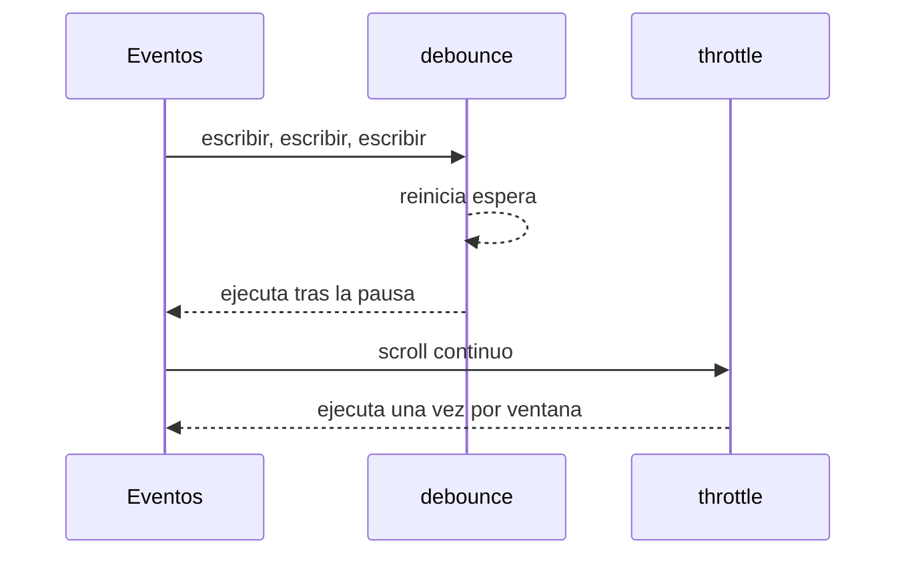
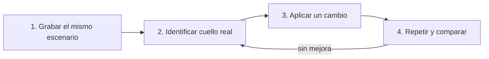
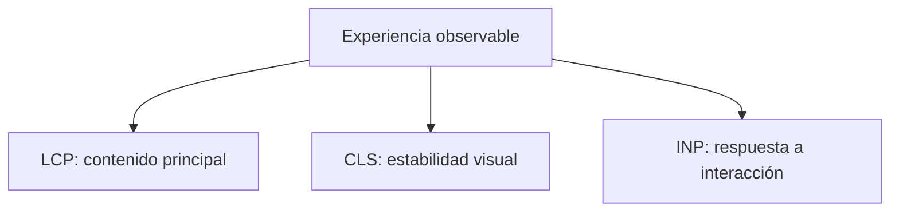

# Módulo 10: Patrones avanzados y rendimiento


## Aprende construyendo


### Tema 1: Debounce y throttle · Intermedio · 40 min

<details open>
<summary><strong>Capa 1 — Lectura</strong></summary>

#### ► DE QUÉ TRATA
Al finalizar podrás implementar, probar y elegir entre debounce y throttle según la interacción, incluyendo cancelación al desmontar. Aplicarás espera a la búsqueda y frecuencia limitada al seguimiento del mapa del proyecto.

#### ► CÓMO FUNCIONA


</details>

<details>
<summary><strong>Capa 2 — Construcción</strong></summary>

#### Código y verificación

```bash
mkdir ejemplo-frecuencia
cd ejemplo-frecuencia
npm init -y
npm install -D vitest
mkdir src test
```

```js
export function debounce(funcion, esperaMs) {
  let temporizador;
  function aplazada(...argumentos) {
    clearTimeout(temporizador);
    // Cada llamada sustituye la ejecución pendiente por la más reciente.
    temporizador = setTimeout(() => funcion(...argumentos), esperaMs);
  }
  aplazada.cancel = () => clearTimeout(temporizador);
  return aplazada;
}

export function throttle(funcion, intervaloMs) {
  let habilitada = true;
  return (...argumentos) => {
    if (!habilitada) return;
    habilitada = false;
    // La primera llamada se ejecuta; las demás esperan otra ventana.
    funcion(...argumentos);
    setTimeout(() => { habilitada = true; }, intervaloMs);
  };
}
```

```bash
npm test -- src/utilidades/frecuencia.test.js
```

</details>

### Tema 2: Memoización · Intermedio · 35 min

<details open>
<summary><strong>Capa 1 — Lectura</strong></summary>

#### ► DE QUÉ TRATA
Al finalizar podrás memoizar una función pura con caché limitada, medir aciertos y reconocer cuándo el coste de memoria supera el ahorro. Optimizarás un cálculo repetido de tarifa del proyecto sin almacenar respuestas cambiantes.

</details>

<details>
<summary><strong>Capa 2 — Construcción</strong></summary>

#### Código y verificación
```bash
mkdir ejemplo-memoizacion
cd ejemplo-memoizacion
npm init -y
mkdir src
```

```js
export function memoize(fn, limite = 100) {
  const cache = new Map();
  let aciertos = 0;
  function memoizada(...args) {
    const key = JSON.stringify(args);
    if (cache.has(key)) {
      aciertos += 1;
      return cache.get(key);
    }
    const resultado = fn(...args);
    // Elimina la entrada más antigua antes de superar el presupuesto.
    if (cache.size >= limite) cache.delete(cache.keys().next().value);
    cache.set(key, resultado);
    return cache.get(key);
  }
  memoizada.estadisticas = () => ({ entradas: cache.size, aciertos });
  return memoizada;
}
```

```bash
node src/performance/medir-tarifa.js
```

</details>

### Tema 3: Web Workers para trabajo pesado · Avanzado · 40 min

<details open>
<summary><strong>Capa 1 — Lectura</strong></summary>

#### ► DE QUÉ TRATA
Al finalizar podrás mover un cálculo CPU-intensivo a un Web Worker, intercambiar mensajes, manejar error y terminar trabajo obsoleto. Mantendrás interactiva la interfaz del proyecto mientras se ordenan candidatos de una ruta.

</details>

<details>
<summary><strong>Capa 2 — Construcción</strong></summary>

#### Código y verificación
```bash
mkdir ejemplo-web-worker
cd ejemplo-web-worker
npm init -y
mkdir src
```

```js
self.onmessage = ({ data }) => {
  // El worker recibe una copia estructurada y nunca toca el DOM.
  const ordenadas = [...data.distancias].sort((a, b) => a - b);
  self.postMessage({ solicitudId: data.solicitudId, ordenadas });
};
```

```js
export function optimizarRuta(distancias, solicitudId) {
  const worker = new Worker(
    new URL("./optimizar-ruta.worker.js", import.meta.url),
    { type: "module" },
  );

  const resultado = new Promise((resolve, reject) => {
    worker.addEventListener("message", ({ data }) => resolve(data), { once: true });
    worker.addEventListener("error", reject, { once: true });
  }).finally(() => worker.terminate());

  worker.postMessage({ distancias, solicitudId });
  return { resultado, cancelar: () => worker.terminate() };
}
```

```bash
npm run dev
```

</details>

### Tema 4: Profiling con DevTools · Avanzado · 45 min

<details open>
<summary><strong>Capa 1 — Lectura</strong></summary>

#### ► DE QUÉ TRATA
Al finalizar podrás grabar un escenario reproducible, localizar una tarea larga en el flame chart, aplicar un solo cambio y comparar la misma métrica. Elaborarás evidencia de rendimiento para el filtro del proyecto.

#### ► CÓMO FUNCIONA


</details>

<details>
<summary><strong>Capa 2 — Construcción</strong></summary>

#### Código y verificación


```bash
mkdir ejemplo-profiling
cd ejemplo-profiling
npm init -y
mkdir src
touch index.html
```

```js
export function crearGuias(cantidad = 10_000) {
  return Array.from({ length: cantidad }, (_, indice) => ({
    numero: `RF-${String(indice).padStart(5, "0")}`,
    estado: indice % 2 === 0 ? "CREADA" : "EN_RUTA",
  }));
}

export function filtrarGuias(guias, termino) {
  performance.mark("filtro-inicio");
  // Este trabajo deliberadamente simple será localizable por nombre y medida.
  const resultado = guias.filter((guia) => guia.numero.includes(termino));
  performance.mark("filtro-fin");
  performance.measure("filtro-app", "filtro-inicio", "filtro-fin");
  return resultado;
}
```

```bash
mkdir ejemplo-devtools
cd ejemplo-devtools
npm init -y
mkdir src docs
```

```bash
npm run dev
```

</details>

### Tema 5: Core Web Vitals · Avanzado · 40 min

<details open>
<summary><strong>Capa 1 — Lectura</strong></summary>

#### ► DE QUÉ TRATA
Al finalizar podrás instrumentar LCP, CLS e INP, relacionar cada métrica con una experiencia visible y distinguir laboratorio de datos de campo. Medirás el proyecto en producción local y corregirás un desplazamiento provocado deliberadamente.

#### ► CÓMO FUNCIONA


</details>

<details>
<summary><strong>Capa 2 — Construcción</strong></summary>

#### Código y verificación


```bash
mkdir ejemplo-web-vitals
cd ejemplo-web-vitals
npm init -y
npm install web-vitals
mkdir -p src/observabilidad
```

```bash
npm install web-vitals
```

```js
import { onCLS, onINP, onLCP } from "web-vitals";

function informar(metrica) {
  // No adjuntamos dirección, número de guía ni identidad del operador.
  console.table({ nombre: metrica.name, valor: metrica.value, id: metrica.id });
}

export function iniciarWebVitals() {
  onLCP(informar);
  onCLS(informar);
  onINP(informar);
}
```

```bash
npm run build
npm run preview
```

</details>

### Comprueba lo construido

<details open>
<summary><strong>Capa 1 — Lectura</strong></summary>

</details>

<details>
<summary><strong>Capa 2 — Construcción</strong></summary>

#### Nota de construcción
Este tema es principalmente conceptual en esta versión. La verificación se realiza con las preguntas de comprensión y el criterio de cuándo NO usar comprueba lo construido.

</details>
