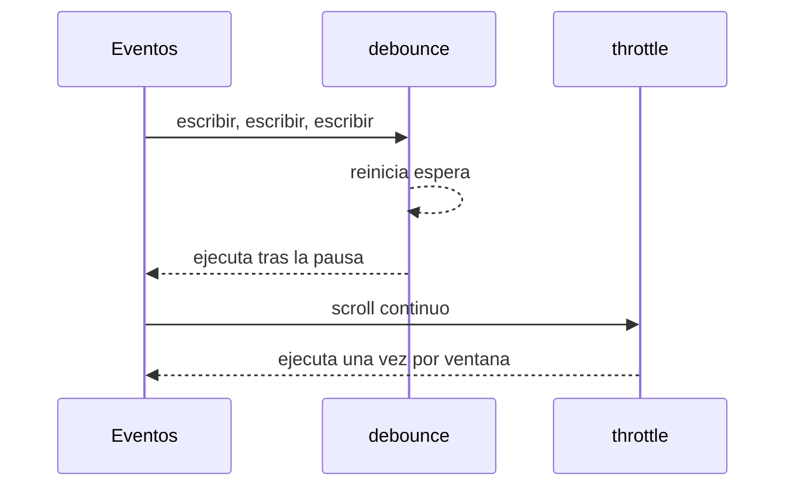
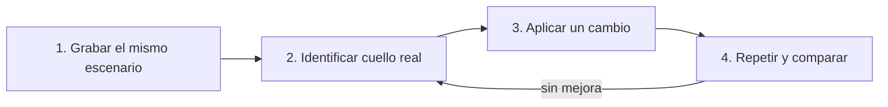
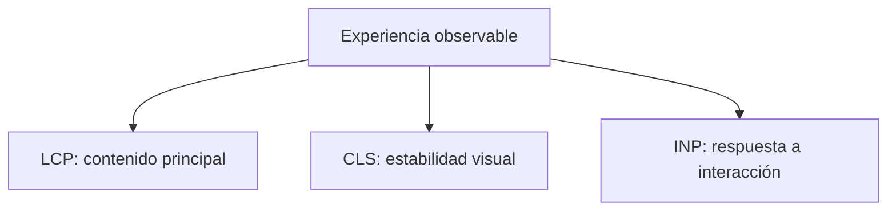

# Módulo 10: Patrones avanzados y rendimiento


## Aprende construyendo


### Tema 1: Debounce y throttle · Intermedio · 40 min

<details open>
<summary><strong>Capa 1 — Lectura</strong></summary>

#### ► DE QUÉ TRATA
Al finalizar podrás implementar, probar y elegir entre debounce y throttle según la interacción, incluyendo cancelación al desmontar. Aplicarás espera a la búsqueda y frecuencia limitada al seguimiento del mapa del proyecto.

#### ► LA IDEA EN UNA FRASE
**Al finalizar podrás implementar, probar y elegir entre debounce y throttle según la interacción, incluyendo cancelación al desmontar.**

#### ► POR QUÉ EXISTE ESTO
Resuelve un problema real de diseño o implementación y evita decisiones a ciegas.

#### ► LA ANALOGÍA
Piensa en debounce y throttle como una herramienta de taller: útil cuando conoces su propósito y sus límites.
**Dónde se rompe la analogía:** en software, los efectos dependen del contexto, la escala y los trade-offs.

#### ► CÓMO FUNCIONA


#### ► LO QUE PUEDE SALIR MAL
| Síntoma | Causa probable | Arreglo |
|---|---|---|
| Debounce y throttle se aplica pero el resultado no mejora | Se usó sin medir el problema real | Mide antes y compara contra la alternativa simple |
| Aparece complejidad inesperada | Se adoptó la técnica sin comprender sus trade-offs | Vuelve a la sección de trade-offs y reduce el alcance |
| Falla en un caso límite | Se asumió un contexto que no se cumple | Prueba el caso límite y documenta cuándo NO usarlo |

#### ► TRADE-OFFS
| Opción | Cuándo usarla | Cuándo NO usarla |
|---|---|---|
| Usar Debounce y throttle | Cuando el problema coincide con su propósito y el beneficio es observable | Cuando agrega complejidad sin resolver un problema real |
| Alternativa más simple | Cuando el contexto es pequeño, estable o fácil de razonar | Cuando ya demostró no escalar o no cumplir el requisito |
| Postergar la decisión | Cuando falta evidencia del problema | Cuando el costo de esperar es mayor que el costo de probar |

#### ► CUÁNDO NO USAR ESTO
No uses debounce y throttle por defecto. Aplícalo cuando el problema lo justifique y puedas verificar el beneficio; si una alternativa más simple resuelve igual, prefiérela.

#### ► DE VUELTA A LA ANALOGÍA
Volviendo a la analogía: debounce y throttle funciona como el modelo inicial, pero recuerda dónde se rompe: en producción importan la evidencia, la escala y el costo de equivocarte.

#### ► LO QUE DEBES RECORDAR
- Debounce y throttle existe para resolver un problema específico.
- Mide antes de adoptar complejidad.
- Conoce el caso donde NO usarlo.
- Verifica con evidencia observable.

#### ► PREGUNTAS PARA PENSAR
1. ¿Qué problema concreto resuelve debounce y throttle en tu contexto?
2. ¿Cómo sabrías que debounce y throttle no está funcionando bien?
3. ¿Qué alternativa más simple considerarías antes de usar debounce y throttle?

</details>

<details>
<summary><strong>Capa 2 — Construcción</strong></summary>

#### Código y verificación


```bash
mkdir ejemplo-frecuencia
cd ejemplo-frecuencia
npm init -y
npm install -D vitest
mkdir src test
```

```js
export function debounce(funcion, esperaMs) {
  let temporizador;
  function aplazada(...argumentos) {
    clearTimeout(temporizador);
    // Cada llamada sustituye la ejecución pendiente por la más reciente.
    temporizador = setTimeout(() => funcion(...argumentos), esperaMs);
  }
  aplazada.cancel = () => clearTimeout(temporizador);
  return aplazada;
}

export function throttle(funcion, intervaloMs) {
  let habilitada = true;
  return (...argumentos) => {
    if (!habilitada) return;
    habilitada = false;
    // La primera llamada se ejecuta; las demás esperan otra ventana.
    funcion(...argumentos);
    setTimeout(() => { habilitada = true; }, intervaloMs);
  };
}
```

```bash
npm test -- src/utilidades/frecuencia.test.js
```

</details>

### Tema 2: Memoización · Intermedio · 35 min

<details open>
<summary><strong>Capa 1 — Lectura</strong></summary>

#### ► DE QUÉ TRATA
Al finalizar podrás memoizar una función pura con caché limitada, medir aciertos y reconocer cuándo el coste de memoria supera el ahorro. Optimizarás un cálculo repetido de tarifa del proyecto sin almacenar respuestas cambiantes.

#### ► LA IDEA EN UNA FRASE
**Al finalizar podrás memoizar una función pura con caché limitada, medir aciertos y reconocer cuándo el coste de memoria supera el ahorro.**

#### ► POR QUÉ EXISTE ESTO
Resuelve un problema real de diseño o implementación y evita decisiones a ciegas.

#### ► LA ANALOGÍA
Piensa en memoización como una herramienta de taller: útil cuando conoces su propósito y sus límites.
**Dónde se rompe la analogía:** en software, los efectos dependen del contexto, la escala y los trade-offs.

#### ► CÓMO FUNCIONA
1. Identifica el problema que memoización resuelve.
2. Observa sus componentes y relaciones.
3. Aplica la opción más simple que funcione.
4. Verifica el resultado y los límites.

#### ► LO QUE PUEDE SALIR MAL
| Síntoma | Causa probable | Arreglo |
|---|---|---|
| Memoización se aplica pero el resultado no mejora | Se usó sin medir el problema real | Mide antes y compara contra la alternativa simple |
| Aparece complejidad inesperada | Se adoptó la técnica sin comprender sus trade-offs | Vuelve a la sección de trade-offs y reduce el alcance |
| Falla en un caso límite | Se asumió un contexto que no se cumple | Prueba el caso límite y documenta cuándo NO usarlo |

#### ► TRADE-OFFS
| Opción | Cuándo usarla | Cuándo NO usarla |
|---|---|---|
| Usar Memoización | Cuando el problema coincide con su propósito y el beneficio es observable | Cuando agrega complejidad sin resolver un problema real |
| Alternativa más simple | Cuando el contexto es pequeño, estable o fácil de razonar | Cuando ya demostró no escalar o no cumplir el requisito |
| Postergar la decisión | Cuando falta evidencia del problema | Cuando el costo de esperar es mayor que el costo de probar |

#### ► CUÁNDO NO USAR ESTO
No uses memoización por defecto. Aplícalo cuando el problema lo justifique y puedas verificar el beneficio; si una alternativa más simple resuelve igual, prefiérela.

#### ► DE VUELTA A LA ANALOGÍA
Volviendo a la analogía: memoización funciona como el modelo inicial, pero recuerda dónde se rompe: en producción importan la evidencia, la escala y el costo de equivocarte.

#### ► LO QUE DEBES RECORDAR
- Memoización existe para resolver un problema específico.
- Mide antes de adoptar complejidad.
- Conoce el caso donde NO usarlo.
- Verifica con evidencia observable.

#### ► PREGUNTAS PARA PENSAR
1. ¿Qué problema concreto resuelve memoización en tu contexto?
2. ¿Cómo sabrías que memoización no está funcionando bien?
3. ¿Qué alternativa más simple considerarías antes de usar memoización?

</details>

<details>
<summary><strong>Capa 2 — Construcción</strong></summary>

#### Código y verificación
```bash
mkdir ejemplo-memoizacion
cd ejemplo-memoizacion
npm init -y
mkdir src
```

```js
export function memoize(fn, limite = 100) {
  const cache = new Map();
  let aciertos = 0;
  function memoizada(...args) {
    const key = JSON.stringify(args);
    if (cache.has(key)) {
      aciertos += 1;
      return cache.get(key);
    }
    const resultado = fn(...args);
    // Elimina la entrada más antigua antes de superar el presupuesto.
    if (cache.size >= limite) cache.delete(cache.keys().next().value);
    cache.set(key, resultado);
    return cache.get(key);
  }
  memoizada.estadisticas = () => ({ entradas: cache.size, aciertos });
  return memoizada;
}
```

```bash
node src/performance/medir-tarifa.js
```

</details>

### Tema 3: Web Workers para trabajo pesado · Avanzado · 40 min

<details open>
<summary><strong>Capa 1 — Lectura</strong></summary>

#### ► DE QUÉ TRATA
Al finalizar podrás mover un cálculo CPU-intensivo a un Web Worker, intercambiar mensajes, manejar error y terminar trabajo obsoleto. Mantendrás interactiva la interfaz del proyecto mientras se ordenan candidatos de una ruta.

#### ► LA IDEA EN UNA FRASE
**Al finalizar podrás mover un cálculo CPU-intensivo a un Web Worker, intercambiar mensajes, manejar error y terminar trabajo obsoleto.**

#### ► POR QUÉ EXISTE ESTO
Resuelve un problema real de diseño o implementación y evita decisiones a ciegas.

#### ► LA ANALOGÍA
Piensa en web workers para trabajo pesado como una herramienta de taller: útil cuando conoces su propósito y sus límites.
**Dónde se rompe la analogía:** en software, los efectos dependen del contexto, la escala y los trade-offs.

#### ► CÓMO FUNCIONA
1. Identifica el problema que web workers para trabajo pesado resuelve.
2. Observa sus componentes y relaciones.
3. Aplica la opción más simple que funcione.
4. Verifica el resultado y los límites.

#### ► LO QUE PUEDE SALIR MAL
| Síntoma | Causa probable | Arreglo |
|---|---|---|
| Web Workers para trabajo pesado se aplica pero el resultado no mejora | Se usó sin medir el problema real | Mide antes y compara contra la alternativa simple |
| Aparece complejidad inesperada | Se adoptó la técnica sin comprender sus trade-offs | Vuelve a la sección de trade-offs y reduce el alcance |
| Falla en un caso límite | Se asumió un contexto que no se cumple | Prueba el caso límite y documenta cuándo NO usarlo |

#### ► TRADE-OFFS
| Opción | Cuándo usarla | Cuándo NO usarla |
|---|---|---|
| Usar Web Workers para trabajo pesado | Cuando el problema coincide con su propósito y el beneficio es observable | Cuando agrega complejidad sin resolver un problema real |
| Alternativa más simple | Cuando el contexto es pequeño, estable o fácil de razonar | Cuando ya demostró no escalar o no cumplir el requisito |
| Postergar la decisión | Cuando falta evidencia del problema | Cuando el costo de esperar es mayor que el costo de probar |

#### ► CUÁNDO NO USAR ESTO
No uses web workers para trabajo pesado por defecto. Aplícalo cuando el problema lo justifique y puedas verificar el beneficio; si una alternativa más simple resuelve igual, prefiérela.

#### ► DE VUELTA A LA ANALOGÍA
Volviendo a la analogía: web workers para trabajo pesado funciona como el modelo inicial, pero recuerda dónde se rompe: en producción importan la evidencia, la escala y el costo de equivocarte.

#### ► LO QUE DEBES RECORDAR
- Web Workers para trabajo pesado existe para resolver un problema específico.
- Mide antes de adoptar complejidad.
- Conoce el caso donde NO usarlo.
- Verifica con evidencia observable.

#### ► PREGUNTAS PARA PENSAR
1. ¿Qué problema concreto resuelve web workers para trabajo pesado en tu contexto?
2. ¿Cómo sabrías que web workers para trabajo pesado no está funcionando bien?
3. ¿Qué alternativa más simple considerarías antes de usar web workers para trabajo pesado?

</details>

<details>
<summary><strong>Capa 2 — Construcción</strong></summary>

#### Código y verificación
```bash
mkdir ejemplo-web-worker
cd ejemplo-web-worker
npm init -y
mkdir src
```

```js
self.onmessage = ({ data }) => {
  // El worker recibe una copia estructurada y nunca toca el DOM.
  const ordenadas = [...data.distancias].sort((a, b) => a - b);
  self.postMessage({ solicitudId: data.solicitudId, ordenadas });
};
```

```js
export function optimizarRuta(distancias, solicitudId) {
  const worker = new Worker(
    new URL("./optimizar-ruta.worker.js", import.meta.url),
    { type: "module" },
  );

  const resultado = new Promise((resolve, reject) => {
    worker.addEventListener("message", ({ data }) => resolve(data), { once: true });
    worker.addEventListener("error", reject, { once: true });
  }).finally(() => worker.terminate());

  worker.postMessage({ distancias, solicitudId });
  return { resultado, cancelar: () => worker.terminate() };
}
```

```bash
npm run dev
```

</details>

### Tema 4: Profiling con DevTools · Avanzado · 45 min

<details open>
<summary><strong>Capa 1 — Lectura</strong></summary>

#### ► DE QUÉ TRATA
Al finalizar podrás grabar un escenario reproducible, localizar una tarea larga en el flame chart, aplicar un solo cambio y comparar la misma métrica. Elaborarás evidencia de rendimiento para el filtro del proyecto.

#### ► LA IDEA EN UNA FRASE
**Al finalizar podrás grabar un escenario reproducible, localizar una tarea larga en el flame chart, aplicar un solo cambio y comparar la misma métrica.**

#### ► POR QUÉ EXISTE ESTO
Resuelve un problema real de diseño o implementación y evita decisiones a ciegas.

#### ► LA ANALOGÍA
Piensa en profiling con devtools como una herramienta de taller: útil cuando conoces su propósito y sus límites.
**Dónde se rompe la analogía:** en software, los efectos dependen del contexto, la escala y los trade-offs.

#### ► CÓMO FUNCIONA


#### ► LO QUE PUEDE SALIR MAL
| Síntoma | Causa probable | Arreglo |
|---|---|---|
| Profiling con DevTools se aplica pero el resultado no mejora | Se usó sin medir el problema real | Mide antes y compara contra la alternativa simple |
| Aparece complejidad inesperada | Se adoptó la técnica sin comprender sus trade-offs | Vuelve a la sección de trade-offs y reduce el alcance |
| Falla en un caso límite | Se asumió un contexto que no se cumple | Prueba el caso límite y documenta cuándo NO usarlo |

#### ► TRADE-OFFS
| Opción | Cuándo usarla | Cuándo NO usarla |
|---|---|---|
| Usar Profiling con DevTools | Cuando el problema coincide con su propósito y el beneficio es observable | Cuando agrega complejidad sin resolver un problema real |
| Alternativa más simple | Cuando el contexto es pequeño, estable o fácil de razonar | Cuando ya demostró no escalar o no cumplir el requisito |
| Postergar la decisión | Cuando falta evidencia del problema | Cuando el costo de esperar es mayor que el costo de probar |

#### ► CUÁNDO NO USAR ESTO
No uses profiling con devtools por defecto. Aplícalo cuando el problema lo justifique y puedas verificar el beneficio; si una alternativa más simple resuelve igual, prefiérela.

#### ► DE VUELTA A LA ANALOGÍA
Volviendo a la analogía: profiling con devtools funciona como el modelo inicial, pero recuerda dónde se rompe: en producción importan la evidencia, la escala y el costo de equivocarte.

#### ► LO QUE DEBES RECORDAR
- Profiling con DevTools existe para resolver un problema específico.
- Mide antes de adoptar complejidad.
- Conoce el caso donde NO usarlo.
- Verifica con evidencia observable.

#### ► PREGUNTAS PARA PENSAR
1. ¿Qué problema concreto resuelve profiling con devtools en tu contexto?
2. ¿Cómo sabrías que profiling con devtools no está funcionando bien?
3. ¿Qué alternativa más simple considerarías antes de usar profiling con devtools?

</details>

<details>
<summary><strong>Capa 2 — Construcción</strong></summary>

#### Código y verificación


```bash
mkdir ejemplo-profiling
cd ejemplo-profiling
npm init -y
mkdir src
touch index.html
```

```js
export function crearGuias(cantidad = 10_000) {
  return Array.from({ length: cantidad }, (_, indice) => ({
    numero: `RF-${String(indice).padStart(5, "0")}`,
    estado: indice % 2 === 0 ? "CREADA" : "EN_RUTA",
  }));
}

export function filtrarGuias(guias, termino) {
  performance.mark("filtro-inicio");
  // Este trabajo deliberadamente simple será localizable por nombre y medida.
  const resultado = guias.filter((guia) => guia.numero.includes(termino));
  performance.mark("filtro-fin");
  performance.measure("filtro-app", "filtro-inicio", "filtro-fin");
  return resultado;
}
```

```bash
mkdir ejemplo-devtools
cd ejemplo-devtools
npm init -y
mkdir src docs
```

```bash
npm run dev
```

</details>

### Tema 5: Core Web Vitals · Avanzado · 40 min

<details open>
<summary><strong>Capa 1 — Lectura</strong></summary>

#### ► DE QUÉ TRATA
Al finalizar podrás instrumentar LCP, CLS e INP, relacionar cada métrica con una experiencia visible y distinguir laboratorio de datos de campo. Medirás el proyecto en producción local y corregirás un desplazamiento provocado deliberadamente.

#### ► LA IDEA EN UNA FRASE
**Al finalizar podrás instrumentar LCP, CLS e INP, relacionar cada métrica con una experiencia visible y distinguir laboratorio de datos de campo.**

#### ► POR QUÉ EXISTE ESTO
Resuelve un problema real de diseño o implementación y evita decisiones a ciegas.

#### ► LA ANALOGÍA
Piensa en core web vitals como una herramienta de taller: útil cuando conoces su propósito y sus límites.
**Dónde se rompe la analogía:** en software, los efectos dependen del contexto, la escala y los trade-offs.

#### ► CÓMO FUNCIONA


#### ► LO QUE PUEDE SALIR MAL
| Síntoma | Causa probable | Arreglo |
|---|---|---|
| Core Web Vitals se aplica pero el resultado no mejora | Se usó sin medir el problema real | Mide antes y compara contra la alternativa simple |
| Aparece complejidad inesperada | Se adoptó la técnica sin comprender sus trade-offs | Vuelve a la sección de trade-offs y reduce el alcance |
| Falla en un caso límite | Se asumió un contexto que no se cumple | Prueba el caso límite y documenta cuándo NO usarlo |

#### ► TRADE-OFFS
| Opción | Cuándo usarla | Cuándo NO usarla |
|---|---|---|
| Usar Core Web Vitals | Cuando el problema coincide con su propósito y el beneficio es observable | Cuando agrega complejidad sin resolver un problema real |
| Alternativa más simple | Cuando el contexto es pequeño, estable o fácil de razonar | Cuando ya demostró no escalar o no cumplir el requisito |
| Postergar la decisión | Cuando falta evidencia del problema | Cuando el costo de esperar es mayor que el costo de probar |

#### ► CUÁNDO NO USAR ESTO
No uses core web vitals por defecto. Aplícalo cuando el problema lo justifique y puedas verificar el beneficio; si una alternativa más simple resuelve igual, prefiérela.

#### ► DE VUELTA A LA ANALOGÍA
Volviendo a la analogía: core web vitals funciona como el modelo inicial, pero recuerda dónde se rompe: en producción importan la evidencia, la escala y el costo de equivocarte.

#### ► LO QUE DEBES RECORDAR
- Core Web Vitals existe para resolver un problema específico.
- Mide antes de adoptar complejidad.
- Conoce el caso donde NO usarlo.
- Verifica con evidencia observable.

#### ► PREGUNTAS PARA PENSAR
1. ¿Qué problema concreto resuelve core web vitals en tu contexto?
2. ¿Cómo sabrías que core web vitals no está funcionando bien?
3. ¿Qué alternativa más simple considerarías antes de usar core web vitals?

</details>

<details>
<summary><strong>Capa 2 — Construcción</strong></summary>

#### Código y verificación


```bash
mkdir ejemplo-web-vitals
cd ejemplo-web-vitals
npm init -y
npm install web-vitals
mkdir -p src/observabilidad
```

```bash
npm install web-vitals
```

```js
import { onCLS, onINP, onLCP } from "web-vitals";

function informar(metrica) {
  // No adjuntamos dirección, número de guía ni identidad del operador.
  console.table({ nombre: metrica.name, valor: metrica.value, id: metrica.id });
}

export function iniciarWebVitals() {
  onLCP(informar);
  onCLS(informar);
  onINP(informar);
}
```

```bash
npm run build
npm run preview
```

</details>

### Comprueba lo construido

<details open>
<summary><strong>Capa 1 — Lectura</strong></summary>

#### ► DE QUÉ TRATA
Este tema te guía por comprueba lo construido con foco en comprensión antes de implementación.

#### ► LA IDEA EN UNA FRASE
**Entender comprueba lo construido te permite tomar mejores decisiones técnicas.**

#### ► POR QUÉ EXISTE ESTO
Resuelve un problema real de diseño o implementación y evita decisiones a ciegas.

#### ► LA ANALOGÍA
Piensa en comprueba lo construido como una herramienta de taller: útil cuando conoces su propósito y sus límites.
**Dónde se rompe la analogía:** en software, los efectos dependen del contexto, la escala y los trade-offs.

#### ► CÓMO FUNCIONA
1. Identifica el problema que comprueba lo construido resuelve.
2. Observa sus componentes y relaciones.
3. Aplica la opción más simple que funcione.
4. Verifica el resultado y los límites.

#### ► LO QUE PUEDE SALIR MAL
| Síntoma | Causa probable | Arreglo |
|---|---|---|
| Comprueba lo construido se aplica pero el resultado no mejora | Se usó sin medir el problema real | Mide antes y compara contra la alternativa simple |
| Aparece complejidad inesperada | Se adoptó la técnica sin comprender sus trade-offs | Vuelve a la sección de trade-offs y reduce el alcance |
| Falla en un caso límite | Se asumió un contexto que no se cumple | Prueba el caso límite y documenta cuándo NO usarlo |

#### ► TRADE-OFFS
| Opción | Cuándo usarla | Cuándo NO usarla |
|---|---|---|
| Usar Comprueba lo construido | Cuando el problema coincide con su propósito y el beneficio es observable | Cuando agrega complejidad sin resolver un problema real |
| Alternativa más simple | Cuando el contexto es pequeño, estable o fácil de razonar | Cuando ya demostró no escalar o no cumplir el requisito |
| Postergar la decisión | Cuando falta evidencia del problema | Cuando el costo de esperar es mayor que el costo de probar |

#### ► CUÁNDO NO USAR ESTO
No uses comprueba lo construido por defecto. Aplícalo cuando el problema lo justifique y puedas verificar el beneficio; si una alternativa más simple resuelve igual, prefiérela.

#### ► DE VUELTA A LA ANALOGÍA
Volviendo a la analogía: comprueba lo construido funciona como el modelo inicial, pero recuerda dónde se rompe: en producción importan la evidencia, la escala y el costo de equivocarte.

#### ► LO QUE DEBES RECORDAR
- Comprueba lo construido existe para resolver un problema específico.
- Mide antes de adoptar complejidad.
- Conoce el caso donde NO usarlo.
- Verifica con evidencia observable.

#### ► PREGUNTAS PARA PENSAR
1. ¿Qué problema concreto resuelve comprueba lo construido en tu contexto?
2. ¿Cómo sabrías que comprueba lo construido no está funcionando bien?
3. ¿Qué alternativa más simple considerarías antes de usar comprueba lo construido?

</details>

<details>
<summary><strong>Capa 2 — Construcción</strong></summary>

#### Nota de construcción
Este tema es principalmente conceptual en esta versión. La verificación se realiza con las preguntas de comprensión y el criterio de cuándo NO usar comprueba lo construido.

</details>
