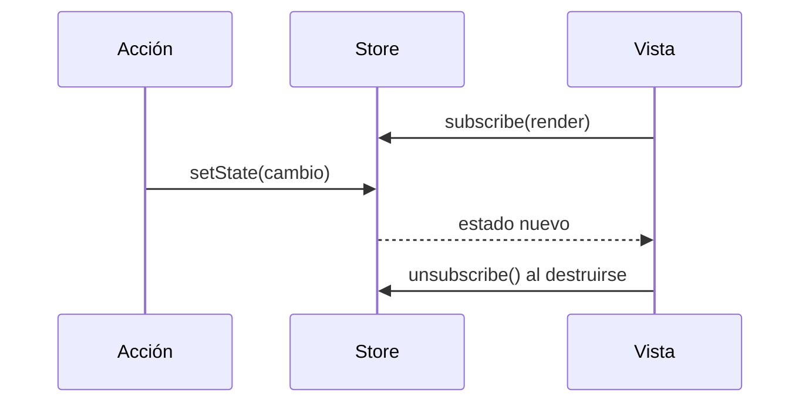
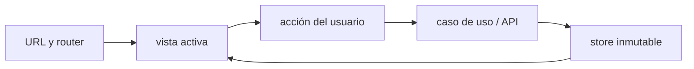

# Módulo 12: Proyecto integrador — SPA sin framework


## Aprende construyendo


### Tema 1: Routing manual con History API · Avanzado · 45 min

<details open>
<summary><strong>Capa 1 — Lectura</strong></summary>

#### ► DE QUÉ TRATA
Al finalizar podrás resolver rutas estáticas y con parámetro, navegar sin recarga, responder a atrás/adelante y respetar enlaces modificados. Construirás el router accesible de la SPA del proyecto.

</details>

<details>
<summary><strong>Capa 2 — Construcción</strong></summary>

#### Código y verificación
```bash
mkdir ejemplo-history-router
cd ejemplo-history-router
npm init -y
npm install -D vitest vite
npm pkg set scripts.test="vitest run" scripts.dev="vite" scripts.build="vite build" scripts.preview="vite preview"
mkdir src
```

```js
export function resolverRuta(pathname) {
  if (pathname === "/") return { vista: "inicio", parametros: {} };
  if (pathname === "/guias") return { vista: "guias", parametros: {} };
  const detalle = pathname.match(/^\/guias\/([^/]+)$/);
  if (detalle) return { vista: "detalle", parametros: { numero: decodeURIComponent(detalle[1]) } };
  return { vista: "no-encontrada", parametros: {} };
}

export function crearRouter({ renderizar }) {
  const renderActual = () => renderizar(resolverRuta(location.pathname));
  const navegar = (ruta) => { history.pushState({}, "", ruta); renderActual(); };
  const alClick = (evento) => {
    const enlace = evento.target.closest("a[data-link]");
    if (!enlace || evento.defaultPrevented || evento.button !== 0 ||
        evento.metaKey || evento.ctrlKey || evento.shiftKey || evento.altKey) return;
    evento.preventDefault();
    navegar(enlace.pathname);
  };
  addEventListener("popstate", renderActual);
  document.addEventListener("click", alClick);
  return { navegar, iniciar: renderActual, destroy: () => {
    removeEventListener("popstate", renderActual);
    document.removeEventListener("click", alClick);
  } };
}
```

```js
import { describe, it, expect } from "vitest";
import { resolverRuta } from "./router.js";

describe("resolverRuta", () => {
  it("resuelve las rutas estáticas", () => {
    expect(resolverRuta("/").vista).toBe("inicio");
    expect(resolverRuta("/guias").vista).toBe("guias");
  });

  it("extrae y decodifica el número del detalle", () => {
    expect(resolverRuta("/guias/RF%2D101")).toEqual({
      vista: "detalle",
      parametros: { numero: "RF-101" },
    });
  });

  it("devuelve no-encontrada ante una ruta desconocida", () => {
    expect(resolverRuta("/otra").vista).toBe("no-encontrada");
  });
});
```

```html
<!doctype html>
<html lang="es">
  <head>
    <meta charset="utf-8" />
    <title>Guías</title>
  </head>
  <body>
    <nav>
      <a href="/" data-link>Inicio</a>
      <a href="/guias" data-link>Guías</a>
      <a href="/guias/RF-101" data-link>RF-101</a>
    </nav>
    <main id="app"></main>
    <script type="module" src="/src/main.js"></script>
  </body>
</html>
```

```js
import { crearRouter } from "./router.js";

const raiz = document.querySelector("#app");
const router = crearRouter({
  renderizar: ({ vista, parametros }) => {
    raiz.textContent = vista === "detalle" ? `Detalle de ${parametros.numero}` : `Vista: ${vista}`;
  },
});
router.iniciar();
```

```bash
npm test -- src/router.test.js
npm run dev
```

</details>

### Tema 2: Estado de aplicación con un store propio · Avanzado · 45 min

<details open>
<summary><strong>Capa 1 — Lectura</strong></summary>

#### ► DE QUÉ TRATA
Al finalizar podrás crear un store con lectura, actualización funcional, suscripción y cleanup, verificando inmutabilidad y orden de notificación. Centralizarás filtro y carga de guías del proyecto.

#### ► CÓMO FUNCIONA


</details>

<details>
<summary><strong>Capa 2 — Construcción</strong></summary>

#### Código y verificación
```bash
mkdir ejemplo-store
cd ejemplo-store
npm init -y
npm install -D vitest
npm pkg set scripts.test="vitest run"
mkdir src test
```

```js
export function crearStore(estadoInicial) {
  let estado = estadoInicial;
  const listeners = new Set();
  return {
    getState: () => estado,
    setState: (actualizacion) => {
      const parcial = typeof actualizacion === "function"
        ? actualizacion(estado)
        : actualizacion;
      // Crea referencia nueva para que cambios sean observables y predecibles.
      estado = Object.freeze({ ...estado, ...parcial });
      listeners.forEach((listener) => listener(estado));
    },
    subscribe: (listener) => {
      listeners.add(listener);
      return () => listeners.delete(listener);
    },
  };
}
```


```js
import { describe, it, expect, vi } from "vitest";
import { crearStore } from "../src/store.js";

describe("crearStore", () => {
  it("notifica, crea una referencia nueva y respeta la desuscripción", () => {
    const store = crearStore({ filtro: "TODAS" });
    const cabecera = vi.fn();
    const lista = vi.fn();
    store.subscribe(cabecera);
    const desuscribirLista = store.subscribe(lista);
    const anterior = store.getState();

    store.setState({ filtro: "EN_RUTA" });
    expect(cabecera).toHaveBeenCalledTimes(1);
    expect(lista).toHaveBeenCalledTimes(1);
    expect(store.getState()).not.toBe(anterior);

    desuscribirLista();
    store.setState((estado) => ({ filtro: `${estado.filtro}-URGENTE` }));
    expect(cabecera).toHaveBeenCalledTimes(2);
    expect(lista).toHaveBeenCalledTimes(1);
    expect(store.getState().filtro).toBe("EN_RUTA-URGENTE");
  });
});
```

```bash
npm test -- test/store.test.js
```

</details>

### Tema 3: Consumo de una API real con manejo de errores · Avanzado · 45 min

<details open>
<summary><strong>Capa 1 — Lectura</strong></summary>

#### ► DE QUÉ TRATA
Al finalizar podrás modelar una operación remota como estados mutuamente excluyentes, validar JSON y cancelar al abandonar la vista. Conectarás el cliente de guías del proyecto al store sin dejar pantallas ambiguas.

</details>

<details>
<summary><strong>Capa 2 — Construcción</strong></summary>

#### Código y verificación
```bash
mkdir ejemplo-api-client
cd ejemplo-api-client
npm init -y
npm install -D vitest
npm pkg set scripts.test="vitest run"
mkdir src test
```

```js
export function parsearGuia(valor) {
  if (typeof valor?.numero !== "string" || typeof valor?.estado !== "string") {
    throw new TypeError("Guía inválida");
  }
  return { numero: valor.numero, estado: valor.estado };
}
```

```js
import { parsearGuia } from "./parsear-guia.js";

export async function cargarGuias(store, { fetchImpl = fetch, signal } = {}) {
  store.setState({ remoto: { tipo: "loading" } });
  try {
    const respuesta = await fetchImpl("/api/guias.json", { signal });
    if (!respuesta.ok) throw new Error(`HTTP ${respuesta.status}`);
    const json = await respuesta.json();
    if (!Array.isArray(json)) throw new TypeError("Respuesta de guías inválida");
    // parsearGuia valida cada frontera antes de entrar al dominio.
    const guias = json.map(parsearGuia);
    store.setState({ remoto: { tipo: "success", guias } });
  } catch (error) {
    if (error instanceof DOMException && error.name === "AbortError") return;
    console.error("Carga de guías", error);
    store.setState({ remoto: {
      tipo: "error",
      mensaje: "No pudimos cargar las entregas. Intenta de nuevo.",
    } });
  }
}
```

```js
import { describe, it, expect, vi } from "vitest";
import { cargarGuias } from "../src/cargar.js";

function crearStoreFalso() {
  const tipos = [];
  return { tipos, setState: (cambio) => tipos.push(cambio.remoto.tipo) };
}

const responder = (status, cuerpo) => async () =>
  new Response(JSON.stringify(cuerpo), { status });

describe("cargarGuias", () => {
  it("pasa de loading a success con datos válidos", async () => {
    const store = crearStoreFalso();
    await cargarGuias(store, { fetchImpl: responder(200, [{ numero: "RF-101", estado: "EN_RUTA" }]) });
    expect(store.tipos).toEqual(["loading", "success"]);
  });

  it("trata un HTTP 500 como error aunque el cuerpo sea JSON", async () => {
    vi.spyOn(console, "error").mockImplementation(() => {});
    const store = crearStoreFalso();
    await cargarGuias(store, { fetchImpl: responder(500, []) });
    expect(store.tipos).toEqual(["loading", "error"]);
  });

  it("trata un JSON con forma inválida como error", async () => {
    vi.spyOn(console, "error").mockImplementation(() => {});
    const store = crearStoreFalso();
    await cargarGuias(store, { fetchImpl: responder(200, { guias: [] }) });
    expect(store.tipos).toEqual(["loading", "error"]);
  });
});
```

```bash
npm test -- test/cargar.test.js
```

</details>

### Tema 4: Conectando todo — el patrón completo de una SPA · Avanzado · 45 min

<details open>
<summary><strong>Capa 1 — Lectura</strong></summary>

#### ► DE QUÉ TRATA
Al finalizar podrás ensamblar dependencias en un composition root, montar una vista por ruta y ejecutar su destroy antes de cambiar. Entregarás una SPA funcional en desarrollo y producción.

#### ► CÓMO FUNCIONA


</details>

<details>
<summary><strong>Capa 2 — Construcción</strong></summary>

#### Código y verificación

```bash
mkdir ejemplo-spa-completa
cd ejemplo-spa-completa
npm init -y
npm install -D vite
npm pkg set scripts.dev="vite" scripts.build="vite build" scripts.preview="vite preview"
mkdir -p src/router src/estado src/api src/vistas public/api
cp ../ejemplo-history-router/src/router.js src/router/router.js
cp ../ejemplo-store/src/store.js src/estado/store.js
cp ../ejemplo-api-client/src/cargar.js src/api/cargar.js
cp ../ejemplo-api-client/src/parsear-guia.js src/api/parsear-guia.js
```

```json
[
  { "numero": "RF-101", "estado": "EN_RUTA" },
  { "numero": "RF-102", "estado": "ENTREGADA" }
]
```

```html
<!doctype html>
<html lang="es">
  <head>
    <meta charset="utf-8" />
    <title>SPA de guías</title>
  </head>
  <body>
    <nav>
      <a href="/" data-link>Inicio</a>
      <a href="/guias" data-link>Guías</a>
      <a href="/no-existe" data-link>Ruta rota</a>
    </nav>
    <main id="app"></main>
    <script type="module" src="/src/main.js"></script>
  </body>
</html>
```

```js
function crearTitulo(raiz, texto) {
  const titulo = document.createElement("h1");
  titulo.textContent = texto;
  titulo.tabIndex = -1;
  raiz.append(titulo);
  titulo.focus();
}

export function crearVistaInicio(raiz) {
  crearTitulo(raiz, "Seguimiento de guías");
  return { destroy() {} };
}

export function crearVistaGuias(raiz, { store, cliente }) {
  crearTitulo(raiz, "Guías");
  const contenido = document.createElement("div");
  contenido.setAttribute("aria-live", "polite");
  raiz.append(contenido);

  const pintar = ({ remoto }) => {
    if (remoto.tipo === "loading") contenido.textContent = "Cargando…";
    if (remoto.tipo === "error") contenido.textContent = remoto.mensaje;
    if (remoto.tipo === "success") {
      const lista = document.createElement("ul");
      for (const guia of remoto.guias) {
        const item = document.createElement("li");
        item.textContent = `${guia.numero}: ${guia.estado}`;
        lista.append(item);
      }
      contenido.replaceChildren(lista);
    }
  };

  const desuscribir = store.subscribe(pintar);
  const controlador = new AbortController();
  cliente.cargarGuias(store, { signal: controlador.signal });
  // destroy deja de escuchar el store y cancela la petición en curso.
  return { destroy() { controlador.abort(); desuscribir(); } };
}

export function crearVista404(raiz) {
  crearTitulo(raiz, "Página no encontrada");
  return { destroy() {} };
}
```

```js
import { crearRouter } from "./router/router.js";
import { crearStore } from "./estado/store.js";
import { crearVistaGuias, crearVistaInicio, crearVista404 } from "./vistas/index.js";

export function crearAplicacion(raiz, dependencias) {
  const store = crearStore({ remoto: { tipo: "idle" }, filtro: "TODAS" });
  let vistaActual = { destroy() {} };

  const renderizar = (ruta) => {
    // El ciclo de vida anterior termina antes de montar el siguiente.
    vistaActual.destroy();
    raiz.replaceChildren();
    if (ruta.vista === "inicio") vistaActual = crearVistaInicio(raiz);
    else if (ruta.vista === "guias") {
      vistaActual = crearVistaGuias(raiz, { store, cliente: dependencias.cliente });
    } else vistaActual = crearVista404(raiz);
  };

  const router = crearRouter({ renderizar });
  router.iniciar();
  return { destroy() { vistaActual.destroy(); router.destroy(); } };
}
```

</details>

### Comprueba lo construido

<details open>
<summary><strong>Capa 1 — Lectura</strong></summary>

</details>

<details>
<summary><strong>Capa 2 — Construcción</strong></summary>

#### Nota de construcción
Este tema es principalmente conceptual en esta versión. La verificación se realiza con las preguntas de comprensión y el criterio de cuándo NO usar comprueba lo construido.

</details>
