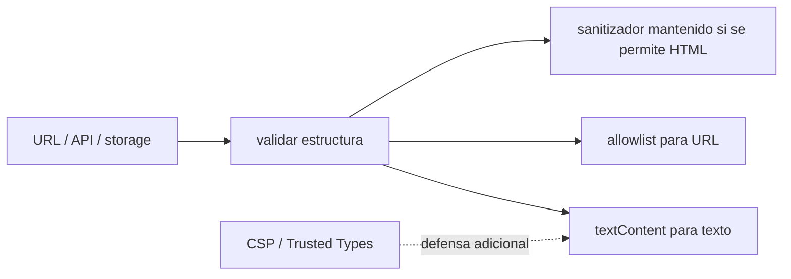
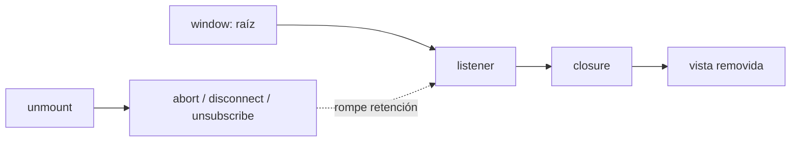
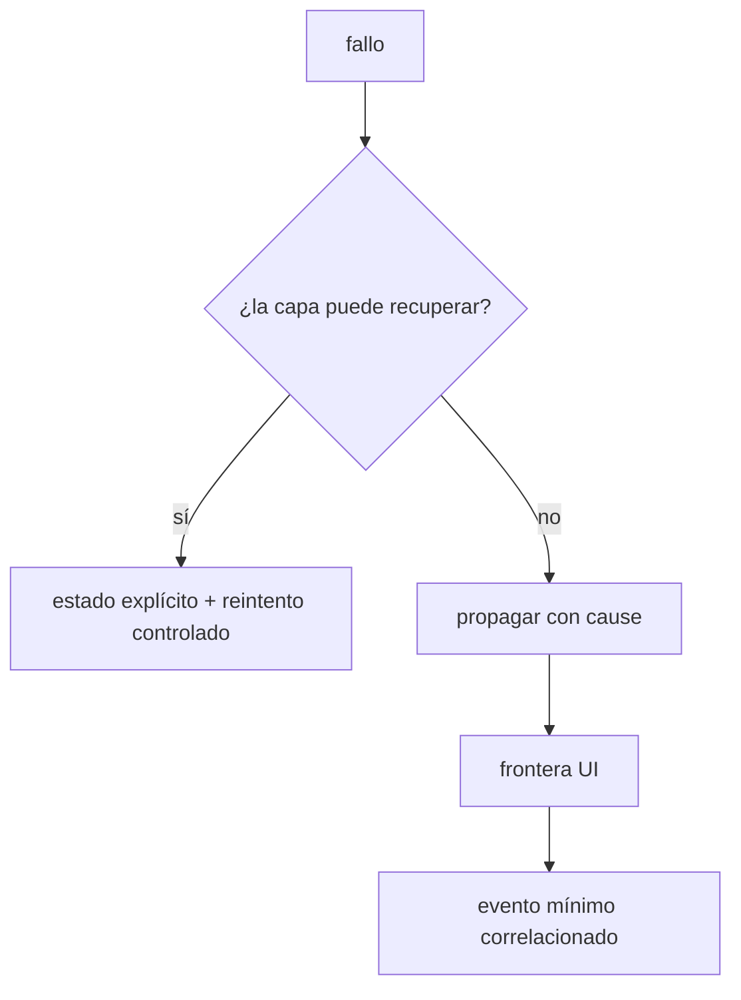
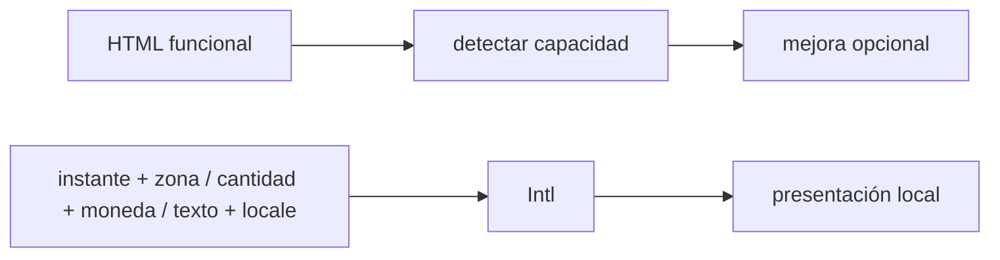

# Módulo 13: JavaScript en producción — seguridad, memoria y compatibilidad

Una aplicación no está terminada cuando muestra datos. En producción recibe entradas hostiles, permanece abierta durante horas, corre en dispositivos diferentes y debe explicar qué falló sin filtrar información privada. En este módulo endurecerás la SPA del módulo 12 mediante evidencia reproducible.


## Aprende construyendo


### Tema 1: Datos no confiables y seguridad en el navegador · Avanzado · 45 min

<details open>
<summary><strong>Capa 1 — Lectura</strong></summary>

#### ► DE QUÉ TRATA
Al finalizar podrás identificar una frontera de confianza, renderizar texto sin interpretarlo, permitir únicamente URLs HTTPS y explicar el papel limitado de CSP, CORS y CSRF. Endurecerás el seguimiento público del proyecto con una prueba de regresión XSS.

#### ► LA IDEA EN UNA FRASE
**Al finalizar podrás identificar una frontera de confianza, renderizar texto sin interpretarlo, permitir únicamente URLs HTTPS y explicar el papel limitado de CSP, CORS y CSRF.**

#### ► POR QUÉ EXISTE ESTO
Resuelve un problema real de diseño o implementación y evita decisiones a ciegas.

#### ► LA ANALOGÍA
Piensa en datos no confiables y seguridad en el navegador como una herramienta de taller: útil cuando conoces su propósito y sus límites.
**Dónde se rompe la analogía:** en software, los efectos dependen del contexto, la escala y los trade-offs.

#### ► CÓMO FUNCIONA


#### ► LO QUE PUEDE SALIR MAL
| Síntoma | Causa probable | Arreglo |
|---|---|---|
| Datos no confiables y seguridad en el navegador se aplica pero el resultado no mejora | Se usó sin medir el problema real | Mide antes y compara contra la alternativa simple |
| Aparece complejidad inesperada | Se adoptó la técnica sin comprender sus trade-offs | Vuelve a la sección de trade-offs y reduce el alcance |
| Falla en un caso límite | Se asumió un contexto que no se cumple | Prueba el caso límite y documenta cuándo NO usarlo |

#### ► TRADE-OFFS
| Opción | Cuándo usarla | Cuándo NO usarla |
|---|---|---|
| Usar Datos no confiables y seguridad en el navegador | Cuando el problema coincide con su propósito y el beneficio es observable | Cuando agrega complejidad sin resolver un problema real |
| Alternativa más simple | Cuando el contexto es pequeño, estable o fácil de razonar | Cuando ya demostró no escalar o no cumplir el requisito |
| Postergar la decisión | Cuando falta evidencia del problema | Cuando el costo de esperar es mayor que el costo de probar |

#### ► CUÁNDO NO USAR ESTO
No uses datos no confiables y seguridad en el navegador por defecto. Aplícalo cuando el problema lo justifique y puedas verificar el beneficio; si una alternativa más simple resuelve igual, prefiérela.

#### ► DE VUELTA A LA ANALOGÍA
Volviendo a la analogía: datos no confiables y seguridad en el navegador funciona como el modelo inicial, pero recuerda dónde se rompe: en producción importan la evidencia, la escala y el costo de equivocarte.

#### ► LO QUE DEBES RECORDAR
- Datos no confiables y seguridad en el navegador existe para resolver un problema específico.
- Mide antes de adoptar complejidad.
- Conoce el caso donde NO usarlo.
- Verifica con evidencia observable.

#### ► PREGUNTAS PARA PENSAR
1. ¿Qué problema concreto resuelve datos no confiables y seguridad en el navegador en tu contexto?
2. ¿Cómo sabrías que datos no confiables y seguridad en el navegador no está funcionando bien?
3. ¿Qué alternativa más simple considerarías antes de usar datos no confiables y seguridad en el navegador?

</details>

<details>
<summary><strong>Capa 2 — Construcción</strong></summary>

#### Código y verificación
```javascript
const title = document.createElement('h2');
title.textContent = product.name;
card.replaceChildren(title);
```


```bash
mkdir ejemplo-seguridad-browser
cd ejemplo-seguridad-browser
npm init -y
npm install -D vitest
mkdir src test
```

```js
function urlHttps(valor, base = location.origin) {
  const url = new URL(valor, base);
  if (url.protocol !== "https:") throw new TypeError("Solo se permiten enlaces HTTPS");
  return url.href;
}

export function renderSeguimiento(raiz, entrada) {
  if (typeof entrada !== "object" || entrada === null) {
    throw new TypeError("Seguimiento inválido");
  }
  const { publicCode, status, helpUrl } = entrada;
  if (![publicCode, status, helpUrl].every((valor) => typeof valor === "string")) {
    throw new TypeError("Campos de seguimiento inválidos");
  }

  const titulo = document.createElement("h2");
  // textContent conserva el payload como texto literal.
  titulo.textContent = publicCode;
  const enlace = document.createElement("a");
  enlace.textContent = `Ayuda para ${status}`;
  enlace.href = urlHttps(helpUrl);
  raiz.replaceChildren(titulo, enlace);
}
```

```bash
npm test -- src/seguridad/render-seguimiento.test.js
```

</details>

### Tema 2: Memoria administrada no significa memoria infinita · Avanzado · 40 min

<details open>
<summary><strong>Capa 1 — Lectura</strong></summary>

#### ► DE QUÉ TRATA
Al finalizar podrás explicar reachability, diseñar montaje/desmontaje simétricos y confirmar una fuga mediante snapshots comparables. Eliminarás listeners y suscripciones retenidos al navegar en la aplicación.

#### ► LA IDEA EN UNA FRASE
**Al finalizar podrás explicar reachability, diseñar montaje/desmontaje simétricos y confirmar una fuga mediante snapshots comparables.**

#### ► POR QUÉ EXISTE ESTO
Resuelve un problema real de diseño o implementación y evita decisiones a ciegas.

#### ► LA ANALOGÍA
Piensa en memoria administrada no significa memoria infinita como una herramienta de taller: útil cuando conoces su propósito y sus límites.
**Dónde se rompe la analogía:** en software, los efectos dependen del contexto, la escala y los trade-offs.

#### ► CÓMO FUNCIONA


#### ► LO QUE PUEDE SALIR MAL
| Síntoma | Causa probable | Arreglo |
|---|---|---|
| Memoria administrada no significa memoria infinita se aplica pero el resultado no mejora | Se usó sin medir el problema real | Mide antes y compara contra la alternativa simple |
| Aparece complejidad inesperada | Se adoptó la técnica sin comprender sus trade-offs | Vuelve a la sección de trade-offs y reduce el alcance |
| Falla en un caso límite | Se asumió un contexto que no se cumple | Prueba el caso límite y documenta cuándo NO usarlo |

#### ► TRADE-OFFS
| Opción | Cuándo usarla | Cuándo NO usarla |
|---|---|---|
| Usar Memoria administrada no significa memoria infinita | Cuando el problema coincide con su propósito y el beneficio es observable | Cuando agrega complejidad sin resolver un problema real |
| Alternativa más simple | Cuando el contexto es pequeño, estable o fácil de razonar | Cuando ya demostró no escalar o no cumplir el requisito |
| Postergar la decisión | Cuando falta evidencia del problema | Cuando el costo de esperar es mayor que el costo de probar |

#### ► CUÁNDO NO USAR ESTO
No uses memoria administrada no significa memoria infinita por defecto. Aplícalo cuando el problema lo justifique y puedas verificar el beneficio; si una alternativa más simple resuelve igual, prefiérela.

#### ► DE VUELTA A LA ANALOGÍA
Volviendo a la analogía: memoria administrada no significa memoria infinita funciona como el modelo inicial, pero recuerda dónde se rompe: en producción importan la evidencia, la escala y el costo de equivocarte.

#### ► LO QUE DEBES RECORDAR
- Memoria administrada no significa memoria infinita existe para resolver un problema específico.
- Mide antes de adoptar complejidad.
- Conoce el caso donde NO usarlo.
- Verifica con evidencia observable.

#### ► PREGUNTAS PARA PENSAR
1. ¿Qué problema concreto resuelve memoria administrada no significa memoria infinita en tu contexto?
2. ¿Cómo sabrías que memoria administrada no significa memoria infinita no está funcionando bien?
3. ¿Qué alternativa más simple considerarías antes de usar memoria administrada no significa memoria infinita?

</details>

<details>
<summary><strong>Capa 2 — Construcción</strong></summary>

#### Código y verificación


```bash
mkdir ejemplo-lifecycle
cd ejemplo-lifecycle
npm init -y
npm install -D vitest
mkdir src test
```

```javascript
export function mountSearch(root, store, render) {
  const controller = new AbortController();
  const onKeydown = (event) => {
    if (event.key === "/") root.querySelector("input")?.focus();
  };
  window.addEventListener("keydown", onKeydown, { signal: controller.signal });
  const unsubscribe = store.subscribe(render);

  return function unmount() {
    // Rompe listener y suscripción que mantienen alcanzable esta vista.
    controller.abort();
    unsubscribe();
    root.replaceChildren();
  };
}
```

```bash
npm test -- src/lifecycle/mount-search.test.js
npm run dev
```

</details>

### Tema 3: Errores útiles sin convertir usuarios en sensores involuntarios · Avanzado · 40 min

<details open>
<summary><strong>Capa 1 — Lectura</strong></summary>

#### ► DE QUÉ TRATA
Al finalizar podrás distinguir fallo operacional de defecto, propagar cause, redactar telemetría mediante allowlist y evitar recursión si el reporter falla. Registrarás errores correlacionables del proyecto sin cuerpos, tokens ni direcciones.

#### ► LA IDEA EN UNA FRASE
**Al finalizar podrás distinguir fallo operacional de defecto, propagar cause, redactar telemetría mediante allowlist y evitar recursión si el reporter falla.**

#### ► POR QUÉ EXISTE ESTO
Resuelve un problema real de diseño o implementación y evita decisiones a ciegas.

#### ► LA ANALOGÍA
Piensa en errores útiles sin convertir usuarios en sensores involuntarios como una herramienta de taller: útil cuando conoces su propósito y sus límites.
**Dónde se rompe la analogía:** en software, los efectos dependen del contexto, la escala y los trade-offs.

#### ► CÓMO FUNCIONA


#### ► LO QUE PUEDE SALIR MAL
| Síntoma | Causa probable | Arreglo |
|---|---|---|
| Errores útiles sin convertir usuarios en sensores involuntarios se aplica pero el resultado no mejora | Se usó sin medir el problema real | Mide antes y compara contra la alternativa simple |
| Aparece complejidad inesperada | Se adoptó la técnica sin comprender sus trade-offs | Vuelve a la sección de trade-offs y reduce el alcance |
| Falla en un caso límite | Se asumió un contexto que no se cumple | Prueba el caso límite y documenta cuándo NO usarlo |

#### ► TRADE-OFFS
| Opción | Cuándo usarla | Cuándo NO usarla |
|---|---|---|
| Usar Errores útiles sin convertir usuarios en sensores involuntarios | Cuando el problema coincide con su propósito y el beneficio es observable | Cuando agrega complejidad sin resolver un problema real |
| Alternativa más simple | Cuando el contexto es pequeño, estable o fácil de razonar | Cuando ya demostró no escalar o no cumplir el requisito |
| Postergar la decisión | Cuando falta evidencia del problema | Cuando el costo de esperar es mayor que el costo de probar |

#### ► CUÁNDO NO USAR ESTO
No uses errores útiles sin convertir usuarios en sensores involuntarios por defecto. Aplícalo cuando el problema lo justifique y puedas verificar el beneficio; si una alternativa más simple resuelve igual, prefiérela.

#### ► DE VUELTA A LA ANALOGÍA
Volviendo a la analogía: errores útiles sin convertir usuarios en sensores involuntarios funciona como el modelo inicial, pero recuerda dónde se rompe: en producción importan la evidencia, la escala y el costo de equivocarte.

#### ► LO QUE DEBES RECORDAR
- Errores útiles sin convertir usuarios en sensores involuntarios existe para resolver un problema específico.
- Mide antes de adoptar complejidad.
- Conoce el caso donde NO usarlo.
- Verifica con evidencia observable.

#### ► PREGUNTAS PARA PENSAR
1. ¿Qué problema concreto resuelve errores útiles sin convertir usuarios en sensores involuntarios en tu contexto?
2. ¿Cómo sabrías que errores útiles sin convertir usuarios en sensores involuntarios no está funcionando bien?
3. ¿Qué alternativa más simple considerarías antes de usar errores útiles sin convertir usuarios en sensores involuntarios?

</details>

<details>
<summary><strong>Capa 2 — Construcción</strong></summary>

#### Código y verificación


```bash
mkdir ejemplo-errores-privacidad
cd ejemplo-errores-privacidad
npm init -y
npm install -D vitest
mkdir src test
```

```javascript
const camposPermitidos = ["tipo", "version", "rutaLogica", "traceId", "duracionMs"];
let reportando = false;

export async function reportarError(datos, enviar = fetch) {
  if (reportando) return; // Evita un bucle si la propia telemetría falla.
  reportando = true;
  try {
    const evento = Object.fromEntries(
      camposPermitidos.flatMap((campo) => campo in datos ? [[campo, datos[campo]]] : []),
    );
    await enviar("/telemetria/errores", {
      method: "POST",
      headers: { "content-type": "application/json" },
      body: JSON.stringify(evento),
      keepalive: true,
    });
    return evento;
  } catch {
    return undefined; // La observabilidad no debe romper la recuperación de UI.
  } finally {
    reportando = false;
  }
}
```

```bash
npm test -- src/observabilidad/reportar-error.test.js
```

</details>

### Tema 4: Compatibilidad, idioma y tiempo son requisitos de datos · Avanzado · 40 min

<details open>
<summary><strong>Capa 1 — Lectura</strong></summary>

#### ► DE QUÉ TRATA
Al finalizar podrás detectar capacidades, ofrecer fallback, formatear cantidad/moneda/instante según locale y respetar zona y movimiento reducido. Presentarás el seguimiento en Colombia y Estados Unidos sin cambiar el dato original.

#### ► LA IDEA EN UNA FRASE
**Al finalizar podrás detectar capacidades, ofrecer fallback, formatear cantidad/moneda/instante según locale y respetar zona y movimiento reducido.**

#### ► POR QUÉ EXISTE ESTO
Resuelve un problema real de diseño o implementación y evita decisiones a ciegas.

#### ► LA ANALOGÍA
**Conceptos clave:** feature detection, progressive enhancement, polyfill, transpilation, browserslist, capability, locale, Intl, Unicode, zona horaria, instante, fecha civil, accesibilidad y reduced motion.

Detecta capacidades, no nombres de navegador. `if ('IntersectionObserver' in window)` expresa la dependencia; analizar user-agent es frágil. Diseña una función básica que opere con HTML y navegación normal y mejora cuando JavaScript o una API está disponible. Un polyfill implementa una API ausente; transpilar cambia sintaxis. Ninguno corrige APIs ni comportamientos que no se incluyeron deliberadamente.

No construyas moneda concatenando símbolos ni fechas separando strings. Locale define convenciones; moneda y zona horaria son datos distintos y obligatorios. Un instante UTC representa un punto temporal; “9:00 del 3 de marzo en Bogotá” es fecha civil más zona. Horarios de verano producen horas repetidas o inexistentes. Conserva instantes para eventos ocurridos y modela zona/regla para eventos futuros.

Unicode significa que longitud de código no siempre equivale a caracteres percibidos. No cortes nombres con `slice(0, 10)` asumiendo diez glifos. Usa `Intl.Segmenter` cuando la experiencia lo requiera. Ordenar texto con `<` tampoco sigue reglas lingüísticas; usa `Intl.Collator`.

La compatibilidad incluye preferencias y dispositivos: teclado, lectores, contraste, `prefers-reduced-motion`, touch y conexiones lentas. Presupuesto de bundle y carga progresiva son parte funcional para quien no puede descargar varios megabytes.

**Analogía:** traducir solo etiquetas es como cambiar los letreros de una estación sin adaptar horarios, moneda, orden alfabético ni accesos.

**¿Por qué es importante?** porque supuestos locales producen precios engañosos, fechas desplazadas y funciones inaccesibles aunque el código “pase” en la máquina del equipo.

**Casos de uso reales:** catálogo multimoneda, agenda internacional, navegador sin observer, usuario con movimiento reducido, nombres Unicode y conexión móvil lenta.

**Diagrama:**



**Dónde se rompe la analogía:** el modelo simplifica la realidad; en producción influyen escala, fallos, costo y contexto.

#### ► CÓMO FUNCIONA


#### ► LO QUE PUEDE SALIR MAL
| Síntoma | Causa probable | Arreglo |
|---|---|---|
| Compatibilidad, idioma y tiempo son requisitos de datos se aplica pero el resultado no mejora | Se usó sin medir el problema real | Mide antes y compara contra la alternativa simple |
| Aparece complejidad inesperada | Se adoptó la técnica sin comprender sus trade-offs | Vuelve a la sección de trade-offs y reduce el alcance |
| Falla en un caso límite | Se asumió un contexto que no se cumple | Prueba el caso límite y documenta cuándo NO usarlo |

#### ► TRADE-OFFS
| Opción | Cuándo usarla | Cuándo NO usarla |
|---|---|---|
| Usar Compatibilidad, idioma y tiempo son requisitos de datos | Cuando el problema coincide con su propósito y el beneficio es observable | Cuando agrega complejidad sin resolver un problema real |
| Alternativa más simple | Cuando el contexto es pequeño, estable o fácil de razonar | Cuando ya demostró no escalar o no cumplir el requisito |
| Postergar la decisión | Cuando falta evidencia del problema | Cuando el costo de esperar es mayor que el costo de probar |

#### ► CUÁNDO NO USAR ESTO
No uses compatibilidad, idioma y tiempo son requisitos de datos por defecto. Aplícalo cuando el problema lo justifique y puedas verificar el beneficio; si una alternativa más simple resuelve igual, prefiérela.

#### ► DE VUELTA A LA ANALOGÍA
Volviendo a la analogía: compatibilidad, idioma y tiempo son requisitos de datos funciona como el modelo inicial, pero recuerda dónde se rompe: en producción importan la evidencia, la escala y el costo de equivocarte.

#### ► LO QUE DEBES RECORDAR
- Compatibilidad, idioma y tiempo son requisitos de datos existe para resolver un problema específico.
- Mide antes de adoptar complejidad.
- Conoce el caso donde NO usarlo.
- Verifica con evidencia observable.

#### ► PREGUNTAS PARA PENSAR
1. ¿Qué problema concreto resuelve compatibilidad, idioma y tiempo son requisitos de datos en tu contexto?
2. ¿Cómo sabrías que compatibilidad, idioma y tiempo son requisitos de datos no está funcionando bien?
3. ¿Qué alternativa más simple considerarías antes de usar compatibilidad, idioma y tiempo son requisitos de datos?

</details>

<details>
<summary><strong>Capa 2 — Construcción</strong></summary>

#### Código y verificación


```bash
mkdir ejemplo-locale-time
cd ejemplo-locale-time
npm init -y
mkdir src
```

```javascript
export function formatearSeguimiento(entrega, { locale, timeZone }) {
  const costo = new Intl.NumberFormat(locale, {
    style: "currency",
    currency: entrega.moneda,
  }).format(entrega.costo);
  const actualizado = new Intl.DateTimeFormat(locale, {
    dateStyle: "long",
    timeStyle: "short",
    timeZone,
  }).format(new Date(entrega.actualizadoEn));
  return { costo, actualizado };
}

export function observarConFallback(elemento, alVisible) {
  if (!("IntersectionObserver" in globalThis)) {
    alVisible(); // La función base permanece disponible sin mejora moderna.
    return () => {};
  }
  const observer = new IntersectionObserver(([entrada]) => {
    if (entrada.isIntersecting) alVisible();
  });
  observer.observe(elemento);
  return () => observer.disconnect();
}
```

```bash
npm test -- src/i18n/formatear-seguimiento.test.js
```

</details>

### ECMAScript vivo, propuestas y fechas modernas

<details open>
<summary><strong>Capa 1 — Lectura</strong></summary>

#### ► DE QUÉ TRATA
Este tema te guía por ecmascript vivo, propuestas y fechas modernas con foco en comprensión antes de implementación.

#### ► LA IDEA EN UNA FRASE
**Entender ecmascript vivo, propuestas y fechas modernas te permite tomar mejores decisiones técnicas.**

#### ► POR QUÉ EXISTE ESTO
Resuelve un problema real de diseño o implementación y evita decisiones a ciegas.

#### ► LA ANALOGÍA
Piensa en ecmascript vivo, propuestas y fechas modernas como una herramienta de taller: útil cuando conoces su propósito y sus límites.
**Dónde se rompe la analogía:** en software, los efectos dependen del contexto, la escala y los trade-offs.

#### ► CÓMO FUNCIONA
1. Identifica el problema que ecmascript vivo, propuestas y fechas modernas resuelve.
2. Observa sus componentes y relaciones.
3. Aplica la opción más simple que funcione.
4. Verifica el resultado y los límites.

#### ► LO QUE PUEDE SALIR MAL
| Síntoma | Causa probable | Arreglo |
|---|---|---|
| ECMAScript vivo, propuestas y fechas modernas se aplica pero el resultado no mejora | Se usó sin medir el problema real | Mide antes y compara contra la alternativa simple |
| Aparece complejidad inesperada | Se adoptó la técnica sin comprender sus trade-offs | Vuelve a la sección de trade-offs y reduce el alcance |
| Falla en un caso límite | Se asumió un contexto que no se cumple | Prueba el caso límite y documenta cuándo NO usarlo |

#### ► TRADE-OFFS
| Opción | Cuándo usarla | Cuándo NO usarla |
|---|---|---|
| Usar ECMAScript vivo, propuestas y fechas modernas | Cuando el problema coincide con su propósito y el beneficio es observable | Cuando agrega complejidad sin resolver un problema real |
| Alternativa más simple | Cuando el contexto es pequeño, estable o fácil de razonar | Cuando ya demostró no escalar o no cumplir el requisito |
| Postergar la decisión | Cuando falta evidencia del problema | Cuando el costo de esperar es mayor que el costo de probar |

#### ► CUÁNDO NO USAR ESTO
No uses ecmascript vivo, propuestas y fechas modernas por defecto. Aplícalo cuando el problema lo justifique y puedas verificar el beneficio; si una alternativa más simple resuelve igual, prefiérela.

#### ► DE VUELTA A LA ANALOGÍA
Volviendo a la analogía: ecmascript vivo, propuestas y fechas modernas funciona como el modelo inicial, pero recuerda dónde se rompe: en producción importan la evidencia, la escala y el costo de equivocarte.

#### ► LO QUE DEBES RECORDAR
- ECMAScript vivo, propuestas y fechas modernas existe para resolver un problema específico.
- Mide antes de adoptar complejidad.
- Conoce el caso donde NO usarlo.
- Verifica con evidencia observable.

#### ► PREGUNTAS PARA PENSAR
1. ¿Qué problema concreto resuelve ecmascript vivo, propuestas y fechas modernas en tu contexto?
2. ¿Cómo sabrías que ecmascript vivo, propuestas y fechas modernas no está funcionando bien?
3. ¿Qué alternativa más simple considerarías antes de usar ecmascript vivo, propuestas y fechas modernas?

</details>

<details>
<summary><strong>Capa 2 — Construcción</strong></summary>

#### Nota de construcción
Este tema es principalmente conceptual en esta versión. La verificación se realiza con las preguntas de comprensión y el criterio de cuándo NO usar ecmascript vivo, propuestas y fechas modernas.

</details>

### Proyecto de endurecimiento de la SPA

<details open>
<summary><strong>Capa 1 — Lectura</strong></summary>

#### ► DE QUÉ TRATA
Este tema te guía por proyecto de endurecimiento de la spa con foco en comprensión antes de implementación.

#### ► LA IDEA EN UNA FRASE
**Entender proyecto de endurecimiento de la spa te permite tomar mejores decisiones técnicas.**

#### ► POR QUÉ EXISTE ESTO
Resuelve un problema real de diseño o implementación y evita decisiones a ciegas.

#### ► LA ANALOGÍA
Piensa en proyecto de endurecimiento de la spa como una herramienta de taller: útil cuando conoces su propósito y sus límites.
**Dónde se rompe la analogía:** en software, los efectos dependen del contexto, la escala y los trade-offs.

#### ► CÓMO FUNCIONA
1. Identifica el problema que proyecto de endurecimiento de la spa resuelve.
2. Observa sus componentes y relaciones.
3. Aplica la opción más simple que funcione.
4. Verifica el resultado y los límites.

#### ► LO QUE PUEDE SALIR MAL
| Síntoma | Causa probable | Arreglo |
|---|---|---|
| Proyecto de endurecimiento de la SPA se aplica pero el resultado no mejora | Se usó sin medir el problema real | Mide antes y compara contra la alternativa simple |
| Aparece complejidad inesperada | Se adoptó la técnica sin comprender sus trade-offs | Vuelve a la sección de trade-offs y reduce el alcance |
| Falla en un caso límite | Se asumió un contexto que no se cumple | Prueba el caso límite y documenta cuándo NO usarlo |

#### ► TRADE-OFFS
| Opción | Cuándo usarla | Cuándo NO usarla |
|---|---|---|
| Usar Proyecto de endurecimiento de la SPA | Cuando el problema coincide con su propósito y el beneficio es observable | Cuando agrega complejidad sin resolver un problema real |
| Alternativa más simple | Cuando el contexto es pequeño, estable o fácil de razonar | Cuando ya demostró no escalar o no cumplir el requisito |
| Postergar la decisión | Cuando falta evidencia del problema | Cuando el costo de esperar es mayor que el costo de probar |

#### ► CUÁNDO NO USAR ESTO
No uses proyecto de endurecimiento de la spa por defecto. Aplícalo cuando el problema lo justifique y puedas verificar el beneficio; si una alternativa más simple resuelve igual, prefiérela.

#### ► DE VUELTA A LA ANALOGÍA
Volviendo a la analogía: proyecto de endurecimiento de la spa funciona como el modelo inicial, pero recuerda dónde se rompe: en producción importan la evidencia, la escala y el costo de equivocarte.

#### ► LO QUE DEBES RECORDAR
- Proyecto de endurecimiento de la SPA existe para resolver un problema específico.
- Mide antes de adoptar complejidad.
- Conoce el caso donde NO usarlo.
- Verifica con evidencia observable.

#### ► PREGUNTAS PARA PENSAR
1. ¿Qué problema concreto resuelve proyecto de endurecimiento de la spa en tu contexto?
2. ¿Cómo sabrías que proyecto de endurecimiento de la spa no está funcionando bien?
3. ¿Qué alternativa más simple considerarías antes de usar proyecto de endurecimiento de la spa?

</details>

<details>
<summary><strong>Capa 2 — Construcción</strong></summary>

#### Nota de construcción
Este tema es principalmente conceptual en esta versión. La verificación se realiza con las preguntas de comprensión y el criterio de cuándo NO usar proyecto de endurecimiento de la spa.

</details>

### Comprueba lo construido

<details open>
<summary><strong>Capa 1 — Lectura</strong></summary>

#### ► DE QUÉ TRATA
Este tema te guía por comprueba lo construido con foco en comprensión antes de implementación.

#### ► LA IDEA EN UNA FRASE
**Entender comprueba lo construido te permite tomar mejores decisiones técnicas.**

#### ► POR QUÉ EXISTE ESTO
Resuelve un problema real de diseño o implementación y evita decisiones a ciegas.

#### ► LA ANALOGÍA
Piensa en comprueba lo construido como una herramienta de taller: útil cuando conoces su propósito y sus límites.
**Dónde se rompe la analogía:** en software, los efectos dependen del contexto, la escala y los trade-offs.

#### ► CÓMO FUNCIONA
1. Identifica el problema que comprueba lo construido resuelve.
2. Observa sus componentes y relaciones.
3. Aplica la opción más simple que funcione.
4. Verifica el resultado y los límites.

#### ► LO QUE PUEDE SALIR MAL
| Síntoma | Causa probable | Arreglo |
|---|---|---|
| Comprueba lo construido se aplica pero el resultado no mejora | Se usó sin medir el problema real | Mide antes y compara contra la alternativa simple |
| Aparece complejidad inesperada | Se adoptó la técnica sin comprender sus trade-offs | Vuelve a la sección de trade-offs y reduce el alcance |
| Falla en un caso límite | Se asumió un contexto que no se cumple | Prueba el caso límite y documenta cuándo NO usarlo |

#### ► TRADE-OFFS
| Opción | Cuándo usarla | Cuándo NO usarla |
|---|---|---|
| Usar Comprueba lo construido | Cuando el problema coincide con su propósito y el beneficio es observable | Cuando agrega complejidad sin resolver un problema real |
| Alternativa más simple | Cuando el contexto es pequeño, estable o fácil de razonar | Cuando ya demostró no escalar o no cumplir el requisito |
| Postergar la decisión | Cuando falta evidencia del problema | Cuando el costo de esperar es mayor que el costo de probar |

#### ► CUÁNDO NO USAR ESTO
No uses comprueba lo construido por defecto. Aplícalo cuando el problema lo justifique y puedas verificar el beneficio; si una alternativa más simple resuelve igual, prefiérela.

#### ► DE VUELTA A LA ANALOGÍA
Volviendo a la analogía: comprueba lo construido funciona como el modelo inicial, pero recuerda dónde se rompe: en producción importan la evidencia, la escala y el costo de equivocarte.

#### ► LO QUE DEBES RECORDAR
- Comprueba lo construido existe para resolver un problema específico.
- Mide antes de adoptar complejidad.
- Conoce el caso donde NO usarlo.
- Verifica con evidencia observable.

#### ► PREGUNTAS PARA PENSAR
1. ¿Qué problema concreto resuelve comprueba lo construido en tu contexto?
2. ¿Cómo sabrías que comprueba lo construido no está funcionando bien?
3. ¿Qué alternativa más simple considerarías antes de usar comprueba lo construido?

</details>

<details>
<summary><strong>Capa 2 — Construcción</strong></summary>

#### Nota de construcción
Este tema es principalmente conceptual en esta versión. La verificación se realiza con las preguntas de comprensión y el criterio de cuándo NO usar comprueba lo construido.

</details>

### Método de estudio y proyecto de ampliación

<details open>
<summary><strong>Capa 1 — Lectura</strong></summary>

#### ► DE QUÉ TRATA
Este tema te guía por método de estudio y proyecto de ampliación con foco en comprensión antes de implementación.

#### ► LA IDEA EN UNA FRASE
**Entender método de estudio y proyecto de ampliación te permite tomar mejores decisiones técnicas.**

#### ► POR QUÉ EXISTE ESTO
Resuelve un problema real de diseño o implementación y evita decisiones a ciegas.

#### ► LA ANALOGÍA
Piensa en método de estudio y proyecto de ampliación como una herramienta de taller: útil cuando conoces su propósito y sus límites.
**Dónde se rompe la analogía:** en software, los efectos dependen del contexto, la escala y los trade-offs.

#### ► CÓMO FUNCIONA
1. Identifica el problema que método de estudio y proyecto de ampliación resuelve.
2. Observa sus componentes y relaciones.
3. Aplica la opción más simple que funcione.
4. Verifica el resultado y los límites.

#### ► LO QUE PUEDE SALIR MAL
| Síntoma | Causa probable | Arreglo |
|---|---|---|
| Método de estudio y proyecto de ampliación se aplica pero el resultado no mejora | Se usó sin medir el problema real | Mide antes y compara contra la alternativa simple |
| Aparece complejidad inesperada | Se adoptó la técnica sin comprender sus trade-offs | Vuelve a la sección de trade-offs y reduce el alcance |
| Falla en un caso límite | Se asumió un contexto que no se cumple | Prueba el caso límite y documenta cuándo NO usarlo |

#### ► TRADE-OFFS
| Opción | Cuándo usarla | Cuándo NO usarla |
|---|---|---|
| Usar Método de estudio y proyecto de ampliación | Cuando el problema coincide con su propósito y el beneficio es observable | Cuando agrega complejidad sin resolver un problema real |
| Alternativa más simple | Cuando el contexto es pequeño, estable o fácil de razonar | Cuando ya demostró no escalar o no cumplir el requisito |
| Postergar la decisión | Cuando falta evidencia del problema | Cuando el costo de esperar es mayor que el costo de probar |

#### ► CUÁNDO NO USAR ESTO
No uses método de estudio y proyecto de ampliación por defecto. Aplícalo cuando el problema lo justifique y puedas verificar el beneficio; si una alternativa más simple resuelve igual, prefiérela.

#### ► DE VUELTA A LA ANALOGÍA
Volviendo a la analogía: método de estudio y proyecto de ampliación funciona como el modelo inicial, pero recuerda dónde se rompe: en producción importan la evidencia, la escala y el costo de equivocarte.

#### ► LO QUE DEBES RECORDAR
- Método de estudio y proyecto de ampliación existe para resolver un problema específico.
- Mide antes de adoptar complejidad.
- Conoce el caso donde NO usarlo.
- Verifica con evidencia observable.

#### ► PREGUNTAS PARA PENSAR
1. ¿Qué problema concreto resuelve método de estudio y proyecto de ampliación en tu contexto?
2. ¿Cómo sabrías que método de estudio y proyecto de ampliación no está funcionando bien?
3. ¿Qué alternativa más simple considerarías antes de usar método de estudio y proyecto de ampliación?

</details>

<details>
<summary><strong>Capa 2 — Construcción</strong></summary>

#### Nota de construcción
Este tema es principalmente conceptual en esta versión. La verificación se realiza con las preguntas de comprensión y el criterio de cuándo NO usar método de estudio y proyecto de ampliación.

</details>
