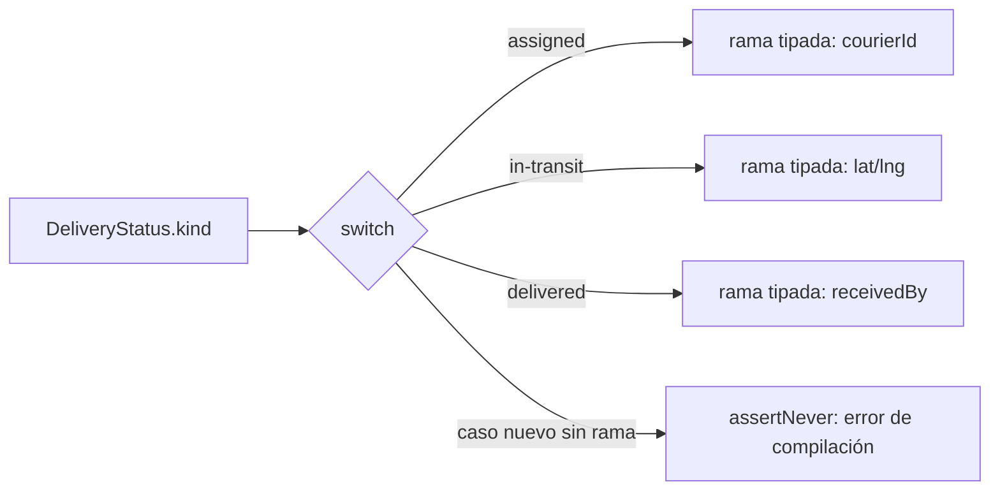
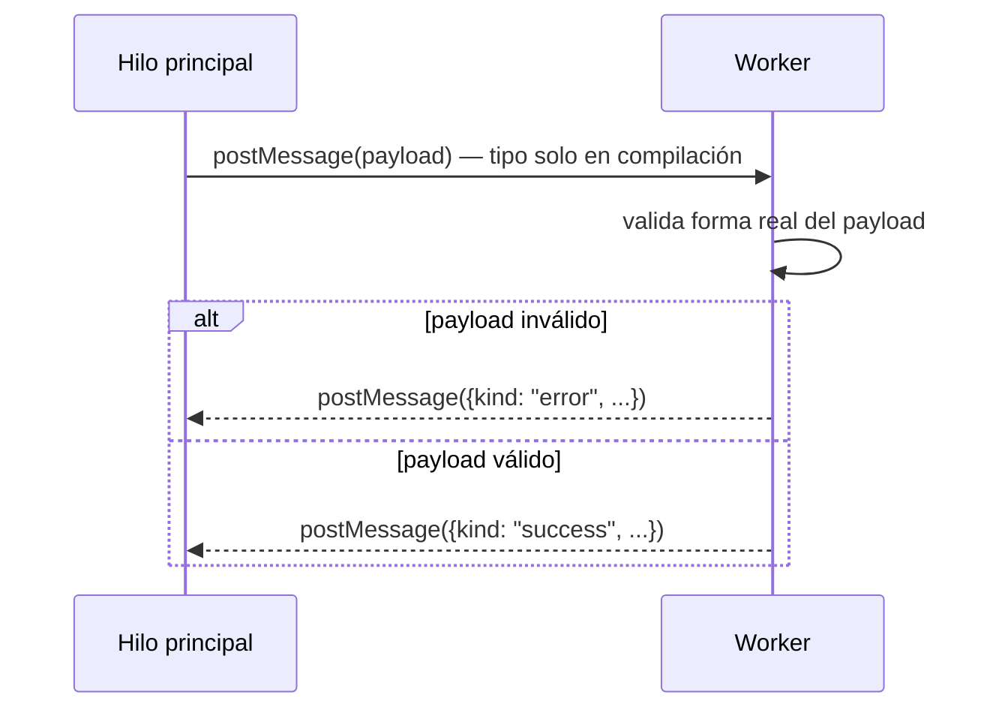
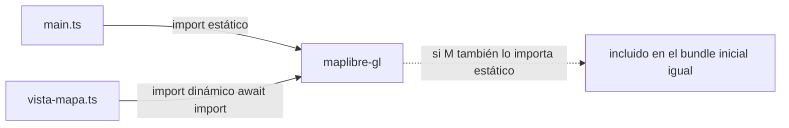
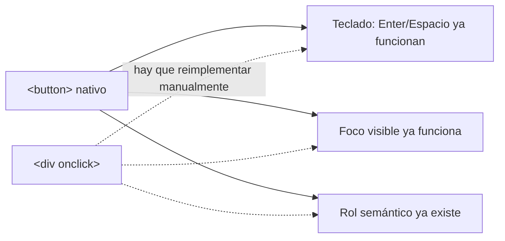
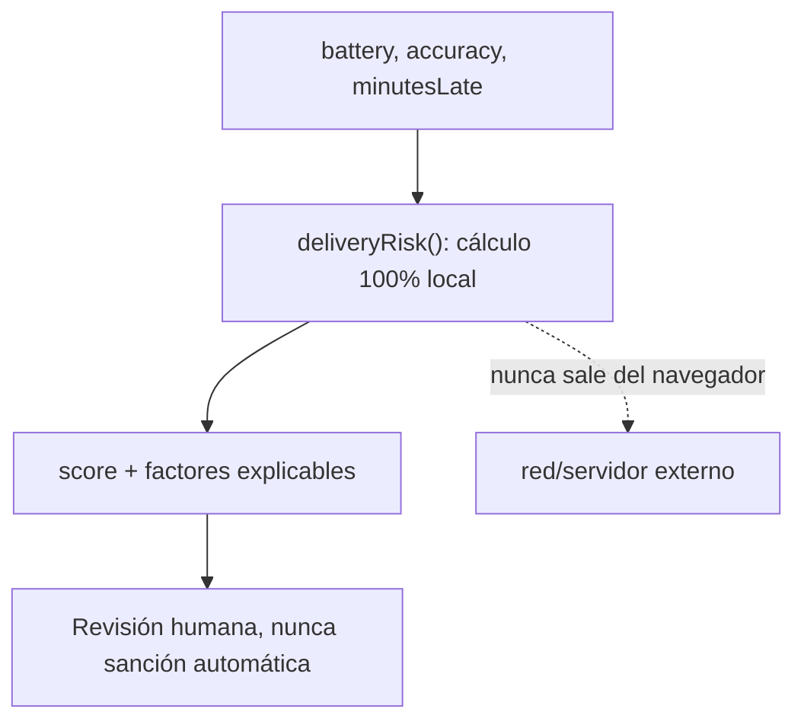
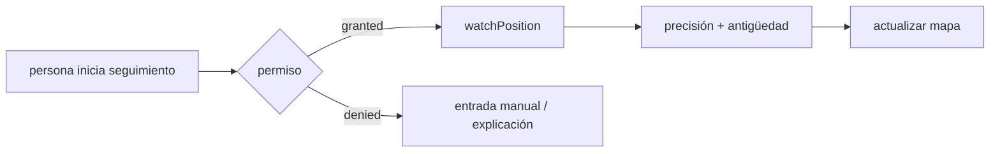
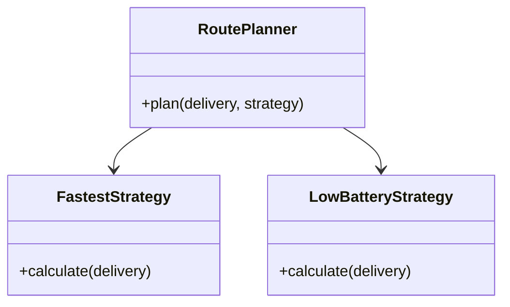
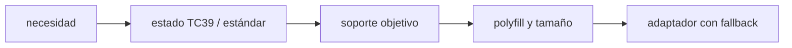
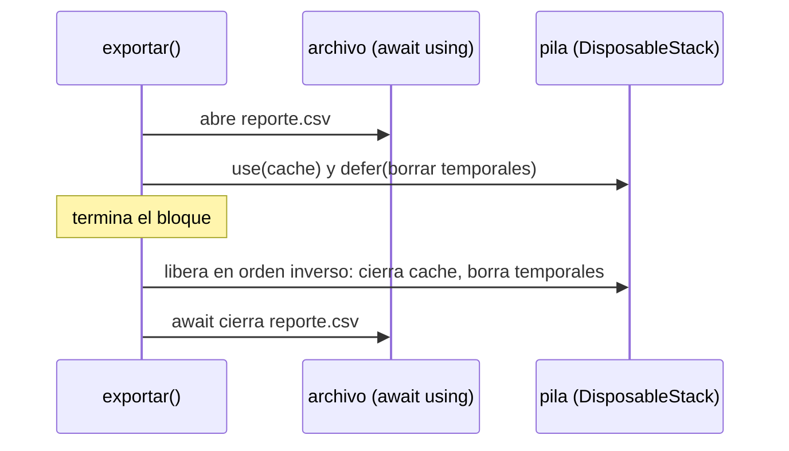
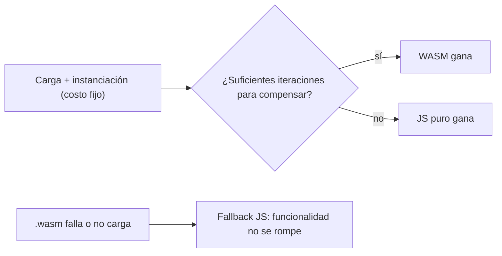

# Módulo 14: JavaScript Master: TypeScript, WASM y cómputo emergente


**Preparación del módulo:** cada tema comienza en una carpeta vacía e independiente con Node 24 LTS. Crearás el proyecto, el manifiesto, los puntos de entrada y todos los archivos indicados; las rutas son relativas a esa carpeta. Conserva cada laboratorio para comparar los cambios posteriores sin depender de archivos prefabricados.

## Aprende construyendo


### Tema 1: TypeScript avanzado · Avanzado · 45 min

<details open>
<summary><strong>Capa 1 — Lectura</strong></summary>

#### ► DE QUÉ TRATA
Al finalizar podrás construir una unión discriminada exhaustiva, derivar tipos con utilidades y mantener un contrato público que falle al añadir estados sin manejar. Endurecerás el ciclo de entrega del proyecto sin any ni assertions que oculten deuda.

#### ► LA IDEA EN UNA FRASE
**Al finalizar podrás construir una unión discriminada exhaustiva, derivar tipos con utilidades y mantener un contrato público que falle al añadir estados sin manejar.**

#### ► POR QUÉ EXISTE ESTO
Resuelve un problema real de diseño o implementación y evita decisiones a ciegas.

#### ► LA ANALOGÍA
Piensa en typescript avanzado como una herramienta de taller: útil cuando conoces su propósito y sus límites.
**Dónde se rompe la analogía:** en software, los efectos dependen del contexto, la escala y los trade-offs.

#### ► CÓMO FUNCIONA


#### ► LO QUE PUEDE SALIR MAL
| Síntoma | Causa probable | Arreglo |
|---|---|---|
| TypeScript avanzado se aplica pero el resultado no mejora | Se usó sin medir el problema real | Mide antes y compara contra la alternativa simple |
| Aparece complejidad inesperada | Se adoptó la técnica sin comprender sus trade-offs | Vuelve a la sección de trade-offs y reduce el alcance |
| Falla en un caso límite | Se asumió un contexto que no se cumple | Prueba el caso límite y documenta cuándo NO usarlo |

#### ► TRADE-OFFS
| Opción | Cuándo usarla | Cuándo NO usarla |
|---|---|---|
| Usar TypeScript avanzado | Cuando el problema coincide con su propósito y el beneficio es observable | Cuando agrega complejidad sin resolver un problema real |
| Alternativa más simple | Cuando el contexto es pequeño, estable o fácil de razonar | Cuando ya demostró no escalar o no cumplir el requisito |
| Postergar la decisión | Cuando falta evidencia del problema | Cuando el costo de esperar es mayor que el costo de probar |

#### ► CUÁNDO NO USAR ESTO
No uses typescript avanzado por defecto. Aplícalo cuando el problema lo justifique y puedas verificar el beneficio; si una alternativa más simple resuelve igual, prefiérela.

#### ► DE VUELTA A LA ANALOGÍA
Volviendo a la analogía: typescript avanzado funciona como el modelo inicial, pero recuerda dónde se rompe: en producción importan la evidencia, la escala y el costo de equivocarte.

#### ► LO QUE DEBES RECORDAR
- TypeScript avanzado existe para resolver un problema específico.
- Mide antes de adoptar complejidad.
- Conoce el caso donde NO usarlo.
- Verifica con evidencia observable.

#### ► PREGUNTAS PARA PENSAR
1. ¿Qué problema concreto resuelve typescript avanzado en tu contexto?
2. ¿Cómo sabrías que typescript avanzado no está funcionando bien?
3. ¿Qué alternativa más simple considerarías antes de usar typescript avanzado?

</details>

<details>
<summary><strong>Capa 2 — Construcción</strong></summary>

#### Código y verificación


```bash
mkdir ejemplo-js-modulo-14-tema-1
cd ejemplo-js-modulo-14-tema-1
npm init -y
npm install --save-dev typescript tsx
```

```json
{
  "compilerOptions": {
    "target": "ES2024",
    "module": "NodeNext",
    "moduleResolution": "NodeNext",
    "strict": true,
    "noEmit": true
  },
  "include": ["src"]
}
```

```ts
// La unión discriminada obliga a tratar cada estado de la entrega.
export type DeliveryStatus =
  | { kind: 'assigned'; courierId: string }
  | { kind: 'in-transit'; latitude: number; longitude: number }
  | { kind: 'delivered'; receivedBy: string };

export function statusLabel(status: DeliveryStatus): string {
  switch (status.kind) {
    case 'assigned': return `Asignada a ${status.courierId}`;
    case 'in-transit': return `En ruta: ${status.latitude}, ${status.longitude}`;
    case 'delivered': return `Recibida por ${status.receivedBy}`;
    default: return assertNever(status); // Falla al compilar si aparece un estado nuevo.
  }
}

function assertNever(value: never): never {
  throw new Error(`Estado no soportado: ${JSON.stringify(value)}`);
}
```

```ts
import { statusLabel } from './domain/delivery-status.js';

console.log(statusLabel({ kind: 'assigned', courierId: 'Ana' }));
console.log(statusLabel({ kind: 'in-transit', latitude: 4.6, longitude: -74.1 }));
console.log(statusLabel({ kind: 'delivered', receivedBy: 'Luis' }));
```

```bash
npx tsc --noEmit
npx tsx src/demo.ts
```

</details>

### Tema 2: Workers y ejecución fuera del hilo principal · Avanzado · 40 min

<details open>
<summary><strong>Capa 1 — Lectura</strong></summary>

#### ► DE QUÉ TRATA
Al finalizar podrás definir un protocolo de mensajes discriminado, validar entradas dentro del worker, correlacionar respuestas y cancelar solicitudes obsoletas. Calcularás distancia del proyecto sin bloquear UI ni confiar ciegamente en TypeScript.

#### ► LA IDEA EN UNA FRASE
**Al finalizar podrás definir un protocolo de mensajes discriminado, validar entradas dentro del worker, correlacionar respuestas y cancelar solicitudes obsoletas.**

#### ► POR QUÉ EXISTE ESTO
Resuelve un problema real de diseño o implementación y evita decisiones a ciegas.

#### ► LA ANALOGÍA
Piensa en workers y ejecución fuera del hilo principal como una herramienta de taller: útil cuando conoces su propósito y sus límites.
**Dónde se rompe la analogía:** en software, los efectos dependen del contexto, la escala y los trade-offs.

#### ► CÓMO FUNCIONA


#### ► LO QUE PUEDE SALIR MAL
| Síntoma | Causa probable | Arreglo |
|---|---|---|
| Workers y ejecución fuera del hilo principal se aplica pero el resultado no mejora | Se usó sin medir el problema real | Mide antes y compara contra la alternativa simple |
| Aparece complejidad inesperada | Se adoptó la técnica sin comprender sus trade-offs | Vuelve a la sección de trade-offs y reduce el alcance |
| Falla en un caso límite | Se asumió un contexto que no se cumple | Prueba el caso límite y documenta cuándo NO usarlo |

#### ► TRADE-OFFS
| Opción | Cuándo usarla | Cuándo NO usarla |
|---|---|---|
| Usar Workers y ejecución fuera del hilo principal | Cuando el problema coincide con su propósito y el beneficio es observable | Cuando agrega complejidad sin resolver un problema real |
| Alternativa más simple | Cuando el contexto es pequeño, estable o fácil de razonar | Cuando ya demostró no escalar o no cumplir el requisito |
| Postergar la decisión | Cuando falta evidencia del problema | Cuando el costo de esperar es mayor que el costo de probar |

#### ► CUÁNDO NO USAR ESTO
No uses workers y ejecución fuera del hilo principal por defecto. Aplícalo cuando el problema lo justifique y puedas verificar el beneficio; si una alternativa más simple resuelve igual, prefiérela.

#### ► DE VUELTA A LA ANALOGÍA
Volviendo a la analogía: workers y ejecución fuera del hilo principal funciona como el modelo inicial, pero recuerda dónde se rompe: en producción importan la evidencia, la escala y el costo de equivocarte.

#### ► LO QUE DEBES RECORDAR
- Workers y ejecución fuera del hilo principal existe para resolver un problema específico.
- Mide antes de adoptar complejidad.
- Conoce el caso donde NO usarlo.
- Verifica con evidencia observable.

#### ► PREGUNTAS PARA PENSAR
1. ¿Qué problema concreto resuelve workers y ejecución fuera del hilo principal en tu contexto?
2. ¿Cómo sabrías que workers y ejecución fuera del hilo principal no está funcionando bien?
3. ¿Qué alternativa más simple considerarías antes de usar workers y ejecución fuera del hilo principal?

</details>

<details>
<summary><strong>Capa 2 — Construcción</strong></summary>

#### Código y verificación


```bash
mkdir ejemplo-js-modulo-14-tema-2
cd ejemplo-js-modulo-14-tema-2
npm create vite@latest . -- --template vanilla-ts
npm install
```

```ts
// route.worker.ts: el cálculo pesado ocurre fuera del hilo de la interfaz.
self.onmessage = (event: MessageEvent<unknown>) => {
  const data = event.data;
  if (typeof data !== "object" || data === null ||
      !("segments" in data) || !Array.isArray(data.segments) ||
      !data.segments.every((value) => typeof value === "number")) {
    self.postMessage({ kind: "error", message: "Segmentos inválidos" });
    return;
  }
  const total = data.segments.reduce((distance, segment) => distance + segment, 0);
  self.postMessage({ kind: "success", total });
};
```

```ts
type RouteResponse =
  | { kind: 'success'; total: number }
  | { kind: 'error'; message: string };

export function createRouteClient(output: HTMLElement) {
  const worker = new Worker(new URL('./workers/route.worker.ts', import.meta.url), { type: 'module' });
  worker.onmessage = (event: MessageEvent<RouteResponse>) => {
    output.textContent = event.data.kind === 'success'
      ? `Distancia planificada: ${event.data.total} km`
      : event.data.message;
  };
  return {
    calculate(segments: number[]) { worker.postMessage({ segments }); },
    destroy() { worker.terminate(); },
  };
}
```

```ts
import { createRouteClient } from './route-client';

document.querySelector<HTMLDivElement>('#app')!.innerHTML = `
  <h1>Planificador</h1>
  <button id="calculate">Calcular</button>
  <button id="pulse">Comprobar UI: 0</button>
  <p id="result" role="status"></p>
`;
const client = createRouteClient(document.querySelector('#result')!);
document.querySelector('#calculate')!.addEventListener('click', () => client.calculate([2.4, 3.1, 1.5]));
let clicks = 0;
document.querySelector('#pulse')!.addEventListener('click', (event) => {
  (event.currentTarget as HTMLButtonElement).textContent = `Comprobar UI: ${++clicks}`;
});
window.addEventListener('pagehide', () => client.destroy(), { once: true });
```

```bash
npm run dev
```

</details>

### Tema 3: Bundlers y optimización · Avanzado · 45 min

<details open>
<summary><strong>Capa 1 — Lectura</strong></summary>

#### ► DE QUÉ TRATA
Al finalizar podrás auditar el grafo de producción, crear un chunk bajo demanda y comparar bytes/solicitudes antes y después. Separarás el mapa del proyecto solo si no permanece importado de forma ansiosa.

#### ► LA IDEA EN UNA FRASE
**Al finalizar podrás auditar el grafo de producción, crear un chunk bajo demanda y comparar bytes/solicitudes antes y después.**

#### ► POR QUÉ EXISTE ESTO
Resuelve un problema real de diseño o implementación y evita decisiones a ciegas.

#### ► LA ANALOGÍA
Piensa en bundlers y optimización como una herramienta de taller: útil cuando conoces su propósito y sus límites.
**Dónde se rompe la analogía:** en software, los efectos dependen del contexto, la escala y los trade-offs.

#### ► CÓMO FUNCIONA


#### ► LO QUE PUEDE SALIR MAL
| Síntoma | Causa probable | Arreglo |
|---|---|---|
| Bundlers y optimización se aplica pero el resultado no mejora | Se usó sin medir el problema real | Mide antes y compara contra la alternativa simple |
| Aparece complejidad inesperada | Se adoptó la técnica sin comprender sus trade-offs | Vuelve a la sección de trade-offs y reduce el alcance |
| Falla en un caso límite | Se asumió un contexto que no se cumple | Prueba el caso límite y documenta cuándo NO usarlo |

#### ► TRADE-OFFS
| Opción | Cuándo usarla | Cuándo NO usarla |
|---|---|---|
| Usar Bundlers y optimización | Cuando el problema coincide con su propósito y el beneficio es observable | Cuando agrega complejidad sin resolver un problema real |
| Alternativa más simple | Cuando el contexto es pequeño, estable o fácil de razonar | Cuando ya demostró no escalar o no cumplir el requisito |
| Postergar la decisión | Cuando falta evidencia del problema | Cuando el costo de esperar es mayor que el costo de probar |

#### ► CUÁNDO NO USAR ESTO
No uses bundlers y optimización por defecto. Aplícalo cuando el problema lo justifique y puedas verificar el beneficio; si una alternativa más simple resuelve igual, prefiérela.

#### ► DE VUELTA A LA ANALOGÍA
Volviendo a la analogía: bundlers y optimización funciona como el modelo inicial, pero recuerda dónde se rompe: en producción importan la evidencia, la escala y el costo de equivocarte.

#### ► LO QUE DEBES RECORDAR
- Bundlers y optimización existe para resolver un problema específico.
- Mide antes de adoptar complejidad.
- Conoce el caso donde NO usarlo.
- Verifica con evidencia observable.

#### ► PREGUNTAS PARA PENSAR
1. ¿Qué problema concreto resuelve bundlers y optimización en tu contexto?
2. ¿Cómo sabrías que bundlers y optimización no está funcionando bien?
3. ¿Qué alternativa más simple considerarías antes de usar bundlers y optimización?

</details>

<details>
<summary><strong>Capa 2 — Construcción</strong></summary>

#### Código y verificación


```bash
mkdir ejemplo-js-modulo-14-tema-3
cd ejemplo-js-modulo-14-tema-3
npm create vite@latest . -- --template vanilla-ts
npm install
npm install maplibre-gl
```

```ts
import { defineConfig } from 'vite';

export default defineConfig({
  build: {
    // Crea un artefacto inspeccionable y evita mapas de producción accidentales.
    sourcemap: false,
    rollupOptions: {
      output: {
        // Separa el mapa: solo se descarga cuando la pantalla lo necesita.
        manualChunks: { maps: ['maplibre-gl'] },
      },
    },
  },
});
```

```ts
export async function mountMap(container: HTMLElement) {
  const { Map } = await import('maplibre-gl');
  return new Map({
    container,
    style: 'https://demotiles.maplibre.org/style.json',
    center: [-74.1, 4.6],
    zoom: 4,
  });
}
```

```ts
import 'maplibre-gl/dist/maplibre-gl.css';

document.querySelector<HTMLDivElement>('#app')!.innerHTML = `
  <h1>Seguimiento</h1>
  <p>La entrega está en tránsito.</p>
  <button id="open-map">Abrir mapa</button>
  <p id="map-status" role="status"></p>
  <div id="map" style="height: 320px"></div>
`;
document.querySelector('#open-map')!.addEventListener('click', async () => {
  const status = document.querySelector<HTMLElement>('#map-status')!;
  status.textContent = 'Cargando mapa…';
  try {
    const { mountMap } = await import('./map-view');
    await mountMap(document.querySelector<HTMLElement>('#map')!);
    status.textContent = 'Mapa listo';
  } catch {
    status.textContent = 'No se pudo cargar el mapa; el estado textual sigue disponible.';
  }
});
```

```bash
npm run build
npm run preview
```

</details>

### Tema 4: Accesibilidad web · Avanzado · 45 min

<details open>
<summary><strong>Capa 1 — Lectura</strong></summary>

#### ► DE QUÉ TRATA
Al finalizar podrás construir una confirmación operable con teclado, foco visible, nombre accesible y feedback anunciado, y probarla manual y automáticamente. Harás que confirmar una entrega del proyecto no dependa de ratón, color o visión.

#### ► LA IDEA EN UNA FRASE
**Al finalizar podrás construir una confirmación operable con teclado, foco visible, nombre accesible y feedback anunciado, y probarla manual y automáticamente.**

#### ► POR QUÉ EXISTE ESTO
Resuelve un problema real de diseño o implementación y evita decisiones a ciegas.

#### ► LA ANALOGÍA
Piensa en accesibilidad web como una herramienta de taller: útil cuando conoces su propósito y sus límites.
**Dónde se rompe la analogía:** en software, los efectos dependen del contexto, la escala y los trade-offs.

#### ► CÓMO FUNCIONA


#### ► LO QUE PUEDE SALIR MAL
| Síntoma | Causa probable | Arreglo |
|---|---|---|
| Accesibilidad web se aplica pero el resultado no mejora | Se usó sin medir el problema real | Mide antes y compara contra la alternativa simple |
| Aparece complejidad inesperada | Se adoptó la técnica sin comprender sus trade-offs | Vuelve a la sección de trade-offs y reduce el alcance |
| Falla en un caso límite | Se asumió un contexto que no se cumple | Prueba el caso límite y documenta cuándo NO usarlo |

#### ► TRADE-OFFS
| Opción | Cuándo usarla | Cuándo NO usarla |
|---|---|---|
| Usar Accesibilidad web | Cuando el problema coincide con su propósito y el beneficio es observable | Cuando agrega complejidad sin resolver un problema real |
| Alternativa más simple | Cuando el contexto es pequeño, estable o fácil de razonar | Cuando ya demostró no escalar o no cumplir el requisito |
| Postergar la decisión | Cuando falta evidencia del problema | Cuando el costo de esperar es mayor que el costo de probar |

#### ► CUÁNDO NO USAR ESTO
No uses accesibilidad web por defecto. Aplícalo cuando el problema lo justifique y puedas verificar el beneficio; si una alternativa más simple resuelve igual, prefiérela.

#### ► DE VUELTA A LA ANALOGÍA
Volviendo a la analogía: accesibilidad web funciona como el modelo inicial, pero recuerda dónde se rompe: en producción importan la evidencia, la escala y el costo de equivocarte.

#### ► LO QUE DEBES RECORDAR
- Accesibilidad web existe para resolver un problema específico.
- Mide antes de adoptar complejidad.
- Conoce el caso donde NO usarlo.
- Verifica con evidencia observable.

#### ► PREGUNTAS PARA PENSAR
1. ¿Qué problema concreto resuelve accesibilidad web en tu contexto?
2. ¿Cómo sabrías que accesibilidad web no está funcionando bien?
3. ¿Qué alternativa más simple considerarías antes de usar accesibilidad web?

</details>

<details>
<summary><strong>Capa 2 — Construcción</strong></summary>

#### Código y verificación


```bash
mkdir ejemplo-js-modulo-14-tema-4
cd ejemplo-js-modulo-14-tema-4
npm create vite@latest . -- --template vanilla-ts
npm install
npm install --save-dev vitest jsdom
npm pkg set scripts.test="vitest run"
```

```html
<div id="app">
  <h1>Entrega RF-101</h1>
  <button id="confirm-delivery">Confirmar entrega</button>
  <p id="delivery-feedback" role="status" aria-live="polite"></p>
</div>
```

```ts
export function mountDeliveryButton(button: HTMLButtonElement, feedback: HTMLElement,
  confirmDelivery: () => Promise<void>) {
  const onClick = async () => {
    button.disabled = true;
    button.setAttribute('aria-busy', 'true');
    feedback.textContent = 'Confirmando entrega…';
    try {
      await confirmDelivery();
      feedback.textContent = 'Entrega confirmada';
    } catch { feedback.textContent = 'No se pudo confirmar. Intenta nuevamente.'; }
    finally { button.disabled = false; button.removeAttribute('aria-busy'); }
  };
  button.addEventListener('click', onClick);
  return () => button.removeEventListener('click', onClick);
}
```

```ts
import { mountDeliveryButton } from './ui/delivery-button';

mountDeliveryButton(
  document.querySelector<HTMLButtonElement>('#confirm-delivery')!,
  document.querySelector<HTMLElement>('#delivery-feedback')!,
  () => new Promise<void>((resolve) => setTimeout(resolve, 300)),
);
```

```ts
// @vitest-environment jsdom
import { describe, expect, it } from 'vitest';
import { mountDeliveryButton } from './delivery-button';

describe('confirmación accesible', () => {
  it('bloquea duplicados y anuncia el resultado', async () => {
    document.body.innerHTML = '<button></button><p role="status"></p>';
    const button = document.querySelector<HTMLButtonElement>('button')!;
    const feedback = document.querySelector<HTMLElement>('p')!;
    let resolve!: () => void;
    const pending = new Promise<void>((done) => { resolve = done; });
    const unmount = mountDeliveryButton(button, feedback, () => pending);
    button.click();
    expect(button.disabled).toBe(true);
    expect(button.getAttribute('aria-busy')).toBe('true');
    resolve();
    await pending;
    await Promise.resolve();
    expect(feedback.textContent).toBe('Entrega confirmada');
    expect(button.disabled).toBe(false);
    unmount();
  });
});
```

</details>

### Tema 5: Web3 y machine learning en navegador · Avanzado · 40 min

<details open>
<summary><strong>Capa 1 — Lectura</strong></summary>

#### ► DE QUÉ TRATA
Al finalizar podrás construir una puntuación local explicable, probar fronteras/sesgo y decidir si ML o una red distribuida resuelven un requisito real. Crearás una señal de riesgo del proyecto que nunca sanciona automáticamente.

#### ► LA IDEA EN UNA FRASE
**Al finalizar podrás construir una puntuación local explicable, probar fronteras/sesgo y decidir si ML o una red distribuida resuelven un requisito real.**

#### ► POR QUÉ EXISTE ESTO
Resuelve un problema real de diseño o implementación y evita decisiones a ciegas.

#### ► LA ANALOGÍA
Piensa en web3 y machine learning en navegador como una herramienta de taller: útil cuando conoces su propósito y sus límites.
**Dónde se rompe la analogía:** en software, los efectos dependen del contexto, la escala y los trade-offs.

#### ► CÓMO FUNCIONA


#### ► LO QUE PUEDE SALIR MAL
| Síntoma | Causa probable | Arreglo |
|---|---|---|
| Web3 y machine learning en navegador se aplica pero el resultado no mejora | Se usó sin medir el problema real | Mide antes y compara contra la alternativa simple |
| Aparece complejidad inesperada | Se adoptó la técnica sin comprender sus trade-offs | Vuelve a la sección de trade-offs y reduce el alcance |
| Falla en un caso límite | Se asumió un contexto que no se cumple | Prueba el caso límite y documenta cuándo NO usarlo |

#### ► TRADE-OFFS
| Opción | Cuándo usarla | Cuándo NO usarla |
|---|---|---|
| Usar Web3 y machine learning en navegador | Cuando el problema coincide con su propósito y el beneficio es observable | Cuando agrega complejidad sin resolver un problema real |
| Alternativa más simple | Cuando el contexto es pequeño, estable o fácil de razonar | Cuando ya demostró no escalar o no cumplir el requisito |
| Postergar la decisión | Cuando falta evidencia del problema | Cuando el costo de esperar es mayor que el costo de probar |

#### ► CUÁNDO NO USAR ESTO
No uses web3 y machine learning en navegador por defecto. Aplícalo cuando el problema lo justifique y puedas verificar el beneficio; si una alternativa más simple resuelve igual, prefiérela.

#### ► DE VUELTA A LA ANALOGÍA
Volviendo a la analogía: web3 y machine learning en navegador funciona como el modelo inicial, pero recuerda dónde se rompe: en producción importan la evidencia, la escala y el costo de equivocarte.

#### ► LO QUE DEBES RECORDAR
- Web3 y machine learning en navegador existe para resolver un problema específico.
- Mide antes de adoptar complejidad.
- Conoce el caso donde NO usarlo.
- Verifica con evidencia observable.

#### ► PREGUNTAS PARA PENSAR
1. ¿Qué problema concreto resuelve web3 y machine learning en navegador en tu contexto?
2. ¿Cómo sabrías que web3 y machine learning en navegador no está funcionando bien?
3. ¿Qué alternativa más simple considerarías antes de usar web3 y machine learning en navegador?

</details>

<details>
<summary><strong>Capa 2 — Construcción</strong></summary>

#### Código y verificación


```bash
mkdir ejemplo-js-modulo-14-tema-6
cd ejemplo-js-modulo-14-tema-6
npm init -y
npm install --save-dev tsx typescript
```

```ts
interface RiskInput { battery: number; accuracyMeters: number; minutesLate: number }

export function deliveryRisk(input: RiskInput): number {
  // Modelo local explicable; no envía ubicación ni batería a un tercero.
  const batteryRisk = input.battery < 15 ? 0.35 : 0;
  const gpsRisk = input.accuracyMeters > 80 ? 0.35 : 0;
  const delayRisk = Math.min(input.minutesLate / 120, 0.3);
  return Number((batteryRisk + gpsRisk + delayRisk).toFixed(2));
}

console.log(deliveryRisk({ battery: 10, accuracyMeters: 120, minutesLate: 30 }));
```

```bash
npx tsx src/risk/delivery-risk.ts
```

</details>

### Tema 6: Geolocalización, permisos y precisión GPS · Avanzado · 45 min

<details open>
<summary><strong>Capa 1 — Lectura</strong></summary>

#### ► DE QUÉ TRATA
Al finalizar podrás solicitar ubicación con consentimiento, interpretar precisión y cancelar el seguimiento sin convertir una coordenada imprecisa en una decisión logística.

#### ► LA IDEA EN UNA FRASE
**Al finalizar podrás solicitar ubicación con consentimiento, interpretar precisión y cancelar el seguimiento sin convertir una coordenada imprecisa en una decisión logística.**

#### ► POR QUÉ EXISTE ESTO
Resuelve un problema real de diseño o implementación y evita decisiones a ciegas.

#### ► LA ANALOGÍA
Piensa en geolocalización, permisos y precisión gps como una herramienta de taller: útil cuando conoces su propósito y sus límites.
**Dónde se rompe la analogía:** en software, los efectos dependen del contexto, la escala y los trade-offs.

#### ► CÓMO FUNCIONA


#### ► LO QUE PUEDE SALIR MAL
| Síntoma | Causa probable | Arreglo |
|---|---|---|
| Geolocalización, permisos y precisión GPS se aplica pero el resultado no mejora | Se usó sin medir el problema real | Mide antes y compara contra la alternativa simple |
| Aparece complejidad inesperada | Se adoptó la técnica sin comprender sus trade-offs | Vuelve a la sección de trade-offs y reduce el alcance |
| Falla en un caso límite | Se asumió un contexto que no se cumple | Prueba el caso límite y documenta cuándo NO usarlo |

#### ► TRADE-OFFS
| Opción | Cuándo usarla | Cuándo NO usarla |
|---|---|---|
| Usar Geolocalización, permisos y precisión GPS | Cuando el problema coincide con su propósito y el beneficio es observable | Cuando agrega complejidad sin resolver un problema real |
| Alternativa más simple | Cuando el contexto es pequeño, estable o fácil de razonar | Cuando ya demostró no escalar o no cumplir el requisito |
| Postergar la decisión | Cuando falta evidencia del problema | Cuando el costo de esperar es mayor que el costo de probar |

#### ► CUÁNDO NO USAR ESTO
No uses geolocalización, permisos y precisión gps por defecto. Aplícalo cuando el problema lo justifique y puedas verificar el beneficio; si una alternativa más simple resuelve igual, prefiérela.

#### ► DE VUELTA A LA ANALOGÍA
Volviendo a la analogía: geolocalización, permisos y precisión gps funciona como el modelo inicial, pero recuerda dónde se rompe: en producción importan la evidencia, la escala y el costo de equivocarte.

#### ► LO QUE DEBES RECORDAR
- Geolocalización, permisos y precisión GPS existe para resolver un problema específico.
- Mide antes de adoptar complejidad.
- Conoce el caso donde NO usarlo.
- Verifica con evidencia observable.

#### ► PREGUNTAS PARA PENSAR
1. ¿Qué problema concreto resuelve geolocalización, permisos y precisión gps en tu contexto?
2. ¿Cómo sabrías que geolocalización, permisos y precisión gps no está funcionando bien?
3. ¿Qué alternativa más simple considerarías antes de usar geolocalización, permisos y precisión gps?

</details>

<details>
<summary><strong>Capa 2 — Construcción</strong></summary>

#### Código y verificación


```bash
mkdir ejemplo-js-modulo-14-tema-7
cd ejemplo-js-modulo-14-tema-7
npm create vite@latest . -- --template vanilla
npm install
```

```js
export function iniciarUbicacion({ onPosition, onError }) {
  if (!('geolocation' in navigator)) throw new Error('Geolocalización no disponible');
  const id = navigator.geolocation.watchPosition(
    ({ coords, timestamp }) => onPosition({
      // Precisión y captura viajan con la coordenada; no son metadatos opcionales.
      latitude: coords.latitude,
      longitude: coords.longitude,
      accuracyMeters: coords.accuracy,
      capturedAt: new Date(timestamp).toISOString(),
    }),
    onError,
    { enableHighAccuracy: true, timeout: 10_000, maximumAge: 5_000 },
  );
  return () => navigator.geolocation.clearWatch(id);
}
```

```js
import { iniciarUbicacion } from './location/watch-location';

document.querySelector('#app').innerHTML = `
  <h1>Seguimiento de entrega</h1>
  <button id="share">Compartir ubicación</button>
  <p id="position" role="status">Ubicación no compartida</p>
  <label>Coordenada manual <input id="manual" placeholder="4.6, -74.1"></label>
`;
let detener = () => {};
document.querySelector('#share').addEventListener('click', () => {
  detener();
  detener = iniciarUbicacion({
    onPosition: ({ latitude, longitude, accuracyMeters, capturedAt }) => {
      document.querySelector('#position').textContent =
        `${latitude}, ${longitude}; precisión ±${accuracyMeters} m; ${capturedAt}`;
    },
    onError: (error) => {
      document.querySelector('#position').textContent =
        `No se pudo obtener la ubicación (${error.code}); usa la entrada manual.`;
    },
  });
});
window.addEventListener('pagehide', () => detener(), { once: true });
```

```bash
npm run dev
```

</details>

### Tema 7: sessionStorage, cookies e IndexedDB · Avanzado · 40 min

<details open>
<summary><strong>Capa 1 — Lectura</strong></summary>

#### ► DE QUÉ TRATA
Al finalizar podrás elegir almacenamiento según vida útil, tamaño, consulta y riesgo, y construir un borrador offline sin guardar credenciales accesibles a JavaScript.

#### ► LA IDEA EN UNA FRASE
**Al finalizar podrás elegir almacenamiento según vida útil, tamaño, consulta y riesgo, y construir un borrador offline sin guardar credenciales accesibles a JavaScript.**

#### ► POR QUÉ EXISTE ESTO
Resuelve un problema real de diseño o implementación y evita decisiones a ciegas.

#### ► LA ANALOGÍA
Piensa en sessionstorage, cookies e indexeddb como una herramienta de taller: útil cuando conoces su propósito y sus límites.
**Dónde se rompe la analogía:** en software, los efectos dependen del contexto, la escala y los trade-offs.

#### ► CÓMO FUNCIONA
1. Identifica el problema que sessionstorage, cookies e indexeddb resuelve.
2. Observa sus componentes y relaciones.
3. Aplica la opción más simple que funcione.
4. Verifica el resultado y los límites.

#### ► LO QUE PUEDE SALIR MAL
| Síntoma | Causa probable | Arreglo |
|---|---|---|
| sessionStorage, cookies e IndexedDB se aplica pero el resultado no mejora | Se usó sin medir el problema real | Mide antes y compara contra la alternativa simple |
| Aparece complejidad inesperada | Se adoptó la técnica sin comprender sus trade-offs | Vuelve a la sección de trade-offs y reduce el alcance |
| Falla en un caso límite | Se asumió un contexto que no se cumple | Prueba el caso límite y documenta cuándo NO usarlo |

#### ► TRADE-OFFS
| Opción | Cuándo usarla | Cuándo NO usarla |
|---|---|---|
| Usar sessionStorage, cookies e IndexedDB | Cuando el problema coincide con su propósito y el beneficio es observable | Cuando agrega complejidad sin resolver un problema real |
| Alternativa más simple | Cuando el contexto es pequeño, estable o fácil de razonar | Cuando ya demostró no escalar o no cumplir el requisito |
| Postergar la decisión | Cuando falta evidencia del problema | Cuando el costo de esperar es mayor que el costo de probar |

#### ► CUÁNDO NO USAR ESTO
No uses sessionstorage, cookies e indexeddb por defecto. Aplícalo cuando el problema lo justifique y puedas verificar el beneficio; si una alternativa más simple resuelve igual, prefiérela.

#### ► DE VUELTA A LA ANALOGÍA
Volviendo a la analogía: sessionstorage, cookies e indexeddb funciona como el modelo inicial, pero recuerda dónde se rompe: en producción importan la evidencia, la escala y el costo de equivocarte.

#### ► LO QUE DEBES RECORDAR
- sessionStorage, cookies e IndexedDB existe para resolver un problema específico.
- Mide antes de adoptar complejidad.
- Conoce el caso donde NO usarlo.
- Verifica con evidencia observable.

#### ► PREGUNTAS PARA PENSAR
1. ¿Qué problema concreto resuelve sessionstorage, cookies e indexeddb en tu contexto?
2. ¿Cómo sabrías que sessionstorage, cookies e indexeddb no está funcionando bien?
3. ¿Qué alternativa más simple considerarías antes de usar sessionstorage, cookies e indexeddb?

</details>

<details>
<summary><strong>Capa 2 — Construcción</strong></summary>

#### Código y verificación
```bash
mkdir ejemplo-js-modulo-14-tema-8
cd ejemplo-js-modulo-14-tema-8
npm create vite@latest . -- --template vanilla
npm install
```

```js
const KEY = 'app:delivery-draft';
export const saveDraft = (draft) => sessionStorage.setItem(KEY, JSON.stringify(draft));
export function loadDraft() {
  try {
    // Incluso el almacenamiento propio se trata como dato externo al leer.
    return JSON.parse(sessionStorage.getItem(KEY) ?? 'null');
  } catch {
    sessionStorage.removeItem(KEY);
    return null;
  }
}
```

```js
import { loadDraft, saveDraft } from './storage/delivery-draft';

document.querySelector('#app').innerHTML = `
  <h1>Borrador de entrega</h1>
  <label>Destinatario <input id="recipient" autocomplete="off"></label>
  <p id="storage-status" role="status"></p>
`;
const input = document.querySelector('#recipient');
input.value = loadDraft()?.recipient ?? '';
input.addEventListener('input', () => {
  saveDraft({ recipient: input.value });
  document.querySelector('#storage-status').textContent = 'Borrador guardado en esta pestaña';
});
```

```bash
npm run dev
```

</details>

### Tema 8: Expresiones regulares avanzadas y Unicode · Avanzado · 40 min

<details open>
<summary><strong>Capa 1 — Lectura</strong></summary>

#### ► DE QUÉ TRATA
Al finalizar podrás construir y probar una expresión regular con grupos, anclas y Unicode, medir backtracking y reconocer cuándo un parser explícito es más seguro.

#### ► LA IDEA EN UNA FRASE
**Al finalizar podrás construir y probar una expresión regular con grupos, anclas y Unicode, medir backtracking y reconocer cuándo un parser explícito es más seguro.**

#### ► POR QUÉ EXISTE ESTO
Resuelve un problema real de diseño o implementación y evita decisiones a ciegas.

#### ► LA ANALOGÍA
Piensa en expresiones regulares avanzadas y unicode como una herramienta de taller: útil cuando conoces su propósito y sus límites.
**Dónde se rompe la analogía:** en software, los efectos dependen del contexto, la escala y los trade-offs.

#### ► CÓMO FUNCIONA
1. Identifica el problema que expresiones regulares avanzadas y unicode resuelve.
2. Observa sus componentes y relaciones.
3. Aplica la opción más simple que funcione.
4. Verifica el resultado y los límites.

#### ► LO QUE PUEDE SALIR MAL
| Síntoma | Causa probable | Arreglo |
|---|---|---|
| Expresiones regulares avanzadas y Unicode se aplica pero el resultado no mejora | Se usó sin medir el problema real | Mide antes y compara contra la alternativa simple |
| Aparece complejidad inesperada | Se adoptó la técnica sin comprender sus trade-offs | Vuelve a la sección de trade-offs y reduce el alcance |
| Falla en un caso límite | Se asumió un contexto que no se cumple | Prueba el caso límite y documenta cuándo NO usarlo |

#### ► TRADE-OFFS
| Opción | Cuándo usarla | Cuándo NO usarla |
|---|---|---|
| Usar Expresiones regulares avanzadas y Unicode | Cuando el problema coincide con su propósito y el beneficio es observable | Cuando agrega complejidad sin resolver un problema real |
| Alternativa más simple | Cuando el contexto es pequeño, estable o fácil de razonar | Cuando ya demostró no escalar o no cumplir el requisito |
| Postergar la decisión | Cuando falta evidencia del problema | Cuando el costo de esperar es mayor que el costo de probar |

#### ► CUÁNDO NO USAR ESTO
No uses expresiones regulares avanzadas y unicode por defecto. Aplícalo cuando el problema lo justifique y puedas verificar el beneficio; si una alternativa más simple resuelve igual, prefiérela.

#### ► DE VUELTA A LA ANALOGÍA
Volviendo a la analogía: expresiones regulares avanzadas y unicode funciona como el modelo inicial, pero recuerda dónde se rompe: en producción importan la evidencia, la escala y el costo de equivocarte.

#### ► LO QUE DEBES RECORDAR
- Expresiones regulares avanzadas y Unicode existe para resolver un problema específico.
- Mide antes de adoptar complejidad.
- Conoce el caso donde NO usarlo.
- Verifica con evidencia observable.

#### ► PREGUNTAS PARA PENSAR
1. ¿Qué problema concreto resuelve expresiones regulares avanzadas y unicode en tu contexto?
2. ¿Cómo sabrías que expresiones regulares avanzadas y unicode no está funcionando bien?
3. ¿Qué alternativa más simple considerarías antes de usar expresiones regulares avanzadas y unicode?

</details>

<details>
<summary><strong>Capa 2 — Construcción</strong></summary>

#### Código y verificación
```javascript
const busqueda = 'CO-2026 (urgente)';
const patronSeguro = new RegExp(RegExp.escape(busqueda), 'u');
patronSeguro.test('código: CO-2026 (urgente) recibido'); // true, sin que "(" actúe como grupo
```

```bash
mkdir ejemplo-js-modulo-14-tema-9
cd ejemplo-js-modulo-14-tema-9
npm init -y
npm install --save-dev tsx typescript
```

```js
const TRACKING_CODE = /^(?<country>[A-Z]{2})-(?<year>\d{4})-(?<sequence>\d{6})$/u;
export function parseTrackingCode(value) {
  // Las anclas obligan a que toda la entrada cumpla la gramática.
  const match = TRACKING_CODE.exec(value.normalize('NFC'));
  if (!match?.groups) throw new TypeError('Código esperado: CO-2026-000123');
  return { ...match.groups, year: Number(match.groups.year) };
}
```

```ts
import { parseTrackingCode } from './validation/tracking-code.js';

console.log(parseTrackingCode('CO-2026-000123'));
for (const invalid of ['prefijo-CO-2026-000123', 'CO-2026-123']) {
  try {
    parseTrackingCode(invalid);
  } catch (error) {
    console.log(`${invalid}: ${(error as Error).message}`);
  }
}
```

```bash
npx tsx src/demo.ts
```

</details>

### Tema 9: Patrones Factory, Strategy, Observer y Pub/Sub · Avanzado · 45 min

<details open>
<summary><strong>Capa 1 — Lectura</strong></summary>

#### ► DE QUÉ TRATA
Al finalizar podrás reconocer Factory, Strategy, Observer y Pub/Sub, implementar una política intercambiable y justificar por qué no necesitas Singleton global para compartir estado.

#### ► LA IDEA EN UNA FRASE
**Al finalizar podrás reconocer Factory, Strategy, Observer y Pub/Sub, implementar una política intercambiable y justificar por qué no necesitas Singleton global para compartir estado.**

#### ► POR QUÉ EXISTE ESTO
Resuelve un problema real de diseño o implementación y evita decisiones a ciegas.

#### ► LA ANALOGÍA
Piensa en patrones factory, strategy, observer y pub/sub como una herramienta de taller: útil cuando conoces su propósito y sus límites.
**Dónde se rompe la analogía:** en software, los efectos dependen del contexto, la escala y los trade-offs.

#### ► CÓMO FUNCIONA


#### ► LO QUE PUEDE SALIR MAL
| Síntoma | Causa probable | Arreglo |
|---|---|---|
| Patrones Factory, Strategy, Observer y Pub/Sub se aplica pero el resultado no mejora | Se usó sin medir el problema real | Mide antes y compara contra la alternativa simple |
| Aparece complejidad inesperada | Se adoptó la técnica sin comprender sus trade-offs | Vuelve a la sección de trade-offs y reduce el alcance |
| Falla en un caso límite | Se asumió un contexto que no se cumple | Prueba el caso límite y documenta cuándo NO usarlo |

#### ► TRADE-OFFS
| Opción | Cuándo usarla | Cuándo NO usarla |
|---|---|---|
| Usar Patrones Factory, Strategy, Observer y Pub/Sub | Cuando el problema coincide con su propósito y el beneficio es observable | Cuando agrega complejidad sin resolver un problema real |
| Alternativa más simple | Cuando el contexto es pequeño, estable o fácil de razonar | Cuando ya demostró no escalar o no cumplir el requisito |
| Postergar la decisión | Cuando falta evidencia del problema | Cuando el costo de esperar es mayor que el costo de probar |

#### ► CUÁNDO NO USAR ESTO
No uses patrones factory, strategy, observer y pub/sub por defecto. Aplícalo cuando el problema lo justifique y puedas verificar el beneficio; si una alternativa más simple resuelve igual, prefiérela.

#### ► DE VUELTA A LA ANALOGÍA
Volviendo a la analogía: patrones factory, strategy, observer y pub/sub funciona como el modelo inicial, pero recuerda dónde se rompe: en producción importan la evidencia, la escala y el costo de equivocarte.

#### ► LO QUE DEBES RECORDAR
- Patrones Factory, Strategy, Observer y Pub/Sub existe para resolver un problema específico.
- Mide antes de adoptar complejidad.
- Conoce el caso donde NO usarlo.
- Verifica con evidencia observable.

#### ► PREGUNTAS PARA PENSAR
1. ¿Qué problema concreto resuelve patrones factory, strategy, observer y pub/sub en tu contexto?
2. ¿Cómo sabrías que patrones factory, strategy, observer y pub/sub no está funcionando bien?
3. ¿Qué alternativa más simple considerarías antes de usar patrones factory, strategy, observer y pub/sub?

</details>

<details>
<summary><strong>Capa 2 — Construcción</strong></summary>

#### Código y verificación


```bash
mkdir ejemplo-js-modulo-14-tema-10
cd ejemplo-js-modulo-14-tema-10
npm init -y
npm install --save-dev tsx typescript
```

```js
export const strategies = {
  fastest: ({ routes }) => routes.toSorted((a, b) => a.minutes - b.minutes)[0],
  lowBattery: ({ routes }) => routes.toSorted((a, b) => a.energy - b.energy)[0],
};
export function planRoute(delivery, strategy) {
  // El planificador depende del contrato función, no de estrategias concretas.
  if (typeof strategy !== 'function') throw new TypeError('Strategy requerida');
  return strategy(delivery);
}
```

```ts
import { planRoute, strategies } from './routing/route-strategy.js';

const delivery = {
  routes: [
    { id: 'rápida', minutes: 20, energy: 40 },
    { id: 'ahorro', minutes: 35, energy: 12 },
  ],
};
console.log(planRoute(delivery, strategies.fastest).id);
console.log(planRoute(delivery, strategies.lowBattery).id);
```

```bash
npx tsx src/demo.ts
```

</details>

### Tema 10: WebSocket y comunicación en tiempo real · Avanzado · 45 min

<details open>
<summary><strong>Capa 1 — Lectura</strong></summary>

#### ► DE QUÉ TRATA
Al finalizar podrás abrir un WebSocket, validar mensajes, mantener heartbeat y reconectar con backoff sin duplicar suscripciones.

#### ► LA IDEA EN UNA FRASE
**Al finalizar podrás abrir un WebSocket, validar mensajes, mantener heartbeat y reconectar con backoff sin duplicar suscripciones.**

#### ► POR QUÉ EXISTE ESTO
Resuelve un problema real de diseño o implementación y evita decisiones a ciegas.

#### ► LA ANALOGÍA
Piensa en websocket y comunicación en tiempo real como una herramienta de taller: útil cuando conoces su propósito y sus límites.
**Dónde se rompe la analogía:** en software, los efectos dependen del contexto, la escala y los trade-offs.

#### ► CÓMO FUNCIONA
1. Identifica el problema que websocket y comunicación en tiempo real resuelve.
2. Observa sus componentes y relaciones.
3. Aplica la opción más simple que funcione.
4. Verifica el resultado y los límites.

#### ► LO QUE PUEDE SALIR MAL
| Síntoma | Causa probable | Arreglo |
|---|---|---|
| WebSocket y comunicación en tiempo real se aplica pero el resultado no mejora | Se usó sin medir el problema real | Mide antes y compara contra la alternativa simple |
| Aparece complejidad inesperada | Se adoptó la técnica sin comprender sus trade-offs | Vuelve a la sección de trade-offs y reduce el alcance |
| Falla en un caso límite | Se asumió un contexto que no se cumple | Prueba el caso límite y documenta cuándo NO usarlo |

#### ► TRADE-OFFS
| Opción | Cuándo usarla | Cuándo NO usarla |
|---|---|---|
| Usar WebSocket y comunicación en tiempo real | Cuando el problema coincide con su propósito y el beneficio es observable | Cuando agrega complejidad sin resolver un problema real |
| Alternativa más simple | Cuando el contexto es pequeño, estable o fácil de razonar | Cuando ya demostró no escalar o no cumplir el requisito |
| Postergar la decisión | Cuando falta evidencia del problema | Cuando el costo de esperar es mayor que el costo de probar |

#### ► CUÁNDO NO USAR ESTO
No uses websocket y comunicación en tiempo real por defecto. Aplícalo cuando el problema lo justifique y puedas verificar el beneficio; si una alternativa más simple resuelve igual, prefiérela.

#### ► DE VUELTA A LA ANALOGÍA
Volviendo a la analogía: websocket y comunicación en tiempo real funciona como el modelo inicial, pero recuerda dónde se rompe: en producción importan la evidencia, la escala y el costo de equivocarte.

#### ► LO QUE DEBES RECORDAR
- WebSocket y comunicación en tiempo real existe para resolver un problema específico.
- Mide antes de adoptar complejidad.
- Conoce el caso donde NO usarlo.
- Verifica con evidencia observable.

#### ► PREGUNTAS PARA PENSAR
1. ¿Qué problema concreto resuelve websocket y comunicación en tiempo real en tu contexto?
2. ¿Cómo sabrías que websocket y comunicación en tiempo real no está funcionando bien?
3. ¿Qué alternativa más simple considerarías antes de usar websocket y comunicación en tiempo real?

</details>

<details>
<summary><strong>Capa 2 — Construcción</strong></summary>

#### Código y verificación
```bash
mkdir ejemplo-js-modulo-14-tema-12
cd ejemplo-js-modulo-14-tema-12
npm create vite@latest . -- --template vanilla
npm install
npm install --save-dev ws
npm pkg set scripts.socket="node server/socket.mjs"
```

```js
export function connectTracking(url, { onEvent, onState }) {
  const socket = new WebSocket(url);
  socket.addEventListener('open', () => onState('connected'));
  socket.addEventListener('message', ({ data }) => {
    try {
      const event = JSON.parse(data); // El canal autenticado sigue enviando datos no confiables.
      if (typeof event.id !== 'string' || typeof event.type !== 'string') return;
      onEvent(event);
    } catch { onState('invalid-message'); }
  });
  socket.addEventListener('close', () => onState('disconnected'));
  socket.addEventListener('error', () => socket.close());
  return () => socket.close(1000, 'view-unmounted');
}
```

```js
import { WebSocketServer } from 'ws';

const server = new WebSocketServer({ port: 8080 });
server.on('connection', (socket) => {
  socket.send(JSON.stringify({
    id: 'evt-1',
    type: 'tracking.updated',
    status: 'in-transit',
  }));
  socket.on('message', (message) => socket.send(message.toString()));
});
console.log('WebSocket local en ws://localhost:8080');
```

```js
import { connectTracking } from './realtime/tracking-socket';

document.querySelector('#app').innerHTML = `
  <h1>Seguimiento en vivo</h1>
  <p id="connection" role="status">connecting</p>
  <ul id="events"></ul>
`;
const disconnect = connectTracking('ws://localhost:8080', {
  onState: (state) => { document.querySelector('#connection').textContent = state; },
  onEvent: (event) => {
    const item = document.createElement('li');
    item.textContent = `${event.id}: ${event.type}`;
    document.querySelector('#events').append(item);
  },
});
window.addEventListener('pagehide', disconnect, { once: true });
```

```bash
npm run socket
```

```bash
npm run dev
```

</details>

### Tema 11: Typed Arrays, ArrayBuffer y DataView · Avanzado · 40 min

<details open>
<summary><strong>Capa 1 — Lectura</strong></summary>

#### ► DE QUÉ TRATA
Al finalizar podrás interpretar un paquete binario con endianness explícito, validar fronteras y elegir entre Uint8Array y DataView.

#### ► LA IDEA EN UNA FRASE
**Al finalizar podrás interpretar un paquete binario con endianness explícito, validar fronteras y elegir entre Uint8Array y DataView.**

#### ► POR QUÉ EXISTE ESTO
Resuelve un problema real de diseño o implementación y evita decisiones a ciegas.

#### ► LA ANALOGÍA
Piensa en typed arrays, arraybuffer y dataview como una herramienta de taller: útil cuando conoces su propósito y sus límites.
**Dónde se rompe la analogía:** en software, los efectos dependen del contexto, la escala y los trade-offs.

#### ► CÓMO FUNCIONA
1. Identifica el problema que typed arrays, arraybuffer y dataview resuelve.
2. Observa sus componentes y relaciones.
3. Aplica la opción más simple que funcione.
4. Verifica el resultado y los límites.

#### ► LO QUE PUEDE SALIR MAL
| Síntoma | Causa probable | Arreglo |
|---|---|---|
| Typed Arrays, ArrayBuffer y DataView se aplica pero el resultado no mejora | Se usó sin medir el problema real | Mide antes y compara contra la alternativa simple |
| Aparece complejidad inesperada | Se adoptó la técnica sin comprender sus trade-offs | Vuelve a la sección de trade-offs y reduce el alcance |
| Falla en un caso límite | Se asumió un contexto que no se cumple | Prueba el caso límite y documenta cuándo NO usarlo |

#### ► TRADE-OFFS
| Opción | Cuándo usarla | Cuándo NO usarla |
|---|---|---|
| Usar Typed Arrays, ArrayBuffer y DataView | Cuando el problema coincide con su propósito y el beneficio es observable | Cuando agrega complejidad sin resolver un problema real |
| Alternativa más simple | Cuando el contexto es pequeño, estable o fácil de razonar | Cuando ya demostró no escalar o no cumplir el requisito |
| Postergar la decisión | Cuando falta evidencia del problema | Cuando el costo de esperar es mayor que el costo de probar |

#### ► CUÁNDO NO USAR ESTO
No uses typed arrays, arraybuffer y dataview por defecto. Aplícalo cuando el problema lo justifique y puedas verificar el beneficio; si una alternativa más simple resuelve igual, prefiérela.

#### ► DE VUELTA A LA ANALOGÍA
Volviendo a la analogía: typed arrays, arraybuffer y dataview funciona como el modelo inicial, pero recuerda dónde se rompe: en producción importan la evidencia, la escala y el costo de equivocarte.

#### ► LO QUE DEBES RECORDAR
- Typed Arrays, ArrayBuffer y DataView existe para resolver un problema específico.
- Mide antes de adoptar complejidad.
- Conoce el caso donde NO usarlo.
- Verifica con evidencia observable.

#### ► PREGUNTAS PARA PENSAR
1. ¿Qué problema concreto resuelve typed arrays, arraybuffer y dataview en tu contexto?
2. ¿Cómo sabrías que typed arrays, arraybuffer y dataview no está funcionando bien?
3. ¿Qué alternativa más simple considerarías antes de usar typed arrays, arraybuffer y dataview?

</details>

<details>
<summary><strong>Capa 2 — Construcción</strong></summary>

#### Código y verificación
```bash
mkdir ejemplo-js-modulo-14-tema-13
cd ejemplo-js-modulo-14-tema-13
npm init -y
npm install --save-dev tsx typescript
```

```js
export function decodeGps(buffer) {
  if (!(buffer instanceof ArrayBuffer) || buffer.byteLength !== 8) {
    throw new RangeError('Paquete GPS esperado: 8 bytes');
  }
  const view = new DataView(buffer);
  return {
    // false declara big-endian; el protocolo no depende de la máquina.
    latitudeE6: view.getInt32(0, false),
    longitudeE6: view.getInt32(4, false),
  };
}
```

```ts
import { decodeGps } from './binary/decode-gps.js';

const buffer = new ArrayBuffer(8);
const view = new DataView(buffer);
view.setInt32(0, 4_600_000, false);
view.setInt32(4, -74_100_000, false);
console.log(decodeGps(buffer));
try {
  decodeGps(new ArrayBuffer(7));
} catch (error) {
  console.log((error as Error).message);
}
```

```bash
npx tsx src/demo.ts
```

</details>

### Tema 12: ECMAScript moderno, Temporal e iterator helpers · Avanzado · 40 min

<details open>
<summary><strong>Capa 1 — Lectura</strong></summary>

#### ► DE QUÉ TRATA
Al finalizar podrás verificar el estado de una característica, usar alternativas estables y aislar Temporal, iterator helpers y gestión explícita de recursos detrás de compatibilidad comprobada.

#### ► LA IDEA EN UNA FRASE
**Al finalizar podrás verificar el estado de una característica, usar alternativas estables y aislar Temporal, iterator helpers y gestión explícita de recursos detrás de compatibilidad comprobada.**

#### ► POR QUÉ EXISTE ESTO
Resuelve un problema real de diseño o implementación y evita decisiones a ciegas.

#### ► LA ANALOGÍA
Piensa en ecmascript moderno, temporal e iterator helpers como una herramienta de taller: útil cuando conoces su propósito y sus límites.
**Dónde se rompe la analogía:** en software, los efectos dependen del contexto, la escala y los trade-offs.

#### ► CÓMO FUNCIONA


#### ► LO QUE PUEDE SALIR MAL
| Síntoma | Causa probable | Arreglo |
|---|---|---|
| ECMAScript moderno, Temporal e iterator helpers se aplica pero el resultado no mejora | Se usó sin medir el problema real | Mide antes y compara contra la alternativa simple |
| Aparece complejidad inesperada | Se adoptó la técnica sin comprender sus trade-offs | Vuelve a la sección de trade-offs y reduce el alcance |
| Falla en un caso límite | Se asumió un contexto que no se cumple | Prueba el caso límite y documenta cuándo NO usarlo |

#### ► TRADE-OFFS
| Opción | Cuándo usarla | Cuándo NO usarla |
|---|---|---|
| Usar ECMAScript moderno, Temporal e iterator helpers | Cuando el problema coincide con su propósito y el beneficio es observable | Cuando agrega complejidad sin resolver un problema real |
| Alternativa más simple | Cuando el contexto es pequeño, estable o fácil de razonar | Cuando ya demostró no escalar o no cumplir el requisito |
| Postergar la decisión | Cuando falta evidencia del problema | Cuando el costo de esperar es mayor que el costo de probar |

#### ► CUÁNDO NO USAR ESTO
No uses ecmascript moderno, temporal e iterator helpers por defecto. Aplícalo cuando el problema lo justifique y puedas verificar el beneficio; si una alternativa más simple resuelve igual, prefiérela.

#### ► DE VUELTA A LA ANALOGÍA
Volviendo a la analogía: ecmascript moderno, temporal e iterator helpers funciona como el modelo inicial, pero recuerda dónde se rompe: en producción importan la evidencia, la escala y el costo de equivocarte.

#### ► LO QUE DEBES RECORDAR
- ECMAScript moderno, Temporal e iterator helpers existe para resolver un problema específico.
- Mide antes de adoptar complejidad.
- Conoce el caso donde NO usarlo.
- Verifica con evidencia observable.

#### ► PREGUNTAS PARA PENSAR
1. ¿Qué problema concreto resuelve ecmascript moderno, temporal e iterator helpers en tu contexto?
2. ¿Cómo sabrías que ecmascript moderno, temporal e iterator helpers no está funcionando bien?
3. ¿Qué alternativa más simple considerarías antes de usar ecmascript moderno, temporal e iterator helpers?

</details>

<details>
<summary><strong>Capa 2 — Construcción</strong></summary>

#### Código y verificación
```javascript
async function* paginasDeEntregas() {
  yield { codigo: 'RF-101' };
  yield { codigo: 'RF-102' };
}

const entregas = await Array.fromAsync(paginasDeEntregas());
console.log(entregas.length); // 2
```


```bash
mkdir ejemplo-js-modulo-14-tema-14
cd ejemplo-js-modulo-14-tema-14
npm init -y
npm install --save-dev tsx typescript
```

```js
export function formatDeliveryInstant(iso, timeZone, locale = 'es-CO') {
  const instant = new Date(iso);
  // Date + Intl constituye el fallback estable del contrato de presentación.
  if (Number.isNaN(instant.getTime())) throw new TypeError('Instante inválido');
  return new Intl.DateTimeFormat(locale, { dateStyle: 'medium', timeStyle: 'short', timeZone }).format(instant);
}

export const supportsTemporal = () => typeof globalThis.Temporal !== 'undefined';
```

```ts
import { formatDeliveryInstant, supportsTemporal } from './platform/time.js';

const iso = '2026-07-15T18:30:00Z';
console.log('Bogotá:', formatDeliveryInstant(iso, 'America/Bogota'));
console.log('Madrid:', formatDeliveryInstant(iso, 'Europe/Madrid'));
console.log('Temporal disponible:', supportsTemporal());
```

```bash
npx tsx src/demo.ts
```

</details>

### Tema 13: Gestión explícita de recursos: using, await using y DisposableStack · Avanzado · 40 min

<details open>
<summary><strong>Capa 1 — Lectura</strong></summary>

#### ► DE QUÉ TRATA
Necesitas un motor que soporte la gestión explícita de recursos: Node.js 24 o superior, o Chrome 134 o superior. Comprueba tu versión con node --version. Crea la carpeta academia-labs/javascript/recursos.

#### ► LA IDEA EN UNA FRASE
**Necesitas un motor que soporte la gestión explícita de recursos: Node.js 24 o superior, o Chrome 134 o superior.**

#### ► POR QUÉ EXISTE ESTO
Resuelve un problema real de diseño o implementación y evita decisiones a ciegas.

#### ► LA ANALOGÍA
Piensa en gestión explícita de recursos: using, await using y disposablestack como una herramienta de taller: útil cuando conoces su propósito y sus límites.
**Dónde se rompe la analogía:** en software, los efectos dependen del contexto, la escala y los trade-offs.

#### ► CÓMO FUNCIONA


#### ► LO QUE PUEDE SALIR MAL
| Síntoma | Causa probable | Arreglo |
|---|---|---|
| Gestión explícita de recursos: using, await using y DisposableStack se aplica pero el resultado no mejora | Se usó sin medir el problema real | Mide antes y compara contra la alternativa simple |
| Aparece complejidad inesperada | Se adoptó la técnica sin comprender sus trade-offs | Vuelve a la sección de trade-offs y reduce el alcance |
| Falla en un caso límite | Se asumió un contexto que no se cumple | Prueba el caso límite y documenta cuándo NO usarlo |

#### ► TRADE-OFFS
| Opción | Cuándo usarla | Cuándo NO usarla |
|---|---|---|
| Usar Gestión explícita de recursos: using, await using y DisposableStack | Cuando el problema coincide con su propósito y el beneficio es observable | Cuando agrega complejidad sin resolver un problema real |
| Alternativa más simple | Cuando el contexto es pequeño, estable o fácil de razonar | Cuando ya demostró no escalar o no cumplir el requisito |
| Postergar la decisión | Cuando falta evidencia del problema | Cuando el costo de esperar es mayor que el costo de probar |

#### ► CUÁNDO NO USAR ESTO
No uses gestión explícita de recursos: using, await using y disposablestack por defecto. Aplícalo cuando el problema lo justifique y puedas verificar el beneficio; si una alternativa más simple resuelve igual, prefiérela.

#### ► DE VUELTA A LA ANALOGÍA
Volviendo a la analogía: gestión explícita de recursos: using, await using y disposablestack funciona como el modelo inicial, pero recuerda dónde se rompe: en producción importan la evidencia, la escala y el costo de equivocarte.

#### ► LO QUE DEBES RECORDAR
- Gestión explícita de recursos: using, await using y DisposableStack existe para resolver un problema específico.
- Mide antes de adoptar complejidad.
- Conoce el caso donde NO usarlo.
- Verifica con evidencia observable.

#### ► PREGUNTAS PARA PENSAR
1. ¿Qué problema concreto resuelve gestión explícita de recursos: using, await using y disposablestack en tu contexto?
2. ¿Cómo sabrías que gestión explícita de recursos: using, await using y disposablestack no está funcionando bien?
3. ¿Qué alternativa más simple considerarías antes de usar gestión explícita de recursos: using, await using y disposablestack?

</details>

<details>
<summary><strong>Capa 2 — Construcción</strong></summary>

#### Código y verificación


```js
class Conexion {
  constructor(nombre) {
    this.nombre = nombre;
    console.log(`abre ${nombre}`);
  }
  consultar() {
    return `datos de ${this.nombre}`;
  }
  [Symbol.dispose]() {
    console.log(`cierra ${this.nombre}`);
  }
}

class Archivo {
  constructor(ruta) {
    this.ruta = ruta;
    console.log(`abre ${ruta}`);
  }
  async [Symbol.asyncDispose]() {
    await new Promise((listo) => setTimeout(listo, 10)); // simula vaciar el búfer a disco
    console.log(`cierra ${this.ruta}`);
  }
}

function leerRuta() {
  using db = new Conexion('rutas-db');
  return db.consultar(); // db se cierra después de calcular el valor de retorno
}

async function exportar() {
  await using archivo = new Archivo('reporte.csv');
  using pila = new DisposableStack();
  pila.defer(() => console.log('borra temporales'));
  const cache = pila.use(new Conexion('cache'));
  console.log(cache.consultar());
}

console.log(leerRuta());
await exportar();
```

```bash
cd academia-labs/javascript/recursos
node recursos.mjs
```

```text
abre rutas-db
cierra rutas-db
datos de rutas-db
abre reporte.csv
abre cache
datos de cache
cierra cache
borra temporales
cierra reporte.csv
```

</details>

### Tema 14: WebAssembly con Rust o C · Avanzado · 40 min

<details open>
<summary><strong>Capa 1 — Lectura</strong></summary>

#### ► DE QUÉ TRATA
Al finalizar podrás compilar una función Rust a WebAssembly, cargarla con fallback JavaScript y medir carga/cómputo antes de decidir. Evaluarás un score de ruta del proyecto sin asumir que WASM siempre es más rápido.

#### ► LA IDEA EN UNA FRASE
**Al finalizar podrás compilar una función Rust a WebAssembly, cargarla con fallback JavaScript y medir carga/cómputo antes de decidir.**

#### ► POR QUÉ EXISTE ESTO
Resuelve un problema real de diseño o implementación y evita decisiones a ciegas.

#### ► LA ANALOGÍA
Piensa en webassembly con rust o c como una herramienta de taller: útil cuando conoces su propósito y sus límites.
**Dónde se rompe la analogía:** en software, los efectos dependen del contexto, la escala y los trade-offs.

#### ► CÓMO FUNCIONA


#### ► LO QUE PUEDE SALIR MAL
| Síntoma | Causa probable | Arreglo |
|---|---|---|
| WebAssembly con Rust o C se aplica pero el resultado no mejora | Se usó sin medir el problema real | Mide antes y compara contra la alternativa simple |
| Aparece complejidad inesperada | Se adoptó la técnica sin comprender sus trade-offs | Vuelve a la sección de trade-offs y reduce el alcance |
| Falla en un caso límite | Se asumió un contexto que no se cumple | Prueba el caso límite y documenta cuándo NO usarlo |

#### ► TRADE-OFFS
| Opción | Cuándo usarla | Cuándo NO usarla |
|---|---|---|
| Usar WebAssembly con Rust o C | Cuando el problema coincide con su propósito y el beneficio es observable | Cuando agrega complejidad sin resolver un problema real |
| Alternativa más simple | Cuando el contexto es pequeño, estable o fácil de razonar | Cuando ya demostró no escalar o no cumplir el requisito |
| Postergar la decisión | Cuando falta evidencia del problema | Cuando el costo de esperar es mayor que el costo de probar |

#### ► CUÁNDO NO USAR ESTO
No uses webassembly con rust o c por defecto. Aplícalo cuando el problema lo justifique y puedas verificar el beneficio; si una alternativa más simple resuelve igual, prefiérela.

#### ► DE VUELTA A LA ANALOGÍA
Volviendo a la analogía: webassembly con rust o c funciona como el modelo inicial, pero recuerda dónde se rompe: en producción importan la evidencia, la escala y el costo de equivocarte.

#### ► LO QUE DEBES RECORDAR
- WebAssembly con Rust o C existe para resolver un problema específico.
- Mide antes de adoptar complejidad.
- Conoce el caso donde NO usarlo.
- Verifica con evidencia observable.

#### ► PREGUNTAS PARA PENSAR
1. ¿Qué problema concreto resuelve webassembly con rust o c en tu contexto?
2. ¿Cómo sabrías que webassembly con rust o c no está funcionando bien?
3. ¿Qué alternativa más simple considerarías antes de usar webassembly con rust o c?

</details>

<details>
<summary><strong>Capa 2 — Construcción</strong></summary>

#### Código y verificación


```bash
mkdir ejemplo-js-modulo-14-tema-5
cd ejemplo-js-modulo-14-tema-5
npm create vite@latest . -- --template vanilla-ts
npm install
cargo init --lib wasm
```

```toml
[package]
name = "route_score"
version = "0.1.0"
edition = "2021"

[lib]
crate-type = ["cdylib", "rlib"]

[dependencies]
wasm-bindgen = "0.2"
```

```rust
use wasm_bindgen::prelude::*;

#[wasm_bindgen]
pub fn route_score(distance_km: f64, late_stops: u32) -> f64 {
    // Función pura: fácil de comparar contra la implementación JavaScript.
    distance_km + f64::from(late_stops) * 5.0
}
```

```ts
import init, { route_score } from '../../wasm/pkg/route_score.js';

export async function routeScore(distanceKm: number, lateStops: number) {
  try {
    await init(); // Instancia el módulo antes de invocar sus exportaciones.
    return route_score(distanceKm, lateStops);
  } catch (error) {
    console.warn('WASM no disponible; se usa el fallback JavaScript', error);
    return distanceKm + lateStops * 5;
  }
}
```

```ts
import { routeScore } from './wasm/route-score';

const output = document.querySelector<HTMLOutputElement>('#score')!;
output.value = String(await routeScore(12.5, 2));
```

</details>

### Tema 15: Service Workers, PWA y estrategias de caché · Avanzado · 40 min

<details open>
<summary><strong>Capa 1 — Lectura</strong></summary>

#### ► DE QUÉ TRATA
Al finalizar podrás registrar un Service Worker, precachear la aplicación mínima, diseñar una estrategia offline y actualizarla sin servir archivos incompatibles.

#### ► LA IDEA EN UNA FRASE
**Al finalizar podrás registrar un Service Worker, precachear la aplicación mínima, diseñar una estrategia offline y actualizarla sin servir archivos incompatibles.**

#### ► POR QUÉ EXISTE ESTO
Resuelve un problema real de diseño o implementación y evita decisiones a ciegas.

#### ► LA ANALOGÍA
Piensa en service workers, pwa y estrategias de caché como una herramienta de taller: útil cuando conoces su propósito y sus límites.
**Dónde se rompe la analogía:** en software, los efectos dependen del contexto, la escala y los trade-offs.

#### ► CÓMO FUNCIONA
```mermaid
flowchart LR
    APP["App web"] --> SW["Service Worker"]
    SW --> CACHE["Cache Storage"]
    SW --> NETWORK["API / red"]
    SW --> QUEUE["cola offline idempotente"]
```

#### ► LO QUE PUEDE SALIR MAL
| Síntoma | Causa probable | Arreglo |
|---|---|---|
| Service Workers, PWA y estrategias de caché se aplica pero el resultado no mejora | Se usó sin medir el problema real | Mide antes y compara contra la alternativa simple |
| Aparece complejidad inesperada | Se adoptó la técnica sin comprender sus trade-offs | Vuelve a la sección de trade-offs y reduce el alcance |
| Falla en un caso límite | Se asumió un contexto que no se cumple | Prueba el caso límite y documenta cuándo NO usarlo |

#### ► TRADE-OFFS
| Opción | Cuándo usarla | Cuándo NO usarla |
|---|---|---|
| Usar Service Workers, PWA y estrategias de caché | Cuando el problema coincide con su propósito y el beneficio es observable | Cuando agrega complejidad sin resolver un problema real |
| Alternativa más simple | Cuando el contexto es pequeño, estable o fácil de razonar | Cuando ya demostró no escalar o no cumplir el requisito |
| Postergar la decisión | Cuando falta evidencia del problema | Cuando el costo de esperar es mayor que el costo de probar |

#### ► CUÁNDO NO USAR ESTO
No uses service workers, pwa y estrategias de caché por defecto. Aplícalo cuando el problema lo justifique y puedas verificar el beneficio; si una alternativa más simple resuelve igual, prefiérela.

#### ► DE VUELTA A LA ANALOGÍA
Volviendo a la analogía: service workers, pwa y estrategias de caché funciona como el modelo inicial, pero recuerda dónde se rompe: en producción importan la evidencia, la escala y el costo de equivocarte.

#### ► LO QUE DEBES RECORDAR
- Service Workers, PWA y estrategias de caché existe para resolver un problema específico.
- Mide antes de adoptar complejidad.
- Conoce el caso donde NO usarlo.
- Verifica con evidencia observable.

#### ► PREGUNTAS PARA PENSAR
1. ¿Qué problema concreto resuelve service workers, pwa y estrategias de caché en tu contexto?
2. ¿Cómo sabrías que service workers, pwa y estrategias de caché no está funcionando bien?
3. ¿Qué alternativa más simple considerarías antes de usar service workers, pwa y estrategias de caché?

</details>

<details>
<summary><strong>Capa 2 — Construcción</strong></summary>

#### Código y verificación
```mermaid
flowchart LR
    APP["App web"] --> SW["Service Worker"]
    SW --> CACHE["Cache Storage"]
    SW --> NETWORK["API / red"]
    SW --> QUEUE["cola offline idempotente"]
```

```bash
mkdir ejemplo-js-modulo-14-tema-11
cd ejemplo-js-modulo-14-tema-11
npm create vite@latest . -- --template vanilla-ts
npm install
```

```js
const CACHE = 'academia-lab-shell-v1';
self.addEventListener('install', (event) => event.waitUntil((async () => {
  const cache = await caches.open(CACHE);
  const response = await fetch('/index.html');
  const html = await response.text();
  const assets = [...html.matchAll(/(?:src|href)="([^"#]+)"/g)].map((m) => m[1]).filter((p) => p.startsWith('/assets/'));
  await cache.addAll(['/', '/index.html', ...assets]);
})()));
self.addEventListener('activate', (event) => event.waitUntil(
  caches.keys().then((keys) => Promise.all(keys.filter((key) => key.startsWith('academia-lab-shell-') && key !== CACHE).map((key) => caches.delete(key))))
));
self.addEventListener('fetch', (event) => {
  if (event.request.method !== 'GET' || new URL(event.request.url).origin !== self.location.origin) return;
  event.respondWith(fetch(event.request).catch(async () =>
    (await caches.match(event.request)) ?? new Response('Sin conexión; recurso no disponible', { status: 503 })));
});
```

```ts
export function registerServiceWorker() {
  if (!import.meta.env.PROD || !('serviceWorker' in navigator)) return;
  window.addEventListener('load', () => {
    navigator.serviceWorker.register('/sw.js').catch((error) => {
      console.error('No se pudo registrar el Service Worker', error);
    });
  }, { once: true });
}
```

```ts
import { registerServiceWorker } from './pwa/register-service-worker';

document.querySelector<HTMLDivElement>('#app')!.innerHTML = `
  <h1>Seguimiento público</h1>
  <p id="tracking">Último estado disponible: en tránsito.</p>
  <button id="refresh">Actualizar estado</button>
`;
document.querySelector('#refresh')!.addEventListener('click', async () => {
  const output = document.querySelector<HTMLElement>('#tracking')!;
  try {
    const response = await fetch('/api/tracking');
    if (!response.ok) throw new Error('API no disponible');
    output.textContent = await response.text();
  } catch {
    output.textContent = 'Sin conexión; se conserva el último estado disponible, no una confirmación nueva.';
  }
});
registerServiceWorker();
```

```bash
npm run build
npm run preview
```

</details>
