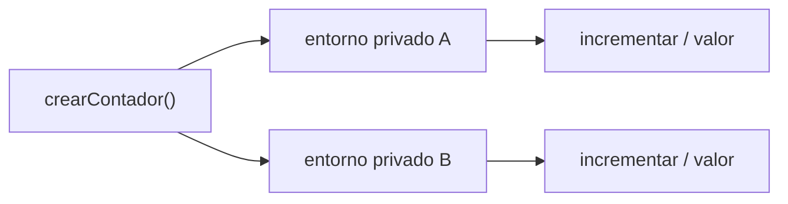
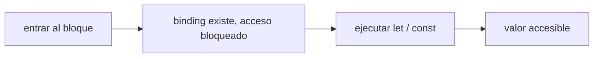
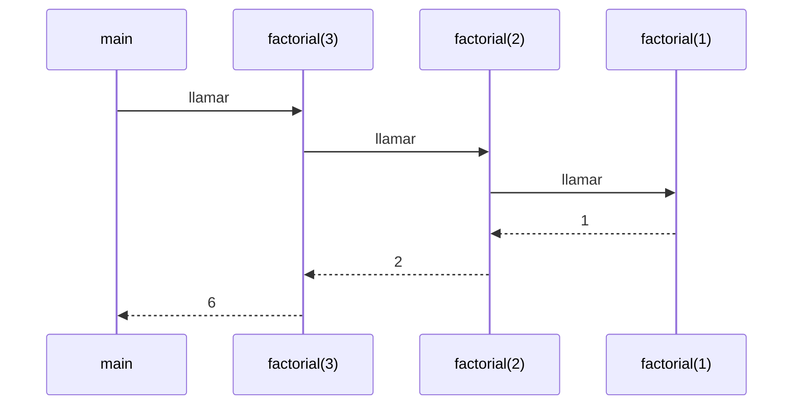
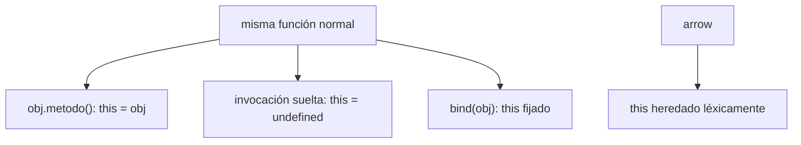
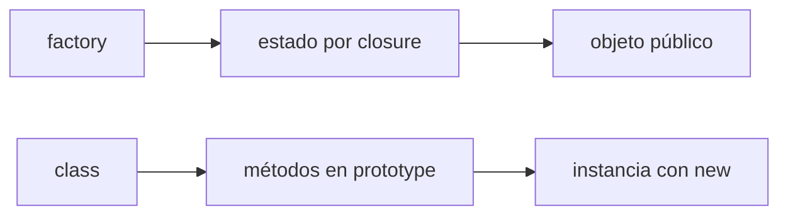
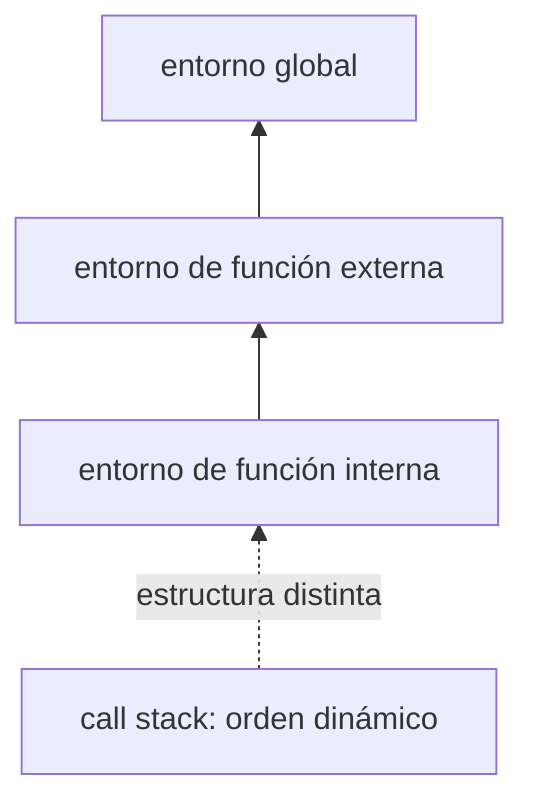

# Módulo 2: Scope, closures y el modelo de ejecución


## Aprende construyendo


### Tema 1: Scope léxico y closures · Intermedio · 40 min

<details open>
<summary><strong>Capa 1 — Lectura</strong></summary>

#### ► DE QUÉ TRATA
Al finalizar podrás crear estado privado mediante closures y explicar qué conserva una función después de terminar su contexto creador.

#### ► LA IDEA EN UNA FRASE
**Al finalizar podrás crear estado privado mediante closures y explicar qué conserva una función después de terminar su contexto creador.**

#### ► POR QUÉ EXISTE ESTO
Resuelve un problema real de diseño o implementación y evita decisiones a ciegas.

#### ► LA ANALOGÍA
Piensa en scope léxico y closures como una herramienta de taller: útil cuando conoces su propósito y sus límites.
**Dónde se rompe la analogía:** en software, los efectos dependen del contexto, la escala y los trade-offs.

#### ► CÓMO FUNCIONA


#### ► LO QUE PUEDE SALIR MAL
| Síntoma | Causa probable | Arreglo |
|---|---|---|
| Scope léxico y closures se aplica pero el resultado no mejora | Se usó sin medir el problema real | Mide antes y compara contra la alternativa simple |
| Aparece complejidad inesperada | Se adoptó la técnica sin comprender sus trade-offs | Vuelve a la sección de trade-offs y reduce el alcance |
| Falla en un caso límite | Se asumió un contexto que no se cumple | Prueba el caso límite y documenta cuándo NO usarlo |

#### ► TRADE-OFFS
| Opción | Cuándo usarla | Cuándo NO usarla |
|---|---|---|
| Usar Scope léxico y closures | Cuando el problema coincide con su propósito y el beneficio es observable | Cuando agrega complejidad sin resolver un problema real |
| Alternativa más simple | Cuando el contexto es pequeño, estable o fácil de razonar | Cuando ya demostró no escalar o no cumplir el requisito |
| Postergar la decisión | Cuando falta evidencia del problema | Cuando el costo de esperar es mayor que el costo de probar |

#### ► CUÁNDO NO USAR ESTO
No uses scope léxico y closures por defecto. Aplícalo cuando el problema lo justifique y puedas verificar el beneficio; si una alternativa más simple resuelve igual, prefiérela.

#### ► DE VUELTA A LA ANALOGÍA
Volviendo a la analogía: scope léxico y closures funciona como el modelo inicial, pero recuerda dónde se rompe: en producción importan la evidencia, la escala y el costo de equivocarte.

#### ► LO QUE DEBES RECORDAR
- Scope léxico y closures existe para resolver un problema específico.
- Mide antes de adoptar complejidad.
- Conoce el caso donde NO usarlo.
- Verifica con evidencia observable.

#### ► PREGUNTAS PARA PENSAR
1. ¿Qué problema concreto resuelve scope léxico y closures en tu contexto?
2. ¿Cómo sabrías que scope léxico y closures no está funcionando bien?
3. ¿Qué alternativa más simple considerarías antes de usar scope léxico y closures?

</details>

<details>
<summary><strong>Capa 2 — Construcción</strong></summary>

#### Código y verificación


```bash
mkdir ejemplo-closures
cd ejemplo-closures
npm init -y
mkdir src
```

```javascript
function crearSeguimiento(guia) {
  const eventos = []; // permanece accesible para las funciones retornadas
  return {
    registrar: (estado) => eventos.push({ estado, orden: eventos.length + 1 }),
    resumen: () => ({ guia, eventos: eventos.map((evento) => ({ ...evento })) }),
  };
}

const seguimiento = crearSeguimiento('RF-10');
seguimiento.registrar('creado');
seguimiento.registrar('asignado');
console.log(seguimiento.resumen());
```

```bash
node src/closures.js
```

</details>

### Tema 2: Hoisting y Temporal Dead Zone · Intermedio · 35 min

<details open>
<summary><strong>Capa 1 — Lectura</strong></summary>

#### ► DE QUÉ TRATA
Al finalizar podrás predecir el acceso a declaraciones, var, let y const antes de inicializarlos y ordenar el arranque del proyecto.

#### ► LA IDEA EN UNA FRASE
**Al finalizar podrás predecir el acceso a declaraciones, var, let y const antes de inicializarlos y ordenar el arranque del proyecto.**

#### ► POR QUÉ EXISTE ESTO
Resuelve un problema real de diseño o implementación y evita decisiones a ciegas.

#### ► LA ANALOGÍA
Piensa en hoisting y temporal dead zone como una herramienta de taller: útil cuando conoces su propósito y sus límites.
**Dónde se rompe la analogía:** en software, los efectos dependen del contexto, la escala y los trade-offs.

#### ► CÓMO FUNCIONA


#### ► LO QUE PUEDE SALIR MAL
| Síntoma | Causa probable | Arreglo |
|---|---|---|
| Hoisting y Temporal Dead Zone se aplica pero el resultado no mejora | Se usó sin medir el problema real | Mide antes y compara contra la alternativa simple |
| Aparece complejidad inesperada | Se adoptó la técnica sin comprender sus trade-offs | Vuelve a la sección de trade-offs y reduce el alcance |
| Falla en un caso límite | Se asumió un contexto que no se cumple | Prueba el caso límite y documenta cuándo NO usarlo |

#### ► TRADE-OFFS
| Opción | Cuándo usarla | Cuándo NO usarla |
|---|---|---|
| Usar Hoisting y Temporal Dead Zone | Cuando el problema coincide con su propósito y el beneficio es observable | Cuando agrega complejidad sin resolver un problema real |
| Alternativa más simple | Cuando el contexto es pequeño, estable o fácil de razonar | Cuando ya demostró no escalar o no cumplir el requisito |
| Postergar la decisión | Cuando falta evidencia del problema | Cuando el costo de esperar es mayor que el costo de probar |

#### ► CUÁNDO NO USAR ESTO
No uses hoisting y temporal dead zone por defecto. Aplícalo cuando el problema lo justifique y puedas verificar el beneficio; si una alternativa más simple resuelve igual, prefiérela.

#### ► DE VUELTA A LA ANALOGÍA
Volviendo a la analogía: hoisting y temporal dead zone funciona como el modelo inicial, pero recuerda dónde se rompe: en producción importan la evidencia, la escala y el costo de equivocarte.

#### ► LO QUE DEBES RECORDAR
- Hoisting y Temporal Dead Zone existe para resolver un problema específico.
- Mide antes de adoptar complejidad.
- Conoce el caso donde NO usarlo.
- Verifica con evidencia observable.

#### ► PREGUNTAS PARA PENSAR
1. ¿Qué problema concreto resuelve hoisting y temporal dead zone en tu contexto?
2. ¿Cómo sabrías que hoisting y temporal dead zone no está funcionando bien?
3. ¿Qué alternativa más simple considerarías antes de usar hoisting y temporal dead zone?

</details>

<details>
<summary><strong>Capa 2 — Construcción</strong></summary>

#### Código y verificación


```bash
mkdir ejemplo-hoisting
cd ejemplo-hoisting
npm init -y
mkdir src
```

```javascript
const crearRepositorio = () => ({ nombre: 'entregas-en-memoria' });

iniciar(); // la function declaration completa está disponible antes de su línea

function iniciar() {
  const repositorio = crearRepositorio();
  console.log(repositorio.nombre);
}
```

```bash
node src/hoisting.js
```

</details>

### Tema 3: Call stack y contexto de ejecución · Intermedio · 35 min

<details open>
<summary><strong>Capa 1 — Lectura</strong></summary>

#### ► DE QUÉ TRATA
Al finalizar podrás leer un stack trace, reconstruir la cadena de llamadas y corregir una recursión sin caso base.

#### ► LA IDEA EN UNA FRASE
**Al finalizar podrás leer un stack trace, reconstruir la cadena de llamadas y corregir una recursión sin caso base.**

#### ► POR QUÉ EXISTE ESTO
Resuelve un problema real de diseño o implementación y evita decisiones a ciegas.

#### ► LA ANALOGÍA
Piensa en call stack y contexto de ejecución como una herramienta de taller: útil cuando conoces su propósito y sus límites.
**Dónde se rompe la analogía:** en software, los efectos dependen del contexto, la escala y los trade-offs.

#### ► CÓMO FUNCIONA


#### ► LO QUE PUEDE SALIR MAL
| Síntoma | Causa probable | Arreglo |
|---|---|---|
| Call stack y contexto de ejecución se aplica pero el resultado no mejora | Se usó sin medir el problema real | Mide antes y compara contra la alternativa simple |
| Aparece complejidad inesperada | Se adoptó la técnica sin comprender sus trade-offs | Vuelve a la sección de trade-offs y reduce el alcance |
| Falla en un caso límite | Se asumió un contexto que no se cumple | Prueba el caso límite y documenta cuándo NO usarlo |

#### ► TRADE-OFFS
| Opción | Cuándo usarla | Cuándo NO usarla |
|---|---|---|
| Usar Call stack y contexto de ejecución | Cuando el problema coincide con su propósito y el beneficio es observable | Cuando agrega complejidad sin resolver un problema real |
| Alternativa más simple | Cuando el contexto es pequeño, estable o fácil de razonar | Cuando ya demostró no escalar o no cumplir el requisito |
| Postergar la decisión | Cuando falta evidencia del problema | Cuando el costo de esperar es mayor que el costo de probar |

#### ► CUÁNDO NO USAR ESTO
No uses call stack y contexto de ejecución por defecto. Aplícalo cuando el problema lo justifique y puedas verificar el beneficio; si una alternativa más simple resuelve igual, prefiérela.

#### ► DE VUELTA A LA ANALOGÍA
Volviendo a la analogía: call stack y contexto de ejecución funciona como el modelo inicial, pero recuerda dónde se rompe: en producción importan la evidencia, la escala y el costo de equivocarte.

#### ► LO QUE DEBES RECORDAR
- Call stack y contexto de ejecución existe para resolver un problema específico.
- Mide antes de adoptar complejidad.
- Conoce el caso donde NO usarlo.
- Verifica con evidencia observable.

#### ► PREGUNTAS PARA PENSAR
1. ¿Qué problema concreto resuelve call stack y contexto de ejecución en tu contexto?
2. ¿Cómo sabrías que call stack y contexto de ejecución no está funcionando bien?
3. ¿Qué alternativa más simple considerarías antes de usar call stack y contexto de ejecución?

</details>

<details>
<summary><strong>Capa 2 — Construcción</strong></summary>

#### Código y verificación


```bash
mkdir ejemplo-call-stack
cd ejemplo-call-stack
npm init -y
mkdir src
```

```javascript
function validarDestino(envio) {
  if (!envio.destino) throw new Error(`Destino ausente en ${envio.guia}`);
}
function procesarGuia(envio) { validarDestino(envio); }
function procesarLote(envios) { envios.forEach(procesarGuia); }

procesarLote([{ guia: 'RF-20', destino: '' }]);
```

```bash
node src/pila.js
```

</details>

### Tema 4: this según el modo de invocación · Intermedio · 40 min

<details open>
<summary><strong>Capa 1 — Lectura</strong></summary>

#### ► DE QUÉ TRATA
Al finalizar podrás predecir this según la forma de llamada y conservar un receptor al entregar un método como callback.

#### ► LA IDEA EN UNA FRASE
**Al finalizar podrás predecir this según la forma de llamada y conservar un receptor al entregar un método como callback.**

#### ► POR QUÉ EXISTE ESTO
Resuelve un problema real de diseño o implementación y evita decisiones a ciegas.

#### ► LA ANALOGÍA
Piensa en this según el modo de invocación como una herramienta de taller: útil cuando conoces su propósito y sus límites.
**Dónde se rompe la analogía:** en software, los efectos dependen del contexto, la escala y los trade-offs.

#### ► CÓMO FUNCIONA


#### ► LO QUE PUEDE SALIR MAL
| Síntoma | Causa probable | Arreglo |
|---|---|---|
| this según el modo de invocación se aplica pero el resultado no mejora | Se usó sin medir el problema real | Mide antes y compara contra la alternativa simple |
| Aparece complejidad inesperada | Se adoptó la técnica sin comprender sus trade-offs | Vuelve a la sección de trade-offs y reduce el alcance |
| Falla en un caso límite | Se asumió un contexto que no se cumple | Prueba el caso límite y documenta cuándo NO usarlo |

#### ► TRADE-OFFS
| Opción | Cuándo usarla | Cuándo NO usarla |
|---|---|---|
| Usar this según el modo de invocación | Cuando el problema coincide con su propósito y el beneficio es observable | Cuando agrega complejidad sin resolver un problema real |
| Alternativa más simple | Cuando el contexto es pequeño, estable o fácil de razonar | Cuando ya demostró no escalar o no cumplir el requisito |
| Postergar la decisión | Cuando falta evidencia del problema | Cuando el costo de esperar es mayor que el costo de probar |

#### ► CUÁNDO NO USAR ESTO
No uses this según el modo de invocación por defecto. Aplícalo cuando el problema lo justifique y puedas verificar el beneficio; si una alternativa más simple resuelve igual, prefiérela.

#### ► DE VUELTA A LA ANALOGÍA
Volviendo a la analogía: this según el modo de invocación funciona como el modelo inicial, pero recuerda dónde se rompe: en producción importan la evidencia, la escala y el costo de equivocarte.

#### ► LO QUE DEBES RECORDAR
- this según el modo de invocación existe para resolver un problema específico.
- Mide antes de adoptar complejidad.
- Conoce el caso donde NO usarlo.
- Verifica con evidencia observable.

#### ► PREGUNTAS PARA PENSAR
1. ¿Qué problema concreto resuelve this según el modo de invocación en tu contexto?
2. ¿Cómo sabrías que this según el modo de invocación no está funcionando bien?
3. ¿Qué alternativa más simple considerarías antes de usar this según el modo de invocación?

</details>

<details>
<summary><strong>Capa 2 — Construcción</strong></summary>

#### Código y verificación


```bash
mkdir ejemplo-this
cd ejemplo-this
npm init -y
mkdir src
```

```javascript
const centro = {
  nombre: 'Bogotá',
  describir(guia) { // this depende del receptor de la llamada
    return `${this.nombre}: ${guia}`;
  },
};

console.log(centro.describir('RF-21'));
const describirBogota = centro.describir.bind(centro);
console.log(describirBogota('RF-22'));
```

```bash
node src/this.js
```

</details>

### Tema 5: Module pattern y factory functions · Avanzado · 45 min

<details open>
<summary><strong>Capa 1 — Lectura</strong></summary>

#### ► DE QUÉ TRATA
Al finalizar podrás construir factories con estado privado y decidir cuándo usarlas frente a clases o módulos sin estado.

#### ► LA IDEA EN UNA FRASE
**Al finalizar podrás construir factories con estado privado y decidir cuándo usarlas frente a clases o módulos sin estado.**

#### ► POR QUÉ EXISTE ESTO
Resuelve un problema real de diseño o implementación y evita decisiones a ciegas.

#### ► LA ANALOGÍA
Piensa en module pattern y factory functions como una herramienta de taller: útil cuando conoces su propósito y sus límites.
**Dónde se rompe la analogía:** en software, los efectos dependen del contexto, la escala y los trade-offs.

#### ► CÓMO FUNCIONA


#### ► LO QUE PUEDE SALIR MAL
| Síntoma | Causa probable | Arreglo |
|---|---|---|
| Module pattern y factory functions se aplica pero el resultado no mejora | Se usó sin medir el problema real | Mide antes y compara contra la alternativa simple |
| Aparece complejidad inesperada | Se adoptó la técnica sin comprender sus trade-offs | Vuelve a la sección de trade-offs y reduce el alcance |
| Falla en un caso límite | Se asumió un contexto que no se cumple | Prueba el caso límite y documenta cuándo NO usarlo |

#### ► TRADE-OFFS
| Opción | Cuándo usarla | Cuándo NO usarla |
|---|---|---|
| Usar Module pattern y factory functions | Cuando el problema coincide con su propósito y el beneficio es observable | Cuando agrega complejidad sin resolver un problema real |
| Alternativa más simple | Cuando el contexto es pequeño, estable o fácil de razonar | Cuando ya demostró no escalar o no cumplir el requisito |
| Postergar la decisión | Cuando falta evidencia del problema | Cuando el costo de esperar es mayor que el costo de probar |

#### ► CUÁNDO NO USAR ESTO
No uses module pattern y factory functions por defecto. Aplícalo cuando el problema lo justifique y puedas verificar el beneficio; si una alternativa más simple resuelve igual, prefiérela.

#### ► DE VUELTA A LA ANALOGÍA
Volviendo a la analogía: module pattern y factory functions funciona como el modelo inicial, pero recuerda dónde se rompe: en producción importan la evidencia, la escala y el costo de equivocarte.

#### ► LO QUE DEBES RECORDAR
- Module pattern y factory functions existe para resolver un problema específico.
- Mide antes de adoptar complejidad.
- Conoce el caso donde NO usarlo.
- Verifica con evidencia observable.

#### ► PREGUNTAS PARA PENSAR
1. ¿Qué problema concreto resuelve module pattern y factory functions en tu contexto?
2. ¿Cómo sabrías que module pattern y factory functions no está funcionando bien?
3. ¿Qué alternativa más simple considerarías antes de usar module pattern y factory functions?

</details>

<details>
<summary><strong>Capa 2 — Construcción</strong></summary>

#### Código y verificación


```bash
mkdir ejemplo-factory
cd ejemplo-factory
npm init -y
mkdir src
```

```javascript
export function crearRepositorioGuias(generarId) {
  const guias = new Map(); // privado para cada invocación
  return {
    guardar(datos) {
      const guia = { ...datos, id: generarId() };
      guias.set(guia.id, guia);
      return { ...guia };
    },
    buscar(id) {
      const guia = guias.get(id);
      return guia ? { ...guia } : null;
    },
    listar: () => [...guias.values()].map((guia) => ({ ...guia })),
  };
}

let secuencia = 0;
const repo = crearRepositorioGuias(() => `RF-${++secuencia}`);
console.log(repo.guardar({ estado: 'creado' }));
console.log(repo.listar());
```

```bash
node src/repositorio.js
```

</details>

### Tema 6: Execution Context, Scope Chain y Lexical Environment · Avanzado · 45 min

<details open>
<summary><strong>Capa 1 — Lectura</strong></summary>

#### ► DE QUÉ TRATA
Al finalizar podrás diferenciar contexto de ejecución, entorno léxico, scope chain y call stack usando una ejecución observable.

#### ► LA IDEA EN UNA FRASE
**Al finalizar podrás diferenciar contexto de ejecución, entorno léxico, scope chain y call stack usando una ejecución observable.**

#### ► POR QUÉ EXISTE ESTO
Resuelve un problema real de diseño o implementación y evita decisiones a ciegas.

#### ► LA ANALOGÍA
Piensa en execution context, scope chain y lexical environment como una herramienta de taller: útil cuando conoces su propósito y sus límites.
**Dónde se rompe la analogía:** en software, los efectos dependen del contexto, la escala y los trade-offs.

#### ► CÓMO FUNCIONA


#### ► LO QUE PUEDE SALIR MAL
| Síntoma | Causa probable | Arreglo |
|---|---|---|
| Execution Context, Scope Chain y Lexical Environment se aplica pero el resultado no mejora | Se usó sin medir el problema real | Mide antes y compara contra la alternativa simple |
| Aparece complejidad inesperada | Se adoptó la técnica sin comprender sus trade-offs | Vuelve a la sección de trade-offs y reduce el alcance |
| Falla en un caso límite | Se asumió un contexto que no se cumple | Prueba el caso límite y documenta cuándo NO usarlo |

#### ► TRADE-OFFS
| Opción | Cuándo usarla | Cuándo NO usarla |
|---|---|---|
| Usar Execution Context, Scope Chain y Lexical Environment | Cuando el problema coincide con su propósito y el beneficio es observable | Cuando agrega complejidad sin resolver un problema real |
| Alternativa más simple | Cuando el contexto es pequeño, estable o fácil de razonar | Cuando ya demostró no escalar o no cumplir el requisito |
| Postergar la decisión | Cuando falta evidencia del problema | Cuando el costo de esperar es mayor que el costo de probar |

#### ► CUÁNDO NO USAR ESTO
No uses execution context, scope chain y lexical environment por defecto. Aplícalo cuando el problema lo justifique y puedas verificar el beneficio; si una alternativa más simple resuelve igual, prefiérela.

#### ► DE VUELTA A LA ANALOGÍA
Volviendo a la analogía: execution context, scope chain y lexical environment funciona como el modelo inicial, pero recuerda dónde se rompe: en producción importan la evidencia, la escala y el costo de equivocarte.

#### ► LO QUE DEBES RECORDAR
- Execution Context, Scope Chain y Lexical Environment existe para resolver un problema específico.
- Mide antes de adoptar complejidad.
- Conoce el caso donde NO usarlo.
- Verifica con evidencia observable.

#### ► PREGUNTAS PARA PENSAR
1. ¿Qué problema concreto resuelve execution context, scope chain y lexical environment en tu contexto?
2. ¿Cómo sabrías que execution context, scope chain y lexical environment no está funcionando bien?
3. ¿Qué alternativa más simple considerarías antes de usar execution context, scope chain y lexical environment?

</details>

<details>
<summary><strong>Capa 2 — Construcción</strong></summary>

#### Código y verificación


```bash
mkdir ejemplo-contextos
cd ejemplo-contextos
npm init -y
mkdir src
```

```javascript
const aplicacion = 'App';

function crearProcesador(centro) {
  const prefijo = `${aplicacion}:${centro}`;
  return function procesar(guia) {
    const mensaje = `${prefijo}:${guia}`;
    console.trace(mensaje); // muestra quién llamó, no cambia el scope
    return mensaje;
  };
}

const procesarBogota = crearProcesador('BOG');
function ejecutarDesdeOtroLugar(fn) { return fn('RF-30'); }
console.log(ejecutarDesdeOtroLugar(procesarBogota));
```

```bash
node src/contextos.js
```

</details>
