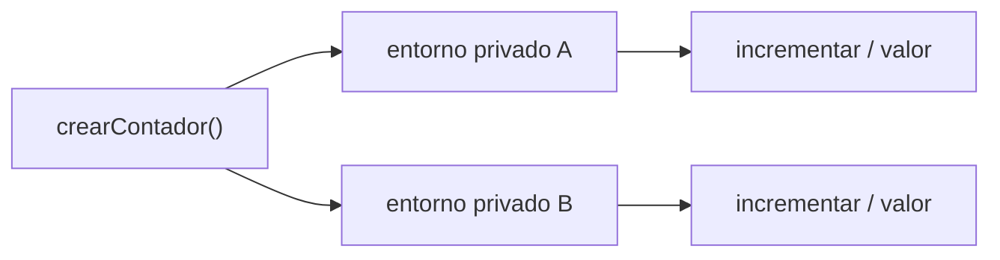
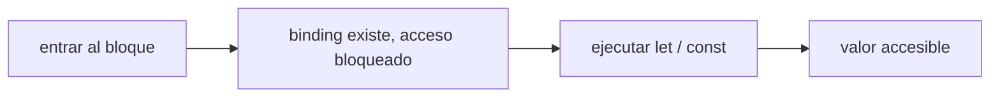
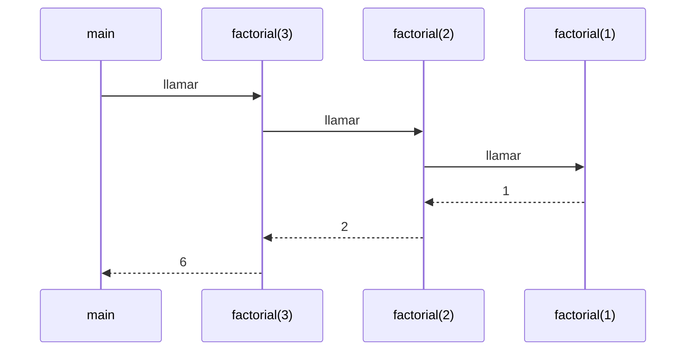
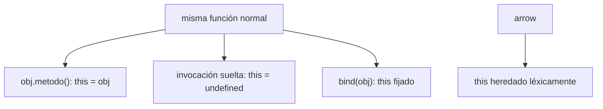
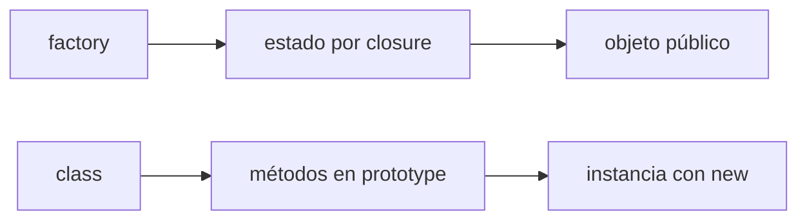
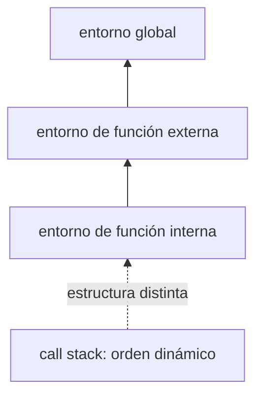

# Módulo 2: Scope, closures y el modelo de ejecución


## Aprende construyendo


### Tema 1: Scope léxico y closures · Intermedio · 40 min

<details open>
<summary><strong>Capa 1 — Lectura</strong></summary>

#### ► DE QUÉ TRATA
Al finalizar podrás crear estado privado mediante closures y explicar qué conserva una función después de terminar su contexto creador.

#### ► CÓMO FUNCIONA


</details>

<details>
<summary><strong>Capa 2 — Construcción</strong></summary>

#### Código y verificación

```bash
mkdir ejemplo-closures
cd ejemplo-closures
npm init -y
mkdir src
```

```javascript
function crearSeguimiento(guia) {
  const eventos = []; // permanece accesible para las funciones retornadas
  return {
    registrar: (estado) => eventos.push({ estado, orden: eventos.length + 1 }),
    resumen: () => ({ guia, eventos: eventos.map((evento) => ({ ...evento })) }),
  };
}

const seguimiento = crearSeguimiento('RF-10');
seguimiento.registrar('creado');
seguimiento.registrar('asignado');
console.log(seguimiento.resumen());
```

```bash
node src/closures.js
```

</details>

### Tema 2: Hoisting y Temporal Dead Zone · Intermedio · 35 min

<details open>
<summary><strong>Capa 1 — Lectura</strong></summary>

#### ► DE QUÉ TRATA
Al finalizar podrás predecir el acceso a declaraciones, var, let y const antes de inicializarlos y ordenar el arranque del proyecto.

#### ► CÓMO FUNCIONA


</details>

<details>
<summary><strong>Capa 2 — Construcción</strong></summary>

#### Código y verificación


```bash
mkdir ejemplo-hoisting
cd ejemplo-hoisting
npm init -y
mkdir src
```

```javascript
const crearRepositorio = () => ({ nombre: 'entregas-en-memoria' });

iniciar(); // la function declaration completa está disponible antes de su línea

function iniciar() {
  const repositorio = crearRepositorio();
  console.log(repositorio.nombre);
}
```

```bash
node src/hoisting.js
```

</details>

### Tema 3: Call stack y contexto de ejecución · Intermedio · 35 min

<details open>
<summary><strong>Capa 1 — Lectura</strong></summary>

#### ► DE QUÉ TRATA
Al finalizar podrás leer un stack trace, reconstruir la cadena de llamadas y corregir una recursión sin caso base.

#### ► CÓMO FUNCIONA


</details>

<details>
<summary><strong>Capa 2 — Construcción</strong></summary>

#### Código y verificación


```bash
mkdir ejemplo-call-stack
cd ejemplo-call-stack
npm init -y
mkdir src
```

```javascript
function validarDestino(envio) {
  if (!envio.destino) throw new Error(`Destino ausente en ${envio.guia}`);
}
function procesarGuia(envio) { validarDestino(envio); }
function procesarLote(envios) { envios.forEach(procesarGuia); }

procesarLote([{ guia: 'RF-20', destino: '' }]);
```

```bash
node src/pila.js
```

</details>

### Tema 4: this según el modo de invocación · Intermedio · 40 min

<details open>
<summary><strong>Capa 1 — Lectura</strong></summary>

#### ► DE QUÉ TRATA
Al finalizar podrás predecir this según la forma de llamada y conservar un receptor al entregar un método como callback.

#### ► CÓMO FUNCIONA


</details>

<details>
<summary><strong>Capa 2 — Construcción</strong></summary>

#### Código y verificación


```bash
mkdir ejemplo-this
cd ejemplo-this
npm init -y
mkdir src
```

```javascript
const centro = {
  nombre: 'Bogotá',
  describir(guia) { // this depende del receptor de la llamada
    return `${this.nombre}: ${guia}`;
  },
};

console.log(centro.describir('RF-21'));
const describirBogota = centro.describir.bind(centro);
console.log(describirBogota('RF-22'));
```

```bash
node src/this.js
```

</details>

### Tema 5: Module pattern y factory functions · Avanzado · 45 min

<details open>
<summary><strong>Capa 1 — Lectura</strong></summary>

#### ► DE QUÉ TRATA
Al finalizar podrás construir factories con estado privado y decidir cuándo usarlas frente a clases o módulos sin estado.

#### ► CÓMO FUNCIONA


</details>

<details>
<summary><strong>Capa 2 — Construcción</strong></summary>

#### Código y verificación


```bash
mkdir ejemplo-factory
cd ejemplo-factory
npm init -y
mkdir src
```

```javascript
export function crearRepositorioGuias(generarId) {
  const guias = new Map(); // privado para cada invocación
  return {
    guardar(datos) {
      const guia = { ...datos, id: generarId() };
      guias.set(guia.id, guia);
      return { ...guia };
    },
    buscar(id) {
      const guia = guias.get(id);
      return guia ? { ...guia } : null;
    },
    listar: () => [...guias.values()].map((guia) => ({ ...guia })),
  };
}

let secuencia = 0;
const repo = crearRepositorioGuias(() => `RF-${++secuencia}`);
console.log(repo.guardar({ estado: 'creado' }));
console.log(repo.listar());
```

```bash
node src/repositorio.js
```

</details>

### Tema 6: Execution Context, Scope Chain y Lexical Environment · Avanzado · 45 min

<details open>
<summary><strong>Capa 1 — Lectura</strong></summary>

#### ► DE QUÉ TRATA
Al finalizar podrás diferenciar contexto de ejecución, entorno léxico, scope chain y call stack usando una ejecución observable.

#### ► CÓMO FUNCIONA


</details>

<details>
<summary><strong>Capa 2 — Construcción</strong></summary>

#### Código y verificación


```bash
mkdir ejemplo-contextos
cd ejemplo-contextos
npm init -y
mkdir src
```

```javascript
const aplicacion = 'App';

function crearProcesador(centro) {
  const prefijo = `${aplicacion}:${centro}`;
  return function procesar(guia) {
    const mensaje = `${prefijo}:${guia}`;
    console.trace(mensaje); // muestra quién llamó, no cambia el scope
    return mensaje;
  };
}

const procesarBogota = crearProcesador('BOG');
function ejecutarDesdeOtroLugar(fn) { return fn('RF-30'); }
console.log(ejecutarDesdeOtroLugar(procesarBogota));
```

```bash
node src/contextos.js
```

</details>
