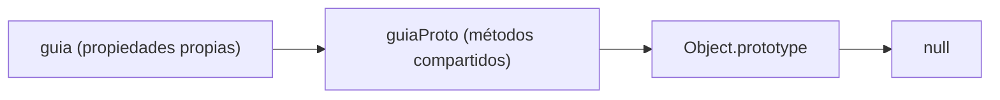
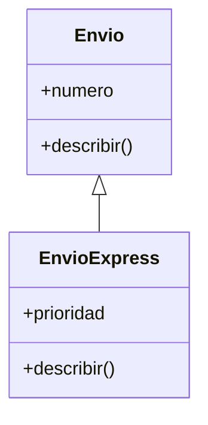
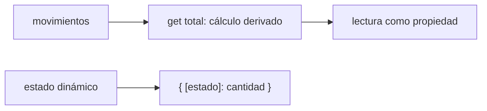
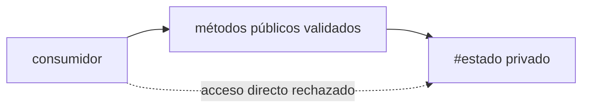
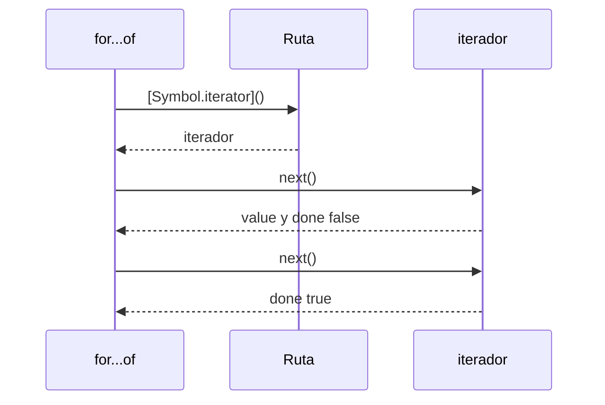

# Módulo 3: Objetos, prototipos y clases


## Aprende construyendo


### Tema 1: Prototype chain y Object.create · Intermedio · 40 min

<details open>
<summary><strong>Capa 1 — Lectura</strong></summary>

#### ► DE QUÉ TRATA
Al finalizar podrás crear objetos que delegan métodos, recorrer su cadena y distinguir propiedades propias, heredadas y sombreadas.

#### ► LA IDEA EN UNA FRASE
**Al finalizar podrás crear objetos que delegan métodos, recorrer su cadena y distinguir propiedades propias, heredadas y sombreadas.**

#### ► POR QUÉ EXISTE ESTO
Resuelve un problema real de diseño o implementación y evita decisiones a ciegas.

#### ► LA ANALOGÍA
Piensa en prototype chain y object.create como una herramienta de taller: útil cuando conoces su propósito y sus límites.
**Dónde se rompe la analogía:** en software, los efectos dependen del contexto, la escala y los trade-offs.

#### ► CÓMO FUNCIONA


#### ► LO QUE PUEDE SALIR MAL
| Síntoma | Causa probable | Arreglo |
|---|---|---|
| Prototype chain y Object.create se aplica pero el resultado no mejora | Se usó sin medir el problema real | Mide antes y compara contra la alternativa simple |
| Aparece complejidad inesperada | Se adoptó la técnica sin comprender sus trade-offs | Vuelve a la sección de trade-offs y reduce el alcance |
| Falla en un caso límite | Se asumió un contexto que no se cumple | Prueba el caso límite y documenta cuándo NO usarlo |

#### ► TRADE-OFFS
| Opción | Cuándo usarla | Cuándo NO usarla |
|---|---|---|
| Usar Prototype chain y Object.create | Cuando el problema coincide con su propósito y el beneficio es observable | Cuando agrega complejidad sin resolver un problema real |
| Alternativa más simple | Cuando el contexto es pequeño, estable o fácil de razonar | Cuando ya demostró no escalar o no cumplir el requisito |
| Postergar la decisión | Cuando falta evidencia del problema | Cuando el costo de esperar es mayor que el costo de probar |

#### ► CUÁNDO NO USAR ESTO
No uses prototype chain y object.create por defecto. Aplícalo cuando el problema lo justifique y puedas verificar el beneficio; si una alternativa más simple resuelve igual, prefiérela.

#### ► DE VUELTA A LA ANALOGÍA
Volviendo a la analogía: prototype chain y object.create funciona como el modelo inicial, pero recuerda dónde se rompe: en producción importan la evidencia, la escala y el costo de equivocarte.

#### ► LO QUE DEBES RECORDAR
- Prototype chain y Object.create existe para resolver un problema específico.
- Mide antes de adoptar complejidad.
- Conoce el caso donde NO usarlo.
- Verifica con evidencia observable.

#### ► PREGUNTAS PARA PENSAR
1. ¿Qué problema concreto resuelve prototype chain y object.create en tu contexto?
2. ¿Cómo sabrías que prototype chain y object.create no está funcionando bien?
3. ¿Qué alternativa más simple considerarías antes de usar prototype chain y object.create?

</details>

<details>
<summary><strong>Capa 2 — Construcción</strong></summary>

#### Código y verificación


```bash
mkdir ejemplo-prototipos
cd ejemplo-prototipos
npm init -y
mkdir src
```

```javascript
const guiaProto = {
  describir() { // se comparte y usa la instancia receptora
    return `${this.numero}: ${this.estado}`;
  },
};

const guia = Object.create(guiaProto);
guia.numero = 'RF-40';
guia.estado = 'creado';

console.log(guia.describir());
console.log(Object.hasOwn(guia, 'describir'));
console.log(Object.getPrototypeOf(guia) === guiaProto);
```

```bash
node src/prototipos.js
```

</details>

### Tema 2: class, extends y super · Intermedio · 45 min

<details open>
<summary><strong>Capa 1 — Lectura</strong></summary>

#### ► DE QUÉ TRATA
Al finalizar podrás implementar una jerarquía pequeña con class, extends y super, y decidir cuándo composición representa mejor el dominio.

#### ► LA IDEA EN UNA FRASE
**Al finalizar podrás implementar una jerarquía pequeña con class, extends y super, y decidir cuándo composición representa mejor el dominio.**

#### ► POR QUÉ EXISTE ESTO
Resuelve un problema real de diseño o implementación y evita decisiones a ciegas.

#### ► LA ANALOGÍA
Piensa en class, extends y super como una herramienta de taller: útil cuando conoces su propósito y sus límites.
**Dónde se rompe la analogía:** en software, los efectos dependen del contexto, la escala y los trade-offs.

#### ► CÓMO FUNCIONA


#### ► LO QUE PUEDE SALIR MAL
| Síntoma | Causa probable | Arreglo |
|---|---|---|
| class, extends y super se aplica pero el resultado no mejora | Se usó sin medir el problema real | Mide antes y compara contra la alternativa simple |
| Aparece complejidad inesperada | Se adoptó la técnica sin comprender sus trade-offs | Vuelve a la sección de trade-offs y reduce el alcance |
| Falla en un caso límite | Se asumió un contexto que no se cumple | Prueba el caso límite y documenta cuándo NO usarlo |

#### ► TRADE-OFFS
| Opción | Cuándo usarla | Cuándo NO usarla |
|---|---|---|
| Usar class, extends y super | Cuando el problema coincide con su propósito y el beneficio es observable | Cuando agrega complejidad sin resolver un problema real |
| Alternativa más simple | Cuando el contexto es pequeño, estable o fácil de razonar | Cuando ya demostró no escalar o no cumplir el requisito |
| Postergar la decisión | Cuando falta evidencia del problema | Cuando el costo de esperar es mayor que el costo de probar |

#### ► CUÁNDO NO USAR ESTO
No uses class, extends y super por defecto. Aplícalo cuando el problema lo justifique y puedas verificar el beneficio; si una alternativa más simple resuelve igual, prefiérela.

#### ► DE VUELTA A LA ANALOGÍA
Volviendo a la analogía: class, extends y super funciona como el modelo inicial, pero recuerda dónde se rompe: en producción importan la evidencia, la escala y el costo de equivocarte.

#### ► LO QUE DEBES RECORDAR
- class, extends y super existe para resolver un problema específico.
- Mide antes de adoptar complejidad.
- Conoce el caso donde NO usarlo.
- Verifica con evidencia observable.

#### ► PREGUNTAS PARA PENSAR
1. ¿Qué problema concreto resuelve class, extends y super en tu contexto?
2. ¿Cómo sabrías que class, extends y super no está funcionando bien?
3. ¿Qué alternativa más simple considerarías antes de usar class, extends y super?

</details>

<details>
<summary><strong>Capa 2 — Construcción</strong></summary>

#### Código y verificación


```bash
mkdir ejemplo-clases
cd ejemplo-clases
npm init -y
mkdir src
```

```javascript
class Envio {
  constructor(numero) {
    if (!numero) throw new TypeError('Número requerido');
    this.numero = numero;
  }
  describir() { return `Envío ${this.numero}`; }
}

class EnvioExpress extends Envio {
  constructor(numero, prioridad) {
    super(numero); // inicializa this mediante el constructor base
    this.prioridad = prioridad;
  }
  describir() { return `${super.describir()} · prioridad ${this.prioridad}`; }
}

console.log(new EnvioExpress('RF-41', 'alta').describir());
```

```bash
node src/clases.js
```

</details>

### Tema 3: Getters, setters y propiedades computadas · Intermedio · 35 min

<details open>
<summary><strong>Capa 1 — Lectura</strong></summary>

#### ► DE QUÉ TRATA
Al finalizar podrás exponer valores derivados con getters, validar escrituras deliberadas y construir claves dinámicas sin duplicar estado.

#### ► LA IDEA EN UNA FRASE
**Al finalizar podrás exponer valores derivados con getters, validar escrituras deliberadas y construir claves dinámicas sin duplicar estado.**

#### ► POR QUÉ EXISTE ESTO
Resuelve un problema real de diseño o implementación y evita decisiones a ciegas.

#### ► LA ANALOGÍA
Piensa en getters, setters y propiedades computadas como una herramienta de taller: útil cuando conoces su propósito y sus límites.
**Dónde se rompe la analogía:** en software, los efectos dependen del contexto, la escala y los trade-offs.

#### ► CÓMO FUNCIONA


#### ► LO QUE PUEDE SALIR MAL
| Síntoma | Causa probable | Arreglo |
|---|---|---|
| Getters, setters y propiedades computadas se aplica pero el resultado no mejora | Se usó sin medir el problema real | Mide antes y compara contra la alternativa simple |
| Aparece complejidad inesperada | Se adoptó la técnica sin comprender sus trade-offs | Vuelve a la sección de trade-offs y reduce el alcance |
| Falla en un caso límite | Se asumió un contexto que no se cumple | Prueba el caso límite y documenta cuándo NO usarlo |

#### ► TRADE-OFFS
| Opción | Cuándo usarla | Cuándo NO usarla |
|---|---|---|
| Usar Getters, setters y propiedades computadas | Cuando el problema coincide con su propósito y el beneficio es observable | Cuando agrega complejidad sin resolver un problema real |
| Alternativa más simple | Cuando el contexto es pequeño, estable o fácil de razonar | Cuando ya demostró no escalar o no cumplir el requisito |
| Postergar la decisión | Cuando falta evidencia del problema | Cuando el costo de esperar es mayor que el costo de probar |

#### ► CUÁNDO NO USAR ESTO
No uses getters, setters y propiedades computadas por defecto. Aplícalo cuando el problema lo justifique y puedas verificar el beneficio; si una alternativa más simple resuelve igual, prefiérela.

#### ► DE VUELTA A LA ANALOGÍA
Volviendo a la analogía: getters, setters y propiedades computadas funciona como el modelo inicial, pero recuerda dónde se rompe: en producción importan la evidencia, la escala y el costo de equivocarte.

#### ► LO QUE DEBES RECORDAR
- Getters, setters y propiedades computadas existe para resolver un problema específico.
- Mide antes de adoptar complejidad.
- Conoce el caso donde NO usarlo.
- Verifica con evidencia observable.

#### ► PREGUNTAS PARA PENSAR
1. ¿Qué problema concreto resuelve getters, setters y propiedades computadas en tu contexto?
2. ¿Cómo sabrías que getters, setters y propiedades computadas no está funcionando bien?
3. ¿Qué alternativa más simple considerarías antes de usar getters, setters y propiedades computadas?

</details>

<details>
<summary><strong>Capa 2 — Construcción</strong></summary>

#### Código y verificación


```bash
mkdir ejemplo-propiedades
cd ejemplo-propiedades
npm init -y
mkdir src
```

```javascript
class Manifiesto {
  #paquetes = [];

  agregar(paquete) {
    if (!Number.isFinite(paquete.pesoKg) || paquete.pesoKg <= 0) {
      throw new TypeError('Peso positivo requerido');
    }
    this.#paquetes.push({ ...paquete });
  }

  get pesoTotal() { // se calcula al leer; no se almacena otra copia
    return this.#paquetes.reduce((total, paquete) => total + paquete.pesoKg, 0);
  }
}

const manifiesto = new Manifiesto();
manifiesto.agregar({ guia: 'RF-42', pesoKg: 2 });
manifiesto.agregar({ guia: 'RF-43', pesoKg: 1.5 });
console.log(manifiesto.pesoTotal);
```

```bash
node src/propiedades.js
```

</details>

### Tema 4: Encapsulación con campos privados (#campo) · Avanzado · 40 min

<details open>
<summary><strong>Capa 1 — Lectura</strong></summary>

#### ► DE QUÉ TRATA
Al finalizar podrás proteger una transición con #campo, exponer lectura controlada y diferenciar privacidad real de la convención _campo.

#### ► LA IDEA EN UNA FRASE
**Al finalizar podrás proteger una transición con #campo, exponer lectura controlada y diferenciar privacidad real de la convención _campo.**

#### ► POR QUÉ EXISTE ESTO
Resuelve un problema real de diseño o implementación y evita decisiones a ciegas.

#### ► LA ANALOGÍA
Piensa en encapsulación con campos privados (#campo) como una herramienta de taller: útil cuando conoces su propósito y sus límites.
**Dónde se rompe la analogía:** en software, los efectos dependen del contexto, la escala y los trade-offs.

#### ► CÓMO FUNCIONA


#### ► LO QUE PUEDE SALIR MAL
| Síntoma | Causa probable | Arreglo |
|---|---|---|
| Encapsulación con campos privados (#campo) se aplica pero el resultado no mejora | Se usó sin medir el problema real | Mide antes y compara contra la alternativa simple |
| Aparece complejidad inesperada | Se adoptó la técnica sin comprender sus trade-offs | Vuelve a la sección de trade-offs y reduce el alcance |
| Falla en un caso límite | Se asumió un contexto que no se cumple | Prueba el caso límite y documenta cuándo NO usarlo |

#### ► TRADE-OFFS
| Opción | Cuándo usarla | Cuándo NO usarla |
|---|---|---|
| Usar Encapsulación con campos privados (#campo) | Cuando el problema coincide con su propósito y el beneficio es observable | Cuando agrega complejidad sin resolver un problema real |
| Alternativa más simple | Cuando el contexto es pequeño, estable o fácil de razonar | Cuando ya demostró no escalar o no cumplir el requisito |
| Postergar la decisión | Cuando falta evidencia del problema | Cuando el costo de esperar es mayor que el costo de probar |

#### ► CUÁNDO NO USAR ESTO
No uses encapsulación con campos privados (#campo) por defecto. Aplícalo cuando el problema lo justifique y puedas verificar el beneficio; si una alternativa más simple resuelve igual, prefiérela.

#### ► DE VUELTA A LA ANALOGÍA
Volviendo a la analogía: encapsulación con campos privados (#campo) funciona como el modelo inicial, pero recuerda dónde se rompe: en producción importan la evidencia, la escala y el costo de equivocarte.

#### ► LO QUE DEBES RECORDAR
- Encapsulación con campos privados (#campo) existe para resolver un problema específico.
- Mide antes de adoptar complejidad.
- Conoce el caso donde NO usarlo.
- Verifica con evidencia observable.

#### ► PREGUNTAS PARA PENSAR
1. ¿Qué problema concreto resuelve encapsulación con campos privados (#campo) en tu contexto?
2. ¿Cómo sabrías que encapsulación con campos privados (#campo) no está funcionando bien?
3. ¿Qué alternativa más simple considerarías antes de usar encapsulación con campos privados (#campo)?

</details>

<details>
<summary><strong>Capa 2 — Construcción</strong></summary>

#### Código y verificación
```javascript
const configuracion = Object.freeze({ reintentos: 3, limites: { porMinuto: 60 } });
configuracion.reintentos = 10; // ignorado en modo no estricto, TypeError en modo estricto
console.log(configuracion.reintentos); // 3: el nivel superior sí quedó protegido

configuracion.limites.porMinuto = 999; // el freeze es superficial: el objeto anidado no está congelado
console.log(configuracion.limites.porMinuto); // 999: la mutación anidada sí tuvo efecto
```


```bash
mkdir ejemplo-encapsulacion
cd ejemplo-encapsulacion
npm init -y
mkdir src
```

```javascript
class Entrega {
  #estado;

  constructor(estado = 'EN_RUTA') { this.#estado = estado; }
  get estado() { return this.#estado; }

  confirmar() {
    if (this.#estado !== 'EN_RUTA') {
      throw new Error(`No se puede confirmar desde ${this.#estado}`);
    }
    this.#estado = 'ENTREGADA';
  }
}

const entrega = new Entrega();
entrega.confirmar();
console.log(entrega.estado);
```

```bash
node src/encapsulacion.js
```

</details>

### Tema 5: Symbol y objetos iterables propios · Avanzado · 30 min

<details open>
<summary><strong>Capa 1 — Lectura</strong></summary>

#### ► DE QUÉ TRATA
Al finalizar podrás crear claves únicas con Symbol, implementar el protocolo de iteración con Symbol.iterator y con generadores, y lograr que tus objetos funcionen con for...of, spread y desestructuración. Prerrequisitos: Tema 2 de este módulo (clases) y Módulo 6, Tema 5 (generad…

#### ► LA IDEA EN UNA FRASE
**Al finalizar podrás crear claves únicas con Symbol, implementar el protocolo de iteración con Symbol.iterator y con generadores, y lograr que tus objetos funcionen con for...of, spread y desestructuración.**

#### ► POR QUÉ EXISTE ESTO
Resuelve un problema real de diseño o implementación y evita decisiones a ciegas.

#### ► LA ANALOGÍA
Piensa en symbol y objetos iterables propios como una herramienta de taller: útil cuando conoces su propósito y sus límites.
**Dónde se rompe la analogía:** en software, los efectos dependen del contexto, la escala y los trade-offs.

#### ► CÓMO FUNCIONA


#### ► LO QUE PUEDE SALIR MAL
| Síntoma | Causa probable | Arreglo |
|---|---|---|
| Symbol y objetos iterables propios se aplica pero el resultado no mejora | Se usó sin medir el problema real | Mide antes y compara contra la alternativa simple |
| Aparece complejidad inesperada | Se adoptó la técnica sin comprender sus trade-offs | Vuelve a la sección de trade-offs y reduce el alcance |
| Falla en un caso límite | Se asumió un contexto que no se cumple | Prueba el caso límite y documenta cuándo NO usarlo |

#### ► TRADE-OFFS
| Opción | Cuándo usarla | Cuándo NO usarla |
|---|---|---|
| Usar Symbol y objetos iterables propios | Cuando el problema coincide con su propósito y el beneficio es observable | Cuando agrega complejidad sin resolver un problema real |
| Alternativa más simple | Cuando el contexto es pequeño, estable o fácil de razonar | Cuando ya demostró no escalar o no cumplir el requisito |
| Postergar la decisión | Cuando falta evidencia del problema | Cuando el costo de esperar es mayor que el costo de probar |

#### ► CUÁNDO NO USAR ESTO
No uses symbol y objetos iterables propios por defecto. Aplícalo cuando el problema lo justifique y puedas verificar el beneficio; si una alternativa más simple resuelve igual, prefiérela.

#### ► DE VUELTA A LA ANALOGÍA
Volviendo a la analogía: symbol y objetos iterables propios funciona como el modelo inicial, pero recuerda dónde se rompe: en producción importan la evidencia, la escala y el costo de equivocarte.

#### ► LO QUE DEBES RECORDAR
- Symbol y objetos iterables propios existe para resolver un problema específico.
- Mide antes de adoptar complejidad.
- Conoce el caso donde NO usarlo.
- Verifica con evidencia observable.

#### ► PREGUNTAS PARA PENSAR
1. ¿Qué problema concreto resuelve symbol y objetos iterables propios en tu contexto?
2. ¿Cómo sabrías que symbol y objetos iterables propios no está funcionando bien?
3. ¿Qué alternativa más simple considerarías antes de usar symbol y objetos iterables propios?

</details>

<details>
<summary><strong>Capa 2 — Construcción</strong></summary>

#### Código y verificación


```bash
mkdir iterables && cd iterables
```

```javascript
// Una ruta de reparto que se puede recorrer con for...of, spread y desestructuración
class Ruta {
  #paradas = [];
  agregar(...paradas) {
    this.#paradas.push(...paradas);
    return this;
  }
  // Protocolo de iteración: un método con la clave Symbol.iterator que devuelve un iterador
  [Symbol.iterator]() {
    let i = 0;
    const paradas = this.#paradas;
    return {
      next() {
        return i < paradas.length
          ? { value: `${i + 1}. ${paradas[i++]}`, done: false }
          : { value: undefined, done: true };
      },
    };
  }
  // Un generador produce un iterador sin escribir next() a mano
  *pendientesDesde(indice) {
    for (let i = indice; i < this.#paradas.length; i++) yield this.#paradas[i];
  }
  get [Symbol.toStringTag]() {
    return 'Ruta';
  }
}

const ruta = new Ruta().agregar('Depósito', 'Chapinero', 'Usaquén', 'Suba');
for (const parada of ruta) console.log(parada);
console.log([...ruta].length, 'paradas');
const [origen, siguiente] = ruta;
console.log('Desestructurada:', origen, '|', siguiente);
console.log('Pendientes:', [...ruta.pendientesDesde(2)]);
console.log(Object.prototype.toString.call(ruta));

// Symbol: claves únicas que no chocan con otras propiedades
const ID_INTERNO = Symbol('idInterno');
const envio = { guia: 'G-1', [ID_INTERNO]: 98765 };
console.log(Object.keys(envio), JSON.stringify(envio), envio[ID_INTERNO]);
console.log(Symbol('a') === Symbol('a'), Symbol.for('a') === Symbol.for('a'));
```

```bash
node iterables.js
```

```text
1. Depósito
2. Chapinero
3. Usaquén
4. Suba
4 paradas
Desestructurada: 1. Depósito | 2. Chapinero
Pendientes: [ 'Usaquén', 'Suba' ]
[object Ruta]
[ 'guia' ] {"guia":"G-1"} 98765
false true
```

</details>
