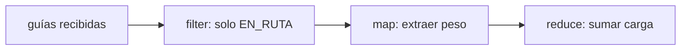
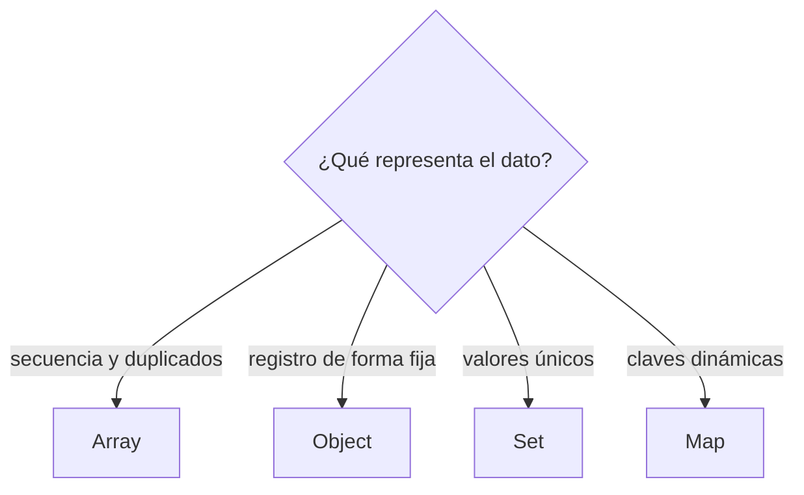
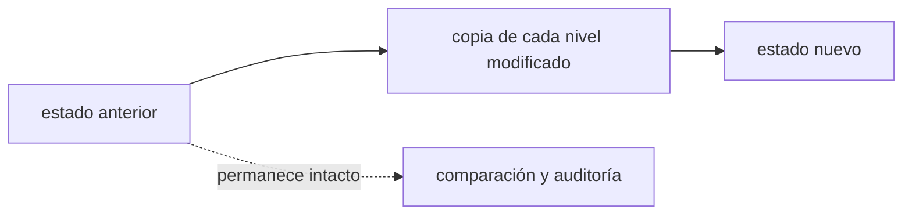
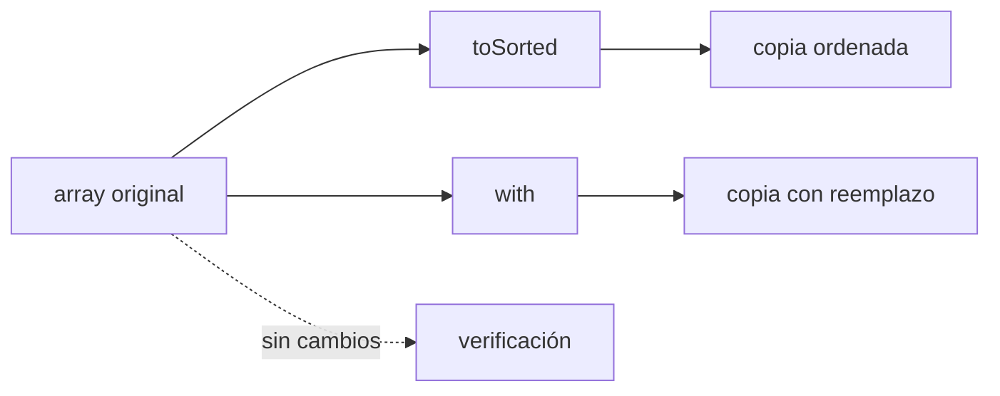
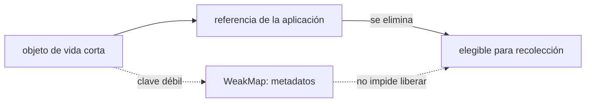

# Módulo 4: Arrays y estructuras de datos funcionales


## Aprende construyendo


### Tema 1: map, filter, reduce, find, some/every · Intermedio · 40 min

<details open>
<summary><strong>Capa 1 — Lectura</strong></summary>

#### ► DE QUÉ TRATA
Al finalizar podrás elegir el método de array según la intención y construir un pipeline que calcule la carga activa sin mutar entregas.

#### ► LA IDEA EN UNA FRASE
**Al finalizar podrás elegir el método de array según la intención y construir un pipeline que calcule la carga activa sin mutar entregas.**

#### ► POR QUÉ EXISTE ESTO
Resuelve un problema real de diseño o implementación y evita decisiones a ciegas.

#### ► LA ANALOGÍA
Piensa en map, filter, reduce, find, some/every como una herramienta de taller: útil cuando conoces su propósito y sus límites.
**Dónde se rompe la analogía:** en software, los efectos dependen del contexto, la escala y los trade-offs.

#### ► CÓMO FUNCIONA


#### ► LO QUE PUEDE SALIR MAL
| Síntoma | Causa probable | Arreglo |
|---|---|---|
| map, filter, reduce, find, some/every se aplica pero el resultado no mejora | Se usó sin medir el problema real | Mide antes y compara contra la alternativa simple |
| Aparece complejidad inesperada | Se adoptó la técnica sin comprender sus trade-offs | Vuelve a la sección de trade-offs y reduce el alcance |
| Falla en un caso límite | Se asumió un contexto que no se cumple | Prueba el caso límite y documenta cuándo NO usarlo |

#### ► TRADE-OFFS
| Opción | Cuándo usarla | Cuándo NO usarla |
|---|---|---|
| Usar map, filter, reduce, find, some/every | Cuando el problema coincide con su propósito y el beneficio es observable | Cuando agrega complejidad sin resolver un problema real |
| Alternativa más simple | Cuando el contexto es pequeño, estable o fácil de razonar | Cuando ya demostró no escalar o no cumplir el requisito |
| Postergar la decisión | Cuando falta evidencia del problema | Cuando el costo de esperar es mayor que el costo de probar |

#### ► CUÁNDO NO USAR ESTO
No uses map, filter, reduce, find, some/every por defecto. Aplícalo cuando el problema lo justifique y puedas verificar el beneficio; si una alternativa más simple resuelve igual, prefiérela.

#### ► DE VUELTA A LA ANALOGÍA
Volviendo a la analogía: map, filter, reduce, find, some/every funciona como el modelo inicial, pero recuerda dónde se rompe: en producción importan la evidencia, la escala y el costo de equivocarte.

#### ► LO QUE DEBES RECORDAR
- map, filter, reduce, find, some/every existe para resolver un problema específico.
- Mide antes de adoptar complejidad.
- Conoce el caso donde NO usarlo.
- Verifica con evidencia observable.

#### ► PREGUNTAS PARA PENSAR
1. ¿Qué problema concreto resuelve map, filter, reduce, find, some/every en tu contexto?
2. ¿Cómo sabrías que map, filter, reduce, find, some/every no está funcionando bien?
3. ¿Qué alternativa más simple considerarías antes de usar map, filter, reduce, find, some/every?

</details>

<details>
<summary><strong>Capa 2 — Construcción</strong></summary>

#### Código y verificación


```bash
mkdir ejemplo-arrays
cd ejemplo-arrays
npm init -y
mkdir src
```

```javascript
const guias = [
  { codigo: 'RF-101', estado: 'EN_RUTA', pesoKg: 2 },
  { codigo: 'RF-102', estado: 'ENTREGADA', pesoKg: 1.5 },
  { codigo: 'RF-103', estado: 'EN_RUTA', pesoKg: 3 }
];

const activas = guias.filter(guia => guia.estado === 'EN_RUTA');
const pesos = activas.map(guia => guia.pesoKg);
const cargaTotal = pesos.reduce((total, peso) => total + peso, 0);
console.log({ activas: activas.length, pesos, cargaTotal });
```

</details>

### Tema 2: Set y Map frente a Array y Object · Intermedio · 40 min

<details open>
<summary><strong>Capa 1 — Lectura</strong></summary>

#### ► DE QUÉ TRATA
Al finalizar podrás escoger Array, Object, Set o Map según orden, duplicados, forma y claves dinámicas.

#### ► LA IDEA EN UNA FRASE
**Al finalizar podrás escoger Array, Object, Set o Map según orden, duplicados, forma y claves dinámicas.**

#### ► POR QUÉ EXISTE ESTO
Resuelve un problema real de diseño o implementación y evita decisiones a ciegas.

#### ► LA ANALOGÍA
Piensa en set y map frente a array y object como una herramienta de taller: útil cuando conoces su propósito y sus límites.
**Dónde se rompe la analogía:** en software, los efectos dependen del contexto, la escala y los trade-offs.

#### ► CÓMO FUNCIONA


#### ► LO QUE PUEDE SALIR MAL
| Síntoma | Causa probable | Arreglo |
|---|---|---|
| Set y Map frente a Array y Object se aplica pero el resultado no mejora | Se usó sin medir el problema real | Mide antes y compara contra la alternativa simple |
| Aparece complejidad inesperada | Se adoptó la técnica sin comprender sus trade-offs | Vuelve a la sección de trade-offs y reduce el alcance |
| Falla en un caso límite | Se asumió un contexto que no se cumple | Prueba el caso límite y documenta cuándo NO usarlo |

#### ► TRADE-OFFS
| Opción | Cuándo usarla | Cuándo NO usarla |
|---|---|---|
| Usar Set y Map frente a Array y Object | Cuando el problema coincide con su propósito y el beneficio es observable | Cuando agrega complejidad sin resolver un problema real |
| Alternativa más simple | Cuando el contexto es pequeño, estable o fácil de razonar | Cuando ya demostró no escalar o no cumplir el requisito |
| Postergar la decisión | Cuando falta evidencia del problema | Cuando el costo de esperar es mayor que el costo de probar |

#### ► CUÁNDO NO USAR ESTO
No uses set y map frente a array y object por defecto. Aplícalo cuando el problema lo justifique y puedas verificar el beneficio; si una alternativa más simple resuelve igual, prefiérela.

#### ► DE VUELTA A LA ANALOGÍA
Volviendo a la analogía: set y map frente a array y object funciona como el modelo inicial, pero recuerda dónde se rompe: en producción importan la evidencia, la escala y el costo de equivocarte.

#### ► LO QUE DEBES RECORDAR
- Set y Map frente a Array y Object existe para resolver un problema específico.
- Mide antes de adoptar complejidad.
- Conoce el caso donde NO usarlo.
- Verifica con evidencia observable.

#### ► PREGUNTAS PARA PENSAR
1. ¿Qué problema concreto resuelve set y map frente a array y object en tu contexto?
2. ¿Cómo sabrías que set y map frente a array y object no está funcionando bien?
3. ¿Qué alternativa más simple considerarías antes de usar set y map frente a array y object?

</details>

<details>
<summary><strong>Capa 2 — Construcción</strong></summary>

#### Código y verificación
```javascript
const enRuta = new Set(['RF-101', 'RF-102', 'RF-103']);
const conIncidencia = new Set(['RF-102', 'RF-104']);
console.log([...enRuta.difference(conIncidencia)]); // ['RF-101', 'RF-103']
console.log(enRuta.isDisjointFrom(new Set(['RF-999']))); // true
```


```bash
mkdir ejemplo-set-map
cd ejemplo-set-map
npm init -y
mkdir src
```

```javascript
const escaneos = ['RF-101', 'RF-101', 'RF-102'];
const unicos = new Set(escaneos);
const porCodigo = new Map([
  ['RF-101', { estado: 'EN_RUTA' }],
  ['RF-102', { estado: 'ENTREGADA' }]
]);
console.log([...unicos], porCodigo.get('RF-101'), porCodigo.has('RF-999'));
```

</details>

### Tema 3: Inmutabilidad y actualización de estructuras anidadas · Intermedio · 35 min

<details open>
<summary><strong>Capa 1 — Lectura</strong></summary>

#### ► DE QUÉ TRATA
Al finalizar podrás actualizar estructuras anidadas sin modificar versiones anteriores y decidir cuándo normalizar el estado.

#### ► LA IDEA EN UNA FRASE
**Al finalizar podrás actualizar estructuras anidadas sin modificar versiones anteriores y decidir cuándo normalizar el estado.**

#### ► POR QUÉ EXISTE ESTO
Resuelve un problema real de diseño o implementación y evita decisiones a ciegas.

#### ► LA ANALOGÍA
Piensa en inmutabilidad y actualización de estructuras anidadas como una herramienta de taller: útil cuando conoces su propósito y sus límites.
**Dónde se rompe la analogía:** en software, los efectos dependen del contexto, la escala y los trade-offs.

#### ► CÓMO FUNCIONA


#### ► LO QUE PUEDE SALIR MAL
| Síntoma | Causa probable | Arreglo |
|---|---|---|
| Inmutabilidad y actualización de estructuras anidadas se aplica pero el resultado no mejora | Se usó sin medir el problema real | Mide antes y compara contra la alternativa simple |
| Aparece complejidad inesperada | Se adoptó la técnica sin comprender sus trade-offs | Vuelve a la sección de trade-offs y reduce el alcance |
| Falla en un caso límite | Se asumió un contexto que no se cumple | Prueba el caso límite y documenta cuándo NO usarlo |

#### ► TRADE-OFFS
| Opción | Cuándo usarla | Cuándo NO usarla |
|---|---|---|
| Usar Inmutabilidad y actualización de estructuras anidadas | Cuando el problema coincide con su propósito y el beneficio es observable | Cuando agrega complejidad sin resolver un problema real |
| Alternativa más simple | Cuando el contexto es pequeño, estable o fácil de razonar | Cuando ya demostró no escalar o no cumplir el requisito |
| Postergar la decisión | Cuando falta evidencia del problema | Cuando el costo de esperar es mayor que el costo de probar |

#### ► CUÁNDO NO USAR ESTO
No uses inmutabilidad y actualización de estructuras anidadas por defecto. Aplícalo cuando el problema lo justifique y puedas verificar el beneficio; si una alternativa más simple resuelve igual, prefiérela.

#### ► DE VUELTA A LA ANALOGÍA
Volviendo a la analogía: inmutabilidad y actualización de estructuras anidadas funciona como el modelo inicial, pero recuerda dónde se rompe: en producción importan la evidencia, la escala y el costo de equivocarte.

#### ► LO QUE DEBES RECORDAR
- Inmutabilidad y actualización de estructuras anidadas existe para resolver un problema específico.
- Mide antes de adoptar complejidad.
- Conoce el caso donde NO usarlo.
- Verifica con evidencia observable.

#### ► PREGUNTAS PARA PENSAR
1. ¿Qué problema concreto resuelve inmutabilidad y actualización de estructuras anidadas en tu contexto?
2. ¿Cómo sabrías que inmutabilidad y actualización de estructuras anidadas no está funcionando bien?
3. ¿Qué alternativa más simple considerarías antes de usar inmutabilidad y actualización de estructuras anidadas?

</details>

<details>
<summary><strong>Capa 2 — Construcción</strong></summary>

#### Código y verificación


```bash
mkdir ejemplo-inmutabilidad
cd ejemplo-inmutabilidad
npm init -y
mkdir src
```

```javascript
const anterior = { codigo: 'RF-101', destino: { ciudad: 'Bogotá', pais: 'CO' } };
const siguiente = {
  ...anterior,
  destino: { ...anterior.destino, ciudad: 'Medellín' }
};
console.log(anterior.destino.ciudad, siguiente.destino.ciudad);
console.log(anterior.destino === siguiente.destino);
```

</details>

### Tema 4: Métodos inmutables modernos · Intermedio · 35 min

<details open>
<summary><strong>Capa 1 — Lectura</strong></summary>

#### ► DE QUÉ TRATA
Al finalizar podrás ordenar, invertir, insertar y reemplazar elementos sin modificar el plan original, verificando compatibilidad del runtime.

#### ► LA IDEA EN UNA FRASE
**Al finalizar podrás ordenar, invertir, insertar y reemplazar elementos sin modificar el plan original, verificando compatibilidad del runtime.**

#### ► POR QUÉ EXISTE ESTO
Resuelve un problema real de diseño o implementación y evita decisiones a ciegas.

#### ► LA ANALOGÍA
Piensa en métodos inmutables modernos como una herramienta de taller: útil cuando conoces su propósito y sus límites.
**Dónde se rompe la analogía:** en software, los efectos dependen del contexto, la escala y los trade-offs.

#### ► CÓMO FUNCIONA


#### ► LO QUE PUEDE SALIR MAL
| Síntoma | Causa probable | Arreglo |
|---|---|---|
| Métodos inmutables modernos se aplica pero el resultado no mejora | Se usó sin medir el problema real | Mide antes y compara contra la alternativa simple |
| Aparece complejidad inesperada | Se adoptó la técnica sin comprender sus trade-offs | Vuelve a la sección de trade-offs y reduce el alcance |
| Falla en un caso límite | Se asumió un contexto que no se cumple | Prueba el caso límite y documenta cuándo NO usarlo |

#### ► TRADE-OFFS
| Opción | Cuándo usarla | Cuándo NO usarla |
|---|---|---|
| Usar Métodos inmutables modernos | Cuando el problema coincide con su propósito y el beneficio es observable | Cuando agrega complejidad sin resolver un problema real |
| Alternativa más simple | Cuando el contexto es pequeño, estable o fácil de razonar | Cuando ya demostró no escalar o no cumplir el requisito |
| Postergar la decisión | Cuando falta evidencia del problema | Cuando el costo de esperar es mayor que el costo de probar |

#### ► CUÁNDO NO USAR ESTO
No uses métodos inmutables modernos por defecto. Aplícalo cuando el problema lo justifique y puedas verificar el beneficio; si una alternativa más simple resuelve igual, prefiérela.

#### ► DE VUELTA A LA ANALOGÍA
Volviendo a la analogía: métodos inmutables modernos funciona como el modelo inicial, pero recuerda dónde se rompe: en producción importan la evidencia, la escala y el costo de equivocarte.

#### ► LO QUE DEBES RECORDAR
- Métodos inmutables modernos existe para resolver un problema específico.
- Mide antes de adoptar complejidad.
- Conoce el caso donde NO usarlo.
- Verifica con evidencia observable.

#### ► PREGUNTAS PARA PENSAR
1. ¿Qué problema concreto resuelve métodos inmutables modernos en tu contexto?
2. ¿Cómo sabrías que métodos inmutables modernos no está funcionando bien?
3. ¿Qué alternativa más simple considerarías antes de usar métodos inmutables modernos?

</details>

<details>
<summary><strong>Capa 2 — Construcción</strong></summary>

#### Código y verificación


```bash
mkdir ejemplo-metodos-inmutables
cd ejemplo-metodos-inmutables
npm init -y
mkdir src
```

```javascript
const paradas = ['Bogotá', 'Cali', 'Medellín'];
const ordenadas = paradas.toSorted();
const invertidas = paradas.toReversed();
const sinCali = paradas.toSpliced(1, 1);
const corregidas = paradas.with(1, 'Palmira');

console.log({ paradas, ordenadas, invertidas, sinCali, corregidas });
```

```bash
node src/copias.js
```

</details>

### Tema 5: WeakMap y WeakSet · Avanzado · 35 min

<details open>
<summary><strong>Capa 1 — Lectura</strong></summary>

#### ► DE QUÉ TRATA
Al finalizar podrás asociar metadatos débiles a objetos y explicar por qué no se pueden enumerar ni usar como almacenamiento de negocio.

#### ► LA IDEA EN UNA FRASE
**Al finalizar podrás asociar metadatos débiles a objetos y explicar por qué no se pueden enumerar ni usar como almacenamiento de negocio.**

#### ► POR QUÉ EXISTE ESTO
Resuelve un problema real de diseño o implementación y evita decisiones a ciegas.

#### ► LA ANALOGÍA
Piensa en weakmap y weakset como una herramienta de taller: útil cuando conoces su propósito y sus límites.
**Dónde se rompe la analogía:** en software, los efectos dependen del contexto, la escala y los trade-offs.

#### ► CÓMO FUNCIONA


#### ► LO QUE PUEDE SALIR MAL
| Síntoma | Causa probable | Arreglo |
|---|---|---|
| WeakMap y WeakSet se aplica pero el resultado no mejora | Se usó sin medir el problema real | Mide antes y compara contra la alternativa simple |
| Aparece complejidad inesperada | Se adoptó la técnica sin comprender sus trade-offs | Vuelve a la sección de trade-offs y reduce el alcance |
| Falla en un caso límite | Se asumió un contexto que no se cumple | Prueba el caso límite y documenta cuándo NO usarlo |

#### ► TRADE-OFFS
| Opción | Cuándo usarla | Cuándo NO usarla |
|---|---|---|
| Usar WeakMap y WeakSet | Cuando el problema coincide con su propósito y el beneficio es observable | Cuando agrega complejidad sin resolver un problema real |
| Alternativa más simple | Cuando el contexto es pequeño, estable o fácil de razonar | Cuando ya demostró no escalar o no cumplir el requisito |
| Postergar la decisión | Cuando falta evidencia del problema | Cuando el costo de esperar es mayor que el costo de probar |

#### ► CUÁNDO NO USAR ESTO
No uses weakmap y weakset por defecto. Aplícalo cuando el problema lo justifique y puedas verificar el beneficio; si una alternativa más simple resuelve igual, prefiérela.

#### ► DE VUELTA A LA ANALOGÍA
Volviendo a la analogía: weakmap y weakset funciona como el modelo inicial, pero recuerda dónde se rompe: en producción importan la evidencia, la escala y el costo de equivocarte.

#### ► LO QUE DEBES RECORDAR
- WeakMap y WeakSet existe para resolver un problema específico.
- Mide antes de adoptar complejidad.
- Conoce el caso donde NO usarlo.
- Verifica con evidencia observable.

#### ► PREGUNTAS PARA PENSAR
1. ¿Qué problema concreto resuelve weakmap y weakset en tu contexto?
2. ¿Cómo sabrías que weakmap y weakset no está funcionando bien?
3. ¿Qué alternativa más simple considerarías antes de usar weakmap y weakset?

</details>

<details>
<summary><strong>Capa 2 — Construcción</strong></summary>

#### Código y verificación


```bash
mkdir ejemplo-weak
cd ejemplo-weak
npm init -y
mkdir src
```

```javascript
const diagnosticos = new WeakMap();
const guia = { codigo: 'RF-101' };
diagnosticos.set(guia, { revisado: true });
console.log(diagnosticos.get(guia));
console.log(diagnosticos.has(guia));
```

</details>
