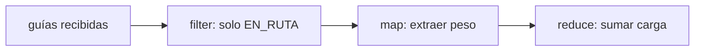
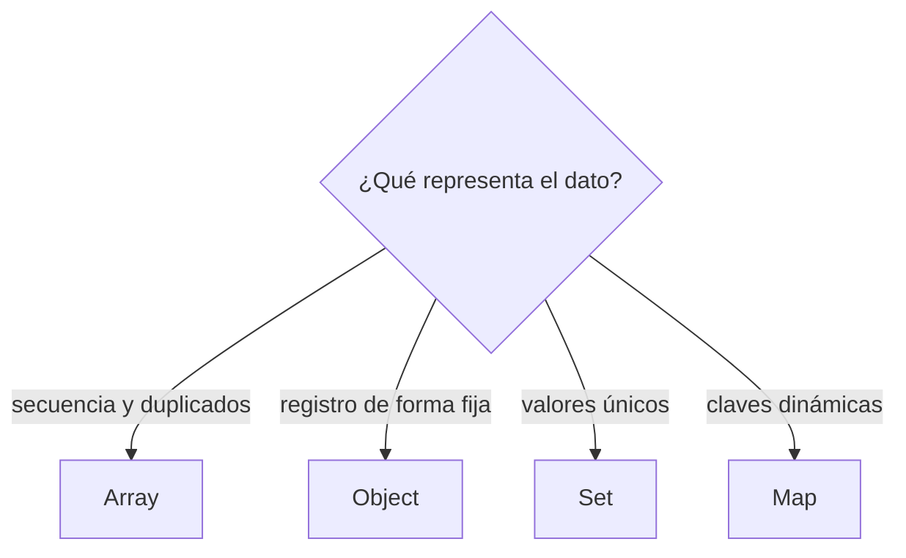
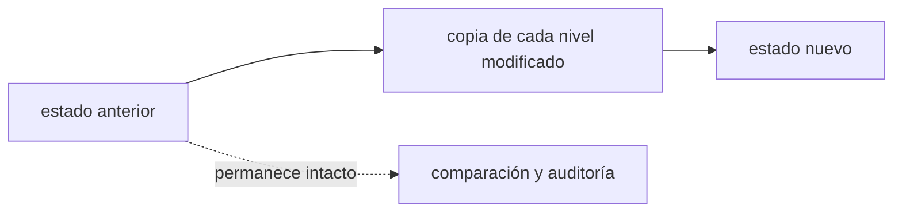
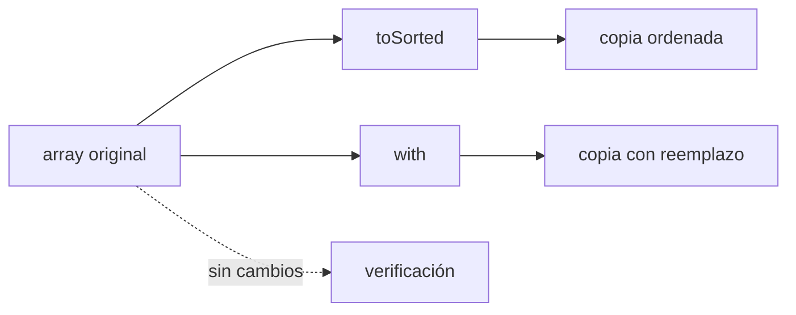
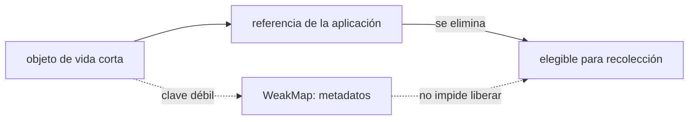

# Módulo 4: Arrays y estructuras de datos funcionales


## Aprende construyendo


### Tema 1: map, filter, reduce, find, some/every · Intermedio · 40 min

<details open>
<summary><strong>Capa 1 — Lectura</strong></summary>

#### ► DE QUÉ TRATA
Al finalizar podrás elegir el método de array según la intención y construir un pipeline que calcule la carga activa sin mutar entregas.

#### ► CÓMO FUNCIONA


</details>

<details>
<summary><strong>Capa 2 — Construcción</strong></summary>

#### Código y verificación


```bash
mkdir ejemplo-arrays
cd ejemplo-arrays
npm init -y
mkdir src
```

```javascript
const guias = [
  { codigo: 'RF-101', estado: 'EN_RUTA', pesoKg: 2 },
  { codigo: 'RF-102', estado: 'ENTREGADA', pesoKg: 1.5 },
  { codigo: 'RF-103', estado: 'EN_RUTA', pesoKg: 3 }
];

const activas = guias.filter(guia => guia.estado === 'EN_RUTA');
const pesos = activas.map(guia => guia.pesoKg);
const cargaTotal = pesos.reduce((total, peso) => total + peso, 0);
console.log({ activas: activas.length, pesos, cargaTotal });
```

</details>

### Tema 2: Set y Map frente a Array y Object · Intermedio · 40 min

<details open>
<summary><strong>Capa 1 — Lectura</strong></summary>

#### ► DE QUÉ TRATA
Al finalizar podrás escoger Array, Object, Set o Map según orden, duplicados, forma y claves dinámicas.

#### ► CÓMO FUNCIONA


#### ► REGLA PRÁCTICA
Si necesitas orden y puedes repetir valores, usa Array; si la forma de los campos es fija y conocida de antemano, usa Object; si solo te importa "¿ya existe esto?" sin duplicados, usa Set; si las claves se generan en tiempo de ejecución (IDs, códigos), usa Map en vez de Object — un Object con claves dinámicas puede chocar con propiedades heredadas del prototipo, un Map no.

</details>

<details>
<summary><strong>Capa 2 — Construcción</strong></summary>

#### Código y verificación
```javascript
const enRuta = new Set(['RF-101', 'RF-102', 'RF-103']);
const conIncidencia = new Set(['RF-102', 'RF-104']);
console.log([...enRuta.difference(conIncidencia)]); // ['RF-101', 'RF-103']
console.log(enRuta.isDisjointFrom(new Set(['RF-999']))); // true
```


```bash
mkdir ejemplo-set-map
cd ejemplo-set-map
npm init -y
mkdir src
```

```javascript
const escaneos = ['RF-101', 'RF-101', 'RF-102'];
const unicos = new Set(escaneos);
const porCodigo = new Map([
  ['RF-101', { estado: 'EN_RUTA' }],
  ['RF-102', { estado: 'ENTREGADA' }]
]);
console.log([...unicos], porCodigo.get('RF-101'), porCodigo.has('RF-999'));
```

</details>

### Tema 3: Inmutabilidad y actualización de estructuras anidadas · Intermedio · 35 min

<details open>
<summary><strong>Capa 1 — Lectura</strong></summary>

#### ► DE QUÉ TRATA
Al finalizar podrás actualizar estructuras anidadas sin modificar versiones anteriores y decidir cuándo normalizar el estado.

#### ► CÓMO FUNCIONA


</details>

<details>
<summary><strong>Capa 2 — Construcción</strong></summary>

#### Código y verificación


```bash
mkdir ejemplo-inmutabilidad
cd ejemplo-inmutabilidad
npm init -y
mkdir src
```

```javascript
const anterior = { codigo: 'RF-101', destino: { ciudad: 'Bogotá', pais: 'CO' } };
const siguiente = {
  ...anterior,
  destino: { ...anterior.destino, ciudad: 'Medellín' }
};
console.log(anterior.destino.ciudad, siguiente.destino.ciudad);
console.log(anterior.destino === siguiente.destino);
```

</details>

### Tema 4: Métodos inmutables modernos · Intermedio · 35 min

<details open>
<summary><strong>Capa 1 — Lectura</strong></summary>

#### ► DE QUÉ TRATA
Al finalizar podrás ordenar, invertir, insertar y reemplazar elementos sin modificar el plan original, verificando compatibilidad del runtime.

#### ► CÓMO FUNCIONA


</details>

<details>
<summary><strong>Capa 2 — Construcción</strong></summary>

#### Código y verificación


```bash
mkdir ejemplo-metodos-inmutables
cd ejemplo-metodos-inmutables
npm init -y
mkdir src
```

```javascript
const paradas = ['Bogotá', 'Cali', 'Medellín'];
const ordenadas = paradas.toSorted();
const invertidas = paradas.toReversed();
const sinCali = paradas.toSpliced(1, 1);
const corregidas = paradas.with(1, 'Palmira');

console.log({ paradas, ordenadas, invertidas, sinCali, corregidas });
```

```bash
node src/copias.js
```

</details>

### Tema 5: WeakMap y WeakSet · Avanzado · 35 min

<details open>
<summary><strong>Capa 1 — Lectura</strong></summary>

#### ► DE QUÉ TRATA
Al finalizar podrás asociar metadatos débiles a objetos y explicar por qué no se pueden enumerar ni usar como almacenamiento de negocio.

#### ► CÓMO FUNCIONA


</details>

<details>
<summary><strong>Capa 2 — Construcción</strong></summary>

#### Código y verificación


```bash
mkdir ejemplo-weak
cd ejemplo-weak
npm init -y
mkdir src
```

```javascript
const diagnosticos = new WeakMap();
const guia = { codigo: 'RF-101' };
diagnosticos.set(guia, { revisado: true });
console.log(diagnosticos.get(guia));
console.log(diagnosticos.has(guia));
```

</details>
