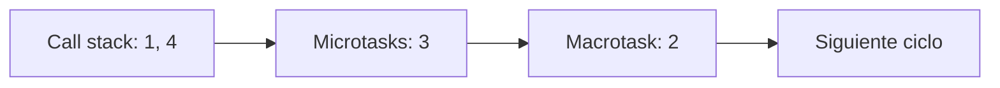
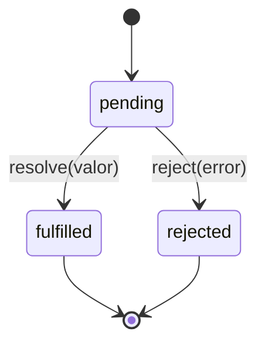
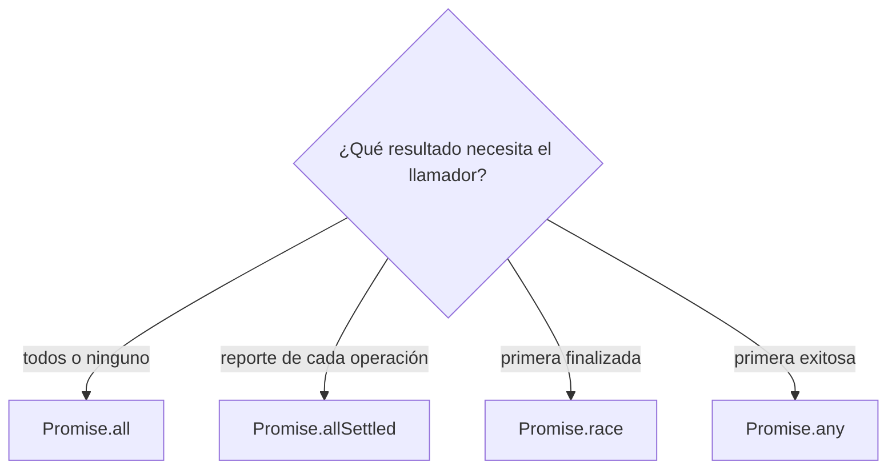
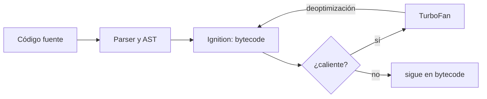
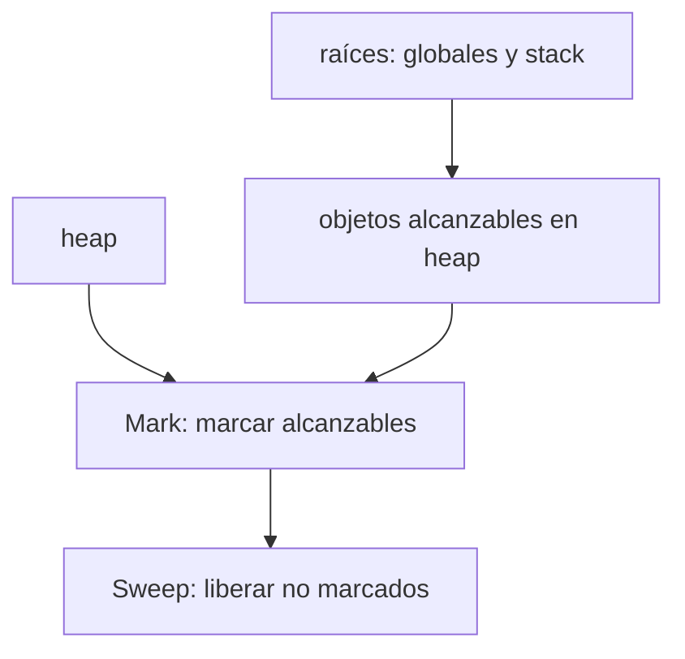

# Módulo 5: Asincronía I — Event Loop y Promesas


## Aprende construyendo


### Tema 1: El Event Loop · Intermedio · 35 min

<details open>
<summary><strong>Capa 1 — Lectura</strong></summary>

#### ► DE QUÉ TRATA
Al finalizar podrás predecir el orden entre código síncrono, microtareas y tareas, y reconocer cuándo una operación bloquea el hilo.

#### ► LA IDEA EN UNA FRASE
**Al finalizar podrás predecir el orden entre código síncrono, microtareas y tareas, y reconocer cuándo una operación bloquea el hilo.**

#### ► POR QUÉ EXISTE ESTO
Resuelve un problema real de diseño o implementación y evita decisiones a ciegas.

#### ► LA ANALOGÍA
Piensa en el event loop como una herramienta de taller: útil cuando conoces su propósito y sus límites.
**Dónde se rompe la analogía:** en software, los efectos dependen del contexto, la escala y los trade-offs.

#### ► CÓMO FUNCIONA


#### ► LO QUE PUEDE SALIR MAL
| Síntoma | Causa probable | Arreglo |
|---|---|---|
| El Event Loop se aplica pero el resultado no mejora | Se usó sin medir el problema real | Mide antes y compara contra la alternativa simple |
| Aparece complejidad inesperada | Se adoptó la técnica sin comprender sus trade-offs | Vuelve a la sección de trade-offs y reduce el alcance |
| Falla en un caso límite | Se asumió un contexto que no se cumple | Prueba el caso límite y documenta cuándo NO usarlo |

#### ► TRADE-OFFS
| Opción | Cuándo usarla | Cuándo NO usarla |
|---|---|---|
| Usar El Event Loop | Cuando el problema coincide con su propósito y el beneficio es observable | Cuando agrega complejidad sin resolver un problema real |
| Alternativa más simple | Cuando el contexto es pequeño, estable o fácil de razonar | Cuando ya demostró no escalar o no cumplir el requisito |
| Postergar la decisión | Cuando falta evidencia del problema | Cuando el costo de esperar es mayor que el costo de probar |

#### ► CUÁNDO NO USAR ESTO
No uses el event loop por defecto. Aplícalo cuando el problema lo justifique y puedas verificar el beneficio; si una alternativa más simple resuelve igual, prefiérela.

#### ► DE VUELTA A LA ANALOGÍA
Volviendo a la analogía: el event loop funciona como el modelo inicial, pero recuerda dónde se rompe: en producción importan la evidencia, la escala y el costo de equivocarte.

#### ► LO QUE DEBES RECORDAR
- El Event Loop existe para resolver un problema específico.
- Mide antes de adoptar complejidad.
- Conoce el caso donde NO usarlo.
- Verifica con evidencia observable.

#### ► PREGUNTAS PARA PENSAR
1. ¿Qué problema concreto resuelve el event loop en tu contexto?
2. ¿Cómo sabrías que el event loop no está funcionando bien?
3. ¿Qué alternativa más simple considerarías antes de usar el event loop?

</details>

<details>
<summary><strong>Capa 2 — Construcción</strong></summary>

#### Código y verificación


```anatomy
event-loop-dispatcher
```

```bash
mkdir ejemplo-event-loop
cd ejemplo-event-loop
npm init -y
mkdir src
```

```javascript
console.log('A: código síncrono');
setTimeout(() => console.log('B: tarea del temporizador'), 0);
Promise.resolve().then(() => console.log('C: microtarea'));
console.log('D: fin síncrono');
```

```bash
node src/event-loop.js
```

</details>

### Tema 2: Promesas · Intermedio · 45 min

<details open>
<summary><strong>Capa 1 — Lectura</strong></summary>

#### ► DE QUÉ TRATA
Al finalizar podrás crear y encadenar una promesa con caminos de éxito, rechazo y limpieza, sin ejecutar dos resultados lógicos.

#### ► LA IDEA EN UNA FRASE
**Al finalizar podrás crear y encadenar una promesa con caminos de éxito, rechazo y limpieza, sin ejecutar dos resultados lógicos.**

#### ► POR QUÉ EXISTE ESTO
Resuelve un problema real de diseño o implementación y evita decisiones a ciegas.

#### ► LA ANALOGÍA
**Conceptos clave:** estados de una promesa (pending/fulfilled/rejected), `new Promise`, `.then`/`.catch`.

Una Promesa representa un valor que estará disponible en algún momento futuro, encapsulando el resultado (aún desconocido) de una operación asíncrona en uno de tres estados posibles: `pending` (pendiente, el resultado aún no está disponible), `fulfilled` (cumplida, la operación tuvo éxito y hay un valor resultante disponible), o `rejected` (rechazada, la operación falló y hay una razón de error disponible). Una vez que una Promesa transiciona de `pending` a `fulfilled` o `rejected`, su estado queda fijo permanentemente; no puede volver a `pending` ni cambiar de un estado resuelto a otro, una garantía fundamental que hace el comportamiento de las Promesas predecible y componible.

Crear una Promesa manualmente con `new Promise((resolve, reject) => {...})` es útil principalmente para envolver APIs basadas en callbacks (el patrón anterior a las Promesas, dominante en el Node.js clásico) en una interfaz basada en Promesas: la función ejecutora recibe dos funciones, `resolve` y `reject`, y se invoca inmediata y síncronamente al crear la Promesa; invocar `resolve(valor)` dentro de esa función transiciona la Promesa a `fulfilled` con ese valor, mientras que invocar `reject(razon)` la transiciona a `rejected`. Este patrón de "promisificar" una API de callbacks es exactamente el mecanismo detrás de utilidades como `util.promisify` en Node.js.

Un problema relacionado aparece cuando una función puede fallar de forma síncrona (lanzando una excepción) o asíncrona (devolviendo una Promesa rechazada): llamarla directamente (`funcion().catch(...)` o `Promise.resolve(funcion())`) no captura el lanzamiento síncrono, que escapa antes de llegar al `.catch`. Desde ECMAScript 2025, `Promise.try(funcion, ...args)` ejecuta la función inmediatamente y normaliza los tres casos —valor síncrono, excepción síncrona o Promesa— en una única Promesa:

```javascript
function buscarGuiaSincronaOAsincrona(codigo) {
  if (!codigo.startsWith('RF-')) throw new Error('código inválido'); // lanzamiento síncrono
  return buscarGuia(codigo); // puede devolver una Promesa
}

Promise.try(buscarGuiaSincronaOAsincrona, '101')
  .catch(error => console.error(error.message)); // captura también el throw síncrono
```

**Versión mínima:** `Promise.try` existe desde Node.js 23 (en la práctica, Node.js 24 LTS). En Node.js 22 obtienes `TypeError: Promise.try is not a function`; allí usa el equivalente `new Promise(resolve => resolve(buscarGuiaSincronaOAsincrona('101')))`, cuyo ejecutor también convierte el `throw` síncrono en rechazo.

`.then(callbackExito, callbackError)` registra callbacks que se ejecutarán cuando la Promesa se resuelva (en cualquiera de sus dos estados finales); `.catch(callbackError)` es azúcar sintáctica equivalente a `.then(undefined, callbackError)`, específicamente para manejar el caso de rechazo sin necesitar también manejar el éxito en la misma llamada. Encadenar múltiples `.then()` es posible porque cada `.then()` devuelve, a su vez, una nueva Promesa, que se resuelve con el valor que devuelve el callback (o se encadena automáticamente si el callback a su vez devuelve otra Promesa), permitiendo componer secuencias de operaciones asíncronas dependientes de forma lineal y legible.

Es importante distinguir claramente entre el momento en que se crea una Promesa (que ejecuta su función ejecutora de forma síncrona e inmediata) y el momento en que se resuelve (que puede ocurrir de forma asíncrona, mucho después, cuando la operación subyacente finalmente completa); esta distinción es la raíz de por qué las callbacks registradas con `.then()` siempre se ejecutan como microtasks, incluso si la Promesa ya estaba resuelta en el momento exacto de registrar el callback, nunca de forma síncrona e inmediata en esa misma línea de código.

**Analogía:** una Promesa es como un recibo que te entrega una tintorería al dejar ropa para lavar: el recibo (la Promesa) existe inmediatamente, en estado "pendiente", y representa el compromiso de que en algún momento futuro la ropa (el valor) estará lista (`fulfilled`) o habrá un problema que impidió completarla (`rejected`); el estado final del recibo, una vez determinado, no vuelve a cambiar.

**Diagrama:**



**Dónde se rompe la analogía:** el modelo simplifica la realidad; en producción influyen escala, fallos, costo y contexto.

#### ► CÓMO FUNCIONA


#### ► LO QUE PUEDE SALIR MAL
| Síntoma | Causa probable | Arreglo |
|---|---|---|
| Promesas se aplica pero el resultado no mejora | Se usó sin medir el problema real | Mide antes y compara contra la alternativa simple |
| Aparece complejidad inesperada | Se adoptó la técnica sin comprender sus trade-offs | Vuelve a la sección de trade-offs y reduce el alcance |
| Falla en un caso límite | Se asumió un contexto que no se cumple | Prueba el caso límite y documenta cuándo NO usarlo |

#### ► TRADE-OFFS
| Opción | Cuándo usarla | Cuándo NO usarla |
|---|---|---|
| Usar Promesas | Cuando el problema coincide con su propósito y el beneficio es observable | Cuando agrega complejidad sin resolver un problema real |
| Alternativa más simple | Cuando el contexto es pequeño, estable o fácil de razonar | Cuando ya demostró no escalar o no cumplir el requisito |
| Postergar la decisión | Cuando falta evidencia del problema | Cuando el costo de esperar es mayor que el costo de probar |

#### ► CUÁNDO NO USAR ESTO
No uses promesas por defecto. Aplícalo cuando el problema lo justifique y puedas verificar el beneficio; si una alternativa más simple resuelve igual, prefiérela.

#### ► DE VUELTA A LA ANALOGÍA
Volviendo a la analogía: promesas funciona como el modelo inicial, pero recuerda dónde se rompe: en producción importan la evidencia, la escala y el costo de equivocarte.

#### ► LO QUE DEBES RECORDAR
- Promesas existe para resolver un problema específico.
- Mide antes de adoptar complejidad.
- Conoce el caso donde NO usarlo.
- Verifica con evidencia observable.

#### ► PREGUNTAS PARA PENSAR
1. ¿Qué problema concreto resuelve promesas en tu contexto?
2. ¿Cómo sabrías que promesas no está funcionando bien?
3. ¿Qué alternativa más simple considerarías antes de usar promesas?

</details>

<details>
<summary><strong>Capa 2 — Construcción</strong></summary>

#### Código y verificación
```javascript
function buscarGuiaSincronaOAsincrona(codigo) {
  if (!codigo.startsWith('RF-')) throw new Error('código inválido'); // lanzamiento síncrono
  return buscarGuia(codigo); // puede devolver una Promesa
}

Promise.try(buscarGuiaSincronaOAsincrona, '101')
  .catch(error => console.error(error.message)); // captura también el throw síncrono
```


```bash
mkdir ejemplo-promesa
cd ejemplo-promesa
npm init -y
mkdir src
```

```javascript
function buscarGuia(codigo) {
  return new Promise((resolve, reject) => {
    if (!codigo.startsWith('RF-')) return reject(new Error('código inválido'));
    resolve({ codigo, estado: 'EN_RUTA' });
  });
}

buscarGuia('RF-101')
  .then(guia => console.log(guia.estado))
  .catch(error => console.error(error.message))
  .finally(() => console.log('consulta terminada'));
```

```bash
node src/promesa.js
```

</details>

### Tema 3: Promise.all, allSettled, race y any · Avanzado · 40 min

<details open>
<summary><strong>Capa 1 — Lectura</strong></summary>

#### ► DE QUÉ TRATA
Al finalizar podrás seleccionar el combinador según la política de fallos y construir resultados parciales, timeout y primera respuesta exitosa.

#### ► LA IDEA EN UNA FRASE
**Al finalizar podrás seleccionar el combinador según la política de fallos y construir resultados parciales, timeout y primera respuesta exitosa.**

#### ► POR QUÉ EXISTE ESTO
Resuelve un problema real de diseño o implementación y evita decisiones a ciegas.

#### ► LA ANALOGÍA
Piensa en promise.all, allsettled, race y any como una herramienta de taller: útil cuando conoces su propósito y sus límites.
**Dónde se rompe la analogía:** en software, los efectos dependen del contexto, la escala y los trade-offs.

#### ► CÓMO FUNCIONA


#### ► LO QUE PUEDE SALIR MAL
| Síntoma | Causa probable | Arreglo |
|---|---|---|
| Promise.all, allSettled, race y any se aplica pero el resultado no mejora | Se usó sin medir el problema real | Mide antes y compara contra la alternativa simple |
| Aparece complejidad inesperada | Se adoptó la técnica sin comprender sus trade-offs | Vuelve a la sección de trade-offs y reduce el alcance |
| Falla en un caso límite | Se asumió un contexto que no se cumple | Prueba el caso límite y documenta cuándo NO usarlo |

#### ► TRADE-OFFS
| Opción | Cuándo usarla | Cuándo NO usarla |
|---|---|---|
| Usar Promise.all, allSettled, race y any | Cuando el problema coincide con su propósito y el beneficio es observable | Cuando agrega complejidad sin resolver un problema real |
| Alternativa más simple | Cuando el contexto es pequeño, estable o fácil de razonar | Cuando ya demostró no escalar o no cumplir el requisito |
| Postergar la decisión | Cuando falta evidencia del problema | Cuando el costo de esperar es mayor que el costo de probar |

#### ► CUÁNDO NO USAR ESTO
No uses promise.all, allsettled, race y any por defecto. Aplícalo cuando el problema lo justifique y puedas verificar el beneficio; si una alternativa más simple resuelve igual, prefiérela.

#### ► DE VUELTA A LA ANALOGÍA
Volviendo a la analogía: promise.all, allsettled, race y any funciona como el modelo inicial, pero recuerda dónde se rompe: en producción importan la evidencia, la escala y el costo de equivocarte.

#### ► LO QUE DEBES RECORDAR
- Promise.all, allSettled, race y any existe para resolver un problema específico.
- Mide antes de adoptar complejidad.
- Conoce el caso donde NO usarlo.
- Verifica con evidencia observable.

#### ► PREGUNTAS PARA PENSAR
1. ¿Qué problema concreto resuelve promise.all, allsettled, race y any en tu contexto?
2. ¿Cómo sabrías que promise.all, allsettled, race y any no está funcionando bien?
3. ¿Qué alternativa más simple considerarías antes de usar promise.all, allsettled, race y any?

</details>

<details>
<summary><strong>Capa 2 — Construcción</strong></summary>

#### Código y verificación


```bash
mkdir ejemplo-combinadores
cd ejemplo-combinadores
npm init -y
mkdir src
```

```javascript
const ok = Promise.resolve('ubicación');
const falla = Promise.reject(new Error('foto no disponible'));

const resultados = await Promise.allSettled([ok, falla]);
console.log(resultados.map(resultado => resultado.status));

try {
  await Promise.all([ok, falla]);
} catch (error) {
  console.log('all rechazó:', error.message);
}
```

```bash
node src/combinadores.js
```

</details>

### Tema 4: El motor V8 — JIT y AST · Avanzado · 45 min

<details open>
<summary><strong>Capa 1 — Lectura</strong></summary>

#### ► DE QUÉ TRATA
Al finalizar podrás reconocer las etapas fuente→AST→bytecode→optimización y obtener evidencia sin asumir que una función fue optimizada.

#### ► LA IDEA EN UNA FRASE
**Al finalizar podrás reconocer las etapas fuente→AST→bytecode→optimización y obtener evidencia sin asumir que una función fue optimizada.**

#### ► POR QUÉ EXISTE ESTO
Resuelve un problema real de diseño o implementación y evita decisiones a ciegas.

#### ► LA ANALOGÍA
Piensa en el motor v8 — jit y ast como una herramienta de taller: útil cuando conoces su propósito y sus límites.
**Dónde se rompe la analogía:** en software, los efectos dependen del contexto, la escala y los trade-offs.

#### ► CÓMO FUNCIONA


#### ► LO QUE PUEDE SALIR MAL
| Síntoma | Causa probable | Arreglo |
|---|---|---|
| El motor V8 — JIT y AST se aplica pero el resultado no mejora | Se usó sin medir el problema real | Mide antes y compara contra la alternativa simple |
| Aparece complejidad inesperada | Se adoptó la técnica sin comprender sus trade-offs | Vuelve a la sección de trade-offs y reduce el alcance |
| Falla en un caso límite | Se asumió un contexto que no se cumple | Prueba el caso límite y documenta cuándo NO usarlo |

#### ► TRADE-OFFS
| Opción | Cuándo usarla | Cuándo NO usarla |
|---|---|---|
| Usar El motor V8 — JIT y AST | Cuando el problema coincide con su propósito y el beneficio es observable | Cuando agrega complejidad sin resolver un problema real |
| Alternativa más simple | Cuando el contexto es pequeño, estable o fácil de razonar | Cuando ya demostró no escalar o no cumplir el requisito |
| Postergar la decisión | Cuando falta evidencia del problema | Cuando el costo de esperar es mayor que el costo de probar |

#### ► CUÁNDO NO USAR ESTO
No uses el motor v8 — jit y ast por defecto. Aplícalo cuando el problema lo justifique y puedas verificar el beneficio; si una alternativa más simple resuelve igual, prefiérela.

#### ► DE VUELTA A LA ANALOGÍA
Volviendo a la analogía: el motor v8 — jit y ast funciona como el modelo inicial, pero recuerda dónde se rompe: en producción importan la evidencia, la escala y el costo de equivocarte.

#### ► LO QUE DEBES RECORDAR
- El motor V8 — JIT y AST existe para resolver un problema específico.
- Mide antes de adoptar complejidad.
- Conoce el caso donde NO usarlo.
- Verifica con evidencia observable.

#### ► PREGUNTAS PARA PENSAR
1. ¿Qué problema concreto resuelve el motor v8 — jit y ast en tu contexto?
2. ¿Cómo sabrías que el motor v8 — jit y ast no está funcionando bien?
3. ¿Qué alternativa más simple considerarías antes de usar el motor v8 — jit y ast?

</details>

<details>
<summary><strong>Capa 2 — Construcción</strong></summary>

#### Código y verificación


```bash
mkdir ejemplo-ast
cd ejemplo-ast
npm init -y
npm install acorn
mkdir src
```

```javascript
// src/regla.js
export const tarifa = peso => peso * 2500;
```

```javascript
// src/ast.mjs
import { readFile } from 'node:fs/promises';
import { parse } from 'acorn';

const codigo = await readFile('src/regla.js', 'utf8');
const ast = parse(codigo, { ecmaVersion: 'latest', sourceType: 'module' });
console.log(ast.type, ast.body[0].type);
```

```bash
node src/ast.mjs
```

</details>

### Tema 5: Stack, Heap y Garbage Collection · Avanzado · 45 min

<details open>
<summary><strong>Capa 1 — Lectura</strong></summary>

#### ► DE QUÉ TRATA
Al finalizar podrás identificar referencias que retienen objetos, implementar una caché limitada y medir memoria sin asumir cuándo se ejecutará el GC.

#### ► LA IDEA EN UNA FRASE
**Al finalizar podrás identificar referencias que retienen objetos, implementar una caché limitada y medir memoria sin asumir cuándo se ejecutará el GC.**

#### ► POR QUÉ EXISTE ESTO
Resuelve un problema real de diseño o implementación y evita decisiones a ciegas.

#### ► LA ANALOGÍA
Piensa en stack, heap y garbage collection como una herramienta de taller: útil cuando conoces su propósito y sus límites.
**Dónde se rompe la analogía:** en software, los efectos dependen del contexto, la escala y los trade-offs.

#### ► CÓMO FUNCIONA


#### ► LO QUE PUEDE SALIR MAL
| Síntoma | Causa probable | Arreglo |
|---|---|---|
| Stack, Heap y Garbage Collection se aplica pero el resultado no mejora | Se usó sin medir el problema real | Mide antes y compara contra la alternativa simple |
| Aparece complejidad inesperada | Se adoptó la técnica sin comprender sus trade-offs | Vuelve a la sección de trade-offs y reduce el alcance |
| Falla en un caso límite | Se asumió un contexto que no se cumple | Prueba el caso límite y documenta cuándo NO usarlo |

#### ► TRADE-OFFS
| Opción | Cuándo usarla | Cuándo NO usarla |
|---|---|---|
| Usar Stack, Heap y Garbage Collection | Cuando el problema coincide con su propósito y el beneficio es observable | Cuando agrega complejidad sin resolver un problema real |
| Alternativa más simple | Cuando el contexto es pequeño, estable o fácil de razonar | Cuando ya demostró no escalar o no cumplir el requisito |
| Postergar la decisión | Cuando falta evidencia del problema | Cuando el costo de esperar es mayor que el costo de probar |

#### ► CUÁNDO NO USAR ESTO
No uses stack, heap y garbage collection por defecto. Aplícalo cuando el problema lo justifique y puedas verificar el beneficio; si una alternativa más simple resuelve igual, prefiérela.

#### ► DE VUELTA A LA ANALOGÍA
Volviendo a la analogía: stack, heap y garbage collection funciona como el modelo inicial, pero recuerda dónde se rompe: en producción importan la evidencia, la escala y el costo de equivocarte.

#### ► LO QUE DEBES RECORDAR
- Stack, Heap y Garbage Collection existe para resolver un problema específico.
- Mide antes de adoptar complejidad.
- Conoce el caso donde NO usarlo.
- Verifica con evidencia observable.

#### ► PREGUNTAS PARA PENSAR
1. ¿Qué problema concreto resuelve stack, heap y garbage collection en tu contexto?
2. ¿Cómo sabrías que stack, heap y garbage collection no está funcionando bien?
3. ¿Qué alternativa más simple considerarías antes de usar stack, heap y garbage collection?

</details>

<details>
<summary><strong>Capa 2 — Construcción</strong></summary>

#### Código y verificación


```bash
mkdir ejemplo-memoria-js
cd ejemplo-memoria-js
npm init -y
mkdir src
```

```javascript
const original = { estado: 'CREADA' };
const alias = original;
alias.estado = 'EN_RUTA';
console.log(original.estado, original === alias);

function desbordar() {
  return desbordar();
}

try {
  desbordar();
} catch (error) {
  console.log(error.name);
}
```

```bash
node src/memoria.js
```

</details>
