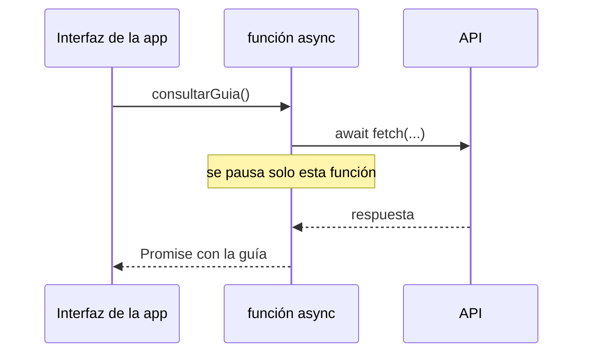
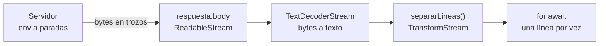

# Módulo 6: Asincronía II — async/await y fetch


## Aprende construyendo


### Tema 1: async/await sobre promesas · Intermedio · 45 min

<details open>
<summary><strong>Capa 1 — Lectura</strong></summary>

#### ► DE QUÉ TRATA
Al finalizar podrás escribir flujos asíncronos legibles, distinguir dependencia de concurrencia y demostrar que await pausa una función, no el hilo.

#### ► CÓMO FUNCIONA


</details>

<details>
<summary><strong>Capa 2 — Construcción</strong></summary>

#### Código y verificación

```bash
mkdir ejemplo-async-await
cd ejemplo-async-await
npm init -y
mkdir src
```

```javascript
const esperar = (ms, valor) => new Promise(resolve => setTimeout(() => resolve(valor), ms));

async function consultarSecuencial() {
  const guia = await esperar(50, 'RF-101');
  const ruta = await esperar(50, `ruta-${guia}`);
  return ruta;
}

async function consultarEnParalelo() {
  return Promise.all([esperar(50, 'RF-101'), esperar(50, 'RF-102')]);
}

console.time('secuencial');
console.log(await consultarSecuencial());
console.timeEnd('secuencial');
console.time('paralelo');
console.log(await consultarEnParalelo());
console.timeEnd('paralelo');
```

```bash
node src/consultas.js
```

</details>

### Tema 2: try/catch en flujos asíncronos · Intermedio · 40 min

<details open>
<summary><strong>Capa 1 — Lectura</strong></summary>

#### ► DE QUÉ TRATA
Al finalizar podrás convertir fallos de red, HTTP y datos en errores diferenciados, limpiar siempre el estado visual y conservar la causa técnica.

</details>

<details>
<summary><strong>Capa 2 — Construcción</strong></summary>

#### Código y verificación
```javascript
function normalizarRechazo(valor) {
  if (!Error.isError(valor)) {
    return new TypeError('Se recibió un valor que no es Error', { cause: valor });
  }
  return valor;
}
```

```bash
mkdir ejemplo-errores-async
cd ejemplo-errores-async
npm init -y
mkdir src
```

```js
async function obtenerUsuarios() {
  try {
    const r = await fetch(url);
    if (!r.ok) throw new Error(`HTTP ${r.status}`); // fetch NO rechaza por 404/500 solo
    return await r.json();
  } catch (error) {
    console.error("Fallo:", error.message);
    return []; // valor por defecto controlado
  } finally {
    ocultarIndicadorDeCarga(); // se ejecuta siempre, éxito o error
  }
}
```

```bash
node src/errores-asincronos.js
```

</details>

### Tema 3: fetch API y AbortController · Intermedio · 35 min

<details open>
<summary><strong>Capa 1 — Lectura</strong></summary>

#### ► DE QUÉ TRATA
Al finalizar podrás cancelar una petición obsoleta, distinguir cancelación intencional de error y evitar que una respuesta antigua sobrescriba la más reciente.

</details>

<details>
<summary><strong>Capa 2 — Construcción</strong></summary>

#### Código y verificación
```bash
mkdir ejemplo-fetch-abort
cd ejemplo-fetch-abort
npm init -y
mkdir src
```

```js
const controlador = new AbortController();
fetch(url, { signal: controlador.signal })
  .catch(error => {
    if (error.name === "AbortError") console.log("petición cancelada");
  });
// en una interacción posterior del usuario (nueva búsqueda):
controlador.abort(); // cancela la petición anterior en curso
```

```bash
node src/busqueda-cancelable.js
```

</details>

### Tema 4: Reintentos y timeouts manuales · Avanzado · 40 min

<details open>
<summary><strong>Capa 1 — Lectura</strong></summary>

#### ► DE QUÉ TRATA
Al finalizar podrás aplicar timeout por intento, backoff exponencial con jitter y una política limitada de reintentos para operaciones idempotentes.

</details>

<details>
<summary><strong>Capa 2 — Construcción</strong></summary>

#### Código y verificación
```bash
mkdir ejemplo-reintentos
cd ejemplo-reintentos
npm init -y
mkdir src
```

```js
async function fetchConReintentos(url, intentos = 3) {
  for (let i = 0; i < intentos; i++) {
    try {
      const r = await fetch(url);
      if (r.ok) return await r.json();
    } catch { /* reintenta */ }
    await new Promise(res => setTimeout(res, 300 * (i + 1))); // backoff
  }
  throw new Error("Falló tras varios intentos");
}

function conTimeout(promesa, ms) {
  const timeout = new Promise((_, rej) => setTimeout(() => rej(new Error("timeout")), ms));
  return Promise.race([promesa, timeout]);
}
```

```bash
node src/resiliencia.js
```

</details>

### Tema 5: Generadores — function*, yield y yield* · Avanzado · 45 min

<details open>
<summary><strong>Capa 1 — Lectura</strong></summary>

#### ► DE QUÉ TRATA
Al finalizar podrás construir una secuencia perezosa con function*, detenerla con yield, reanudarla con .next() y componerla con yield*. La aplicarás al proyecto para recorrer entregas por lotes sin crear todas las páginas en memoria.

</details>

<details>
<summary><strong>Capa 2 — Construcción</strong></summary>

#### Código y verificación
```bash
mkdir ejemplo-generadores
cd ejemplo-generadores
npm init -y
mkdir src
```

```js
function* paginarEntregas(entregas, tamano) {
  // La validación protege la condición de avance del ciclo.
  if (!Number.isInteger(tamano) || tamano <= 0) {
    throw new RangeError("tamano debe ser un entero mayor que cero");
  }

  for (let inicio = 0; inicio < entregas.length; inicio += tamano) {
    // yield pausa aquí; la siguiente iteración continúa después de esta línea.
    yield entregas.slice(inicio, inicio + tamano);
  }
}

const entregas = [
  { numero: "RF-101", prioridad: true },
  { numero: "RF-102", prioridad: false },
  { numero: "RF-103", prioridad: false },
];

const paginas = paginarEntregas(entregas, 2);
console.log("Primera solicitud:", paginas.next());
console.log("Segunda solicitud:", paginas.next());
console.log("Fin:", paginas.next());
```

```bash
node src/generadores.js
```

</details>

### Tema 6: Proxies y Reflect · Avanzado · 45 min

<details open>
<summary><strong>Capa 1 — Lectura</strong></summary>

#### ► DE QUÉ TRATA
Al finalizar podrás interceptar lecturas y escrituras con Proxy, conservar la semántica del lenguaje mediante Reflect y decidir cuándo esta metaprogramación es adecuada. Protegerás el estado de una entrega del proyecto sin ocultar las reglas centrales del dominio.

</details>

<details>
<summary><strong>Capa 2 — Construcción</strong></summary>

#### Código y verificación
```bash
mkdir ejemplo-proxy
cd ejemplo-proxy
npm init -y
mkdir src
```

```js
"use strict";

const estadosPermitidos = new Set(["CREADA", "EN_RUTA", "ENTREGADA"]);
const entrega = { numero: "RF-201", estado: "CREADA" };

const entregaAuditada = new Proxy(entrega, {
  set(target, propiedad, valor, receiver) {
    // Esta validación protege datos que llegan desde el borde de la aplicación.
    if (propiedad === "estado" && !estadosPermitidos.has(valor)) {
      throw new TypeError(`Estado no permitido: ${valor}`);
    }

    console.log(`AUDITORÍA ${String(propiedad)}: ${target[propiedad]} -> ${valor}`);
    // Reflect respeta accesores, herencia y el booleano real de la operación.
    return Reflect.set(target, propiedad, valor, receiver);
  },

  get(target, propiedad, receiver) {
    return Reflect.get(target, propiedad, receiver);
  },
});

entregaAuditada.estado = "EN_RUTA";
console.log(`${entregaAuditada.numero}: ${entregaAuditada.estado}`);
```

```bash
node src/proxy.js
```

</details>

### Tema 7: Streams web: leer una respuesta de fetch por partes · Avanzado · 45 min

<details open>
<summary><strong>Capa 1 — Lectura</strong></summary>

#### ► DE QUÉ TRATA
Usa Node.js 22 o superior, que trae fetch y los streams web sin instalar nada. Crea la carpeta academia-labs/javascript/streams-web. El ejemplo levanta su propio servidor local, así que no necesitas internet.

#### ► CÓMO FUNCIONA


</details>

<details>
<summary><strong>Capa 2 — Construcción</strong></summary>

#### Código y verificación


```js
import { createServer } from 'node:http';

// Servidor de prueba: envía una parada cada 50 ms.
const servidor = createServer(async (_req, res) => {
  res.writeHead(200, { 'content-type': 'text/plain; charset=utf-8' });
  for (const parada of ['Bodega', 'Calle 26', 'Cliente']) {
    res.write(`${parada}\n`);
    await new Promise((listo) => setTimeout(listo, 50));
  }
  res.end();
});
await new Promise((listo) => servidor.listen(0, '127.0.0.1', listo));
const { port } = servidor.address();

// Junta trozos y emite líneas completas.
function separarLineas() {
  let resto = '';
  return new TransformStream({
    transform(trozo, control) {
      const lineas = (resto + trozo).split('\n');
      resto = lineas.pop(); // la última puede estar incompleta
      for (const linea of lineas) control.enqueue(linea);
    },
    flush(control) {
      if (resto) control.enqueue(resto);
    },
  });
}

const respuesta = await fetch(`http://127.0.0.1:${port}/paradas`);
const lineas = respuesta.body
  .pipeThrough(new TextDecoderStream())
  .pipeThrough(separarLineas());

for await (const linea of lineas) {
  console.log(`llegó: ${linea}`);
}
servidor.close();
```

```bash
cd academia-labs/javascript/streams-web
node leer-por-partes.mjs
```

```text
llegó: Bodega
llegó: Calle 26
llegó: Cliente
```

</details>

### Comprueba lo construido

<details open>
<summary><strong>Capa 1 — Lectura</strong></summary>

</details>

<details>
<summary><strong>Capa 2 — Construcción</strong></summary>

#### Nota de construcción
Este tema es principalmente conceptual en esta versión. La verificación se realiza con las preguntas de comprensión y el criterio de cuándo NO usar comprueba lo construido.

</details>
