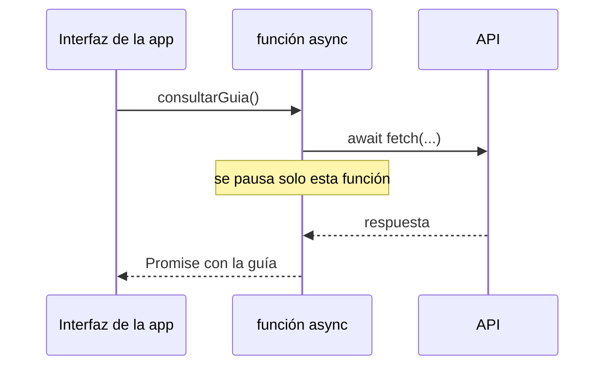
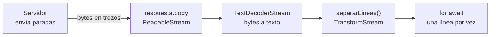

# Módulo 6: Asincronía II — async/await y fetch


## Aprende construyendo


### Tema 1: async/await sobre promesas · Intermedio · 45 min

<details open>
<summary><strong>Capa 1 — Lectura</strong></summary>

#### ► DE QUÉ TRATA
Al finalizar podrás escribir flujos asíncronos legibles, distinguir dependencia de concurrencia y demostrar que await pausa una función, no el hilo.

#### ► LA IDEA EN UNA FRASE
**Al finalizar podrás escribir flujos asíncronos legibles, distinguir dependencia de concurrencia y demostrar que await pausa una función, no el hilo.**

#### ► POR QUÉ EXISTE ESTO
Resuelve un problema real de diseño o implementación y evita decisiones a ciegas.

#### ► LA ANALOGÍA
Piensa en async/await sobre promesas como una herramienta de taller: útil cuando conoces su propósito y sus límites.
**Dónde se rompe la analogía:** en software, los efectos dependen del contexto, la escala y los trade-offs.

#### ► CÓMO FUNCIONA


#### ► LO QUE PUEDE SALIR MAL
| Síntoma | Causa probable | Arreglo |
|---|---|---|
| async/await sobre promesas se aplica pero el resultado no mejora | Se usó sin medir el problema real | Mide antes y compara contra la alternativa simple |
| Aparece complejidad inesperada | Se adoptó la técnica sin comprender sus trade-offs | Vuelve a la sección de trade-offs y reduce el alcance |
| Falla en un caso límite | Se asumió un contexto que no se cumple | Prueba el caso límite y documenta cuándo NO usarlo |

#### ► TRADE-OFFS
| Opción | Cuándo usarla | Cuándo NO usarla |
|---|---|---|
| Usar async/await sobre promesas | Cuando el problema coincide con su propósito y el beneficio es observable | Cuando agrega complejidad sin resolver un problema real |
| Alternativa más simple | Cuando el contexto es pequeño, estable o fácil de razonar | Cuando ya demostró no escalar o no cumplir el requisito |
| Postergar la decisión | Cuando falta evidencia del problema | Cuando el costo de esperar es mayor que el costo de probar |

#### ► CUÁNDO NO USAR ESTO
No uses async/await sobre promesas por defecto. Aplícalo cuando el problema lo justifique y puedas verificar el beneficio; si una alternativa más simple resuelve igual, prefiérela.

#### ► DE VUELTA A LA ANALOGÍA
Volviendo a la analogía: async/await sobre promesas funciona como el modelo inicial, pero recuerda dónde se rompe: en producción importan la evidencia, la escala y el costo de equivocarte.

#### ► LO QUE DEBES RECORDAR
- async/await sobre promesas existe para resolver un problema específico.
- Mide antes de adoptar complejidad.
- Conoce el caso donde NO usarlo.
- Verifica con evidencia observable.

#### ► PREGUNTAS PARA PENSAR
1. ¿Qué problema concreto resuelve async/await sobre promesas en tu contexto?
2. ¿Cómo sabrías que async/await sobre promesas no está funcionando bien?
3. ¿Qué alternativa más simple considerarías antes de usar async/await sobre promesas?

</details>

<details>
<summary><strong>Capa 2 — Construcción</strong></summary>

#### Código y verificación


```bash
mkdir ejemplo-async-await
cd ejemplo-async-await
npm init -y
mkdir src
```

```javascript
const esperar = (ms, valor) => new Promise(resolve => setTimeout(() => resolve(valor), ms));

async function consultarSecuencial() {
  const guia = await esperar(50, 'RF-101');
  const ruta = await esperar(50, `ruta-${guia}`);
  return ruta;
}

async function consultarEnParalelo() {
  return Promise.all([esperar(50, 'RF-101'), esperar(50, 'RF-102')]);
}

console.time('secuencial');
console.log(await consultarSecuencial());
console.timeEnd('secuencial');
console.time('paralelo');
console.log(await consultarEnParalelo());
console.timeEnd('paralelo');
```

```bash
node src/consultas.js
```

</details>

### Tema 2: try/catch en flujos asíncronos · Intermedio · 40 min

<details open>
<summary><strong>Capa 1 — Lectura</strong></summary>

#### ► DE QUÉ TRATA
Al finalizar podrás convertir fallos de red, HTTP y datos en errores diferenciados, limpiar siempre el estado visual y conservar la causa técnica.

#### ► LA IDEA EN UNA FRASE
**Al finalizar podrás convertir fallos de red, HTTP y datos en errores diferenciados, limpiar siempre el estado visual y conservar la causa técnica.**

#### ► POR QUÉ EXISTE ESTO
Resuelve un problema real de diseño o implementación y evita decisiones a ciegas.

#### ► LA ANALOGÍA
Piensa en try/catch en flujos asíncronos como una herramienta de taller: útil cuando conoces su propósito y sus límites.
**Dónde se rompe la analogía:** en software, los efectos dependen del contexto, la escala y los trade-offs.

#### ► CÓMO FUNCIONA
1. Identifica el problema que try/catch en flujos asíncronos resuelve.
2. Observa sus componentes y relaciones.
3. Aplica la opción más simple que funcione.
4. Verifica el resultado y los límites.

#### ► LO QUE PUEDE SALIR MAL
| Síntoma | Causa probable | Arreglo |
|---|---|---|
| try/catch en flujos asíncronos se aplica pero el resultado no mejora | Se usó sin medir el problema real | Mide antes y compara contra la alternativa simple |
| Aparece complejidad inesperada | Se adoptó la técnica sin comprender sus trade-offs | Vuelve a la sección de trade-offs y reduce el alcance |
| Falla en un caso límite | Se asumió un contexto que no se cumple | Prueba el caso límite y documenta cuándo NO usarlo |

#### ► TRADE-OFFS
| Opción | Cuándo usarla | Cuándo NO usarla |
|---|---|---|
| Usar try/catch en flujos asíncronos | Cuando el problema coincide con su propósito y el beneficio es observable | Cuando agrega complejidad sin resolver un problema real |
| Alternativa más simple | Cuando el contexto es pequeño, estable o fácil de razonar | Cuando ya demostró no escalar o no cumplir el requisito |
| Postergar la decisión | Cuando falta evidencia del problema | Cuando el costo de esperar es mayor que el costo de probar |

#### ► CUÁNDO NO USAR ESTO
No uses try/catch en flujos asíncronos por defecto. Aplícalo cuando el problema lo justifique y puedas verificar el beneficio; si una alternativa más simple resuelve igual, prefiérela.

#### ► DE VUELTA A LA ANALOGÍA
Volviendo a la analogía: try/catch en flujos asíncronos funciona como el modelo inicial, pero recuerda dónde se rompe: en producción importan la evidencia, la escala y el costo de equivocarte.

#### ► LO QUE DEBES RECORDAR
- try/catch en flujos asíncronos existe para resolver un problema específico.
- Mide antes de adoptar complejidad.
- Conoce el caso donde NO usarlo.
- Verifica con evidencia observable.

#### ► PREGUNTAS PARA PENSAR
1. ¿Qué problema concreto resuelve try/catch en flujos asíncronos en tu contexto?
2. ¿Cómo sabrías que try/catch en flujos asíncronos no está funcionando bien?
3. ¿Qué alternativa más simple considerarías antes de usar try/catch en flujos asíncronos?

</details>

<details>
<summary><strong>Capa 2 — Construcción</strong></summary>

#### Código y verificación
```javascript
function normalizarRechazo(valor) {
  if (!Error.isError(valor)) {
    return new TypeError('Se recibió un valor que no es Error', { cause: valor });
  }
  return valor;
}
```

```bash
mkdir ejemplo-errores-async
cd ejemplo-errores-async
npm init -y
mkdir src
```

```js
async function obtenerUsuarios() {
  try {
    const r = await fetch(url);
    if (!r.ok) throw new Error(`HTTP ${r.status}`); // fetch NO rechaza por 404/500 solo
    return await r.json();
  } catch (error) {
    console.error("Fallo:", error.message);
    return []; // valor por defecto controlado
  } finally {
    ocultarIndicadorDeCarga(); // se ejecuta siempre, éxito o error
  }
}
```

```bash
node src/errores-asincronos.js
```

</details>

### Tema 3: fetch API y AbortController · Intermedio · 35 min

<details open>
<summary><strong>Capa 1 — Lectura</strong></summary>

#### ► DE QUÉ TRATA
Al finalizar podrás cancelar una petición obsoleta, distinguir cancelación intencional de error y evitar que una respuesta antigua sobrescriba la más reciente.

#### ► LA IDEA EN UNA FRASE
**Al finalizar podrás cancelar una petición obsoleta, distinguir cancelación intencional de error y evitar que una respuesta antigua sobrescriba la más reciente.**

#### ► POR QUÉ EXISTE ESTO
Resuelve un problema real de diseño o implementación y evita decisiones a ciegas.

#### ► LA ANALOGÍA
Piensa en fetch api y abortcontroller como una herramienta de taller: útil cuando conoces su propósito y sus límites.
**Dónde se rompe la analogía:** en software, los efectos dependen del contexto, la escala y los trade-offs.

#### ► CÓMO FUNCIONA
1. Identifica el problema que fetch api y abortcontroller resuelve.
2. Observa sus componentes y relaciones.
3. Aplica la opción más simple que funcione.
4. Verifica el resultado y los límites.

#### ► LO QUE PUEDE SALIR MAL
| Síntoma | Causa probable | Arreglo |
|---|---|---|
| fetch API y AbortController se aplica pero el resultado no mejora | Se usó sin medir el problema real | Mide antes y compara contra la alternativa simple |
| Aparece complejidad inesperada | Se adoptó la técnica sin comprender sus trade-offs | Vuelve a la sección de trade-offs y reduce el alcance |
| Falla en un caso límite | Se asumió un contexto que no se cumple | Prueba el caso límite y documenta cuándo NO usarlo |

#### ► TRADE-OFFS
| Opción | Cuándo usarla | Cuándo NO usarla |
|---|---|---|
| Usar fetch API y AbortController | Cuando el problema coincide con su propósito y el beneficio es observable | Cuando agrega complejidad sin resolver un problema real |
| Alternativa más simple | Cuando el contexto es pequeño, estable o fácil de razonar | Cuando ya demostró no escalar o no cumplir el requisito |
| Postergar la decisión | Cuando falta evidencia del problema | Cuando el costo de esperar es mayor que el costo de probar |

#### ► CUÁNDO NO USAR ESTO
No uses fetch api y abortcontroller por defecto. Aplícalo cuando el problema lo justifique y puedas verificar el beneficio; si una alternativa más simple resuelve igual, prefiérela.

#### ► DE VUELTA A LA ANALOGÍA
Volviendo a la analogía: fetch api y abortcontroller funciona como el modelo inicial, pero recuerda dónde se rompe: en producción importan la evidencia, la escala y el costo de equivocarte.

#### ► LO QUE DEBES RECORDAR
- fetch API y AbortController existe para resolver un problema específico.
- Mide antes de adoptar complejidad.
- Conoce el caso donde NO usarlo.
- Verifica con evidencia observable.

#### ► PREGUNTAS PARA PENSAR
1. ¿Qué problema concreto resuelve fetch api y abortcontroller en tu contexto?
2. ¿Cómo sabrías que fetch api y abortcontroller no está funcionando bien?
3. ¿Qué alternativa más simple considerarías antes de usar fetch api y abortcontroller?

</details>

<details>
<summary><strong>Capa 2 — Construcción</strong></summary>

#### Código y verificación
```bash
mkdir ejemplo-fetch-abort
cd ejemplo-fetch-abort
npm init -y
mkdir src
```

```js
const controlador = new AbortController();
fetch(url, { signal: controlador.signal })
  .catch(error => {
    if (error.name === "AbortError") console.log("petición cancelada");
  });
// en una interacción posterior del usuario (nueva búsqueda):
controlador.abort(); // cancela la petición anterior en curso
```

```bash
node src/busqueda-cancelable.js
```

</details>

### Tema 4: Reintentos y timeouts manuales · Avanzado · 40 min

<details open>
<summary><strong>Capa 1 — Lectura</strong></summary>

#### ► DE QUÉ TRATA
Al finalizar podrás aplicar timeout por intento, backoff exponencial con jitter y una política limitada de reintentos para operaciones idempotentes.

#### ► LA IDEA EN UNA FRASE
**Al finalizar podrás aplicar timeout por intento, backoff exponencial con jitter y una política limitada de reintentos para operaciones idempotentes.**

#### ► POR QUÉ EXISTE ESTO
Resuelve un problema real de diseño o implementación y evita decisiones a ciegas.

#### ► LA ANALOGÍA
Piensa en reintentos y timeouts manuales como una herramienta de taller: útil cuando conoces su propósito y sus límites.
**Dónde se rompe la analogía:** en software, los efectos dependen del contexto, la escala y los trade-offs.

#### ► CÓMO FUNCIONA
1. Identifica el problema que reintentos y timeouts manuales resuelve.
2. Observa sus componentes y relaciones.
3. Aplica la opción más simple que funcione.
4. Verifica el resultado y los límites.

#### ► LO QUE PUEDE SALIR MAL
| Síntoma | Causa probable | Arreglo |
|---|---|---|
| Reintentos y timeouts manuales se aplica pero el resultado no mejora | Se usó sin medir el problema real | Mide antes y compara contra la alternativa simple |
| Aparece complejidad inesperada | Se adoptó la técnica sin comprender sus trade-offs | Vuelve a la sección de trade-offs y reduce el alcance |
| Falla en un caso límite | Se asumió un contexto que no se cumple | Prueba el caso límite y documenta cuándo NO usarlo |

#### ► TRADE-OFFS
| Opción | Cuándo usarla | Cuándo NO usarla |
|---|---|---|
| Usar Reintentos y timeouts manuales | Cuando el problema coincide con su propósito y el beneficio es observable | Cuando agrega complejidad sin resolver un problema real |
| Alternativa más simple | Cuando el contexto es pequeño, estable o fácil de razonar | Cuando ya demostró no escalar o no cumplir el requisito |
| Postergar la decisión | Cuando falta evidencia del problema | Cuando el costo de esperar es mayor que el costo de probar |

#### ► CUÁNDO NO USAR ESTO
No uses reintentos y timeouts manuales por defecto. Aplícalo cuando el problema lo justifique y puedas verificar el beneficio; si una alternativa más simple resuelve igual, prefiérela.

#### ► DE VUELTA A LA ANALOGÍA
Volviendo a la analogía: reintentos y timeouts manuales funciona como el modelo inicial, pero recuerda dónde se rompe: en producción importan la evidencia, la escala y el costo de equivocarte.

#### ► LO QUE DEBES RECORDAR
- Reintentos y timeouts manuales existe para resolver un problema específico.
- Mide antes de adoptar complejidad.
- Conoce el caso donde NO usarlo.
- Verifica con evidencia observable.

#### ► PREGUNTAS PARA PENSAR
1. ¿Qué problema concreto resuelve reintentos y timeouts manuales en tu contexto?
2. ¿Cómo sabrías que reintentos y timeouts manuales no está funcionando bien?
3. ¿Qué alternativa más simple considerarías antes de usar reintentos y timeouts manuales?

</details>

<details>
<summary><strong>Capa 2 — Construcción</strong></summary>

#### Código y verificación
```bash
mkdir ejemplo-reintentos
cd ejemplo-reintentos
npm init -y
mkdir src
```

```js
async function fetchConReintentos(url, intentos = 3) {
  for (let i = 0; i < intentos; i++) {
    try {
      const r = await fetch(url);
      if (r.ok) return await r.json();
    } catch { /* reintenta */ }
    await new Promise(res => setTimeout(res, 300 * (i + 1))); // backoff
  }
  throw new Error("Falló tras varios intentos");
}

function conTimeout(promesa, ms) {
  const timeout = new Promise((_, rej) => setTimeout(() => rej(new Error("timeout")), ms));
  return Promise.race([promesa, timeout]);
}
```

```bash
node src/resiliencia.js
```

</details>

### Tema 5: Generadores — function*, yield y yield* · Avanzado · 45 min

<details open>
<summary><strong>Capa 1 — Lectura</strong></summary>

#### ► DE QUÉ TRATA
Al finalizar podrás construir una secuencia perezosa con function*, detenerla con yield, reanudarla con .next() y componerla con yield*. La aplicarás al proyecto para recorrer entregas por lotes sin crear todas las páginas en memoria.

#### ► LA IDEA EN UNA FRASE
**Al finalizar podrás construir una secuencia perezosa con function*, detenerla con yield, reanudarla con .next() y componerla con yield*.**

#### ► POR QUÉ EXISTE ESTO
Resuelve un problema real de diseño o implementación y evita decisiones a ciegas.

#### ► LA ANALOGÍA
Piensa en generadores — function*, yield y yield* como una herramienta de taller: útil cuando conoces su propósito y sus límites.
**Dónde se rompe la analogía:** en software, los efectos dependen del contexto, la escala y los trade-offs.

#### ► CÓMO FUNCIONA
1. Identifica el problema que generadores — function*, yield y yield* resuelve.
2. Observa sus componentes y relaciones.
3. Aplica la opción más simple que funcione.
4. Verifica el resultado y los límites.

#### ► LO QUE PUEDE SALIR MAL
| Síntoma | Causa probable | Arreglo |
|---|---|---|
| Generadores — function*, yield y yield* se aplica pero el resultado no mejora | Se usó sin medir el problema real | Mide antes y compara contra la alternativa simple |
| Aparece complejidad inesperada | Se adoptó la técnica sin comprender sus trade-offs | Vuelve a la sección de trade-offs y reduce el alcance |
| Falla en un caso límite | Se asumió un contexto que no se cumple | Prueba el caso límite y documenta cuándo NO usarlo |

#### ► TRADE-OFFS
| Opción | Cuándo usarla | Cuándo NO usarla |
|---|---|---|
| Usar Generadores — function*, yield y yield* | Cuando el problema coincide con su propósito y el beneficio es observable | Cuando agrega complejidad sin resolver un problema real |
| Alternativa más simple | Cuando el contexto es pequeño, estable o fácil de razonar | Cuando ya demostró no escalar o no cumplir el requisito |
| Postergar la decisión | Cuando falta evidencia del problema | Cuando el costo de esperar es mayor que el costo de probar |

#### ► CUÁNDO NO USAR ESTO
No uses generadores — function*, yield y yield* por defecto. Aplícalo cuando el problema lo justifique y puedas verificar el beneficio; si una alternativa más simple resuelve igual, prefiérela.

#### ► DE VUELTA A LA ANALOGÍA
Volviendo a la analogía: generadores — function*, yield y yield* funciona como el modelo inicial, pero recuerda dónde se rompe: en producción importan la evidencia, la escala y el costo de equivocarte.

#### ► LO QUE DEBES RECORDAR
- Generadores — function*, yield y yield* existe para resolver un problema específico.
- Mide antes de adoptar complejidad.
- Conoce el caso donde NO usarlo.
- Verifica con evidencia observable.

#### ► PREGUNTAS PARA PENSAR
1. ¿Qué problema concreto resuelve generadores — function*, yield y yield* en tu contexto?
2. ¿Cómo sabrías que generadores — function*, yield y yield* no está funcionando bien?
3. ¿Qué alternativa más simple considerarías antes de usar generadores — function*, yield y yield*?

</details>

<details>
<summary><strong>Capa 2 — Construcción</strong></summary>

#### Código y verificación
```bash
mkdir ejemplo-generadores
cd ejemplo-generadores
npm init -y
mkdir src
```

```js
function* paginarEntregas(entregas, tamano) {
  // La validación protege la condición de avance del ciclo.
  if (!Number.isInteger(tamano) || tamano <= 0) {
    throw new RangeError("tamano debe ser un entero mayor que cero");
  }

  for (let inicio = 0; inicio < entregas.length; inicio += tamano) {
    // yield pausa aquí; la siguiente iteración continúa después de esta línea.
    yield entregas.slice(inicio, inicio + tamano);
  }
}

const entregas = [
  { numero: "RF-101", prioridad: true },
  { numero: "RF-102", prioridad: false },
  { numero: "RF-103", prioridad: false },
];

const paginas = paginarEntregas(entregas, 2);
console.log("Primera solicitud:", paginas.next());
console.log("Segunda solicitud:", paginas.next());
console.log("Fin:", paginas.next());
```

```bash
node src/generadores.js
```

</details>

### Tema 6: Proxies y Reflect · Avanzado · 45 min

<details open>
<summary><strong>Capa 1 — Lectura</strong></summary>

#### ► DE QUÉ TRATA
Al finalizar podrás interceptar lecturas y escrituras con Proxy, conservar la semántica del lenguaje mediante Reflect y decidir cuándo esta metaprogramación es adecuada. Protegerás el estado de una entrega del proyecto sin ocultar las reglas centrales del dominio.

#### ► LA IDEA EN UNA FRASE
**Al finalizar podrás interceptar lecturas y escrituras con Proxy, conservar la semántica del lenguaje mediante Reflect y decidir cuándo esta metaprogramación es adecuada.**

#### ► POR QUÉ EXISTE ESTO
Resuelve un problema real de diseño o implementación y evita decisiones a ciegas.

#### ► LA ANALOGÍA
Piensa en proxies y reflect como una herramienta de taller: útil cuando conoces su propósito y sus límites.
**Dónde se rompe la analogía:** en software, los efectos dependen del contexto, la escala y los trade-offs.

#### ► CÓMO FUNCIONA
1. Identifica el problema que proxies y reflect resuelve.
2. Observa sus componentes y relaciones.
3. Aplica la opción más simple que funcione.
4. Verifica el resultado y los límites.

#### ► LO QUE PUEDE SALIR MAL
| Síntoma | Causa probable | Arreglo |
|---|---|---|
| Proxies y Reflect se aplica pero el resultado no mejora | Se usó sin medir el problema real | Mide antes y compara contra la alternativa simple |
| Aparece complejidad inesperada | Se adoptó la técnica sin comprender sus trade-offs | Vuelve a la sección de trade-offs y reduce el alcance |
| Falla en un caso límite | Se asumió un contexto que no se cumple | Prueba el caso límite y documenta cuándo NO usarlo |

#### ► TRADE-OFFS
| Opción | Cuándo usarla | Cuándo NO usarla |
|---|---|---|
| Usar Proxies y Reflect | Cuando el problema coincide con su propósito y el beneficio es observable | Cuando agrega complejidad sin resolver un problema real |
| Alternativa más simple | Cuando el contexto es pequeño, estable o fácil de razonar | Cuando ya demostró no escalar o no cumplir el requisito |
| Postergar la decisión | Cuando falta evidencia del problema | Cuando el costo de esperar es mayor que el costo de probar |

#### ► CUÁNDO NO USAR ESTO
No uses proxies y reflect por defecto. Aplícalo cuando el problema lo justifique y puedas verificar el beneficio; si una alternativa más simple resuelve igual, prefiérela.

#### ► DE VUELTA A LA ANALOGÍA
Volviendo a la analogía: proxies y reflect funciona como el modelo inicial, pero recuerda dónde se rompe: en producción importan la evidencia, la escala y el costo de equivocarte.

#### ► LO QUE DEBES RECORDAR
- Proxies y Reflect existe para resolver un problema específico.
- Mide antes de adoptar complejidad.
- Conoce el caso donde NO usarlo.
- Verifica con evidencia observable.

#### ► PREGUNTAS PARA PENSAR
1. ¿Qué problema concreto resuelve proxies y reflect en tu contexto?
2. ¿Cómo sabrías que proxies y reflect no está funcionando bien?
3. ¿Qué alternativa más simple considerarías antes de usar proxies y reflect?

</details>

<details>
<summary><strong>Capa 2 — Construcción</strong></summary>

#### Código y verificación
```bash
mkdir ejemplo-proxy
cd ejemplo-proxy
npm init -y
mkdir src
```

```js
"use strict";

const estadosPermitidos = new Set(["CREADA", "EN_RUTA", "ENTREGADA"]);
const entrega = { numero: "RF-201", estado: "CREADA" };

const entregaAuditada = new Proxy(entrega, {
  set(target, propiedad, valor, receiver) {
    // Esta validación protege datos que llegan desde el borde de la aplicación.
    if (propiedad === "estado" && !estadosPermitidos.has(valor)) {
      throw new TypeError(`Estado no permitido: ${valor}`);
    }

    console.log(`AUDITORÍA ${String(propiedad)}: ${target[propiedad]} -> ${valor}`);
    // Reflect respeta accesores, herencia y el booleano real de la operación.
    return Reflect.set(target, propiedad, valor, receiver);
  },

  get(target, propiedad, receiver) {
    return Reflect.get(target, propiedad, receiver);
  },
});

entregaAuditada.estado = "EN_RUTA";
console.log(`${entregaAuditada.numero}: ${entregaAuditada.estado}`);
```

```bash
node src/proxy.js
```

</details>

### Tema 7: Streams web: leer una respuesta de fetch por partes · Avanzado · 45 min

<details open>
<summary><strong>Capa 1 — Lectura</strong></summary>

#### ► DE QUÉ TRATA
Usa Node.js 22 o superior, que trae fetch y los streams web sin instalar nada. Crea la carpeta academia-labs/javascript/streams-web. El ejemplo levanta su propio servidor local, así que no necesitas internet.

#### ► LA IDEA EN UNA FRASE
**Usa Node.js 22 o superior, que trae fetch y los streams web sin instalar nada.**

#### ► POR QUÉ EXISTE ESTO
Resuelve un problema real de diseño o implementación y evita decisiones a ciegas.

#### ► LA ANALOGÍA
Piensa en streams web: leer una respuesta de fetch por partes como una herramienta de taller: útil cuando conoces su propósito y sus límites.
**Dónde se rompe la analogía:** en software, los efectos dependen del contexto, la escala y los trade-offs.

#### ► CÓMO FUNCIONA


#### ► LO QUE PUEDE SALIR MAL
| Síntoma | Causa probable | Arreglo |
|---|---|---|
| Streams web: leer una respuesta de fetch por partes se aplica pero el resultado no mejora | Se usó sin medir el problema real | Mide antes y compara contra la alternativa simple |
| Aparece complejidad inesperada | Se adoptó la técnica sin comprender sus trade-offs | Vuelve a la sección de trade-offs y reduce el alcance |
| Falla en un caso límite | Se asumió un contexto que no se cumple | Prueba el caso límite y documenta cuándo NO usarlo |

#### ► TRADE-OFFS
| Opción | Cuándo usarla | Cuándo NO usarla |
|---|---|---|
| Usar Streams web: leer una respuesta de fetch por partes | Cuando el problema coincide con su propósito y el beneficio es observable | Cuando agrega complejidad sin resolver un problema real |
| Alternativa más simple | Cuando el contexto es pequeño, estable o fácil de razonar | Cuando ya demostró no escalar o no cumplir el requisito |
| Postergar la decisión | Cuando falta evidencia del problema | Cuando el costo de esperar es mayor que el costo de probar |

#### ► CUÁNDO NO USAR ESTO
No uses streams web: leer una respuesta de fetch por partes por defecto. Aplícalo cuando el problema lo justifique y puedas verificar el beneficio; si una alternativa más simple resuelve igual, prefiérela.

#### ► DE VUELTA A LA ANALOGÍA
Volviendo a la analogía: streams web: leer una respuesta de fetch por partes funciona como el modelo inicial, pero recuerda dónde se rompe: en producción importan la evidencia, la escala y el costo de equivocarte.

#### ► LO QUE DEBES RECORDAR
- Streams web: leer una respuesta de fetch por partes existe para resolver un problema específico.
- Mide antes de adoptar complejidad.
- Conoce el caso donde NO usarlo.
- Verifica con evidencia observable.

#### ► PREGUNTAS PARA PENSAR
1. ¿Qué problema concreto resuelve streams web: leer una respuesta de fetch por partes en tu contexto?
2. ¿Cómo sabrías que streams web: leer una respuesta de fetch por partes no está funcionando bien?
3. ¿Qué alternativa más simple considerarías antes de usar streams web: leer una respuesta de fetch por partes?

</details>

<details>
<summary><strong>Capa 2 — Construcción</strong></summary>

#### Código y verificación


```js
import { createServer } from 'node:http';

// Servidor de prueba: envía una parada cada 50 ms.
const servidor = createServer(async (_req, res) => {
  res.writeHead(200, { 'content-type': 'text/plain; charset=utf-8' });
  for (const parada of ['Bodega', 'Calle 26', 'Cliente']) {
    res.write(`${parada}\n`);
    await new Promise((listo) => setTimeout(listo, 50));
  }
  res.end();
});
await new Promise((listo) => servidor.listen(0, '127.0.0.1', listo));
const { port } = servidor.address();

// Junta trozos y emite líneas completas.
function separarLineas() {
  let resto = '';
  return new TransformStream({
    transform(trozo, control) {
      const lineas = (resto + trozo).split('\n');
      resto = lineas.pop(); // la última puede estar incompleta
      for (const linea of lineas) control.enqueue(linea);
    },
    flush(control) {
      if (resto) control.enqueue(resto);
    },
  });
}

const respuesta = await fetch(`http://127.0.0.1:${port}/paradas`);
const lineas = respuesta.body
  .pipeThrough(new TextDecoderStream())
  .pipeThrough(separarLineas());

for await (const linea of lineas) {
  console.log(`llegó: ${linea}`);
}
servidor.close();
```

```bash
cd academia-labs/javascript/streams-web
node leer-por-partes.mjs
```

```text
llegó: Bodega
llegó: Calle 26
llegó: Cliente
```

</details>

### Comprueba lo construido

<details open>
<summary><strong>Capa 1 — Lectura</strong></summary>

#### ► DE QUÉ TRATA
Este tema te guía por comprueba lo construido con foco en comprensión antes de implementación.

#### ► LA IDEA EN UNA FRASE
**Entender comprueba lo construido te permite tomar mejores decisiones técnicas.**

#### ► POR QUÉ EXISTE ESTO
Resuelve un problema real de diseño o implementación y evita decisiones a ciegas.

#### ► LA ANALOGÍA
Piensa en comprueba lo construido como una herramienta de taller: útil cuando conoces su propósito y sus límites.
**Dónde se rompe la analogía:** en software, los efectos dependen del contexto, la escala y los trade-offs.

#### ► CÓMO FUNCIONA
1. Identifica el problema que comprueba lo construido resuelve.
2. Observa sus componentes y relaciones.
3. Aplica la opción más simple que funcione.
4. Verifica el resultado y los límites.

#### ► LO QUE PUEDE SALIR MAL
| Síntoma | Causa probable | Arreglo |
|---|---|---|
| Comprueba lo construido se aplica pero el resultado no mejora | Se usó sin medir el problema real | Mide antes y compara contra la alternativa simple |
| Aparece complejidad inesperada | Se adoptó la técnica sin comprender sus trade-offs | Vuelve a la sección de trade-offs y reduce el alcance |
| Falla en un caso límite | Se asumió un contexto que no se cumple | Prueba el caso límite y documenta cuándo NO usarlo |

#### ► TRADE-OFFS
| Opción | Cuándo usarla | Cuándo NO usarla |
|---|---|---|
| Usar Comprueba lo construido | Cuando el problema coincide con su propósito y el beneficio es observable | Cuando agrega complejidad sin resolver un problema real |
| Alternativa más simple | Cuando el contexto es pequeño, estable o fácil de razonar | Cuando ya demostró no escalar o no cumplir el requisito |
| Postergar la decisión | Cuando falta evidencia del problema | Cuando el costo de esperar es mayor que el costo de probar |

#### ► CUÁNDO NO USAR ESTO
No uses comprueba lo construido por defecto. Aplícalo cuando el problema lo justifique y puedas verificar el beneficio; si una alternativa más simple resuelve igual, prefiérela.

#### ► DE VUELTA A LA ANALOGÍA
Volviendo a la analogía: comprueba lo construido funciona como el modelo inicial, pero recuerda dónde se rompe: en producción importan la evidencia, la escala y el costo de equivocarte.

#### ► LO QUE DEBES RECORDAR
- Comprueba lo construido existe para resolver un problema específico.
- Mide antes de adoptar complejidad.
- Conoce el caso donde NO usarlo.
- Verifica con evidencia observable.

#### ► PREGUNTAS PARA PENSAR
1. ¿Qué problema concreto resuelve comprueba lo construido en tu contexto?
2. ¿Cómo sabrías que comprueba lo construido no está funcionando bien?
3. ¿Qué alternativa más simple considerarías antes de usar comprueba lo construido?

</details>

<details>
<summary><strong>Capa 2 — Construcción</strong></summary>

#### Nota de construcción
Este tema es principalmente conceptual en esta versión. La verificación se realiza con las preguntas de comprensión y el criterio de cuándo NO usar comprueba lo construido.

</details>
