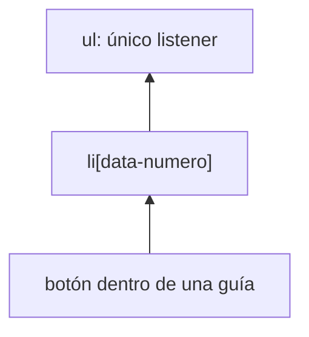

# Módulo 8: El DOM y eventos del navegador


## Aprende construyendo


### Tema 1: Selección y manipulación del DOM · Intermedio · 45 min

<details open>
<summary><strong>Capa 1 — Lectura</strong></summary>

</details>

<details>
<summary><strong>Capa 2 — Construcción</strong></summary>

#### Código y verificación
```bash
mkdir ejemplo-dom
cd ejemplo-dom
npm init -y
npm install --save-dev vite
npm pkg set type=module scripts.dev="vite"
mkdir -p src/ui
touch index.html
```

```html
<!doctype html>
<html lang="es">
  <head>
    <meta charset="UTF-8">
    <meta name="viewport" content="width=device-width, initial-scale=1.0">
    <title>Entregas</title>
  </head>
  <body>
    <ul id="guias" aria-live="polite"></ul>
    <script type="module" src="/src/main.js"></script>
  </body>
</html>
```

```js
export function renderGuias(lista, guias) {
  // El fragmento permanece fuera del documento hasta estar completo.
  const fragmento = document.createDocumentFragment();

  for (const guia of guias) {
    const elemento = document.createElement("li");
    elemento.dataset.numero = guia.numero;

    const numero = document.createElement("strong");
    // textContent trata cualquier valor externo como texto, no como HTML.
    numero.textContent = guia.numero;
    elemento.append(numero, ` — ${guia.estado}`);
    fragmento.append(elemento);
  }

  // replaceChildren evita duplicar filas al volver a renderizar.
  lista.replaceChildren(fragmento);
}
```

```js
import { renderGuias } from "./ui/render-guias.js";

const guias = [
  { numero: "RF-101", estado: "CREADA" },
  { numero: "RF-102", estado: "EN_RUTA" },
  { numero: "", estado: "REVISAR" },
];

const lista = document.querySelector("#guias");
if (!lista) throw new Error("No existe #guias en index.html");
renderGuias(lista, guias);
```

```bash
npm run dev
```

</details>

### Tema 2: Delegación de eventos · Intermedio · 40 min

<details open>
<summary><strong>Capa 1 — Lectura</strong></summary>

#### ► DE QUÉ TRATA
Al finalizar podrás manejar acciones de una colección dinámica con un solo listener, localizar la fila correcta con closest y descartar clics irrelevantes. Permitirás cambiar el estado de una entrega del proyecto sin acoplar comportamiento a cada nodo.

#### ► CÓMO FUNCIONA


</details>

<details>
<summary><strong>Capa 2 — Construcción</strong></summary>

#### Código y verificación
```bash
mkdir ejemplo-eventos-dom
cd ejemplo-eventos-dom
npm init -y
mkdir src
touch index.html
```

```js
export function delegarAcciones(lista, alSeleccionar) {
  const manejarClick = (event) => {
    // closest tolera que el clic ocurra en un icono dentro del botón.
    const boton = event.target.closest("button[data-action]");
    if (!boton || !lista.contains(boton)) return;

    const fila = boton.closest("li[data-numero]");
    if (!fila) return;

    alSeleccionar({ accion: boton.dataset.action, numero: fila.dataset.numero });
  };

  lista.addEventListener("click", manejarClick);
  // Devolver cleanup permite desmontar la vista sin dejar listeners vivos.
  return () => lista.removeEventListener("click", manejarClick);
}
```


```js
import { delegarAcciones } from "./ui/eventos-guias.js";

const dejarDeEscuchar = delegarAcciones(lista, ({ accion, numero }) => {
  console.log(`ACCIÓN ${accion} PARA ${numero}`);
});

// La fila añadida después queda cubierta por el listener del contenedor.
lista.insertAdjacentHTML(
  "beforeend",
  '<li data-numero="RF-103"><button data-action="entregar">Entregar RF-103</button></li>',
);
```

```bash
npm run dev
```

</details>

### Tema 3: Formularios y validación nativa · Intermedio · 40 min

<details open>
<summary><strong>Capa 1 — Lectura</strong></summary>

#### ► DE QUÉ TRATA
Al finalizar podrás construir un formulario accesible, combinar restricciones HTML con mensajes específicos, extraer datos con FormData y explicar por qué el servidor debe validar otra vez. Crearás entregas del proyecto sin dejar al usuario adivinar qué dato falló.

</details>

<details>
<summary><strong>Capa 2 — Construcción</strong></summary>

#### Código y verificación
```html
<form id="nueva-guia">
  <label for="numero">Número de guía</label>
  <input id="numero" name="numero" required pattern="RF-[0-9]+"
         aria-describedby="ayuda-numero" />
  <small id="ayuda-numero">Ejemplo: RF-200</small>
  <label for="peso">Peso en kg</label>
  <input id="peso" name="peso" type="number" min="0.1" step="0.1" required />
  <button>Crear entrega</button>
</form>
```

```bash
mkdir ejemplo-formularios
cd ejemplo-formularios
npm init -y
mkdir src
touch index.html
```

```js
export function prepararFormulario(formulario, alCrear) {
  const numero = formulario.elements.namedItem("numero");

  numero.addEventListener("invalid", () => {
    // El mensaje ofrece formato y ejemplo, no solamente dice “inválido”.
    numero.setCustomValidity("Usa RF- seguido de números, por ejemplo RF-200");
  });
  numero.addEventListener("input", () => numero.setCustomValidity(""));

  formulario.addEventListener("submit", (event) => {
    event.preventDefault();
    if (!formulario.reportValidity()) return;
    const datos = new FormData(formulario);
    alCrear({ numero: datos.get("numero"), pesoKg: Number(datos.get("peso")) });
    formulario.reset();
  });
}
```

```bash
npm run dev
```

</details>

### Tema 4: Formularios accesibles: validar, anunciar y conservar la entrada · Intermedio · 40 min

<details open>
<summary><strong>Capa 1 — Lectura</strong></summary>

#### ► DE QUÉ TRATA
Al finalizar implementarás un formulario que muestra un estado comprensible sin borrar lo escrito cuando hay un error. Prerrequisitos: HTML semántico, funciones, eventos y propiedades del DOM. Usa una carpeta vacía; es un ejemplo independiente que funciona sin paquetes.

</details>

<details>
<summary><strong>Capa 2 — Construcción</strong></summary>

#### Código y verificación
```bash
mkdir formulario-accesible
cd formulario-accesible
```

```html
<!doctype html>
<html lang="es">
<meta charset="utf-8">
<title>Validar código</title>
<form id="consulta" novalidate>
  <label for="codigo">Código de envío</label>
  <input id="codigo" aria-describedby="ayuda estado" required>
  <p id="ayuda">Usa ENV- seguido de dígitos, por ejemplo ENV-42.</p>
  <button>Comprobar formato</button>
  <p id="estado" role="status"></p>
</form>
<script type="module" src="formulario.js"></script>
</html>
```

```javascript
const form = document.querySelector('#consulta');
const input = document.querySelector('#codigo');
const status = document.querySelector('#estado');
form.addEventListener('submit', event => {
  event.preventDefault(); // Conserva la página y el texto recibido.
  const code = input.value.trim();
  const valid = /^ENV-\d+$/.test(code);
  input.setAttribute('aria-invalid', String(!valid));
  status.textContent = valid
    ? `Formato válido: ${code}. Aún no se consultó una entrega.`
    : 'Corrige el código: debe empezar por ENV- y terminar en dígitos.';
  if (!valid) input.focus();
});
```

```bash
python3 -m http.server 8000
```

</details>

### Tema 5: Web APIs — localStorage e IntersectionObserver · Avanzado · 40 min

<details open>
<summary><strong>Capa 1 — Lectura</strong></summary>

#### ► DE QUÉ TRATA
Al finalizar podrás persistir una preferencia no sensible, recuperarte de datos dañados y cargar páginas cuando un sentinela se acerque al viewport. Aplicarás ambas APIs a la lista de entregas del proyecto sin bloquear el hilo con eventos scroll continuos.

#### ► LA ANALOGÍA
**Conceptos clave:** persistencia simple del lado del cliente, observación eficiente de visibilidad.

`localStorage` proporciona una forma simple de persistir datos como strings en el navegador del usuario, sobreviviendo entre recargas de página e incluso entre sesiones completas del navegador (a diferencia de `sessionStorage`, que se limpia al cerrar la pestaña), útil para casos como recordar preferencias del usuario o guardar un borrador de formulario sin necesidad de un servidor. Es importante recordar que `localStorage` solo almacena strings: guardar objetos requiere serializarlos explícitamente con `JSON.stringify()` antes de guardar, y deserializarlos con `JSON.parse()` al leer, y que su capacidad es limitada (típicamente unos pocos megabytes según el navegador), inapropiado para almacenar volúmenes grandes de datos.

`IntersectionObserver` es una API moderna y eficiente para detectar cuándo un elemento entra o sale del viewport visible (o de cualquier otro elemento contenedor especificado), reemplazando el patrón anterior, mucho menos eficiente, de escuchar el evento `scroll` y calcular manualmente en cada disparo si un elemento específico está visible (una operación costosa si se ejecuta en cada uno de los muchos eventos de scroll que ocurren durante un desplazamiento continuo del usuario). En vez de eso, `IntersectionObserver` notifica de forma asíncrona y eficiente, gestionada internamente por el navegador, exactamente cuándo ocurre un cambio real de intersección, sin necesidad de recalcular constantemente en cada pequeño movimiento de scroll.

El caso de uso más común de `IntersectionObserver` es el scroll infinito: colocar un elemento "sentinela" invisible al final de una lista de resultados, y observar cuándo ese sentinela se vuelve visible en el viewport (indicando que el usuario se ha desplazado hasta cerca del final de la lista actual), disparando en ese momento la carga de más resultados adicionales, típicamente mediante una petición a una API (Módulo 6). Otro uso frecuente es implementar "lazy loading" de imágenes: cargar la imagen real de un elemento solo cuando ese elemento se acerca a entrar en el viewport visible, en vez de cargar todas las imágenes de la página completa desde el inicio, mejorando el tiempo de carga inicial percibido.

Ambas APIs —`localStorage` e `IntersectionObserver`— ilustran un principio recurrente en el diseño de APIs modernas del navegador: preferir mecanismos declarativos y eficientes gestionados internamente por el navegador (observadores) sobre patrones imperativos que requieren que el propio JavaScript de la aplicación recalcule constantemente el estado relevante en respuesta a eventos de alta frecuencia como el scroll.

**Analogía:** `localStorage` es como una libreta personal que cada visitante deja guardada en su propia casillero al salir de un edificio, disponible de nuevo exactamente donde la dejó en su próxima visita; `IntersectionObserver` es como un sensor de movimiento inteligente que notifica automáticamente cuando algo entra en un área específica, en vez de requerir que alguien revise constantemente y de forma manual esa área cada fracción de segundo.

**¿Por qué es importante?** `IntersectionObserver` es sustancialmente más eficiente que escuchar `scroll` manualmente para detectar visibilidad, y `localStorage` es la forma más simple de persistencia del lado del cliente sin requerir un backend, ambas ampliamente usadas en interfaces web reales.

</details>

<details>
<summary><strong>Capa 2 — Construcción</strong></summary>

#### Código y verificación
```bash
mkdir ejemplo-web-apis
cd ejemplo-web-apis
npm init -y
mkdir src
touch index.html
```

```js
const CLAVE = "app:filtro";

export function prepararPreferencias(select) {
  try {
    // JSON.parse puede fallar si otra versión escribió un valor incompatible.
    const guardado = JSON.parse(localStorage.getItem(CLAVE) ?? "null");
    if (["TODAS", "CREADA", "EN_RUTA"].includes(guardado)) select.value = guardado;
  } catch (error) {
    console.warn("Preferencia dañada; se usará TODAS", error);
    localStorage.removeItem(CLAVE);
    select.value = "TODAS";
  }

  select.addEventListener("change", () => {
    localStorage.setItem(CLAVE, JSON.stringify(select.value));
  });
}

export function observarSiguientePagina(sentinela, cargarPagina) {
  let cargando = false;
  const observador = new IntersectionObserver(async ([entrada]) => {
    if (!entrada.isIntersecting || cargando) return;
    cargando = true;
    try {
      const hayMas = await cargarPagina();
      if (!hayMas) observador.disconnect();
    } finally {
      cargando = false;
    }
  }, { rootMargin: "200px" });
  observador.observe(sentinela);
  return () => observador.disconnect();
}
```

```bash
npm run dev
```

</details>

### Tema 6: ResizeObserver y MutationObserver · Avanzado · 40 min

<details open>
<summary><strong>Capa 1 — Lectura</strong></summary>

#### ► DE QUÉ TRATA
Al finalizar podrás reaccionar al tamaño real de un contenedor y a inserciones realizadas por código externo, limitar el alcance observado y liberar ambos observers. Harás que el tablero de la aplicación se adapte sin sondeo ni listeners globales innecesarios.

#### ► LA ANALOGÍA
**Conceptos clave:** observación de cambios de tamaño y de cambios en el árbol del DOM.

`ResizeObserver` notifica de forma eficiente cuándo el tamaño de un elemento observado cambia, ya sea por una acción directa del usuario (redimensionar la ventana del navegador) o indirectamente por cambios de layout provocados por otro contenido de la página (como una imagen que termina de cargar y empuja el tamaño de un contenedor adyacente). Antes de esta API, detectar cambios de tamaño de un elemento específico (no de toda la ventana) requería trucos indirectos y menos confiables, como escuchar el evento `resize` global de la ventana y recalcular manualmente el tamaño de cada elemento de interés, un enfoque que además no capturaba cambios de tamaño provocados por causas distintas al redimensionamiento de la ventana completa.

`MutationObserver` notifica cuándo el árbol del DOM cambia dentro de un elemento observado: adición o eliminación de nodos hijos, cambios de atributos, o cambios de texto, según qué tipos de mutación se configuren explícitamente al crear el observador. Este mecanismo es útil para reaccionar a cambios en el DOM provocados por código externo sobre el que no se tiene control directo (por ejemplo, una biblioteca de terceros que inserta contenido dinámicamente en un contenedor específico), permitiendo ejecutar lógica propia en respuesta a esos cambios sin necesidad de modificar el código de esa biblioteca externa directamente.

Ambos observadores comparten un patrón de diseño común con `IntersectionObserver` (Tema 4): en vez de sondear activamente el estado (verificar repetidamente y de forma manual si algo cambió, un patrón costoso e ineficiente conocido como "polling"), se registra un callback una única vez, y el navegador se encarga internamente de notificar de forma eficiente y asíncrona exactamente cuándo ocurre el cambio relevante, sin desperdiciar ciclos de procesamiento en verificaciones innecesarias cuando nada ha cambiado realmente.

Es importante desconectar estos observadores explícitamente (`observer.disconnect()`) cuando el elemento que observan se elimina de la página o cuando la lógica que depende de ellos ya no es necesaria, para evitar que el observador siga consumiendo recursos innecesariamente de forma indefinida, un descuido de limpieza que, aunque no cause errores visibles inmediatos, puede acumular overhead innecesario en aplicaciones de larga duración con muchos componentes creándose y destruyéndose dinámicamente.

**Analogía:** `ResizeObserver` es como un sastre que automáticamente te notifica en cuanto detecta que tu talla cambió, sin que tengas que medirte constantemente tú mismo; `MutationObserver` es como una cámara de seguridad que notifica automáticamente cualquier cambio específico en una habitación vigilada (algo que entra, sale, o se mueve), sin necesidad de revisar manualmente la habitación cada cierto tiempo para comprobar si algo cambió.

**¿Por qué es importante?** Estos observadores permiten reaccionar eficientemente a cambios de tamaño o de estructura del DOM sin recurrir a sondeo costoso e ineficiente, un patrón de diseño consistente y recomendado en las Web APIs modernas del navegador.

</details>

<details>
<summary><strong>Capa 2 — Construcción</strong></summary>

#### Código y verificación
```bash
mkdir ejemplo-observers
cd ejemplo-observers
npm init -y
mkdir src
touch index.html
```

```js
export function observarPanel(panel, lista) {
  const tamanos = new ResizeObserver(([entrada]) => {
    // El ancho del componente decide su layout, no el ancho de la ventana.
    const columnas = entrada.contentRect.width >= 720 ? 3 : 1;
    lista.style.setProperty("--columnas", columnas);
    console.log("COLUMNAS", columnas);
  });

  const mutaciones = new MutationObserver((registros) => {
    const agregados = registros.reduce((total, registro) => total + registro.addedNodes.length, 0);
    console.log("NODOS EXTERNOS", agregados);
  });

  tamanos.observe(panel);
  // Observamos solo hijos directos; no atributos ni todo el subárbol.
  mutaciones.observe(lista, { childList: true });

  return function destruir() {
    tamanos.disconnect();
    mutaciones.disconnect();
  };
}
```

```bash
npm run dev
```

</details>

### Tema 7: requestAnimationFrame y requestIdleCallback · Avanzado · 40 min

<details open>
<summary><strong>Capa 1 — Lectura</strong></summary>

#### ► DE QUÉ TRATA
Al finalizar podrás animar un marcador según tiempo transcurrido, cancelar el ciclo, respetar movimiento reducido y reservar tareas prescindibles para períodos ociosos con fallback. Visualizarás el avance de una entrega del proyecto sin ligar velocidad al número de frames.

#### ► LA ANALOGÍA
**Conceptos clave:** sincronización con el ciclo de renderizado, trabajo de baja prioridad en tiempo ocioso.

`requestAnimationFrame(callback)` programa la ejecución de `callback` justo antes de que el navegador realice el siguiente repintado visual de la página, típicamente sincronizado con la frecuencia de actualización de la pantalla del usuario (comúnmente 60 veces por segundo). Esto lo hace la herramienta correcta para cualquier animación programada directamente en JavaScript (en vez de usar animaciones CSS, que suelen ser preferibles cuando son suficientes para el efecto deseado): usar `setTimeout` con un intervalo fijo para animaciones produce resultados visualmente inconsistentes, porque no está sincronizado con el ciclo real de repintado del navegador y puede disparar la actualización en momentos que no coinciden con cuándo el navegador realmente va a repintar la pantalla, mientras que `requestAnimationFrame` garantiza que cada actualización de la animación ocurra exactamente en sincronía con un repintado real, evitando tanto actualizaciones desperdiciadas (que ocurren pero nunca se muestran porque el navegador aún no repintó) como saltos visuales perceptibles.

`requestIdleCallback(callback)` programa la ejecución de `callback` durante un período de tiempo en que el navegador está genuinamente ocioso (sin trabajo urgente pendiente de renderizado o de respuesta a interacción del usuario), siendo apropiado para trabajo de baja prioridad que puede posponerse sin afectar la experiencia percibida por el usuario, como el registro de analíticas no urgentes, pre-cálculos especulativos que podrían no llegar a necesitarse, o limpieza de datos en segundo plano. El callback recibe un objeto con información sobre cuánto tiempo restante de ociosidad está disponible, permitiendo que el propio código decida ceder el control de vuelta al navegador antes de que ese tiempo se agote, en vez de monopolizar el hilo principal con trabajo prolongado que podría retrasar una interacción urgente del usuario que llegue en medio de esa ejecución.

Elegir entre estos dos mecanismos según la naturaleza del trabajo —visualmente crítico y sincronizado con el repintado (`requestAnimationFrame`) frente a genuinamente prescindible y de baja prioridad (`requestIdleCallback`)— es importante para no congestionar innecesariamente el hilo principal de JavaScript con trabajo que compite por los mismos recursos que la interactividad y la fluidez visual que el usuario percibe directamente, una consideración de rendimiento particularmente relevante en aplicaciones con animaciones complejas o con volúmenes grandes de procesamiento de datos en segundo plano.

Ambas APIs, junto con los observadores del Tema 6, forman parte de un conjunto más amplio de herramientas del navegador diseñadas específicamente para que el código de la aplicación pueda cooperar de forma eficiente con el ciclo de renderizado y con la disponibilidad real de recursos del navegador, en vez de competir ciegamente por el hilo único de JavaScript sin ninguna consideración de prioridad o de sincronización con el repintado visual real.

**Analogía:** `requestAnimationFrame` es como sincronizar cada paso de un bailarín exactamente con el compás de la música (el ciclo de repintado del navegador), garantizando que cada movimiento se vea fluido y en el momento correcto; `requestIdleCallback` es como aprovechar los momentos de pausa genuina entre tareas urgentes de un equipo de trabajo para adelantar tareas de baja prioridad que pueden esperar, sin interrumpir nunca el trabajo urgente cuando este llega.

**¿Por qué es importante?** Usar la API correcta según la naturaleza del trabajo —animaciones sincronizadas frente a trabajo de baja prioridad diferible— evita competir innecesariamente por recursos del hilo principal con la interactividad y fluidez visual que el usuario percibe directamente.

</details>

<details>
<summary><strong>Capa 2 — Construcción</strong></summary>

#### Código y verificación
```bash
mkdir ejemplo-animacion
cd ejemplo-animacion
npm init -y
mkdir src
touch index.html
```

```js
export function animarMarcador(elemento, destinoPx, duracionMs = 800) {
  if (matchMedia("(prefers-reduced-motion: reduce)").matches) {
    elemento.style.transform = `translateX(${destinoPx}px)`;
    return () => {};
  }

  let id;
  let inicio;
  function frame(timestamp) {
    inicio ??= timestamp;
    // El progreso depende del tiempo; una pantalla lenta no cambia la duración.
    const progreso = Math.min((timestamp - inicio) / duracionMs, 1);
    elemento.style.transform = `translateX(${destinoPx * progreso}px)`;
    if (progreso < 1) id = requestAnimationFrame(frame);
  }
  id = requestAnimationFrame(frame);
  return () => cancelAnimationFrame(id);
}

export function cuandoHayaTiempo(tarea) {
  // Safari puede no ofrecer requestIdleCallback; el fallback conserva funcionalidad.
  if ("requestIdleCallback" in window) return requestIdleCallback(tarea, { timeout: 2000 });
  return setTimeout(() => tarea({ timeRemaining: () => 0 }), 0);
}
```

```bash
npm run dev
```

</details>

### Comprueba lo construido

<details open>
<summary><strong>Capa 1 — Lectura</strong></summary>

</details>

<details>
<summary><strong>Capa 2 — Construcción</strong></summary>

#### Nota de construcción
Este tema es principalmente conceptual en esta versión. La verificación se realiza con las preguntas de comprensión y el criterio de cuándo NO usar comprueba lo construido.

</details>
