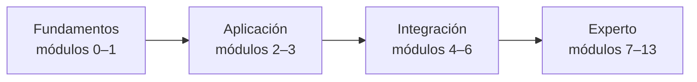
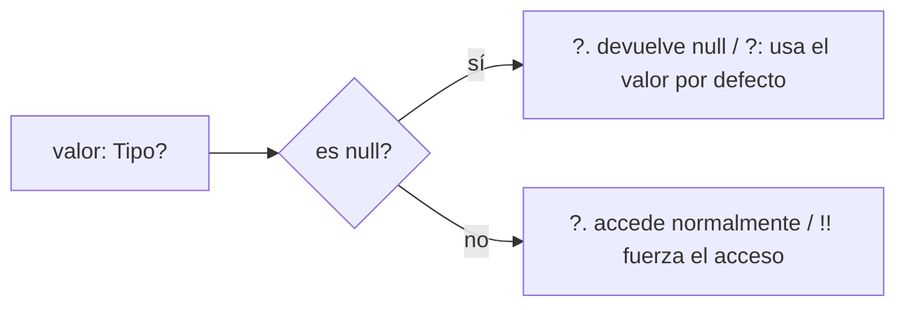
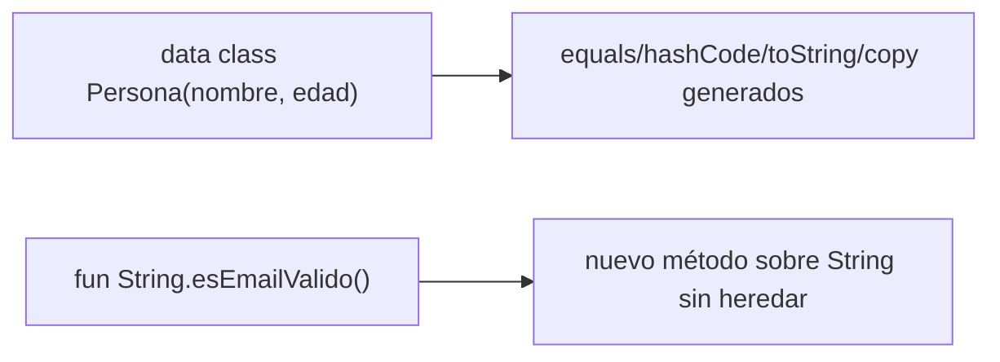
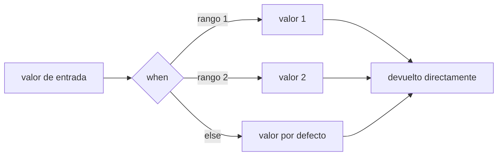

# Módulo 0: Fundamentos de Kotlin

Este módulo no se lee una sola vez: se practica hasta que la sintaxis sale sin pensarla. Cada tema se estudia por separado, con su propia demostración, su propia repetición progresiva y su propio reto de memoria — para que null safety, `data class`, `when` y destructuring queden en el mismo lugar mental que el resto de la sintaxis que ya usas sin esfuerzo.


## Antes de comenzar: entorno Kotlin Multiplatform

Kotlin Multiplatform combina herramientas de varias plataformas. Para empezar instala **JDK 25** (LTS), Git e **IntelliJ IDEA** con el plugin Kotlin. Para Android necesitarás Android Studio; para compilar el destino iOS necesitarás obligatoriamente un Mac con Xcode.

| Sistema | Qué puedes desarrollar | Instalación mínima |
|---|---|---|
| Windows | commonMain, JVM, Android y Desktop | JDK 25, Gradle 9.7+, IntelliJ/Android Studio, Git |
| macOS | Todos los destinos, incluido iOS | JDK 25, Gradle 9.7+, Xcode, Android Studio, Git |
| Linux | commonMain, JVM, Android y Desktop | OpenJDK 25, Gradle 9.7+, IntelliJ/Android Studio, Git |

El track usa Kotlin 2.4.21 con JDK 25. Si el asistente genera una versión anterior de Kotlin o un wrapper anterior a Gradle 9.7, actualízalos antes de continuar. No uses un JDK más nuevo para compilar: con JDK 27, Kotlin 2.4.21 avisa «Kotlin does not yet support 27 JDK target, falling back to Kotlin JVM_26 JVM target».

Verifica `java --version` (25), `./gradlew --version` (Gradle 9.7 o superior) y `git --version`. En macOS abre Xcode una vez y acepta su licencia; comprueba `xcodebuild -version`. Crea un proyecto desde el asistente **Kotlin Multiplatform** de Android Studio/IntelliJ y ejecuta primero el destino Desktop o Android. Usa siempre el Gradle Wrapper incluido:

```bash
./gradlew tasks          # macOS/Linux
.\gradlew.bat tasks      # Windows
```

Si Gradle no encuentra Java, configura `JAVA_HOME` hacia el JDK, no hacia una JRE. No intentes resolver problemas de lógica común y de toolchain iOS al mismo tiempo: haz funcionar primero los tests de `commonTest` en JVM, después cada plataforma por separado.


### Paso 0 · Crea el proyecto `academia-kmp`

<details open>
<summary><strong>Capa 1 — Lectura</strong></summary>

#### ► CÓMO FUNCIONA


</details>

<details>
<summary><strong>Capa 2 — Construcción</strong></summary>

#### Código y verificación
```bash
mkdir -p academia-kmp/shared/src/commonMain/kotlin/com/academia/kmp \
         academia-kmp/shared/src/commonTest/kotlin/com/academia/kmp
cd academia-kmp
```

Crea el archivo `settings.gradle.kts`:

```kotlin
pluginManagement {
    repositories {
        gradlePluginPortal()
        mavenCentral()
    }
}
dependencyResolutionManagement {
    repositories {
        mavenCentral()
    }
}
rootProject.name = "academia-kmp"
include(":shared")
```

Crea el archivo `shared/build.gradle.kts`:

```kotlin
plugins {
    kotlin("multiplatform") version "2.4.21"
}

kotlin {
    jvm()
    sourceSets {
        commonMain.dependencies {
            implementation("org.jetbrains.kotlinx:kotlinx-coroutines-core:1.11.0") // módulo 2
        }
        commonTest.dependencies {
            implementation(kotlin("test"))
            implementation("org.jetbrains.kotlinx:kotlinx-coroutines-test:1.11.0") // módulo 2
        }
    }
}
```

```bash
gradle wrapper --gradle-version 9.7.0
./gradlew :shared:jvmTest
```


</details>

### Tema 1: Null safety real · Básico · 40 min

<details open>
<summary><strong>Capa 1 — Lectura</strong></summary>

#### ► DE QUÉ TRATA
Al finalizar podrás distinguir en cualquier firma de tipo si un valor puede ser null, elegir entre safe call, non-null assertion y operador Elvis según el contexto, y explicar por qué el compilador rechaza el acceso directo a un tipo nullable.

#### ► CÓMO FUNCIONA


</details>

<details>
<summary><strong>Capa 2 — Construcción</strong></summary>

#### Código y verificación


```kotlin
package com.academia.kmp

fun describirApodo(apodo: String?): String {
    val largo = apodo?.length ?: 0
    return if (apodo != null) "El apodo '$apodo' tiene $largo caracteres" else "Sin apodo (largo: $largo)"
}
```

```bash
# compila el módulo compartido del proyecto academia-kmp (Paso 0 del módulo 0)
cd academia-kmp
./gradlew :shared:assemble
```

```kotlin
package com.academia.kmp

import kotlin.test.Test
import kotlin.test.assertEquals
import kotlin.test.assertFailsWith

class NullSafetyTest {
    @Test
    fun conApodoPresente() {
        assertEquals("El apodo 'Nico' tiene 4 caracteres", describirApodo("Nico"))
    }

    @Test
    fun conApodoAusente() {
        assertEquals("Sin apodo (largo: 0)", describirApodo(null))
    }

    @Test
    fun accesoForzadoSobreNullLanzaExcepcion() {
        val apodo: String? = null
        assertFailsWith<NullPointerException> { apodo!!.length }
    }
}
```

```bash
# ejecuta el test Kotlin del módulo compartido
cd academia-kmp
./gradlew :shared:allTests
```

```kotlin
fun saludo(nombre: String?): String {
    val quienSaluda = nombre ____ "invitado"
    return "Hola, $quienSaluda"
}
```

</details>

### Tema 2: data class y funciones de extensión · Básico · 40 min

<details open>
<summary><strong>Capa 1 — Lectura</strong></summary>

#### ► DE QUÉ TRATA
Al finalizar podrás declarar una data class y usar copy() para producir una variante inmutable, y escribir una función de extensión que agregue comportamiento a un tipo existente sin heredar de él.

#### ► CÓMO FUNCIONA


</details>

<details>
<summary><strong>Capa 2 — Construcción</strong></summary>

#### Código y verificación


```kotlin
package com.academia.kmp

data class Persona(val nombre: String, val edad: Int)

fun String.esEmailValido(): Boolean = this.contains("@") && this.contains(".")
```

```bash
# compila el módulo compartido del proyecto academia-kmp (Paso 0 del módulo 0)
cd academia-kmp
./gradlew :shared:assemble
```

```kotlin
package com.academia.kmp

import kotlin.test.Test
import kotlin.test.assertEquals
import kotlin.test.assertTrue

class PersonaTest {
    @Test
    fun copySobrescribeSoloElCampoIndicado() {
        val ana = Persona("Ana", 28)
        val anaCumpleanos = ana.copy(edad = 29)
        assertEquals("Ana", anaCumpleanos.nombre)
        assertEquals(29, anaCumpleanos.edad)
    }

    @Test
    fun igualdadEsPorValorNoPorIdentidad() {
        assertEquals(Persona("Ana", 28), Persona("Ana", 28))
    }

    @Test
    fun funcionDeExtensionValidaElEmail() {
        assertTrue("ana@ejemplo.com".esEmailValido())
        assertTrue(!"ana-sin-arroba".esEmailValido())
    }
}
```

```bash
# ejecuta el test Kotlin del módulo compartido
cd academia-kmp
./gradlew :shared:allTests
```

```kotlin
val correo = "ana@ejemplo.com"
val emailValido: Boolean = correo.____()
```

</details>

### Tema 3: when como expresión · Básico · 40 min

<details open>
<summary><strong>Capa 1 — Lectura</strong></summary>

#### ► DE QUÉ TRATA
Al finalizar podrás usar when para devolver un valor directamente en vez de asignarlo dentro de cada rama, y aprovechar la verificación de exhaustividad del compilador sobre una sealed class.

#### ► CÓMO FUNCIONA


</details>

<details>
<summary><strong>Capa 2 — Construcción</strong></summary>

#### Código y verificación
```kotlin
val descripcion = when (edad) {
    in 0..12 -> "niño"
    in 13..17 -> "adolescente"
    else -> "adulto"
}
```


```kotlin
package com.academia.kmp

sealed class EstadoUI {
    object Cargando : EstadoUI()
    data class Exito(val datos: List<String>) : EstadoUI()
    data class Error(val mensaje: String) : EstadoUI()
}

fun describir(estado: EstadoUI): String = when (estado) {
    is EstadoUI.Cargando -> "cargando..."
    is EstadoUI.Exito -> "éxito: ${estado.datos.size} elementos"
    is EstadoUI.Error -> "error: ${estado.mensaje}"
    // sin else: el compilador exige cubrir los tres casos de la sealed class
}
```

```bash
# compila el módulo compartido del proyecto academia-kmp (Paso 0 del módulo 0)
cd academia-kmp
./gradlew :shared:assemble
```

```kotlin
package com.academia.kmp

import kotlin.test.Test
import kotlin.test.assertEquals

class EstadoUITest {
    @Test
    fun describeCargando() {
        assertEquals("cargando...", describir(EstadoUI.Cargando))
    }

    @Test
    fun describeExito() {
        assertEquals("éxito: 3 elementos", describir(EstadoUI.Exito(listOf("a", "b", "c"))))
    }

    @Test
    fun describeError() {
        assertEquals("error: sin conexión", describir(EstadoUI.Error("sin conexión")))
    }
}
```

```bash
# ejecuta el test Kotlin del módulo compartido
cd academia-kmp
./gradlew :shared:allTests
```

</details>

### Tema 4: Destructuring declarations y rangos · Básico · 40 min

<details open>
<summary><strong>Capa 1 — Lectura</strong></summary>

#### ► DE QUÉ TRATA
Al finalizar podrás desestructurar una data class en variables individuales con una sola declaración, e iterar un rango con el paso y la dirección correctos.

</details>

<details>
<summary><strong>Capa 2 — Construcción</strong></summary>

#### Código y verificación
```
┌── data class Punto(x, y) ──┐
│  val (a, b) = punto          │  →  a = punto.x (component1), b = punto.y (component2)
└───────────────────────────┘

1 ..2.. 3 ..4.. 5 ..6.. 7   con step 2:  1, 3, 5, 7
7 ..6.. 5 ..4.. 3 ..2.. 1   con downTo:  7, 6, 5, 4, 3, 2, 1
```

```kotlin
package com.academia.kmp

data class Punto(val x: Int, val y: Int)

fun distanciaAlOrigen(punto: Punto): Double {
    val (x, y) = punto  // destructuring: usa component1()/component2() generados por data class
    return kotlin.math.sqrt((x * x + y * y).toDouble())
}

fun pasosImpares(hasta: Int): List<Int> {
    return (1..hasta step 2).toList()
}
```

```bash
# compila el módulo compartido del proyecto academia-kmp (Paso 0 del módulo 0)
cd academia-kmp
./gradlew :shared:assemble
```

```kotlin
package com.academia.kmp

import kotlin.test.Test
import kotlin.test.assertEquals

class DestructuringTest {
    @Test
    fun distanciaAlOrigenDeTriangulo3_4_5() {
        assertEquals(5.0, distanciaAlOrigen(Punto(3, 4)))
    }

    @Test
    fun pasosImparesHasta10() {
        assertEquals(listOf(1, 3, 5, 7, 9), pasosImpares(10))
    }
}
```

```bash
# ejecuta el test Kotlin del módulo compartido
cd academia-kmp
./gradlew :shared:allTests
```

```kotlin
data class Producto(val nombre: String, val precio: Double)
val (nombre, precio) ____ Producto("Café", 3.50)

for (i in 5 ____ 1) {
    println(i)
}
```

</details>
