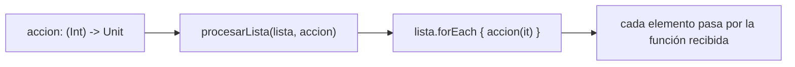
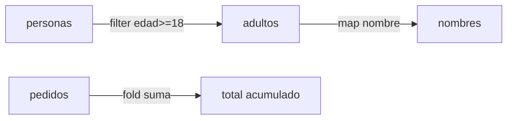
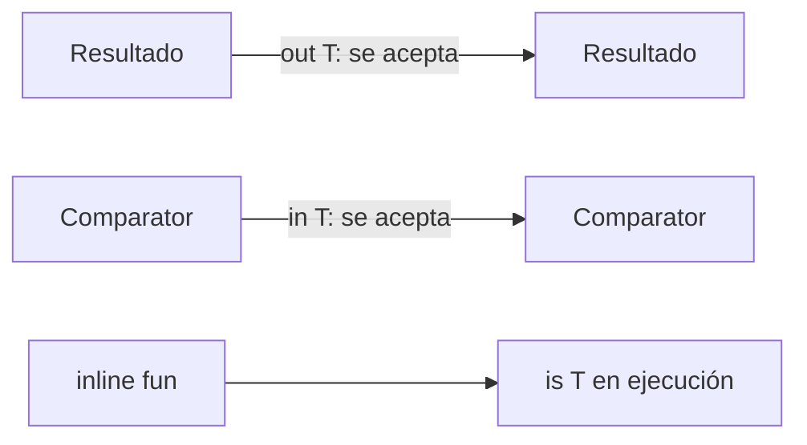

# Módulo 1: Programación funcional en Kotlin

Cada tema de este módulo se practica hasta que la sintaxis sale sin pensarla, con su propia repetición progresiva y su propio reto de memoria — funciones de orden superior, scope functions, sealed classes y lambdas con receptor son patrones que vas a usar en cada línea de código del resto del track.


## Aprende construyendo


### Tema 1: Funciones de orden superior · Básico · 25 min

<details open>
<summary><strong>Capa 1 — Lectura</strong></summary>

#### ► DE QUÉ TRATA
Al finalizar podrás declarar una función que recibe otra función como parámetro, y usar la sintaxis de lambda final de Kotlin para invocarla de forma idiomática.

#### ► CÓMO FUNCIONA


</details>

<details>
<summary><strong>Capa 2 — Construcción</strong></summary>

#### Código y verificación

```kotlin
package com.academia.kmp

fun procesarLista(lista: List<Int>, accion: (Int) -> Unit) {
    lista.forEach { accion(it) }
}
```

```bash
# compila el módulo compartido del proyecto academia-kmp (Paso 0 del módulo 0)
cd academia-kmp
./gradlew :shared:assemble
```

```kotlin
package com.academia.kmp

import kotlin.test.Test
import kotlin.test.assertEquals

class OrdenSuperiorTest {
    @Test
    fun duplicaCadaElemento() {
        val resultados = mutableListOf<Int>()
        procesarLista(listOf(1, 2, 3)) { numero -> resultados.add(numero * 2) }
        assertEquals(listOf(2, 4, 6), resultados)
    }

    @Test
    fun elevaAlCuadradoCadaElemento() {
        val resultadosCuadrado = mutableListOf<Int>()
        procesarLista(listOf(1, 2, 3)) { numero -> resultadosCuadrado.add(numero * numero) }
        assertEquals(listOf(1, 4, 9), resultadosCuadrado)
    }
}
```

```bash
# ejecuta el test Kotlin del módulo compartido
cd academia-kmp
./gradlew :shared:allTests
```

```kotlin
fun transformar(valor: Int, f: ____ -> Int): Int = f(valor)
val resultado = transformar(5) { it * 3 }
```

</details>

### Tema 2: Scope functions · Básico · 25 min

<details open>
<summary><strong>Capa 1 — Lectura</strong></summary>

#### ► DE QUÉ TRATA
Al finalizar podrás elegir entre let, run, apply y also según qué necesites devolver (el receptor original o el resultado de un bloque) y cómo referenciar el receptor (this o it).

</details>

<details>
<summary><strong>Capa 2 — Construcción</strong></summary>

#### Código y verificación
```
┌──────────────┬───────────────────────┬───────────────────────────────┐
│              │ devuelve el RECEPTOR   │ devuelve el RESULTADO del bloque │
├──────────────┼───────────────────────┼───────────────────────────────┤
│ this implícito │        apply         │              run                │
│ it explícito   │        also          │              let                │
└──────────────┴───────────────────────┴───────────────────────────────┘
```

```kotlin
package com.academia.kmp

data class Config(var timeout: Int = 10, var reintentos: Int = 1)

fun construirConfig(): Config = Config().apply {
    timeout = 30
    reintentos = 3
}

fun saludarSiExiste(nombre: String?): String? = nombre?.let { n -> "Hola, $n" }
```

```bash
# compila el módulo compartido del proyecto academia-kmp (Paso 0 del módulo 0)
cd academia-kmp
./gradlew :shared:assemble
```

```kotlin
package com.academia.kmp

import kotlin.test.Test
import kotlin.test.assertEquals
import kotlin.test.assertNull

class ScopeFunctionsTest {
    @Test
    fun applyDevuelveElReceptorConfigurado() {
        val config = construirConfig()
        assertEquals(30, config.timeout)
        assertEquals(3, config.reintentos)
    }

    @Test
    fun letDevuelveElResultadoDelBloqueConValorPresente() {
        assertEquals("Hola, Nico", saludarSiExiste("Nico"))
    }

    @Test
    fun letNoEjecutaElBloqueConNull() {
        assertNull(saludarSiExiste(null))
    }
}
```

```bash
# ejecuta el test Kotlin del módulo compartido
cd academia-kmp
./gradlew :shared:allTests
```

```kotlin
val texto: String? = direccion ____ { d -> "Envía a: $d" }
```

</details>

### Tema 3: Sealed classes y colecciones funcionales · Básico · 25 min

<details open>
<summary><strong>Capa 1 — Lectura</strong></summary>

#### ► DE QUÉ TRATA
Al finalizar podrás modelar un conjunto cerrado de estados con sealed class, y encadenar filter/map/fold para transformar una colección de forma declarativa.

#### ► CÓMO FUNCIONA


</details>

<details>
<summary><strong>Capa 2 — Construcción</strong></summary>

#### Código y verificación
```kotlin
sealed class EstadoUI {
    object Cargando : EstadoUI()
    data class Exito(val datos: List<String>) : EstadoUI()
    data class Error(val mensaje: String) : EstadoUI()
}
```

```kotlin
val nombres = personas.filter { it.edad >= 18 }.map { it.nombre }
```

```kotlin
val total = pedidos.fold(0.0) { acumulado, pedido -> acumulado + pedido.monto }
```


```kotlin
package com.academia.kmp

data class Persona(val nombre: String, val edad: Int)
data class Pedido(val monto: Double)

fun nombresAdultos(personas: List<Persona>): List<String> =
    personas.filter { it.edad >= 18 }.map { it.nombre }

fun totalPedidos(pedidos: List<Pedido>): Double =
    pedidos.fold(0.0) { acumulado, pedido -> acumulado + pedido.monto }
```

```bash
# compila el módulo compartido del proyecto academia-kmp (Paso 0 del módulo 0)
cd academia-kmp
./gradlew :shared:assemble
```

</details>

### Tema 4: Lambdas con receptor y builders tipo DSL · Básico · 25 min

<details open>
<summary><strong>Capa 1 — Lectura</strong></summary>

#### ► DE QUÉ TRATA
Al finalizar podrás escribir una función que reciba una lambda con receptor (T.() -> Unit), y explicar por qué esta capacidad es la base de los DSL que usarás en Gradle y Compose Multiplatform.

</details>

<details>
<summary><strong>Capa 2 — Construcción</strong></summary>

#### Código y verificación
```
┌── lambda normal ──────────────────────────────────────────┐
│  (persona) -> println(persona.nombre)   -- "it." explícito │
└─────────────────────────────────────────────────────────┘
┌── lambda con receptor ────────────────────────────────────┐
│  Persona.() -> println(nombre)   -- "this." implícito, se omite │
└─────────────────────────────────────────────────────────┘
```

```kotlin
package com.academia.kmp

class RutaBuilder {
    private val paradas = mutableListOf<String>()
    fun parada(nombre: String) { paradas.add(nombre) }
    fun construir(): List<String> = paradas.toList()
}

fun ruta(bloque: RutaBuilder.() -> Unit): List<String> {
    val builder = RutaBuilder()
    builder.bloque()  // el bloque se ejecuta CON RutaBuilder como receptor implícito
    return builder.construir()
}
```

```bash
# compila el módulo compartido del proyecto academia-kmp (Paso 0 del módulo 0)
cd academia-kmp
./gradlew :shared:assemble
```

```kotlin
package com.academia.kmp

import kotlin.test.Test
import kotlin.test.assertEquals

class DslBuilderTest {
    @Test
    fun construyeRutaSinPrefijoDentroDelBloque() {
        val miRuta = ruta {
            parada("Depósito central")  // llamado sin prefijo: "this." implícito es el RutaBuilder
            parada("Cliente A")
            parada("Cliente B")
        }
        assertEquals(listOf("Depósito central", "Cliente A", "Cliente B"), miRuta)
    }
}
```

```bash
# ejecuta el test Kotlin del módulo compartido
cd academia-kmp
./gradlew :shared:allTests
```

```kotlin
class Ajustes { var modoOscuro = false; var idioma = "es" }

fun configurar(bloque: Ajustes.____ Unit): Ajustes {
    val ajustes = Ajustes()
    ajustes.bloque()
    return ajustes
}
```

</details>

### Tema 5: Genéricos en Kotlin: varianza con in y out, restricciones y reified · Avanzado · 45 min

<details open>
<summary><strong>Capa 1 — Lectura</strong></summary>

#### ► DE QUÉ TRATA
Usa un proyecto KMP (por ejemplo, creado con el asistente de kmp.jetbrains.com) y escribe en shared/src/commonMain/kotlin/co/rutaflow/genericos/. Las pruebas van en commonTest.

#### ► CÓMO FUNCIONA


</details>

<details>
<summary><strong>Capa 2 — Construcción</strong></summary>

#### Código y verificación


```kotlin
package co.rutaflow.genericos

sealed interface Resultado<out T> {           // covariante: solo produce T
    data class Exito<out T>(val valor: T) : Resultado<T>
    data class Fallo(val mensaje: String) : Resultado<Nothing> // Nothing sirve para cualquier T
}

data class Envio(val codigo: String, val kilos: Int) : Comparable<Envio> {
    override fun compareTo(other: Envio) = kilos.compareTo(other.kilos)
}

fun describir(r: Resultado<Any>): String = when (r) {  // acepta Resultado<Envio> gracias a out
    is Resultado.Exito -> "ok: ${r.valor}"
    is Resultado.Fallo -> "error: ${r.mensaje}"
}

fun <T : Comparable<T>> mayor(a: T, b: T): T = if (a >= b) a else b  // restricción

inline fun <reified T> List<Any>.soloDe(): List<T> = filter { it is T }.map { it as T } // reified
```

```kotlin
package co.rutaflow.genericos

import kotlin.test.Test
import kotlin.test.assertEquals

class GenericosTest {
    @Test fun covarianza() {
        val r: Resultado<Envio> = Resultado.Exito(Envio("ENV-42", 2))
        assertEquals("ok: Envio(codigo=ENV-42, kilos=2)", describir(r))
        assertEquals("error: sin red", describir(Resultado.Fallo("sin red")))
    }

    @Test fun restriccion() {
        assertEquals("ENV-2", mayor(Envio("ENV-1", 3), Envio("ENV-2", 7)).codigo)
    }

    @Test fun reified() {
        val mezcla: List<Any> = listOf(Envio("ENV-1", 1), "nota", Envio("ENV-2", 2), 42)
        assertEquals(listOf("ENV-1", "ENV-2"), mezcla.soloDe<Envio>().map { it.codigo })
    }
}
```

```bash
./gradlew :shared:allTests
```

```text
> Task :shared:jvmTest
> Task :shared:iosSimulatorArm64Test
BUILD SUCCESSFUL
(3 pruebas aprobadas por target en shared/build/reports/tests)
```

</details>
