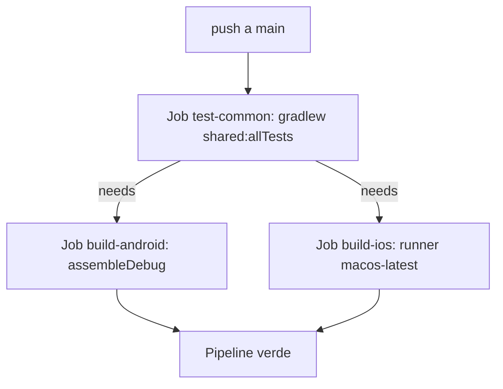
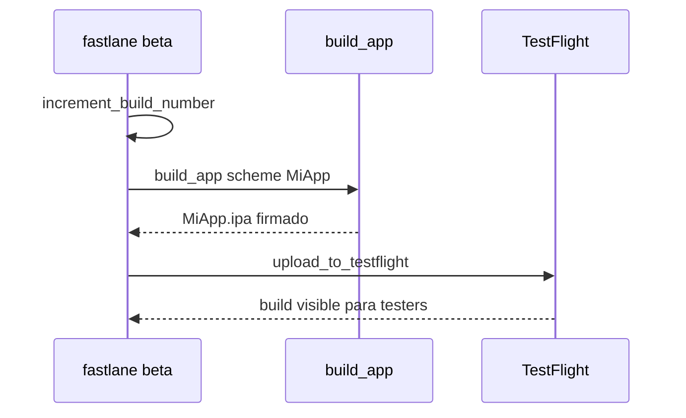

# Módulo 10: CI/CD para KMP


## Aprende construyendo


### Tema 1: Pipeline Gradle multiplataforma en CI · Avanzado · 45 min

<details open>
<summary><strong>Capa 1 — Lectura</strong></summary>

#### ► DE QUÉ TRATA
Al finalizar vas a configurar un pipeline de CI que compile y pruebe el módulo shared contra el target Android y el target iOS en cada push, usando un runner macOS específicamente para iOS. Prerrequisitos: JDK 25 y el Gradle Wrapper del proyecto (módulo 0, «Antes de comenzar»), y…

#### ► LA IDEA EN UNA FRASE
**Al finalizar vas a configurar un pipeline de CI que compile y pruebe el módulo shared contra el target Android y el target iOS en cada push, usando un runner macOS específicamente para iOS.**

#### ► POR QUÉ EXISTE ESTO
Resuelve un problema real de diseño o implementación y evita decisiones a ciegas.

#### ► LA ANALOGÍA
Piensa en pipeline gradle multiplataforma en ci como una herramienta de taller: útil cuando conoces su propósito y sus límites.
**Dónde se rompe la analogía:** en software, los efectos dependen del contexto, la escala y los trade-offs.

#### ► CÓMO FUNCIONA


#### ► LO QUE PUEDE SALIR MAL
| Síntoma | Causa probable | Arreglo |
|---|---|---|
| Pipeline Gradle multiplataforma en CI se aplica pero el resultado no mejora | Se usó sin medir el problema real | Mide antes y compara contra la alternativa simple |
| Aparece complejidad inesperada | Se adoptó la técnica sin comprender sus trade-offs | Vuelve a la sección de trade-offs y reduce el alcance |
| Falla en un caso límite | Se asumió un contexto que no se cumple | Prueba el caso límite y documenta cuándo NO usarlo |

#### ► TRADE-OFFS
| Opción | Cuándo usarla | Cuándo NO usarla |
|---|---|---|
| Usar Pipeline Gradle multiplataforma en CI | Cuando el problema coincide con su propósito y el beneficio es observable | Cuando agrega complejidad sin resolver un problema real |
| Alternativa más simple | Cuando el contexto es pequeño, estable o fácil de razonar | Cuando ya demostró no escalar o no cumplir el requisito |
| Postergar la decisión | Cuando falta evidencia del problema | Cuando el costo de esperar es mayor que el costo de probar |

#### ► CUÁNDO NO USAR ESTO
No uses pipeline gradle multiplataforma en ci por defecto. Aplícalo cuando el problema lo justifique y puedas verificar el beneficio; si una alternativa más simple resuelve igual, prefiérela.

#### ► DE VUELTA A LA ANALOGÍA
Volviendo a la analogía: pipeline gradle multiplataforma en ci funciona como el modelo inicial, pero recuerda dónde se rompe: en producción importan la evidencia, la escala y el costo de equivocarte.

#### ► LO QUE DEBES RECORDAR
- Pipeline Gradle multiplataforma en CI existe para resolver un problema específico.
- Mide antes de adoptar complejidad.
- Conoce el caso donde NO usarlo.
- Verifica con evidencia observable.

#### ► PREGUNTAS PARA PENSAR
1. ¿Qué problema concreto resuelve pipeline gradle multiplataforma en ci en tu contexto?
2. ¿Cómo sabrías que pipeline gradle multiplataforma en ci no está funcionando bien?
3. ¿Qué alternativa más simple considerarías antes de usar pipeline gradle multiplataforma en ci?

</details>

<details>
<summary><strong>Capa 2 — Construcción</strong></summary>

#### Código y verificación


```yaml
name: CI
on:
  push:
    branches: [main]
  pull_request:

jobs:
  test-common:
    runs-on: ubuntu-latest
    steps:
      - uses: actions/checkout@3d3c42e5aac5ba805825da76410c181273ba90b1 # v7.0.1
      - uses: actions/setup-java@d1374f8ac74474200d16ef8ecee22c7ae7a51880 # v6.3.0
        with:
          distribution: temurin
          java-version: '25'
      - uses: gradle/actions/setup-gradle@8da46b539cd8fe6ab27ca75128919a18d757604c # v6.4.1
      - run: ./gradlew :shared:allTests   # en Linux ejecuta los tests de JVM y Android; los de iOS se omiten
  build-android:
    needs: test-common
    runs-on: ubuntu-latest
    steps:
      - uses: actions/checkout@3d3c42e5aac5ba805825da76410c181273ba90b1 # v7.0.1
      - uses: actions/setup-java@d1374f8ac74474200d16ef8ecee22c7ae7a51880 # v6.3.0
        with:
          distribution: temurin
          java-version: '25'
      - uses: gradle/actions/setup-gradle@8da46b539cd8fe6ab27ca75128919a18d757604c # v6.4.1
      - run: ./gradlew :androidApp:assembleDebug
  build-ios:
    needs: test-common
    runs-on: macos-latest   # los builds de iOS requieren un runner macOS
    steps:
      - uses: actions/checkout@3d3c42e5aac5ba805825da76410c181273ba90b1 # v7.0.1
      - uses: actions/setup-java@d1374f8ac74474200d16ef8ecee22c7ae7a51880 # v6.3.0
        with:
          distribution: temurin
          java-version: '25'
      - uses: gradle/actions/setup-gradle@8da46b539cd8fe6ab27ca75128919a18d757604c # v6.4.1
      - run: ./gradlew :shared:iosSimulatorArm64Test :shared:linkDebugFrameworkIosArm64
```

```bash
./gradlew :shared:allTests
```

</details>

### Tema 2: Fastlane · Avanzado · 45 min

<details open>
<summary><strong>Capa 1 — Lectura</strong></summary>

#### ► DE QUÉ TRATA
Al finalizar vas a automatizar con Fastlane la secuencia de build y subida a TestFlight de la app iOS en un único comando. Prerrequisitos: Tema 1 de este módulo; Xcode y Fastlane instalados (fastlane --version).

#### ► LA IDEA EN UNA FRASE
**Al finalizar vas a automatizar con Fastlane la secuencia de build y subida a TestFlight de la app iOS en un único comando.**

#### ► POR QUÉ EXISTE ESTO
Resuelve un problema real de diseño o implementación y evita decisiones a ciegas.

#### ► LA ANALOGÍA
Piensa en fastlane como una herramienta de taller: útil cuando conoces su propósito y sus límites.
**Dónde se rompe la analogía:** en software, los efectos dependen del contexto, la escala y los trade-offs.

#### ► CÓMO FUNCIONA


#### ► LO QUE PUEDE SALIR MAL
| Síntoma | Causa probable | Arreglo |
|---|---|---|
| Fastlane se aplica pero el resultado no mejora | Se usó sin medir el problema real | Mide antes y compara contra la alternativa simple |
| Aparece complejidad inesperada | Se adoptó la técnica sin comprender sus trade-offs | Vuelve a la sección de trade-offs y reduce el alcance |
| Falla en un caso límite | Se asumió un contexto que no se cumple | Prueba el caso límite y documenta cuándo NO usarlo |

#### ► TRADE-OFFS
| Opción | Cuándo usarla | Cuándo NO usarla |
|---|---|---|
| Usar Fastlane | Cuando el problema coincide con su propósito y el beneficio es observable | Cuando agrega complejidad sin resolver un problema real |
| Alternativa más simple | Cuando el contexto es pequeño, estable o fácil de razonar | Cuando ya demostró no escalar o no cumplir el requisito |
| Postergar la decisión | Cuando falta evidencia del problema | Cuando el costo de esperar es mayor que el costo de probar |

#### ► CUÁNDO NO USAR ESTO
No uses fastlane por defecto. Aplícalo cuando el problema lo justifique y puedas verificar el beneficio; si una alternativa más simple resuelve igual, prefiérela.

#### ► DE VUELTA A LA ANALOGÍA
Volviendo a la analogía: fastlane funciona como el modelo inicial, pero recuerda dónde se rompe: en producción importan la evidencia, la escala y el costo de equivocarte.

#### ► LO QUE DEBES RECORDAR
- Fastlane existe para resolver un problema específico.
- Mide antes de adoptar complejidad.
- Conoce el caso donde NO usarlo.
- Verifica con evidencia observable.

#### ► PREGUNTAS PARA PENSAR
1. ¿Qué problema concreto resuelve fastlane en tu contexto?
2. ¿Cómo sabrías que fastlane no está funcionando bien?
3. ¿Qué alternativa más simple considerarías antes de usar fastlane?

</details>

<details>
<summary><strong>Capa 2 — Construcción</strong></summary>

#### Código y verificación
```ruby
# fastlane/Fastfile
lane :beta do
  build_app(scheme: "MiApp")
  upload_to_testflight
end
```


```ruby
# fastlane/Fastfile
lane :beta do
  increment_build_number
  build_app(scheme: "MiApp")
  upload_to_testflight
end
```

```bash
./gradlew :shared:allTests
```

</details>

### Tema 3: Versionado compartido · Avanzado · 45 min

<details open>
<summary><strong>Capa 1 — Lectura</strong></summary>

#### ► DE QUÉ TRATA
Al finalizar vas a centralizar el número de versión del módulo compartido en un único archivo leído por los pipelines de build de Android y de iOS. Prerrequisitos: Tema 2 de este módulo.

#### ► LA IDEA EN UNA FRASE
**Al finalizar vas a centralizar el número de versión del módulo compartido en un único archivo leído por los pipelines de build de Android y de iOS.**

#### ► POR QUÉ EXISTE ESTO
Resuelve un problema real de diseño o implementación y evita decisiones a ciegas.

#### ► LA ANALOGÍA
Piensa en versionado compartido como una herramienta de taller: útil cuando conoces su propósito y sus límites.
**Dónde se rompe la analogía:** en software, los efectos dependen del contexto, la escala y los trade-offs.

#### ► CÓMO FUNCIONA
1. Identifica el problema que versionado compartido resuelve.
2. Observa sus componentes y relaciones.
3. Aplica la opción más simple que funcione.
4. Verifica el resultado y los límites.

#### ► LO QUE PUEDE SALIR MAL
| Síntoma | Causa probable | Arreglo |
|---|---|---|
| Versionado compartido se aplica pero el resultado no mejora | Se usó sin medir el problema real | Mide antes y compara contra la alternativa simple |
| Aparece complejidad inesperada | Se adoptó la técnica sin comprender sus trade-offs | Vuelve a la sección de trade-offs y reduce el alcance |
| Falla en un caso límite | Se asumió un contexto que no se cumple | Prueba el caso límite y documenta cuándo NO usarlo |

#### ► TRADE-OFFS
| Opción | Cuándo usarla | Cuándo NO usarla |
|---|---|---|
| Usar Versionado compartido | Cuando el problema coincide con su propósito y el beneficio es observable | Cuando agrega complejidad sin resolver un problema real |
| Alternativa más simple | Cuando el contexto es pequeño, estable o fácil de razonar | Cuando ya demostró no escalar o no cumplir el requisito |
| Postergar la decisión | Cuando falta evidencia del problema | Cuando el costo de esperar es mayor que el costo de probar |

#### ► CUÁNDO NO USAR ESTO
No uses versionado compartido por defecto. Aplícalo cuando el problema lo justifique y puedas verificar el beneficio; si una alternativa más simple resuelve igual, prefiérela.

#### ► DE VUELTA A LA ANALOGÍA
Volviendo a la analogía: versionado compartido funciona como el modelo inicial, pero recuerda dónde se rompe: en producción importan la evidencia, la escala y el costo de equivocarte.

#### ► LO QUE DEBES RECORDAR
- Versionado compartido existe para resolver un problema específico.
- Mide antes de adoptar complejidad.
- Conoce el caso donde NO usarlo.
- Verifica con evidencia observable.

#### ► PREGUNTAS PARA PENSAR
1. ¿Qué problema concreto resuelve versionado compartido en tu contexto?
2. ¿Cómo sabrías que versionado compartido no está funcionando bien?
3. ¿Qué alternativa más simple considerarías antes de usar versionado compartido?

</details>

<details>
<summary><strong>Capa 2 — Construcción</strong></summary>

#### Código y verificación
```
Archivo de versión compartido → leído por el pipeline de build de Android y de iOS
Evita: "¿qué versión del módulo compartido corre esta versión específica de cada app?"
```

```properties
# version.properties (leído por ambos pipelines de build)
sharedVersion=2.3.1
```

```bash
./gradlew :shared:allTests
```

```kotlin
// shared/build.gradle.kts
val sharedVersion = file("../version.properties").readLines()
    .first { it.startsWith("sharedVersion=") }.substringAfter("=")
version = sharedVersion
```

</details>
