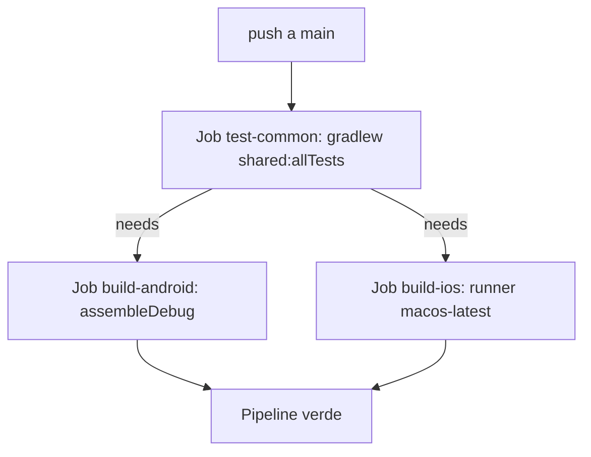
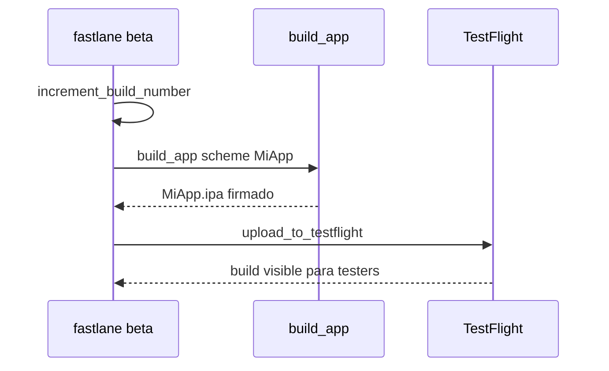

# Módulo 10: CI/CD para KMP


## Aprende construyendo


### Tema 1: Pipeline Gradle multiplataforma en CI · Avanzado · 45 min

<details open>
<summary><strong>Capa 1 — Lectura</strong></summary>

#### ► DE QUÉ TRATA
Al finalizar vas a configurar un pipeline de CI que compile y pruebe el módulo shared contra el target Android y el target iOS en cada push, usando un runner macOS específicamente para iOS. Prerrequisitos: JDK 25 y el Gradle Wrapper del proyecto (módulo 0, «Antes de comenzar»), y…

#### ► CÓMO FUNCIONA


</details>

<details>
<summary><strong>Capa 2 — Construcción</strong></summary>

#### Código y verificación

```yaml
name: CI
on:
  push:
    branches: [main]
  pull_request:

jobs:
  test-common:
    runs-on: ubuntu-latest
    steps:
      - uses: actions/checkout@3d3c42e5aac5ba805825da76410c181273ba90b1 # v7.0.1
      - uses: actions/setup-java@d1374f8ac74474200d16ef8ecee22c7ae7a51880 # v6.3.0
        with:
          distribution: temurin
          java-version: '25'
      - uses: gradle/actions/setup-gradle@8da46b539cd8fe6ab27ca75128919a18d757604c # v6.4.1
      - run: ./gradlew :shared:allTests   # en Linux ejecuta los tests de JVM y Android; los de iOS se omiten
  build-android:
    needs: test-common
    runs-on: ubuntu-latest
    steps:
      - uses: actions/checkout@3d3c42e5aac5ba805825da76410c181273ba90b1 # v7.0.1
      - uses: actions/setup-java@d1374f8ac74474200d16ef8ecee22c7ae7a51880 # v6.3.0
        with:
          distribution: temurin
          java-version: '25'
      - uses: gradle/actions/setup-gradle@8da46b539cd8fe6ab27ca75128919a18d757604c # v6.4.1
      - run: ./gradlew :androidApp:assembleDebug
  build-ios:
    needs: test-common
    runs-on: macos-latest   # los builds de iOS requieren un runner macOS
    steps:
      - uses: actions/checkout@3d3c42e5aac5ba805825da76410c181273ba90b1 # v7.0.1
      - uses: actions/setup-java@d1374f8ac74474200d16ef8ecee22c7ae7a51880 # v6.3.0
        with:
          distribution: temurin
          java-version: '25'
      - uses: gradle/actions/setup-gradle@8da46b539cd8fe6ab27ca75128919a18d757604c # v6.4.1
      - run: ./gradlew :shared:iosSimulatorArm64Test :shared:linkDebugFrameworkIosArm64
```

```bash
./gradlew :shared:allTests
```

</details>

### Tema 2: Fastlane · Avanzado · 45 min

<details open>
<summary><strong>Capa 1 — Lectura</strong></summary>

#### ► DE QUÉ TRATA
Al finalizar vas a automatizar con Fastlane la secuencia de build y subida a TestFlight de la app iOS en un único comando. Prerrequisitos: Tema 1 de este módulo; Xcode y Fastlane instalados (fastlane --version).

#### ► CÓMO FUNCIONA


</details>

<details>
<summary><strong>Capa 2 — Construcción</strong></summary>

#### Código y verificación
```ruby
# fastlane/Fastfile
lane :beta do
  build_app(scheme: "MiApp")
  upload_to_testflight
end
```


```ruby
# fastlane/Fastfile
lane :beta do
  increment_build_number
  build_app(scheme: "MiApp")
  upload_to_testflight
end
```

```bash
./gradlew :shared:allTests
```

</details>

### Tema 3: Versionado compartido · Avanzado · 45 min

<details open>
<summary><strong>Capa 1 — Lectura</strong></summary>

#### ► DE QUÉ TRATA
Al finalizar vas a centralizar el número de versión del módulo compartido en un único archivo leído por los pipelines de build de Android y de iOS. Prerrequisitos: Tema 2 de este módulo.

</details>

<details>
<summary><strong>Capa 2 — Construcción</strong></summary>

#### Código y verificación
```
Archivo de versión compartido → leído por el pipeline de build de Android y de iOS
Evita: "¿qué versión del módulo compartido corre esta versión específica de cada app?"
```

```properties
# version.properties (leído por ambos pipelines de build)
sharedVersion=2.3.1
```

```bash
./gradlew :shared:allTests
```

```kotlin
// shared/build.gradle.kts
val sharedVersion = file("../version.properties").readLines()
    .first { it.startsWith("sharedVersion=") }.substringAfter("=")
version = sharedVersion
```

</details>
