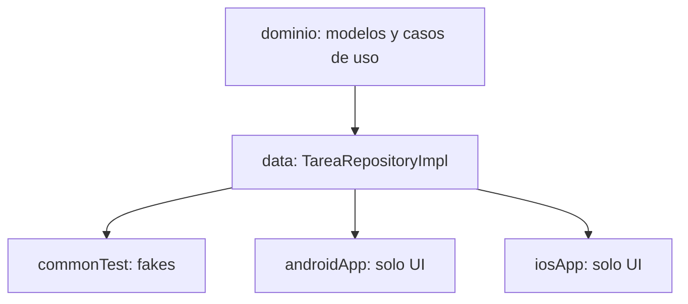
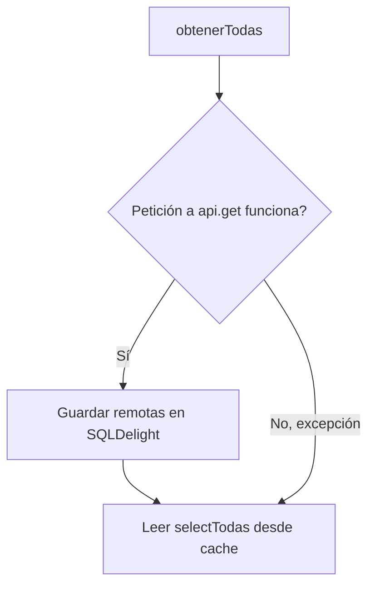
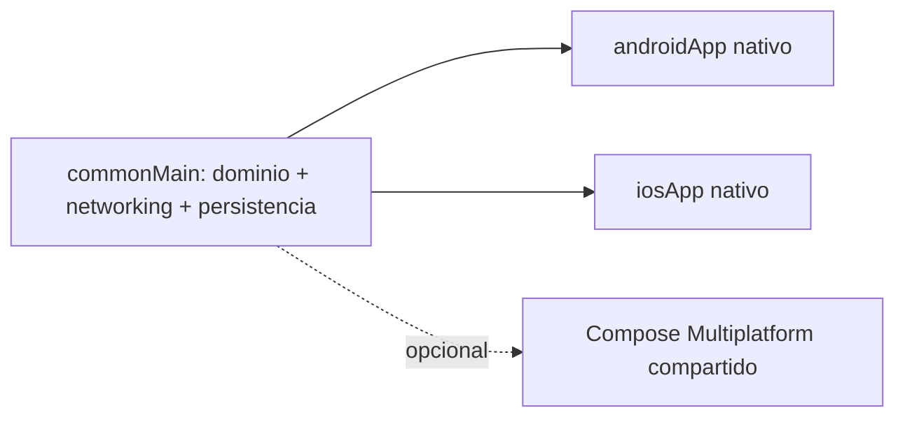

# Módulo 11: Proyecto integrador — app KMP completa


## Aprende construyendo


### Tema 1: Arquitectura del proyecto integrador · Avanzado · 45 min

<details open>
<summary><strong>Capa 1 — Lectura</strong></summary>

#### ► DE QUÉ TRATA
Al finalizar vas a organizar el proyecto integrador completo en commonMain (dominio + datos), commonTest, androidApp e iosApp, documentando qué vive en cada capa. Prerrequisitos: Módulos 0-10 completados.

#### ► CÓMO FUNCIONA


</details>

<details>
<summary><strong>Capa 2 — Construcción</strong></summary>

#### Código y verificación
```
shared/src/
  commonMain/kotlin/
    dominio/        ← modelos + casos de uso (módulo 4)
    data/           ← TareaRepositoryImpl (Ktor + SQLDelight, módulos 5-6)
  commonTest/        ← tests con fakes (módulo 9)
androidApp/           ← UI Compose o Jetpack Compose nativo
iosApp/                ← UI SwiftUI consumiendo Shared.framework (módulo 8)
```


```text
shared/src/
  commonMain/kotlin/
    dominio/        <- modelos + casos de uso (Módulo 4)
    data/           <- TareaRepositoryImpl (Ktor + SQLDelight, Módulos 5-6)
  commonTest/        <- tests con fakes (Módulo 9)
androidApp/           <- UI Compose o Jetpack Compose nativo
iosApp/                <- UI SwiftUI consumiendo Shared.framework (Módulo 8)
```

```bash
./gradlew :shared:allTests
```

</details>

### Tema 2: Sincronización de datos remotos con caché local · Avanzado · 45 min

<details open>
<summary><strong>Capa 1 — Lectura</strong></summary>

#### ► DE QUÉ TRATA
Al finalizar vas a implementar un TareaRepositoryImpl que combine Ktor (datos remotos) y SQLDelight (caché local) con fallback automático cuando la red falla. Prerrequisitos: Tema 1 de este módulo.

#### ► CÓMO FUNCIONA


</details>

<details>
<summary><strong>Capa 2 — Construcción</strong></summary>

#### Código y verificación
```kotlin
class TareaRepositoryImpl(
    private val api: HttpClient,
    private val db: Database,
) : TareaRepository {
    override suspend fun obtenerTodas(): List<Tarea> = try {
        val remotas = api.get("/tareas").body<List<TareaDTO>>()
        db.tareaQueries.transaction { remotas.forEach { guardarLocal(it) } }
        db.tareaQueries.selectTodas().executeAsList()
    } catch (e: Exception) {
        db.tareaQueries.selectTodas().executeAsList() // fallback offline a la caché local
    }
}
```


```kotlin
class TareaRepositoryImpl(
    private val api: HttpClient,
    private val db: Database,
) : TareaRepository {
    override suspend fun obtenerTodas(): List<Tarea> = try {
        val remotas = api.get("/tareas").body<List<TareaDTO>>()
        db.tareaQueries.transaction { remotas.forEach { guardarLocal(it) } }
        db.tareaQueries.selectTodas().executeAsList()
    } catch (e: Exception) {
        db.tareaQueries.selectTodas().executeAsList() // fallback offline a la caché local
    }
}
```

```bash
./gradlew :shared:allTests
```

</details>

### Tema 3: Cierre del track — la promesa realista de KMP · Avanzado · 45 min

<details open>
<summary><strong>Capa 1 — Lectura</strong></summary>

#### ► DE QUÉ TRATA
Al finalizar vas a auditar el proyecto integrador completo y documentar explícitamente qué se comparte (y por qué) frente a qué se mantuvo nativo por plataforma. Prerrequisitos: Tema 2 de este módulo.

#### ► CÓMO FUNCIONA


</details>

<details>
<summary><strong>Capa 2 — Construcción</strong></summary>

#### Código y verificación
```
Compartido (redundancia pura si se duplicara): lógica de negocio, networking, persistencia
Decisión de arquitectura del equipo: UI nativa (fidelidad) vs Compose Multiplatform (velocidad compartida)
```


```text
Compartido (redundancia pura si se duplicara): lógica de negocio, networking, persistencia
Decisión de arquitectura del equipo: UI nativa (fidelidad) vs Compose Multiplatform (velocidad compartida)
```

```bash
./gradlew :shared:allTests
```

</details>
