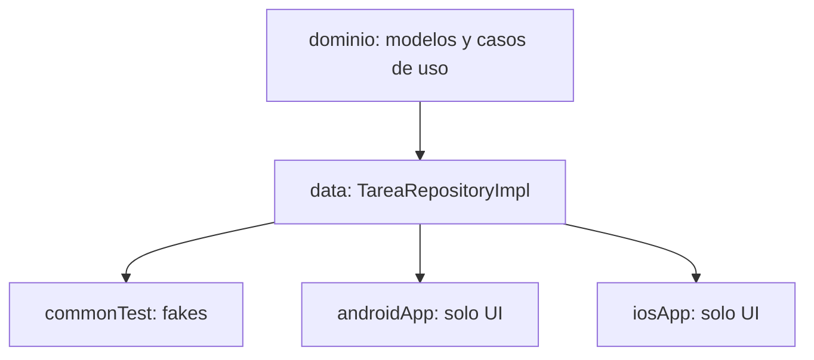
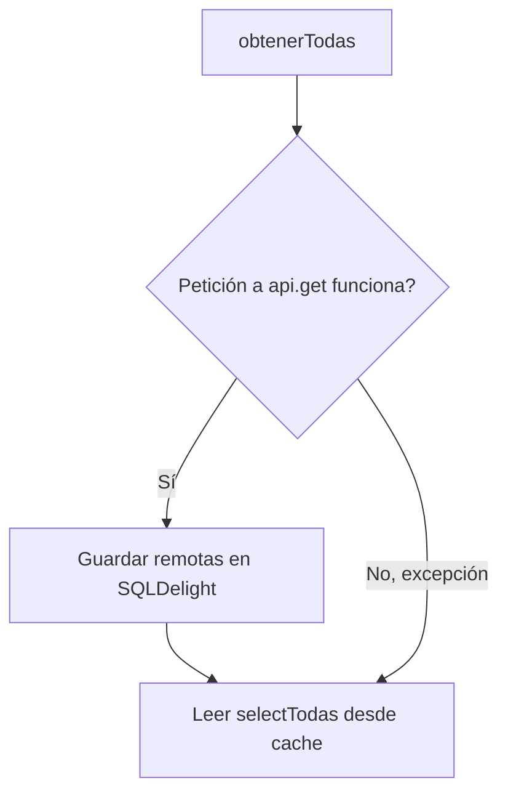
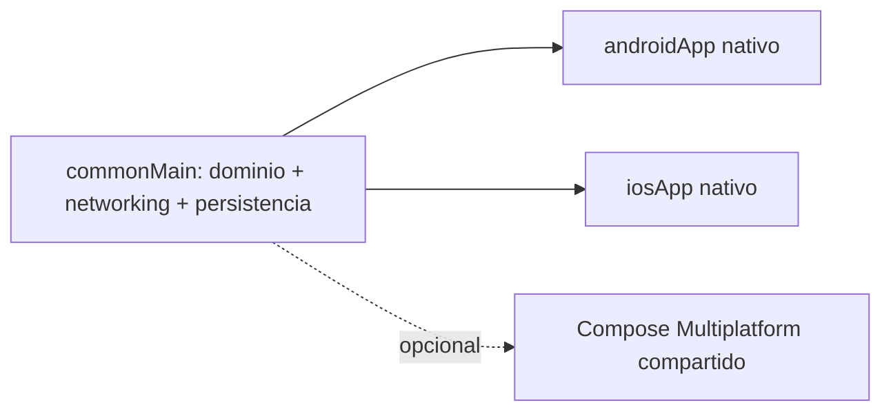

# Módulo 11: Proyecto integrador — app KMP completa


## Aprende construyendo


### Tema 1: Arquitectura del proyecto integrador · Avanzado · 45 min

<details open>
<summary><strong>Capa 1 — Lectura</strong></summary>

#### ► DE QUÉ TRATA
Al finalizar vas a organizar el proyecto integrador completo en commonMain (dominio + datos), commonTest, androidApp e iosApp, documentando qué vive en cada capa. Prerrequisitos: Módulos 0-10 completados.

#### ► LA IDEA EN UNA FRASE
**Al finalizar vas a organizar el proyecto integrador completo en commonMain (dominio + datos), commonTest, androidApp e iosApp, documentando qué vive en cada capa.**

#### ► POR QUÉ EXISTE ESTO
Resuelve un problema real de diseño o implementación y evita decisiones a ciegas.

#### ► LA ANALOGÍA
Piensa en arquitectura del proyecto integrador como una herramienta de taller: útil cuando conoces su propósito y sus límites.
**Dónde se rompe la analogía:** en software, los efectos dependen del contexto, la escala y los trade-offs.

#### ► CÓMO FUNCIONA


#### ► LO QUE PUEDE SALIR MAL
| Síntoma | Causa probable | Arreglo |
|---|---|---|
| Arquitectura del proyecto integrador se aplica pero el resultado no mejora | Se usó sin medir el problema real | Mide antes y compara contra la alternativa simple |
| Aparece complejidad inesperada | Se adoptó la técnica sin comprender sus trade-offs | Vuelve a la sección de trade-offs y reduce el alcance |
| Falla en un caso límite | Se asumió un contexto que no se cumple | Prueba el caso límite y documenta cuándo NO usarlo |

#### ► TRADE-OFFS
| Opción | Cuándo usarla | Cuándo NO usarla |
|---|---|---|
| Usar Arquitectura del proyecto integrador | Cuando el problema coincide con su propósito y el beneficio es observable | Cuando agrega complejidad sin resolver un problema real |
| Alternativa más simple | Cuando el contexto es pequeño, estable o fácil de razonar | Cuando ya demostró no escalar o no cumplir el requisito |
| Postergar la decisión | Cuando falta evidencia del problema | Cuando el costo de esperar es mayor que el costo de probar |

#### ► CUÁNDO NO USAR ESTO
No uses arquitectura del proyecto integrador por defecto. Aplícalo cuando el problema lo justifique y puedas verificar el beneficio; si una alternativa más simple resuelve igual, prefiérela.

#### ► DE VUELTA A LA ANALOGÍA
Volviendo a la analogía: arquitectura del proyecto integrador funciona como el modelo inicial, pero recuerda dónde se rompe: en producción importan la evidencia, la escala y el costo de equivocarte.

#### ► LO QUE DEBES RECORDAR
- Arquitectura del proyecto integrador existe para resolver un problema específico.
- Mide antes de adoptar complejidad.
- Conoce el caso donde NO usarlo.
- Verifica con evidencia observable.

#### ► PREGUNTAS PARA PENSAR
1. ¿Qué problema concreto resuelve arquitectura del proyecto integrador en tu contexto?
2. ¿Cómo sabrías que arquitectura del proyecto integrador no está funcionando bien?
3. ¿Qué alternativa más simple considerarías antes de usar arquitectura del proyecto integrador?

</details>

<details>
<summary><strong>Capa 2 — Construcción</strong></summary>

#### Código y verificación
```
shared/src/
  commonMain/kotlin/
    dominio/        ← modelos + casos de uso (módulo 4)
    data/           ← TareaRepositoryImpl (Ktor + SQLDelight, módulos 5-6)
  commonTest/        ← tests con fakes (módulo 9)
androidApp/           ← UI Compose o Jetpack Compose nativo
iosApp/                ← UI SwiftUI consumiendo Shared.framework (módulo 8)
```


```text
shared/src/
  commonMain/kotlin/
    dominio/        <- modelos + casos de uso (Módulo 4)
    data/           <- TareaRepositoryImpl (Ktor + SQLDelight, Módulos 5-6)
  commonTest/        <- tests con fakes (Módulo 9)
androidApp/           <- UI Compose o Jetpack Compose nativo
iosApp/                <- UI SwiftUI consumiendo Shared.framework (Módulo 8)
```

```bash
./gradlew :shared:allTests
```

</details>

### Tema 2: Sincronización de datos remotos con caché local · Avanzado · 45 min

<details open>
<summary><strong>Capa 1 — Lectura</strong></summary>

#### ► DE QUÉ TRATA
Al finalizar vas a implementar un TareaRepositoryImpl que combine Ktor (datos remotos) y SQLDelight (caché local) con fallback automático cuando la red falla. Prerrequisitos: Tema 1 de este módulo.

#### ► LA IDEA EN UNA FRASE
**Al finalizar vas a implementar un TareaRepositoryImpl que combine Ktor (datos remotos) y SQLDelight (caché local) con fallback automático cuando la red falla.**

#### ► POR QUÉ EXISTE ESTO
Resuelve un problema real de diseño o implementación y evita decisiones a ciegas.

#### ► LA ANALOGÍA
Piensa en sincronización de datos remotos con caché local como una herramienta de taller: útil cuando conoces su propósito y sus límites.
**Dónde se rompe la analogía:** en software, los efectos dependen del contexto, la escala y los trade-offs.

#### ► CÓMO FUNCIONA


#### ► LO QUE PUEDE SALIR MAL
| Síntoma | Causa probable | Arreglo |
|---|---|---|
| Sincronización de datos remotos con caché local se aplica pero el resultado no mejora | Se usó sin medir el problema real | Mide antes y compara contra la alternativa simple |
| Aparece complejidad inesperada | Se adoptó la técnica sin comprender sus trade-offs | Vuelve a la sección de trade-offs y reduce el alcance |
| Falla en un caso límite | Se asumió un contexto que no se cumple | Prueba el caso límite y documenta cuándo NO usarlo |

#### ► TRADE-OFFS
| Opción | Cuándo usarla | Cuándo NO usarla |
|---|---|---|
| Usar Sincronización de datos remotos con caché local | Cuando el problema coincide con su propósito y el beneficio es observable | Cuando agrega complejidad sin resolver un problema real |
| Alternativa más simple | Cuando el contexto es pequeño, estable o fácil de razonar | Cuando ya demostró no escalar o no cumplir el requisito |
| Postergar la decisión | Cuando falta evidencia del problema | Cuando el costo de esperar es mayor que el costo de probar |

#### ► CUÁNDO NO USAR ESTO
No uses sincronización de datos remotos con caché local por defecto. Aplícalo cuando el problema lo justifique y puedas verificar el beneficio; si una alternativa más simple resuelve igual, prefiérela.

#### ► DE VUELTA A LA ANALOGÍA
Volviendo a la analogía: sincronización de datos remotos con caché local funciona como el modelo inicial, pero recuerda dónde se rompe: en producción importan la evidencia, la escala y el costo de equivocarte.

#### ► LO QUE DEBES RECORDAR
- Sincronización de datos remotos con caché local existe para resolver un problema específico.
- Mide antes de adoptar complejidad.
- Conoce el caso donde NO usarlo.
- Verifica con evidencia observable.

#### ► PREGUNTAS PARA PENSAR
1. ¿Qué problema concreto resuelve sincronización de datos remotos con caché local en tu contexto?
2. ¿Cómo sabrías que sincronización de datos remotos con caché local no está funcionando bien?
3. ¿Qué alternativa más simple considerarías antes de usar sincronización de datos remotos con caché local?

</details>

<details>
<summary><strong>Capa 2 — Construcción</strong></summary>

#### Código y verificación
```kotlin
class TareaRepositoryImpl(
    private val api: HttpClient,
    private val db: Database,
) : TareaRepository {
    override suspend fun obtenerTodas(): List<Tarea> = try {
        val remotas = api.get("/tareas").body<List<TareaDTO>>()
        db.tareaQueries.transaction { remotas.forEach { guardarLocal(it) } }
        db.tareaQueries.selectTodas().executeAsList()
    } catch (e: Exception) {
        db.tareaQueries.selectTodas().executeAsList() // fallback offline a la caché local
    }
}
```


```kotlin
class TareaRepositoryImpl(
    private val api: HttpClient,
    private val db: Database,
) : TareaRepository {
    override suspend fun obtenerTodas(): List<Tarea> = try {
        val remotas = api.get("/tareas").body<List<TareaDTO>>()
        db.tareaQueries.transaction { remotas.forEach { guardarLocal(it) } }
        db.tareaQueries.selectTodas().executeAsList()
    } catch (e: Exception) {
        db.tareaQueries.selectTodas().executeAsList() // fallback offline a la caché local
    }
}
```

```bash
./gradlew :shared:allTests
```

</details>

### Tema 3: Cierre del track — la promesa realista de KMP · Avanzado · 45 min

<details open>
<summary><strong>Capa 1 — Lectura</strong></summary>

#### ► DE QUÉ TRATA
Al finalizar vas a auditar el proyecto integrador completo y documentar explícitamente qué se comparte (y por qué) frente a qué se mantuvo nativo por plataforma. Prerrequisitos: Tema 2 de este módulo.

#### ► LA IDEA EN UNA FRASE
**Al finalizar vas a auditar el proyecto integrador completo y documentar explícitamente qué se comparte (y por qué) frente a qué se mantuvo nativo por plataforma.**

#### ► POR QUÉ EXISTE ESTO
Resuelve un problema real de diseño o implementación y evita decisiones a ciegas.

#### ► LA ANALOGÍA
Piensa en cierre del track — la promesa realista de kmp como una herramienta de taller: útil cuando conoces su propósito y sus límites.
**Dónde se rompe la analogía:** en software, los efectos dependen del contexto, la escala y los trade-offs.

#### ► CÓMO FUNCIONA


#### ► LO QUE PUEDE SALIR MAL
| Síntoma | Causa probable | Arreglo |
|---|---|---|
| Cierre del track — la promesa realista de KMP se aplica pero el resultado no mejora | Se usó sin medir el problema real | Mide antes y compara contra la alternativa simple |
| Aparece complejidad inesperada | Se adoptó la técnica sin comprender sus trade-offs | Vuelve a la sección de trade-offs y reduce el alcance |
| Falla en un caso límite | Se asumió un contexto que no se cumple | Prueba el caso límite y documenta cuándo NO usarlo |

#### ► TRADE-OFFS
| Opción | Cuándo usarla | Cuándo NO usarla |
|---|---|---|
| Usar Cierre del track — la promesa realista de KMP | Cuando el problema coincide con su propósito y el beneficio es observable | Cuando agrega complejidad sin resolver un problema real |
| Alternativa más simple | Cuando el contexto es pequeño, estable o fácil de razonar | Cuando ya demostró no escalar o no cumplir el requisito |
| Postergar la decisión | Cuando falta evidencia del problema | Cuando el costo de esperar es mayor que el costo de probar |

#### ► CUÁNDO NO USAR ESTO
No uses cierre del track — la promesa realista de kmp por defecto. Aplícalo cuando el problema lo justifique y puedas verificar el beneficio; si una alternativa más simple resuelve igual, prefiérela.

#### ► DE VUELTA A LA ANALOGÍA
Volviendo a la analogía: cierre del track — la promesa realista de kmp funciona como el modelo inicial, pero recuerda dónde se rompe: en producción importan la evidencia, la escala y el costo de equivocarte.

#### ► LO QUE DEBES RECORDAR
- Cierre del track — la promesa realista de KMP existe para resolver un problema específico.
- Mide antes de adoptar complejidad.
- Conoce el caso donde NO usarlo.
- Verifica con evidencia observable.

#### ► PREGUNTAS PARA PENSAR
1. ¿Qué problema concreto resuelve cierre del track — la promesa realista de kmp en tu contexto?
2. ¿Cómo sabrías que cierre del track — la promesa realista de kmp no está funcionando bien?
3. ¿Qué alternativa más simple considerarías antes de usar cierre del track — la promesa realista de kmp?

</details>

<details>
<summary><strong>Capa 2 — Construcción</strong></summary>

#### Código y verificación
```
Compartido (redundancia pura si se duplicara): lógica de negocio, networking, persistencia
Decisión de arquitectura del equipo: UI nativa (fidelidad) vs Compose Multiplatform (velocidad compartida)
```


```text
Compartido (redundancia pura si se duplicara): lógica de negocio, networking, persistencia
Decisión de arquitectura del equipo: UI nativa (fidelidad) vs Compose Multiplatform (velocidad compartida)
```

```bash
./gradlew :shared:allTests
```

</details>
