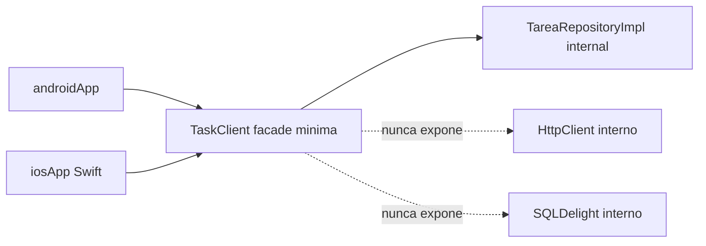
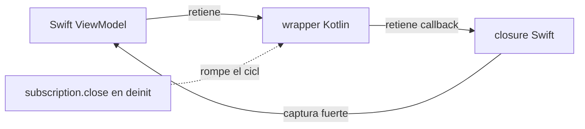
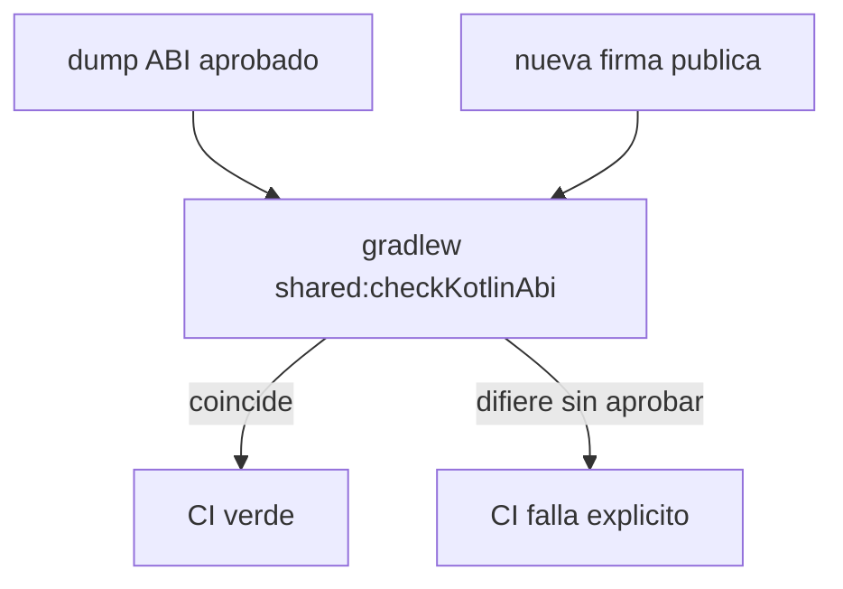

# Módulo 12: KMP en producción — fronteras, compatibilidad y observabilidad

La app integradora demuestra que el código común compila y funciona. Un producto multiplataforma añade otra responsabilidad: una decisión en `commonMain` se convierte en API para equipos, compiladores y runtimes diferentes. Este módulo enseña a compartir solo lo estable, mantener la frontera consumible y actualizar Android/iOS sin obligarlos a desplegar simultáneamente.


## Aprende construyendo


### Tema 1: La mejor frontera compartida es deliberadamente pequeña · Avanzado · 45 min

<details open>
<summary><strong>Capa 1 — Lectura</strong></summary>

#### ► DE QUÉ TRATA
Al finalizar vas a diseñar una facade TaskClient mínima en commonMain que exponga solo lo que Android e iOS necesitan consumir, sin filtrar tipos internos del dominio. Prerrequisitos: Módulo 11 completado.

#### ► LA IDEA EN UNA FRASE
**Al finalizar vas a diseñar una facade TaskClient mínima en commonMain que exponga solo lo que Android e iOS necesitan consumir, sin filtrar tipos internos del dominio.**

#### ► POR QUÉ EXISTE ESTO
Resuelve un problema real de diseño o implementación y evita decisiones a ciegas.

#### ► LA ANALOGÍA
Piensa en la mejor frontera compartida es deliberadamente pequeña como una herramienta de taller: útil cuando conoces su propósito y sus límites.
**Dónde se rompe la analogía:** en software, los efectos dependen del contexto, la escala y los trade-offs.

#### ► CÓMO FUNCIONA


#### ► LO QUE PUEDE SALIR MAL
| Síntoma | Causa probable | Arreglo |
|---|---|---|
| La mejor frontera compartida es deliberadamente pequeña se aplica pero el resultado no mejora | Se usó sin medir el problema real | Mide antes y compara contra la alternativa simple |
| Aparece complejidad inesperada | Se adoptó la técnica sin comprender sus trade-offs | Vuelve a la sección de trade-offs y reduce el alcance |
| Falla en un caso límite | Se asumió un contexto que no se cumple | Prueba el caso límite y documenta cuándo NO usarlo |

#### ► TRADE-OFFS
| Opción | Cuándo usarla | Cuándo NO usarla |
|---|---|---|
| Usar La mejor frontera compartida es deliberadamente pequeña | Cuando el problema coincide con su propósito y el beneficio es observable | Cuando agrega complejidad sin resolver un problema real |
| Alternativa más simple | Cuando el contexto es pequeño, estable o fácil de razonar | Cuando ya demostró no escalar o no cumplir el requisito |
| Postergar la decisión | Cuando falta evidencia del problema | Cuando el costo de esperar es mayor que el costo de probar |

#### ► CUÁNDO NO USAR ESTO
No uses la mejor frontera compartida es deliberadamente pequeña por defecto. Aplícalo cuando el problema lo justifique y puedas verificar el beneficio; si una alternativa más simple resuelve igual, prefiérela.

#### ► DE VUELTA A LA ANALOGÍA
Volviendo a la analogía: la mejor frontera compartida es deliberadamente pequeña funciona como el modelo inicial, pero recuerda dónde se rompe: en producción importan la evidencia, la escala y el costo de equivocarte.

#### ► LO QUE DEBES RECORDAR
- La mejor frontera compartida es deliberadamente pequeña existe para resolver un problema específico.
- Mide antes de adoptar complejidad.
- Conoce el caso donde NO usarlo.
- Verifica con evidencia observable.

#### ► PREGUNTAS PARA PENSAR
1. ¿Qué problema concreto resuelve la mejor frontera compartida es deliberadamente pequeña en tu contexto?
2. ¿Cómo sabrías que la mejor frontera compartida es deliberadamente pequeña no está funcionando bien?
3. ¿Qué alternativa más simple considerarías antes de usar la mejor frontera compartida es deliberadamente pequeña?

</details>

<details>
<summary><strong>Capa 2 — Construcción</strong></summary>

#### Código y verificación
```swift
final class TaskScreenModel: ObservableObject {
    private var observation: Cancellable?

    func start(client: SharedTaskClient) {
        observation = client.observe { [weak self] value, error in
            guard let self else { return }
            self.apply(value, error)
        }
    }

    deinit { observation?.cancel() }
}
```

```text
Android UI -> adapter Kotlin --\
                              facade shared -> dominio/repositorios
iOS SwiftUI -> wrapper Swift --/        |
                          interfaces de plataforma (clock, secure store)
cancelación/lifecycle deben cruzar en ambas direcciones
```


```kotlin
public interface TaskClient {
    public suspend fun task(id: TaskId): TaskResult
    public fun observeTasks(): Flow<List<TaskSummary>>
}

public sealed interface TaskResult {
    public data class Found(val task: Task) : TaskResult
    public data object NotFound : TaskResult
    public data object Unauthorized : TaskResult
    public data class Unavailable(val retryable: Boolean) : TaskResult
}
```

```bash
./gradlew :shared:allTests
```

</details>

### Tema 2: Garbage collection no cierra sockets ni rompe ciclos externos · Avanzado · 45 min

<details open>
<summary><strong>Capa 1 — Lectura</strong></summary>

#### ► DE QUÉ TRATA
Al finalizar vas a implementar un TaskSubscription: AutoCloseable que cancele explícitamente su Job al cerrarse, evitando que una pantalla de iOS retenida indefinidamente siga consumiendo un Flow compartido. Prerrequisitos: Tema 1 de este módulo.

#### ► LA IDEA EN UNA FRASE
**Al finalizar vas a implementar un TaskSubscription: AutoCloseable que cancele explícitamente su Job al cerrarse, evitando que una pantalla de iOS retenida indefinidamente siga consumiendo un Flow compartido.**

#### ► POR QUÉ EXISTE ESTO
Resuelve un problema real de diseño o implementación y evita decisiones a ciegas.

#### ► LA ANALOGÍA
Piensa en garbage collection no cierra sockets ni rompe ciclos externos como una herramienta de taller: útil cuando conoces su propósito y sus límites.
**Dónde se rompe la analogía:** en software, los efectos dependen del contexto, la escala y los trade-offs.

#### ► CÓMO FUNCIONA


#### ► LO QUE PUEDE SALIR MAL
| Síntoma | Causa probable | Arreglo |
|---|---|---|
| Garbage collection no cierra sockets ni rompe ciclos externos se aplica pero el resultado no mejora | Se usó sin medir el problema real | Mide antes y compara contra la alternativa simple |
| Aparece complejidad inesperada | Se adoptó la técnica sin comprender sus trade-offs | Vuelve a la sección de trade-offs y reduce el alcance |
| Falla en un caso límite | Se asumió un contexto que no se cumple | Prueba el caso límite y documenta cuándo NO usarlo |

#### ► TRADE-OFFS
| Opción | Cuándo usarla | Cuándo NO usarla |
|---|---|---|
| Usar Garbage collection no cierra sockets ni rompe ciclos externos | Cuando el problema coincide con su propósito y el beneficio es observable | Cuando agrega complejidad sin resolver un problema real |
| Alternativa más simple | Cuando el contexto es pequeño, estable o fácil de razonar | Cuando ya demostró no escalar o no cumplir el requisito |
| Postergar la decisión | Cuando falta evidencia del problema | Cuando el costo de esperar es mayor que el costo de probar |

#### ► CUÁNDO NO USAR ESTO
No uses garbage collection no cierra sockets ni rompe ciclos externos por defecto. Aplícalo cuando el problema lo justifique y puedas verificar el beneficio; si una alternativa más simple resuelve igual, prefiérela.

#### ► DE VUELTA A LA ANALOGÍA
Volviendo a la analogía: garbage collection no cierra sockets ni rompe ciclos externos funciona como el modelo inicial, pero recuerda dónde se rompe: en producción importan la evidencia, la escala y el costo de equivocarte.

#### ► LO QUE DEBES RECORDAR
- Garbage collection no cierra sockets ni rompe ciclos externos existe para resolver un problema específico.
- Mide antes de adoptar complejidad.
- Conoce el caso donde NO usarlo.
- Verifica con evidencia observable.

#### ► PREGUNTAS PARA PENSAR
1. ¿Qué problema concreto resuelve garbage collection no cierra sockets ni rompe ciclos externos en tu contexto?
2. ¿Cómo sabrías que garbage collection no cierra sockets ni rompe ciclos externos no está funcionando bien?
3. ¿Qué alternativa más simple considerarías antes de usar garbage collection no cierra sockets ni rompe ciclos externos?

</details>

<details>
<summary><strong>Capa 2 — Construcción</strong></summary>

#### Código y verificación
```text
Swift ViewModel -> Kotlin client -> callback closure -> Swift ViewModel
       ARC                GC                  captura fuerte
cancel handle + weak capture + lifecycle -> romper ciclo
GC Kotlin != close(driver/socket/native handle)
```


```kotlin
public class TaskSubscription internal constructor(
    private val job: Job,
) : AutoCloseable {
    override fun close() = job.cancel()
}

public fun TaskClient.subscribe(
    scope: CoroutineScope,
    listener: (List<TaskSummary>) -> Unit,
): TaskSubscription = TaskSubscription(
    scope.launch { observeTasks().collect(listener) },
)
```

```bash
./gradlew :shared:allTests
```

</details>

### Tema 3: Un artefacto compatible necesita más que el mismo número de versión · Avanzado · 45 min

<details open>
<summary><strong>Capa 1 — Lectura</strong></summary>

#### ► DE QUÉ TRATA
Al finalizar vas a activar la validación binaria del plugin de Kotlin (abiValidation) para que check falle ante cualquier cambio de API no aprobado explícitamente. Prerrequisitos: Tema 2 de este módulo; JDK 25 y Gradle 9.7+ para el ejemplo.

#### ► LA IDEA EN UNA FRASE
**Al finalizar vas a activar la validación binaria del plugin de Kotlin (abiValidation) para que check falle ante cualquier cambio de API no aprobado explícitamente.**

#### ► POR QUÉ EXISTE ESTO
Resuelve un problema real de diseño o implementación y evita decisiones a ciegas.

#### ► LA ANALOGÍA
La compatibilidad de fuente significa que el consumidor recompila; la binaria, que un binario ya compilado enlaza; la conductual, que obtiene el significado esperado — podés conservar la firma y romper el comportamiento cambiando orden, threading o un valor default. La analogía es mantener el mismo conector físico sin garantizar el mismo voltaje ni protocolo.

**Conceptos clave:** source compatibility, binary compatibility, behavioral compatibility, API dump, KLib, ABI, semantic versioning, XCFramework, Maven publication, checksum, schema, migration, serialization y deprecation.

Compatibilidad source significa que el consumidor recompila; binary, que un binario ya compilado enlaza; behavioral, que obtiene significado esperado. Puedes conservar firma y romper comportamiento cambiando orden, threading, valor default o error. Versiona semánticamente, pero documenta también garantías.

La validación binaria del plugin Kotlin genera dumps ABI y hace fallar `check` ante un cambio no aprobado. El soporte para KLib multiplataforma puede depender de versión/estado; úsalo junto a pruebas de compilación reales de consumidores Android y iOS, no como única evidencia.

```kotlin
kotlin {
    @OptIn(org.jetbrains.kotlin.gradle.dsl.abi.ExperimentalAbiValidation::class)
    abiValidation()
}
```

Revisa el dump como código. Añadir método abstracto a interfaz implementada por apps puede romper; cambiar data class altera `copy/componentN`; exponer dependencia filtra sus tipos. Mantén `internal` por defecto y surface mínima.

Datos persisten más que binarios. SQLDelight migrations deben funcionar desde cada versión soportada en ambas plataformas. `kotlinx.serialization` requiere nombres estables (`@SerialName`), defaults para campos añadidos y política ante desconocidos. Quitar/renombrar enum o campo rompe datos cacheados y mensajes en vuelo.

Publicación Maven produce metadata raíz y artefactos por target; Apple suele consumir XCFramework por SwiftPM/CocoaPods/direct integration. Firma artefactos, publica sources/docs, checksums y coordenadas inmutables. Nunca sobrescribas `1.2.0`. Construir Apple exige runner macOS y Xcode compatible; fija matriz.

No exportes todos los transitive dependencies. Decide static/dynamic framework y export explícito: exportar aumenta superficie/tamaño y puede duplicar símbolos. Prueba una app consumidora desde artefacto remoto, no solo composite build local.

**Analogía:** mantener el mismo conector físico no garantiza voltaje ni protocolo. ABI conserva encaje; contrato conductual conserva que el dispositivo funcione.

**¿Por qué es importante?** porque Android/iOS no actualizan juntos y un SDK roto bloquea equipos distintos o falla solo después de instalar una migración antigua.

**Casos de uso reales:** nueva función abstracta, data class pública, enum serializado, XCFramework, KLib, Maven metadata, migración desde N-2 y dependencia exportada.

**Diagrama:**

```text
API source -> updateKotlinAbi/checkKotlinAbi -> ABI/KLib
                          `-> consumer compile Android + Swift
schemas N-2 -> migraciones -> datos actuales
tag inmutable -> Maven targets + XCFramework -> apps de prueba -> publicar
```

La configuración de `abiValidation` vive en `shared/build.gradle.kts`, y `./gradlew :shared:checkKotlinAbi` es el comando que la aplica en cada push:



Tu proyecto RutaFlow ilustra el mismo riesgo sin `abiValidation`: si el `SyncEngine` que creas en `shared/src/commonMain/kotlin/com/academia/kmp/SyncEngine.kt` cambiara el orden de los parámetros de `drain()` sin que ningún check lo detecte, un consumidor Android que todavía no recompiló contra la nueva versión podría enlazar en runtime contra una firma distinta a la que espera. **Cuándo no conviene** activar `abiValidation` desde el primer commit: en un módulo compartido que todavía no tiene ningún consumidor externo publicado (solo se consume por fuente, dentro del mismo build), el dump de API es puro overhead de mantenimiento sin ningún consumidor al que proteger — conviene activarlo recién cuando el artefacto se publica como dependencia binaria real, no antes.

**Dónde se rompe la analogía:** el modelo simplifica la realidad; en producción influyen escala, fallos, costo y contexto.

#### ► CÓMO FUNCIONA


#### ► LO QUE PUEDE SALIR MAL
| Síntoma | Causa probable | Arreglo |
|---|---|---|
| Un artefacto compatible necesita más que el mismo número de versión se aplica pero el resultado no mejora | Se usó sin medir el problema real | Mide antes y compara contra la alternativa simple |
| Aparece complejidad inesperada | Se adoptó la técnica sin comprender sus trade-offs | Vuelve a la sección de trade-offs y reduce el alcance |
| Falla en un caso límite | Se asumió un contexto que no se cumple | Prueba el caso límite y documenta cuándo NO usarlo |

#### ► TRADE-OFFS
| Opción | Cuándo usarla | Cuándo NO usarla |
|---|---|---|
| Usar Un artefacto compatible necesita más que el mismo número de versión | Cuando el problema coincide con su propósito y el beneficio es observable | Cuando agrega complejidad sin resolver un problema real |
| Alternativa más simple | Cuando el contexto es pequeño, estable o fácil de razonar | Cuando ya demostró no escalar o no cumplir el requisito |
| Postergar la decisión | Cuando falta evidencia del problema | Cuando el costo de esperar es mayor que el costo de probar |

#### ► CUÁNDO NO USAR ESTO
No uses un artefacto compatible necesita más que el mismo número de versión por defecto. Aplícalo cuando el problema lo justifique y puedas verificar el beneficio; si una alternativa más simple resuelve igual, prefiérela.

#### ► DE VUELTA A LA ANALOGÍA
Volviendo a la analogía: un artefacto compatible necesita más que el mismo número de versión funciona como el modelo inicial, pero recuerda dónde se rompe: en producción importan la evidencia, la escala y el costo de equivocarte.

#### ► LO QUE DEBES RECORDAR
- Un artefacto compatible necesita más que el mismo número de versión existe para resolver un problema específico.
- Mide antes de adoptar complejidad.
- Conoce el caso donde NO usarlo.
- Verifica con evidencia observable.

#### ► PREGUNTAS PARA PENSAR
1. ¿Qué problema concreto resuelve un artefacto compatible necesita más que el mismo número de versión en tu contexto?
2. ¿Cómo sabrías que un artefacto compatible necesita más que el mismo número de versión no está funcionando bien?
3. ¿Qué alternativa más simple considerarías antes de usar un artefacto compatible necesita más que el mismo número de versión?

</details>

<details>
<summary><strong>Capa 2 — Construcción</strong></summary>

#### Código y verificación
```kotlin
kotlin {
    @OptIn(org.jetbrains.kotlin.gradle.dsl.abi.ExperimentalAbiValidation::class)
    abiValidation()
}
```

```text
API source -> updateKotlinAbi/checkKotlinAbi -> ABI/KLib
                          `-> consumer compile Android + Swift
schemas N-2 -> migraciones -> datos actuales
tag inmutable -> Maven targets + XCFramework -> apps de prueba -> publicar
```


```bash
mkdir -p ejemplo-abi/src/commonMain/kotlin/academia && cd ejemplo-abi
```

```kotlin
rootProject.name = "ejemplo-abi"
```

```kotlin
plugins {
    kotlin("multiplatform") version "2.4.21"
}

repositories {
    mavenCentral()
}

kotlin {
    jvm()
    @OptIn(org.jetbrains.kotlin.gradle.dsl.abi.ExperimentalAbiValidation::class)
    abiValidation()
}
```

</details>

### Tema 4: Un fallo compartido necesita símbolos y contexto de ambas plataformas · Avanzado · 45 min

<details open>
<summary><strong>Capa 1 — Lectura</strong></summary>

#### ► DE QUÉ TRATA
Al finalizar vas a inyectar una interfaz Diagnostics en commonMain y provocar el mismo fallo compartido en ambas apps para confirmar que puede simbolizarse con mapping/dSYM en cada plataforma. Prerrequisitos: Tema 3 de este módulo.

#### ► LA IDEA EN UNA FRASE
**Al finalizar vas a inyectar una interfaz Diagnostics en commonMain y provocar el mismo fallo compartido en ambas apps para confirmar que puede simbolizarse con mapping/dSYM en cada plataforma.**

#### ► POR QUÉ EXISTE ESTO
Resuelve un problema real de diseño o implementación y evita decisiones a ciegas.

#### ► LA ANALOGÍA
Piensa en un fallo compartido necesita símbolos y contexto de ambas plataformas como una herramienta de taller: útil cuando conoces su propósito y sus límites.
**Dónde se rompe la analogía:** en software, los efectos dependen del contexto, la escala y los trade-offs.

#### ► CÓMO FUNCIONA
1. Identifica el problema que un fallo compartido necesita símbolos y contexto de ambas plataformas resuelve.
2. Observa sus componentes y relaciones.
3. Aplica la opción más simple que funcione.
4. Verifica el resultado y los límites.

#### ► LO QUE PUEDE SALIR MAL
| Síntoma | Causa probable | Arreglo |
|---|---|---|
| Un fallo compartido necesita símbolos y contexto de ambas plataformas se aplica pero el resultado no mejora | Se usó sin medir el problema real | Mide antes y compara contra la alternativa simple |
| Aparece complejidad inesperada | Se adoptó la técnica sin comprender sus trade-offs | Vuelve a la sección de trade-offs y reduce el alcance |
| Falla en un caso límite | Se asumió un contexto que no se cumple | Prueba el caso límite y documenta cuándo NO usarlo |

#### ► TRADE-OFFS
| Opción | Cuándo usarla | Cuándo NO usarla |
|---|---|---|
| Usar Un fallo compartido necesita símbolos y contexto de ambas plataformas | Cuando el problema coincide con su propósito y el beneficio es observable | Cuando agrega complejidad sin resolver un problema real |
| Alternativa más simple | Cuando el contexto es pequeño, estable o fácil de razonar | Cuando ya demostró no escalar o no cumplir el requisito |
| Postergar la decisión | Cuando falta evidencia del problema | Cuando el costo de esperar es mayor que el costo de probar |

#### ► CUÁNDO NO USAR ESTO
No uses un fallo compartido necesita símbolos y contexto de ambas plataformas por defecto. Aplícalo cuando el problema lo justifique y puedas verificar el beneficio; si una alternativa más simple resuelve igual, prefiérela.

#### ► DE VUELTA A LA ANALOGÍA
Volviendo a la analogía: un fallo compartido necesita símbolos y contexto de ambas plataformas funciona como el modelo inicial, pero recuerda dónde se rompe: en producción importan la evidencia, la escala y el costo de equivocarte.

#### ► LO QUE DEBES RECORDAR
- Un fallo compartido necesita símbolos y contexto de ambas plataformas existe para resolver un problema específico.
- Mide antes de adoptar complejidad.
- Conoce el caso donde NO usarlo.
- Verifica con evidencia observable.

#### ► PREGUNTAS PARA PENSAR
1. ¿Qué problema concreto resuelve un fallo compartido necesita símbolos y contexto de ambas plataformas en tu contexto?
2. ¿Cómo sabrías que un fallo compartido necesita símbolos y contexto de ambas plataformas no está funcionando bien?
3. ¿Qué alternativa más simple considerarías antes de usar un fallo compartido necesita símbolos y contexto de ambas plataformas?

</details>

<details>
<summary><strong>Capa 2 — Construcción</strong></summary>

#### Código y verificación
```kotlin
public interface Diagnostics {
    public fun record(
        event: DiagnosticEvent,
        attributes: Map<String, String> = emptyMap(),
    )
}

public enum class DiagnosticEvent { SYNC_STARTED, SYNC_CONFLICT, SYNC_FAILED }
```

```text
common failure -> Android stack + mapping --\
               -> iOS stack + dSYM --------> build ID -> causa compartida
SDK release -> compatibility window -> Android/iOS rollouts independientes
metrics por sdk/app/OS -> promover | detener | forward fix
```

```kotlin
public interface Diagnostics {
    public fun record(
        event: DiagnosticEvent,
        attributes: Map<String, String> = emptyMap(),
    )
}

public enum class DiagnosticEvent { SYNC_STARTED, SYNC_CONFLICT, SYNC_FAILED }
```

```bash
./gradlew :shared:allTests
```

</details>

### Kotlin 2.4 y estado real de cada target

<details open>
<summary><strong>Capa 1 — Lectura</strong></summary>

#### ► DE QUÉ TRATA
Este tema te guía por kotlin 2.4 y estado real de cada target con foco en comprensión antes de implementación.

#### ► LA IDEA EN UNA FRASE
**Entender kotlin 2.4 y estado real de cada target te permite tomar mejores decisiones técnicas.**

#### ► POR QUÉ EXISTE ESTO
Resuelve un problema real de diseño o implementación y evita decisiones a ciegas.

#### ► LA ANALOGÍA
Piensa en kotlin 2.4 y estado real de cada target como una herramienta de taller: útil cuando conoces su propósito y sus límites.
**Dónde se rompe la analogía:** en software, los efectos dependen del contexto, la escala y los trade-offs.

#### ► CÓMO FUNCIONA
1. Identifica el problema que kotlin 2.4 y estado real de cada target resuelve.
2. Observa sus componentes y relaciones.
3. Aplica la opción más simple que funcione.
4. Verifica el resultado y los límites.

#### ► LO QUE PUEDE SALIR MAL
| Síntoma | Causa probable | Arreglo |
|---|---|---|
| Kotlin 2.4 y estado real de cada target se aplica pero el resultado no mejora | Se usó sin medir el problema real | Mide antes y compara contra la alternativa simple |
| Aparece complejidad inesperada | Se adoptó la técnica sin comprender sus trade-offs | Vuelve a la sección de trade-offs y reduce el alcance |
| Falla en un caso límite | Se asumió un contexto que no se cumple | Prueba el caso límite y documenta cuándo NO usarlo |

#### ► TRADE-OFFS
| Opción | Cuándo usarla | Cuándo NO usarla |
|---|---|---|
| Usar Kotlin 2.4 y estado real de cada target | Cuando el problema coincide con su propósito y el beneficio es observable | Cuando agrega complejidad sin resolver un problema real |
| Alternativa más simple | Cuando el contexto es pequeño, estable o fácil de razonar | Cuando ya demostró no escalar o no cumplir el requisito |
| Postergar la decisión | Cuando falta evidencia del problema | Cuando el costo de esperar es mayor que el costo de probar |

#### ► CUÁNDO NO USAR ESTO
No uses kotlin 2.4 y estado real de cada target por defecto. Aplícalo cuando el problema lo justifique y puedas verificar el beneficio; si una alternativa más simple resuelve igual, prefiérela.

#### ► DE VUELTA A LA ANALOGÍA
Volviendo a la analogía: kotlin 2.4 y estado real de cada target funciona como el modelo inicial, pero recuerda dónde se rompe: en producción importan la evidencia, la escala y el costo de equivocarte.

#### ► LO QUE DEBES RECORDAR
- Kotlin 2.4 y estado real de cada target existe para resolver un problema específico.
- Mide antes de adoptar complejidad.
- Conoce el caso donde NO usarlo.
- Verifica con evidencia observable.

#### ► PREGUNTAS PARA PENSAR
1. ¿Qué problema concreto resuelve kotlin 2.4 y estado real de cada target en tu contexto?
2. ¿Cómo sabrías que kotlin 2.4 y estado real de cada target no está funcionando bien?
3. ¿Qué alternativa más simple considerarías antes de usar kotlin 2.4 y estado real de cada target?

</details>

<details>
<summary><strong>Capa 2 — Construcción</strong></summary>

#### Nota de construcción
Este tema es principalmente conceptual en esta versión. La verificación se realiza con las preguntas de comprensión y el criterio de cuándo NO usar kotlin 2.4 y estado real de cada target.

</details>

### Proyecto: SDK compartido estable y operable

<details open>
<summary><strong>Capa 1 — Lectura</strong></summary>

#### ► DE QUÉ TRATA
Este tema te guía por proyecto: sdk compartido estable y operable con foco en comprensión antes de implementación.

#### ► LA IDEA EN UNA FRASE
**Entender proyecto: sdk compartido estable y operable te permite tomar mejores decisiones técnicas.**

#### ► POR QUÉ EXISTE ESTO
Resuelve un problema real de diseño o implementación y evita decisiones a ciegas.

#### ► LA ANALOGÍA
Piensa en proyecto: sdk compartido estable y operable como una herramienta de taller: útil cuando conoces su propósito y sus límites.
**Dónde se rompe la analogía:** en software, los efectos dependen del contexto, la escala y los trade-offs.

#### ► CÓMO FUNCIONA
1. Identifica el problema que proyecto: sdk compartido estable y operable resuelve.
2. Observa sus componentes y relaciones.
3. Aplica la opción más simple que funcione.
4. Verifica el resultado y los límites.

#### ► LO QUE PUEDE SALIR MAL
| Síntoma | Causa probable | Arreglo |
|---|---|---|
| Proyecto: SDK compartido estable y operable se aplica pero el resultado no mejora | Se usó sin medir el problema real | Mide antes y compara contra la alternativa simple |
| Aparece complejidad inesperada | Se adoptó la técnica sin comprender sus trade-offs | Vuelve a la sección de trade-offs y reduce el alcance |
| Falla en un caso límite | Se asumió un contexto que no se cumple | Prueba el caso límite y documenta cuándo NO usarlo |

#### ► TRADE-OFFS
| Opción | Cuándo usarla | Cuándo NO usarla |
|---|---|---|
| Usar Proyecto: SDK compartido estable y operable | Cuando el problema coincide con su propósito y el beneficio es observable | Cuando agrega complejidad sin resolver un problema real |
| Alternativa más simple | Cuando el contexto es pequeño, estable o fácil de razonar | Cuando ya demostró no escalar o no cumplir el requisito |
| Postergar la decisión | Cuando falta evidencia del problema | Cuando el costo de esperar es mayor que el costo de probar |

#### ► CUÁNDO NO USAR ESTO
No uses proyecto: sdk compartido estable y operable por defecto. Aplícalo cuando el problema lo justifique y puedas verificar el beneficio; si una alternativa más simple resuelve igual, prefiérela.

#### ► DE VUELTA A LA ANALOGÍA
Volviendo a la analogía: proyecto: sdk compartido estable y operable funciona como el modelo inicial, pero recuerda dónde se rompe: en producción importan la evidencia, la escala y el costo de equivocarte.

#### ► LO QUE DEBES RECORDAR
- Proyecto: SDK compartido estable y operable existe para resolver un problema específico.
- Mide antes de adoptar complejidad.
- Conoce el caso donde NO usarlo.
- Verifica con evidencia observable.

#### ► PREGUNTAS PARA PENSAR
1. ¿Qué problema concreto resuelve proyecto: sdk compartido estable y operable en tu contexto?
2. ¿Cómo sabrías que proyecto: sdk compartido estable y operable no está funcionando bien?
3. ¿Qué alternativa más simple considerarías antes de usar proyecto: sdk compartido estable y operable?

</details>

<details>
<summary><strong>Capa 2 — Construcción</strong></summary>

#### Nota de construcción
Este tema es principalmente conceptual en esta versión. La verificación se realiza con las preguntas de comprensión y el criterio de cuándo NO usar proyecto: sdk compartido estable y operable.

</details>

### Método de estudio y proyecto de ampliación

<details open>
<summary><strong>Capa 1 — Lectura</strong></summary>

#### ► DE QUÉ TRATA
Este tema te guía por método de estudio y proyecto de ampliación con foco en comprensión antes de implementación.

#### ► LA IDEA EN UNA FRASE
**Entender método de estudio y proyecto de ampliación te permite tomar mejores decisiones técnicas.**

#### ► POR QUÉ EXISTE ESTO
Resuelve un problema real de diseño o implementación y evita decisiones a ciegas.

#### ► LA ANALOGÍA
Piensa en método de estudio y proyecto de ampliación como una herramienta de taller: útil cuando conoces su propósito y sus límites.
**Dónde se rompe la analogía:** en software, los efectos dependen del contexto, la escala y los trade-offs.

#### ► CÓMO FUNCIONA
1. Identifica el problema que método de estudio y proyecto de ampliación resuelve.
2. Observa sus componentes y relaciones.
3. Aplica la opción más simple que funcione.
4. Verifica el resultado y los límites.

#### ► LO QUE PUEDE SALIR MAL
| Síntoma | Causa probable | Arreglo |
|---|---|---|
| Método de estudio y proyecto de ampliación se aplica pero el resultado no mejora | Se usó sin medir el problema real | Mide antes y compara contra la alternativa simple |
| Aparece complejidad inesperada | Se adoptó la técnica sin comprender sus trade-offs | Vuelve a la sección de trade-offs y reduce el alcance |
| Falla en un caso límite | Se asumió un contexto que no se cumple | Prueba el caso límite y documenta cuándo NO usarlo |

#### ► TRADE-OFFS
| Opción | Cuándo usarla | Cuándo NO usarla |
|---|---|---|
| Usar Método de estudio y proyecto de ampliación | Cuando el problema coincide con su propósito y el beneficio es observable | Cuando agrega complejidad sin resolver un problema real |
| Alternativa más simple | Cuando el contexto es pequeño, estable o fácil de razonar | Cuando ya demostró no escalar o no cumplir el requisito |
| Postergar la decisión | Cuando falta evidencia del problema | Cuando el costo de esperar es mayor que el costo de probar |

#### ► CUÁNDO NO USAR ESTO
No uses método de estudio y proyecto de ampliación por defecto. Aplícalo cuando el problema lo justifique y puedas verificar el beneficio; si una alternativa más simple resuelve igual, prefiérela.

#### ► DE VUELTA A LA ANALOGÍA
Volviendo a la analogía: método de estudio y proyecto de ampliación funciona como el modelo inicial, pero recuerda dónde se rompe: en producción importan la evidencia, la escala y el costo de equivocarte.

#### ► LO QUE DEBES RECORDAR
- Método de estudio y proyecto de ampliación existe para resolver un problema específico.
- Mide antes de adoptar complejidad.
- Conoce el caso donde NO usarlo.
- Verifica con evidencia observable.

#### ► PREGUNTAS PARA PENSAR
1. ¿Qué problema concreto resuelve método de estudio y proyecto de ampliación en tu contexto?
2. ¿Cómo sabrías que método de estudio y proyecto de ampliación no está funcionando bien?
3. ¿Qué alternativa más simple considerarías antes de usar método de estudio y proyecto de ampliación?

</details>

<details>
<summary><strong>Capa 2 — Construcción</strong></summary>

#### Nota de construcción
Este tema es principalmente conceptual en esta versión. La verificación se realiza con las preguntas de comprensión y el criterio de cuándo NO usar método de estudio y proyecto de ampliación.

</details>
