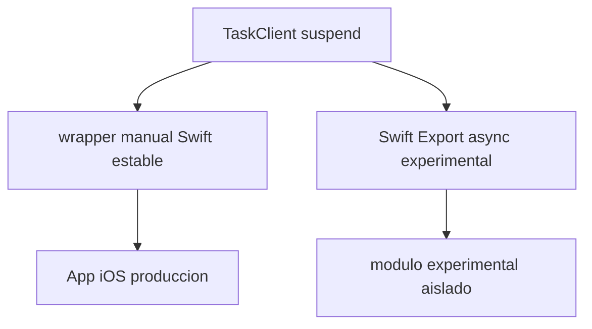
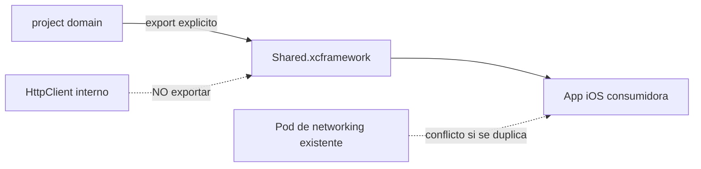
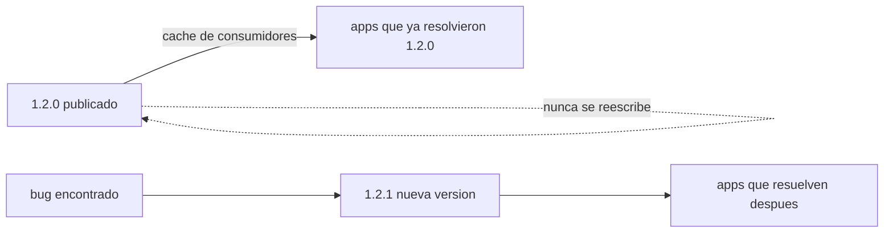
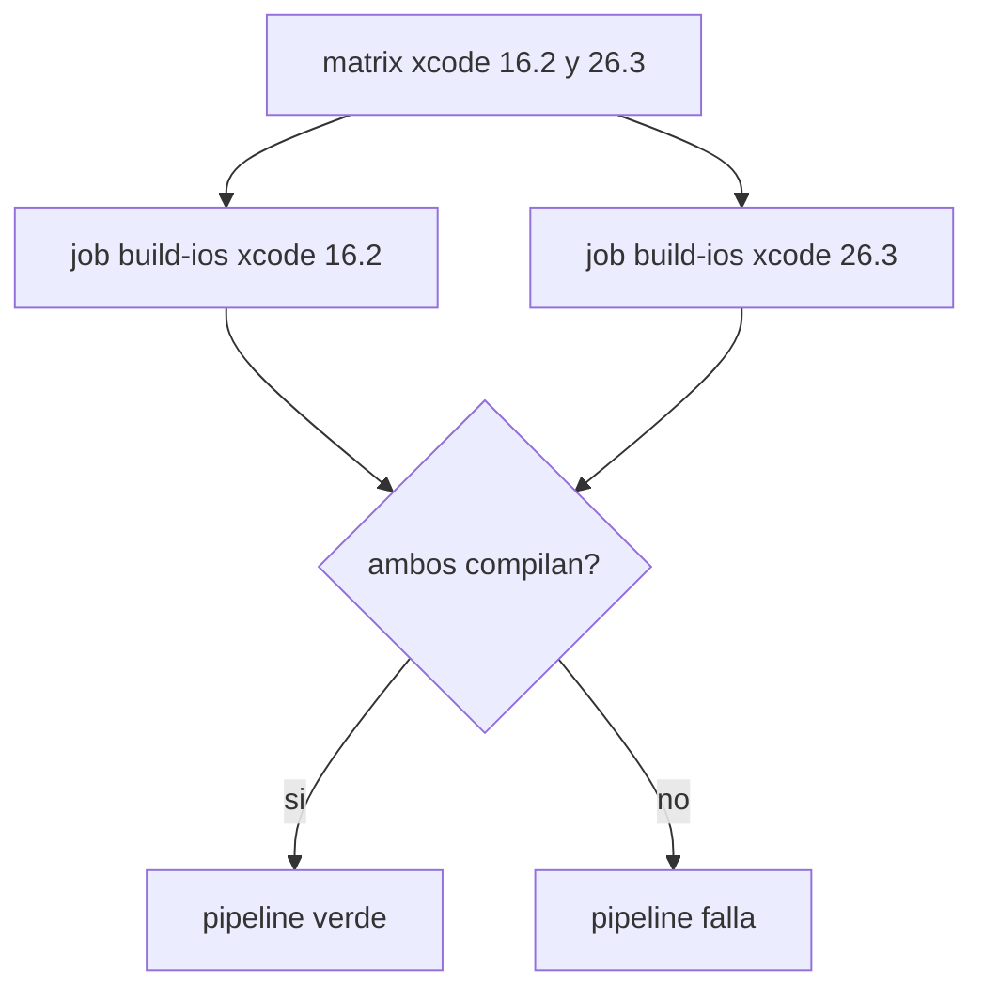

# Módulo 13: KMP Master: Native, Swift Export y publicación


## Aprende construyendo


### Tema 1: Kotlin/Native · Avanzado · 45 min

<details open>
<summary><strong>Capa 1 — Lectura</strong></summary>

#### ► DE QUÉ TRATA
Al finalizar vas a compilar el framework de Kotlin/Native para el target del simulador de iOS y para el dispositivo físico, y empaquetarlos juntos en un XCFramework. Prerrequisitos: macOS con Xcode instalado, módulo shared del proyecto integrador (Módulo 11).

#### ► LA IDEA EN UNA FRASE
**Al finalizar vas a compilar el framework de Kotlin/Native para el target del simulador de iOS y para el dispositivo físico, y empaquetarlos juntos en un XCFramework.**

#### ► POR QUÉ EXISTE ESTO
Resuelve un problema real de diseño o implementación y evita decisiones a ciegas.

#### ► LA ANALOGÍA
Piensa en kotlin/native como una herramienta de taller: útil cuando conoces su propósito y sus límites.
**Dónde se rompe la analogía:** en software, los efectos dependen del contexto, la escala y los trade-offs.

#### ► CÓMO FUNCIONA
1. Identifica el problema que kotlin/native resuelve.
2. Observa sus componentes y relaciones.
3. Aplica la opción más simple que funcione.
4. Verifica el resultado y los límites.

#### ► LO QUE PUEDE SALIR MAL
| Síntoma | Causa probable | Arreglo |
|---|---|---|
| Kotlin/Native se aplica pero el resultado no mejora | Se usó sin medir el problema real | Mide antes y compara contra la alternativa simple |
| Aparece complejidad inesperada | Se adoptó la técnica sin comprender sus trade-offs | Vuelve a la sección de trade-offs y reduce el alcance |
| Falla en un caso límite | Se asumió un contexto que no se cumple | Prueba el caso límite y documenta cuándo NO usarlo |

#### ► TRADE-OFFS
| Opción | Cuándo usarla | Cuándo NO usarla |
|---|---|---|
| Usar Kotlin/Native | Cuando el problema coincide con su propósito y el beneficio es observable | Cuando agrega complejidad sin resolver un problema real |
| Alternativa más simple | Cuando el contexto es pequeño, estable o fácil de razonar | Cuando ya demostró no escalar o no cumplir el requisito |
| Postergar la decisión | Cuando falta evidencia del problema | Cuando el costo de esperar es mayor que el costo de probar |

#### ► CUÁNDO NO USAR ESTO
No uses kotlin/native por defecto. Aplícalo cuando el problema lo justifique y puedas verificar el beneficio; si una alternativa más simple resuelve igual, prefiérela.

#### ► DE VUELTA A LA ANALOGÍA
Volviendo a la analogía: kotlin/native funciona como el modelo inicial, pero recuerda dónde se rompe: en producción importan la evidencia, la escala y el costo de equivocarte.

#### ► LO QUE DEBES RECORDAR
- Kotlin/Native existe para resolver un problema específico.
- Mide antes de adoptar complejidad.
- Conoce el caso donde NO usarlo.
- Verifica con evidencia observable.

#### ► PREGUNTAS PARA PENSAR
1. ¿Qué problema concreto resuelve kotlin/native en tu contexto?
2. ¿Cómo sabrías que kotlin/native no está funcionando bien?
3. ¿Qué alternativa más simple considerarías antes de usar kotlin/native?

</details>

<details>
<summary><strong>Capa 2 — Construcción</strong></summary>

#### Código y verificación
```kotlin
import org.jetbrains.kotlin.gradle.plugin.mpp.apple.XCFramework

kotlin {
    val xcf = XCFramework()
    listOf(iosArm64(), iosSimulatorArm64()).forEach {
        it.binaries.framework {
            baseName = "Shared"
            xcf.add(this)
        }
    }
}
```

```bash
./gradlew :shared:assembleSharedReleaseXCFramework
ls shared/build/XCFrameworks/release/Shared.xcframework
```

</details>

### Tema 2: Interop con C · Avanzado · 45 min

<details open>
<summary><strong>Capa 1 — Lectura</strong></summary>

#### ► DE QUÉ TRATA
Al finalizar vas a declarar un binding cinterop hacia una función C que recibe un buffer, y a usar usePinned correctamente para pasar memoria Kotlin de forma segura sin retener el puntero después del bloque. Prerrequisitos: Tema 1 de este módulo; macOS con Xcode para ejecutar el…

#### ► LA IDEA EN UNA FRASE
**Al finalizar vas a declarar un binding cinterop hacia una función C que recibe un buffer, y a usar usePinned correctamente para pasar memoria Kotlin de forma segura sin retener el puntero después del bloque.**

#### ► POR QUÉ EXISTE ESTO
Resuelve un problema real de diseño o implementación y evita decisiones a ciegas.

#### ► LA ANALOGÍA
Piensa en interop con c como una herramienta de taller: útil cuando conoces su propósito y sus límites.
**Dónde se rompe la analogía:** en software, los efectos dependen del contexto, la escala y los trade-offs.

#### ► CÓMO FUNCIONA
1. Identifica el problema que interop con c resuelve.
2. Observa sus componentes y relaciones.
3. Aplica la opción más simple que funcione.
4. Verifica el resultado y los límites.

#### ► LO QUE PUEDE SALIR MAL
| Síntoma | Causa probable | Arreglo |
|---|---|---|
| Interop con C se aplica pero el resultado no mejora | Se usó sin medir el problema real | Mide antes y compara contra la alternativa simple |
| Aparece complejidad inesperada | Se adoptó la técnica sin comprender sus trade-offs | Vuelve a la sección de trade-offs y reduce el alcance |
| Falla en un caso límite | Se asumió un contexto que no se cumple | Prueba el caso límite y documenta cuándo NO usarlo |

#### ► TRADE-OFFS
| Opción | Cuándo usarla | Cuándo NO usarla |
|---|---|---|
| Usar Interop con C | Cuando el problema coincide con su propósito y el beneficio es observable | Cuando agrega complejidad sin resolver un problema real |
| Alternativa más simple | Cuando el contexto es pequeño, estable o fácil de razonar | Cuando ya demostró no escalar o no cumplir el requisito |
| Postergar la decisión | Cuando falta evidencia del problema | Cuando el costo de esperar es mayor que el costo de probar |

#### ► CUÁNDO NO USAR ESTO
No uses interop con c por defecto. Aplícalo cuando el problema lo justifique y puedas verificar el beneficio; si una alternativa más simple resuelve igual, prefiérela.

#### ► DE VUELTA A LA ANALOGÍA
Volviendo a la analogía: interop con c funciona como el modelo inicial, pero recuerda dónde se rompe: en producción importan la evidencia, la escala y el costo de equivocarte.

#### ► LO QUE DEBES RECORDAR
- Interop con C existe para resolver un problema específico.
- Mide antes de adoptar complejidad.
- Conoce el caso donde NO usarlo.
- Verifica con evidencia observable.

#### ► PREGUNTAS PARA PENSAR
1. ¿Qué problema concreto resuelve interop con c en tu contexto?
2. ¿Cómo sabrías que interop con c no está funcionando bien?
3. ¿Qué alternativa más simple considerarías antes de usar interop con c?

</details>

<details>
<summary><strong>Capa 2 — Construcción</strong></summary>

#### Código y verificación
```c
package = com.academia.kmp.nativo
---
static int c_funcion_nativa(char* datos, int largo) {
    int suma = 0;
    for (int i = 0; i < largo; i++) suma += (unsigned char) datos[i];
    return suma;
}
```

```kotlin
iosSimulatorArm64 {
    compilations.getByName("main") {
        val nativo by cinterops.creating
    }
}
```

```kotlin
package com.academia.kmp

import com.academia.kmp.nativo.c_funcion_nativa
import kotlinx.cinterop.ExperimentalForeignApi
import kotlinx.cinterop.addressOf
import kotlinx.cinterop.usePinned

@OptIn(ExperimentalForeignApi::class)
fun procesarBuffer(datos: ByteArray): Int =
    datos.usePinned { pinned ->
        c_funcion_nativa(pinned.addressOf(0), datos.size) // puntero válido SOLO dentro de este bloque
    }
```

```kotlin
package com.academia.kmp

import kotlin.test.Test
import kotlin.test.assertEquals

class BufferTest {
    @Test
    fun sumaLosBytesDelBuffer() {
        assertEquals(6, procesarBuffer(byteArrayOf(1, 2, 3)))
    }
}
```

```bash
./gradlew :shared:iosSimulatorArm64Test
```

</details>

### Tema 3: Swift Export · Avanzado · 45 min

<details open>
<summary><strong>Capa 1 — Lectura</strong></summary>

#### ► DE QUÉ TRATA
Al finalizar vas a exportar una función suspend de TaskClient directamente como una función async de Swift usando Swift Export, y a aislar su uso detrás de un experimento verificable. Prerrequisitos: Tema 2 de este módulo; Swift Export habilitado en el proyecto.

#### ► LA IDEA EN UNA FRASE
**Al finalizar vas a exportar una función suspend de TaskClient directamente como una función async de Swift usando Swift Export, y a aislar su uso detrás de un experimento verificable.**

#### ► POR QUÉ EXISTE ESTO
Resuelve un problema real de diseño o implementación y evita decisiones a ciegas.

#### ► LA ANALOGÍA
Swift Export mapea tipos Kotlin (incluyendo funciones `suspend`) de forma más directa que el interop manual tradicional, pero su estado de estabilidad concreto determina si puede ser la única vía de producción o debe convivir como experimento aislado junto a los wrappers manuales existentes. La analogía es adoptar una herramienta nueva y prometedora en todas las líneas de producción de una vez, en vez de probarla primero en una línea aislada mientras la línea estable sigue funcionando.

**¿Por qué es importante?** Una característica en estado Alpha puede cambiar su comportamiento entre versiones menores de Kotlin; tratarla como la única vía de producción traslada ese riesgo a toda la app de una sola vez.
**Conceptos clave:** Swift Export, async/await, suspend mapping, estado Alpha/Beta/estable, wrapper manual de respaldo, sealed interface mapping y riesgo de adopción temprana.

El experimento de Swift Export se aísla en `iosApp/SwiftExportExperiment.swift`, separado del wrapper manual de `TaskClient` (`shared/src/commonMain/kotlin/com/academia/kmp/TaskClient.kt`, Módulo 12) que sigue siendo la vía estable de producción:



El proyecto integrador RutaFlow aplicaría la misma cautela si expusiera `SyncEngine.drain()` (`shared/src/commonMain/kotlin/com/academia/kmp/SyncEngine.kt`) vía Swift Export: la app de entregas seguiría consumiendo el wrapper manual como vía estable, dejando el `async` exportado detrás de un flag mientras Swift Export madura. **Cuándo no conviene** adoptarlo todavía: si la app ya tiene wrappers manuales estables y funcionando, migrar todo de una sola vez a una herramienta en estado Alpha es un trade-off que cambia riesgo conocido (mantenimiento manual) por riesgo desconocido (una dependencia que puede romper el mapeo en el siguiente upgrade de Kotlin) — conviene esperar a Beta/estable antes de ese reemplazo total.

**Dónde se rompe la analogía:** el modelo simplifica la realidad; en producción influyen escala, fallos, costo y contexto.

#### ► CÓMO FUNCIONA


#### ► LO QUE PUEDE SALIR MAL
| Síntoma | Causa probable | Arreglo |
|---|---|---|
| Swift Export se aplica pero el resultado no mejora | Se usó sin medir el problema real | Mide antes y compara contra la alternativa simple |
| Aparece complejidad inesperada | Se adoptó la técnica sin comprender sus trade-offs | Vuelve a la sección de trade-offs y reduce el alcance |
| Falla en un caso límite | Se asumió un contexto que no se cumple | Prueba el caso límite y documenta cuándo NO usarlo |

#### ► TRADE-OFFS
| Opción | Cuándo usarla | Cuándo NO usarla |
|---|---|---|
| Usar Swift Export | Cuando el problema coincide con su propósito y el beneficio es observable | Cuando agrega complejidad sin resolver un problema real |
| Alternativa más simple | Cuando el contexto es pequeño, estable o fácil de razonar | Cuando ya demostró no escalar o no cumplir el requisito |
| Postergar la decisión | Cuando falta evidencia del problema | Cuando el costo de esperar es mayor que el costo de probar |

#### ► CUÁNDO NO USAR ESTO
No uses swift export por defecto. Aplícalo cuando el problema lo justifique y puedas verificar el beneficio; si una alternativa más simple resuelve igual, prefiérela.

#### ► DE VUELTA A LA ANALOGÍA
Volviendo a la analogía: swift export funciona como el modelo inicial, pero recuerda dónde se rompe: en producción importan la evidencia, la escala y el costo de equivocarte.

#### ► LO QUE DEBES RECORDAR
- Swift Export existe para resolver un problema específico.
- Mide antes de adoptar complejidad.
- Conoce el caso donde NO usarlo.
- Verifica con evidencia observable.

#### ► PREGUNTAS PARA PENSAR
1. ¿Qué problema concreto resuelve swift export en tu contexto?
2. ¿Cómo sabrías que swift export no está funcionando bien?
3. ¿Qué alternativa más simple considerarías antes de usar swift export?

</details>

<details>
<summary><strong>Capa 2 — Construcción</strong></summary>

#### Código y verificación


```kotlin
public suspend fun TaskClient.task(id: TaskId): TaskResult // Swift Export lo expone como una función async que puede lanzar: se llama con try await
```

```bash
./gradlew :shared:allTests
```

```swift
let resultado = try await taskClient.task(id: taskId) // consumido directamente como async de Swift, con try
```

</details>

### Tema 4: XCFramework y API pública · Avanzado · 45 min

<details open>
<summary><strong>Capa 1 — Lectura</strong></summary>

#### ► DE QUÉ TRATA
Al finalizar vas a empaquetar el framework compartido en un XCFramework con una API pública mínima, decidiendo explícitamente qué dependencias transitivas exportar. Prerrequisitos: Tema 3 de este módulo.

#### ► LA IDEA EN UNA FRASE
**Al finalizar vas a empaquetar el framework compartido en un XCFramework con una API pública mínima, decidiendo explícitamente qué dependencias transitivas exportar.**

#### ► POR QUÉ EXISTE ESTO
Resuelve un problema real de diseño o implementación y evita decisiones a ciegas.

#### ► LA ANALOGÍA
Piensa en xcframework y api pública como una herramienta de taller: útil cuando conoces su propósito y sus límites.
**Dónde se rompe la analogía:** en software, los efectos dependen del contexto, la escala y los trade-offs.

#### ► CÓMO FUNCIONA


#### ► LO QUE PUEDE SALIR MAL
| Síntoma | Causa probable | Arreglo |
|---|---|---|
| XCFramework y API pública se aplica pero el resultado no mejora | Se usó sin medir el problema real | Mide antes y compara contra la alternativa simple |
| Aparece complejidad inesperada | Se adoptó la técnica sin comprender sus trade-offs | Vuelve a la sección de trade-offs y reduce el alcance |
| Falla en un caso límite | Se asumió un contexto que no se cumple | Prueba el caso límite y documenta cuándo NO usarlo |

#### ► TRADE-OFFS
| Opción | Cuándo usarla | Cuándo NO usarla |
|---|---|---|
| Usar XCFramework y API pública | Cuando el problema coincide con su propósito y el beneficio es observable | Cuando agrega complejidad sin resolver un problema real |
| Alternativa más simple | Cuando el contexto es pequeño, estable o fácil de razonar | Cuando ya demostró no escalar o no cumplir el requisito |
| Postergar la decisión | Cuando falta evidencia del problema | Cuando el costo de esperar es mayor que el costo de probar |

#### ► CUÁNDO NO USAR ESTO
No uses xcframework y api pública por defecto. Aplícalo cuando el problema lo justifique y puedas verificar el beneficio; si una alternativa más simple resuelve igual, prefiérela.

#### ► DE VUELTA A LA ANALOGÍA
Volviendo a la analogía: xcframework y api pública funciona como el modelo inicial, pero recuerda dónde se rompe: en producción importan la evidencia, la escala y el costo de equivocarte.

#### ► LO QUE DEBES RECORDAR
- XCFramework y API pública existe para resolver un problema específico.
- Mide antes de adoptar complejidad.
- Conoce el caso donde NO usarlo.
- Verifica con evidencia observable.

#### ► PREGUNTAS PARA PENSAR
1. ¿Qué problema concreto resuelve xcframework y api pública en tu contexto?
2. ¿Cómo sabrías que xcframework y api pública no está funcionando bien?
3. ¿Qué alternativa más simple considerarías antes de usar xcframework y api pública?

</details>

<details>
<summary><strong>Capa 2 — Construcción</strong></summary>

#### Código y verificación


```kotlin
kotlin {
    listOf(iosX64(), iosArm64(), iosSimulatorArm64()).forEach {
        it.binaries.framework {
            baseName = "Shared"
            export(project(":domain")) // export explícito y deliberado, no transitivo por defecto
            isStatic = true
        }
    }
}
```

```bash
xcodebuild -create-xcframework \
  -framework shared-iosArm64/Shared.framework \
  -framework shared-iosSimulatorArm64/Shared.framework \
  -output Shared.xcframework
```

</details>

### Tema 5: Publicación en Maven Central · Avanzado · 45 min

<details open>
<summary><strong>Capa 1 — Lectura</strong></summary>

#### ► DE QUÉ TRATA
Al finalizar vas a publicar el módulo compartido en un repositorio Maven con coordenadas, firma y checksums inmutables. Prerrequisitos: Tema 4 de este módulo; credenciales de publicación configuradas.

#### ► LA IDEA EN UNA FRASE
**Al finalizar vas a publicar el módulo compartido en un repositorio Maven con coordenadas, firma y checksums inmutables.**

#### ► POR QUÉ EXISTE ESTO
Resuelve un problema real de diseño o implementación y evita decisiones a ciegas.

#### ► LA ANALOGÍA
Una publicación Maven produce metadata raíz y artefactos firmados por target, con checksums que los consumidores verifican al resolver una dependencia; esas coordenadas deben ser inmutables porque otros sistemas (incluyendo cachés de dependencias) asumen que una misma versión siempre resuelve exactamente al mismo contenido. La analogía es un número de lote de un producto industrial — una vez impreso y distribuido, no puede referirse después a un contenido distinto.

**¿Por qué es importante?** Las coordenadas de una versión publicada deben ser inmutables porque todo el ecosistema de dependencias asume que una misma versión siempre resuelve exactamente al mismo contenido.
**Conceptos clave:** Maven publication, checksum, coordenadas inmutables, firma de artefactos, sources/docs, semantic versioning y caché de dependencias.

Las coordenadas de publicación (`groupId`, `artifactId`, `version`) se declaran en `shared/build.gradle.kts`, y el comando completo con Gradle es `./gradlew publishAllPublicationsToMavenCentralRepository`. Si el proyecto integrador RutaFlow publicara su módulo `SyncEngine` (`shared/src/commonMain/kotlin/com/academia/kmp/SyncEngine.kt`) como librería reutilizable por otros equipos, aplicaría exactamente esta misma regla de inmutabilidad:



**Dónde se rompe la analogía:** el modelo simplifica la realidad; en producción influyen escala, fallos, costo y contexto.

#### ► CÓMO FUNCIONA


#### ► LO QUE PUEDE SALIR MAL
| Síntoma | Causa probable | Arreglo |
|---|---|---|
| Publicación en Maven Central se aplica pero el resultado no mejora | Se usó sin medir el problema real | Mide antes y compara contra la alternativa simple |
| Aparece complejidad inesperada | Se adoptó la técnica sin comprender sus trade-offs | Vuelve a la sección de trade-offs y reduce el alcance |
| Falla en un caso límite | Se asumió un contexto que no se cumple | Prueba el caso límite y documenta cuándo NO usarlo |

#### ► TRADE-OFFS
| Opción | Cuándo usarla | Cuándo NO usarla |
|---|---|---|
| Usar Publicación en Maven Central | Cuando el problema coincide con su propósito y el beneficio es observable | Cuando agrega complejidad sin resolver un problema real |
| Alternativa más simple | Cuando el contexto es pequeño, estable o fácil de razonar | Cuando ya demostró no escalar o no cumplir el requisito |
| Postergar la decisión | Cuando falta evidencia del problema | Cuando el costo de esperar es mayor que el costo de probar |

#### ► CUÁNDO NO USAR ESTO
No uses publicación en maven central por defecto. Aplícalo cuando el problema lo justifique y puedas verificar el beneficio; si una alternativa más simple resuelve igual, prefiérela.

#### ► DE VUELTA A LA ANALOGÍA
Volviendo a la analogía: publicación en maven central funciona como el modelo inicial, pero recuerda dónde se rompe: en producción importan la evidencia, la escala y el costo de equivocarte.

#### ► LO QUE DEBES RECORDAR
- Publicación en Maven Central existe para resolver un problema específico.
- Mide antes de adoptar complejidad.
- Conoce el caso donde NO usarlo.
- Verifica con evidencia observable.

#### ► PREGUNTAS PARA PENSAR
1. ¿Qué problema concreto resuelve publicación en maven central en tu contexto?
2. ¿Cómo sabrías que publicación en maven central no está funcionando bien?
3. ¿Qué alternativa más simple considerarías antes de usar publicación en maven central?

</details>

<details>
<summary><strong>Capa 2 — Construcción</strong></summary>

#### Código y verificación


```kotlin
publishing {
    publications.withType<MavenPublication> {
        groupId = "com.proyecto.tareas"
        artifactId = "shared"
        version = "1.2.1" // nueva versión, nunca se reescribe 1.2.0
    }
}
```

```bash
./gradlew publishAllPublicationsToMavenCentralRepository
```

</details>

### Tema 6: Compatibilidad binaria y CI multi-target · Avanzado · 45 min

<details open>
<summary><strong>Capa 1 — Lectura</strong></summary>

#### ► DE QUÉ TRATA
Al finalizar vas a configurar una matriz de CI que pruebe la compilación del módulo compartido contra la versión mínima soportada de Xcode, no solo la más reciente. Prerrequisitos: Tema 5 de este módulo.

#### ► LA IDEA EN UNA FRASE
**Al finalizar vas a configurar una matriz de CI que pruebe la compilación del módulo compartido contra la versión mínima soportada de Xcode, no solo la más reciente.**

#### ► POR QUÉ EXISTE ESTO
Resuelve un problema real de diseño o implementación y evita decisiones a ciegas.

#### ► LA ANALOGÍA
Piensa en compatibilidad binaria y ci multi-target como una herramienta de taller: útil cuando conoces su propósito y sus límites.
**Dónde se rompe la analogía:** en software, los efectos dependen del contexto, la escala y los trade-offs.

#### ► CÓMO FUNCIONA


#### ► LO QUE PUEDE SALIR MAL
| Síntoma | Causa probable | Arreglo |
|---|---|---|
| Compatibilidad binaria y CI multi-target se aplica pero el resultado no mejora | Se usó sin medir el problema real | Mide antes y compara contra la alternativa simple |
| Aparece complejidad inesperada | Se adoptó la técnica sin comprender sus trade-offs | Vuelve a la sección de trade-offs y reduce el alcance |
| Falla en un caso límite | Se asumió un contexto que no se cumple | Prueba el caso límite y documenta cuándo NO usarlo |

#### ► TRADE-OFFS
| Opción | Cuándo usarla | Cuándo NO usarla |
|---|---|---|
| Usar Compatibilidad binaria y CI multi-target | Cuando el problema coincide con su propósito y el beneficio es observable | Cuando agrega complejidad sin resolver un problema real |
| Alternativa más simple | Cuando el contexto es pequeño, estable o fácil de razonar | Cuando ya demostró no escalar o no cumplir el requisito |
| Postergar la decisión | Cuando falta evidencia del problema | Cuando el costo de esperar es mayor que el costo de probar |

#### ► CUÁNDO NO USAR ESTO
No uses compatibilidad binaria y ci multi-target por defecto. Aplícalo cuando el problema lo justifique y puedas verificar el beneficio; si una alternativa más simple resuelve igual, prefiérela.

#### ► DE VUELTA A LA ANALOGÍA
Volviendo a la analogía: compatibilidad binaria y ci multi-target funciona como el modelo inicial, pero recuerda dónde se rompe: en producción importan la evidencia, la escala y el costo de equivocarte.

#### ► LO QUE DEBES RECORDAR
- Compatibilidad binaria y CI multi-target existe para resolver un problema específico.
- Mide antes de adoptar complejidad.
- Conoce el caso donde NO usarlo.
- Verifica con evidencia observable.

#### ► PREGUNTAS PARA PENSAR
1. ¿Qué problema concreto resuelve compatibilidad binaria y ci multi-target en tu contexto?
2. ¿Cómo sabrías que compatibilidad binaria y ci multi-target no está funcionando bien?
3. ¿Qué alternativa más simple considerarías antes de usar compatibilidad binaria y ci multi-target?

</details>

<details>
<summary><strong>Capa 2 — Construcción</strong></summary>

#### Código y verificación


```yaml
name: CI
on: [push, pull_request]

jobs:
  build-ios:
    runs-on: macos-15   # imagen fija: cada imagen trae su propia lista de Xcode instalados
    strategy:
      fail-fast: false
      matrix:
        xcode: ["16.2", "26.3"]   # mínima soportada declarada y la más reciente
    steps:
      - uses: actions/checkout@3d3c42e5aac5ba805825da76410c181273ba90b1 # v7.0.1
      - uses: actions/setup-java@d1374f8ac74474200d16ef8ecee22c7ae7a51880 # v6.3.0
        with:
          distribution: temurin
          java-version: '27'
      - run: sudo xcode-select -s /Applications/Xcode_${{ matrix.xcode }}.app
      - run: ./gradlew :shared:linkDebugFrameworkIosArm64
```

```bash
./gradlew :shared:allTests
```

</details>
