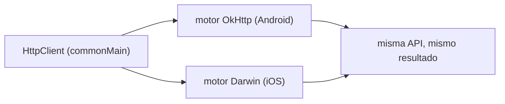
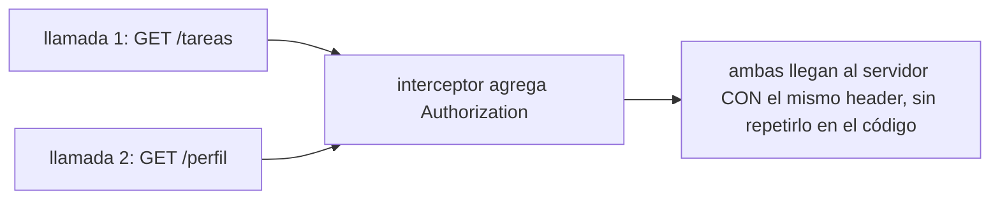

# Módulo 2: Networking compartido con Ktor Client

Cada tema se practica por separado con su propia repetición progresiva y su propio reto de memoria, contra un servidor HTTP real —no una simulación— para que cada afirmación sobre networking sea verificable, no solo descrita.


## Aprende construyendo


### Tema 1: Ktor Client multiplataforma · Avanzado · 30 min

<details open>
<summary><strong>Capa 1 — Lectura</strong></summary>

#### ► DE QUÉ TRATA
Al finalizar podrás configurar un HttpClient con deserialización JSON automática, y explicar por qué el mismo cliente funciona en Android e iOS sin que el código lo note.

#### ► CÓMO FUNCIONA


</details>

<details>
<summary><strong>Capa 2 — Construcción</strong></summary>

#### Código y verificación

```kotlin
package com.academia.kmp

import io.ktor.client.*
import io.ktor.client.call.*
import io.ktor.client.plugins.contentnegotiation.*
import io.ktor.client.request.*
import io.ktor.serialization.kotlinx.json.*
import kotlinx.serialization.Serializable

fun crearClienteJson(engine: io.ktor.client.engine.HttpClientEngine): HttpClient =
    HttpClient(engine) { install(ContentNegotiation) { json() } }

@Serializable
data class TareaDTO(val id: String, val titulo: String)

suspend fun obtenerTareas(client: HttpClient): List<TareaDTO> =
    client.get("https://api.miapp.com/tareas").body()
```

```bash
# compila el módulo compartido de Kotlin Multiplatform con Gradle
mkdir -p academia-kmp/shared/src/commonMain/kotlin/com/academia/kmp
cd academia-kmp
./gradlew :shared:compileKotlinMetadata
```

```kotlin
package com.academia.kmp

import io.ktor.client.engine.mock.*
import io.ktor.http.*
import kotlinx.coroutines.test.runTest
import kotlin.test.Test
import kotlin.test.assertEquals

class NetworkingTest {
    @Test
    fun obtenerTareasDeserializaLaRespuestaJsonReal() = runTest {
        val mockEngine = MockEngine { request ->
            assertEquals("https://api.miapp.com/tareas", request.url.toString())
            respond(
                content = """[{"id":"1","titulo":"Comprar leche"}]""",
                status = HttpStatusCode.OK,
                headers = headersOf(HttpHeaders.ContentType, "application/json"),
            )
        }
        val client = crearClienteJson(mockEngine)
        val tareas = obtenerTareas(client)
        assertEquals(listOf(TareaDTO("1", "Comprar leche")), tareas)
    }
}
```

```bash
# ejecuta el test Kotlin del módulo compartido contra el HttpClient real
cd academia-kmp
./gradlew :shared:allTests
```

```kotlin
fun crearClienteJson(engine: HttpClientEngine): HttpClient = HttpClient(engine) {
    install(____) { json() }
}
```

</details>

### Tema 2: Manejo de errores de red con un tipo explícito · Avanzado · 30 min

<details open>
<summary><strong>Capa 1 — Lectura</strong></summary>

#### ► DE QUÉ TRATA
Al finalizar podrás modelar el resultado de una llamada de red como Resultado.Exito/Resultado.Error, y confirmar contra un servidor real apagado que el error se captura sin propagar una excepción sin control.

</details>

<details>
<summary><strong>Capa 2 — Construcción</strong></summary>

#### Código y verificación
```
┌── obtenerTareasSeguro(): Resultado<List<TareaDTO>> ──┐
│  servidor responde  -> Resultado.Exito(datos)           │
│  servidor apagado/timeout -> Resultado.Error(mensaje)   │
└───────────────────────────────────────────────────┘
```

```kotlin
package com.academia.kmp

import io.ktor.client.*

sealed class Resultado<out T> {
    data class Exito<T>(val datos: T) : Resultado<T>()
    data class Error(val mensaje: String) : Resultado<Nothing>()
}

suspend fun obtenerTareasSeguro(client: HttpClient): Resultado<List<TareaDTO>> = try {
    Resultado.Exito(obtenerTareas(client))
} catch (e: Exception) {
    Resultado.Error(e.message ?: "Error de red")
}
```

```bash
# compila el módulo compartido de Kotlin Multiplatform con Gradle
mkdir -p academia-kmp/shared/src/commonMain/kotlin/com/academia/kmp
cd academia-kmp
./gradlew :shared:compileKotlinMetadata
```

```kotlin
package com.academia.kmp

import io.ktor.client.engine.mock.*
import io.ktor.http.*
import kotlinx.coroutines.test.runTest
import kotlin.test.Test
import kotlin.test.assertEquals
import kotlin.test.assertIs

class NetworkingSeguroTest {
    @Test
    fun conRespuestaExitosaDevuelveResultadoExito() = runTest {
        val mockEngine = MockEngine {
            respond(
                content = """[{"id":"1","titulo":"Comprar leche"}]""",
                status = HttpStatusCode.OK,
                headers = headersOf(HttpHeaders.ContentType, "application/json"),
            )
        }
        val resultado = obtenerTareasSeguro(crearClienteJson(mockEngine))
        assertIs<Resultado.Exito<List<TareaDTO>>>(resultado)
        assertEquals(listOf(TareaDTO("1", "Comprar leche")), resultado.datos)
    }

    @Test
    fun conFalloDeConexionDevuelveResultadoErrorSinPropagar() = runTest {
        val mockEngine = MockEngine { throw java.net.ConnectException("Connection refused") }
        val resultado = obtenerTareasSeguro(crearClienteJson(mockEngine))
        assertIs<Resultado.Error>(resultado)
    }
}
```

```bash
# ejecuta el test Kotlin del módulo compartido, con y sin fallo de red
cd academia-kmp
./gradlew :shared:allTests
```

```kotlin
suspend fun obtenerPerfilSeguro(): Resultado<Perfil> = try {
    Resultado.____(obtenerPerfil())
} catch (e: Exception) {
    Resultado.____(e.message ?: "Error de red")
}
```

</details>

### Tema 3: Interceptores y autenticación · Avanzado · 30 min

<details open>
<summary><strong>Capa 1 — Lectura</strong></summary>

#### ► DE QUÉ TRATA
Al finalizar podrás configurar un interceptor que agregue un header a cada petición saliente automáticamente, y confirmar contra un servidor real que el header llega en cada llamada sin repetirlo manualmente.

#### ► CÓMO FUNCIONA


</details>

<details>
<summary><strong>Capa 2 — Construcción</strong></summary>

#### Código y verificación


```kotlin
package com.academia.kmp

import io.ktor.client.*
import io.ktor.client.engine.*
import io.ktor.client.plugins.auth.*
import io.ktor.client.plugins.auth.providers.*
import io.ktor.client.request.*

fun crearClienteAutenticado(engine: HttpClientEngine): HttpClient = HttpClient(engine) {
    install(Auth) {
        bearer {
            loadTokens { BearerTokens("token-abc123", "refresh-xyz") }
        }
    }
}

suspend fun llamarRuta(client: HttpClient, path: String) = client.get(path)
```

```bash
# compila el módulo compartido de Kotlin Multiplatform con Gradle
mkdir -p academia-kmp/shared/src/commonMain/kotlin/com/academia/kmp
cd academia-kmp
./gradlew :shared:compileKotlinMetadata
```

```kotlin
package com.academia.kmp

import io.ktor.client.engine.mock.*
import io.ktor.http.*
import kotlinx.coroutines.test.runTest
import kotlin.test.Test
import kotlin.test.assertEquals

class ClienteAutenticadoTest {
    @Test
    fun ambasRutasRecibenElHeaderSinQueLlamarRutaLoMencione() = runTest {
        val headersRecibidos = mutableListOf<String?>()
        val mockEngine = MockEngine { request ->
            headersRecibidos.add(request.headers[HttpHeaders.Authorization])
            respond(content = "ok", status = HttpStatusCode.OK)
        }
        val client = crearClienteAutenticado(mockEngine)

        llamarRuta(client, "https://api.miapp.com/tareas")
        llamarRuta(client, "https://api.miapp.com/perfil")

        assertEquals(listOf("Bearer token-abc123", "Bearer token-abc123"), headersRecibidos)
    }
}
```

```bash
# ejecuta el test Kotlin del módulo compartido, inspeccionando las peticiones reales
cd academia-kmp
./gradlew :shared:allTests
```

```kotlin
val client = HttpClient {
    install(____) {
        bearer { loadTokens { BearerTokens(token, refreshToken) } }
    }
}
```

</details>

### Tema 4: Reintentos con backoff exponencial · Avanzado · 30 min

<details open>
<summary><strong>Capa 1 — Lectura</strong></summary>

#### ► DE QUÉ TRATA
Al finalizar podrás implementar un mecanismo de reintentos con backoff exponencial para peticiones que fallan temporalmente, y confirmar contra un servidor real que se recupera tras varios intentos que el mecanismo efectivamente logra una respuesta exitosa.

</details>

<details>
<summary><strong>Capa 2 — Construcción</strong></summary>

#### Código y verificación
```
┌─ intento 1 (falla) ─┐espera 0.05s┌─ intento 2 (falla) ─┐espera 0.10s┌─ intento 3 (éxito) ─┐
└────────────────────┘───────────►└────────────────────┘───────────►└────────────────────┘
```

```kotlin
package com.academia.kmp

import kotlinx.coroutines.delay

suspend fun <T> conReintentos(maxIntentos: Int = 5, bloque: suspend () -> T): T {
    var esperaMs = 50L
    repeat(maxIntentos - 1) {
        try {
            return bloque()
        } catch (e: Exception) {
            delay(esperaMs)
            esperaMs *= 2 // backoff exponencial
        }
    }
    return bloque() // último intento, sin capturar (propaga si falla)
}
```

```bash
# compila el módulo compartido de Kotlin Multiplatform con Gradle
mkdir -p academia-kmp/shared/src/commonMain/kotlin/com/academia/kmp
cd academia-kmp
./gradlew :shared:compileKotlinMetadata
```

```kotlin
package com.academia.kmp

import io.ktor.client.call.*
import io.ktor.client.engine.mock.*
import io.ktor.client.request.*
import io.ktor.http.*
import kotlinx.coroutines.test.runTest
import kotlin.test.Test
import kotlin.test.assertEquals

class ReintentosTest {
    @Test
    fun seRecuperaTrasDosFallosTemporales() = runTest {
        var intento = 0
        val mockEngine = MockEngine { _ ->
            intento++
            if (intento < 3) respond(content = "", status = HttpStatusCode.ServiceUnavailable)
            else respond(content = """{"ok":true}""", status = HttpStatusCode.OK)
        }
        val client = crearClienteJson(mockEngine)

        val resultado = conReintentos {
            val response = client.get("https://api.miapp.com/tareas")
            if (response.status != HttpStatusCode.OK) error("fallo con ${response.status}")
            response.body<String>()
        }

        assertEquals(3, intento)
        assertEquals(50L + 100L, currentTime) // esperas de 50ms y 100ms antes del tercer intento exitoso
        assertEquals("""{"ok":true}""", resultado)
    }
}
```

```bash
# ejecuta el test Kotlin del módulo compartido, con tiempo virtual para las esperas
cd academia-kmp
./gradlew :shared:allTests
```

```kotlin
suspend fun <T> conReintentos(maxIntentos: Int, bloque: suspend () -> T): T {
    var esperaMs = 50L
    repeat(maxIntentos - 1) {
        try {
            return bloque()
        } catch (e: Exception) {
            delay(esperaMs)
            esperaMs ____ 2
        }
    }
    return bloque()
}
```

</details>

### Tema 5: kotlinx.serialization — JSON compartido entre plataformas · Avanzado · 30 min

<details open>
<summary><strong>Capa 1 — Lectura</strong></summary>

#### ► DE QUÉ TRATA
Al finalizar podrás serializar y deserializar modelos entre JSON y objetos Kotlin con kotlinx.serialization en el módulo común, de forma que Android e iOS compartan el mismo mapeo. Prerrequisitos: Temas 1-2 de este módulo (Ktor Client y manejo de errores).

</details>

<details>
<summary><strong>Capa 2 — Construcción</strong></summary>

#### Código y verificación
```kotlin
import kotlinx.serialization.*
import kotlinx.serialization.json.Json

@Serializable
data class Envio(
    val guia: String,
    val estado: String,
    @SerialName("recipient_pin") val pin: String? = null   // mapea nombre JSON distinto
)

fun main() {
    val json = """{"guia":"RF-4471","estado":"en ruta","recipient_pin":"837201"}"""
    val envio = Json.decodeFromString<Envio>(json)          // JSON -> objeto
    println(envio)
    val devuelta = Json.encodeToString(envio)               // objeto -> JSON
    println(devuelta)
}
```

```bash
./gradlew :shared:allTests
```

</details>
