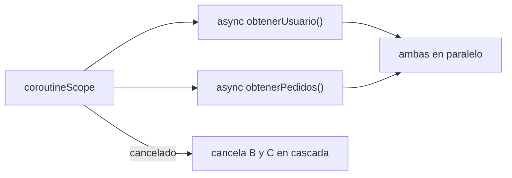
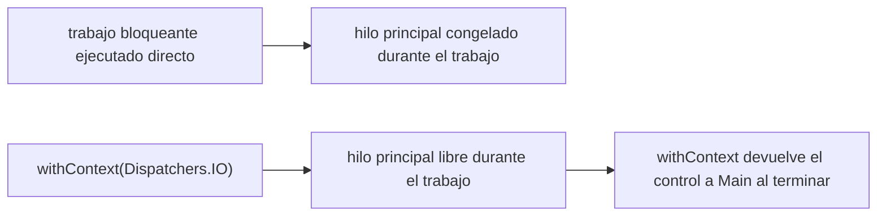

# Módulo 2: Coroutines y Flow

Cada tema se practica por separado con su propia repetición progresiva y su propio reto de memoria — suspend functions, Flow/StateFlow/SharedFlow, manejo de errores con Mutex, y Dispatchers son los cuatro pilares de la concurrencia en Kotlin que vas a reutilizar en Android, iOS y backend compartido.


## Aprende construyendo


### Tema 1: suspend functions y concurrencia estructurada · Intermedio · 45 min

<details open>
<summary><strong>Capa 1 — Lectura</strong></summary>

#### ► DE QUÉ TRATA
Al finalizar podrás escribir una función suspend que combina dos llamadas asíncronas en paralelo, y explicar por qué cancelar el scope padre cancela automáticamente todas sus coroutines hijas.

#### ► CÓMO FUNCIONA


</details>

<details>
<summary><strong>Capa 2 — Construcción</strong></summary>

#### Código y verificación
```kotlin
suspend fun cargarPantalla() = coroutineScope {
    val usuario = async { obtenerUsuario() }
    val pedidos = async { obtenerPedidos() }
    PantallaDatos(usuario.await(), pedidos.await())
}
```


```kotlin
package com.academia.kmp

import kotlinx.coroutines.*

suspend fun obtenerUsuario(): String { delay(200); return "Ana" }
suspend fun obtenerPedidos(): List<String> { delay(200); return listOf("pedido1", "pedido2") }

suspend fun cargarPantalla() = coroutineScope {
    val usuario = async { obtenerUsuario() }
    val pedidos = async { obtenerPedidos() }
    Pair(usuario.await(), pedidos.await()) // ambas corren en PARALELO, no secuencial
}
```

```bash
# compila el módulo compartido del proyecto academia-kmp (Paso 0 del módulo 0)
cd academia-kmp
./gradlew :shared:assemble
```

```kotlin
package com.academia.kmp

import kotlinx.coroutines.test.runTest
import kotlin.test.Test
import kotlin.test.assertEquals

class ConcurrenciaEstructuradaTest {
    @Test
    fun ambasLlamadasCorrenEnParaleloNoEnSecuencia() = runTest {
        val (usuario, pedidos) = cargarPantalla()
        assertEquals("Ana", usuario)
        assertEquals(listOf("pedido1", "pedido2"), pedidos)
        // con tiempo virtual, el tiempo transcurrido es EXACTO: 200ms si corrieron en paralelo
        assertEquals(200, currentTime)
    }
}
```

```bash
# ejecuta el test Kotlin del módulo compartido, con tiempo virtual
cd academia-kmp
./gradlew :shared:allTests
```

</details>

### Tema 2: Flow, StateFlow y SharedFlow · Intermedio · 45 min

<details open>
<summary><strong>Capa 1 — Lectura</strong></summary>

#### ► DE QUÉ TRATA
Al finalizar podrás elegir entre Flow, StateFlow y SharedFlow según si tu dato necesita un valor actual siempre consultable o representa un evento puntual de un solo uso.

</details>

<details>
<summary><strong>Capa 2 — Construcción</strong></summary>

#### Código y verificación
```
┌── Flow ────────────┐   ┌── StateFlow ──────────────┐   ┌── SharedFlow ──────────────┐
│ emite N valores,    │   │ SIEMPRE tiene un valor      │   │ SIN valor inicial,           │
│ evaluación perezosa  │   │ actual consultable          │   │ eventos de un solo uso       │
└─────────────────┘   └────────────────────────┘   └────────────────────────┘
```

```kotlin
package com.academia.kmp

import kotlinx.coroutines.flow.*
import kotlinx.coroutines.delay

fun contarHasta(n: Int): Flow<Int> = flow {
    for (i in 1..n) { delay(10); emit(i) }
}

sealed class EstadoPantalla { object Cargando : EstadoPantalla(); object Exito : EstadoPantalla() }

class ObservadorDeEstado {
    val estado = MutableStateFlow<EstadoPantalla>(EstadoPantalla.Cargando)   // siempre tiene valor actual
    val eventos = MutableSharedFlow<String>()                                // sin valor inicial, un solo uso
}
```

```bash
# compila el módulo compartido del proyecto academia-kmp (Paso 0 del módulo 0)
cd academia-kmp
./gradlew :shared:assemble
```

```kotlin
package com.academia.kmp

import kotlinx.coroutines.flow.first
import kotlinx.coroutines.flow.toList
import kotlinx.coroutines.test.runTest
import kotlin.test.Test
import kotlin.test.assertEquals

class FlowTiposTest {
    @Test
    fun flowEmiteTodosLosValoresEnOrden() = runTest {
        assertEquals(listOf(1, 2, 3, 4, 5), contarHasta(5).toList())
    }

    @Test
    fun observadorTardioDeStateFlowVeElValorActual() = runTest {
        val observador = ObservadorDeEstado()
        observador.estado.value = EstadoPantalla.Exito
        // un nuevo observador que recién ahora empieza a leer, ve el valor actual de inmediato
        assertEquals(EstadoPantalla.Exito, observador.estado.first())
    }
}
```

```bash
# ejecuta el test Kotlin del módulo compartido
cd academia-kmp
./gradlew :shared:allTests
```

```kotlin
val contadorTareas = MutableStateFlow____Int>(0)
```

</details>

### Tema 3: Manejo de errores y exclusión mutua · Intermedio · 45 min

<details open>
<summary><strong>Capa 1 — Lectura</strong></summary>

#### ► DE QUÉ TRATA
Al finalizar podrás capturar errores de una llamada suspend transformándolos en un estado explícito, y usar Mutex para proteger una variable compartida de una condición de carrera real entre coroutines concurrentes.

</details>

<details>
<summary><strong>Capa 2 — Construcción</strong></summary>

#### Código y verificación
```
┌── SIN Mutex: 100 coroutines leen→esperan→escriben ──┐
│  todas leen 0 antes de que cualquiera escriba → resultado final: 1 (perdido) │
└───────────────────────────────────────────────────┘
┌── CON Mutex: cada coroutine espera su turno ──────┐
│  lee→escribe de forma exclusiva → resultado final: 100 (correcto)          │
└───────────────────────────────────────────────────┘
```

```kotlin
package com.academia.kmp

import kotlinx.coroutines.sync.Mutex
import kotlinx.coroutines.sync.withLock
import kotlinx.coroutines.yield

sealed class EstadoUI {
    object Cargando : EstadoUI()
    data class Exito(val datos: List<String>) : EstadoUI()
    data class Error(val mensaje: String) : EstadoUI()
}

suspend fun cargarUsuarioSeguro(id: String, obtenerUsuario: suspend (String) -> String): EstadoUI {
    return try {
        EstadoUI.Exito(listOf(obtenerUsuario(id)))
    } catch (e: Exception) {
        EstadoUI.Error(e.message ?: "Error desconocido")
    }
}

class ContadorSinProteger {
    var valor = 0
        private set
    suspend fun incrementar() {
        val leido = valor
        yield() // cede el control: otra coroutine puede intercalarse justo aquí
        valor = leido + 1
    }
}

class ContadorProtegido {
    private val mutex = Mutex()
    var valor = 0
        private set
    suspend fun incrementar() {
        mutex.withLock { // exclusión mutua compatible con suspensión
            val leido = valor
            yield()
            valor = leido + 1
        }
    }
}
```

```bash
# compila el módulo compartido del proyecto academia-kmp (Paso 0 del módulo 0)
cd academia-kmp
./gradlew :shared:assemble
```

```kotlin
package com.academia.kmp

import kotlinx.coroutines.launch
import kotlinx.coroutines.test.runTest
import kotlin.test.Test
import kotlin.test.assertEquals
import kotlin.test.assertTrue

class ErroresYMutexTest {
    @Test
    fun sinProteccionSePierdenIncrementos() = runTest {
        val contador = ContadorSinProteger()
        repeat(100) { launch { contador.incrementar() } }
        // deja que todas las coroutines lanzadas terminen antes de leer el resultado
        advanceUntilIdle()
        assertTrue(contador.valor < 100, "esperaba incrementos perdidos, pero valor fue ${contador.valor}")
    }

    @Test
    fun conMutexNingunIncrementoSePierde() = runTest {
        val contador = ContadorProtegido()
        repeat(100) { launch { contador.incrementar() } }
        advanceUntilIdle()
        assertEquals(100, contador.valor)
    }
}
```

```bash
# ejecuta el test Kotlin del módulo compartido, verificando la condición de carrera
cd academia-kmp
./gradlew :shared:allTests
```

```kotlin
class Contador {
    private val mutex = Mutex()
    private var valor = 0
    suspend fun incrementar() {
        mutex.____ { valor += 1 }
    }
}
```

</details>

### Tema 4: Dispatchers y withContext: en qué hilo corre tu código · Intermedio · 45 min

<details open>
<summary><strong>Capa 1 — Lectura</strong></summary>

#### ► DE QUÉ TRATA
Al finalizar podrás elegir el Dispatcher apropiado para una operación (bloqueante de I/O, intensiva en CPU, o de UI), y usar withContext para cambiar de contexto sin bloquear el hilo principal.

#### ► CÓMO FUNCIONA


</details>

<details>
<summary><strong>Capa 2 — Construcción</strong></summary>

#### Código y verificación

```kotlin
package com.academia.kmp

import kotlinx.coroutines.Dispatchers
import kotlinx.coroutines.withContext
import kotlin.time.Duration.Companion.milliseconds
import kotlin.time.TimeSource

fun leerArchivoGrandeBloqueante(): String {
    // busy-wait multiplataforma (Thread.sleep no existe en commonMain): bloquea el hilo real de verdad
    val inicio = TimeSource.Monotonic.markNow()
    while (inicio.elapsedNow() < 300.milliseconds) { /* ocupa el hilo activamente */ }
    return "contenido leído"
}

suspend fun leerArchivoSeguro(): String = withContext(Dispatchers.IO) {
    leerArchivoGrandeBloqueante() // movido explícitamente fuera del hilo principal
}
```

```bash
# compila el módulo compartido del proyecto academia-kmp (Paso 0 del módulo 0)
cd academia-kmp
./gradlew :shared:assemble
```

```kotlin
package com.academia.kmp

import kotlinx.coroutines.async
import kotlinx.coroutines.delay
import kotlinx.coroutines.runBlocking
import kotlin.test.Test
import kotlin.test.assertEquals

class DispatchersTest {
    @Test
    fun bloquearElHiloPrincipalCongelaElTicker() = runBlocking {
        var marcas = 0
        val ticker = async { repeat(6) { delay(50); marcas++ } }
        leerArchivoGrandeBloqueante() // ejecutado DIRECTO en este hilo, sin withContext
        val marcasDuranteElBloqueo = marcas // se lee ANTES de esperar al ticker
        ticker.await()
        // runBlocking usa un solo hilo: mientras el busy-wait lo ocupa, el ticker no puede ni empezar
        assertEquals(0, marcasDuranteElBloqueo)
        assertEquals(6, marcas) // al liberar el hilo, el ticker completa sus 6 marcas
    }

    @Test
    fun withContextIoNoBloqueaElLlamador() = runBlocking {
        var marcas = 0
        val ticker = async { repeat(6) { delay(50); marcas++ } }
        val resultado = leerArchivoSeguro() // corre en Dispatchers.IO, en otro hilo
        ticker.await()
        assertEquals("contenido leído", resultado)
        assertEquals(6, marcas) // el ticker completó sus 6 incrementos sin ser bloqueado
    }
}
```

```bash
# ejecuta el test Kotlin del módulo compartido, midiendo el bloqueo real del hilo
cd academia-kmp
./gradlew :shared:allTests
```

```kotlin
suspend fun obtenerTareasGuardadas(): List<Tarea> = withContext(Dispatchers.____) {
    consultaBloqueanteDeBaseDeDatos()
}
```

</details>
