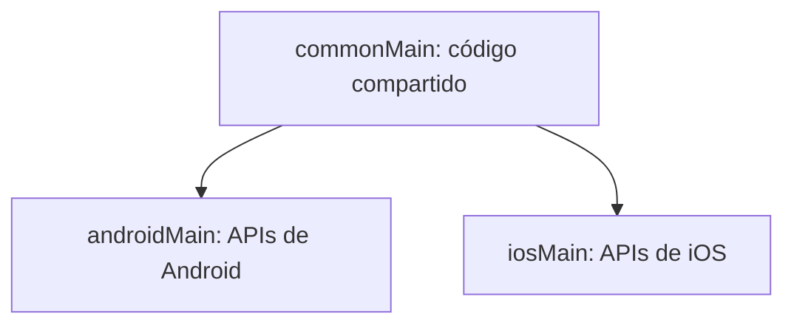
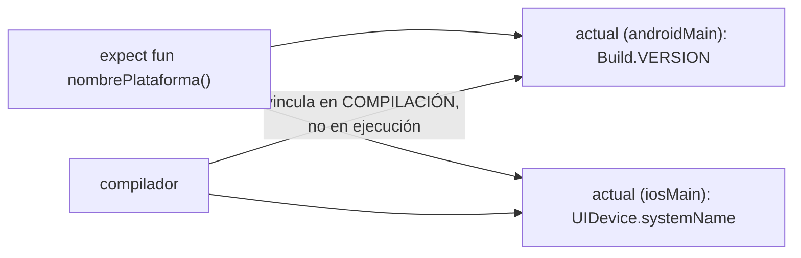
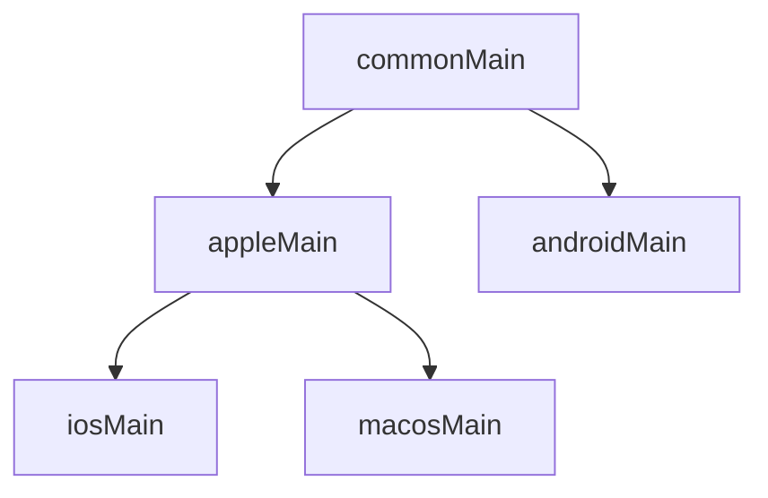
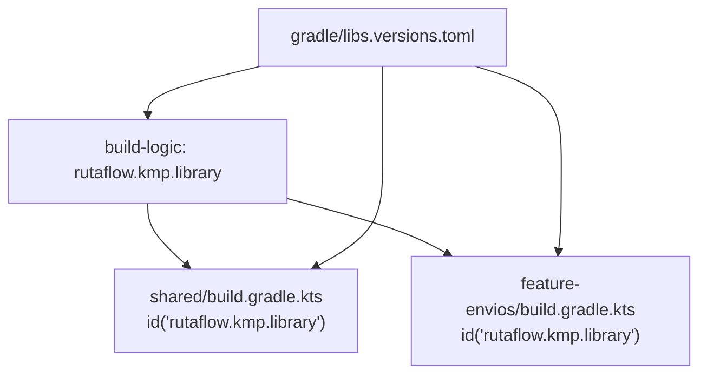
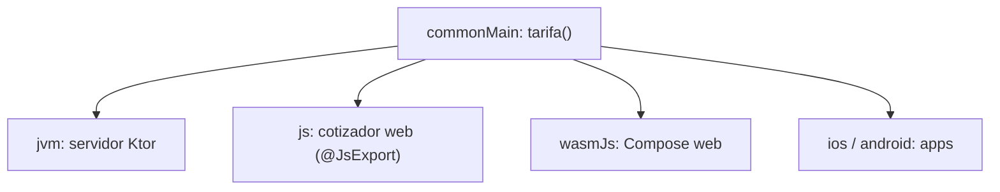

# Módulo 3: Arquitectura de un proyecto KMP

Cada tema se practica por separado con su propia repetición progresiva y su propio reto de memoria — source sets, `expect`/`actual`, targets de Gradle y jerarquías intermedias son la estructura sobre la que se apoya todo el resto del track.


## Aprende construyendo

### Tema 1: Source sets

#### Paso 1 · Objetivo y preparación

Al finalizar podrás decidir si un archivo Kotlin pertenece a `commonMain` o a un source set específico de plataforma, y verificar que `commonMain` nunca importa una API específica de una sola plataforma.

**Conocimiento previo:** ninguno específico; ayuda haber creado ya un archivo `.kt` en módulos anteriores.

#### Paso 2 · Contexto y caso real

**¿Por qué es importante?** La lógica de validación de formularios y reglas de negocio compartida entre la app Android y la app iOS de una misma empresa solo puede vivir en un lugar sin duplicarse si ese código no depende de ninguna API específica de una sola plataforma — source sets es el mecanismo que hace cumplir esa separación.

#### Paso 3 · Teoría con analogía

**Conceptos clave:** `commonMain` (compilado para todas las plataformas), `androidMain`/`iosMain` (específico por plataforma).

`commonMain` contiene código compilado para TODAS las plataformas de destino configuradas, sin ninguna dependencia de APIs específicas de una plataforma particular. `androidMain` e `iosMain` contienen código que se compila únicamente para su plataforma correspondiente, pudiendo usar libremente APIs específicas de esa plataforma. El propósito central de KMP es maximizar la cantidad de código en `commonMain` (lógica de negocio, modelos de dominio) mientras se aísla en source sets específicos solo lo que genuinamente necesita APIs nativas particulares.

**Analogía:** los source sets son plantas de un edificio con distinto alcance de acceso: la planta baja (`commonMain`) es accesible por todos los visitantes; los pisos superiores específicos (`androidMain`, `iosMain`) contienen recursos particulares solo para quienes necesitan ese departamento específico.

**Diagrama:**



#### Paso 4 · Demostración guiada desde cero

Desde una carpeta vacía (o continuando en `academia-kmp`, o créala con `mkdir -p academia-kmp` si es tu primera vez), crea la estructura de source sets con este contenido:

```kotlin
// shared/src/commonMain/kotlin/com/academia/kmp/Tarea.kt
package com.academia.kmp

data class Tarea(val id: String, val titulo: String, val completada: Boolean)
```

```kotlin
// shared/src/androidMain/kotlin/com/academia/kmp/Plataforma.android.kt
package com.academia.kmp

import android.os.Build

actual fun nombrePlataforma(): String = "Android ${Build.VERSION.SDK_INT}"
```

Guarda ambos archivos y compila el módulo compartido:

```bash
# crea la estructura de source sets y compila el módulo compartido con Gradle
mkdir -p academia-kmp/shared/src/commonMain/kotlin/com/academia/kmp
mkdir -p academia-kmp/shared/src/androidMain/kotlin/com/academia/kmp
mkdir -p academia-kmp/shared/src/iosMain/kotlin/com/academia/kmp
cd academia-kmp
./gradlew :shared:compileKotlinMetadata
```

**Explicación línea por línea:** `Tarea.kt` en `commonMain` solo usa tipos del lenguaje base de Kotlin (`String`, `Boolean`), sin ningún import de `android.*` o de Foundation/UIKit, por lo que puede compilarse igual para Android, iOS o cualquier otro target configurado; `Plataforma.android.kt` en `androidMain` sí importa `android.os.Build` libremente, porque este archivo solo se compila cuando el target es Android.

**Resultado esperado:** `./gradlew :shared:compileKotlinMetadata` compila sin errores, confirmando que `commonMain` no depende de ninguna API específica de plataforma.

**Fallo deliberado:** mueve el contenido de `Plataforma.android.kt` a `commonMain` (es decir, crea `shared/src/commonMain/kotlin/com/academia/kmp/Plataforma.kt` con el mismo `import android.os.Build` y la misma función). Vuelve a ejecutar `./gradlew :shared:compileKotlinMetadata` — la compilación falla con `Unresolved reference: android`, porque `commonMain` se compila contra un classpath que NO incluye el SDK de Android — diagnostica confirmando que "usar una API específica de Android directamente en `commonMain`" no es un problema de estilo sino un error real de compilación, detectado incluso al compilar solo el metadata común, antes de llegar a compilar para ningún target específico.

#### Paso 5 · Práctica guiada — repetición progresiva

1. Crea un archivo en `commonMain` con una `data class` simple y confirma que no tiene imports de plataforma.
2. Crea un archivo en `androidMain` que importe `android.util.Log` y confirma que `./gradlew :shared:compileDebugKotlinAndroid` compila sin error (porque está en el source set correcto).
3. Mueve deliberadamente ese mismo archivo a `commonMain` y confirma con `./gradlew :shared:compileKotlinMetadata` que ahora SÍ produce `Unresolved reference: android`.
4. Escribe de memoria (sin mirar) un archivo de ejemplo en `iosMain` que importe algo de `platform.Foundation`.

**Pista:** la regla es siempre la misma: `commonMain` nunca importa nada que no exista en TODOS los targets configurados; un source set específico sí puede.

#### Paso 6 · Práctica independiente

**Completa el código:** indica en qué source set debería vivir cada archivo:

```kotlin
// data class Usuario(val id: String, val nombre: String)         -> vive en: ____Main
// import android.content.SharedPreferences ...                    -> vive en: ____Main
// import platform.Foundation.NSUserDefaults ...                   -> vive en: ____Main
```

**Reto de memoria sin mirar:** cierra este documento y escribe, solo de memoria, la estructura de carpetas de un módulo `shared` con `commonMain`, `androidMain` e `iosMain`, y un ejemplo de archivo que pertenecería a cada uno. Compara después contra el patrón del Paso 4.

#### Paso 7 · Cierre

Ya decides en qué source set pertenece un archivo según si depende o no de APIs específicas de plataforma, y confirmas con el compilador real que violar esa regla en `commonMain` es un error de compilación, no solo un problema de estilo. El siguiente tema resuelve cómo `commonMain` puede llamar a código que SÍ necesita una implementación distinta por plataforma. Fuente oficial: [Kotlin docs — Multiplatform source sets](https://kotlinlang.org/docs/multiplatform-discover-project.html#source-sets).

**Errores comunes:** intentar usar una API específica de Android directamente en `commonMain`, rompiendo la compilación para cualquier otro target; duplicar lógica de negocio idéntica en `androidMain` e `iosMain` en vez de moverla a `commonMain`.

**Cuándo no usarlo:** para un proyecto que target solo una plataforma (únicamente Android, sin planes reales de multiplataforma), la separación en source sets múltiples es complejidad innecesaria; resérvala para proyectos que efectivamente comparten código entre 2 o más targets.

**Transferencia al proyecto integrador «Núcleo móvil compartido»:** Ubica reglas de entrega en commonMain y adaptadores nativos en su source set. Compila ambos destinos y verifica que el dominio no importa APIs exclusivas de Android o iOS.

### Tema 2: expect/actual

#### Paso 1 · Objetivo y preparación

Al finalizar podrás declarar una función `expect` en `commonMain` y sus implementaciones `actual` correspondientes por plataforma, y explicar por qué el compilador exige una `actual` por cada target configurado.

**Conocimiento previo:** Tema 1 de este módulo (source sets).

#### Paso 2 · Contexto y caso real

**¿Por qué es importante?** Obtener un identificador único de dispositivo (`Settings.Secure.ANDROID_ID` en Android vs `UIDevice.identifierForVendor` en iOS) necesita una implementación completamente distinta por plataforma, pero el código que lo consume en `commonMain` no debería necesitar saber cuál corresponde a cada caso.

#### Paso 3 · Teoría con analogía

**Conceptos clave:** `expect` (contrato declarado en común), `actual` (implementación específica por plataforma), vinculación en tiempo de compilación.

`expect fun nombrePlataforma(): String` (en `commonMain`) establece un contrato: código en `commonMain` puede llamar a esta función confiando en que existe una implementación concreta. `actual fun nombrePlataforma(): String = "Android ${'$'}{Build.VERSION.SDK_INT}"` (en `androidMain`) y su equivalente en `iosMain` proporcionan la implementación real. El compilador de Kotlin vincula cada `expect` con su `actual` correspondiente en TIEMPO DE COMPILACIÓN específico para cada target — sin la ceremonia de selección en tiempo de ejecución que una interfaz común con inyección de dependencias requeriría.

**Analogía:** `expect`/`actual` es una especificación técnica universal de un enchufe eléctrico que cada país implementa físicamente según su propio estándar, sin que el aparato (el código en `commonMain`) necesite saber los detalles de la implementación eléctrica de cada país.

**Diagrama:**



#### Paso 4 · Demostración guiada desde cero

Desde una carpeta vacía (o continuando en `academia-kmp`, o créala con `mkdir -p academia-kmp` si es tu primera vez), crea el contrato en `commonMain` y su implementación en `androidMain`:

```kotlin
// shared/src/commonMain/kotlin/com/academia/kmp/Plataforma.kt
package com.academia.kmp

expect fun nombrePlataforma(): String
expect fun idUnicoDispositivo(): String
```

```kotlin
// shared/src/androidMain/kotlin/com/academia/kmp/Plataforma.android.kt
package com.academia.kmp

actual fun nombrePlataforma(): String = "Android"
actual fun idUnicoDispositivo(): String = "android-id-simulado"
```

Guarda ambos archivos y compila para Android:

```bash
# crea la estructura de source sets y compila el módulo compartido con Gradle
mkdir -p academia-kmp/shared/src/commonMain/kotlin/com/academia/kmp
mkdir -p academia-kmp/shared/src/androidMain/kotlin/com/academia/kmp
cd academia-kmp
./gradlew :shared:compileKotlinMetadata :shared:compileDebugKotlinAndroid
```

**Explicación línea por línea:** `expect fun nombrePlataforma(): String` y `expect fun idUnicoDispositivo(): String` declaran dos contratos en `commonMain`; `actual fun nombrePlataforma()` y `actual fun idUnicoDispositivo()` en `androidMain` implementan AMBOS contratos — si faltara implementar uno de los dos, la compilación para Android fallaría.

**Resultado esperado:** ambos comandos compilan sin errores, confirmando que `androidMain` implementa el contrato completo declarado en `commonMain`.

**Fallo deliberado:** actualiza `shared/src/androidMain/kotlin/com/academia/kmp/Plataforma.android.kt` eliminando la línea `actual fun idUnicoDispositivo(): String = "android-id-simulado"`, dejando solo `actual fun nombrePlataforma()`. Vuelve a ejecutar `./gradlew :shared:compileDebugKotlinAndroid` — la compilación falla con `Expected function 'idUnicoDispositivo' has no actual declaration in module <shared> for target ANDROID` — diagnostica confirmando que el compilador exige una `actual` por cada `expect` declarada, para cada target configurado, antes de poder compilar; a diferencia de una interfaz con método por defecto (donde olvidar una implementación no necesariamente rompe la compilación), un `expect` sin su `actual` correspondiente es siempre un error de compilación, nunca un comportamiento silencioso.

#### Paso 5 · Práctica guiada — repetición progresiva

1. Declara `expect fun plataformaSoportaNotificacionesPush(): Boolean` y sus dos `actual` correspondientes.
2. Compila para ambos targets y confirma que ambos targets cumplen el contrato.
3. Elimina deliberadamente una de las dos implementaciones `actual` y confirma el error real de compilación para ese target.
4. Escribe de memoria (sin mirar) una función `expect` de tu elección con sus dos implementaciones `actual`.

**Pista:** cuenta primero cuántas funciones `expect` hay en `commonMain`, y verifica que cada target tenga exactamente esa misma cantidad de `actual`.

#### Paso 6 · Práctica independiente

**Completa el código:** rellena los espacios para declarar el contrato y su implementación:

```kotlin
// commonMain
____ fun rutaDeAlmacenamiento(): String

// androidMain
____ fun rutaDeAlmacenamiento(): String = context.filesDir.path
```

**Reto de memoria sin mirar:** cierra este documento y escribe, solo de memoria, una función `expect` con dos implementaciones `actual` distintas (Android e iOS), explicando en una frase por qué el compilador exige ambas antes de compilar. Compara después contra el patrón del Paso 4.

#### Paso 7 · Cierre

Ya declaras contratos `expect` en `commonMain` y verificas que cada plataforma implementa su `actual` correspondiente, confirmando con el compilador real qué ocurre cuando falta una implementación. El siguiente tema configura los targets de Gradle que determinan para qué plataformas se compila cada `actual`. Fuente oficial: [Kotlin docs — Expected and actual declarations](https://kotlinlang.org/docs/multiplatform-expect-actual.html).

**Errores comunes:** olvidar implementar `actual` en uno de los targets tras agregar una nueva `expect`, rompiendo la compilación solo para ese target; declarar una `actual` con una firma de tipo distinta a su `expect` correspondiente (parámetros o tipo de retorno diferentes).

**Cuándo no usarlo:** para una función que se comporta idénticamente en todas las plataformas sin necesitar ninguna API nativa particular, `expect`/`actual` es innecesario; decláralas directamente en `commonMain` como una función común.

**Transferencia al proyecto integrador «Núcleo móvil compartido»:** Expón una capacidad nativa mínima, como obtener una marca temporal o identificador de instalación. Prueba el contrato común y documenta las diferencias observables de cada implementación actual.

### Tema 3: Gradle multiplataforma y targets disponibles

#### Paso 1 · Objetivo y preparación

Al finalizar podrás configurar los targets de compilación de un proyecto KMP, y declarar una dependencia en el bloque `sourceSets` correcto según si debe estar disponible en todo el código compartido o solo en una plataforma.

**Conocimiento previo:** Tema 1 de este módulo (source sets); Tema 2 (expect/actual).

#### Paso 2 · Contexto y caso real

**¿Por qué es importante?** Declarar una dependencia (por ejemplo Ktor, Módulo 5) solo en el source set de Android cuando en realidad se necesita en `commonMain` produce un error de compilación al intentar usarla desde código compartido — el bloque de `sourceSets` donde se declara una dependencia determina exactamente desde dónde es visible.

#### Paso 3 · Teoría con analogía

**Conceptos clave:** configuración de targets (`androidTarget()`, `iosX64()`, etc.), dependencias por bloque de `sourceSets`, alcance más allá de Android/iOS.

```kotlin
kotlin {
    androidTarget()
    iosX64()
    iosArm64()
    iosSimulatorArm64()
    sourceSets {
        commonMain.dependencies {
            implementation("io.ktor:ktor-client-core:3.5.0")
        }
    }
}
```

Esta configuración habilita los targets (Android y las tres variantes de iOS necesarias para dispositivo físico de distintas arquitecturas y simulador), y declara una dependencia en `commonMain.dependencies`, garantizando que esté disponible para todo el código compartido. KMP no se limita a Android/iOS: también compila a JVM, JS/Wasm y Native para escritorio.

**Analogía:** configurar los targets de Gradle es decidir para qué mercados específicos se fabricará un producto, mientras el diseño central (`commonMain`) permanece el mismo sin importar cuántos mercados se decida atender.

**Diagrama:**

```
┌── kotlin { } ────────────────────────────────────────────┐
│  androidTarget()  iosX64()  iosArm64()  iosSimulatorArm64() │
│  sourceSets { commonMain.dependencies { ... } }              │
└──────────────────────────────────────────────────────┘
```

#### Paso 4 · Demostración guiada desde cero

Desde una carpeta vacía (o continuando en `academia-kmp`, o créala con `mkdir -p academia-kmp` si es tu primera vez), crea `build.gradle.kts` con este contenido:

```kotlin
kotlin {
    androidTarget()
    iosX64(); iosArm64(); iosSimulatorArm64()
    sourceSets {
        commonMain.dependencies {
            implementation("io.ktor:ktor-client-core:3.5.0")
        }
    }
}
```

Guarda el archivo y confirma que Gradle reconoce la configuración:

```bash
# lista los proyectos y confirma que la configuración de Gradle es válida
mkdir -p academia-kmp
cd academia-kmp
./gradlew projects
```

**Explicación línea por línea:** `androidTarget()` habilita la compilación para Android; `iosX64(); iosArm64(); iosSimulatorArm64()` habilitan tres variantes de iOS (simulador Intel, dispositivo físico ARM, simulador ARM en Mac Apple Silicon); `iosArm64` e `iosSimulatorArm64` son las necesarias hoy, mientras que `iosX64` es un destino de nivel 3 (Tier 3) que Kotlin no garantiza probar en CI: mantenlo solo si tu equipo aún usa Macs Intel; `commonMain.dependencies { implementation(...) }` declara Ktor disponible para TODO el código compartido, no solo para una plataforma.

Agrega en `commonMain` un archivo que use una clase de Ktor, y compila para confirmar que la dependencia declarada en `commonMain.dependencies` es visible:

```kotlin
// shared/src/commonMain/kotlin/com/academia/kmp/ClienteHttp.kt
package com.academia.kmp

import io.ktor.client.*

fun crearCliente(): HttpClient = HttpClient()
```

```bash
# compila el módulo compartido, confirmando que ve la dependencia de commonMain.dependencies
cd academia-kmp
./gradlew :shared:compileKotlinMetadata
```

**Resultado esperado:** la compilación es exitosa, confirmando que `io.ktor.client.HttpClient`, declarada en `commonMain.dependencies`, es visible desde código en `commonMain`.

**Fallo deliberado:** mueve `implementation("io.ktor:ktor-client-core:3.5.0")` del bloque `commonMain.dependencies` al bloque `androidMain.dependencies` en el `build.gradle.kts`, dejando `ClienteHttp.kt` sin cambios en `commonMain`. Vuelve a ejecutar `./gradlew :shared:compileKotlinMetadata` — la compilación falla con `Unresolved reference: io`, porque `commonMain` ya no tiene visibilidad sobre una dependencia declarada solo en `androidMain` — diagnostica confirmando el error común "declarar una dependencia solo en un source set específico cuando se necesita en `commonMain`": el síntoma aparece exactamente al compilar el source set que perdió la dependencia, no necesariamente en el que la conserva.

#### Paso 5 · Práctica guiada — repetición progresiva

1. Agrega un target `jvm()` a la configuración y explica en una frase qué caso de uso habilitaría (compartir lógica con un backend Spring Boot).
2. Declara `implementation("io.ktor:ktor-client-darwin:3.5.0")` en `iosMain.dependencies` y confirma que usarla desde `commonMain` produce el mismo `Unresolved reference` visto en el fallo deliberado.
3. Declara la misma dependencia en `commonMain.dependencies` en su lugar, y confirma que ahora SÍ es visible desde ambos.
4. Escribe de memoria (sin mirar) un bloque `kotlin { }` con al menos dos targets y una dependencia en `commonMain.dependencies`.

**Pista:** una dependencia declarada en `commonMain` siempre es visible desde cualquier plataforma; una declarada en un source set específico solo es visible desde ese mismo source set (y sus descendientes, si los hay).

#### Paso 6 · Práctica independiente

**Completa el código:** rellena el espacio para que la dependencia esté disponible en todo el código compartido:

```kotlin
sourceSets {
    ____.dependencies {
        implementation("io.ktor:ktor-client-core:3.5.0")
    }
}
```

**Reto de memoria sin mirar:** cierra este documento y escribe, solo de memoria, un bloque `kotlin { }` configurando Android + iOS con una dependencia en `commonMain`. Compara después contra el patrón del Paso 4.

#### Paso 7 · Cierre

Ya configuras los targets de un proyecto KMP y declaras dependencias en el bloque correcto según su alcance necesario, confirmando con el compilador real que una dependencia mal ubicada rompe la compilación solo para la plataforma que no la ve. El siguiente y último tema de este módulo extiende la jerarquía de source sets más allá de solo `commonMain`/`androidMain`/`iosMain`. Fuente oficial: [Kotlin docs — Add dependencies](https://kotlinlang.org/docs/multiplatform-add-dependencies.html).

**Errores comunes:** olvidar declarar todos los targets de iOS necesarios (x64, arm64, simulador), cada uno cubriendo un caso distinto; declarar una dependencia solo en un source set específico cuando se necesita en `commonMain`, rompiendo la compilación solo para las plataformas que no la ven.

**Cuándo no usarlo:** para un proyecto que nunca compilará para más de una plataforma, configurar múltiples targets de Gradle es trabajo innecesario; agrégalos solo cuando el proyecto realmente los necesite.

**Transferencia al proyecto integrador «Núcleo móvil compartido»:** Configura `androidTarget()` y los tres targets de iOS para el módulo `shared`, y declara Ktor en `commonMain.dependencies` para que el cliente HTTP de consulta de envíos sea el mismo código consumido por la app Android y la app iOS.

### Tema 4: Jerarquía de source sets intermedios

#### Paso 1 · Objetivo y preparación

Al finalizar podrás usar un source set intermedio (como `appleMain`) para compartir código entre plataformas similares sin duplicarlo en cada una y sin subirlo hasta `commonMain`.

**Conocimiento previo:** Tema 1 de este módulo (source sets básicos); Tema 3 (targets de Gradle, incluyendo las tres variantes de iOS).

#### Paso 2 · Contexto y caso real

**¿Por qué es importante?** Código que usa Foundation/UIKit tiene sentido para iOS Y macOS (ambos son plataformas Apple) pero NO para Android; subirlo a `commonMain` rompería la compilación para Android, y duplicarlo en `iosMain` y `macosMain` por separado repite la misma lógica dos veces innecesariamente.

#### Paso 3 · Teoría con analogía

**Conceptos clave:** source set intermedio (`appleMain`), jerarquía de `dependsOn`, código compartido entre un subconjunto de plataformas.

Un source set intermedio como `appleMain` se sitúa entre `commonMain` y los source sets específicos de cada variante Apple (`iosMain`, `macosMain`): declarando `iosMain.dependsOn(appleMain)` y `macosMain.dependsOn(appleMain)`, cualquier código en `appleMain` (que sí puede usar Foundation, disponible en todas las plataformas Apple) queda automáticamente visible para `iosMain` y `macosMain`, pero sigue siendo invisible para `androidMain`. Esto evita el falso dilema de "todo en `commonMain` o todo duplicado por plataforma".

**Analogía:** si `commonMain` es la planta baja de acceso universal y cada `androidMain`/`iosMain` es un piso privado, un source set intermedio como `appleMain` es un piso compartido SOLO entre los departamentos de un mismo edificio hermano (las plataformas Apple), sin acceso desde el edificio de al lado (Android).

**Diagrama:**



#### Paso 4 · Demostración guiada desde cero

Desde una carpeta vacía (o continuando en `academia-kmp`, o créala con `mkdir -p academia-kmp` si es tu primera vez), agrega la jerarquía intermedia a `build.gradle.kts`:

```kotlin
// jerarquía intermedia: iosMain y macosMain dependen de appleMain, no directamente de commonMain
sourceSets {
    val appleMain by creating { dependsOn(commonMain.get()) }
    iosMain.get().dependsOn(appleMain)
    // macosMain.get().dependsOn(appleMain) -- se agregaría igual si el target macOS está habilitado
}
```

Guarda el archivo y compila para iOS:

```bash
# crea la estructura de source sets y compila el target iOS con Gradle
mkdir -p academia-kmp/shared/src/{commonMain,appleMain,iosMain,macosMain,androidMain}/kotlin/com/academia/kmp
cd academia-kmp
./gradlew :shared:compileKotlinIosX64
```

**Explicación línea por línea:** `val appleMain by creating { dependsOn(commonMain.get()) }` crea un nuevo source set intermedio que a su vez depende de `commonMain` (ve todo lo que `commonMain` expone); `iosMain.get().dependsOn(appleMain)` hace que `iosMain` ahora dependa de `appleMain` en vez de solo de `commonMain` directamente, ganando acceso a cualquier código Apple-específico que se coloque ahí.

Para confirmar la regla general ("la visibilidad fluye desde una hoja hacia la raíz, nunca lateralmente"), crea `shared/src/commonMain/kotlin/com/academia/kmp/JerarquiaSourceSets.kt` con la función de reachability real en Kotlin —útil en cualquier proyecto para auditar jerarquías de módulos— y su test en `shared/src/commonTest/kotlin/com/academia/kmp/JerarquiaSourceSetsTest.kt`:

```kotlin
// shared/src/commonMain/kotlin/com/academia/kmp/JerarquiaSourceSets.kt
package com.academia.kmp

fun puedeVer(jerarquia: Map<String, List<String>>, origen: String, sourceSetBuscado: String): Boolean {
    val visibles = mutableSetOf(origen)
    val pendientes = mutableListOf(origen)
    while (pendientes.isNotEmpty()) {
        val actual = pendientes.removeAt(pendientes.lastIndex)
        for (padre in jerarquia[actual].orEmpty()) {
            if (visibles.add(padre)) pendientes.add(padre)
        }
    }
    return sourceSetBuscado in visibles
}
```

```kotlin
// shared/src/commonTest/kotlin/com/academia/kmp/JerarquiaSourceSetsTest.kt
package com.academia.kmp

import kotlin.test.Test
import kotlin.test.assertFalse
import kotlin.test.assertTrue

class JerarquiaSourceSetsTest {
    private val jerarquia = mapOf(
        "commonMain" to emptyList(),
        "appleMain" to listOf("commonMain"),
        "iosMain" to listOf("appleMain", "commonMain"),
        "macosMain" to listOf("appleMain", "commonMain"),
        "androidMain" to listOf("commonMain"),
    )

    @Test
    fun iosMainYMacosMainVenAppleMain() {
        assertTrue(puedeVer(jerarquia, "iosMain", "appleMain"))
        assertTrue(puedeVer(jerarquia, "macosMain", "appleMain"))
    }

    @Test
    fun androidMainNoVeAppleMain() {
        assertFalse(puedeVer(jerarquia, "androidMain", "appleMain"))
    }
}
```

Ejecuta el test real con Gradle:

```bash
# ejecuta el test Kotlin del módulo compartido
cd academia-kmp
./gradlew :shared:allTests
```

**Resultado esperado:** las dos pruebas pasan en verde: tanto `iosMain` como `macosMain` ven código de `appleMain`, porque ambos dependen de él en la jerarquía; `androidMain` NO ve código de `appleMain`, porque no existe ninguna ruta de `dependsOn` que los conecte — exactamente el aislamiento que se buscaba: código Apple-específico compartido entre iOS y macOS, sin filtrarse hacia Android.

**Fallo deliberado:** agrega `"androidMain" to listOf("appleMain", "commonMain")` a la `jerarquia` del test (una conexión que no tendría sentido real, ya que Android no es una plataforma Apple). La prueba `androidMainNoVeAppleMain` ahora falla, porque `puedeVer` reporta `true` — diagnostica confirmando que la función de reachability solo refleja fielmente la jerarquía real declarada con `dependsOn` en Gradle: si esa conexión existiera en el `build.gradle.kts` real, `androidMain` efectivamente vería código de `appleMain` que probablemente usa Foundation/UIKit (inexistente en Android), produciendo un error de compilación real en cuanto se intente usar algo específico de Apple desde ese código.

#### Paso 5 · Práctica guiada — repetición progresiva

1. Agrega `"watchosMain" to listOf("appleMain", "commonMain")` al mapa de la prueba, y confirma con `puedeVer` que ve el mismo código que `iosMain`/`macosMain`.
2. Confirma que `puedeVer(jerarquia, "watchosMain", "iosMain")` es `false` (son hermanos, no hay `dependsOn` entre ellos).
3. Elimina la entrada de `iosMain` del mapa y confirma que `puedeVer(jerarquia, "iosMain", "appleMain")` ahora devuelve `false` (el origen ya no tiene ninguna entrada de la que partir).
4. Escribe de memoria (sin mirar) una jerarquía de tres niveles (`commonMain` → un intermedio de tu elección → dos hojas) y verifica la visibilidad entre ellas con `puedeVer`.

**Pista:** dibuja la jerarquía como un árbol antes de escribir el código; la visibilidad siempre fluye desde una hoja hacia la raíz, nunca lateralmente entre hermanos.

#### Paso 6 · Práctica independiente

**Completa el código:** rellena el espacio para que `iosMain` dependa del source set intermedio:

```kotlin
val appleMain by creating { dependsOn(commonMain.get()) }
iosMain.get().____(appleMain)
```

**Reto de memoria sin mirar:** cierra este documento y escribe, solo de memoria, una jerarquía de source sets con un nivel intermedio compartido por exactamente dos plataformas hoja, y explica en una frase por qué una tercera plataforma no relacionada no debería depender de ese intermedio. Compara después contra el patrón del Paso 4.

#### Paso 7 · Cierre

Ya usas un source set intermedio para compartir código entre un subconjunto de plataformas sin duplicarlo ni subirlo incorrectamente a `commonMain`, confirmando con un chequeo de reachability real qué source sets pueden verse entre sí. Esto cierra el módulo de arquitectura; el siguiente módulo aplica esta estructura a modelos de dominio y casos de uso de la lógica de negocio compartida. Fuente oficial: [Kotlin docs — Hierarchical project structure](https://kotlinlang.org/docs/multiplatform-hierarchy.html).

**Errores comunes:** subir código Apple-específico directamente a `commonMain` en vez de a un intermedio como `appleMain`, rompiendo la compilación para Android; crear una conexión `dependsOn` entre plataformas que no comparten APIs reales, permitiendo que código incompatible se filtre.

**Cuándo no usarlo:** para un proyecto que solo compila a dos plataformas sin ningún subconjunto intermedio con necesidades compartidas específicas (por ejemplo, solo Android + JVM backend, sin variantes Apple múltiples), un source set intermedio adicional es complejidad innecesaria; usa `commonMain` y los source sets específicos directamente.

---

**Transferencia al proyecto integrador «Núcleo móvil compartido»:** Comparte código entre destinos que realmente soportan la misma API. Construye cada target configurado y demuestra que introducir una dependencia nativa no rompe un destino hermano.

### Tema 5: Version catalogs y convention plugins: una sola fuente de versiones y configuración de Gradle · Avanzado · 45 min

**Prerrequisito:** temas «Gradle multiplataforma y targets disponibles» y «Jerarquía de source sets intermedios» de este módulo.

**Al finalizar podrás:** mover todas las versiones a `gradle/libs.versions.toml` y extraer la configuración común de los módulos KMP a un convention plugin en `build-logic`, para que cada módulo nuevo tenga tres líneas de configuración.

**¿Por qué es importante?** Con varios módulos, cada `build.gradle.kts` repite targets, versiones y opciones. Un día un módulo queda con otra versión de Ktor o sin el target de iOS. Un catálogo y un plugin de convención evitan esa deriva.

#### Paso 1 · Objetivo y preparación

Usa un proyecto KMP con al menos dos módulos (`shared` y `feature-envios`) y Gradle 8.5 o superior. Crea la carpeta `build-logic` en la raíz.

#### Paso 2 · Contexto y caso real

RutaFlow tenía cinco módulos KMP. Dos usaban Ktor 2 y tres Ktor 3, y uno olvidó el target `iosSimulatorArm64`, así que la app de iOS fallaba en Macs con chip Apple. Centralizar la configuración evitó repetirlo.

#### Paso 3 · Teoría, modelo mental y analogía

**Conceptos clave:** version catalog, alias (`libs.ktor.client.core`), bundle, convention plugin, `includeBuild`, `build-logic`, plugin precompilado.

**Version catalog:** un archivo TOML con secciones `[versions]`, `[libraries]`, `[bundles]` y `[plugins]`. Gradle genera accesos con tipos: `libs.ktor.client.core`. Cambias una versión en un solo lugar.

**Convention plugin:** un plugin de Gradle propio que aplica la configuración común (targets, opciones del compilador, dependencias base). Vive en un **build incluido** (`build-logic`) que se agrega con `includeBuild` en `settings.gradle.kts`. Cada módulo solo aplica el plugin por su id.

Resultado: el `build.gradle.kts` de un módulo dice **qué es** (`id("rutaflow.kmp.library")`) y sus dependencias propias; el **cómo** está en un solo lugar.

**Analogía:** el catálogo es la lista de precios oficial de la tienda; el convention plugin es el manual de montaje común a todos los muebles. La analogía falla en que, si cambias el manual, todos los muebles se rearman en el siguiente build.

**Límite de uso:** no metas en el convention plugin lo que solo usa un módulo. Un plugin con demasiadas opciones vuelve a ser difícil de leer: prefiere varios plugins pequeños (librería, feature, app).



#### Paso 4 · Demostración guiada desde cero

Archivo `gradle/libs.versions.toml`:

```toml
[versions]
kotlin = "2.4.21"
ktor = "3.5.0"
coroutines = "1.11.0"

[libraries]
ktor-client-core = { module = "io.ktor:ktor-client-core", version.ref = "ktor" }
kotlinx-coroutines-core = { module = "org.jetbrains.kotlinx:kotlinx-coroutines-core", version.ref = "coroutines" }
kotlin-gradle-plugin = { module = "org.jetbrains.kotlin:kotlin-gradle-plugin", version.ref = "kotlin" }

[plugins]
kotlin-multiplatform = { id = "org.jetbrains.kotlin.multiplatform", version.ref = "kotlin" }
```

Archivo `build-logic/build.gradle.kts`:

```kotlin
plugins { `kotlin-dsl` }

dependencies {
    implementation(libs.kotlin.gradle.plugin) // el plugin necesita el plugin de Kotlin para configurarlo
}
```

Archivo `build-logic/settings.gradle.kts`:

```kotlin
dependencyResolutionManagement {
    repositories { mavenCentral(); gradlePluginPortal() }
    versionCatalogs { create("libs") { from(files("../gradle/libs.versions.toml")) } }
}
```

Archivo `build-logic/src/main/kotlin/rutaflow.kmp.library.gradle.kts`:

```kotlin
// Plugin precompilado: su id es el nombre del archivo, "rutaflow.kmp.library".
plugins { id("org.jetbrains.kotlin.multiplatform") }

kotlin {
    jvm()
    iosArm64()
    iosSimulatorArm64() // ningún módulo puede olvidarlo
    jvmToolchain(25) // JDK 25, la línea del curso (docs/VERSIONES.md)
    compilerOptions { allWarningsAsErrors.set(true) }
}
```

Archivo `feature-envios/build.gradle.kts`:

```kotlin
plugins { id("rutaflow.kmp.library") }

kotlin {
    sourceSets.commonMain.dependencies {
        implementation(libs.ktor.client.core)
        implementation(libs.kotlinx.coroutines.core)
    }
}
```

Archivo `settings.gradle.kts`:

```kotlin
pluginManagement { includeBuild("build-logic") }
dependencyResolutionManagement {
    repositories { mavenCentral() } // sin esto los módulos no encuentran kotlin-stdlib, Ktor ni coroutines
}
rootProject.name = "rutaflow"
include(":feature-envios") // el Tema 6 añade ":shared"
```

Ejecútalo:

```bash
./gradlew :feature-envios:tasks --group=verification
./gradlew :feature-envios:allTests
```

**Explicación por bloques:** El catálogo define versiones una vez y las referencia con `version.ref`. `build-logic` es un build aparte con `kotlin-dsl`; usa el mismo catálogo desde su propio `settings.gradle.kts`. El archivo `rutaflow.kmp.library.gradle.kts` es un plugin precompilado: aplica el plugin multiplataforma y fija targets, toolchain y avisos como errores. `settings.gradle.kts` de la raíz incluye `build-logic` para que sus plugins estén disponibles y declara en `dependencyResolutionManagement` el repositorio de donde salen las dependencias de todos los módulos: el `settings.gradle.kts` de `build-logic` solo sirve a ese build, no a la raíz. Cada `include` debe apuntar a una carpeta que exista; por eso `:shared` se añade en el Tema 6, cuando se crea. El módulo `feature-envios` queda con su plugin y sus dependencias.

**Resultado esperado:**

```text
./gradlew :feature-envios:tasks --group=verification lista allTests, jvmTest e iosSimulatorArm64Test, aunque el módulo no los declara.
BUILD SUCCESSFUL
```

**Fallo deliberado:** escribe en `feature-envios` la dependencia con versión fija `implementation("io.ktor:ktor-client-core:2.3.12")`. **Error esperado:** el build compila, pero `./gradlew :feature-envios:dependencies` muestra Ktor 2 y el módulo `shared` usa Ktor 3: conflicto en ejecución. **Diagnóstico:** saltarse el catálogo reintroduce la deriva. Usa siempre `libs.*` y, si quieres impedirlo, agrega una regla en el plugin que falle con versiones literales.

#### Paso 5 · Práctica guiada

1. **Reproducción:** lista las tareas de verificación de `feature-envios` y comprueba los targets.
2. **Variación:** actualiza Ktor en el catálogo y comprueba con `dependencies` que cambia en todos los módulos.
3. **Diagnóstico:** reproduce el fallo deliberado con una versión literal.
4. **Integración:** crea un segundo plugin `rutaflow.kmp.feature` que aplique el de librería y agregue Compose Multiplatform.
5. **Diseño:** escribe en el README de RutaFlow qué plugin usa cada tipo de módulo.

**Pista:** si Gradle no encuentra `libs` dentro de `build-logic`, revisa su propio `settings.gradle.kts`: es un build separado.

#### Paso 6 · Práctica independiente

Agrega un `[bundles]` llamado `ktor` con cliente, negociación de contenido y serialización JSON, y úsalo con `implementation(libs.bundles.ktor)`.

#### Paso 7 · Cierre

- [ ] Explicas catálogo y convention plugin.
- [ ] El módulo hereda los targets del plugin.
- [ ] Reprodujiste la deriva por una versión literal.
- [ ] Cada módulo tiene un `build.gradle.kts` corto.

Si fallas dos o más, vuelve al Paso 3. **Errores comunes:** poner versiones literales en los módulos, crear un único plugin gigante y olvidar que `build-logic` es otro build. **Siguiente paso:** el tema siguiente agrega targets JVM, JS y Wasm desde este mismo plugin.

**Transferencia al proyecto integrador «RutaFlow»:** centraliza las versiones de RutaFlow en `libs.versions.toml` y aplica `rutaflow.kmp.library` en todos los módulos compartidos.

**Fuente oficial:** [Gradle — Version catalogs](https://docs.gradle.org/current/userguide/version_catalogs.html) y [Gradle — Sharing build logic with convention plugins](https://docs.gradle.org/current/userguide/sharing_build_logic_between_subprojects.html).

### Tema 6: Más allá del móvil: targets JVM, JS y Wasm desde el mismo código común · Avanzado · 45 min

**Prerrequisito:** tema «Version catalogs y convention plugins» de este módulo.

**Al finalizar podrás:** agregar los targets `jvm`, `js` y `wasmJs` a un módulo compartido, usar la misma regla de negocio desde un servidor Ktor y desde el navegador, y aislar lo que cambia por plataforma.

**¿Por qué es importante?** La regla de tarifa de RutaFlow debe dar el mismo resultado en la app, en el servidor y en el cotizador web. Escribirla tres veces garantiza que tarde o temprano no coincidan. KMP permite compilar la misma regla para todos.

#### Paso 1 · Objetivo y preparación

Continúa el proyecto con el convention plugin. Necesitas Node.js para ejecutar las pruebas de JS y un navegador moderno para Wasm.

#### Paso 2 · Contexto y caso real

El cotizador web de RutaFlow tenía la fórmula de tarifa copiada en TypeScript. Cuando cambió el recargo por peso, el servidor cobró una cosa y la web mostró otra. Compartir la regla desde KMP eliminó la copia.

#### Paso 3 · Teoría, modelo mental y analogía

**Conceptos clave:** target, `jvm()`, `js { browser(); nodejs() }`, `wasmJs`, `@JsExport`, source set por target, `expect/actual` por plataforma.

Cada **target** compila el código común a una plataforma:

| Target | Produce | Uso típico |
|---|---|---|
| `jvm()` | bytecode de Java | servidor Ktor o Spring, escritorio |
| `js { browser() }` | JavaScript | web existente, librería npm |
| `wasmJs { browser() }` | WebAssembly | web con Compose Multiplatform |

El código de `commonMain` se compila para todos. Lo que depende de la plataforma (hora del sistema, almacenamiento) se declara con `expect` en común y se implementa con `actual` en cada source set.

Para que JavaScript pueda llamar una función de Kotlin con un nombre estable, se marca con **`@JsExport`**.

**Analogía:** el código común es una partitura; cada target es un instrumento que la interpreta. La analogía falla en que algunos instrumentos no tienen ciertas notas: por eso `expect/actual` da a cada uno su versión.

**Límite de uso:** no todo paquete de Kotlin soporta JS o Wasm: revisa en klibs.io o en la documentación de cada librería. Wasm en el navegador todavía tiene restricciones de interoperabilidad con APIs del DOM.



#### Paso 4 · Demostración guiada desde cero

Continúa en el proyecto del Tema 5 y registra el módulo nuevo. Archivo `settings.gradle.kts` (reemplaza el del Tema 5):

```kotlin
pluginManagement { includeBuild("build-logic") }
dependencyResolutionManagement {
    repositories { mavenCentral() }
}
rootProject.name = "rutaflow"
include(":shared", ":feature-envios")
```

Archivo `shared/build.gradle.kts`:

```kotlin
plugins { id("rutaflow.kmp.library") }

kotlin {
    js { browser(); nodejs(); binaries.library() }
    @OptIn(org.jetbrains.kotlin.gradle.ExperimentalWasmDsl::class)
    wasmJs { browser() }
}
```

Archivo `shared/src/commonMain/kotlin/co/rutaflow/tarifa/Tarifa.kt`:

```kotlin
package co.rutaflow.tarifa

import kotlin.js.ExperimentalJsExport
import kotlin.js.JsExport

@OptIn(ExperimentalJsExport::class)
@JsExport // nombre estable para JavaScript
fun tarifaCentavos(kilos: Int, urgente: Boolean): Int {
    require(kilos > 0) { "peso inválido" }
    val base = 1_000 + kilos * 120
    return if (urgente) base * 2 else base
}

expect fun plataforma(): String
```

Archivo `shared/src/jvmMain/kotlin/co/rutaflow/tarifa/Plataforma.jvm.kt`:

```kotlin
package co.rutaflow.tarifa

actual fun plataforma(): String = "JVM ${System.getProperty("java.version")}"
```

Archivo `shared/src/jsMain/kotlin/co/rutaflow/tarifa/Plataforma.js.kt`:

```kotlin
package co.rutaflow.tarifa

actual fun plataforma(): String = "JavaScript"
```

El convention plugin también declara iOS y este módulo añade Wasm, así que esos dos targets necesitan su `actual`.

Archivo `shared/src/iosMain/kotlin/co/rutaflow/tarifa/Plataforma.ios.kt`:

```kotlin
package co.rutaflow.tarifa

actual fun plataforma(): String = "iOS"
```

Archivo `shared/src/wasmJsMain/kotlin/co/rutaflow/tarifa/Plataforma.wasm.kt`:

```kotlin
package co.rutaflow.tarifa

actual fun plataforma(): String = "Wasm"
```

Archivo `shared/src/commonTest/kotlin/co/rutaflow/tarifa/TarifaTest.kt`:

```kotlin
package co.rutaflow.tarifa

import kotlin.test.Test
import kotlin.test.assertEquals

class TarifaTest {
    @Test fun mismaTarifaEnTodosLosTargets() {
        assertEquals(1_240, tarifaCentavos(2, urgente = false))
        assertEquals(2_480, tarifaCentavos(2, urgente = true))
        println("probado en ${plataforma()}")
    }
}
```

Ejecútalo:

```bash
./gradlew :shared:jvmTest :shared:jsNodeTest :shared:wasmJsBrowserTest
./gradlew :shared:jsBrowserProductionLibraryDistribution
```

**Explicación por bloques:** El módulo hereda `jvm` e iOS del convention plugin y agrega `js` (navegador y Node, como librería) y `wasmJs`. `tarifaCentavos` vive en `commonMain` y se exporta a JavaScript con `@JsExport`. `plataforma` es un `expect` con un `actual` por cada target que compila: JVM, JS, Wasm e iOS (el de iOS sirve para `iosArm64` e `iosSimulatorArm64`, que comparten `iosMain`). La misma prueba común corre en cada target. La última tarea genera un paquete JS que el cotizador web puede importar.

**Resultado esperado:**

```text
> Task :shared:jvmTest
> Task :shared:jsNodeTest
> Task :shared:wasmJsBrowserTest
BUILD SUCCESSFUL
build/dist/js/productionLibrary contiene shared.js y su archivo de tipos .d.ts con tarifaCentavos(kilos: number, urgente: boolean): number
```

**Fallo deliberado:** borra `Plataforma.js.kt`. **Error esperado:** `Expected function 'plataforma' has no actual declaration in module for JS`. **Diagnóstico:** cada `expect` necesita su `actual` en cada target que compila. Agrega la implementación o mueve la función a un source set intermedio compartido.

#### Paso 5 · Práctica guiada

1. **Reproducción:** ejecuta las pruebas de los tres targets.
2. **Variación:** importa `shared.js` desde un HTML de prueba y llama `tarifaCentavos(2, false)` en la consola del navegador.
3. **Diagnóstico:** reproduce el fallo deliberado sin el `actual` de JS.
4. **Integración:** usa la misma función desde un endpoint de Ktor en `jvmMain` y compara el resultado con la web.
5. **Diseño:** lista qué reglas de RutaFlow conviene compartir con la web y cuáles no.

**Pista:** si un target no compila, revisa primero qué `expect` le falta y si cada dependencia soporta ese target.

#### Paso 6 · Práctica independiente

Agrega un source set intermedio `webMain` (dependiente de `commonMain`) compartido por `js` y `wasmJs`, y mueve allí un `actual` común para los dos.

#### Paso 7 · Cierre

- [ ] Explicas qué produce cada target.
- [ ] La prueba común pasa en JVM, JS y Wasm.
- [ ] Reprodujiste el error de `expect` sin `actual`.
- [ ] Exportaste la regla a JavaScript con un nombre estable.

Si fallas dos o más, vuelve al Paso 3. **Errores comunes:** asumir que toda librería soporta JS y Wasm, olvidar `@JsExport` y duplicar en TypeScript reglas que ya están compartidas. **Siguiente paso:** el módulo 7 usa el target Wasm para Compose Multiplatform en el navegador.

**Transferencia al proyecto integrador «RutaFlow»:** comparte la regla de tarifa de RutaFlow entre la app, el servidor Ktor y el cotizador web desde `commonMain`.

**Fuente oficial:** [Kotlin — Multiplatform targets](https://kotlinlang.org/docs/multiplatform-dsl-reference.html#targets) y [Kotlin — JavaScript export](https://kotlinlang.org/docs/js-to-kotlin-interop.html#jsexport-annotation) y [Kotlin — Wasm](https://kotlinlang.org/docs/wasm-overview.html).

## Laboratorio práctico

**Objetivo del laboratorio:** construir un proyecto KMP con un módulo compartido que compila para Android e iOS, con contratos `expect`/`actual` verificados y una jerarquía de source sets correcta.

**Requisitos previos:** Módulos 0-2 completados.

| Paso | Acción | Código | Explicación |
|---|---|---|---|
| 1 | Crear un proyecto KMP desde la plantilla oficial | — | Explora `commonMain`/`androidMain`/`iosMain` |
| 2 | Escribir una función `expect` en `commonMain` | Ver Tema 2 | Que dependa de una implementación por plataforma |
| 3 | Implementar `actual` en `androidMain` e `iosMain` | Ver Tema 2 | Con código distinto en cada una |
| 4 | Configurar los targets de Gradle | Ver Tema 3 | Android + las tres variantes de iOS |
| 5 | Declarar una dependencia en `commonMain.dependencies` | Ver Tema 3 | Confirma que es visible desde ambas plataformas |
| 6 | Crear un source set intermedio `appleMain` | Ver Tema 4 | Compartido entre iOS y macOS, no Android |

**Verificación:** el laboratorio se considera exitoso si el proyecto compila correctamente para ambos targets, si la función `expect`/`actual` devuelve el valor correcto y específico de cada plataforma, y si puedes explicar con un ejemplo propio qué source set corresponde a un archivo dado según sus dependencias.

**Errores comunes y soluciones**

- **Intentar usar una API específica de Android directamente en `commonMain`.** Ese código no compilaría para iOS; usa `expect`/`actual` para aislar lo específico de plataforma.
- **Olvidar declarar todos los targets de iOS necesarios (x64, arm64, simulador).** Cada uno cubre un caso distinto (dispositivo físico de arquitecturas distintas, simulador).
- **Declarar una dependencia solo en un source set específico cuando se necesita en `commonMain`.** Verifica en qué bloque de `sourceSets` corresponde declarar cada dependencia según su alcance.
- **Subir código Apple-específico a `commonMain` en vez de a un intermedio como `appleMain`.** Usa la jerarquía de `dependsOn` para compartir código solo entre las plataformas que realmente lo necesitan.

---
