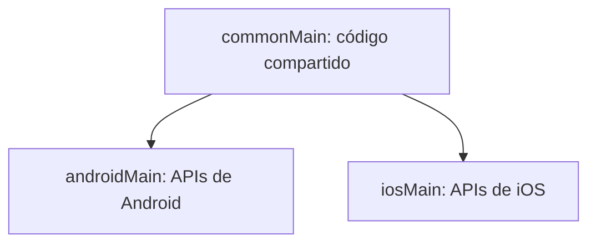
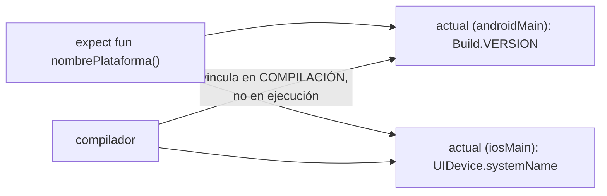
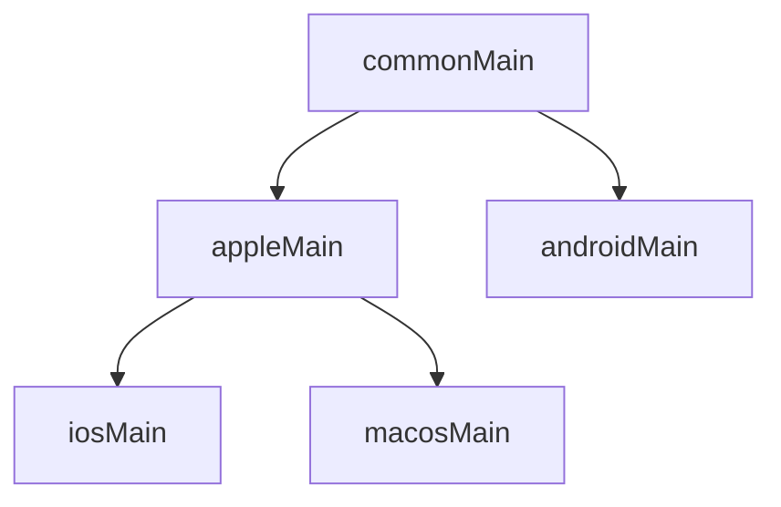
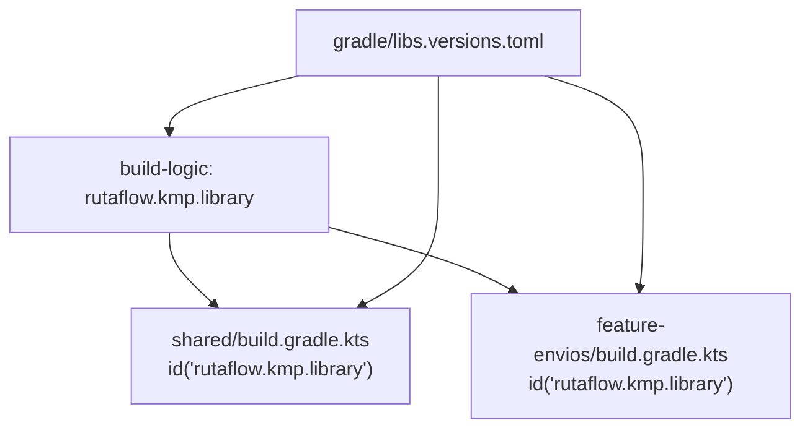
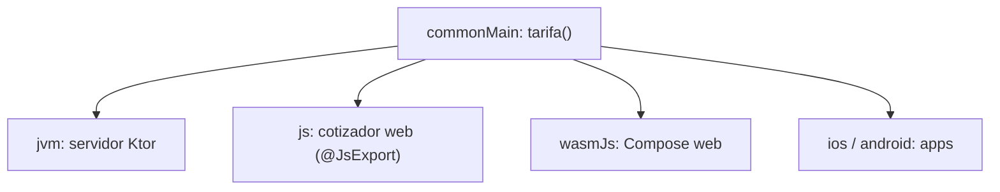

# Módulo 3: Arquitectura de un proyecto KMP

Cada tema se practica por separado con su propia repetición progresiva y su propio reto de memoria — source sets, `expect`/`actual`, targets de Gradle y jerarquías intermedias son la estructura sobre la que se apoya todo el resto del track.


## Aprende construyendo


### Tema 1: Source sets · Intermedio · 25 min

<details open>
<summary><strong>Capa 1 — Lectura</strong></summary>

#### ► DE QUÉ TRATA
Al finalizar podrás decidir si un archivo Kotlin pertenece a commonMain o a un source set específico de plataforma, y verificar que commonMain nunca importa una API específica de una sola plataforma.

#### ► LA IDEA EN UNA FRASE
**Al finalizar podrás decidir si un archivo Kotlin pertenece a commonMain o a un source set específico de plataforma, y verificar que commonMain nunca importa una API específica de una sola plataforma.**

#### ► POR QUÉ EXISTE ESTO
Resuelve un problema real de diseño o implementación y evita decisiones a ciegas.

#### ► LA ANALOGÍA
Piensa en source sets como una herramienta de taller: útil cuando conoces su propósito y sus límites.
**Dónde se rompe la analogía:** en software, los efectos dependen del contexto, la escala y los trade-offs.

#### ► CÓMO FUNCIONA


#### ► LO QUE PUEDE SALIR MAL
| Síntoma | Causa probable | Arreglo |
|---|---|---|
| Source sets se aplica pero el resultado no mejora | Se usó sin medir el problema real | Mide antes y compara contra la alternativa simple |
| Aparece complejidad inesperada | Se adoptó la técnica sin comprender sus trade-offs | Vuelve a la sección de trade-offs y reduce el alcance |
| Falla en un caso límite | Se asumió un contexto que no se cumple | Prueba el caso límite y documenta cuándo NO usarlo |

#### ► TRADE-OFFS
| Opción | Cuándo usarla | Cuándo NO usarla |
|---|---|---|
| Usar Source sets | Cuando el problema coincide con su propósito y el beneficio es observable | Cuando agrega complejidad sin resolver un problema real |
| Alternativa más simple | Cuando el contexto es pequeño, estable o fácil de razonar | Cuando ya demostró no escalar o no cumplir el requisito |
| Postergar la decisión | Cuando falta evidencia del problema | Cuando el costo de esperar es mayor que el costo de probar |

#### ► CUÁNDO NO USAR ESTO
No uses source sets por defecto. Aplícalo cuando el problema lo justifique y puedas verificar el beneficio; si una alternativa más simple resuelve igual, prefiérela.

#### ► DE VUELTA A LA ANALOGÍA
Volviendo a la analogía: source sets funciona como el modelo inicial, pero recuerda dónde se rompe: en producción importan la evidencia, la escala y el costo de equivocarte.

#### ► LO QUE DEBES RECORDAR
- Source sets existe para resolver un problema específico.
- Mide antes de adoptar complejidad.
- Conoce el caso donde NO usarlo.
- Verifica con evidencia observable.

#### ► PREGUNTAS PARA PENSAR
1. ¿Qué problema concreto resuelve source sets en tu contexto?
2. ¿Cómo sabrías que source sets no está funcionando bien?
3. ¿Qué alternativa más simple considerarías antes de usar source sets?

</details>

<details>
<summary><strong>Capa 2 — Construcción</strong></summary>

#### Código y verificación


```kotlin
// shared/src/commonMain/kotlin/com/academia/kmp/Tarea.kt
package com.academia.kmp

data class Tarea(val id: String, val titulo: String, val completada: Boolean)
```

```kotlin
// shared/src/androidMain/kotlin/com/academia/kmp/Plataforma.android.kt
package com.academia.kmp

import android.os.Build

actual fun nombrePlataforma(): String = "Android ${Build.VERSION.SDK_INT}"
```

```bash
# crea la estructura de source sets y compila el módulo compartido con Gradle
mkdir -p academia-kmp/shared/src/commonMain/kotlin/com/academia/kmp
mkdir -p academia-kmp/shared/src/androidMain/kotlin/com/academia/kmp
mkdir -p academia-kmp/shared/src/iosMain/kotlin/com/academia/kmp
cd academia-kmp
./gradlew :shared:compileKotlinMetadata
```

```kotlin
// data class Usuario(val id: String, val nombre: String)         -> vive en: ____Main
// import android.content.SharedPreferences ...                    -> vive en: ____Main
// import platform.Foundation.NSUserDefaults ...                   -> vive en: ____Main
```

</details>

### Tema 2: expect/actual · Intermedio · 25 min

<details open>
<summary><strong>Capa 1 — Lectura</strong></summary>

#### ► DE QUÉ TRATA
Al finalizar podrás declarar una función expect en commonMain y sus implementaciones actual correspondientes por plataforma, y explicar por qué el compilador exige una actual por cada target configurado.

#### ► LA IDEA EN UNA FRASE
**Al finalizar podrás declarar una función expect en commonMain y sus implementaciones actual correspondientes por plataforma, y explicar por qué el compilador exige una actual por cada target configurado.**

#### ► POR QUÉ EXISTE ESTO
Resuelve un problema real de diseño o implementación y evita decisiones a ciegas.

#### ► LA ANALOGÍA
Piensa en expect/actual como una herramienta de taller: útil cuando conoces su propósito y sus límites.
**Dónde se rompe la analogía:** en software, los efectos dependen del contexto, la escala y los trade-offs.

#### ► CÓMO FUNCIONA


#### ► LO QUE PUEDE SALIR MAL
| Síntoma | Causa probable | Arreglo |
|---|---|---|
| expect/actual se aplica pero el resultado no mejora | Se usó sin medir el problema real | Mide antes y compara contra la alternativa simple |
| Aparece complejidad inesperada | Se adoptó la técnica sin comprender sus trade-offs | Vuelve a la sección de trade-offs y reduce el alcance |
| Falla en un caso límite | Se asumió un contexto que no se cumple | Prueba el caso límite y documenta cuándo NO usarlo |

#### ► TRADE-OFFS
| Opción | Cuándo usarla | Cuándo NO usarla |
|---|---|---|
| Usar expect/actual | Cuando el problema coincide con su propósito y el beneficio es observable | Cuando agrega complejidad sin resolver un problema real |
| Alternativa más simple | Cuando el contexto es pequeño, estable o fácil de razonar | Cuando ya demostró no escalar o no cumplir el requisito |
| Postergar la decisión | Cuando falta evidencia del problema | Cuando el costo de esperar es mayor que el costo de probar |

#### ► CUÁNDO NO USAR ESTO
No uses expect/actual por defecto. Aplícalo cuando el problema lo justifique y puedas verificar el beneficio; si una alternativa más simple resuelve igual, prefiérela.

#### ► DE VUELTA A LA ANALOGÍA
Volviendo a la analogía: expect/actual funciona como el modelo inicial, pero recuerda dónde se rompe: en producción importan la evidencia, la escala y el costo de equivocarte.

#### ► LO QUE DEBES RECORDAR
- expect/actual existe para resolver un problema específico.
- Mide antes de adoptar complejidad.
- Conoce el caso donde NO usarlo.
- Verifica con evidencia observable.

#### ► PREGUNTAS PARA PENSAR
1. ¿Qué problema concreto resuelve expect/actual en tu contexto?
2. ¿Cómo sabrías que expect/actual no está funcionando bien?
3. ¿Qué alternativa más simple considerarías antes de usar expect/actual?

</details>

<details>
<summary><strong>Capa 2 — Construcción</strong></summary>

#### Código y verificación


```kotlin
// shared/src/commonMain/kotlin/com/academia/kmp/Plataforma.kt
package com.academia.kmp

expect fun nombrePlataforma(): String
expect fun idUnicoDispositivo(): String
```

```kotlin
// shared/src/androidMain/kotlin/com/academia/kmp/Plataforma.android.kt
package com.academia.kmp

actual fun nombrePlataforma(): String = "Android"
actual fun idUnicoDispositivo(): String = "android-id-simulado"
```

```bash
# crea la estructura de source sets y compila el módulo compartido con Gradle
mkdir -p academia-kmp/shared/src/commonMain/kotlin/com/academia/kmp
mkdir -p academia-kmp/shared/src/androidMain/kotlin/com/academia/kmp
cd academia-kmp
./gradlew :shared:compileKotlinMetadata :shared:compileDebugKotlinAndroid
```

```kotlin
// commonMain
____ fun rutaDeAlmacenamiento(): String

// androidMain
____ fun rutaDeAlmacenamiento(): String = context.filesDir.path
```

</details>

### Tema 3: Gradle multiplataforma y targets disponibles · Intermedio · 25 min

<details open>
<summary><strong>Capa 1 — Lectura</strong></summary>

#### ► DE QUÉ TRATA
Al finalizar podrás configurar los targets de compilación de un proyecto KMP, y declarar una dependencia en el bloque sourceSets correcto según si debe estar disponible en todo el código compartido o solo en una plataforma.

#### ► LA IDEA EN UNA FRASE
**Al finalizar podrás configurar los targets de compilación de un proyecto KMP, y declarar una dependencia en el bloque sourceSets correcto según si debe estar disponible en todo el código compartido o solo en una plataforma.**

#### ► POR QUÉ EXISTE ESTO
Resuelve un problema real de diseño o implementación y evita decisiones a ciegas.

#### ► LA ANALOGÍA
Piensa en gradle multiplataforma y targets disponibles como una herramienta de taller: útil cuando conoces su propósito y sus límites.
**Dónde se rompe la analogía:** en software, los efectos dependen del contexto, la escala y los trade-offs.

#### ► CÓMO FUNCIONA
1. Identifica el problema que gradle multiplataforma y targets disponibles resuelve.
2. Observa sus componentes y relaciones.
3. Aplica la opción más simple que funcione.
4. Verifica el resultado y los límites.

#### ► LO QUE PUEDE SALIR MAL
| Síntoma | Causa probable | Arreglo |
|---|---|---|
| Gradle multiplataforma y targets disponibles se aplica pero el resultado no mejora | Se usó sin medir el problema real | Mide antes y compara contra la alternativa simple |
| Aparece complejidad inesperada | Se adoptó la técnica sin comprender sus trade-offs | Vuelve a la sección de trade-offs y reduce el alcance |
| Falla en un caso límite | Se asumió un contexto que no se cumple | Prueba el caso límite y documenta cuándo NO usarlo |

#### ► TRADE-OFFS
| Opción | Cuándo usarla | Cuándo NO usarla |
|---|---|---|
| Usar Gradle multiplataforma y targets disponibles | Cuando el problema coincide con su propósito y el beneficio es observable | Cuando agrega complejidad sin resolver un problema real |
| Alternativa más simple | Cuando el contexto es pequeño, estable o fácil de razonar | Cuando ya demostró no escalar o no cumplir el requisito |
| Postergar la decisión | Cuando falta evidencia del problema | Cuando el costo de esperar es mayor que el costo de probar |

#### ► CUÁNDO NO USAR ESTO
No uses gradle multiplataforma y targets disponibles por defecto. Aplícalo cuando el problema lo justifique y puedas verificar el beneficio; si una alternativa más simple resuelve igual, prefiérela.

#### ► DE VUELTA A LA ANALOGÍA
Volviendo a la analogía: gradle multiplataforma y targets disponibles funciona como el modelo inicial, pero recuerda dónde se rompe: en producción importan la evidencia, la escala y el costo de equivocarte.

#### ► LO QUE DEBES RECORDAR
- Gradle multiplataforma y targets disponibles existe para resolver un problema específico.
- Mide antes de adoptar complejidad.
- Conoce el caso donde NO usarlo.
- Verifica con evidencia observable.

#### ► PREGUNTAS PARA PENSAR
1. ¿Qué problema concreto resuelve gradle multiplataforma y targets disponibles en tu contexto?
2. ¿Cómo sabrías que gradle multiplataforma y targets disponibles no está funcionando bien?
3. ¿Qué alternativa más simple considerarías antes de usar gradle multiplataforma y targets disponibles?

</details>

<details>
<summary><strong>Capa 2 — Construcción</strong></summary>

#### Código y verificación
```kotlin
kotlin {
    androidTarget()
    iosX64()
    iosArm64()
    iosSimulatorArm64()
    sourceSets {
        commonMain.dependencies {
            implementation("io.ktor:ktor-client-core:3.5.0")
        }
    }
}
```

```
┌── kotlin { } ────────────────────────────────────────────┐
│  androidTarget()  iosX64()  iosArm64()  iosSimulatorArm64() │
│  sourceSets { commonMain.dependencies { ... } }              │
└──────────────────────────────────────────────────────┘
```

```kotlin
kotlin {
    androidTarget()
    iosX64(); iosArm64(); iosSimulatorArm64()
    sourceSets {
        commonMain.dependencies {
            implementation("io.ktor:ktor-client-core:3.5.0")
        }
    }
}
```

```bash
# lista los proyectos y confirma que la configuración de Gradle es válida
mkdir -p academia-kmp
cd academia-kmp
./gradlew projects
```

```kotlin
// shared/src/commonMain/kotlin/com/academia/kmp/ClienteHttp.kt
package com.academia.kmp

import io.ktor.client.*

fun crearCliente(): HttpClient = HttpClient()
```

```bash
# compila el módulo compartido, confirmando que ve la dependencia de commonMain.dependencies
cd academia-kmp
./gradlew :shared:compileKotlinMetadata
```

</details>

### Tema 4: Jerarquía de source sets intermedios · Intermedio · 25 min

<details open>
<summary><strong>Capa 1 — Lectura</strong></summary>

#### ► DE QUÉ TRATA
Al finalizar podrás usar un source set intermedio (como appleMain) para compartir código entre plataformas similares sin duplicarlo en cada una y sin subirlo hasta commonMain.

#### ► LA IDEA EN UNA FRASE
**Al finalizar podrás usar un source set intermedio (como appleMain) para compartir código entre plataformas similares sin duplicarlo en cada una y sin subirlo hasta commonMain.**

#### ► POR QUÉ EXISTE ESTO
Resuelve un problema real de diseño o implementación y evita decisiones a ciegas.

#### ► LA ANALOGÍA
Piensa en jerarquía de source sets intermedios como una herramienta de taller: útil cuando conoces su propósito y sus límites.
**Dónde se rompe la analogía:** en software, los efectos dependen del contexto, la escala y los trade-offs.

#### ► CÓMO FUNCIONA


#### ► LO QUE PUEDE SALIR MAL
| Síntoma | Causa probable | Arreglo |
|---|---|---|
| Jerarquía de source sets intermedios se aplica pero el resultado no mejora | Se usó sin medir el problema real | Mide antes y compara contra la alternativa simple |
| Aparece complejidad inesperada | Se adoptó la técnica sin comprender sus trade-offs | Vuelve a la sección de trade-offs y reduce el alcance |
| Falla en un caso límite | Se asumió un contexto que no se cumple | Prueba el caso límite y documenta cuándo NO usarlo |

#### ► TRADE-OFFS
| Opción | Cuándo usarla | Cuándo NO usarla |
|---|---|---|
| Usar Jerarquía de source sets intermedios | Cuando el problema coincide con su propósito y el beneficio es observable | Cuando agrega complejidad sin resolver un problema real |
| Alternativa más simple | Cuando el contexto es pequeño, estable o fácil de razonar | Cuando ya demostró no escalar o no cumplir el requisito |
| Postergar la decisión | Cuando falta evidencia del problema | Cuando el costo de esperar es mayor que el costo de probar |

#### ► CUÁNDO NO USAR ESTO
No uses jerarquía de source sets intermedios por defecto. Aplícalo cuando el problema lo justifique y puedas verificar el beneficio; si una alternativa más simple resuelve igual, prefiérela.

#### ► DE VUELTA A LA ANALOGÍA
Volviendo a la analogía: jerarquía de source sets intermedios funciona como el modelo inicial, pero recuerda dónde se rompe: en producción importan la evidencia, la escala y el costo de equivocarte.

#### ► LO QUE DEBES RECORDAR
- Jerarquía de source sets intermedios existe para resolver un problema específico.
- Mide antes de adoptar complejidad.
- Conoce el caso donde NO usarlo.
- Verifica con evidencia observable.

#### ► PREGUNTAS PARA PENSAR
1. ¿Qué problema concreto resuelve jerarquía de source sets intermedios en tu contexto?
2. ¿Cómo sabrías que jerarquía de source sets intermedios no está funcionando bien?
3. ¿Qué alternativa más simple considerarías antes de usar jerarquía de source sets intermedios?

</details>

<details>
<summary><strong>Capa 2 — Construcción</strong></summary>

#### Código y verificación


```kotlin
// jerarquía intermedia: iosMain y macosMain dependen de appleMain, no directamente de commonMain
sourceSets {
    val appleMain by creating { dependsOn(commonMain.get()) }
    iosMain.get().dependsOn(appleMain)
    // macosMain.get().dependsOn(appleMain) -- se agregaría igual si el target macOS está habilitado
}
```

```bash
# crea la estructura de source sets y compila el target iOS con Gradle
mkdir -p academia-kmp/shared/src/{commonMain,appleMain,iosMain,macosMain,androidMain}/kotlin/com/academia/kmp
cd academia-kmp
./gradlew :shared:compileKotlinIosX64
```

```kotlin
// shared/src/commonMain/kotlin/com/academia/kmp/JerarquiaSourceSets.kt
package com.academia.kmp

fun puedeVer(jerarquia: Map<String, List<String>>, origen: String, sourceSetBuscado: String): Boolean {
    val visibles = mutableSetOf(origen)
    val pendientes = mutableListOf(origen)
    while (pendientes.isNotEmpty()) {
        val actual = pendientes.removeAt(pendientes.lastIndex)
        for (padre in jerarquia[actual].orEmpty()) {
            if (visibles.add(padre)) pendientes.add(padre)
        }
    }
    return sourceSetBuscado in visibles
}
```

```kotlin
// shared/src/commonTest/kotlin/com/academia/kmp/JerarquiaSourceSetsTest.kt
package com.academia.kmp

import kotlin.test.Test
import kotlin.test.assertFalse
import kotlin.test.assertTrue

class JerarquiaSourceSetsTest {
    private val jerarquia = mapOf(
        "commonMain" to emptyList(),
        "appleMain" to listOf("commonMain"),
        "iosMain" to listOf("appleMain", "commonMain"),
        "macosMain" to listOf("appleMain", "commonMain"),
        "androidMain" to listOf("commonMain"),
    )

    @Test
    fun iosMainYMacosMainVenAppleMain() {
        assertTrue(puedeVer(jerarquia, "iosMain", "appleMain"))
        assertTrue(puedeVer(jerarquia, "macosMain", "appleMain"))
    }

    @Test
    fun androidMainNoVeAppleMain() {
        assertFalse(puedeVer(jerarquia, "androidMain", "appleMain"))
    }
}
```

```bash
# ejecuta el test Kotlin del módulo compartido
cd academia-kmp
./gradlew :shared:allTests
```

</details>

### Tema 5: Version catalogs y convention plugins: una sola fuente de versiones y configuración de Gradle · Avanzado · 45 min

<details open>
<summary><strong>Capa 1 — Lectura</strong></summary>

#### ► DE QUÉ TRATA
Usa un proyecto KMP con al menos dos módulos (shared y feature-envios) y Gradle 8.5 o superior. Crea la carpeta build-logic en la raíz.

#### ► LA IDEA EN UNA FRASE
**Usa un proyecto KMP con al menos dos módulos (shared y feature-envios) y Gradle 8.5 o superior.**

#### ► POR QUÉ EXISTE ESTO
Resuelve un problema real de diseño o implementación y evita decisiones a ciegas.

#### ► LA ANALOGÍA
Piensa en version catalogs y convention plugins: una sola fuente de versiones y configuración de gradle como una herramienta de taller: útil cuando conoces su propósito y sus límites.
**Dónde se rompe la analogía:** en software, los efectos dependen del contexto, la escala y los trade-offs.

#### ► CÓMO FUNCIONA


#### ► LO QUE PUEDE SALIR MAL
| Síntoma | Causa probable | Arreglo |
|---|---|---|
| Version catalogs y convention plugins: una sola fuente de versiones y configuración de Gradle se aplica pero el resultado no mejora | Se usó sin medir el problema real | Mide antes y compara contra la alternativa simple |
| Aparece complejidad inesperada | Se adoptó la técnica sin comprender sus trade-offs | Vuelve a la sección de trade-offs y reduce el alcance |
| Falla en un caso límite | Se asumió un contexto que no se cumple | Prueba el caso límite y documenta cuándo NO usarlo |

#### ► TRADE-OFFS
| Opción | Cuándo usarla | Cuándo NO usarla |
|---|---|---|
| Usar Version catalogs y convention plugins: una sola fuente de versiones y configuración de Gradle | Cuando el problema coincide con su propósito y el beneficio es observable | Cuando agrega complejidad sin resolver un problema real |
| Alternativa más simple | Cuando el contexto es pequeño, estable o fácil de razonar | Cuando ya demostró no escalar o no cumplir el requisito |
| Postergar la decisión | Cuando falta evidencia del problema | Cuando el costo de esperar es mayor que el costo de probar |

#### ► CUÁNDO NO USAR ESTO
No uses version catalogs y convention plugins: una sola fuente de versiones y configuración de gradle por defecto. Aplícalo cuando el problema lo justifique y puedas verificar el beneficio; si una alternativa más simple resuelve igual, prefiérela.

#### ► DE VUELTA A LA ANALOGÍA
Volviendo a la analogía: version catalogs y convention plugins: una sola fuente de versiones y configuración de gradle funciona como el modelo inicial, pero recuerda dónde se rompe: en producción importan la evidencia, la escala y el costo de equivocarte.

#### ► LO QUE DEBES RECORDAR
- Version catalogs y convention plugins: una sola fuente de versiones y configuración de Gradle existe para resolver un problema específico.
- Mide antes de adoptar complejidad.
- Conoce el caso donde NO usarlo.
- Verifica con evidencia observable.

#### ► PREGUNTAS PARA PENSAR
1. ¿Qué problema concreto resuelve version catalogs y convention plugins: una sola fuente de versiones y configuración de gradle en tu contexto?
2. ¿Cómo sabrías que version catalogs y convention plugins: una sola fuente de versiones y configuración de gradle no está funcionando bien?
3. ¿Qué alternativa más simple considerarías antes de usar version catalogs y convention plugins: una sola fuente de versiones y configuración de gradle?

</details>

<details>
<summary><strong>Capa 2 — Construcción</strong></summary>

#### Código y verificación


```toml
[versions]
kotlin = "2.4.21"
ktor = "3.5.0"
coroutines = "1.11.0"

[libraries]
ktor-client-core = { module = "io.ktor:ktor-client-core", version.ref = "ktor" }
kotlinx-coroutines-core = { module = "org.jetbrains.kotlinx:kotlinx-coroutines-core", version.ref = "coroutines" }
kotlin-gradle-plugin = { module = "org.jetbrains.kotlin:kotlin-gradle-plugin", version.ref = "kotlin" }

[plugins]
kotlin-multiplatform = { id = "org.jetbrains.kotlin.multiplatform", version.ref = "kotlin" }
```

```kotlin
plugins { `kotlin-dsl` }

dependencies {
    implementation(libs.kotlin.gradle.plugin) // el plugin necesita el plugin de Kotlin para configurarlo
}
```

```kotlin
dependencyResolutionManagement {
    repositories { mavenCentral(); gradlePluginPortal() }
    versionCatalogs { create("libs") { from(files("../gradle/libs.versions.toml")) } }
}
```

```kotlin
// Plugin precompilado: su id es el nombre del archivo, "rutaflow.kmp.library".
plugins { id("org.jetbrains.kotlin.multiplatform") }

kotlin {
    jvm()
    iosArm64()
    iosSimulatorArm64() // ningún módulo puede olvidarlo
    jvmToolchain(25) // JDK 25, la línea del curso (docs/VERSIONES.md)
    compilerOptions { allWarningsAsErrors.set(true) }
}
```

```kotlin
plugins { id("rutaflow.kmp.library") }

kotlin {
    sourceSets.commonMain.dependencies {
        implementation(libs.ktor.client.core)
        implementation(libs.kotlinx.coroutines.core)
    }
}
```

</details>

### Tema 6: Más allá del móvil: targets JVM, JS y Wasm desde el mismo código común · Avanzado · 45 min

<details open>
<summary><strong>Capa 1 — Lectura</strong></summary>

#### ► DE QUÉ TRATA
Continúa el proyecto con el convention plugin. Necesitas Node.js para ejecutar las pruebas de JS y un navegador moderno para Wasm.

#### ► LA IDEA EN UNA FRASE
**Continúa el proyecto con el convention plugin.**

#### ► POR QUÉ EXISTE ESTO
Resuelve un problema real de diseño o implementación y evita decisiones a ciegas.

#### ► LA ANALOGÍA
Piensa en más allá del móvil: targets jvm, js y wasm desde el mismo código común como una herramienta de taller: útil cuando conoces su propósito y sus límites.
**Dónde se rompe la analogía:** en software, los efectos dependen del contexto, la escala y los trade-offs.

#### ► CÓMO FUNCIONA


#### ► LO QUE PUEDE SALIR MAL
| Síntoma | Causa probable | Arreglo |
|---|---|---|
| Más allá del móvil: targets JVM, JS y Wasm desde el mismo código común se aplica pero el resultado no mejora | Se usó sin medir el problema real | Mide antes y compara contra la alternativa simple |
| Aparece complejidad inesperada | Se adoptó la técnica sin comprender sus trade-offs | Vuelve a la sección de trade-offs y reduce el alcance |
| Falla en un caso límite | Se asumió un contexto que no se cumple | Prueba el caso límite y documenta cuándo NO usarlo |

#### ► TRADE-OFFS
| Opción | Cuándo usarla | Cuándo NO usarla |
|---|---|---|
| Usar Más allá del móvil: targets JVM, JS y Wasm desde el mismo código común | Cuando el problema coincide con su propósito y el beneficio es observable | Cuando agrega complejidad sin resolver un problema real |
| Alternativa más simple | Cuando el contexto es pequeño, estable o fácil de razonar | Cuando ya demostró no escalar o no cumplir el requisito |
| Postergar la decisión | Cuando falta evidencia del problema | Cuando el costo de esperar es mayor que el costo de probar |

#### ► CUÁNDO NO USAR ESTO
No uses más allá del móvil: targets jvm, js y wasm desde el mismo código común por defecto. Aplícalo cuando el problema lo justifique y puedas verificar el beneficio; si una alternativa más simple resuelve igual, prefiérela.

#### ► DE VUELTA A LA ANALOGÍA
Volviendo a la analogía: más allá del móvil: targets jvm, js y wasm desde el mismo código común funciona como el modelo inicial, pero recuerda dónde se rompe: en producción importan la evidencia, la escala y el costo de equivocarte.

#### ► LO QUE DEBES RECORDAR
- Más allá del móvil: targets JVM, JS y Wasm desde el mismo código común existe para resolver un problema específico.
- Mide antes de adoptar complejidad.
- Conoce el caso donde NO usarlo.
- Verifica con evidencia observable.

#### ► PREGUNTAS PARA PENSAR
1. ¿Qué problema concreto resuelve más allá del móvil: targets jvm, js y wasm desde el mismo código común en tu contexto?
2. ¿Cómo sabrías que más allá del móvil: targets jvm, js y wasm desde el mismo código común no está funcionando bien?
3. ¿Qué alternativa más simple considerarías antes de usar más allá del móvil: targets jvm, js y wasm desde el mismo código común?

</details>

<details>
<summary><strong>Capa 2 — Construcción</strong></summary>

#### Código y verificación


```kotlin
pluginManagement { includeBuild("build-logic") }
dependencyResolutionManagement {
    repositories { mavenCentral() }
}
rootProject.name = "rutaflow"
include(":shared", ":feature-envios")
```

```kotlin
plugins { id("rutaflow.kmp.library") }

kotlin {
    js { browser(); nodejs(); binaries.library() }
    @OptIn(org.jetbrains.kotlin.gradle.ExperimentalWasmDsl::class)
    wasmJs { browser() }
}
```

```kotlin
package co.rutaflow.tarifa

import kotlin.js.ExperimentalJsExport
import kotlin.js.JsExport

@OptIn(ExperimentalJsExport::class)
@JsExport // nombre estable para JavaScript
fun tarifaCentavos(kilos: Int, urgente: Boolean): Int {
    require(kilos > 0) { "peso inválido" }
    val base = 1_000 + kilos * 120
    return if (urgente) base * 2 else base
}

expect fun plataforma(): String
```

```kotlin
package co.rutaflow.tarifa

actual fun plataforma(): String = "JVM ${System.getProperty("java.version")}"
```

```kotlin
package co.rutaflow.tarifa

actual fun plataforma(): String = "JavaScript"
```

</details>
