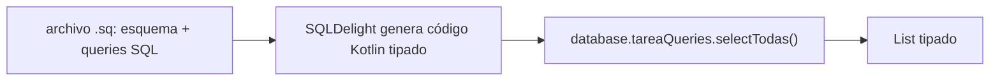
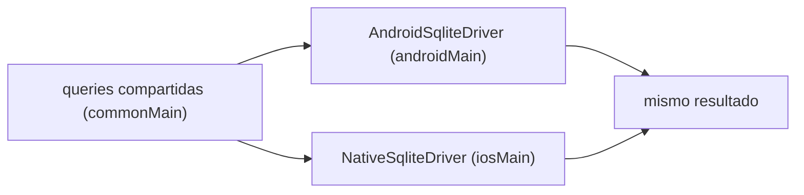
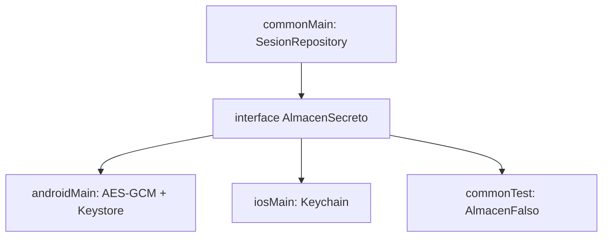

# Módulo 3: Persistencia compartida con SQLDelight

Cada tema se practica por separado con su propia repetición progresiva y su propio reto de memoria, verificado contra SQLite real (el motor que SQLDelight envuelve) para que cada afirmación sea comprobable, no solo descrita.


## Aprende construyendo


### Tema 1: Esquemas SQLDelight y queries tipadas · Avanzado · 30 min

<details open>
<summary><strong>Capa 1 — Lectura</strong></summary>

#### ► DE QUÉ TRATA
Al finalizar podrás declarar un esquema .sq con queries tipadas, y explicar por qué SQLDelight detecta un error de SQL en compilación mientras un ORM dinámico lo detectaría recién en tiempo de ejecución.

#### ► CÓMO FUNCIONA


</details>

<details>
<summary><strong>Capa 2 — Construcción</strong></summary>

#### Código y verificación

```bash
mkdir -p academia-kmp/shared/src/commonMain/sqldelight/com/academia/kmp
cd academia-kmp
```

```sql
-- shared/src/commonMain/sqldelight/com/academia/kmp/Tarea.sq
CREATE TABLE Tarea (
    id TEXT NOT NULL PRIMARY KEY,
    titulo TEXT NOT NULL,
    completada INTEGER AS Boolean NOT NULL DEFAULT 0
);

selectTodas:
SELECT * FROM Tarea;

insertar:
INSERT INTO Tarea(id, titulo, completada) VALUES (?, ?, ?);
```

```kotlin
sqldelight {
    databases {
        create("Database") {               // nombre de la clase generada: Database
            packageName.set("com.academia.kmp")
        }
    }
}
```

```kotlin
// shared/src/jvmTest/kotlin/com/academia/kmp/TareaQueriesTest.kt
package com.academia.kmp

import app.cash.sqldelight.ColumnAdapter
import app.cash.sqldelight.driver.jdbc.sqlite.JdbcSqliteDriver
import kotlin.test.Test
import kotlin.test.assertEquals

// adapta la columna SQLite INTEGER (0/1) hacia el Boolean que usa el resto del dominio (Módulos 3-4, 9)
val adaptadorBooleano = object : ColumnAdapter<Boolean, Long> {
    override fun decode(databaseValue: Long): Boolean = databaseValue == 1L
    override fun encode(value: Boolean): Long = if (value) 1L else 0L
}

class TareaQueriesTest {

    private fun crearBaseDeDatosEnMemoria(): Database {
        val driver = JdbcSqliteDriver(JdbcSqliteDriver.IN_MEMORY)
        Database.Schema.create(driver)
        return Database(driver, Tarea.Adapter(completadaAdapter = adaptadorBooleano))
    }

    @Test
    fun `insertar y selectTodas devuelven la fila insertada`() {
        val database = crearBaseDeDatosEnMemoria()

        database.tareaQueries.insertar(id = "1", titulo = "Comprar leche", completada = false)

        val filas = database.tareaQueries.selectTodas().executeAsList()
        assertEquals(listOf(Tarea(id = "1", titulo = "Comprar leche", completada = false)), filas)
    }
}
```

```bash
# Gradle ejecuta el test real contra SQLite vía JdbcSqliteDriver
./gradlew :shared:jvmTest --tests "com.academia.kmp.TareaQueriesTest"
```

</details>

### Tema 2: Drivers por plataforma · Avanzado · 30 min

<details open>
<summary><strong>Capa 1 — Lectura</strong></summary>

#### ► DE QUÉ TRATA
Al finalizar podrás explicar por qué las queries compartidas en commonMain requieren un driver distinto por plataforma, y confirmar que el mismo conjunto de queries produce el mismo resultado sin importar qué driver las ejecute.

#### ► CÓMO FUNCIONA


</details>

<details>
<summary><strong>Capa 2 — Construcción</strong></summary>

#### Código y verificación


```bash
mkdir -p academia-kmp/shared/src/commonMain/kotlin/com/academia/kmp
mkdir -p academia-kmp/shared/src/androidMain/kotlin/com/academia/kmp
mkdir -p academia-kmp/shared/src/iosMain/kotlin/com/academia/kmp
cd academia-kmp
```

```kotlin
// shared/src/commonMain/kotlin/com/academia/kmp/Driver.kt
package com.academia.kmp

import app.cash.sqldelight.db.SqlDriver

expect fun crearDriver(): SqlDriver
```

```kotlin
// shared/src/androidMain/kotlin/com/academia/kmp/Driver.android.kt
package com.academia.kmp

import android.content.Context
import app.cash.sqldelight.db.SqlDriver
import app.cash.sqldelight.driver.android.AndroidSqliteDriver

actual fun crearDriver(): SqlDriver = AndroidSqliteDriver(Database.Schema, appContext, "app.db")
```

```kotlin
// shared/src/iosMain/kotlin/com/academia/kmp/Driver.ios.kt
package com.academia.kmp

import app.cash.sqldelight.db.SqlDriver
import app.cash.sqldelight.driver.native.NativeSqliteDriver

actual fun crearDriver(): SqlDriver = NativeSqliteDriver(Database.Schema, "app.db")
```

```kotlin
// shared/src/jvmTest/kotlin/com/academia/kmp/DriverIndependenciaTest.kt
package com.academia.kmp

import app.cash.sqldelight.driver.jdbc.sqlite.JdbcSqliteDriver
import kotlin.test.Test
import kotlin.test.assertEquals

class DriverIndependenciaTest {

    // adaptadorBooleano: el ColumnAdapter<Boolean, Long> definido en TareaQueriesTest.kt (Tema 1),
    // visible aquí sin import porque ambos archivos viven en el mismo paquete com.academia.kmp
    private fun ejecutarQueriesCompartidas(): List<Tarea> {
        val driver = JdbcSqliteDriver(JdbcSqliteDriver.IN_MEMORY)
        Database.Schema.create(driver)
        val database = Database(driver, Tarea.Adapter(completadaAdapter = adaptadorBooleano))
        database.tareaQueries.insertar(id = "1", titulo = "Comprar leche", completada = false)
        return database.tareaQueries.selectTodas().executeAsList()
    }

    @Test
    fun `mismas queries producen el mismo resultado en instancias de driver distintas`() {
        val resultadoInstanciaA = ejecutarQueriesCompartidas()
        val resultadoInstanciaB = ejecutarQueriesCompartidas()

        assertEquals(resultadoInstanciaA, resultadoInstanciaB)
    }
}
```

</details>

### Tema 3: Migraciones de esquema · Avanzado · 30 min

<details open>
<summary><strong>Capa 1 — Lectura</strong></summary>

#### ► DE QUÉ TRATA
Al finalizar podrás escribir una migración .sqm versionada que agrega una columna sin perder datos existentes, y confirmar contra SQLite real que los datos previos se preservan tras aplicarla.

</details>

<details>
<summary><strong>Capa 2 — Construcción</strong></summary>

#### Código y verificación
```
┌── esquema v1: Tarea(id, titulo, completada) ──┐
│  datos existentes del usuario                    │
└────────────────┬──────────────────────────┘
                  │ 2.sqm: ALTER TABLE ADD COLUMN prioridad
                  ▼
┌── esquema v2: Tarea(id, titulo, completada, prioridad) ──┐
│  MISMOS datos existentes + columna nueva con default        │
└────────────────────────────────────────────────────┘
```

```bash
mkdir -p academia-kmp/shared/src/commonMain/sqldelight/com/academia/kmp/migrations
cd academia-kmp
```

```sql
-- shared/src/commonMain/sqldelight/com/academia/kmp/migrations/2.sqm
ALTER TABLE Tarea ADD COLUMN prioridad INTEGER NOT NULL DEFAULT 0;
```

```kotlin
// shared/src/jvmTest/kotlin/com/academia/kmp/MigracionTest.kt
package com.academia.kmp

import app.cash.sqldelight.driver.jdbc.sqlite.JdbcSqliteDriver
import kotlin.test.Test
import kotlin.test.assertEquals

class MigracionTest {

    @Test
    fun `migrar de v1 a v2 preserva los datos existentes`() {
        val driver = JdbcSqliteDriver(JdbcSqliteDriver.IN_MEMORY)

        // crea el esquema en versión 1 a mano (sin la columna prioridad)
        driver.execute(null, "CREATE TABLE Tarea (id TEXT NOT NULL PRIMARY KEY, titulo TEXT NOT NULL, completada INTEGER NOT NULL DEFAULT 0)", 0)
        driver.execute(null, "INSERT INTO Tarea VALUES ('1', 'Comprar leche', 0)", 0)
        driver.execute(null, "INSERT INTO Tarea VALUES ('2', 'Pagar factura', 0)", 0)

        // aplica las migraciones pendientes de la 1 a la 2 (ejecuta 2.sqm)
        Database.Schema.migrate(driver, oldVersion = 1, newVersion = 2)
        // adaptadorBooleano: el ColumnAdapter<Boolean, Long> definido en TareaQueriesTest.kt (Tema 1)
        val database = Database(driver, Tarea.Adapter(completadaAdapter = adaptadorBooleano))

        val filas = database.tareaQueries.selectTodas().executeAsList()
        assertEquals(
            listOf(
                Tarea(id = "1", titulo = "Comprar leche", completada = false, prioridad = 0),
                Tarea(id = "2", titulo = "Pagar factura", completada = false, prioridad = 0),
            ),
            filas,
        )
    }
}
```

```bash
# Gradle ejecuta la migración real contra SQLite en memoria
./gradlew :shared:jvmTest --tests "com.academia.kmp.MigracionTest"
```

```sql
ALTER TABLE Tarea ____ COLUMN fechaLimite TEXT;
```

</details>

### Tema 4: Transacciones: atomicidad en operaciones multi-tabla · Avanzado · 30 min

<details open>
<summary><strong>Capa 1 — Lectura</strong></summary>

#### ► DE QUÉ TRATA
Al finalizar podrás agrupar varias escrituras relacionadas en una transacción, y confirmar contra SQLite real que un fallo a mitad de la transacción revierte TODAS las escrituras, no solo la que falló.

</details>

<details>
<summary><strong>Capa 2 — Construcción</strong></summary>

#### Código y verificación
```
┌── transacción { insertar tarea; incrementar contador } ──┐
│  AMBAS escrituras se aplican  ──►  COMMIT (ambas persisten)  │
│  CUALQUIERA falla            ──►  ROLLBACK (ninguna persiste) │
└───────────────────────────────────────────────────┘
```

```bash
mkdir -p academia-kmp/shared/src/commonMain/sqldelight/com/academia/kmp
cd academia-kmp
```

```sql
-- shared/src/commonMain/sqldelight/com/academia/kmp/ContadorTareas.sq
CREATE TABLE ContadorTareas (
    total INTEGER NOT NULL
);

INSERT INTO ContadorTareas(total) VALUES (0);

total:
SELECT total FROM ContadorTareas;

incrementar:
UPDATE ContadorTareas SET total = total + 1;
```

```kotlin
// shared/src/commonMain/kotlin/com/academia/kmp/Transacciones.kt
package com.academia.kmp

class FalloSimuladoException(mensaje: String) : Exception(mensaje)

fun insertarTareaConContador(database: Database, id: String, titulo: String, forzarFallo: Boolean = false) {
    database.transaction {
        database.tareaQueries.insertar(id, titulo, false)
        if (forzarFallo) {
            throw FalloSimuladoException("fallo simulado a mitad de la transacción")
        }
        database.contadorQueries.incrementar()
    }
}
```

```kotlin
// shared/src/jvmTest/kotlin/com/academia/kmp/TransaccionesTest.kt
package com.academia.kmp

import app.cash.sqldelight.driver.jdbc.sqlite.JdbcSqliteDriver
import kotlin.test.Test
import kotlin.test.assertEquals
import kotlin.test.assertFailsWith

class TransaccionesTest {

    // adaptadorBooleano: el ColumnAdapter<Boolean, Long> definido en TareaQueriesTest.kt (Tema 1)
    private fun crearBaseDeDatosEnMemoria(): Database {
        val driver = JdbcSqliteDriver(JdbcSqliteDriver.IN_MEMORY)
        Database.Schema.create(driver)
        return Database(driver, Tarea.Adapter(completadaAdapter = adaptadorBooleano))
    }

    @Test
    fun `transaccion exitosa aplica ambas escrituras`() {
        val database = crearBaseDeDatosEnMemoria()

        insertarTareaConContador(database, "1", "Comprar leche")

        assertEquals(1, database.tareaQueries.selectTodas().executeAsList().size)
        assertEquals(1L, database.contadorQueries.total().executeAsOne())
    }

    @Test
    fun `transaccion fallida revierte AMBAS escrituras, no solo la que fallo`() {
        val database = crearBaseDeDatosEnMemoria()
        insertarTareaConContador(database, "1", "Comprar leche")

        assertFailsWith<FalloSimuladoException> {
            insertarTareaConContador(database, "2", "Pagar factura", forzarFallo = true)
        }

        // la tarea '2' NO quedó guardada: la transacción revirtió la inserción también
        assertEquals(1, database.tareaQueries.selectTodas().executeAsList().size)
        assertEquals(1L, database.contadorQueries.total().executeAsOne())
    }
}
```

```bash
# Gradle ejecuta ambos tests reales contra SQLite en memoria
./gradlew :shared:jvmTest --tests "com.academia.kmp.TransaccionesTest"
```

</details>

### Tema 5: Seguridad multiplataforma: guardar secretos con Keystore y Keychain detrás de una interfaz común · Avanzado · 45 min

<details open>
<summary><strong>Capa 1 — Lectura</strong></summary>

#### ► DE QUÉ TRATA
No necesitas dependencias extra: en Android se usa el Android Keystore del sistema y en iOS el Keychain con platform.Security. (La librería androidx.security:security-crypto y su EncryptedSharedPreferences quedaron obsoletas en 2025; no la uses en código nuevo.) Trabajarás en sha…

#### ► LA ANALOGÍA
**Conceptos clave:** secreto, Android Keystore, AES-GCM, iOS Keychain, `kSecAttrAccessible`, interfaz común, implementación por plataforma.

Una **interfaz común** (`AlmacenSecreto`) dice qué se puede hacer: guardar, leer y borrar un secreto. Cada plataforma lo implementa con su almacén seguro:

| Plataforma | Almacén | Protección |
|---|---|---|
| Android | valor cifrado con AES-GCM usando una clave del **Keystore** | la clave nunca sale del hardware seguro |
| iOS | **Keychain** con `kSecAttrAccessibleAfterFirstUnlockThisDeviceOnly` | cifrado por el sistema, no viaja a otros dispositivos |

El código común (por ejemplo, el repositorio de sesión) recibe la interfaz por constructor. En las pruebas comunes usas una implementación falsa en memoria.

Los **secretos de la app** (claves de API del servidor) no van en el binario: cualquiera puede extraerlos. Esos se quedan en el servidor.

**Analogía:** la interfaz es la palabra «caja fuerte» en el manual; cada sistema operativo trae su propia marca de caja fuerte. El código común solo pide «guarda esto en la caja fuerte». La analogía falla en que ninguna caja protege un secreto que ya viene impreso en el manual (el binario).

**Límite de uso:** un dispositivo con root o jailbreak puede leer más de lo esperado: el almacén seguro reduce el riesgo, no lo elimina. No guardes en el cliente secretos compartidos entre usuarios.



#### ► CÓMO FUNCIONA


</details>

<details>
<summary><strong>Capa 2 — Construcción</strong></summary>

#### Objetivo observable
No necesitas dependencias extra: en Android se usa el Android Keystore del sistema y en iOS el Keychain con `platform.Security`. (La librería `androidx.security:security-crypto` y su EncryptedSharedPreferences quedaron obsoletas en 2025; no la uses en código nuevo.) Trabajarás en `shared/src/{commonMain,androidMain,iosMain}`.

</details>
