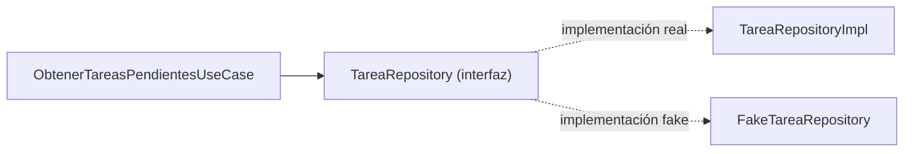
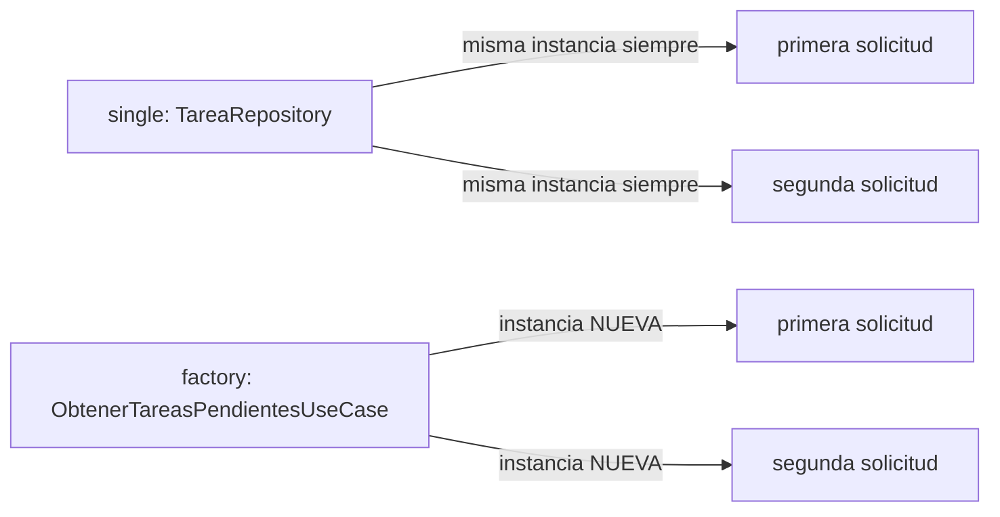

# Módulo 4: Lógica de negocio compartida

Cada tema se practica por separado con su propia repetición progresiva y su propio reto de memoria — modelos de dominio, repositorios con interfaz común, inyección de dependencias con Koin, y modelado explícito de errores son la base de cualquier capa de dominio compartida entre Android e iOS.


## Aprende construyendo


### Tema 1: Modelos de dominio y casos de uso · Avanzado · 35 min

<details open>
<summary><strong>Capa 1 — Lectura</strong></summary>

#### ► DE QUÉ TRATA
Al finalizar podrás declarar un modelo de dominio en commonMain y un caso de uso que depende de una interfaz (no de una implementación concreta), y explicar por qué esa dependencia hacia la interfaz permite testear el caso de uso de forma aislada.

#### ► LA IDEA EN UNA FRASE
**Al finalizar podrás declarar un modelo de dominio en commonMain y un caso de uso que depende de una interfaz (no de una implementación concreta), y explicar por qué esa dependencia hacia la interfaz permite testear el caso de uso de forma aislada.**

#### ► POR QUÉ EXISTE ESTO
Resuelve un problema real de diseño o implementación y evita decisiones a ciegas.

#### ► LA ANALOGÍA
**Conceptos clave:** `data class` compartida en `commonMain`, caso de uso dependiente de interfaz (no de implementación).

`data class Tarea(val id: String, val titulo: String, val completada: Boolean)` en `commonMain` representa una entidad central sin ninguna dependencia hacia persistencia, red o UI de ninguna plataforma específica. `class ObtenerTareasPendientesUseCase(private val repositorio: TareaRepository) { suspend operator fun invoke(): List<Tarea> = repositorio.obtenerTodas().filter { !it.completada } }` encapsula lógica de negocio dependiendo explícitamente de la INTERFAZ `TareaRepository`, no de ninguna implementación concreta — el mismo principio de inversión de dependencias visto para Spring (Módulo 0 del track Spring Boot), aquí manual, sin framework de IoC automático.

**Analogía:** un modelo de dominio compartido es una definición única y oficial que todos los departamentos usan exactamente igual, evitando interpretaciones divergentes; un caso de uso que depende de una interfaz es un procedimiento que especifica qué información necesita sin importarle de qué proveedor específico proviene, siempre que cumpla el formato acordado.

**Diagrama:**



**Dónde se rompe la analogía:** el modelo simplifica la realidad; en producción influyen escala, fallos, costo y contexto.

#### ► CÓMO FUNCIONA


#### ► LO QUE PUEDE SALIR MAL
| Síntoma | Causa probable | Arreglo |
|---|---|---|
| Modelos de dominio y casos de uso se aplica pero el resultado no mejora | Se usó sin medir el problema real | Mide antes y compara contra la alternativa simple |
| Aparece complejidad inesperada | Se adoptó la técnica sin comprender sus trade-offs | Vuelve a la sección de trade-offs y reduce el alcance |
| Falla en un caso límite | Se asumió un contexto que no se cumple | Prueba el caso límite y documenta cuándo NO usarlo |

#### ► TRADE-OFFS
| Opción | Cuándo usarla | Cuándo NO usarla |
|---|---|---|
| Usar Modelos de dominio y casos de uso | Cuando el problema coincide con su propósito y el beneficio es observable | Cuando agrega complejidad sin resolver un problema real |
| Alternativa más simple | Cuando el contexto es pequeño, estable o fácil de razonar | Cuando ya demostró no escalar o no cumplir el requisito |
| Postergar la decisión | Cuando falta evidencia del problema | Cuando el costo de esperar es mayor que el costo de probar |

#### ► CUÁNDO NO USAR ESTO
No uses modelos de dominio y casos de uso por defecto. Aplícalo cuando el problema lo justifique y puedas verificar el beneficio; si una alternativa más simple resuelve igual, prefiérela.

#### ► DE VUELTA A LA ANALOGÍA
Volviendo a la analogía: modelos de dominio y casos de uso funciona como el modelo inicial, pero recuerda dónde se rompe: en producción importan la evidencia, la escala y el costo de equivocarte.

#### ► LO QUE DEBES RECORDAR
- Modelos de dominio y casos de uso existe para resolver un problema específico.
- Mide antes de adoptar complejidad.
- Conoce el caso donde NO usarlo.
- Verifica con evidencia observable.

#### ► PREGUNTAS PARA PENSAR
1. ¿Qué problema concreto resuelve modelos de dominio y casos de uso en tu contexto?
2. ¿Cómo sabrías que modelos de dominio y casos de uso no está funcionando bien?
3. ¿Qué alternativa más simple considerarías antes de usar modelos de dominio y casos de uso?

</details>

<details>
<summary><strong>Capa 2 — Construcción</strong></summary>

#### Código y verificación


```kotlin
package com.academia.kmp

data class Tarea(val id: String, val titulo: String, val completada: Boolean)

interface TareaRepository {
    suspend fun obtenerTodas(): List<Tarea>
    suspend fun guardar(tarea: Tarea)
}

class ObtenerTareasPendientesUseCase(private val repositorio: TareaRepository) {
    suspend operator fun invoke(): List<Tarea> =
        repositorio.obtenerTodas().filter { !it.completada }
}
```

```bash
# compila el módulo compartido de Kotlin Multiplatform con Gradle
mkdir -p academia-kmp/shared/src/commonMain/kotlin/com/academia/kmp
cd academia-kmp
./gradlew :shared:compileKotlinMetadata
```

```kotlin
package com.academia.kmp

import kotlinx.coroutines.delay
import kotlinx.coroutines.test.runTest
import kotlin.test.Test
import kotlin.test.assertEquals

private val tareaPendiente = Tarea("1", "Comprar leche", completada = false)

class RepositorioEnMemoria : TareaRepository {
    override suspend fun obtenerTodas(): List<Tarea> = listOf(tareaPendiente)
    override suspend fun guardar(tarea: Tarea) = Unit
}

class RepositorioConLatencia : TareaRepository {
    override suspend fun obtenerTodas(): List<Tarea> {
        delay(300) // simula red/DB real
        return listOf(tareaPendiente)
    }
    override suspend fun guardar(tarea: Tarea) = Unit
}

class DominioTest {
    @Test
    fun elCasoDeUsoProduceElMismoResultadoConCualquierImplementacion() = runTest {
        val resultadoFake = ObtenerTareasPendientesUseCase(RepositorioEnMemoria())()
        val resultadoConLatencia = ObtenerTareasPendientesUseCase(RepositorioConLatencia())()
        assertEquals(resultadoFake, resultadoConLatencia)
        assertEquals(listOf(tareaPendiente), resultadoFake)
    }
}
```

```bash
# ejecuta el test Kotlin del módulo compartido
cd academia-kmp
./gradlew :shared:allTests
```

```kotlin
class GuardarTareaUseCase(private val repositorio: ____) {
    suspend operator fun invoke(tarea: Tarea) = repositorio.guardar(tarea)
}
```

</details>

### Tema 2: Repositorios con interfaz común · Avanzado · 35 min

<details open>
<summary><strong>Capa 1 — Lectura</strong></summary>

#### ► DE QUÉ TRATA
Al finalizar podrás definir una interfaz de repositorio en commonMain con al menos dos implementaciones, y explicar por qué esto permite testear la lógica de negocio sin infraestructura real.

#### ► LA IDEA EN UNA FRASE
**Al finalizar podrás definir una interfaz de repositorio en commonMain con al menos dos implementaciones, y explicar por qué esto permite testear la lógica de negocio sin infraestructura real.**

#### ► POR QUÉ EXISTE ESTO
Resuelve un problema real de diseño o implementación y evita decisiones a ciegas.

#### ► LA ANALOGÍA
Piensa en repositorios con interfaz común como una herramienta de taller: útil cuando conoces su propósito y sus límites.
**Dónde se rompe la analogía:** en software, los efectos dependen del contexto, la escala y los trade-offs.

#### ► CÓMO FUNCIONA
1. Identifica el problema que repositorios con interfaz común resuelve.
2. Observa sus componentes y relaciones.
3. Aplica la opción más simple que funcione.
4. Verifica el resultado y los límites.

#### ► LO QUE PUEDE SALIR MAL
| Síntoma | Causa probable | Arreglo |
|---|---|---|
| Repositorios con interfaz común se aplica pero el resultado no mejora | Se usó sin medir el problema real | Mide antes y compara contra la alternativa simple |
| Aparece complejidad inesperada | Se adoptó la técnica sin comprender sus trade-offs | Vuelve a la sección de trade-offs y reduce el alcance |
| Falla en un caso límite | Se asumió un contexto que no se cumple | Prueba el caso límite y documenta cuándo NO usarlo |

#### ► TRADE-OFFS
| Opción | Cuándo usarla | Cuándo NO usarla |
|---|---|---|
| Usar Repositorios con interfaz común | Cuando el problema coincide con su propósito y el beneficio es observable | Cuando agrega complejidad sin resolver un problema real |
| Alternativa más simple | Cuando el contexto es pequeño, estable o fácil de razonar | Cuando ya demostró no escalar o no cumplir el requisito |
| Postergar la decisión | Cuando falta evidencia del problema | Cuando el costo de esperar es mayor que el costo de probar |

#### ► CUÁNDO NO USAR ESTO
No uses repositorios con interfaz común por defecto. Aplícalo cuando el problema lo justifique y puedas verificar el beneficio; si una alternativa más simple resuelve igual, prefiérela.

#### ► DE VUELTA A LA ANALOGÍA
Volviendo a la analogía: repositorios con interfaz común funciona como el modelo inicial, pero recuerda dónde se rompe: en producción importan la evidencia, la escala y el costo de equivocarte.

#### ► LO QUE DEBES RECORDAR
- Repositorios con interfaz común existe para resolver un problema específico.
- Mide antes de adoptar complejidad.
- Conoce el caso donde NO usarlo.
- Verifica con evidencia observable.

#### ► PREGUNTAS PARA PENSAR
1. ¿Qué problema concreto resuelve repositorios con interfaz común en tu contexto?
2. ¿Cómo sabrías que repositorios con interfaz común no está funcionando bien?
3. ¿Qué alternativa más simple considerarías antes de usar repositorios con interfaz común?

</details>

<details>
<summary><strong>Capa 2 — Construcción</strong></summary>

#### Código y verificación
```
┌── interface TareaRepository ─────────────────────────────┐
│  suspend fun obtenerTodas(): List<Tarea>                    │
│  suspend fun guardar(tarea: Tarea)                           │
└──────┬─────────────────────────────────┬──────────────┘
       │                                    │
┌──────▼──────────┐                ┌──────▼──────────┐
│ TareaRepositoryImpl │                │ FakeTareaRepository │
│ (api + db reales)    │                │ (en memoria, tests)   │
└─────────────────┘                └─────────────────┘
```

```kotlin
package com.academia.kmp

class TareaRepositoryImpl(private val api: Any, private val db: Any) : TareaRepository {
    override suspend fun obtenerTodas(): List<Tarea> = emptyList() // combinaría api y db reales
    override suspend fun guardar(tarea: Tarea) { /* persiste en db, sincroniza con api */ }
}

class FakeTareaRepository(private val datos: MutableList<Tarea> = mutableListOf()) : TareaRepository {
    override suspend fun obtenerTodas(): List<Tarea> = datos.toList()
    override suspend fun guardar(tarea: Tarea) { datos.add(tarea) }
}
```

```bash
# compila el módulo compartido de Kotlin Multiplatform con Gradle
mkdir -p academia-kmp/shared/src/commonMain/kotlin/com/academia/kmp
cd academia-kmp
./gradlew :shared:compileKotlinMetadata
```

```kotlin
package com.academia.kmp

import kotlinx.coroutines.test.runTest
import kotlin.test.Test
import kotlin.test.assertEquals

class RepositorioTest {
    @Test
    fun fakeGuardaYDevuelveLoGuardado() = runTest {
        val repo: TareaRepository = FakeTareaRepository()
        val tarea = Tarea("1", "Comprar leche", completada = false)
        repo.guardar(tarea)
        assertEquals(listOf(tarea), repo.obtenerTodas())
    }
}
```

```bash
# ejecuta el test Kotlin del módulo compartido
cd academia-kmp
./gradlew :shared:allTests
```

```kotlin
class FakeTareaRepository : ____ {
    private val datos = mutableListOf<Tarea>()
    override suspend fun obtenerTodas(): List<Tarea> = datos.toList()
    override suspend fun guardar(tarea: Tarea) { datos.add(tarea) }
}
```

</details>

### Tema 3: Inyección de dependencias multiplataforma con Koin · Avanzado · 35 min

<details open>
<summary><strong>Capa 1 — Lectura</strong></summary>

#### ► DE QUÉ TRATA
Al finalizar podrás distinguir entre una dependencia single (una única instancia compartida) y una factory (nueva instancia cada vez), y configurar Koin para resolver la cadena completa de dependencias una sola vez para todas las plataformas.

#### ► LA IDEA EN UNA FRASE
**Al finalizar podrás distinguir entre una dependencia single (una única instancia compartida) y una factory (nueva instancia cada vez), y configurar Koin para resolver la cadena completa de dependencias una sola vez para todas las plataformas.**

#### ► POR QUÉ EXISTE ESTO
Resuelve un problema real de diseño o implementación y evita decisiones a ciegas.

#### ► LA ANALOGÍA
**Conceptos clave:** `single` (instancia única compartida), `factory` (nueva instancia por solicitud), módulo de Koin en `commonMain`.

`val sharedModule = module { single<TareaRepository> { TareaRepositoryImpl(get(), get()) }; factory { ObtenerTareasPendientesUseCase(get()) } }` configura Koin (un framework de DI ligero, sin generación de código en compilación) para resolver automáticamente la cadena de dependencias: `TareaRepository` se resuelve como una única instancia compartida (`single`), mientras `ObtenerTareasPendientesUseCase` se crea nueva cada vez que se solicita (`factory`). Koin funciona idénticamente en `commonMain` para todas las plataformas, sin un framework de DI distinto por plataforma.

**Analogía:** Koin es un directorio de contactos universal que funciona igual en cualquier oficina de la empresa, resolviendo automáticamente quién debe conectarse con quién según relaciones declaradas una única vez.

**Diagrama:**



**Dónde se rompe la analogía:** el modelo simplifica la realidad; en producción influyen escala, fallos, costo y contexto.

#### ► CÓMO FUNCIONA


#### ► LO QUE PUEDE SALIR MAL
| Síntoma | Causa probable | Arreglo |
|---|---|---|
| Inyección de dependencias multiplataforma con Koin se aplica pero el resultado no mejora | Se usó sin medir el problema real | Mide antes y compara contra la alternativa simple |
| Aparece complejidad inesperada | Se adoptó la técnica sin comprender sus trade-offs | Vuelve a la sección de trade-offs y reduce el alcance |
| Falla en un caso límite | Se asumió un contexto que no se cumple | Prueba el caso límite y documenta cuándo NO usarlo |

#### ► TRADE-OFFS
| Opción | Cuándo usarla | Cuándo NO usarla |
|---|---|---|
| Usar Inyección de dependencias multiplataforma con Koin | Cuando el problema coincide con su propósito y el beneficio es observable | Cuando agrega complejidad sin resolver un problema real |
| Alternativa más simple | Cuando el contexto es pequeño, estable o fácil de razonar | Cuando ya demostró no escalar o no cumplir el requisito |
| Postergar la decisión | Cuando falta evidencia del problema | Cuando el costo de esperar es mayor que el costo de probar |

#### ► CUÁNDO NO USAR ESTO
No uses inyección de dependencias multiplataforma con koin por defecto. Aplícalo cuando el problema lo justifique y puedas verificar el beneficio; si una alternativa más simple resuelve igual, prefiérela.

#### ► DE VUELTA A LA ANALOGÍA
Volviendo a la analogía: inyección de dependencias multiplataforma con koin funciona como el modelo inicial, pero recuerda dónde se rompe: en producción importan la evidencia, la escala y el costo de equivocarte.

#### ► LO QUE DEBES RECORDAR
- Inyección de dependencias multiplataforma con Koin existe para resolver un problema específico.
- Mide antes de adoptar complejidad.
- Conoce el caso donde NO usarlo.
- Verifica con evidencia observable.

#### ► PREGUNTAS PARA PENSAR
1. ¿Qué problema concreto resuelve inyección de dependencias multiplataforma con koin en tu contexto?
2. ¿Cómo sabrías que inyección de dependencias multiplataforma con koin no está funcionando bien?
3. ¿Qué alternativa más simple considerarías antes de usar inyección de dependencias multiplataforma con koin?

</details>

<details>
<summary><strong>Capa 2 — Construcción</strong></summary>

#### Código y verificación


```kotlin
package com.academia.kmp

import org.koin.dsl.module

val sharedModule = module {
    single<TareaRepository> { FakeTareaRepository() }
    factory { ObtenerTareasPendientesUseCase(get()) }
}
```

```bash
# compila el módulo compartido de Kotlin Multiplatform con Gradle
mkdir -p academia-kmp/shared/src/commonMain/kotlin/com/academia/kmp
cd academia-kmp
./gradlew :shared:compileKotlinMetadata
```

```kotlin
package com.academia.kmp

import org.koin.core.context.startKoin
import org.koin.core.context.stopKoin
import org.koin.test.KoinTest
import org.koin.test.inject
import kotlin.test.AfterTest
import kotlin.test.BeforeTest
import kotlin.test.Test
import kotlin.test.assertNotSame
import kotlin.test.assertSame

class DiModuleTest : KoinTest {
    @BeforeTest
    fun iniciarKoin() { startKoin { modules(sharedModule) } }

    @AfterTest
    fun detenerKoin() { stopKoin() }

    @Test
    fun singleDevuelveSiempreLaMismaInstancia() {
        val repo1: TareaRepository by inject()
        val repo2: TareaRepository by inject()
        assertSame(repo1, repo2)
    }

    @Test
    fun factoryDevuelveUnaInstanciaNuevaEnCadaSolicitud() {
        val caso1: ObtenerTareasPendientesUseCase by inject()
        val caso2: ObtenerTareasPendientesUseCase by inject()
        assertNotSame(caso1, caso2)
    }
}
```

```bash
# ejecuta el test Kotlin del módulo compartido, arrancando Koin de verdad
cd academia-kmp
./gradlew :shared:allTests
```

```kotlin
val sharedModule = module {
    ____<TareaRepository> { TareaRepositoryImpl(get(), get()) }
}
```

</details>

### Tema 4: Modelado de errores de dominio con un tipo Result explícito · Avanzado · 35 min

<details open>
<summary><strong>Capa 1 — Lectura</strong></summary>

#### ► DE QUÉ TRATA
Al finalizar podrás modelar el resultado de una operación que puede fallar con un tipo explícito (Exito/Error), y explicar por qué esto obliga al llamador a manejar el caso de error sin depender de excepciones no documentadas en la firma.

#### ► LA IDEA EN UNA FRASE
**Al finalizar podrás modelar el resultado de una operación que puede fallar con un tipo explícito (Exito/Error), y explicar por qué esto obliga al llamador a manejar el caso de error sin depender de excepciones no documentadas en la firma.**

#### ► POR QUÉ EXISTE ESTO
Resuelve un problema real de diseño o implementación y evita decisiones a ciegas.

#### ► LA ANALOGÍA
Piensa en modelado de errores de dominio con un tipo result explícito como una herramienta de taller: útil cuando conoces su propósito y sus límites.
**Dónde se rompe la analogía:** en software, los efectos dependen del contexto, la escala y los trade-offs.

#### ► CÓMO FUNCIONA
1. Identifica el problema que modelado de errores de dominio con un tipo result explícito resuelve.
2. Observa sus componentes y relaciones.
3. Aplica la opción más simple que funcione.
4. Verifica el resultado y los límites.

#### ► LO QUE PUEDE SALIR MAL
| Síntoma | Causa probable | Arreglo |
|---|---|---|
| Modelado de errores de dominio con un tipo Result explícito se aplica pero el resultado no mejora | Se usó sin medir el problema real | Mide antes y compara contra la alternativa simple |
| Aparece complejidad inesperada | Se adoptó la técnica sin comprender sus trade-offs | Vuelve a la sección de trade-offs y reduce el alcance |
| Falla en un caso límite | Se asumió un contexto que no se cumple | Prueba el caso límite y documenta cuándo NO usarlo |

#### ► TRADE-OFFS
| Opción | Cuándo usarla | Cuándo NO usarla |
|---|---|---|
| Usar Modelado de errores de dominio con un tipo Result explícito | Cuando el problema coincide con su propósito y el beneficio es observable | Cuando agrega complejidad sin resolver un problema real |
| Alternativa más simple | Cuando el contexto es pequeño, estable o fácil de razonar | Cuando ya demostró no escalar o no cumplir el requisito |
| Postergar la decisión | Cuando falta evidencia del problema | Cuando el costo de esperar es mayor que el costo de probar |

#### ► CUÁNDO NO USAR ESTO
No uses modelado de errores de dominio con un tipo result explícito por defecto. Aplícalo cuando el problema lo justifique y puedas verificar el beneficio; si una alternativa más simple resuelve igual, prefiérela.

#### ► DE VUELTA A LA ANALOGÍA
Volviendo a la analogía: modelado de errores de dominio con un tipo result explícito funciona como el modelo inicial, pero recuerda dónde se rompe: en producción importan la evidencia, la escala y el costo de equivocarte.

#### ► LO QUE DEBES RECORDAR
- Modelado de errores de dominio con un tipo Result explícito existe para resolver un problema específico.
- Mide antes de adoptar complejidad.
- Conoce el caso donde NO usarlo.
- Verifica con evidencia observable.

#### ► PREGUNTAS PARA PENSAR
1. ¿Qué problema concreto resuelve modelado de errores de dominio con un tipo result explícito en tu contexto?
2. ¿Cómo sabrías que modelado de errores de dominio con un tipo result explícito no está funcionando bien?
3. ¿Qué alternativa más simple considerarías antes de usar modelado de errores de dominio con un tipo result explícito?

</details>

<details>
<summary><strong>Capa 2 — Construcción</strong></summary>

#### Código y verificación
```
┌── fun guardarTarea(): Resultado<Tarea> ──────────────┐
│  el tipo de retorno YA declara que puede fallar         │
└──────┬───────────────────────────────┬──────────┘
       │                                    │
┌──────▼──────┐                    ┌──────▼──────┐
│  Exito(tarea) │                    │ Error(mensaje) │
└─────────────┘                    └─────────────┘
   when exhaustivo obliga a manejar AMBOS casos
```

```kotlin
package com.academia.kmp

sealed class Resultado<out T> {
    data class Exito<T>(val datos: T) : Resultado<T>()
    data class Error(val mensaje: String) : Resultado<Nothing>()
}

fun guardarTareaSegura(tarea: Tarea, simularFalloRed: Boolean): Resultado<Tarea> {
    if (simularFalloRed) return Resultado.Error("sin conexión")
    return Resultado.Exito(tarea)
}

fun guardarTareaConExcepcion(tarea: Tarea, simularFalloRed: Boolean): Tarea {
    if (simularFalloRed) throw IllegalStateException("sin conexión")
    return tarea
}
```

```bash
# compila el módulo compartido de Kotlin Multiplatform con Gradle
mkdir -p academia-kmp/shared/src/commonMain/kotlin/com/academia/kmp
cd academia-kmp
./gradlew :shared:compileKotlinMetadata
```

```kotlin
package com.academia.kmp

import kotlin.test.Test
import kotlin.test.assertEquals
import kotlin.test.assertFailsWith

private val tarea = Tarea("1", "Comprar leche", completada = false)

fun manejar(resultado: Resultado<Tarea>): String = when (resultado) {
    is Resultado.Exito -> "guardado: ${resultado.datos.titulo}"
    is Resultado.Error -> "error manejado explícitamente: ${resultado.mensaje}"
}

class ResultadoTest {
    @Test
    fun elCasoDeExitoSeManejaSinLanzarNada() {
        assertEquals("guardado: Comprar leche", manejar(guardarTareaSegura(tarea, simularFalloRed = false)))
    }

    @Test
    fun elCasoDeErrorSeManejaComoValorNormalNoComoExcepcion() {
        assertEquals("error manejado explícitamente: sin conexión", manejar(guardarTareaSegura(tarea, simularFalloRed = true)))
    }

    @Test
    fun laVersionConExcepcionesPropagaSiNadieLaCaptura() {
        assertFailsWith<IllegalStateException> {
            guardarTareaConExcepcion(tarea, simularFalloRed = true)
        }
    }
}
```

```bash
# ejecuta el test Kotlin del módulo compartido
cd academia-kmp
./gradlew :shared:allTests
```

```kotlin
fun eliminarTarea(id: String): ____<Unit> {
    if (!existe(id)) return Resultado.Error("tarea no encontrada")
    return Resultado.Exito(Unit)
}
```

</details>

### Tema 5: Tiempo determinista: probar vencimientos sin dormir ni consultar el reloj global · Avanzado · 35 min

<details open>
<summary><strong>Capa 1 — Lectura</strong></summary>

#### ► DE QUÉ TRATA
Al finalizar comprobarás el vencimiento de una oferta de entrega con un reloj sustituible. Prerrequisitos: interfaces, lambdas, Long y funciones de Kotlin. Kotlin/JVM y JDK para el ejemplo independiente; en KMP puedes colocar el contrato en commonMain y sus pruebas en commonTest.

#### ► LA IDEA EN UNA FRASE
**Al finalizar comprobarás el vencimiento de una oferta de entrega con un reloj sustituible.**

#### ► POR QUÉ EXISTE ESTO
Resuelve un problema real de diseño o implementación y evita decisiones a ciegas.

#### ► LA ANALOGÍA
Piensa en tiempo determinista: probar vencimientos sin dormir ni consultar el reloj global como una herramienta de taller: útil cuando conoces su propósito y sus límites.
**Dónde se rompe la analogía:** en software, los efectos dependen del contexto, la escala y los trade-offs.

#### ► CÓMO FUNCIONA
1. Identifica el problema que tiempo determinista: probar vencimientos sin dormir ni consultar el reloj global resuelve.
2. Observa sus componentes y relaciones.
3. Aplica la opción más simple que funcione.
4. Verifica el resultado y los límites.

#### ► LO QUE PUEDE SALIR MAL
| Síntoma | Causa probable | Arreglo |
|---|---|---|
| Tiempo determinista: probar vencimientos sin dormir ni consultar el reloj global se aplica pero el resultado no mejora | Se usó sin medir el problema real | Mide antes y compara contra la alternativa simple |
| Aparece complejidad inesperada | Se adoptó la técnica sin comprender sus trade-offs | Vuelve a la sección de trade-offs y reduce el alcance |
| Falla en un caso límite | Se asumió un contexto que no se cumple | Prueba el caso límite y documenta cuándo NO usarlo |

#### ► TRADE-OFFS
| Opción | Cuándo usarla | Cuándo NO usarla |
|---|---|---|
| Usar Tiempo determinista: probar vencimientos sin dormir ni consultar el reloj global | Cuando el problema coincide con su propósito y el beneficio es observable | Cuando agrega complejidad sin resolver un problema real |
| Alternativa más simple | Cuando el contexto es pequeño, estable o fácil de razonar | Cuando ya demostró no escalar o no cumplir el requisito |
| Postergar la decisión | Cuando falta evidencia del problema | Cuando el costo de esperar es mayor que el costo de probar |

#### ► CUÁNDO NO USAR ESTO
No uses tiempo determinista: probar vencimientos sin dormir ni consultar el reloj global por defecto. Aplícalo cuando el problema lo justifique y puedas verificar el beneficio; si una alternativa más simple resuelve igual, prefiérela.

#### ► DE VUELTA A LA ANALOGÍA
Volviendo a la analogía: tiempo determinista: probar vencimientos sin dormir ni consultar el reloj global funciona como el modelo inicial, pero recuerda dónde se rompe: en producción importan la evidencia, la escala y el costo de equivocarte.

#### ► LO QUE DEBES RECORDAR
- Tiempo determinista: probar vencimientos sin dormir ni consultar el reloj global existe para resolver un problema específico.
- Mide antes de adoptar complejidad.
- Conoce el caso donde NO usarlo.
- Verifica con evidencia observable.

#### ► PREGUNTAS PARA PENSAR
1. ¿Qué problema concreto resuelve tiempo determinista: probar vencimientos sin dormir ni consultar el reloj global en tu contexto?
2. ¿Cómo sabrías que tiempo determinista: probar vencimientos sin dormir ni consultar el reloj global no está funcionando bien?
3. ¿Qué alternativa más simple considerarías antes de usar tiempo determinista: probar vencimientos sin dormir ni consultar el reloj global?

</details>

<details>
<summary><strong>Capa 2 — Construcción</strong></summary>

#### Código y verificación
```bash
mkdir reloj-kotlin
cd reloj-kotlin
```

```kotlin
class Oferta(private val venceEnMs: Long, private val ahoraMs: () -> Long) {
    fun vencida(): Boolean = ahoraMs() >= venceEnMs
}

fun main() {
    var reloj = 1_000L
    val oferta = Oferta(31_000L) { reloj }
    check(!oferta.vencida())
    reloj = 30_999L
    check(!oferta.vencida())
    reloj = 31_000L
    check(oferta.vencida()) // El límite también pertenece al contrato.
    reloj = 31_001L
    check(oferta.vencida())
    println("Antes, límite y después: correctos")
}
```

```bash
kotlinc Vencimiento.kt -include-runtime -d vencimiento.jar
java -jar vencimiento.jar
```

</details>
