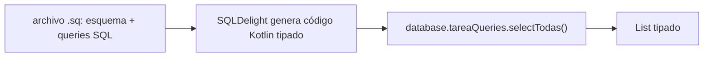
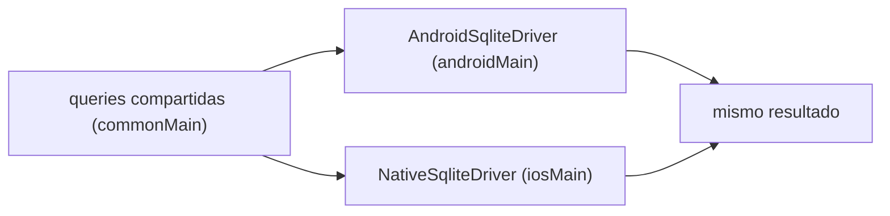
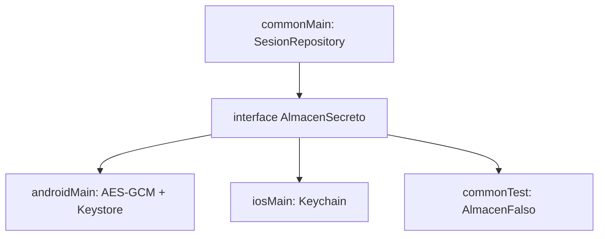

# Módulo 6: Persistencia compartida con SQLDelight

Cada tema se practica por separado con su propia repetición progresiva y su propio reto de memoria, verificado contra SQLite real (el motor que SQLDelight envuelve) para que cada afirmación sea comprobable, no solo descrita.


## Aprende construyendo

### Tema 1: Esquemas SQLDelight y queries tipadas · Avanzado · 30 min

#### Paso 1 · Objetivo y preparación

Al finalizar podrás declarar un esquema `.sq` con queries tipadas, y explicar por qué SQLDelight detecta un error de SQL en compilación mientras un ORM dinámico lo detectaría recién en tiempo de ejecución.

**Conocimiento previo:** source sets y `commonMain` (Módulo 3); repositorios (Módulo 4).

#### Paso 2 · Contexto y caso real

**¿Por qué es importante?** Una caché local de la lista de tareas obtenida por red (Módulo 5), consultable sin conexión, necesita persistencia real; escribir mal el nombre de una columna en una query debería fallar al compilar, no como un crash en producción cuando esa query específica finalmente se ejecute con datos reales.

#### Paso 3 · Teoría con analogía

**Conceptos clave:** archivo `.sq` (esquema + queries en SQL real), código Kotlin tipado generado automáticamente, verificación en compilación.

Un archivo `.sq` declara tanto el esquema de la tabla como las queries específicas, escritas en SQL real (no un lenguaje propietario de ORM), a partir del cual SQLDelight genera código Kotlin fuertemente tipado (`database.tareaQueries.selectTodas().executeAsList()` devuelve `List<Tarea>` directamente). La diferencia frente a un ORM dinámico es que SQLDelight verifica el SQL completo en COMPILACIÓN: un nombre de columna mal escrito no compila, señalando el error en el punto exacto, en vez de manifestarse como un crash en producción.

**Analogía:** SQLDelight es un corrector ortográfico que revisa un documento completo antes de publicarlo; un ORM dinámico sin esa verificación es publicar directamente y descubrir errores solo cuando un lector específico se topa con ellos.

**Diagrama:**



#### Paso 4 · Demostración guiada desde cero

Desde una carpeta vacía (o continuando en `academia-kmp`, o créala con `mkdir -p academia-kmp` si es tu primera vez), crea el esquema en `shared/src/commonMain/sqldelight/.../Tarea.sq`:

```bash
mkdir -p academia-kmp/shared/src/commonMain/sqldelight/com/academia/kmp
cd academia-kmp
```

```sql
-- shared/src/commonMain/sqldelight/com/academia/kmp/Tarea.sq
CREATE TABLE Tarea (
    id TEXT NOT NULL PRIMARY KEY,
    titulo TEXT NOT NULL,
    completada INTEGER AS Boolean NOT NULL DEFAULT 0
);

selectTodas:
SELECT * FROM Tarea;

insertar:
INSERT INTO Tarea(id, titulo, completada) VALUES (?, ?, ?);
```

**Explicación línea por línea:** `CREATE TABLE Tarea (...)` declara el esquema real de SQL; `completada INTEGER AS Boolean` le indica a SQLDelight que, aunque SQLite almacena la columna como `INTEGER` (SQLite no tiene un tipo boolean nativo), el campo generado en la clase Kotlin `Tarea` sea `Boolean` — el mismo tipo que `completada` tiene en la entidad de dominio desde el Módulo 3/4, en vez del `Long` crudo que SQLDelight generaría por defecto para una columna `INTEGER` sin esa anotación; esa conversión requiere un `ColumnAdapter<Boolean, Long>` explícito al construir `Database(...)`, agregado a continuación. `selectTodas:` y `insertar:` son nombres de query que SQLDelight usa para generar funciones Kotlin correspondientes (`tareaQueries.selectTodas()`, `tareaQueries.insertar(...)`), cada una tipada según las columnas reales de la tabla.

SQLDelight solo genera código si el módulo aplica su plugin y declara la base de datos. En `shared/build.gradle.kts`, añade `id("app.cash.sqldelight") version "<versión>"` dentro de `plugins { }` (la estable de [github.com/sqldelight/sqldelight/releases](https://github.com/sqldelight/sqldelight/releases); usa esa misma versión para `runtime` y para los drivers) y, al final del archivo, este bloque:

```kotlin
sqldelight {
    databases {
        create("Database") {               // nombre de la clase generada: Database
            packageName.set("com.academia.kmp")
        }
    }
}
```

El nombre `Database` fija también el de las tareas de generación: `generateCommonMainDatabaseInterface` genera el código de `commonMain`.

Agrega el driver JDBC de pruebas (`app.cash.sqldelight:sqlite-driver`, JVM puro, la técnica oficial de SQLDelight para probar queries de `commonMain` sin depender de Android/iOS) al `sourceSet` `jvmTest` de `build.gradle.kts`, y crea el test real en Kotlin que ejecuta el esquema y las queries contra SQLite de verdad:

```kotlin
// shared/src/jvmTest/kotlin/com/academia/kmp/TareaQueriesTest.kt
package com.academia.kmp

import app.cash.sqldelight.ColumnAdapter
import app.cash.sqldelight.driver.jdbc.sqlite.JdbcSqliteDriver
import kotlin.test.Test
import kotlin.test.assertEquals

// adapta la columna SQLite INTEGER (0/1) hacia el Boolean que usa el resto del dominio (Módulos 3-4, 9)
val adaptadorBooleano = object : ColumnAdapter<Boolean, Long> {
    override fun decode(databaseValue: Long): Boolean = databaseValue == 1L
    override fun encode(value: Boolean): Long = if (value) 1L else 0L
}

class TareaQueriesTest {

    private fun crearBaseDeDatosEnMemoria(): Database {
        val driver = JdbcSqliteDriver(JdbcSqliteDriver.IN_MEMORY)
        Database.Schema.create(driver)
        return Database(driver, Tarea.Adapter(completadaAdapter = adaptadorBooleano))
    }

    @Test
    fun `insertar y selectTodas devuelven la fila insertada`() {
        val database = crearBaseDeDatosEnMemoria()

        database.tareaQueries.insertar(id = "1", titulo = "Comprar leche", completada = false)

        val filas = database.tareaQueries.selectTodas().executeAsList()
        assertEquals(listOf(Tarea(id = "1", titulo = "Comprar leche", completada = false)), filas)
    }
}
```

```bash
# Gradle ejecuta el test real contra SQLite vía JdbcSqliteDriver
./gradlew :shared:jvmTest --tests "com.academia.kmp.TareaQueriesTest"
```

`--tests` es la bandera que acota la ejecución de Gradle a una sola clase de test, en vez de correr toda la suite.

**Resultado esperado:** el test pasa contra SQLite REAL (el motor que `JdbcSqliteDriver` envuelve, el mismo que usarán `AndroidSqliteDriver`/`NativeSqliteDriver` en producción): `selectTodas()` devuelve exactamente la fila insertada, tipada como `Tarea` sin ningún casteo manual — confirma que el esquema y las queries generadas se comportan como se espera.

**Fallo deliberado:** cambia `selectTodas:\nSELECT * FROM Tarea;` por `selectTodas:\nSELECT id, tituloo FROM Tarea;` (columna mal escrita a propósito) en `Tarea.sq` y ejecuta:

```bash
# Gradle falla en generación de código, antes de compilar ningún test
./gradlew :shared:generateCommonMainDatabaseInterface
```

El build FALLA antes de llegar a compilar ningún test, con un error de SQLDelight que señala la línea exacta de `Tarea.sq`: `Unknown column: tituloo` — diagnostica confirmando que este es precisamente el punto del Paso 3: un ORM dinámico sin verificación en compilación dejaría pasar esa misma columna mal escrita hasta que el código que la usa corriera en producción con datos reales; SQLDelight la rechaza en la tarea de generación de código, antes de que exista siquiera un `.class` compilado. Revierte el cambio a `SELECT * FROM Tarea;` antes de continuar.

#### Paso 5 · Práctica guiada — repetición progresiva

1. Agrega una query `selectPorId` con un parámetro (`WHERE id = ?`) y ejecútala contra SQLite real.
2. Agrega una columna nueva a la tabla y confirma que las queries existentes que no la mencionan siguen funcionando.
3. Escribe deliberadamente una query con un nombre de tabla inexistente y confirma el error real de SQLite.
4. Escribe de memoria (sin mirar) un esquema `.sq` con una tabla de dos columnas y dos queries nombradas.

**Pista:** siempre prueba primero la query directamente contra SQLite real antes de asumir que SQLDelight la aceptará; si SQLite la rechaza, SQLDelight también lo hará, solo que en compilación en vez de en ejecución.

#### Paso 6 · Práctica independiente

**Completa el código:** rellena el espacio para declarar la query de selección:

```sql
____:
SELECT * FROM Tarea WHERE completada = 0;
```

**Reto de memoria sin mirar:** cierra este documento y escribe, solo de memoria, un esquema `.sq` con una tabla y al menos dos queries nombradas (una de selección, una de inserción). Compara después contra el patrón del Paso 4.

#### Paso 7 · Cierre

Ya declaras esquemas y queries tipadas en SQL real, confirmando contra SQLite real que un nombre de columna incorrecto es detectable, y explicando por qué SQLDelight adelanta esa detección a tiempo de compilación. El siguiente tema resuelve cómo el mismo esquema se ejecuta contra un driver distinto por plataforma. Fuente oficial: [SQLDelight — SQLite multiplataforma](https://sqldelight.github.io/sqldelight/2.1.0/multiplatform_sqlite/).

**Errores comunes:** confiar en un ORM dinámico sin verificación de tipos en compilación, descubriendo errores de SQL solo en producción; nombrar una query de forma ambigua que no refleja lo que realmente hace.

**Cuándo no usarlo:** para un prototipo desechable de un solo archivo sin necesidad real de persistencia estructurada, SQLDelight completo es más ceremonia de la necesaria; usa una estructura en memoria simple en ese caso.

**Transferencia al proyecto integrador «Núcleo móvil compartido»:** Define consultas tipadas para entregas y operaciones pendientes. Prueba insertar, consultar y confirmar una guía en una base temporal, comprobando que una operación inexistente no se inventa por defecto.

### Tema 2: Drivers por plataforma · Avanzado · 30 min

#### Paso 1 · Objetivo y preparación

Al finalizar podrás explicar por qué las queries compartidas en `commonMain` requieren un driver distinto por plataforma, y confirmar que el mismo conjunto de queries produce el mismo resultado sin importar qué driver las ejecute.

**Conocimiento previo:** `expect`/`actual` (Módulo 3); Tema 1 de este módulo.

#### Paso 2 · Contexto y caso real

**¿Por qué es importante?** Registrar el driver de Android en `Application.onCreate()` y el de iOS al arrancar la app SwiftUI, ambos apuntando al mismo esquema `.sq`, es necesario porque Android e iOS exponen el acceso a SQLite mediante mecanismos nativos completamente distintos entre sí.

#### Paso 3 · Teoría con analogía

**Conceptos clave:** queries compartidas (código de alto nivel), driver específico de plataforma (código de bajo nivel), `expect`/`actual`.

`actual fun crearDriver(): SqlDriver = AndroidSqliteDriver(Database.Schema, context, "app.db")` (en `androidMain`) y `actual fun crearDriver(): SqlDriver = NativeSqliteDriver(Database.Schema, "app.db")` (en `iosMain`) son un caso directo de `expect`/`actual` (Módulo 3): las queries en `commonMain` son idénticas, pero el driver concreto que ejecuta esas queries contra el SQLite nativo del sistema operativo es necesariamente distinto por plataforma.

**Analogía:** las queries compartidas son una lista de compras en un idioma universal comprensible por cualquier tienda; el driver específico de plataforma es el empleado local de cada tienda que sabe cómo localizar físicamente cada artículo en los estantes específicos de esa tienda concreta.

**Diagrama:**



#### Paso 4 · Demostración guiada desde cero

Desde una carpeta vacía (o continuando en `academia-kmp`, o créala con `mkdir -p academia-kmp` si es tu primera vez), crea el contrato `expect`/`actual` del driver en `shared/src/commonMain/kotlin/com/academia/kmp/Driver.kt`:

```bash
mkdir -p academia-kmp/shared/src/commonMain/kotlin/com/academia/kmp
mkdir -p academia-kmp/shared/src/androidMain/kotlin/com/academia/kmp
mkdir -p academia-kmp/shared/src/iosMain/kotlin/com/academia/kmp
cd academia-kmp
```

```kotlin
// shared/src/commonMain/kotlin/com/academia/kmp/Driver.kt
package com.academia.kmp

import app.cash.sqldelight.db.SqlDriver

expect fun crearDriver(): SqlDriver
```

```kotlin
// shared/src/androidMain/kotlin/com/academia/kmp/Driver.android.kt
package com.academia.kmp

import android.content.Context
import app.cash.sqldelight.db.SqlDriver
import app.cash.sqldelight.driver.android.AndroidSqliteDriver

actual fun crearDriver(): SqlDriver = AndroidSqliteDriver(Database.Schema, appContext, "app.db")
```

```kotlin
// shared/src/iosMain/kotlin/com/academia/kmp/Driver.ios.kt
package com.academia.kmp

import app.cash.sqldelight.db.SqlDriver
import app.cash.sqldelight.driver.native.NativeSqliteDriver

actual fun crearDriver(): SqlDriver = NativeSqliteDriver(Database.Schema, "app.db")
```

**Explicación línea por línea:** `expect fun crearDriver(): SqlDriver` declara el contrato en `commonMain`, sin especificar cómo se construye el driver; `actual fun crearDriver(): SqlDriver = AndroidSqliteDriver(...)` en `androidMain` proporciona la implementación real específica de Android, mientras `iosMain` provee su propia `actual` con `NativeSqliteDriver` — ambas satisfacen el mismo contrato con una construcción concreta distinta.

Confirma con un test real en `jvmTest` que las MISMAS queries de `commonMain` producen el mismo resultado sin importar qué instancia de driver las ejecute (usando `JdbcSqliteDriver`, el driver real que SQLDelight recomienda para pruebas en JVM — la diferencia entre este y `AndroidSqliteDriver`/`NativeSqliteDriver` es únicamente la configuración de conexión, nunca la lógica de las queries compartidas):

```kotlin
// shared/src/jvmTest/kotlin/com/academia/kmp/DriverIndependenciaTest.kt
package com.academia.kmp

import app.cash.sqldelight.driver.jdbc.sqlite.JdbcSqliteDriver
import kotlin.test.Test
import kotlin.test.assertEquals

class DriverIndependenciaTest {

    // adaptadorBooleano: el ColumnAdapter<Boolean, Long> definido en TareaQueriesTest.kt (Tema 1),
    // visible aquí sin import porque ambos archivos viven en el mismo paquete com.academia.kmp
    private fun ejecutarQueriesCompartidas(): List<Tarea> {
        val driver = JdbcSqliteDriver(JdbcSqliteDriver.IN_MEMORY)
        Database.Schema.create(driver)
        val database = Database(driver, Tarea.Adapter(completadaAdapter = adaptadorBooleano))
        database.tareaQueries.insertar(id = "1", titulo = "Comprar leche", completada = false)
        return database.tareaQueries.selectTodas().executeAsList()
    }

    @Test
    fun `mismas queries producen el mismo resultado en instancias de driver distintas`() {
        val resultadoInstanciaA = ejecutarQueriesCompartidas()
        val resultadoInstanciaB = ejecutarQueriesCompartidas()

        assertEquals(resultadoInstanciaA, resultadoInstanciaB)
    }
}
```

```bash
# Gradle ejecuta el test real contra dos instancias independientes del driver JDBC
./gradlew :shared:jvmTest --tests "com.academia.kmp.DriverIndependenciaTest"
```

**Resultado esperado:** el test pasa: ambas instancias de `JdbcSqliteDriver` (cada una con su propia base SQLite en memoria) producen exactamente `[Tarea(id="1", titulo="Comprar leche", completada=false)]` al ejecutar las mismas queries de `tareaQueries` — las queries generadas desde `Tarea.sq` no cambian, solo la configuración de conexión subyacente que cada driver concreto (`AndroidSqliteDriver`, `NativeSqliteDriver`, `JdbcSqliteDriver`) resuelve de forma distinta.

**Fallo deliberado:** intenta importar `app.cash.sqldelight.driver.android.AndroidSqliteDriver` (una clase que requiere un `Context` de Android) directamente dentro de un archivo en `commonMain`. La compilación falla inmediatamente con `Unresolved reference: android` porque el artefacto `android-driver` no está disponible en el `commonMain` source set — diagnostica confirmando por qué el error "compartir el driver de SQLite entre plataformas" es en realidad imposible de cometer literalmente (el compilador y el classpath por source set lo impiden), pero SÍ es posible cometer el error relacionado de poner lógica de negocio dentro de la implementación `actual` del driver, mezclando responsabilidades que deberían mantenerse separadas.

#### Paso 5 · Práctica guiada — repetición progresiva

1. Ejecuta las mismas queries contra un tercer "driver" (otro archivo `:memory:` distinto) y confirma que el resultado sigue siendo idéntico.
2. Agrega una query de actualización (`UPDATE`) y confirma que se refleja igual en ambos drivers tras ejecutarla en ambos.
3. Simula un driver que falla al conectar (una ruta de archivo inválida) y confirma que el error ocurre al crear la conexión, no al ejecutar las queries.
4. Escribe de memoria (sin mirar) un contrato `expect`/`actual` para un driver de base de datos con sus dos implementaciones.

**Pista:** la pregunta clave para separar "qué va en `commonMain`" de "qué va en `expect`/`actual`" es: ¿esta línea de código depende de una API que solo existe en una plataforma?

#### Paso 6 · Práctica independiente

**Completa el código:** rellena el espacio para declarar el contrato del driver en `commonMain`:

```kotlin
____ fun crearDriver(): SqlDriver
```

**Reto de memoria sin mirar:** cierra este documento y escribe, solo de memoria, un contrato `expect`/`actual` para un driver de SQLDelight, con sus dos implementaciones (Android e iOS). Compara después contra el patrón del Paso 4.

#### Paso 7 · Cierre

Ya distingues las queries compartidas del driver específico de plataforma, confirmando que el mismo conjunto de queries produce resultados idénticos sin importar la configuración de conexión subyacente. El siguiente tema evoluciona el esquema con el tiempo sin perder datos existentes. Fuente oficial: [SQLDelight — Drivers](https://sqldelight.github.io/sqldelight/2.1.0/multiplatform_sqlite/).

**Errores comunes:** intentar compartir el driver de SQLite entre plataformas en vez de usar `expect`/`actual`; mezclar lógica de negocio dentro de la implementación `actual` del driver, que debería limitarse exclusivamente a la configuración de conexión.

**Cuándo no usarlo:** para un proyecto que solo compila para una plataforma, la abstracción `expect`/`actual` del driver es innecesaria; usa el driver nativo directamente.

**Transferencia al proyecto integrador «Núcleo móvil compartido»:** Inyecta el driver de base adecuado por plataforma y uno temporal para pruebas. Reinicia el repositorio y verifica persistencia real en dispositivo, diferenciándola de la base en memoria del test.

### Tema 3: Migraciones de esquema · Avanzado · 30 min

#### Paso 1 · Objetivo y preparación

Al finalizar podrás escribir una migración `.sqm` versionada que agrega una columna sin perder datos existentes, y confirmar contra SQLite real que los datos previos se preservan tras aplicarla.

**Conocimiento previo:** Tema 1 de este módulo (esquemas).

#### Paso 2 · Contexto y caso real

**¿Por qué es importante?** Agregar una columna `prioridad` a `Tarea` en una nueva versión de la app no debe borrar las tareas que el usuario ya tenía guardadas en su dispositivo con la versión anterior del esquema.

#### Paso 3 · Teoría con analogía

**Conceptos clave:** migración versionada (`.sqm`), aplicación secuencial según versión detectada.

`-- 2.sqm: ALTER TABLE Tarea ADD COLUMN prioridad INTEGER NOT NULL DEFAULT 0;` declara un cambio de esquema versionado, nombrado según su número de versión secuencial. SQLDelight aplica estas migraciones en orden estricto según la versión detectada en el dispositivo del usuario, aplicando únicamente las migraciones intermedias pendientes necesarias — de forma similar en espíritu a las migraciones de Flyway (Módulo 3 del track Spring Boot), aquí para una base de datos local en el dispositivo.

**Analogía:** una migración de esquema es una instrucción de actualización incremental de un manual ya distribuido: en vez de reemplazar el manual completo, se distribuye únicamente el suplemento de actualización necesario, en el orden correcto según qué versión cada persona ya posee.

**Diagrama:**

```
┌── esquema v1: Tarea(id, titulo, completada) ──┐
│  datos existentes del usuario                    │
└────────────────┬──────────────────────────┘
                  │ 2.sqm: ALTER TABLE ADD COLUMN prioridad
                  ▼
┌── esquema v2: Tarea(id, titulo, completada, prioridad) ──┐
│  MISMOS datos existentes + columna nueva con default        │
└────────────────────────────────────────────────────┘
```

#### Paso 4 · Demostración guiada desde cero

Desde una carpeta vacía (o continuando en `academia-kmp`, o créala con `mkdir -p academia-kmp` si es tu primera vez), crea la migración en `shared/src/commonMain/sqldelight/.../migrations/2.sqm`:

```bash
mkdir -p academia-kmp/shared/src/commonMain/sqldelight/com/academia/kmp/migrations
cd academia-kmp
```

```sql
-- shared/src/commonMain/sqldelight/com/academia/kmp/migrations/2.sqm
ALTER TABLE Tarea ADD COLUMN prioridad INTEGER NOT NULL DEFAULT 0;
```

**Explicación línea por línea:** `2.sqm` (nombrado según el número de versión de esquema al que corresponde) contiene `ALTER TABLE Tarea ADD COLUMN prioridad INTEGER NOT NULL DEFAULT 0`, que agrega una columna nueva con un valor por defecto para las filas ya existentes, en vez de recrear la tabla completa (lo cual perdería los datos).

SQLDelight genera automáticamente `Database.Schema.migrate(driver, oldVersion, newVersion)`, que aplica en orden las migraciones pendientes. Confírmalo con un test real en `jvmTest` que crea la BASE en versión 1 (sin la columna), inserta datos, migra a versión 2 y verifica que los datos sobreviven:

```kotlin
// shared/src/jvmTest/kotlin/com/academia/kmp/MigracionTest.kt
package com.academia.kmp

import app.cash.sqldelight.driver.jdbc.sqlite.JdbcSqliteDriver
import kotlin.test.Test
import kotlin.test.assertEquals

class MigracionTest {

    @Test
    fun `migrar de v1 a v2 preserva los datos existentes`() {
        val driver = JdbcSqliteDriver(JdbcSqliteDriver.IN_MEMORY)

        // crea el esquema en versión 1 a mano (sin la columna prioridad)
        driver.execute(null, "CREATE TABLE Tarea (id TEXT NOT NULL PRIMARY KEY, titulo TEXT NOT NULL, completada INTEGER NOT NULL DEFAULT 0)", 0)
        driver.execute(null, "INSERT INTO Tarea VALUES ('1', 'Comprar leche', 0)", 0)
        driver.execute(null, "INSERT INTO Tarea VALUES ('2', 'Pagar factura', 0)", 0)

        // aplica las migraciones pendientes de la 1 a la 2 (ejecuta 2.sqm)
        Database.Schema.migrate(driver, oldVersion = 1, newVersion = 2)
        // adaptadorBooleano: el ColumnAdapter<Boolean, Long> definido en TareaQueriesTest.kt (Tema 1)
        val database = Database(driver, Tarea.Adapter(completadaAdapter = adaptadorBooleano))

        val filas = database.tareaQueries.selectTodas().executeAsList()
        assertEquals(
            listOf(
                Tarea(id = "1", titulo = "Comprar leche", completada = false, prioridad = 0),
                Tarea(id = "2", titulo = "Pagar factura", completada = false, prioridad = 0),
            ),
            filas,
        )
    }
}
```

```bash
# Gradle ejecuta la migración real contra SQLite en memoria
./gradlew :shared:jvmTest --tests "com.academia.kmp.MigracionTest"
```

**Resultado esperado:** el test pasa: las MISMAS dos filas insertadas en el esquema v1 aparecen después de la migración con la columna `prioridad = 0` agregada automáticamente, sin ninguna pérdida de la información original — SQLDelight generó el código de migración a partir de `2.sqm` y lo aplicó sin que el test escribiera SQL de migración a mano.

**Fallo deliberado:** en vez de migrar, reproduce el error común "modificar el esquema directamente sin una migración versionada" en el mismo test: sustituye la línea `Database.Schema.migrate(...)` por `driver.execute(null, "DROP TABLE Tarea", 0)` seguido de `driver.execute(null, "CREATE TABLE Tarea (id TEXT NOT NULL PRIMARY KEY, titulo TEXT NOT NULL, completada INTEGER NOT NULL DEFAULT 0, prioridad INTEGER NOT NULL DEFAULT 0)", 0)`. Vuelve a ejecutar `selectTodas()` — el `assertEquals` FALLA porque la lista está vacía: `DROP TABLE` eliminó las dos filas existentes junto con la estructura antigua — diagnostica confirmando por qué una migración incremental (`ALTER TABLE`, vía `Schema.migrate`) es categóricamente distinta de recrear la tabla desde cero: la primera preserva datos, la segunda los destruye. Revierte el cambio antes de continuar.

#### Paso 5 · Práctica guiada — repetición progresiva

1. Agrega una segunda migración (`3.sqm`) que agregue otra columna, y confirma que ambas migraciones aplicadas en secuencia preservan los datos.
2. Simula aplicar solo la migración `3.sqm` sin haber aplicado antes `2.sqm` (fuera de orden) y observa qué error produce SQLite si `3.sqm` depende de una columna que `2.sqm` debía haber creado primero.
3. Escribe una migración que RENOMBRE una columna (`ALTER TABLE ... RENAME COLUMN`) y confirma que los datos sobreviven con el nuevo nombre.
4. Escribe de memoria (sin mirar) una migración `.sqm` que agregue una columna con un valor por defecto, y verifica contra SQLite real que preserva datos existentes.

**Pista:** las migraciones siempre se aplican en el orden de su número de versión; saltarse una migración intermedia puede dejar el esquema en un estado inconsistente para las migraciones posteriores.

#### Paso 6 · Práctica independiente

**Completa el código:** rellena el espacio para agregar una columna sin perder los datos existentes:

```sql
ALTER TABLE Tarea ____ COLUMN fechaLimite TEXT;
```

**Reto de memoria sin mirar:** cierra este documento y escribe, solo de memoria, una migración `.sqm` que agregue una columna a una tabla existente, y verifica mentalmente (o con SQLite real) que preserva los datos. Compara después contra el patrón del Paso 4.

#### Paso 7 · Cierre

Ya escribes migraciones versionadas que evolucionan el esquema sin perder datos existentes, confirmando contra SQLite real que los valores por defecto se aplican correctamente a filas preexistentes. El siguiente y último tema del módulo agrupa múltiples escrituras relacionadas en una transacción atómica. Fuente oficial: [SQLDelight — Migrations](https://sqldelight.github.io/sqldelight/2.1.0/android_sqlite/migrations/).

**Errores comunes:** modificar el esquema directamente (recreando la tabla) en vez de usar una migración incremental, perdiendo datos existentes; numerar las migraciones fuera de secuencia, dejando el esquema en un estado inconsistente para algunos dispositivos.

**Cuándo no usarlo:** para una tabla que solo almacena datos completamente desechables (una caché que se puede reconstruir libremente desde la red), recrear la tabla en vez de migrarla puede ser aceptable; reserva las migraciones cuidadosas para datos que el usuario genuinamente no puede permitirse perder.

**Transferencia al proyecto integrador «Núcleo móvil compartido»:** Añade un campo de sincronización mediante migración versionada. Abre una base antigua con entregas pendientes y demuestra que la actualización conserva registros y valores compatibles.

### Tema 4: Transacciones: atomicidad en operaciones multi-tabla · Avanzado · 30 min

#### Paso 1 · Objetivo y preparación

Al finalizar podrás agrupar varias escrituras relacionadas en una transacción, y confirmar contra SQLite real que un fallo a mitad de la transacción revierte TODAS las escrituras, no solo la que falló.

**Conocimiento previo:** Tema 1 de este módulo (esquemas); manejo de errores (Módulo 5, Tema 2).

#### Paso 2 · Contexto y caso real

**¿Por qué es importante?** Insertar una tarea nueva Y actualizar un contador total de tareas son dos escrituras relacionadas: si la segunda falla después de que la primera ya se aplicó, la base de datos queda en un estado inconsistente (una tarea existe, pero el contador no la refleja) a menos que ambas escrituras estén protegidas como una unidad atómica.

#### Paso 3 · Teoría con analogía

**Conceptos clave:** transacción (todo o nada), atomicidad, reversión automática ante fallo.

`database.transaction { tareaQueries.insertar(id, titulo, false); contadorQueries.incrementar() }` agrupa ambas escrituras dentro de una transacción: si CUALQUIER excepción ocurre dentro del bloque, SQLDelight revierte automáticamente TODAS las escrituras realizadas hasta ese punto dentro de la misma transacción, dejando la base de datos exactamente como estaba antes de empezar. Sin una transacción explícita, cada escritura se confirma independientemente, arriesgando un estado a medio aplicar si una falla después de que otra ya se completó.

**Analogía:** una transacción es como una transferencia bancaria entre dos cuentas: retirar de una cuenta y depositar en la otra deben ocurrir como una sola operación indivisible; si el depósito falla después de que el retiro ya se procesó, el dinero no puede simplemente desaparecer — debe revertirse la operación completa.

**Diagrama:**

```
┌── transacción { insertar tarea; incrementar contador } ──┐
│  AMBAS escrituras se aplican  ──►  COMMIT (ambas persisten)  │
│  CUALQUIERA falla            ──►  ROLLBACK (ninguna persiste) │
└───────────────────────────────────────────────────┘
```

#### Paso 4 · Demostración guiada desde cero

Desde una carpeta vacía (o continuando en `academia-kmp`, o créala con `mkdir -p academia-kmp` si es tu primera vez), agrega la tabla del contador al esquema en `shared/src/commonMain/sqldelight/.../ContadorTareas.sq`:

```bash
mkdir -p academia-kmp/shared/src/commonMain/sqldelight/com/academia/kmp
cd academia-kmp
```

```sql
-- shared/src/commonMain/sqldelight/com/academia/kmp/ContadorTareas.sq
CREATE TABLE ContadorTareas (
    total INTEGER NOT NULL
);

INSERT INTO ContadorTareas(total) VALUES (0);

total:
SELECT total FROM ContadorTareas;

incrementar:
UPDATE ContadorTareas SET total = total + 1;
```

Y crea la función transaccional real en `shared/src/commonMain/kotlin/com/academia/kmp/Transacciones.kt`:

```kotlin
// shared/src/commonMain/kotlin/com/academia/kmp/Transacciones.kt
package com.academia.kmp

class FalloSimuladoException(mensaje: String) : Exception(mensaje)

fun insertarTareaConContador(database: Database, id: String, titulo: String, forzarFallo: Boolean = false) {
    database.transaction {
        database.tareaQueries.insertar(id, titulo, false)
        if (forzarFallo) {
            throw FalloSimuladoException("fallo simulado a mitad de la transacción")
        }
        database.contadorQueries.incrementar()
    }
}
```

**Explicación línea por línea:** `database.transaction { ... }` (generado por SQLDelight sobre el `Database` completo, no por tabla) agrupa ambas escrituras; si `forzarFallo` es `true`, la excepción se lanza DESPUÉS de `insertar` pero ANTES de `incrementar`, dentro del mismo bloque de transacción — SQLDelight revierte automáticamente ambas escrituras cuando cualquier excepción escapa del bloque.

Confirma con un test real en `jvmTest` el comportamiento de una transacción exitosa y una que falla a mitad de camino:

```kotlin
// shared/src/jvmTest/kotlin/com/academia/kmp/TransaccionesTest.kt
package com.academia.kmp

import app.cash.sqldelight.driver.jdbc.sqlite.JdbcSqliteDriver
import kotlin.test.Test
import kotlin.test.assertEquals
import kotlin.test.assertFailsWith

class TransaccionesTest {

    // adaptadorBooleano: el ColumnAdapter<Boolean, Long> definido en TareaQueriesTest.kt (Tema 1)
    private fun crearBaseDeDatosEnMemoria(): Database {
        val driver = JdbcSqliteDriver(JdbcSqliteDriver.IN_MEMORY)
        Database.Schema.create(driver)
        return Database(driver, Tarea.Adapter(completadaAdapter = adaptadorBooleano))
    }

    @Test
    fun `transaccion exitosa aplica ambas escrituras`() {
        val database = crearBaseDeDatosEnMemoria()

        insertarTareaConContador(database, "1", "Comprar leche")

        assertEquals(1, database.tareaQueries.selectTodas().executeAsList().size)
        assertEquals(1L, database.contadorQueries.total().executeAsOne())
    }

    @Test
    fun `transaccion fallida revierte AMBAS escrituras, no solo la que fallo`() {
        val database = crearBaseDeDatosEnMemoria()
        insertarTareaConContador(database, "1", "Comprar leche")

        assertFailsWith<FalloSimuladoException> {
            insertarTareaConContador(database, "2", "Pagar factura", forzarFallo = true)
        }

        // la tarea '2' NO quedó guardada: la transacción revirtió la inserción también
        assertEquals(1, database.tareaQueries.selectTodas().executeAsList().size)
        assertEquals(1L, database.contadorQueries.total().executeAsOne())
    }
}
```

```bash
# Gradle ejecuta ambos tests reales contra SQLite en memoria
./gradlew :shared:jvmTest --tests "com.academia.kmp.TransaccionesTest"
```

**Resultado esperado:** ambos tests pasan. Tras la transacción exitosa, `Tarea` tiene una fila y `ContadorTareas` refleja `1`; tras la transacción FALLIDA (que insertó la tarea '2' pero lanzó `FalloSimuladoException` antes de incrementar el contador), `Tarea` sigue teniendo solo UNA fila (la inserción de '2' fue revertida junto con todo lo demás de esa transacción) y `ContadorTareas` sigue en `1`, exactamente como antes del intento fallido — confirmando que la transacción revirtió AMBAS escrituras, no solo la que explícitamente falló.

**Fallo deliberado:** agrega un tercer test que ejecuta las mismas dos escrituras SIN el bloque `database.transaction { }` (llamando `database.tareaQueries.insertar(...)` y, tras forzar la misma excepción, sin que `database.contadorQueries.incrementar()` llegue a ejecutarse, pero SIN que la inserción anterior pueda revertirse porque nunca estuvo dentro de una transacción):

```kotlin
@Test
fun `sin transaccion, un fallo a mitad de camino deja estado parcial`() {
    val database = crearBaseDeDatosEnMemoria()

    database.tareaQueries.insertar("2", "Pagar factura", false)  // se confirma de inmediato, sin transacción
    assertFailsWith<FalloSimuladoException> {
        throw FalloSimuladoException("fallo simulado antes de incrementar")
    }
    // contadorQueries.incrementar() nunca se ejecuta

    // la tarea '2' SÍ quedó guardada, pero el contador NO se incrementó: estado inconsistente
    assertEquals(1, database.tareaQueries.selectTodas().executeAsList().size)
    assertEquals(0L, database.contadorQueries.total().executeAsOne())
}
```

Este tercer test también pasa, pero por la razón contraria: confirma exactamente el problema que las transacciones resuelven — sin `database.transaction { }`, la tarea '2' SÍ queda guardada en la base de datos, mientras el contador NO se incrementó, dejando el sistema en un estado inconsistente (una tarea existe sin reflejarse en el contador) — diagnostica comparando este resultado con el segundo test, que sí usó transacción y no dejó ningún rastro parcial.

#### Paso 5 · Práctica guiada — repetición progresiva

1. Agrega una tercera escritura a la transacción (por ejemplo, un registro de auditoría) y confirma que un fallo revierte las tres.
2. Repite la transacción exitosa dos veces seguidas y confirma que el contador se incrementa correctamente cada vez (`2`, luego `3`).
3. Simula un fallo en la PRIMERA escritura en vez de la segunda, y confirma que ninguna de las dos escrituras persiste.
4. Escribe de memoria (sin mirar) una transacción de dos escrituras con un fallo deliberado a mitad de camino, verificando el estado final de ambas tablas.

**Pista:** `database.transaction { }` hace commit automático al salir sin excepción, y rollback automático si se lanza cualquier excepción dentro del bloque — no necesitas capturar la excepción tú mismo dentro de la transacción para que el rollback ocurra; solo si quieres decidir qué hacer después de que SQLDelight ya revirtió.

#### Paso 6 · Práctica independiente

**Completa el código:** rellena el espacio para que ambas escrituras compartan la misma transacción:

```kotlin
database.____ {
    tareaQueries.insertar(id, titulo, false)
    contadorQueries.incrementar()
}
```

**Reto de memoria sin mirar:** cierra este documento y escribe, solo de memoria, una transacción de dos escrituras relacionadas con un fallo deliberado, verificando que ambas se revierten juntas. Compara después contra el patrón del Paso 4.

#### Paso 7 · Cierre

Ya agrupas escrituras relacionadas en una transacción atómica, confirmando contra SQLite real que un fallo a mitad de camino revierte TODAS las escrituras de esa transacción, no solo la que falló explícitamente. Esto cierra el módulo de persistencia compartida; el siguiente módulo aplica estos fundamentos a la UI compartida con Compose Multiplatform. Fuente oficial: [SQLDelight — Transactions](https://sqldelight.github.io/sqldelight/2.1.0/multiplatform_sqlite/#transactions).

**Errores comunes:** realizar escrituras relacionadas sin una transacción que las agrupe, arriesgando estados parciales inconsistentes ante un fallo a mitad de camino; envolver operaciones que NO están relacionadas en una misma transacción innecesariamente, ampliando el alcance de un posible rollback más de lo necesario.

**Cuándo no usarlo:** para una única escritura aislada sin ninguna otra operación relacionada que deba tener éxito o fallar junto con ella, envolverla en una transacción explícita no aporta ningún beneficio adicional sobre el comportamiento por defecto.

---

**Transferencia al proyecto integrador «Núcleo móvil compartido»:** Guarda el cambio de entrega y su entrada en outbox en una transacción. Provoca un fallo en la segunda escritura y comprueba que ninguna plataforma conserva un estado parcialmente actualizado.

### Tema 5: Seguridad multiplataforma: guardar secretos con Keystore y Keychain detrás de una interfaz común · Avanzado · 45 min

**Prerrequisito:** temas «Drivers por plataforma» de este módulo y «expect/actual» (módulo 3).

**Al finalizar podrás:** definir en `commonMain` una interfaz `AlmacenSecreto`, implementarla con EncryptedSharedPreferences sobre Android Keystore y con el Keychain de iOS, y probar la lógica común con una versión falsa.

**¿Por qué es importante?** Los tokens de sesión no pueden ir en archivos o preferencias normales: cualquiera con acceso al dispositivo o a un respaldo los lee. Cada plataforma tiene un almacén seguro; el código común debe usarlos sin conocer sus detalles.

#### Paso 1 · Objetivo y preparación

No necesitas dependencias extra: en Android se usa el Android Keystore del sistema y en iOS el Keychain con `platform.Security`. (La librería `androidx.security:security-crypto` y su EncryptedSharedPreferences quedaron obsoletas en 2025; no la uses en código nuevo.) Trabajarás en `shared/src/{commonMain,androidMain,iosMain}`.

#### Paso 2 · Contexto y caso real

La primera versión de RutaFlow guardaba el token del conductor en `SharedPreferences` y en `NSUserDefaults`. Un respaldo sin cifrar de un teléfono robado permitió entrar a la cuenta. Mover el token al almacén seguro de cada sistema cerró ese camino.

#### Paso 3 · Teoría, modelo mental y analogía

**Conceptos clave:** secreto, Android Keystore, AES-GCM, iOS Keychain, `kSecAttrAccessible`, interfaz común, implementación por plataforma.

Una **interfaz común** (`AlmacenSecreto`) dice qué se puede hacer: guardar, leer y borrar un secreto. Cada plataforma lo implementa con su almacén seguro:

| Plataforma | Almacén | Protección |
|---|---|---|
| Android | valor cifrado con AES-GCM usando una clave del **Keystore** | la clave nunca sale del hardware seguro |
| iOS | **Keychain** con `kSecAttrAccessibleAfterFirstUnlockThisDeviceOnly` | cifrado por el sistema, no viaja a otros dispositivos |

El código común (por ejemplo, el repositorio de sesión) recibe la interfaz por constructor. En las pruebas comunes usas una implementación falsa en memoria.

Los **secretos de la app** (claves de API del servidor) no van en el binario: cualquiera puede extraerlos. Esos se quedan en el servidor.

**Analogía:** la interfaz es la palabra «caja fuerte» en el manual; cada sistema operativo trae su propia marca de caja fuerte. El código común solo pide «guarda esto en la caja fuerte». La analogía falla en que ninguna caja protege un secreto que ya viene impreso en el manual (el binario).

**Límite de uso:** un dispositivo con root o jailbreak puede leer más de lo esperado: el almacén seguro reduce el riesgo, no lo elimina. No guardes en el cliente secretos compartidos entre usuarios.



#### Paso 4 · Demostración guiada desde cero

Archivo `shared/src/commonMain/kotlin/co/rutaflow/seguridad/AlmacenSecreto.kt`:

```kotlin
package co.rutaflow.seguridad

interface AlmacenSecreto {
    fun guardar(clave: String, valor: String)
    fun leer(clave: String): String?
    fun borrar(clave: String)
}

class SesionRepository(private val almacen: AlmacenSecreto) {
    fun iniciar(token: String) = almacen.guardar("token", token)
    fun token(): String? = almacen.leer("token")
    fun cerrar() = almacen.borrar("token")
}
```

Archivo `shared/src/androidMain/kotlin/co/rutaflow/seguridad/AlmacenAndroid.kt`:

```kotlin
package co.rutaflow.seguridad

import android.content.Context
import android.security.keystore.KeyGenParameterSpec
import android.security.keystore.KeyProperties
import android.util.Base64
import java.security.KeyStore
import javax.crypto.Cipher
import javax.crypto.KeyGenerator
import javax.crypto.SecretKey
import javax.crypto.spec.GCMParameterSpec

class AlmacenAndroid(contexto: Context) : AlmacenSecreto {
    private val prefs = contexto.getSharedPreferences("secretos", Context.MODE_PRIVATE)
    private val alias = "rutaflow-secretos"

    // La clave AES vive en el Android Keystore y nunca sale de él.
    private fun claveMaestra(): SecretKey {
        val keystore = KeyStore.getInstance("AndroidKeyStore").apply { load(null) }
        (keystore.getKey(alias, null) as? SecretKey)?.let { return it }
        val generador = KeyGenerator.getInstance(KeyProperties.KEY_ALGORITHM_AES, "AndroidKeyStore")
        generador.init(KeyGenParameterSpec.Builder(alias, KeyProperties.PURPOSE_ENCRYPT or KeyProperties.PURPOSE_DECRYPT)
            .setBlockModes(KeyProperties.BLOCK_MODE_GCM)
            .setEncryptionPaddings(KeyProperties.ENCRYPTION_PADDING_NONE)
            .build())
        return generador.generateKey()
    }

    override fun guardar(clave: String, valor: String) {
        val cifrador = Cipher.getInstance("AES/GCM/NoPadding").apply { init(Cipher.ENCRYPT_MODE, claveMaestra()) }
        val datos = cifrador.iv + cifrador.doFinal(valor.encodeToByteArray()) // IV de 12 bytes + cifrado
        prefs.edit().putString(clave, Base64.encodeToString(datos, Base64.NO_WRAP)).apply()
    }

    override fun leer(clave: String): String? {
        val datos = Base64.decode(prefs.getString(clave, null) ?: return null, Base64.NO_WRAP)
        val cifrador = Cipher.getInstance("AES/GCM/NoPadding")
        cifrador.init(Cipher.DECRYPT_MODE, claveMaestra(), GCMParameterSpec(128, datos, 0, 12))
        return cifrador.doFinal(datos, 12, datos.size - 12).decodeToString()
    }

    override fun borrar(clave: String) = prefs.edit().remove(clave).apply()
}
```

Archivo `shared/src/iosMain/kotlin/co/rutaflow/seguridad/AlmacenIos.kt`:

```kotlin
package co.rutaflow.seguridad

import kotlinx.cinterop.*
import platform.CoreFoundation.*
import platform.Foundation.*
import platform.Security.*

@OptIn(ExperimentalForeignApi::class, BetaInteropApi::class)
class AlmacenIos(private val servicio: String = "co.rutaflow.app") : AlmacenSecreto {
    private fun consulta(clave: String, extra: Map<Any?, Any?> = emptyMap()): CFDictionaryRef? =
        CFBridgingRetain(mapOf<Any?, Any?>(kSecClass to kSecClassGenericPassword, kSecAttrService to servicio,
            kSecAttrAccount to clave) + extra) as CFDictionaryRef?

    override fun guardar(clave: String, valor: String) {
        borrar(clave)
        val datos = (valor as NSString).dataUsingEncoding(NSUTF8StringEncoding)
        SecItemAdd(consulta(clave, mapOf(kSecValueData to datos,
            kSecAttrAccessible to kSecAttrAccessibleAfterFirstUnlockThisDeviceOnly)), null)
    }

    override fun leer(clave: String): String? = memScoped {
        val resultado = alloc<CFTypeRefVar>()
        val estado = SecItemCopyMatching(consulta(clave, mapOf(kSecReturnData to kCFBooleanTrue,
            kSecMatchLimit to kSecMatchLimitOne)), resultado.ptr)
        if (estado != errSecSuccess) return null
        val datos = CFBridgingRelease(resultado.value) as NSData
        NSString.create(datos, NSUTF8StringEncoding) as String?
    }

    override fun borrar(clave: String) { SecItemDelete(consulta(clave)) }
}
```

Archivo `shared/src/commonTest/kotlin/co/rutaflow/seguridad/SesionRepositoryTest.kt`:

```kotlin
package co.rutaflow.seguridad

import kotlin.test.Test
import kotlin.test.assertEquals
import kotlin.test.assertNull

class AlmacenFalso : AlmacenSecreto {
    private val datos = mutableMapOf<String, String>()
    override fun guardar(clave: String, valor: String) { datos[clave] = valor }
    override fun leer(clave: String) = datos[clave]
    override fun borrar(clave: String) { datos.remove(clave) }
}

class SesionRepositoryTest {
    @Test fun cerrarSesionBorraElToken() {
        val sesion = SesionRepository(AlmacenFalso())
        sesion.iniciar("tok-123")
        assertEquals("tok-123", sesion.token())
        sesion.cerrar()
        assertNull(sesion.token())
    }
}
```

Ejecútalo:

```bash
./gradlew :shared:allTests
./gradlew :composeApp:installDebug   # inicia sesión y revisa que el token no aparece en texto plano:
adb shell run-as co.rutaflow.app cat shared_prefs/secretos.xml
```

**Explicación por bloques:** La interfaz común define tres operaciones y `SesionRepository` solo depende de ella. En Android, cada valor se cifra con AES-GCM usando una clave creada dentro del Keystore; en las preferencias solo queda el IV y el texto cifrado en Base64. En iOS, `AlmacenIos` usa el Keychain: cada secreto es un «generic password» identificado por servicio y cuenta, accesible después del primer desbloqueo y solo en este dispositivo. La prueba común usa un almacén falso en memoria y comprueba que cerrar sesión borra el token, sin depender de ninguna plataforma.

**Resultado esperado:**

```text
./gradlew :shared:allTests aprueba cerrarSesionBorraElToken en JVM e iOS.
`adb shell run-as ... cat shared_prefs/secretos.xml` muestra el valor de `token` como Base64 ilegible, nunca «tok-123».
```

**Fallo deliberado:** cambia `guardar` en Android para escribir `valor` directo en las preferencias, sin cifrar. **Error esperado:** el mismo comando de `adb` muestra `<string name="token">tok-123</string>` en texto plano. **Diagnóstico:** el token queda expuesto en respaldos y en dispositivos comprometidos. Usa el almacén cifrado.

#### Paso 5 · Práctica guiada

1. **Reproducción:** ejecuta las pruebas comunes.
2. **Variación:** inicia sesión en Android y revisa el archivo de preferencias: el token debe verse cifrado.
3. **Diagnóstico:** reproduce el fallo deliberado con preferencias normales.
4. **Integración:** inyecta la implementación correcta en cada plataforma con Koin o con un `expect fun crearAlmacen(): AlmacenSecreto`.
5. **Diseño:** lista los secretos de RutaFlow y decide cuáles van en el dispositivo y cuáles solo en el servidor.

**Pista:** si un secreto aparece en texto plano en el dispositivo, no está en el almacén seguro.

#### Paso 6 · Práctica independiente

Agrega a `AlmacenSecreto` una operación `borrarTodo()` para el cierre de sesión completo y pruébala con el almacén falso.

#### Paso 7 · Cierre

- [ ] Explicas por qué los tokens no van en preferencias normales.
- [ ] La prueba común pasa con el almacén falso.
- [ ] Comprobaste que el archivo de Android está cifrado.
- [ ] Sabes qué secretos nunca van en el binario.

Si fallas dos o más, vuelve al Paso 3. **Errores comunes:** guardar tokens en preferencias normales, poner claves de API del servidor en el binario y probar la lógica común solo en dispositivos. **Siguiente paso:** el tema «Migraciones de esquema» trata los datos que no son secretos pero sí persistentes.

**Transferencia al proyecto integrador «RutaFlow»:** guarda el token de sesión de RutaFlow cifrado con el Keystore y en el Keychain detrás de `AlmacenSecreto`, con pruebas comunes del repositorio de sesión.

**Fuente oficial:** [Android Developers — Work with data more securely](https://developer.android.com/privacy-and-security/security-tips) y [Apple — Keychain services](https://developer.apple.com/documentation/security/keychain-services).

## Laboratorio práctico

**Objetivo del laboratorio:** construir una capa de persistencia compartida con al menos una migración de esquema y una transacción multi-tabla.

**Requisitos previos:** Módulos 0-5 completados.

| Paso | Acción | Código | Explicación |
|---|---|---|---|
| 1 | Definir el esquema `.sq` con una tabla y queries básicas | Ver Tema 1 | Insertar, listar, actualizar |
| 2 | Generar y usar el código Kotlin tipado | Ver Tema 1 | Desde `commonMain` |
| 3 | Configurar el driver por plataforma | Ver Tema 2 | `expect`/`actual` |
| 4 | Agregar una migración `.sqm` | Ver Tema 3 | Sin perder datos existentes |
| 5 | Agrupar dos escrituras relacionadas en una transacción | Ver Tema 4 | Verifica reversión ante fallo |

**Verificación:** el laboratorio se considera exitoso si escribir mal el nombre de una columna en una query produce un error de compilación (no un crash en runtime), si la migración agrega la nueva columna preservando los datos existentes de un esquema anterior simulado, y si una transacción con un fallo forzado revierte todas sus escrituras sin dejar estados parciales.

**Errores comunes y soluciones**

- **Confiar en un ORM dinámico sin verificación de tipos en compilación.** SQLDelight detecta errores de SQL en compilación, aprovecha esa ventaja.
- **Compartir el driver de SQLite entre plataformas.** El driver debe ser específico por plataforma vía `expect`/`actual`; las queries sí son compartidas.
- **Modificar el esquema directamente sin una migración versionada.** Usa archivos `.sqm` para cambios incrementales sin perder datos existentes.
- **Realizar escrituras relacionadas sin una transacción que las agrupe.** Usa `database.transaction { }` para garantizar todo o nada.

---
