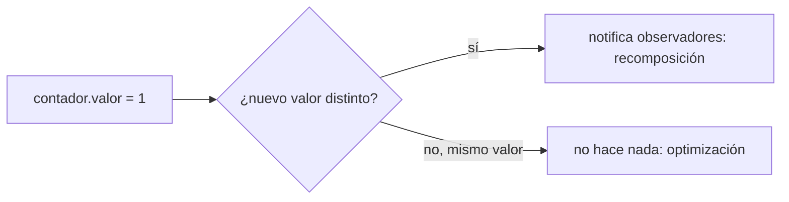
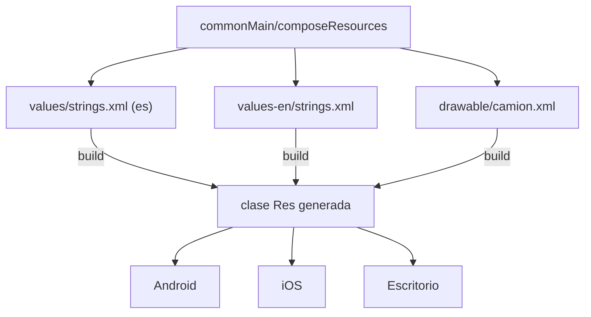
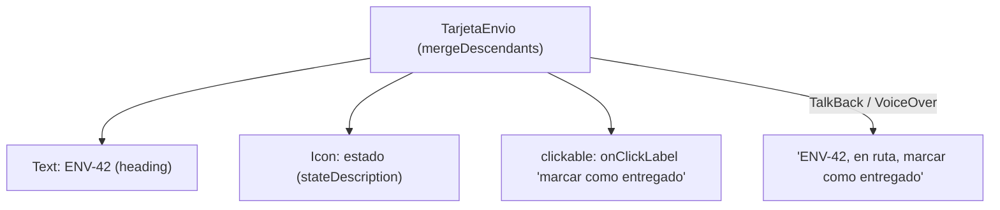
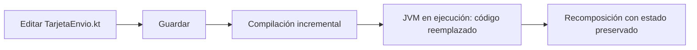
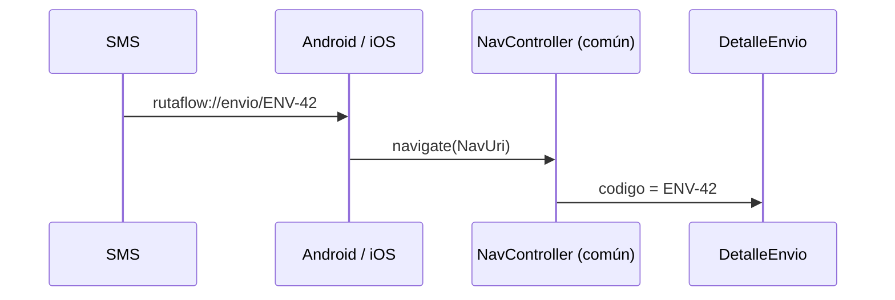

# Módulo 7: Compose Multiplatform — UI compartida

Cada tema se practica por separado con su propia repetición progresiva y su propio reto de memoria. El modelo reactivo de recomposición se verifica con `runComposeUiTest`, la API de pruebas real de Compose Multiplatform que ejecuta composición y recomposición de verdad sobre JVM/Skiko sin necesitar un emulador, para que la afirmación "solo el estado observable dispara recomposición" sea comprobable, no solo descrita.


## Aprende construyendo

### Tema 1: Compose Multiplatform vs Jetpack Compose

#### Paso 1 · Objetivo y preparación

Al finalizar podrás explicar qué significa `@Composable` en código compartido, qué motor gráfico usa cada plataforma, y por qué una dependencia exclusiva de Android dentro de una función compartida rompe la compilación de iOS.

**Conocimiento previo:** source sets y `expect`/`actual` (Módulo 3).

#### Paso 2 · Contexto y caso real

**¿Por qué es importante?** Una startup con equipo pequeño necesita una pantalla de lista de tareas idéntica en Android e iOS sin duplicar el código de UI, y sin asumir por error que cualquier import de Android es automáticamente portable solo por estar dentro de una función marcada `@Composable`.

#### Paso 3 · Teoría con analogía

**Conceptos clave:** mismo modelo de programación extendido a más plataformas, Skia como motor gráfico embebido.

En `commonMain`, `@Composable` conserva el mismo significado de compilación que en Jetpack Compose: el plugin de Compose transforma la función para integrarla en el runtime de composición. El target determina el backend gráfico; Android usa el motor nativo de Compose ya integrado en el sistema, mientras iOS usa Skia (el mismo motor de renderizado de bajo nivel, aquí embebido directamente en la app iOS en vez de depender de UIKit nativo). Marcar una función con `@Composable` no vuelve portable una dependencia Android incluida dentro de ella: si se importa `android.*` desde `commonMain`, la compilación del target iOS falla antes de renderizar nada.

**Analogía:** Compose Multiplatform es un mismo equipo de diseño que ensambla estructuras visualmente idénticas en distintas ciudades usando el mismo conjunto de herramientas, en vez de contratar equipos separados en cada ciudad con métodos distintos entre sí.

**Diagrama:**

```
┌── commonMain: @Composable fun PantallaTareas(...) ──┐
│  MISMA función, MISMA estructura declarativa          │
└──────────────┬─────────────────────────────┘
               ├── Android: motor nativo de Compose
               └── iOS: Skia embebido
```

#### Paso 4 · Demostración guiada desde cero

Desde una carpeta vacía (o continuando en `academia-kmp`, o créala con `mkdir -p academia-kmp` si es tu primera vez), crea la pantalla compartida en `shared/src/commonMain/kotlin/.../PantallaTareas.kt`:

```bash
mkdir -p academia-kmp/shared/src/commonMain/kotlin/com/academia/kmp
cd academia-kmp
```

```kotlin
// shared/src/commonMain/kotlin/com/academia/kmp/PantallaTareas.kt
package com.academia.kmp

import androidx.compose.foundation.lazy.LazyColumn
import androidx.compose.foundation.lazy.items
import androidx.compose.material3.Text
import androidx.compose.runtime.Composable

@Composable
fun PantallaTareas(tareas: List<Tarea>) {
    LazyColumn {
        items(tareas) { tarea -> Text(tarea.titulo) }
    }
}
```

**Explicación línea por línea:** `package com.academia.kmp` (sin sufijo `.android` ni `.ios`) confirma que el archivo vive en `commonMain`; `@Composable fun PantallaTareas(tareas: List<Tarea>)` declara la función portable; `LazyColumn { items(tareas) { ... } }` es la estructura declarativa que cada plataforma renderizará con su propio motor gráfico, sin que la función necesite saber cuál.

Confirma con un test real que la MISMA función compartida produce el árbol de UI esperado, usando `runComposeUiTest` (API de pruebas oficial de Compose Multiplatform que ejecuta composición real sobre JVM/Skiko, sin emulador):

```kotlin
// shared/src/commonTest/kotlin/com/academia/kmp/PantallaTareasTest.kt
package com.academia.kmp

import androidx.compose.ui.test.ExperimentalTestApi
import androidx.compose.ui.test.onNodeWithText
import androidx.compose.ui.test.runComposeUiTest
import kotlin.test.Test

class PantallaTareasTest {

    @OptIn(ExperimentalTestApi::class)
    @Test
    fun `PantallaTareas renderiza un Text por cada tarea de la lista`() = runComposeUiTest {
        setContent {
            PantallaTareas(
                listOf(
                    Tarea(id = "1", titulo = "Comprar leche", completada = false),
                    Tarea(id = "2", titulo = "Pagar factura", completada = false),
                ),
            )
        }

        onNodeWithText("Comprar leche").assertExists()
        onNodeWithText("Pagar factura").assertExists()
    }
}
```

```bash
# Gradle ejecuta la composición real (misma función compartida) sobre Skiko en JVM
./gradlew :shared:jvmTest --tests "com.academia.kmp.PantallaTareasTest"
```

**Resultado esperado:** el test pasa: los dos nodos de texto existen en el árbol compuesto por `PantallaTareas`, confirmando que la MISMA función declarativa produce la estructura esperada — este es el árbol que luego el motor nativo de Compose (Android) o Skia embebido (iOS) renderizan cada uno con su propio backend gráfico, sin que la función necesite saberlo. Instalar la app en un emulador Android y un simulador iOS confirma visualmente ese renderizado final en cada plataforma.

**Fallo deliberado:** agrega `import android.content.Context` dentro de `PantallaTareas.kt` (en `commonMain`) y vuelve a ejecutar `./gradlew :shared:compileKotlinMetadata`, o intenta compilar el target `iosX64` (`./gradlew :shared:compileKotlinIosX64`): la compilación falla con `Unresolved reference: android`, porque el compilador de Kotlin Multiplatform solo resuelve APIs de Android dentro de `androidMain` — diagnostica confirmando que un import exclusivo de plataforma dentro de código compartido rompe la compilación del resto de targets en tiempo de COMPILACIÓN, no de ejecución, coincidiendo con la afirmación del Paso 3.

#### Paso 5 · Práctica guiada — repetición progresiva

1. Agrega un segundo composable (`PantallaDetalleTarea`) que reciba una sola `Tarea` en vez de una lista, y escribe un `runComposeUiTest` que confirme su texto.
2. Agrega un tercer caso al mismo test con una lista vacía y confirma con `onNodeWithText(...).assertDoesNotExist()` que no aparece ningún texto de tarea.
3. Intenta (mentalmente o revisando el classpath de `commonMain`) agregar una dependencia exclusiva de iOS dentro de la función compartida y confirma en qué plataforma fallaría la compilación.
4. Escribe de memoria (sin mirar) una función `@Composable` que reciba una lista y un test `runComposeUiTest` que confirme que renderiza un elemento por cada ítem.

**Pista:** la pregunta que separa código compartido de código de plataforma es siempre la misma del Módulo 3: ¿esta línea depende de una API que solo existe en un sistema operativo?

#### Paso 6 · Práctica independiente

**Completa el código:** rellena el espacio para que la función viva en código compartido:

```kotlin
____
fun PantallaTareas(tareas: List<Tarea>) {
    LazyColumn { items(tareas) { tarea -> Text(tarea.titulo) } }
}
```

**Reto de memoria sin mirar:** cierra este documento y escribe, solo de memoria, una función `@Composable` compartida que reciba una lista de un modelo de dominio y la muestre en una `LazyColumn`. Compara después contra el patrón del Paso 4.

#### Paso 7 · Cierre

Ya distingues qué significa `@Composable` en código compartido y por qué el motor gráfico (no la anotación) determina el target. El siguiente tema construye sobre esta misma pantalla agregándole estado observable. Fuente oficial: [Compose Multiplatform docs](https://www.jetbrains.com/lp/compose-multiplatform/).

**Errores comunes:** asumir que `@Composable` por sí solo vuelve portable cualquier código dentro de la función; importar una dependencia exclusiva de plataforma dentro de `commonMain` sin notar el error hasta que falla la compilación de la otra plataforma.

**Cuándo no usarlo:** si la app necesita que cada plataforma luzca y se comporte exactamente según sus propias convenciones nativas sin ninguna concesión, UI nativa separada (Jetpack Compose puro + SwiftUI puro) puede ser preferible a compartir UI.

**Transferencia al proyecto integrador «Núcleo móvil compartido»:** Comparte una pantalla simple de lista donde la experiencia sea equivalente. Prueba navegación y entrada en cada plataforma y documenta qué interacción exige un adaptador nativo.

### Tema 2: Estado y recomposición — mutableStateOf y por qué la UI se redibuja

#### Paso 1 · Objetivo y preparación

Al finalizar podrás explicar por qué `mutableStateOf` dispara recomposición y una variable plana no, y confirmar con un modelo real que Compose evita recomponer cuando el nuevo valor es idéntico al anterior.

**Conocimiento previo:** Tema 1 de este módulo.

#### Paso 2 · Contexto y caso real

**¿Por qué es importante?** Un contador de tareas completadas que se muestra en pantalla debe actualizarse visualmente cada vez que el usuario marca una tarea, pero si el estado se guarda en una variable `var` común en vez de `mutableStateOf`, la variable cambia en memoria mientras la pantalla nunca se entera y sigue mostrando el valor antiguo.

#### Paso 3 · Teoría con analogía

**Conceptos clave:** estado observable, recomposición, optimización por igualdad de valor (snapshot).

`var contador by remember { mutableStateOf(0) }` envuelve el valor en un contenedor observable: cada lectura dentro de una función `@Composable` registra esa función como "interesada" en el valor, y cada escritura notifica a las funciones registradas para que se recompongan (se vuelvan a ejecutar y redibujar). Compose además optimiza: si el nuevo valor asignado es igual al anterior, NO dispara recomposición, evitando trabajo de renderizado innecesario. Una variable plana (`var contador = 0`, sin `mutableStateOf`) cambia en memoria pero ninguna función observa ese cambio, así que la UI nunca se redibuja con el nuevo valor.

**Analogía:** `mutableStateOf` es un tablero de anuncios con suscriptores que reciben una notificación automática cada vez que el anuncio cambia (y no reciben nada si el anuncio se "actualiza" con el mismo texto de antes); una variable plana es una nota adhesiva privada que alguien actualiza sin avisar a nadie más, así que nadie que dependa de esa información se entera del cambio.

**Diagrama:**



#### Paso 4 · Demostración guiada desde cero

Desde una carpeta vacía (o continuando en `academia-kmp`, o créala con `mkdir -p academia-kmp` si es tu primera vez), crea la pantalla con estado en `shared/src/commonMain/kotlin/.../PantallaContador.kt`:

```bash
mkdir -p academia-kmp/shared/src/commonMain/kotlin/com/academia/kmp
cd academia-kmp
```

```kotlin
// shared/src/commonMain/kotlin/com/academia/kmp/PantallaContador.kt
package com.academia.kmp

import androidx.compose.foundation.layout.Column
import androidx.compose.material3.Button
import androidx.compose.material3.Text
import androidx.compose.runtime.Composable
import androidx.compose.runtime.getValue
import androidx.compose.runtime.mutableStateOf
import androidx.compose.runtime.remember
import androidx.compose.runtime.setValue

@Composable
fun PantallaContador() {
    var contador by remember { mutableStateOf(0) }
    Column {
        Text("Tareas completadas: $contador")
        Button(onClick = { contador++ }) { Text("Completar tarea") }
    }
}
```

**Explicación línea por línea:** `var contador by remember { mutableStateOf(0) }` envuelve el valor en un contenedor observable; `Text("Tareas completadas: $contador")` lee el estado (registrando esa función como interesada); `Button(onClick = { contador++ })` escribe un nuevo valor, disparando recomposición de cualquier función que haya leído `contador`.

Confirma con `runComposeUiTest` que pulsar el botón actualiza el texto en pantalla, simulando el click real sobre el nodo del `Button` (sin necesitar un emulador):

```kotlin
// shared/src/commonTest/kotlin/com/academia/kmp/PantallaContadorTest.kt
package com.academia.kmp

import androidx.compose.ui.test.ExperimentalTestApi
import androidx.compose.ui.test.assertTextEquals
import androidx.compose.ui.test.onNodeWithText
import androidx.compose.ui.test.performClick
import androidx.compose.ui.test.runComposeUiTest
import kotlin.test.Test

class PantallaContadorTest {

    @OptIn(ExperimentalTestApi::class)
    @Test
    fun `cada click actualiza el texto en pantalla`() = runComposeUiTest {
        setContent { PantallaContador() }

        onNodeWithText("Tareas completadas: 0").assertExists()
        onNodeWithText("Completar tarea").performClick()
        onNodeWithText("Tareas completadas: 1").assertExists()
        onNodeWithText("Completar tarea").performClick()
        onNodeWithText("Tareas completadas: 2").assertExists()
    }
}
```

```bash
# Gradle ejecuta clicks reales y verifica recomposición sobre Skiko en JVM
./gradlew :shared:jvmTest --tests "com.academia.kmp.PantallaContadorTest"
```

**Resultado esperado:** el test pasa: cada `performClick()` real sobre el nodo del botón actualiza el texto en pantalla porque `contador` está envuelto en `mutableStateOf`, disparando una recomposición real de la función que lee su valor.

**Fallo deliberado:** cambia `var contador by remember { mutableStateOf(0) }` por una variable plana `var contador = 0` (sin `remember`/`mutableStateOf`) dentro de `PantallaContador`, y vuelve a ejecutar el mismo test. El `assertExists()` sobre `"Tareas completadas: 1"` FALLA con un error de aserción real (`Failed to find a component with text: Tareas completadas: 1`) porque el `Text` sigue mostrando `"Tareas completadas: 0"` tras el click — diagnostica confirmando el bug real más común de Compose: "cambié el estado pero la pantalla no se actualiza" ocurre casi siempre porque el estado vive en una variable plana en vez de estar envuelto en `mutableStateOf`. Revierte el cambio antes de continuar.

Para confirmar además la optimización de Compose por igualdad de valor (no recompone si el nuevo valor es idéntico al anterior), agrega un contador de recomposiciones real dentro de la propia función mediante una lectura de estado adicional:

```kotlin
// shared/src/commonTest/kotlin/com/academia/kmp/OptimizacionIgualdadTest.kt
package com.academia.kmp

import androidx.compose.material3.Text
import androidx.compose.runtime.Composable
import androidx.compose.runtime.getValue
import androidx.compose.runtime.mutableIntStateOf
import androidx.compose.runtime.mutableStateOf
import androidx.compose.runtime.remember
import androidx.compose.runtime.setValue
import androidx.compose.ui.test.ExperimentalTestApi
import androidx.compose.ui.test.onNodeWithText
import androidx.compose.ui.test.runComposeUiTest
import kotlin.test.Test

class OptimizacionIgualdadTest {

    @OptIn(ExperimentalTestApi::class)
    @Test
    fun `asignar el mismo valor no dispara una recomposicion adicional`() = runComposeUiTest {
        var recomposiciones = 0
        val contador = mutableStateOf(0)

        setContent {
            recomposiciones++
            Text("valor: ${contador.value}")
        }

        val recomposicionesIniciales = recomposiciones
        contador.value = 1
        waitForIdle()
        contador.value = 1 // mismo valor: NO debería disparar otra recomposición
        waitForIdle()

        onNodeWithText("valor: 1").assertExists()
        // solo UNA recomposición adicional pese a DOS asignaciones (una repetida)
        check(recomposiciones == recomposicionesIniciales + 1) {
            "se esperaba 1 recomposición adicional, ocurrieron ${recomposiciones - recomposicionesIniciales}"
        }
    }
}
```

**Resultado esperado adicional:** el test pasa: pese a asignar `contador.value = 1` dos veces seguidas, solo ocurre UNA recomposición adicional — la segunda asignación (mismo valor que el anterior) no dispara ninguna notificación, confirmando en composición real la misma optimización por igualdad de valor que Compose aplica en la app real.

#### Paso 5 · Práctica guiada — repetición progresiva

1. Agrega un segundo `Text` que también lea `contador` en la misma pantalla y confirma con `runComposeUiTest` que AMBOS se actualizan tras el mismo click.
2. Encadena cuatro asignaciones con dos valores repetidos intercalados (`1, 1, 2, 2`) en el test de `OptimizacionIgualdadTest` y predice cuántas recomposiciones adicionales ocurrirán antes de ejecutar.
3. Cambia el estado a tipo lista (`mutableStateOf(listOf(...))`) y confirma con un test real que reemplazar la lista completa por una nueva lista con el mismo contenido SÍ dispara recomposición (las listas se comparan por referencia/igualdad estructural, no automáticamente como los booleanos o enteros primitivos).
4. Escribe de memoria (sin mirar) un `runComposeUiTest` que verifique cuántas veces se actualiza un `Text` tras tres asignaciones de estado (con una repetida).

**Pista:** si la UI no se actualiza tras cambiar un valor, la primera pregunta a hacerte es si ese valor realmente está envuelto en `mutableStateOf` o si es una variable plana disfrazada de estado.

#### Paso 6 · Práctica independiente

**Completa el código:** rellena el espacio para declarar el estado observable correctamente:

```kotlin
var contador by remember { ____(0) }
```

**Reto de memoria sin mirar:** cierra este documento y escribe, solo de memoria, un `runComposeUiTest` que confirme cuántas veces cambia el texto renderizado tras las asignaciones `1, 2, 2, 3`. Compara después contra el patrón del Paso 4.

#### Paso 7 · Cierre

Ya distingues estado observable de una variable plana, y confirmas con `runComposeUiTest` (composición real, sin emulador) por qué Compose evita recomponer cuando el valor no cambia. El siguiente tema aplica un theme y una navegación compartidos sobre este mismo modelo de estado. Fuente oficial: [Compose docs — State](https://developer.android.com/develop/ui/compose/state).

**Errores comunes:** guardar estado que la UI necesita mostrar en una variable plana en vez de `mutableStateOf`; asumir que toda asignación siempre dispara recomposición sin considerar la optimización por igualdad de valor.

**Cuándo no usarlo:** para un valor que se calcula una sola vez al iniciar la app y nunca cambia durante su ciclo de vida, envolverlo en `mutableStateOf` es innecesario; una constante o `val` es suficiente.

**Transferencia al proyecto integrador «Núcleo móvil compartido»:** Conecta el estado observable del repositorio con la lista compartida. Cambia una entrega y verifica el resultado visual sin mutar una colección que la UI no pueda observar.

### Tema 3: Theming y navegación compartidos

#### Paso 1 · Objetivo y preparación

Al finalizar podrás definir un theme compartido y explicar por qué un grafo de navegación declarado una vez en código común evita mantener dos implementaciones de navegación divergentes.

**Conocimiento previo:** Tema 1 de este módulo.

#### Paso 2 · Contexto y caso real

**¿Por qué es importante?** Aplicar modo oscuro/claro de forma idéntica en Android e iOS, y mantener un flujo de onboarding de varias pantallas consistente en ambas plataformas, requiere definir el esquema de colores y el grafo de pantallas una única vez en vez de duplicarlos y arriesgar que diverjan con el tiempo.

#### Paso 3 · Teoría con analogía

**Conceptos clave:** un único esquema de diseño, grafo de navegación declarado una vez.

`@Composable fun AppTheme(content: @Composable () -> Unit) { MaterialTheme(colorScheme = esquemaColoresCompartido, content = content) }` define un theme (colores, tipografía, formas) una única vez en código compartido, aplicado consistentemente sin importar en qué plataforma se renderice. Librerías de navegación compatibles con KMP (como Voyager) permiten definir el grafo completo de navegación (qué pantallas existen, cómo se conectan, qué parámetros se pasan) una única vez en código compartido, en vez de mantener dos implementaciones de navegación separadas y potencialmente divergentes.

**Analogía:** un theme compartido es un manual de identidad visual corporativa aplicado consistentemente en todas las sucursales de una empresa; un grafo de navegación compartido es un mapa único del recorrido completo de un edificio, válido para cualquier visitante sin importar por cuál entrada haya ingresado.

**Diagrama:**

```
┌── AppTheme (commonMain): un único esquema de colores ──┐
│  Android: se renderiza con el motor nativo               │
│  iOS: se renderiza con Skia                              │
│  MISMO resultado visual en ambos                          │
└─────────────────────────────────────────────────┘
```

#### Paso 4 · Demostración guiada desde cero

Desde una carpeta vacía (o continuando en `academia-kmp`, o créala con `mkdir -p academia-kmp` si es tu primera vez), crea el theme compartido en `shared/src/commonMain/kotlin/.../AppTheme.kt`:

```bash
mkdir -p academia-kmp/shared/src/commonMain/kotlin/com/academia/kmp
cd academia-kmp
```

```kotlin
// shared/src/commonMain/kotlin/com/academia/kmp/AppTheme.kt
package com.academia.kmp

import androidx.compose.material3.MaterialTheme
import androidx.compose.material3.lightColorScheme
import androidx.compose.runtime.Composable
import androidx.compose.ui.graphics.Color

val esquemaColoresCompartido = lightColorScheme(
    primary = Color(0xFF7F52FF),
    background = Color(0xFF1A1A2E),
    onBackground = Color(0xFFFFFFFF),
)

@Composable
fun AppTheme(content: @Composable () -> Unit) {
    MaterialTheme(colorScheme = esquemaColoresCompartido, content = content)
}
```

**Explicación línea por línea:** `esquemaColoresCompartido` declara los tres colores base una única vez; `@Composable fun AppTheme(content: @Composable () -> Unit)` envuelve cualquier contenido pasado como parámetro con `MaterialTheme(colorScheme = esquemaColoresCompartido, ...)`, garantizando que toda pantalla envuelta por `AppTheme` reciba exactamente el mismo esquema de colores, sin importar en qué plataforma se ejecute.

Confirma con un test real que cualquier composable envuelto en `AppTheme` lee el mismo `primary` — comparando dos árboles compuestos por separado, como si fueran "dos plataformas" leyendo el mismo `MaterialTheme.colorScheme`:

```kotlin
// shared/src/commonTest/kotlin/com/academia/kmp/AppThemeTest.kt
package com.academia.kmp

import androidx.compose.material3.MaterialTheme
import androidx.compose.material3.Text
import androidx.compose.runtime.Composable
import androidx.compose.ui.test.ExperimentalTestApi
import androidx.compose.ui.test.onNodeWithTag
import androidx.compose.ui.test.runComposeUiTest
import kotlin.test.Test
import kotlin.test.assertEquals

@Composable
private fun MuestraColorPrimario() {
    val color = MaterialTheme.colorScheme.primary
    Text("color:${color.value}")
}

class AppThemeTest {

    @OptIn(ExperimentalTestApi::class)
    @Test
    fun `dos composiciones distintas leen el mismo color primario compartido`() = runComposeUiTest {
        var colorLeidoUno: ULong? = null
        var colorLeidoDos: ULong? = null

        setContent {
            AppTheme { colorLeidoUno = MaterialTheme.colorScheme.primary.value }
        }
        val primeraLectura = colorLeidoUno

        setContent {
            AppTheme { colorLeidoDos = MaterialTheme.colorScheme.primary.value }
        }

        assertEquals(primeraLectura, colorLeidoDos)
    }
}
```

```bash
# Gradle compone dos árboles independientes y confirma que ambos leen el mismo color
./gradlew :shared:jvmTest --tests "com.academia.kmp.AppThemeTest"
```

**Resultado esperado:** el test pasa: ambas composiciones (cada una simula una "plataforma" independiente componiendo su propio árbol) leen exactamente el mismo valor de `MaterialTheme.colorScheme.primary`, porque ambas se envuelven con el mismo `AppTheme` que lee `esquemaColoresCompartido` desde `commonMain`. Instalar la app envuelta en `AppTheme` en un emulador Android y un simulador iOS confirma visualmente el mismo color `#7F52FF` (morado Kotlin) en ambos.

**Fallo deliberado:** define un segundo esquema `esquemaColoresIOS` con un valor de `primary` ligeramente distinto (por ejemplo `Color(0xFF7C4DFF)`, un morado apenas diferente) y úsalo en la segunda composición del test en vez de `AppTheme`. El `assertEquals(primeraLectura, colorLeidoDos)` FALLA porque los valores ya no coinciden — diagnostica confirmando el problema real de mantener sistemas de diseño paralelos: pequeñas divergencias visuales se acumulan silenciosamente hasta que un test (o una comparación visual manual) las expone. Revierte el cambio antes de continuar.

#### Paso 5 · Práctica guiada — repetición progresiva

1. Agrega un tercer campo al esquema (`error`) y confirma que también se propaga idéntico a ambas plataformas.
2. Simula un rebranding (cambiar `primario` en el esquema compartido) y confirma que ambas plataformas reflejan el nuevo valor automáticamente.
3. Modela un grafo de navegación simple (diccionario de pantalla → lista de pantallas alcanzables) y confirma que es el mismo grafo consultado desde ambas plataformas.
4. Escribe de memoria (sin mirar) un esquema de colores compartido y una función que lo aplique a dos plataformas, confirmando igualdad.

**Pista:** cualquier vez que necesites comparar visualmente "¿se ve igual en Android que en iOS?", la respuesta más confiable es verificar si ambas leen del mismo esquema compartido, no comparar capturas de pantalla una por una.

#### Paso 6 · Práctica independiente

**Completa el código:** rellena el espacio para que el theme use el esquema compartido:

```kotlin
@Composable
fun AppTheme(content: @Composable () -> Unit) {
    MaterialTheme(colorScheme = ____, content = content)
}
```

**Reto de memoria sin mirar:** cierra este documento y escribe, solo de memoria, una función de theme compartido y una simulación en dos plataformas confirmando colores idénticos. Compara después contra el patrón del Paso 4.

#### Paso 7 · Cierre

Ya defines un theme y (conceptualmente) un grafo de navegación una única vez en código compartido, confirmando que ambas plataformas reciben valores idénticos en vez de arriesgar divergencias acumuladas. El siguiente tema reconoce dónde este modelo de compartir todo encuentra límites reales. Fuente oficial: [Compose Multiplatform docs — Theming](https://www.jetbrains.com/lp/compose-multiplatform/).

**Errores comunes:** definir dos sistemas de diseño separados por plataforma que divergen silenciosamente con el tiempo; duplicar el grafo de navegación en vez de compartirlo, arriesgando flujos inconsistentes entre plataformas.

**Cuándo no usarlo:** si el diseño de marca requiere deliberadamente lucir distinto en cada plataforma (por ejemplo, seguir estrictamente las guías de Material en Android y de Human Interface en iOS sin ninguna concesión), un theme único compartido contradice ese objetivo.

**Transferencia al proyecto integrador «Núcleo móvil compartido»:** Define destinos por identidad de guía y aplica el tema común. Abre un detalle desde ambos clientes y comprueba que regresar mantiene la selección sin compartir objetos nativos entre plataformas.

### Tema 4: Limitaciones en iOS y otros targets

#### Paso 1 · Objetivo y preparación

Al finalizar podrás identificar qué tipo de integraciones nativas todavía requieren puentes específicos de plataforma en Compose Multiplatform para iOS, y decidir cuándo usar SwiftUI nativo en vez de UI compartida.

**Conocimiento previo:** Temas 1-3 de este módulo; `expect`/`actual` (Módulo 3).

#### Paso 2 · Contexto y caso real

**¿Por qué es importante?** Un widget de pantalla de inicio en iOS, o una integración con Apple Pay, no puede implementarse directamente con Compose Multiplatform porque esas capacidades son exclusivas del sistema y requieren SwiftUI nativo o un puente `expect`/`actual`, evitando el error de asumir que absolutamente toda la UI puede compartirse sin ninguna excepción.

#### Paso 3 · Teoría con analogía

**Conceptos clave:** Compose Multiplatform estable en iOS desde 1.8.0, límites de integraciones nativas puntuales que ningún framework de UI compartida cubre.

Compose Multiplatform para iOS alcanzó estado estable y listo para producción con la versión 1.8.0 (mayo de 2025): ofrece paridad de funcionalidad con Jetpack Compose para los casos de uso más comunes, APIs estables y rendimiento equiparable al de UI nativa. Esa estabilidad del framework de UI en sí no elimina, sin embargo, una categoría distinta de límite: ciertas capacidades exclusivas del sistema operativo (notificaciones push nativas con configuración particular, ciertos widgets de pantalla de inicio, algunas APIs de accesibilidad muy específicas de iOS) siguen existiendo fuera de cualquier framework de UI multiplataforma, igual que en Android seguirían requiriendo código específico de plataforma. Para esos casos puntuales, la opción sigue siendo un puente `expect`/`actual` o recurrir directamente a SwiftUI nativo, no porque Compose Multiplatform sea inmaduro, sino porque esa integración nativa profunda está genuinamente fuera del alcance de cualquier UI declarativa compartida.

**Analogía:** las limitaciones actuales de Compose Multiplatform en iOS son como una traducción que captura fielmente la mayor parte del contenido original, pero donde ciertas expresiones idiomáticas muy específicas y locales todavía requieren una adaptación manual especializada.

**Diagrama:**

```
┌── Android: Compose Multiplatform sobre el motor nativo, estable ────────┐
├── iOS: Compose Multiplatform sobre Skia embebido, estable desde 1.8.0 ──┤
│      └─ ciertos casos (push nativo, Apple Pay) requieren SwiftUI ────┘  │
└── Desktop / Web: targets adicionales con madurez relativa a evaluar ────┘
```

#### Paso 4 · Demostración guiada desde cero

Desde una carpeta vacía (o continuando en `academia-kmp`, o créala con `mkdir -p academia-kmp` si es tu primera vez), crea un mapa de decisión en `shared/src/commonMain/kotlin/.../MapaDecisionUI.kt`:

```bash
mkdir -p academia-kmp/shared/src/commonMain/kotlin/com/academia/kmp
cd academia-kmp
```

```kotlin
// shared/src/commonMain/kotlin/com/academia/kmp/MapaDecisionUI.kt
package com.academia.kmp

// documenta el criterio: capacidad exclusiva del sistema -> SwiftUI nativo o expect/actual
// UI declarativa estándar (listas, texto, botones, formularios) -> Compose Multiplatform compartido
enum class TipoIntegracion { UI_ESTANDAR, CAPACIDAD_EXCLUSIVA_SISTEMA }

val casosClasificados: Map<String, TipoIntegracion> = mapOf(
    "Lista de tareas con texto y checkboxes" to TipoIntegracion.UI_ESTANDAR,
    "Widget de pantalla de inicio en iOS" to TipoIntegracion.CAPACIDAD_EXCLUSIVA_SISTEMA,
    "Formulario de login con validación" to TipoIntegracion.UI_ESTANDAR,
    "Integración con Apple Pay" to TipoIntegracion.CAPACIDAD_EXCLUSIVA_SISTEMA,
    "Pantalla de detalle con theme compartido" to TipoIntegracion.UI_ESTANDAR,
    "Notificación push nativa personalizada" to TipoIntegracion.CAPACIDAD_EXCLUSIVA_SISTEMA,
)
```

```bash
# Gradle compila el mapa de clasificación en commonMain
./gradlew :shared:compileKotlinMetadata
```

**Explicación línea por línea:** `enum class TipoIntegracion { UI_ESTANDAR, CAPACIDAD_EXCLUSIVA_SISTEMA }` documenta el criterio de decisión central del tema: si la integración es UI declarativa estándar (listas, texto, formularios), Compose Multiplatform compartido es apropiado; si es una capacidad exclusiva del sistema operativo, se necesita SwiftUI nativo o un puente `expect`/`actual`.

Aplica el criterio a seis casos concretos de un proyecto real:

| Caso | Clasificación | Acción |
|---|---|---|
| Lista de tareas con texto y checkboxes | `UI_ESTANDAR` | Compose Multiplatform compartido |
| Widget de pantalla de inicio en iOS | `CAPACIDAD_EXCLUSIVA_SISTEMA` | SwiftUI nativo o puente `expect`/`actual` |
| Formulario de login con validación | `UI_ESTANDAR` | Compose Multiplatform compartido |
| Integración con Apple Pay | `CAPACIDAD_EXCLUSIVA_SISTEMA` | SwiftUI nativo o puente `expect`/`actual` |
| Pantalla de detalle con theme compartido | `UI_ESTANDAR` | Compose Multiplatform compartido |
| Notificación push nativa personalizada | `CAPACIDAD_EXCLUSIVA_SISTEMA` | SwiftUI nativo o puente `expect`/`actual` |

**Resultado esperado:** de los 6 casos evaluados, exactamente 3 (`Widget de pantalla de inicio en iOS`, `Integración con Apple Pay`, `Notificación push nativa personalizada`) requieren SwiftUI nativo o un puente `expect`/`actual`, mientras los otros 3 (listas, formularios, pantallas con theme compartido) son UI declarativa estándar apropiada para Compose Multiplatform compartido.

**Fallo deliberado:** clasifica erróneamente "Integración con Apple Pay" como `UI_ESTANDAR` (asumiendo, incorrectamente, que toda UI de pago puede compartirse igual que un formulario cualquiera) e intenta implementarla directamente en `commonMain` sin ningún puente. En un proyecto real esto fallaría en compilación porque Apple Pay requiere APIs exclusivas de iOS (`PassKit`) no disponibles en `commonMain` — diagnostica confirmando por qué el criterio de decisión (¿es una capacidad exclusiva del sistema?) debe aplicarse ANTES de escribir código compartido, no descubrirse después de que la compilación específica de una plataforma falle.

Confirma con un test real que la tabulación programática coincide con la tabla:

```kotlin
// shared/src/commonTest/kotlin/com/academia/kmp/MapaDecisionUITest.kt
package com.academia.kmp

import kotlin.test.Test
import kotlin.test.assertEquals

class MapaDecisionUITest {

    @Test
    fun `exactamente 3 de 6 casos requieren integracion nativa puntual`() {
        val necesitanPuente = casosClasificados.values.count { it == TipoIntegracion.CAPACIDAD_EXCLUSIVA_SISTEMA }

        assertEquals(6, casosClasificados.size)
        assertEquals(3, necesitanPuente)
    }
}
```

```bash
./gradlew :shared:jvmTest --tests "com.academia.kmp.MapaDecisionUITest"
```

El test pasa, confirmando `de 6 casos, 3 requieren integración nativa puntual`, coincidiendo con la tabla anterior.

#### Paso 5 · Práctica guiada — repetición progresiva

1. Agrega dos casos nuevos a la clasificación (por ejemplo, "selector de fecha nativo" y "lista de contactos del dispositivo") y clasifícalos.
2. Cuenta cuántos de los 8 casos totales requieren puente nativo y verifica el resultado.
3. Para uno de los casos que requiere puente nativo, describe (en comentario) cómo se estructuraría con `expect`/`actual` (Módulo 3).
4. Escribe de memoria (sin mirar) tres ejemplos de UI estándar compartible y tres ejemplos de capacidad exclusiva de sistema.

**Pista:** si dudas si algo es "capacidad exclusiva del sistema", pregúntate si esa función existe en el SDK multiplataforma común o si solo la expone la documentación nativa de un sistema operativo específico.

#### Paso 6 · Práctica independiente

**Completa el código:** rellena el espacio para clasificar correctamente un caso de integración exclusiva:

```kotlin
val integracionApplePay = TipoIntegracion.____
```

**Reto de memoria sin mirar:** cierra este documento y escribe, solo de memoria, una clasificación de al menos cuatro casos concretos (dos estándar, dos exclusivos de sistema) según el criterio del Paso 3. Compara después contra el patrón del Paso 4.

#### Paso 7 · Cierre

Ya aplicas un criterio explícito para decidir cuándo una integración necesita SwiftUI nativo o un puente `expect`/`actual` en vez de UI compartida, evitando asumir paridad completa donde no existe. El siguiente módulo profundiza en interoperabilidad directa con iOS más allá de la UI. Fuente oficial: [Compose Multiplatform 1.8.0 — Compose for iOS is Stable](https://blog.jetbrains.com/kotlin/2025/05/compose-multiplatform-1-8-0-released-compose-multiplatform-for-ios-is-stable-and-production-ready/).

**Errores comunes:** asumir que absolutamente toda integración nativa está disponible igual en iOS que en Android; descubrir la necesidad de un puente nativo solo después de que la compilación falla, en vez de clasificar el caso de antemano.

**Cuándo no usarlo:** si el proyecto es exclusivamente para Android (sin ningún plan de expandir a iOS u otros targets), evaluar estas limitaciones de Compose Multiplatform no aplica; usa Jetpack Compose puro sin la capa multiplataforma.

**Transferencia al proyecto integrador «Núcleo móvil compartido»:** Clasifica la pantalla de confirmación de entrega (lista, formulario, theme) como UI estándar compartible, y la integración de escaneo de código de barras con la cámara nativa como capacidad exclusiva de sistema que necesita un puente `expect`/`actual` por plataforma.

---

### Tema 5: Recursos y localización en Compose Multiplatform: textos, imágenes y plurales comunes · Intermedio · 40 min

**Prerrequisito:** tema «Theming y navegación compartidos» de este módulo.

**Al finalizar podrás:** poner textos, imágenes y plurales en `composeResources`, generar la clase `Res` y mostrarlos en Android, iOS y escritorio con el idioma del dispositivo.

**¿Por qué es importante?** Si cada plataforma tiene sus propios archivos de textos, se desincronizan y un botón aparece en inglés solo en iOS. Compose Multiplatform Resources comparte los recursos desde `commonMain` con accesos con tipos.

#### Paso 1 · Objetivo y preparación

Usa Compose Multiplatform 1.6 o superior con la dependencia `compose.components.resources` en `commonMain`. Crea `composeApp/src/commonMain/composeResources/`.

#### Paso 2 · Contexto y caso real

La app de RutaFlow decía «Entregar» en Android y «Deliver» en iOS porque alguien olvidó traducir el archivo de una plataforma. Con recursos comunes, hay un solo archivo por idioma.

#### Paso 3 · Teoría, modelo mental y analogía

**Conceptos clave:** `composeResources`, `values/strings.xml`, calificador de idioma (`values-en`), `Res.string`, `stringResource`, `pluralStringResource`, `painterResource`.

Los recursos comunes viven en `commonMain/composeResources/`:

- `values/strings.xml` con los textos por defecto y `values-en/strings.xml` con los de inglés (el **calificador** del nombre de la carpeta elige el idioma).
- `<plurals>` para textos que cambian con la cantidad.
- `drawable/` para imágenes (PNG, JPG, XML vectorial, SVG).

Al compilar, Gradle genera la clase **`Res`** con accesos con tipos: `Res.string.entregar`, `Res.drawable.camion`. En los composables se leen con `stringResource(...)`, `pluralStringResource(...)` y `painterResource(...)`. El idioma se toma del sistema en cada plataforma.

**Analogía:** `composeResources` es la bodega central de etiquetas: cada tienda (plataforma) toma de ahí la etiqueta del idioma de su cliente. La analogía falla en que la bodega se arma al compilar: un recurso nuevo no aparece en `Res` hasta el siguiente build.

**Límite de uso:** no pongas en recursos textos que vienen del servidor. Los nombres de recursos deben ser identificadores válidos de Kotlin (sin guiones).



#### Paso 4 · Demostración guiada desde cero

Archivo `composeApp/src/commonMain/composeResources/values/strings.xml`:

```xml
<resources>
    <string name="entregar">Entregar</string>
    <string name="saludo">Hola, %1$s</string>
    <plurals name="pendientes">
        <item quantity="one">%1$d entrega pendiente</item>
        <item quantity="other">%1$d entregas pendientes</item>
    </plurals>
</resources>
```

Archivo `composeApp/src/commonMain/composeResources/values-en/strings.xml`:

```xml
<resources>
    <string name="entregar">Deliver</string>
    <string name="saludo">Hi, %1$s</string>
    <plurals name="pendientes">
        <item quantity="one">%1$d pending delivery</item>
        <item quantity="other">%1$d pending deliveries</item>
    </plurals>
</resources>
```

Archivo `composeApp/src/commonMain/kotlin/co/rutaflow/ui/Encabezado.kt`:

```kotlin
package co.rutaflow.ui

import androidx.compose.foundation.Image
import androidx.compose.foundation.layout.Column
import androidx.compose.material3.Button
import androidx.compose.material3.Text
import androidx.compose.runtime.Composable
import org.jetbrains.compose.resources.painterResource
import org.jetbrains.compose.resources.pluralStringResource
import org.jetbrains.compose.resources.stringResource
import rutaflow.composeapp.generated.resources.*

@Composable
fun Encabezado(conductor: String, pendientes: Int, alEntregar: () -> Unit) {
    Column {
        Image(painterResource(Res.drawable.camion), contentDescription = null)
        Text(stringResource(Res.string.saludo, conductor))
        Text(pluralStringResource(Res.plurals.pendientes, pendientes, pendientes))
        Button(onClick = alEntregar) { Text(stringResource(Res.string.entregar)) }
    }
}
```

Ejecútalo:

```bash
./gradlew :composeApp:generateComposeResClass
./gradlew :composeApp:run              # escritorio
./gradlew :composeApp:installDebug     # Android
```

**Explicación por bloques:** `values/strings.xml` tiene los textos en español y `values-en/strings.xml` en inglés. `%1$s` y `%1$d` son el primer argumento como texto y como número. `<plurals>` define la forma singular y plural. Al compilar, Gradle genera `Res` en el paquete `rutaflow.composeapp.generated.resources`. `Encabezado` usa `stringResource` con argumento, `pluralStringResource` con la cantidad (para elegir la forma) y otra vez la cantidad como argumento del texto, y `painterResource` para la imagen de `drawable/camion.xml`.

**Resultado esperado:**

```text
Con el sistema en español y 1 pendiente: «Hola, Ana», «1 entrega pendiente», botón «Entregar».
Con el sistema en inglés y 3 pendientes: «Hi, Ana», «3 pending deliveries», botón «Deliver».
El mismo resultado en Android, iOS y escritorio.
```

**Fallo deliberado:** nombra el recurso `entregar-ya` en `strings.xml`. **Error esperado:** la generación de `Res` falla o el acceso no existe, porque `entregar-ya` no es un identificador válido de Kotlin. **Diagnóstico:** usa nombres con guion bajo (`entregar_ya`).

#### Paso 5 · Práctica guiada

1. **Reproducción:** ejecuta en escritorio y en Android con el sistema en español.
2. **Variación:** cambia el idioma del emulador a inglés y comprueba los textos.
3. **Diagnóstico:** reproduce el fallo deliberado con el guion.
4. **Integración:** agrega una carpeta `drawable-dark` con otra versión de la imagen para el modo oscuro.
5. **Diseño:** mueve a recursos comunes los textos que hoy están en `strings.xml` de Android y en `Localizable.strings` de iOS.

**Pista:** si `Res` no tiene tu recurso, ejecuta `generateComposeResClass` y revisa el nombre.

#### Paso 6 · Práctica independiente

Agrega portugués (`values-pt`) y una prueba en `commonTest` que verifique que las tres versiones de `strings.xml` tienen las mismas claves.

#### Paso 7 · Cierre

- [ ] Explicas cómo se elige el idioma con calificadores.
- [ ] Los textos y plurales cambian con el idioma del sistema.
- [ ] Reprodujiste el error de nombre inválido.
- [ ] Hay un solo archivo de textos por idioma.

Si fallas dos o más, vuelve al Paso 3. **Errores comunes:** duplicar textos por plataforma, usar nombres con guiones y armar plurales con `if` en el código. **Siguiente paso:** el tema siguiente abre pantallas desde enlaces externos con deep links.

**Transferencia al proyecto integrador «RutaFlow»:** mueve todos los textos e imágenes de la app de RutaFlow a `composeResources` con español e inglés.

**Fuente oficial:** [Kotlin — Multiplatform resources](https://kotlinlang.org/docs/multiplatform/compose-multiplatform-resources.html).

### Tema 6: Accesibilidad en Compose Multiplatform: semántica que funciona con TalkBack y VoiceOver · Intermedio · 40 min

**Prerrequisito:** tema «Estado y recomposición» de este módulo.

**Al finalizar podrás:** dar descripciones, roles y estados a los componentes con `Modifier.semantics`, agrupar elementos para que se lean como una unidad y comprobarlo con TalkBack, VoiceOver y una prueba común.

**¿Por qué es importante?** Compose Multiplatform traduce la semántica de Compose a las APIs de accesibilidad de cada sistema. Si la semántica está mal en el código común, está mal en todas las plataformas a la vez.

#### Paso 1 · Objetivo y preparación

Usa Compose Multiplatform 1.7 o superior (accesibilidad en iOS estable). Activa TalkBack en el emulador de Android y VoiceOver en el simulador de iOS (Accessibility Inspector en Xcode).

#### Paso 2 · Contexto y caso real

Un conductor de RutaFlow con baja visión usaba VoiceOver. En la tarjeta de envío, VoiceOver leía «botón» sin decir para qué, y el ícono de estado no se leía. El arreglo en el código común sirvió también para TalkBack.

#### Paso 3 · Teoría, modelo mental y analogía

**Conceptos clave:** árbol de semántica, `contentDescription`, `Modifier.semantics`, `mergeDescendants`, `role`, `stateDescription`, `heading`, `onClickLabel`.

Compose arma un **árbol de semántica** paralelo a la interfaz. Los lectores de pantalla leen ese árbol, no los píxeles.

- Las imágenes con significado necesitan `contentDescription`; las decorativas, `null`.
- `Modifier.semantics(mergeDescendants = true)` junta un grupo (código, estado y botón) para leerlo como una unidad.
- `role` dice qué es (botón, casilla); `stateDescription` dice su estado («entregado»); `heading()` marca títulos para navegar entre ellos.
- `onClickLabel` en `clickable` describe la acción («marcar como entregado»), no solo «botón».

Las pruebas comunes (`runComposeUiTest`) buscan nodos por su semántica: si la prueba encuentra el texto o la descripción, el lector de pantalla también.

**Analogía:** el árbol de semántica es la versión en braille de la pantalla: si no escribes el braille, el usuario que no ve no tiene nada que leer. La analogía falla en que aquí el «braille» también lo usan las pruebas automáticas.

**Límite de uso:** no pongas `contentDescription` que repite el texto visible: el lector lo dirá dos veces. La semántica no reemplaza el contraste de colores ni los tamaños táctiles mínimos (48 dp).



#### Paso 4 · Demostración guiada desde cero

Archivo `composeApp/src/commonMain/kotlin/co/rutaflow/ui/TarjetaEnvio.kt`:

```kotlin
package co.rutaflow.ui

import androidx.compose.foundation.clickable
import androidx.compose.foundation.layout.Row
import androidx.compose.foundation.layout.padding
import androidx.compose.material.icons.Icons
import androidx.compose.material.icons.filled.CheckCircle
import androidx.compose.material.icons.filled.LocalShipping
import androidx.compose.material3.Icon
import androidx.compose.material3.Text
import androidx.compose.runtime.Composable
import androidx.compose.ui.Modifier
import androidx.compose.ui.semantics.Role
import androidx.compose.ui.semantics.heading
import androidx.compose.ui.semantics.semantics
import androidx.compose.ui.semantics.stateDescription
import androidx.compose.ui.unit.dp

@Composable
fun TarjetaEnvio(codigo: String, entregado: Boolean, alMarcar: () -> Unit) {
    val estado = if (entregado) "entregado" else "en ruta"
    Row(
        Modifier
            .clickable(onClickLabel = "marcar como entregado", role = Role.Button, onClick = alMarcar)
            .semantics(mergeDescendants = true) { stateDescription = estado } // una sola lectura
            .padding(16.dp),
    ) {
        Icon(if (entregado) Icons.Default.CheckCircle else Icons.Default.LocalShipping, contentDescription = null) // el estado ya se dice
        Text(codigo, Modifier.semantics { heading() })
    }
}
```

Archivo `composeApp/src/commonTest/kotlin/co/rutaflow/ui/TarjetaEnvioTest.kt`:

```kotlin
package co.rutaflow.ui

import androidx.compose.ui.semantics.SemanticsProperties
import androidx.compose.ui.test.*
import kotlin.test.Test

class TarjetaEnvioTest {
    @OptIn(ExperimentalTestApi::class)
    @Test fun seLeeComoUnaUnidadConEstado() = runComposeUiTest {
        setContent { TarjetaEnvio("ENV-42", entregado = false) {} }
        onNode(hasStateDescription("en ruta") and hasClickAction())
            .assertTextContains("ENV-42")
            .assert(SemanticsMatcher.keyIsDefined(SemanticsProperties.Role))
    }
}
```

Ejecútalo:

```bash
./gradlew :composeApp:jvmTest
./gradlew :composeApp:installDebug   # luego activa TalkBack y toca la tarjeta
```

**Explicación por bloques:** La fila completa es clicable con una etiqueta de acción y el rol de botón. `mergeDescendants = true` une el ícono y el texto en un solo nodo, con el estado como `stateDescription`. El ícono tiene `contentDescription = null` porque el estado ya se dice: así no se repite. El código se marca como encabezado para que el usuario salte entre tarjetas. La prueba común busca un nodo con ese estado y acción de clic, y comprueba el texto y el rol: si la prueba lo encuentra, el lector también.

**Resultado esperado:**

```text
./gradlew :composeApp:jvmTest pasa la prueba seLeeComoUnaUnidadConEstado.
TalkBack lee: «ENV-42, en ruta, botón. Toca dos veces para marcar como entregado».
VoiceOver lee una frase equivalente en iOS.
```

**Fallo deliberado:** quita `mergeDescendants = true`. **Error esperado:** la prueba falla con «Failed: assertTextContains... no node found», y TalkBack recorre el ícono, el texto y la fila por separado. **Diagnóstico:** sin agrupar, la información queda repartida en tres nodos. Agrupa lo que el usuario entiende como una unidad.

#### Paso 5 · Práctica guiada

1. **Reproducción:** ejecuta la prueba común y luego recorre la tarjeta con TalkBack.
2. **Variación:** cambia `entregado` a `true` y comprueba que el lector dice «entregado».
3. **Diagnóstico:** reproduce el fallo deliberado sin agrupar.
4. **Integración:** revisa la pantalla con el Accessibility Scanner de Android y corrige lo que reporte.
5. **Diseño:** escribe tres reglas de accesibilidad para todas las tarjetas de RutaFlow.

**Pista:** escucha la pantalla con el lector antes de mirarla: si no entiendes qué hacer, falta semántica.

#### Paso 6 · Práctica independiente

Agrega una acción personalizada «reportar problema» con `customActions` en la semántica de la tarjeta y pruébala con TalkBack y VoiceOver.

#### Paso 7 · Cierre

- [ ] Explicas el árbol de semántica.
- [ ] La prueba común pasa.
- [ ] Reprodujiste la lectura repartida sin `mergeDescendants`.
- [ ] El lector dice el estado y la acción.

Si fallas dos o más, vuelve al Paso 3. **Errores comunes:** describir íconos decorativos, repetir el texto visible en la descripción y no agrupar elementos relacionados. **Siguiente paso:** el módulo 8 muestra estas pantallas dentro de una app SwiftUI existente.

**Transferencia al proyecto integrador «RutaFlow»:** agrega semántica de estado y acción a las tarjetas de envío de RutaFlow y pruébala en `commonTest`.

**Fuente oficial:** [Kotlin — Accessibility in Compose Multiplatform](https://kotlinlang.org/docs/multiplatform/compose-accessibility.html) y [Android Developers — Semantics in Compose](https://developer.android.com/develop/ui/compose/accessibility/semantics).

### Tema 7: Compose Hot Reload: ver cambios de la interfaz sin reiniciar la app · Intermedio · 30 min

**Prerrequisito:** tema «Compose Multiplatform vs Jetpack Compose» de este módulo.

**Al finalizar podrás:** activar Compose Hot Reload en el target de escritorio, cambiar textos, colores y diseño mientras la app corre sin perder el estado, y saber qué cambios exigen reiniciar.

**¿Por qué es importante?** Ajustar una pantalla con ciclos de compilar y reiniciar de un minuto hace que se pruebe menos. Con Hot Reload el cambio aparece en segundos y conservas el estado (por ejemplo, el formulario ya llenado).

#### Paso 1 · Objetivo y preparación

Usa Compose Multiplatform 1.10 o superior, donde Hot Reload viene incluido en el plugin. Necesitas el target `jvm()` (escritorio): Hot Reload funciona sobre la JVM. Instala el plugin de Kotlin Multiplatform en IntelliJ IDEA o Android Studio.

#### Paso 2 · Contexto y caso real

El diseñador de RutaFlow ajustaba el espaciado de la tarjeta de envío con el equipo de desarrollo. Cada cambio pedía reiniciar la app y volver a llenar el formulario de prueba. Con Hot Reload, revisaron diez variantes en cinco minutos.

#### Paso 3 · Teoría, modelo mental y analogía

**Conceptos clave:** recarga en caliente, estado preservado, target JVM de escritorio, tarea `hotRun`, cambios compatibles e incompatibles.

Compose Hot Reload recompila solo lo que cambió y **reemplaza el código en la JVM en ejecución**. Luego Compose recompone la pantalla y **mantiene el estado** de `remember`.

- Se ejecuta con la tarea `hotRun` del target de escritorio o con el botón de Hot Reload del IDE.
- Al guardar el archivo, la app se actualiza.

| Cambio | ¿Recarga en caliente? |
|---|---|
| textos, colores, modificadores, nuevos composables | sí |
| cuerpo de funciones | sí |
| nuevas dependencias de Gradle, cambios en `main` | no: reinicia |

Aunque se ejecuta en escritorio, el código común es el mismo que corre en Android e iOS: lo que ves es lo que se compila para ellos.

**Analogía:** es cambiar la decoración de una habitación con la gente adentro: nadie tiene que salir y volver a entrar. La analogía falla en que, si cambias los cimientos (dependencias), hay que desalojar y reconstruir.

**Límite de uso:** no todos los cambios se pueden aplicar en caliente; si el estado se ve raro después de un cambio grande, reinicia. Revisa siempre el resultado final en Android e iOS: tipografía y densidad pueden variar.



#### Paso 4 · Demostración guiada desde cero

Archivo `composeApp/build.gradle.kts`:

```kotlin
plugins {
    alias(libs.plugins.kotlin.multiplatform)
    alias(libs.plugins.compose.multiplatform)
    alias(libs.plugins.compose.compiler)
    alias(libs.plugins.compose.hot.reload) // en versiones donde no viene incluido
}

kotlin {
    jvm("desktop")
    // ... targets de Android e iOS
}
```

Archivo `composeApp/src/commonMain/kotlin/co/rutaflow/ui/Formulario.kt`:

```kotlin
package co.rutaflow.ui

import androidx.compose.foundation.layout.Column
import androidx.compose.foundation.layout.padding
import androidx.compose.material3.OutlinedTextField
import androidx.compose.material3.Text
import androidx.compose.runtime.*
import androidx.compose.ui.Modifier
import androidx.compose.ui.unit.dp

@Composable
fun FormularioNota() {
    var nota by remember { mutableStateOf("") } // este estado sobrevive a la recarga
    Column(Modifier.padding(16.dp)) {             // cambia 16 por 32 y guarda
        Text("Nota para el cliente")              // cambia el texto y guarda
        OutlinedTextField(value = nota, onValueChange = { nota = it })
    }
}
```

Ejecútalo:

```bash
./gradlew :composeApp:hotRunDesktop --auto
# escribe algo en el campo, cambia el padding o el texto en el código y guarda
```

**Explicación por bloques:** El target de escritorio se llama `desktop`; con el plugin de Hot Reload, Gradle agrega la tarea `hotRunDesktop`, y `--auto` recarga al guardar. `FormularioNota` guarda la nota en `remember`. Al cambiar el padding o el texto y guardar, la JVM recibe el código nuevo y Compose recompone: el diseño cambia y el texto que escribiste sigue en el campo.

**Resultado esperado:**

```text
La ventana de escritorio se actualiza uno o dos segundos después de guardar, sin cerrarse.
El texto escrito en el campo sigue ahí tras cambiar el padding de 16 a 32.
Al agregar una dependencia nueva en Gradle, la herramienta pide reiniciar.
```

**Fallo deliberado:** cambia `remember { mutableStateOf("") }` por `remember { mutableStateOf(0) }` (otro tipo) y guarda. **Error esperado:** el estado se reinicia o la herramienta avisa que el cambio no es compatible y reinicia la composición. **Diagnóstico:** cambiar el tipo del estado no se puede aplicar conservando el valor anterior. Es normal: reinicia cuando cambies la forma del estado.

#### Paso 5 · Práctica guiada

1. **Reproducción:** arranca con `hotRunDesktop`, escribe una nota y cambia el padding.
2. **Variación:** cambia el color del texto con `MaterialTheme.colorScheme.primary` y guarda.
3. **Diagnóstico:** reproduce el fallo deliberado cambiando el tipo del estado.
4. **Integración:** agrega un composable nuevo debajo del campo y guarda sin reiniciar.
5. **Diseño:** escribe en el README del equipo qué cambios se prueban con Hot Reload y cuáles exigen reiniciar.

**Pista:** si un cambio no aparece, revisa la consola de Hot Reload: dice si recargó o si necesita reiniciar.

#### Paso 6 · Práctica independiente

Usa Hot Reload para ajustar con el diseñador la tarjeta de envío y, al final, compara capturas del escritorio con Android e iOS.

#### Paso 7 · Cierre

- [ ] Explicas por qué Hot Reload necesita la JVM.
- [ ] Cambiaste el diseño sin perder el texto escrito.
- [ ] Reprodujiste un cambio incompatible.
- [ ] Verificas el resultado final en móvil.

Si fallas dos o más, vuelve al Paso 3. **Errores comunes:** esperar que todo cambio se aplique en caliente, olvidar verificar en Android e iOS y no tener target de escritorio. **Siguiente paso:** el módulo 9 prueba estas mismas pantallas con `runComposeUiTest`.

**Transferencia al proyecto integrador «RutaFlow»:** agrega el target de escritorio a la app de RutaFlow para ajustar pantallas con Hot Reload.

**Fuente oficial:** [Kotlin — Compose Hot Reload](https://kotlinlang.org/docs/multiplatform/compose-hot-reload.html) y [GitHub — JetBrains/compose-hot-reload](https://github.com/JetBrains/compose-hot-reload).

### Tema 8: Deep links en Compose Multiplatform: abrir una pantalla desde un enlace · Avanzado · 45 min

**Prerrequisito:** tema «Theming y navegación compartidos» de este módulo.

**Al finalizar podrás:** declarar un deep link en el grafo de navegación común, registrarlo en Android e iOS y abrir el detalle de un envío desde `rutaflow://envio/ENV-42`.

**¿Por qué es importante?** Una notificación o un SMS con el enlace del envío debe llevar al conductor directo al detalle, no a la pantalla de inicio. Con navegación común, la ruta se define una vez para todas las plataformas.

#### Paso 1 · Objetivo y preparación

Usa Compose Multiplatform 1.8 o superior con `org.jetbrains.androidx.navigation:navigation-compose` en `commonMain`. Necesitas acceso a `AndroidManifest.xml` y al `Info.plist` de la app de iOS.

#### Paso 2 · Contexto y caso real

RutaFlow envía al conductor un SMS cuando le asignan un envío urgente. El enlace abría la app en la lista y el conductor tenía que buscar el envío entre veinte. Con el deep link, abre el detalle directamente.

#### Paso 3 · Teoría, modelo mental y analogía

**Conceptos clave:** deep link, esquema de URL, `navDeepLink`, ruta con tipos (`@Serializable`), `intent-filter`, `CFBundleURLTypes`, `ExternalUriHandler`.

Un **deep link** es una URL que la app sabe abrir. En Compose Multiplatform:

1. Defines las rutas como clases `@Serializable` (`data class DetalleEnvio(val codigo: String)`).
2. En el grafo, `composable<DetalleEnvio>(deepLinks = listOf(navDeepLink<DetalleEnvio>(basePath = "rutaflow://envio")))` asocia el patrón. El parámetro `codigo` se toma de la ruta.
3. Cada plataforma debe avisar al sistema que la app atiende el esquema `rutaflow://`: Android con un `intent-filter`, iOS con `CFBundleURLTypes`.
4. Cuando llega el enlace, la plataforma se lo entrega al `NavController` con `navController.navigate(NavUri(url))` o, si el controlador aún no existe, lo guarda hasta que esté listo.

**Analogía:** el deep link es la dirección exacta de una oficina en un edificio grande: en lugar de entrar por recepción y preguntar, vas directo al piso y la puerta. La analogía falla en que, si la oficina no existe, la app debe decidir a dónde llevarte (por ejemplo, la lista).

**Límite de uso:** los esquemas propios (`rutaflow://`) los puede reclamar cualquier app; para enlaces web verificados usa App Links (Android) y Universal Links (iOS) con tu dominio. Valida siempre los parámetros recibidos.



#### Paso 4 · Demostración guiada desde cero

Archivo `composeApp/src/commonMain/kotlin/co/rutaflow/navegacion/Navegacion.kt`:

```kotlin
package co.rutaflow.navegacion

import androidx.compose.material3.Text
import androidx.compose.runtime.Composable
import androidx.navigation.NavHostController
import androidx.navigation.compose.NavHost
import androidx.navigation.compose.composable
import androidx.navigation.navDeepLink
import androidx.navigation.toRoute
import kotlinx.serialization.Serializable

@Serializable object ListaEnvios
@Serializable data class DetalleEnvio(val codigo: String)

@Composable
fun RutaFlowNav(nav: NavHostController) {
    NavHost(nav, startDestination = ListaEnvios) {
        composable<ListaEnvios> { Text("Lista de envíos") }
        composable<DetalleEnvio>(
            deepLinks = listOf(navDeepLink<DetalleEnvio>(basePath = "rutaflow://envio")),
        ) { entrada ->
            val codigo = entrada.toRoute<DetalleEnvio>().codigo
            if (Regex("ENV-\\d+").matches(codigo)) Text("Detalle de $codigo") else Text("Enlace no válido")
        }
    }
}
```

Archivo `composeApp/src/androidMain/AndroidManifest.xml`:

```xml
<activity android:name=".MainActivity" android:exported="true" android:launchMode="singleTask">
    <intent-filter>
        <action android:name="android.intent.action.VIEW" />
        <category android:name="android.intent.category.DEFAULT" />
        <category android:name="android.intent.category.BROWSABLE" />
        <data android:scheme="rutaflow" android:host="envio" />
    </intent-filter>
</activity>
```

Archivo `iosApp/iosApp/Info.plist`:

```xml
<key>CFBundleURLTypes</key>
<array>
    <dict>
        <key>CFBundleURLSchemes</key>
        <array><string>rutaflow</string></array>
    </dict>
</array>
```

Ejecútalo:

```bash
./gradlew :composeApp:installDebug
adb shell am start -W -a android.intent.action.VIEW -d "rutaflow://envio/ENV-42"
xcrun simctl openurl booted "rutaflow://envio/ENV-42"
```

**Explicación por bloques:** Las rutas son clases serializables; `DetalleEnvio` lleva el código. `navDeepLink<DetalleEnvio>(basePath = ...)` arma el patrón `rutaflow://envio/{codigo}` a partir de los campos de la clase. Al llegar, `toRoute` reconstruye el objeto y el código se valida antes de usarlo. En Android, el `intent-filter` declara el esquema y el host; Navigation lee el intent al iniciar la actividad. En iOS, `CFBundleURLSchemes` registra el esquema y la app pasa la URL al controlador desde `onOpenURL`.

**Resultado esperado:**

```text
`adb shell am start ... rutaflow://envio/ENV-42` abre la app directamente en «Detalle de ENV-42».
`xcrun simctl openurl booted ...` hace lo mismo en el simulador de iOS.
`rutaflow://envio/abc` muestra «Enlace no válido».
```

**Fallo deliberado:** quita el `<intent-filter>` del manifiesto. **Error esperado:** `adb` responde `Error: Activity not started, unable to resolve Intent`. **Diagnóstico:** el sistema no sabe que la app atiende el esquema `rutaflow://`. La navegación común define la ruta, pero cada plataforma debe registrar el esquema.

#### Paso 5 · Práctica guiada

1. **Reproducción:** abre el enlace con `adb` y con `simctl`.
2. **Variación:** agrega un deep link `rutaflow://ruta/{dia}` hacia la pantalla de ruta del día.
3. **Diagnóstico:** reproduce el fallo deliberado sin `intent-filter`.
4. **Integración:** abre el enlace con la app ya abierta y comprueba que no se crea una segunda instancia (`singleTask`).
5. **Diseño:** diseña los enlaces que enviaría RutaFlow por SMS y notificación, y qué pasa si el envío ya no es del conductor.

**Pista:** si el enlace abre la app pero no la pantalla, revisa que el patrón (`basePath` + campos) coincida exactamente con la URL.

#### Paso 6 · Práctica independiente

Cambia el esquema propio por un App Link verificado (`https://rutaflow.co/envio/ENV-42`) con `assetlinks.json` en Android y explica qué gana en seguridad.

#### Paso 7 · Cierre

- [ ] Explicas qué hace la parte común y qué hace cada plataforma.
- [ ] El enlace abre el detalle en Android e iOS.
- [ ] Reprodujiste el error sin `intent-filter`.
- [ ] Validas el parámetro recibido.

Si fallas dos o más, vuelve al Paso 3. **Errores comunes:** olvidar registrar el esquema en una plataforma, no validar el parámetro y usar esquemas propios para enlaces públicos sin verificación. **Siguiente paso:** el tema siguiente hace que estas pantallas sean accesibles en todas las plataformas.

**Transferencia al proyecto integrador «RutaFlow»:** abre el detalle de envíos urgentes de RutaFlow desde el SMS con `rutaflow://envio/{codigo}` en Android e iOS.

**Fuente oficial:** [Kotlin — Navigation and routing in Compose Multiplatform](https://kotlinlang.org/docs/multiplatform/compose-navigation-routing.html) y [Kotlin — Deep links in Compose Multiplatform](https://kotlinlang.org/docs/multiplatform/compose-navigation-deep-links.html).

## Laboratorio práctico

**Objetivo del laboratorio:** construir una pantalla compartida en Compose Multiplatform con estado observable y theme consistente, renderizada en Android e iOS.

**Requisitos previos:** Módulos 0-6 completados.

| Paso | Acción | Código | Explicación |
|---|---|---|---|
| 1 | Crear una pantalla simple en `commonMain` | Ver Tema 1 | No en `androidMain` |
| 2 | Agregar estado observable con `mutableStateOf` | Ver Tema 2 | Confirma que el valor repetido no recompone |
| 3 | Definir un theme compartido | Ver Tema 3 | Colores y tipografía |
| 4 | Ejecutarla en un emulador Android y un simulador iOS | — | Verifica la renderización en ambos |
| 5 | Clasificar una integración nativa puntual necesaria | Ver Tema 4 | UI estándar vs capacidad exclusiva de sistema |

**Verificación:** el laboratorio se considera exitoso si la misma pantalla, escrita una única vez, se renderiza correctamente en ambas plataformas con el mismo theme, si el estado observable dispara recomposición solo ante cambios reales de valor, y si al menos una integración nativa puntual fue correctamente clasificada como requiriendo un puente específico.

**Errores comunes y soluciones**

- **Escribir la pantalla en `androidMain` en vez de `commonMain`.** Solo el código en `commonMain` se comparte entre plataformas.
- **Guardar estado que la UI muestra en una variable plana en vez de `mutableStateOf`.** Sin el contenedor observable, la UI nunca se entera del cambio.
- **Definir dos sistemas de diseño separados por plataforma.** Comparte el theme en código común para garantizar coherencia visual.
- **Asumir que absolutamente toda integración nativa está disponible igual en iOS que en Android.** Verifica la madurez específica de cada integración antes de asumir paridad completa.

---
