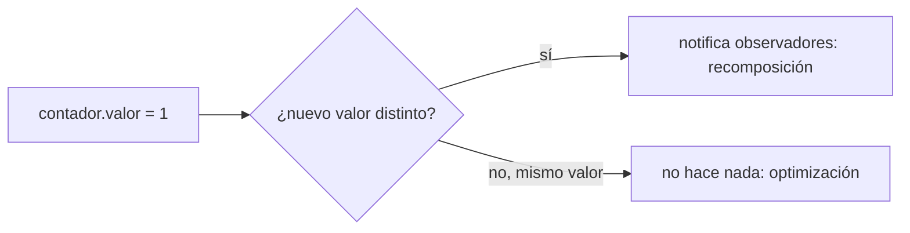
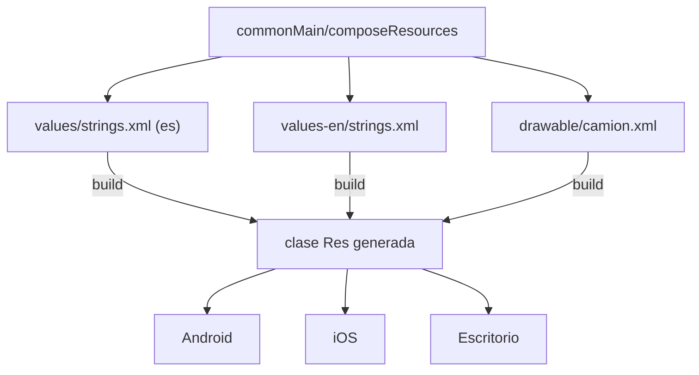
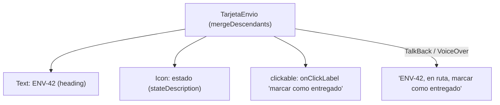
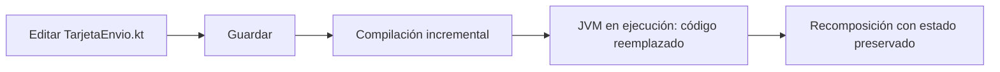
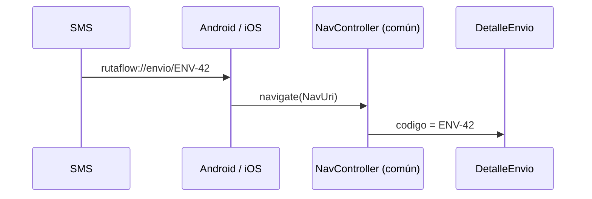

# Módulo 7: Compose Multiplatform — UI compartida

Cada tema se practica por separado con su propia repetición progresiva y su propio reto de memoria. El modelo reactivo de recomposición se verifica con `runComposeUiTest`, la API de pruebas real de Compose Multiplatform que ejecuta composición y recomposición de verdad sobre JVM/Skiko sin necesitar un emulador, para que la afirmación "solo el estado observable dispara recomposición" sea comprobable, no solo descrita.


## Aprende construyendo


### Tema 1: Compose Multiplatform vs Jetpack Compose · Avanzado · 20 min

<details open>
<summary><strong>Capa 1 — Lectura</strong></summary>

#### ► DE QUÉ TRATA
Al finalizar podrás explicar qué significa @Composable en código compartido, qué motor gráfico usa cada plataforma, y por qué una dependencia exclusiva de Android dentro de una función compartida rompe la compilación de iOS.

#### ► REGLA PRÁCTICA
Compose Multiplatform es Jetpack Compose extendido: la misma anotación `@Composable` y la misma API declarativa funcionan en `commonMain`, pero el motor de renderizado que dibuja esa UI cambia según la plataforma (nativo en Android, Skia embebido en iOS/desktop). Por eso una dependencia exclusiva de Android dentro de una función compartida no es un error de Compose: es una dependencia de plataforma colada en código que debería compilar para todas.

</details>

<details>
<summary><strong>Capa 2 — Construcción</strong></summary>

#### Código y verificación
```
┌── commonMain: @Composable fun PantallaTareas(...) ──┐
│  MISMA función, MISMA estructura declarativa          │
└──────────────┬─────────────────────────────┘
               ├── Android: motor nativo de Compose
               └── iOS: Skia embebido
```

```bash
mkdir -p academia-kmp/shared/src/commonMain/kotlin/com/academia/kmp
cd academia-kmp
```

```kotlin
// shared/src/commonMain/kotlin/com/academia/kmp/PantallaTareas.kt
package com.academia.kmp

import androidx.compose.foundation.lazy.LazyColumn
import androidx.compose.foundation.lazy.items
import androidx.compose.material3.Text
import androidx.compose.runtime.Composable

@Composable
fun PantallaTareas(tareas: List<Tarea>) {
    LazyColumn {
        items(tareas) { tarea -> Text(tarea.titulo) }
    }
}
```

```kotlin
// shared/src/commonTest/kotlin/com/academia/kmp/PantallaTareasTest.kt
package com.academia.kmp

import androidx.compose.ui.test.ExperimentalTestApi
import androidx.compose.ui.test.onNodeWithText
import androidx.compose.ui.test.runComposeUiTest
import kotlin.test.Test

class PantallaTareasTest {

    @OptIn(ExperimentalTestApi::class)
    @Test
    fun `PantallaTareas renderiza un Text por cada tarea de la lista`() = runComposeUiTest {
        setContent {
            PantallaTareas(
                listOf(
                    Tarea(id = "1", titulo = "Comprar leche", completada = false),
                    Tarea(id = "2", titulo = "Pagar factura", completada = false),
                ),
            )
        }

        onNodeWithText("Comprar leche").assertExists()
        onNodeWithText("Pagar factura").assertExists()
    }
}
```

```bash
# Gradle ejecuta la composición real (misma función compartida) sobre Skiko en JVM
./gradlew :shared:jvmTest --tests "com.academia.kmp.PantallaTareasTest"
```

```kotlin
____
fun PantallaTareas(tareas: List<Tarea>) {
    LazyColumn { items(tareas) { tarea -> Text(tarea.titulo) } }
}
```

</details>

### Tema 2: Estado y recomposición — mutableStateOf y por qué la UI se redibuja · Avanzado · 20 min

<details open>
<summary><strong>Capa 1 — Lectura</strong></summary>

#### ► DE QUÉ TRATA
Al finalizar podrás explicar por qué mutableStateOf dispara recomposición y una variable plana no, y confirmar con un modelo real que Compose evita recomponer cuando el nuevo valor es idéntico al anterior.

#### ► CÓMO FUNCIONA


</details>

<details>
<summary><strong>Capa 2 — Construcción</strong></summary>

#### Código y verificación


```bash
mkdir -p academia-kmp/shared/src/commonMain/kotlin/com/academia/kmp
cd academia-kmp
```

```kotlin
// shared/src/commonMain/kotlin/com/academia/kmp/PantallaContador.kt
package com.academia.kmp

import androidx.compose.foundation.layout.Column
import androidx.compose.material3.Button
import androidx.compose.material3.Text
import androidx.compose.runtime.Composable
import androidx.compose.runtime.getValue
import androidx.compose.runtime.mutableStateOf
import androidx.compose.runtime.remember
import androidx.compose.runtime.setValue

@Composable
fun PantallaContador() {
    var contador by remember { mutableStateOf(0) }
    Column {
        Text("Tareas completadas: $contador")
        Button(onClick = { contador++ }) { Text("Completar tarea") }
    }
}
```

```kotlin
// shared/src/commonTest/kotlin/com/academia/kmp/PantallaContadorTest.kt
package com.academia.kmp

import androidx.compose.ui.test.ExperimentalTestApi
import androidx.compose.ui.test.assertTextEquals
import androidx.compose.ui.test.onNodeWithText
import androidx.compose.ui.test.performClick
import androidx.compose.ui.test.runComposeUiTest
import kotlin.test.Test

class PantallaContadorTest {

    @OptIn(ExperimentalTestApi::class)
    @Test
    fun `cada click actualiza el texto en pantalla`() = runComposeUiTest {
        setContent { PantallaContador() }

        onNodeWithText("Tareas completadas: 0").assertExists()
        onNodeWithText("Completar tarea").performClick()
        onNodeWithText("Tareas completadas: 1").assertExists()
        onNodeWithText("Completar tarea").performClick()
        onNodeWithText("Tareas completadas: 2").assertExists()
    }
}
```

```bash
# Gradle ejecuta clicks reales y verifica recomposición sobre Skiko en JVM
./gradlew :shared:jvmTest --tests "com.academia.kmp.PantallaContadorTest"
```

```kotlin
// shared/src/commonTest/kotlin/com/academia/kmp/OptimizacionIgualdadTest.kt
package com.academia.kmp

import androidx.compose.material3.Text
import androidx.compose.runtime.Composable
import androidx.compose.runtime.getValue
import androidx.compose.runtime.mutableIntStateOf
import androidx.compose.runtime.mutableStateOf
import androidx.compose.runtime.remember
import androidx.compose.runtime.setValue
import androidx.compose.ui.test.ExperimentalTestApi
import androidx.compose.ui.test.onNodeWithText
import androidx.compose.ui.test.runComposeUiTest
import kotlin.test.Test

class OptimizacionIgualdadTest {

    @OptIn(ExperimentalTestApi::class)
    @Test
    fun `asignar el mismo valor no dispara una recomposicion adicional`() = runComposeUiTest {
        var recomposiciones = 0
        val contador = mutableStateOf(0)

        setContent {
            recomposiciones++
            Text("valor: ${contador.value}")
        }

        val recomposicionesIniciales = recomposiciones
        contador.value = 1
        waitForIdle()
        contador.value = 1 // mismo valor: NO debería disparar otra recomposición
        waitForIdle()

        onNodeWithText("valor: 1").assertExists()
        // solo UNA recomposición adicional pese a DOS asignaciones (una repetida)
        check(recomposiciones == recomposicionesIniciales + 1) {
            "se esperaba 1 recomposición adicional, ocurrieron ${recomposiciones - recomposicionesIniciales}"
        }
    }
}
```

</details>

### Tema 3: Theming y navegación compartidos · Avanzado · 20 min

<details open>
<summary><strong>Capa 1 — Lectura</strong></summary>

#### ► DE QUÉ TRATA
Al finalizar podrás definir un theme compartido y explicar por qué un grafo de navegación declarado una vez en código común evita mantener dos implementaciones de navegación divergentes.

#### ► LA ANALOGÍA
**Conceptos clave:** un único esquema de diseño, grafo de navegación declarado una vez.

`@Composable fun AppTheme(content: @Composable () -> Unit) { MaterialTheme(colorScheme = esquemaColoresCompartido, content = content) }` define un theme (colores, tipografía, formas) una única vez en código compartido, aplicado consistentemente sin importar en qué plataforma se renderice. Librerías de navegación compatibles con KMP (como Voyager) permiten definir el grafo completo de navegación (qué pantallas existen, cómo se conectan, qué parámetros se pasan) una única vez en código compartido, en vez de mantener dos implementaciones de navegación separadas y potencialmente divergentes.

**Analogía:** un theme compartido es un manual de identidad visual corporativa aplicado consistentemente en todas las sucursales de una empresa; un grafo de navegación compartido es un mapa único del recorrido completo de un edificio, válido para cualquier visitante sin importar por cuál entrada haya ingresado.

**Diagrama:**

```
┌── AppTheme (commonMain): un único esquema de colores ──┐
│  Android: se renderiza con el motor nativo               │
│  iOS: se renderiza con Skia                              │
│  MISMO resultado visual en ambos                          │
└─────────────────────────────────────────────────┘
```

</details>

<details>
<summary><strong>Capa 2 — Construcción</strong></summary>

#### Código y verificación
```
┌── AppTheme (commonMain): un único esquema de colores ──┐
│  Android: se renderiza con el motor nativo               │
│  iOS: se renderiza con Skia                              │
│  MISMO resultado visual en ambos                          │
└─────────────────────────────────────────────────┘
```

```bash
mkdir -p academia-kmp/shared/src/commonMain/kotlin/com/academia/kmp
cd academia-kmp
```

```kotlin
// shared/src/commonMain/kotlin/com/academia/kmp/AppTheme.kt
package com.academia.kmp

import androidx.compose.material3.MaterialTheme
import androidx.compose.material3.lightColorScheme
import androidx.compose.runtime.Composable
import androidx.compose.ui.graphics.Color

val esquemaColoresCompartido = lightColorScheme(
    primary = Color(0xFF7F52FF),
    background = Color(0xFF1A1A2E),
    onBackground = Color(0xFFFFFFFF),
)

@Composable
fun AppTheme(content: @Composable () -> Unit) {
    MaterialTheme(colorScheme = esquemaColoresCompartido, content = content)
}
```

```kotlin
// shared/src/commonTest/kotlin/com/academia/kmp/AppThemeTest.kt
package com.academia.kmp

import androidx.compose.material3.MaterialTheme
import androidx.compose.material3.Text
import androidx.compose.runtime.Composable
import androidx.compose.ui.test.ExperimentalTestApi
import androidx.compose.ui.test.onNodeWithTag
import androidx.compose.ui.test.runComposeUiTest
import kotlin.test.Test
import kotlin.test.assertEquals

@Composable
private fun MuestraColorPrimario() {
    val color = MaterialTheme.colorScheme.primary
    Text("color:${color.value}")
}

class AppThemeTest {

    @OptIn(ExperimentalTestApi::class)
    @Test
    fun `dos composiciones distintas leen el mismo color primario compartido`() = runComposeUiTest {
        var colorLeidoUno: ULong? = null
        var colorLeidoDos: ULong? = null

        setContent {
            AppTheme { colorLeidoUno = MaterialTheme.colorScheme.primary.value }
        }
        val primeraLectura = colorLeidoUno

        setContent {
            AppTheme { colorLeidoDos = MaterialTheme.colorScheme.primary.value }
        }

        assertEquals(primeraLectura, colorLeidoDos)
    }
}
```

```bash
# Gradle compone dos árboles independientes y confirma que ambos leen el mismo color
./gradlew :shared:jvmTest --tests "com.academia.kmp.AppThemeTest"
```

```kotlin
@Composable
fun AppTheme(content: @Composable () -> Unit) {
    MaterialTheme(colorScheme = ____, content = content)
}
```

</details>

### Tema 4: Limitaciones en iOS y otros targets · Avanzado · 20 min

<details open>
<summary><strong>Capa 1 — Lectura</strong></summary>

#### ► DE QUÉ TRATA
Al finalizar podrás identificar qué tipo de integraciones nativas todavía requieren puentes específicos de plataforma en Compose Multiplatform para iOS, y decidir cuándo usar SwiftUI nativo en vez de UI compartida.

</details>

<details>
<summary><strong>Capa 2 — Construcción</strong></summary>

#### Código y verificación
```
┌── Android: Compose Multiplatform sobre el motor nativo, estable ────────┐
├── iOS: Compose Multiplatform sobre Skia embebido, estable desde 1.8.0 ──┤
│      └─ ciertos casos (push nativo, Apple Pay) requieren SwiftUI ────┘  │
└── Desktop / Web: targets adicionales con madurez relativa a evaluar ────┘
```

```bash
mkdir -p academia-kmp/shared/src/commonMain/kotlin/com/academia/kmp
cd academia-kmp
```

```kotlin
// shared/src/commonMain/kotlin/com/academia/kmp/MapaDecisionUI.kt
package com.academia.kmp

// documenta el criterio: capacidad exclusiva del sistema -> SwiftUI nativo o expect/actual
// UI declarativa estándar (listas, texto, botones, formularios) -> Compose Multiplatform compartido
enum class TipoIntegracion { UI_ESTANDAR, CAPACIDAD_EXCLUSIVA_SISTEMA }

val casosClasificados: Map<String, TipoIntegracion> = mapOf(
    "Lista de tareas con texto y checkboxes" to TipoIntegracion.UI_ESTANDAR,
    "Widget de pantalla de inicio en iOS" to TipoIntegracion.CAPACIDAD_EXCLUSIVA_SISTEMA,
    "Formulario de login con validación" to TipoIntegracion.UI_ESTANDAR,
    "Integración con Apple Pay" to TipoIntegracion.CAPACIDAD_EXCLUSIVA_SISTEMA,
    "Pantalla de detalle con theme compartido" to TipoIntegracion.UI_ESTANDAR,
    "Notificación push nativa personalizada" to TipoIntegracion.CAPACIDAD_EXCLUSIVA_SISTEMA,
)
```

```bash
# Gradle compila el mapa de clasificación en commonMain
./gradlew :shared:compileKotlinMetadata
```

```kotlin
// shared/src/commonTest/kotlin/com/academia/kmp/MapaDecisionUITest.kt
package com.academia.kmp

import kotlin.test.Test
import kotlin.test.assertEquals

class MapaDecisionUITest {

    @Test
    fun `exactamente 3 de 6 casos requieren integracion nativa puntual`() {
        val necesitanPuente = casosClasificados.values.count { it == TipoIntegracion.CAPACIDAD_EXCLUSIVA_SISTEMA }

        assertEquals(6, casosClasificados.size)
        assertEquals(3, necesitanPuente)
    }
}
```

```bash
./gradlew :shared:jvmTest --tests "com.academia.kmp.MapaDecisionUITest"
```

</details>

### Tema 5: Recursos y localización en Compose Multiplatform: textos, imágenes y plurales comunes · Avanzado · 40 min

<details open>
<summary><strong>Capa 1 — Lectura</strong></summary>

#### ► DE QUÉ TRATA
Usa Compose Multiplatform 1.6 o superior con la dependencia compose.components.resources en commonMain. Crea composeApp/src/commonMain/composeResources/.

#### ► LA ANALOGÍA
**Conceptos clave:** `composeResources`, `values/strings.xml`, calificador de idioma (`values-en`), `Res.string`, `stringResource`, `pluralStringResource`, `painterResource`.

Los recursos comunes viven en `commonMain/composeResources/`:

- `values/strings.xml` con los textos por defecto y `values-en/strings.xml` con los de inglés (el **calificador** del nombre de la carpeta elige el idioma).
- `<plurals>` para textos que cambian con la cantidad.
- `drawable/` para imágenes (PNG, JPG, XML vectorial, SVG).

Al compilar, Gradle genera la clase **`Res`** con accesos con tipos: `Res.string.entregar`, `Res.drawable.camion`. En los composables se leen con `stringResource(...)`, `pluralStringResource(...)` y `painterResource(...)`. El idioma se toma del sistema en cada plataforma.

**Analogía:** `composeResources` es la bodega central de etiquetas: cada tienda (plataforma) toma de ahí la etiqueta del idioma de su cliente. La analogía falla en que la bodega se arma al compilar: un recurso nuevo no aparece en `Res` hasta el siguiente build.

**Límite de uso:** no pongas en recursos textos que vienen del servidor. Los nombres de recursos deben ser identificadores válidos de Kotlin (sin guiones).



#### ► CÓMO FUNCIONA


</details>

<details>
<summary><strong>Capa 2 — Construcción</strong></summary>

#### Código y verificación


```xml
<resources>
    <string name="entregar">Entregar</string>
    <string name="saludo">Hola, %1$s</string>
    <plurals name="pendientes">
        <item quantity="one">%1$d entrega pendiente</item>
        <item quantity="other">%1$d entregas pendientes</item>
    </plurals>
</resources>
```

```xml
<resources>
    <string name="entregar">Deliver</string>
    <string name="saludo">Hi, %1$s</string>
    <plurals name="pendientes">
        <item quantity="one">%1$d pending delivery</item>
        <item quantity="other">%1$d pending deliveries</item>
    </plurals>
</resources>
```

```kotlin
package co.rutaflow.ui

import androidx.compose.foundation.Image
import androidx.compose.foundation.layout.Column
import androidx.compose.material3.Button
import androidx.compose.material3.Text
import androidx.compose.runtime.Composable
import org.jetbrains.compose.resources.painterResource
import org.jetbrains.compose.resources.pluralStringResource
import org.jetbrains.compose.resources.stringResource
import rutaflow.composeapp.generated.resources.*

@Composable
fun Encabezado(conductor: String, pendientes: Int, alEntregar: () -> Unit) {
    Column {
        Image(painterResource(Res.drawable.camion), contentDescription = null)
        Text(stringResource(Res.string.saludo, conductor))
        Text(pluralStringResource(Res.plurals.pendientes, pendientes, pendientes))
        Button(onClick = alEntregar) { Text(stringResource(Res.string.entregar)) }
    }
}
```

```bash
./gradlew :composeApp:generateComposeResClass
./gradlew :composeApp:run              # escritorio
./gradlew :composeApp:installDebug     # Android
```

```text
Con el sistema en español y 1 pendiente: «Hola, Ana», «1 entrega pendiente», botón «Entregar».
Con el sistema en inglés y 3 pendientes: «Hi, Ana», «3 pending deliveries», botón «Deliver».
El mismo resultado en Android, iOS y escritorio.
```

</details>

### Tema 6: Accesibilidad en Compose Multiplatform: semántica que funciona con TalkBack y VoiceOver · Avanzado · 40 min

<details open>
<summary><strong>Capa 1 — Lectura</strong></summary>

#### ► DE QUÉ TRATA
Usa Compose Multiplatform 1.7 o superior (accesibilidad en iOS estable). Activa TalkBack en el emulador de Android y VoiceOver en el simulador de iOS (Accessibility Inspector en Xcode).

#### ► CÓMO FUNCIONA


</details>

<details>
<summary><strong>Capa 2 — Construcción</strong></summary>

#### Código y verificación


```kotlin
package co.rutaflow.ui

import androidx.compose.foundation.clickable
import androidx.compose.foundation.layout.Row
import androidx.compose.foundation.layout.padding
import androidx.compose.material.icons.Icons
import androidx.compose.material.icons.filled.CheckCircle
import androidx.compose.material.icons.filled.LocalShipping
import androidx.compose.material3.Icon
import androidx.compose.material3.Text
import androidx.compose.runtime.Composable
import androidx.compose.ui.Modifier
import androidx.compose.ui.semantics.Role
import androidx.compose.ui.semantics.heading
import androidx.compose.ui.semantics.semantics
import androidx.compose.ui.semantics.stateDescription
import androidx.compose.ui.unit.dp

@Composable
fun TarjetaEnvio(codigo: String, entregado: Boolean, alMarcar: () -> Unit) {
    val estado = if (entregado) "entregado" else "en ruta"
    Row(
        Modifier
            .clickable(onClickLabel = "marcar como entregado", role = Role.Button, onClick = alMarcar)
            .semantics(mergeDescendants = true) { stateDescription = estado } // una sola lectura
            .padding(16.dp),
    ) {
        Icon(if (entregado) Icons.Default.CheckCircle else Icons.Default.LocalShipping, contentDescription = null) // el estado ya se dice
        Text(codigo, Modifier.semantics { heading() })
    }
}
```

```kotlin
package co.rutaflow.ui

import androidx.compose.ui.semantics.SemanticsProperties
import androidx.compose.ui.test.*
import kotlin.test.Test

class TarjetaEnvioTest {
    @OptIn(ExperimentalTestApi::class)
    @Test fun seLeeComoUnaUnidadConEstado() = runComposeUiTest {
        setContent { TarjetaEnvio("ENV-42", entregado = false) {} }
        onNode(hasStateDescription("en ruta") and hasClickAction())
            .assertTextContains("ENV-42")
            .assert(SemanticsMatcher.keyIsDefined(SemanticsProperties.Role))
    }
}
```

```bash
./gradlew :composeApp:jvmTest
./gradlew :composeApp:installDebug   # luego activa TalkBack y toca la tarjeta
```

```text
./gradlew :composeApp:jvmTest pasa la prueba seLeeComoUnaUnidadConEstado.
TalkBack lee: «ENV-42, en ruta, botón. Toca dos veces para marcar como entregado».
VoiceOver lee una frase equivalente en iOS.
```

</details>

### Tema 7: Compose Hot Reload: ver cambios de la interfaz sin reiniciar la app · Avanzado · 30 min

<details open>
<summary><strong>Capa 1 — Lectura</strong></summary>

#### ► DE QUÉ TRATA
Usa Compose Multiplatform 1.10 o superior, donde Hot Reload viene incluido en el plugin. Necesitas el target jvm() (escritorio): Hot Reload funciona sobre la JVM. Instala el plugin de Kotlin Multiplatform en IntelliJ IDEA o Android Studio.

#### ► CÓMO FUNCIONA


</details>

<details>
<summary><strong>Capa 2 — Construcción</strong></summary>

#### Código y verificación


```kotlin
plugins {
    alias(libs.plugins.kotlin.multiplatform)
    alias(libs.plugins.compose.multiplatform)
    alias(libs.plugins.compose.compiler)
    alias(libs.plugins.compose.hot.reload) // en versiones donde no viene incluido
}

kotlin {
    jvm("desktop")
    // ... targets de Android e iOS
}
```

```kotlin
package co.rutaflow.ui

import androidx.compose.foundation.layout.Column
import androidx.compose.foundation.layout.padding
import androidx.compose.material3.OutlinedTextField
import androidx.compose.material3.Text
import androidx.compose.runtime.*
import androidx.compose.ui.Modifier
import androidx.compose.ui.unit.dp

@Composable
fun FormularioNota() {
    var nota by remember { mutableStateOf("") } // este estado sobrevive a la recarga
    Column(Modifier.padding(16.dp)) {             // cambia 16 por 32 y guarda
        Text("Nota para el cliente")              // cambia el texto y guarda
        OutlinedTextField(value = nota, onValueChange = { nota = it })
    }
}
```

```bash
./gradlew :composeApp:hotRunDesktop --auto
# escribe algo en el campo, cambia el padding o el texto en el código y guarda
```

```text
La ventana de escritorio se actualiza uno o dos segundos después de guardar, sin cerrarse.
El texto escrito en el campo sigue ahí tras cambiar el padding de 16 a 32.
Al agregar una dependencia nueva en Gradle, la herramienta pide reiniciar.
```

</details>

### Tema 8: Deep links en Compose Multiplatform: abrir una pantalla desde un enlace · Avanzado · 45 min

<details open>
<summary><strong>Capa 1 — Lectura</strong></summary>

#### ► DE QUÉ TRATA
Usa Compose Multiplatform 1.8 o superior con org.jetbrains.androidx.navigation:navigation-compose en commonMain. Necesitas acceso a AndroidManifest.xml y al Info.plist de la app de iOS.

#### ► CÓMO FUNCIONA


</details>

<details>
<summary><strong>Capa 2 — Construcción</strong></summary>

#### Código y verificación


```kotlin
package co.rutaflow.navegacion

import androidx.compose.material3.Text
import androidx.compose.runtime.Composable
import androidx.navigation.NavHostController
import androidx.navigation.compose.NavHost
import androidx.navigation.compose.composable
import androidx.navigation.navDeepLink
import androidx.navigation.toRoute
import kotlinx.serialization.Serializable

@Serializable object ListaEnvios
@Serializable data class DetalleEnvio(val codigo: String)

@Composable
fun RutaFlowNav(nav: NavHostController) {
    NavHost(nav, startDestination = ListaEnvios) {
        composable<ListaEnvios> { Text("Lista de envíos") }
        composable<DetalleEnvio>(
            deepLinks = listOf(navDeepLink<DetalleEnvio>(basePath = "rutaflow://envio")),
        ) { entrada ->
            val codigo = entrada.toRoute<DetalleEnvio>().codigo
            if (Regex("ENV-\\d+").matches(codigo)) Text("Detalle de $codigo") else Text("Enlace no válido")
        }
    }
}
```

```xml
<activity android:name=".MainActivity" android:exported="true" android:launchMode="singleTask">
    <intent-filter>
        <action android:name="android.intent.action.VIEW" />
        <category android:name="android.intent.category.DEFAULT" />
        <category android:name="android.intent.category.BROWSABLE" />
        <data android:scheme="rutaflow" android:host="envio" />
    </intent-filter>
</activity>
```

```xml
<key>CFBundleURLTypes</key>
<array>
    <dict>
        <key>CFBundleURLSchemes</key>
        <array><string>rutaflow</string></array>
    </dict>
</array>
```

```bash
./gradlew :composeApp:installDebug
adb shell am start -W -a android.intent.action.VIEW -d "rutaflow://envio/ENV-42"
xcrun simctl openurl booted "rutaflow://envio/ENV-42"
```

```text
`adb shell am start ... rutaflow://envio/ENV-42` abre la app directamente en «Detalle de ENV-42».
`xcrun simctl openurl booted ...` hace lo mismo en el simulador de iOS.
`rutaflow://envio/abc` muestra «Enlace no válido».
```

</details>
