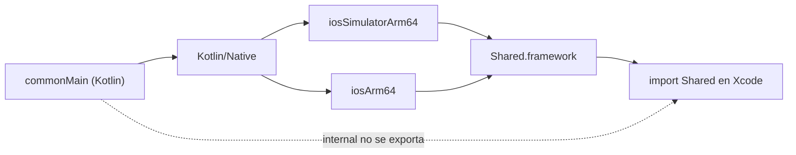

# Módulo 8: Interoperabilidad con iOS


## Aprende construyendo

### Tema 1: El framework generado para iOS

#### Paso 1 · Objetivo y preparación
Al finalizar vas a identificar la estructura que debe tener el framework `Shared` para que Swift lo importe sin puentes manuales, y a verificarla con un script antes de abrir Xcode. Prerrequisitos: Tema 0 del track y, para generar el binario real, JDK 17+, Gradle y macOS con Xcode.

#### Paso 2 · Contexto y caso real
El equipo iOS de RutaFlow necesita consumir la lógica de dominio compartida (`Tarea`, casos de uso) desde SwiftUI. No quiere un puente entre procesos ni una capa de interpretación: quiere un framework nativo que se importe con `import Shared`. El problema aparece cuando una clase que el equipo Kotlin cree pública no está en la cabecera generada y Swift simplemente no la ve, sin un error de compilación que explique por qué.

#### Paso 3 · Teoría, modelo mental y analogía
Kotlin/Native compila el módulo compartido a un binario nativo para cada target de iOS: simulador Intel (`iosX64`), simulador Apple Silicon (`iosSimulatorArm64`) y dispositivo (`iosArm64`). El bloque `binaries.framework { baseName = "Shared" }` produce `Shared.framework`, con una cabecera umbrella, un modulemap y metadatos en `Info.plist`. Swift lo importa como cualquier framework de terceros.

Solo los símbolos públicos cruzan la frontera. Una clase `internal` compila sin error, pero no se exporta a la cabecera; para Swift no existe. El modulemap declara qué cabeceras forman el módulo y la umbrella header agrupa los símbolos públicos. Si una cabecera queda fuera del modulemap, el código puede compilar en Kotlin y aun así ser invisible en Xcode.

Generar un framework por target tiene sentido cuando hay una app iOS que lo consume. Si el proyecto es solo Android, agregar targets iOS aumenta el tiempo de build sin un consumidor real. La distribución posterior se resuelve con Swift Package Manager o un XCFramework que agrupe los targets.

**Conceptos clave:** Kotlin/Native, target, framework, `baseName`, cabecera umbrella, modulemap, símbolo público, `internal` y XCFramework.



**Analogía:** el framework es un componente terminado y empaquetado según el estándar local; si una pieza no se incluye en la caja, el instalador no puede verla aunque exista en la fábrica.

**¿Por qué es importante?** Porque la diferencia entre “compila en Kotlin” y “Swift puede usarlo” depende de la exportación de símbolos y de la estructura del framework, no solo de que el build termine sin errores.

**Límite de uso:** este tema no enseña a firmar ni a publicar el framework; se limita a su estructura y a la visibilidad de símbolos.

#### Paso 4 · Demostración guiada desde cero
**Ejemplo independiente (desde cero):** crea un directorio de trabajo nuevo con la estructura mínima de un framework y un verificador. Los archivos representan lo que el build debe producir; no reemplazan la compilación real.

```bash
mkdir ejemplo && cd ejemplo
mkdir -p Shared.framework/Headers Shared.framework/Modules
```

Crea `Shared.framework/Info.plist` con el tipo de paquete y el identificador:

```xml
<?xml version="1.0" encoding="UTF-8"?>
<!DOCTYPE plist PUBLIC "-//Apple//DTD PLIST 1.0//EN" "http://www.apple.com/DTDs/PropertyList-1.0.dtd">
<plist version="1.0">
<dict>
  <key>CFBundleIdentifier</key><string>co.rutaflow.shared</string>
  <key>CFBundlePackageType</key><string>FMWK</string>
  <key>CFBundleName</key><string>Shared</string>
</dict>
</plist>
```

Crea `Shared.framework/Modules/module.modulemap` con la cabecera umbrella:

```text
framework module Shared {
  umbrella header "Shared.h"
  export *
}
```

Crea `Shared.framework/Headers/Shared.h` con una clase pública:

```objc
#import <Foundation/Foundation.h>

@interface SharedTarea : NSObject
@property (nonatomic, copy) NSString *titulo;
@end
```

Crea `verificar_framework.py` para comprobar el paquete, el modulemap, las cabeceras exportadas y la clase pública:

```python
import plistlib
from pathlib import Path

framework = Path("Shared.framework")
plist = plistlib.loads((framework / "Info.plist").read_bytes())
if plist.get("CFBundlePackageType") != "FMWK":
    raise SystemExit("fallo: Info.plist no declara un framework (FMWK)")

modulemap = (framework / "Modules/module.modulemap").read_text(encoding="utf-8")
if 'umbrella header "Shared.h"' not in modulemap:
    raise SystemExit("fallo: module.modulemap sin umbrella header")

cabeceras = sorted((framework / "Headers").glob("*.h"))
exportadas = {ruta.name for ruta in cabeceras if ruta.name in modulemap}
no_exportadas = [ruta.name for ruta in cabeceras if ruta.name not in exportadas]
if no_exportadas:
    raise SystemExit(f"fallo: cabeceras no exportadas: {', '.join(no_exportadas)}")

header = (framework / "Headers/Shared.h").read_text(encoding="utf-8")
if "@interface SharedTarea" not in header:
    raise SystemExit("fallo: falta la clase pública SharedTarea")

print(f"framework: {framework.name}")
print(f"paquete: {plist['CFBundlePackageType']}")
print('modulemap: umbrella header "Shared.h"')
print("clase pública: SharedTarea")
print(f"cabeceras exportadas: {len(exportadas)}")
```

**Ejecuta el ejemplo:**

```bash
cd ejemplo
python3 verificar_framework.py
```

Resultado esperado:

```text
framework: Shared.framework
paquete: FMWK
modulemap: umbrella header "Shared.h"
clase pública: SharedTarea
cabeceras exportadas: 1
```

El script explica cada requisito: tipo de paquete, umbrella header, cabeceras incluidas en el modulemap y símbolo público esperado.

#### Paso 5 · Práctica guiada
Pista: agregá `Shared.framework/Headers/Interna.h` con `@interface SharedTareaInterna` y no la incluyas en el modulemap; ese es el fallo deliberado: el verificador termina con `fallo: cabeceras no exportadas: Interna.h`, porque una cabecera fuera del modulemap no forma parte del módulo que Swift importa.

#### Paso 6 · Práctica independiente
Eliminá `Interna.h` y, si tenés Gradle y Xcode disponibles, generá el framework real con `./gradlew linkDebugFrameworkIosSimulatorArm64` y apuntá el verificador a `shared/build/bin/iosSimulatorArm64/debugFramework/Shared.framework`. Si no tenés el toolchain, documentá esa limitación y compará la estructura generada con la del ejercicio. Luego agregá `iosArm64` y explicá por qué produce un binario separado para dispositivo. Conectá el resultado con el proyecto integrador: la app iOS consume `Shared.framework` sin saber que se originó en Kotlin.

#### Paso 7 · Cierre
Entregá la salida del Paso 4, el fallo de exportación del Paso 5 y la configuración de targets del Paso 6; explicá por qué una clase `internal` compila pero no existe para Swift. Siguiente paso: mapear los tipos Kotlin hacia Swift en el Tema 2. Errores comunes: declarar `internal` una clase que Swift necesita, olvidar el target de dispositivo y asumir que un build exitoso implica que todos los símbolos se exportaron. **Fuentes oficiales:** https://www.jetbrains.com/help/kotlin-multiplatform-dev/multiplatform-ios-framework.html y https://kotlinlang.org/docs/native-objc-interop.html.

### Tema 2: Mapeo de tipos Kotlin ↔ Swift

#### Paso 1 · Objetivo y preparación
Al finalizar vas a exponer una `sealed class` de Kotlin hacia Swift y vas a confirmar que Swift NO verifica automáticamente la exhaustividad de un `switch` sobre ella, a diferencia de un `when` en Kotlin. Prerrequisitos: Tema 1 de este módulo.

#### Paso 2 · Contexto y caso real
Un desarrollador Swift maneja `Resultado<Tarea>` con un `switch` que cubre `Exito` y `Error`; meses después, el equipo Kotlin agrega un tercer caso `Cargando` a la sealed class compartida, y nadie en el equipo Swift se entera hasta que un usuario reporta que la app no muestra nada en ese estado.

#### Paso 3 · Teoría, modelo mental y analogía
Los tipos básicos de Kotlin se mapean directamente a sus equivalentes en Swift (`String`→`String`, `Int`→`Int32`); una `sealed class` se expone hacia Swift como una jerarquía de clases regular, manejable con `switch`, pero Swift no tiene el conocimiento especial de que proviene de un conjunto cerrado garantizado — no avisa si falta una rama. La analogía: una traducción directa para conceptos simples, pero una adaptación estructural que pierde una garantía del idioma de origen para conceptos más elaborados.

**Conceptos clave:** correspondencia directa de tipos básicos, sealed class como jerarquía manejable con switch.

Documentar este mapeo de tipos es indispensable para el proyecto integrador (app KMP completa, Módulo 11): cada `data class` y `sealed class` del dominio compartido (`Tarea`, `Resultado<T>`) cruzará esta misma frontera hacia las vistas SwiftUI de la app iOS.

**Cuándo no usarlo:** documentar manualmente cada mapeo de tipos como aquí es razonable para un dominio compartido pequeño; con muchas sealed classes, confiar solo en la disciplina del equipo para no olvidar una rama del `switch` en Swift no escala — en ese caso conviene una prueba que falle explícitamente si Kotlin agrega una variante nueva sin que Swift la maneje.

Los tipos básicos de Kotlin se mapean directamente a sus equivalentes naturales en Swift (`String` a `String`, `Int`/`Long` a `Int32`/`Int64`), y una `data class` de Kotlin se expone hacia Swift como una clase con propiedades equivalentes accesibles de forma natural (`import Shared; let usuario = SharedUsuario(nombre: "Ana", edad: 28)`, con el prefijo `Shared` en el nombre reflejando el `baseName` configurado en el framework, Tema 1). Una `sealed class` de Kotlin (Módulo 1) se expone hacia Swift como una jerarquía de clases regular, manejable con un `switch` de Swift de forma conceptualmente análoga al `when` exhaustivo de Kotlin, aunque Swift no verifica automáticamente la exhaustividad completa contra el conjunto cerrado original de Kotlin de la misma forma estricta en que Kotlin sí la verifica, dado que desde la perspectiva de Swift esa jerarquía es simplemente una jerarquía de clases regular sin el conocimiento especial de que proviene de una sealed class con un conjunto cerrado garantizado.

**Analogía:** el mapeo de tipos es como una traducción directa palabra por palabra para conceptos simples (números, texto), pero que requiere una adaptación estructural más cuidadosa para conceptos más elaborados (una sealed class), donde el idioma de destino (Swift) representa la misma idea con una estructura gramatical distinta que se comporta de forma similar pero no idéntica en cuanto a garantías del compilador.

**¿Por qué es importante?** Los tipos básicos se mapean directamente entre Kotlin y Swift; las sealed classes se exponen como jerarquías de clases regulares manejables con switch, aunque sin la misma garantía estricta de exhaustividad verificada que Kotlin ofrece nativamente.

**Casos de uso reales:**
- Consumir `Tarea` (Módulo 4) directamente desde una vista SwiftUI (Módulo 1 del track iOS) como si fuera un struct nativo de Swift.
- Manejar `Resultado<T>` (Módulo 5) con un `switch` en Swift, replicando el mismo manejo exhaustivo que `when` hace en Kotlin.
- Documentar explícitamente en el equipo qué sealed classes existen, ya que Swift no avisará si falta una rama en el `switch`.

**Diagrama:**

| Kotlin | Swift |
|---|---|
| `String` | `String` |
| `Int`, `Long` | `Int32`, `Int64` |
| `data class` | `class` con propiedades equivalentes |
| `sealed class` | jerarquía de clases, manejable con `switch` |

```swift
import Shared
let usuario = SharedUsuario(nombre: "Ana", edad: 28)
```

#### Paso 4 · Demostración guiada desde cero

En el proyecto iOS conectado a `Shared`, guarda el consumidor en `iosApp/iosApp/ResultadoViewModel.swift`. Inserta el `switch` dentro del método que recibe `resultado`; `mostrar` y `mostrarError` son las funciones de presentación de tu aplicación. Compila y ejecuta el target iOS desde Xcode, probando una instancia de cada subtipo exportado.

```swift
import Shared
switch resultado {
case is ResultadoExito: mostrar(resultado)
case is ResultadoError: mostrarError(resultado)
default: break
}
```

**Ejecuta el ejemplo** (en un proyecto KMP con Gradle, corre las pruebas del módulo común):

```bash
./gradlew commonTest
```
Para compilar todos los targets: `./gradlew build`.

Resultado esperado: el `switch` compila y maneja ambos casos conocidos (`Exito`, `Error`) correctamente, con un `default` necesario porque Swift trata esto como una jerarquía de clases abierta, no como un conjunto cerrado verificado.

#### Paso 5 · Práctica guiada
Pista: agregá un tercer caso `Cargando` a la `sealed class Resultado` en Kotlin (`commonMain`), recompilá el framework, pero NO toques el `switch` de Swift del Paso 4. Ese es el fallo deliberado: el proyecto Swift compila exitosamente sin ningún error ni advertencia, y en tiempo de ejecución el caso `Cargando` cae silenciosamente en la rama `default: break`, sin ningún indicio de que un estado completo quedó sin manejar.

#### Paso 6 · Práctica independiente
Corregí el Paso 5 documentando explícitamente (en un comentario o test) la lista completa de casos de `Resultado` que el equipo Swift debe revisar manualmente cada vez que el framework se actualiza, y agregá el manejo real de `Cargando` al `switch`.

#### Paso 7 · Cierre
Entregá el `switch` funcionando del Paso 4, el caso silenciosamente no manejado del Paso 5, y la documentación/corrección del Paso 6; explicá por qué la exhaustividad verificada de Kotlin no cruza la frontera hacia Swift automáticamente. Siguiente paso: exponé funciones suspend hacia Swift y elegí cómo distribuir el framework. Errores comunes: asumir que Swift avisará si falta un caso nuevo de una sealed class actualizada; usar un `default` que oculta silenciosamente casos nuevos en vez de uno que, como mínimo, registre un error visible. Fuentes oficiales: https://kotlinlang.org/docs/native-objc-interop.html y https://developer.apple.com/documentation/swift/switch.
**¿Por qué es importante?** Porque la exhaustividad verificada de una `sealed class` en Kotlin no cruza automáticamente hacia Swift; un caso nuevo puede caer silenciosamente en un `default` sin que nadie se entere hasta producción.

### Tema 3: Coroutines desde Swift, y distribución del framework

#### Paso 1 · Objetivo y preparación
Al finalizar vas a invocar una función `suspend` de Kotlin desde Swift mediante el callback que Kotlin/Native genera automáticamente, y vas a decidir entre CocoaPods y Swift Package Manager para distribuir el framework. Prerrequisitos: Tema 2 de este módulo.

#### Paso 2 · Contexto y caso real
Una función `suspend obtenerTareas()` de Kotlin no tiene un equivalente sintáctico directo en todas las versiones de Swift — el equipo iOS necesita saber exactamente cómo invocarla sin asumir que `await` funciona igual de ambos lados de la frontera.

#### Paso 3 · Teoría, modelo mental y analogía
Kotlin/Native exporta funciones suspend mediante completion handlers; desde Swift 5.5 también pueden importarse como funciones async. Para recibir errores de negocio en Swift, la función Kotlin debe declarar las excepciones con `@Throws`. La analogía: traducir "esperá aquí hasta que el resultado esté listo" hacia "cuando el resultado esté listo, ejecutá esta acción específica" — mismo efecto final, sintaxis distinta según las capacidades del idioma destino.

**Conceptos clave:** funciones suspend expuestas como callback, CocoaPods frente a SPM.

`sharedRepository.obtenerTareas { tareas, error in if let tareas = tareas { mostrar(tareas) } }` demuestra cómo Kotlin/Native expone una función `suspend` (Módulo 2) hacia Swift: dado que Swift, en versiones anteriores a su propio soporte nativo de `async`/`await`, no tenía un concepto directamente equivalente a las funciones suspend de Kotlin, Kotlin/Native genera automáticamente una versión con callback tradicional para cada función suspend expuesta, cambiando la forma en que se invoca (con un cierre/callback que recibe el resultado o el error) en vez de la sintaxis lineal `await` que el mismo código tendría en Kotlin; con librerías más recientes y versiones más nuevas de Swift, esta interoperabilidad puede exponerse directamente como `async`/`await` nativo de Swift, acercando considerablemente la experiencia de uso entre ambos lenguajes.

CocoaPods fue históricamente la forma estándar y más común de distribuir el framework KMP compilado hacia un proyecto Xcode consumidor, integrándose con el sistema de gestión de dependencias específico de CocoaPods; Swift Package Manager (SPM) es la alternativa moderna recomendada actualmente por Apple, con integración nativa directamente dentro de Xcode sin necesidad de herramientas externas adicionales de gestión de dependencias, siendo generalmente la opción preferida para proyectos nuevos — el soporte oficial de CocoaPods para KMP ya está deprecado, así que para un proyecto nuevo SPM no es solo la opción preferida sino la única con mantenimiento activo.

**Analogía:** exponer una función suspend como callback hacia Swift es como traducir una instrucción que originalmente decía "espera aquí hasta que el resultado esté listo" hacia una instrucción equivalente que dice "cuando el resultado esté listo, ejecuta esta acción específica", logrando el mismo efecto final pero expresado con una sintaxis distinta según las capacidades nativas del idioma de destino.

**¿Por qué es importante?** Kotlin/Native expone funciones suspend hacia Swift mediante callbacks (o `async`/`await` nativo con librerías más recientes); SPM es la alternativa moderna recomendada por Apple para distribuir el framework, con mejor integración nativa en Xcode que CocoaPods, cuyo soporte oficial para KMP ya está deprecado.

**Casos de uso reales:**
- Invocar `obtenerTareasPendientesUseCase` (Módulo 4) desde una vista SwiftUI usando `async`/`await` nativo de Swift.
- Migrar la distribución del framework compartido de CocoaPods a SPM en un proyecto iOS existente.
- Envolver el callback generado por Kotlin/Native en una función `async` propia de Swift para integrarlo naturalmente con `Task {}`.

**Código del ejemplo:**

```swift
sharedRepository.obtenerTareas { tareas, error in
    if let tareas = tareas { mostrar(tareas) }
}
```

---

**Transferencia al proyecto integrador «Núcleo móvil compartido»:** Adapta la consulta suspend para el consumidor Swift y cubre éxito, error y cancelación. Una prueba iOS debe terminar también en el camino de error, sin dejar una continuación pendiente.
Como **siguiente** paso, lleva lo aprendido al próximo tema y conéctalo con el proyecto integrador del track.

#### Paso 4 · Demostración guiada desde cero
Este ejemplo es acumulativo: usa el framework `Shared` enlazado al target iOS de los temas anteriores. Crea `shared/src/commonMain/kotlin/TareasRepository.kt`:
```kotlin
class TareasException(message: String) : Exception(message)

class TareasRepository {
    @Throws(TareasException::class)
    suspend fun obtenerTareas(simularFallo: Boolean): List<String> {
        if (simularFallo) throw TareasException("Servicio no disponible")
        return listOf("RF-4471")
    }
}
```

**Ejecuta el ejemplo** (en un proyecto KMP con Gradle, corre las pruebas del módulo común):

```bash
./gradlew commonTest
```
Para compilar todos los targets: `./gradlew build`.

La anotación forma parte del contrato exportado: las excepciones declaradas llegan como NSError; otras excepciones no controladas pueden terminar el proceso. Una función suspend sin `@Throws` solo propaga CancellationException por esta vía. No uses una excepción no declarada para simular el error.

Crea `iosApp/iosApp/TareasAdapter.swift`:
```swift
import Foundation
import Shared

enum ErrorAdaptacion: Error { case respuestaInvalida }

func cargarTareas(_ repository: TareasRepository, simularFallo: Bool) async throws -> [String] {
    try await withCheckedThrowingContinuation { continuation in
        repository.obtenerTareas(simularFallo: simularFallo) { tareas, error in
            if let error {
                continuation.resume(throwing: error)
            } else if let tareas {
                continuation.resume(returning: tareas)
            } else {
                continuation.resume(throwing: ErrorAdaptacion.respuestaInvalida)
            }
        }
    }
}
```
El resultado Kotlin es no nulo; un resultado nulo sin error se trata defensivamente como incumplimiento del contrato. Cada rama resuelve la continuation una vez. Swift 5.5+ puede importar también la función suspend como async; aquí el wrapper muestra explícitamente la adaptación del callback. La cancelación de una Task Swift no cancela por sí sola el trabajo Kotlin mediante este wrapper.

En el target de pruebas iOS crea `TareasAdapterTests.swift` (sustituye `iosApp` por el módulo real de tu target):
```swift
import Testing
import Shared
@testable import iosApp

@Test func contratoDeExitoYError() async throws {
    let repository = TareasRepository()
    let tareas = try await cargarTareas(repository, simularFallo: false)
    #expect(tareas == ["RF-4471"])
    do {
        _ = try await cargarTareas(repository, simularFallo: true)
        Issue.record("Debía lanzar el error Kotlin declarado")
    } catch {
        #expect(String(describing: error).contains("Servicio no disponible"))
    }
}
```
Reconstruye Shared y ejecuta Product → Test en Xcode. **Resultado esperado:** ambas ramas pasan, sin espera indefinida ni terminación por excepción no declarada. Fuente oficial: https://kotlinlang.org/docs/native-objc-interop.html.

#### Paso 5 · Práctica guiada
Pista: envolvé ese callback en una función `async` propia de Swift usando `withCheckedThrowingContinuation`, pero olvidá llamar a `continuation.resume(...)` en la rama donde `error` no es nulo. Ese es el fallo deliberado: si la función Kotlin original falla con un error, tu wrapper `async` de Swift queda esperando para siempre (la `Task` nunca termina), porque ninguna rama de tu callback invocó `resume` para ese caso.

#### Paso 6 · Práctica independiente
Corregí el Paso 5 agregando `continuation.resume(throwing: error)` en la rama de error, y agregá un test que fuerce explícitamente el camino de error (simulando que `obtenerTareas` falla) confirmando que tu wrapper `async` relanza la excepción en vez de colgarse indefinidamente.

#### Paso 7 · Cierre
Entregá el callback consumido del Paso 4, la `Task` colgada por falta de `resume` en la rama de error del Paso 5, y el wrapper corregido con su test del Paso 6; explicá por qué un wrapper `async` sobre un callback debe cubrir EXPLÍCITAMENTE ambas ramas (éxito y error), no solo la feliz. Con esto cerrás la interoperabilidad con iOS de este track. Errores comunes: asumir que Swift maneja las funciones suspend igual que Kotlin sin ninguna adaptación; escribir un wrapper `async`/`withCheckedThrowingContinuation` que no cubre la rama de error, dejando la `Task` colgada indefinidamente ante un fallo. Fuentes oficiales: https://kotlinlang.org/docs/native-objc-interop.html y https://developer.apple.com/documentation/swift/withcheckedthrowingcontinuation(function:_:).
**¿Por qué es importante?** Porque un wrapper `async` sobre un callback Kotlin debe resolver la continuation en AMBAS ramas (éxito y error); omitir la rama de error deja la `Task` de Swift colgada indefinidamente ante un fallo real.

## Laboratorio práctico

**Objetivo del laboratorio:** construir una app SwiftUI que consume el módulo compartido KMP a través del framework generado.

**Requisitos previos:** Módulos 0-7 completados.

| Paso | Acción | Código | Explicación |
|---|---|---|---|
| 1 | Generar el `.framework` y agregarlo a un proyecto Xcode | Ver Tema 1 | Verifica la importación |
| 2 | Llamar a una función Kotlin desde Swift | Ver Tema 2 | Verifica el tipo resultante |
| 3 | Llamar a una función suspend desde Swift | Ver Tema 3 | Con su callback/async equivalente |
| 4 | Configurar la distribución con Swift Package Manager | Ver Tema 3 | En vez de CocoaPods |

**Verificación:** el laboratorio se considera exitoso si la app SwiftUI consume correctamente los datos y la lógica del módulo compartido, incluyendo al menos una función suspend invocada correctamente desde Swift.

**Errores comunes y soluciones**

- **Asumir que Swift maneja las funciones suspend igual que Kotlin de forma nativa sin ninguna adaptación.** Verifica la forma específica (callback o async/await) según la versión de las librerías usadas.
- **Usar CocoaPods por defecto sin evaluar Swift Package Manager.** SPM es la alternativa moderna recomendada, con mejor integración nativa y mantenimiento activo.
- **Esperar verificación de exhaustividad idéntica en Swift para una sealed class de Kotlin.** Swift la trata como una jerarquía de clases regular, sin esa garantía estricta.

---
