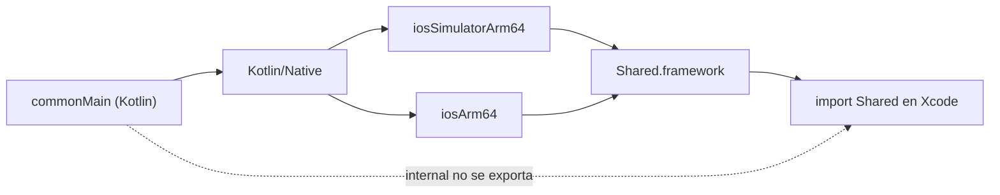
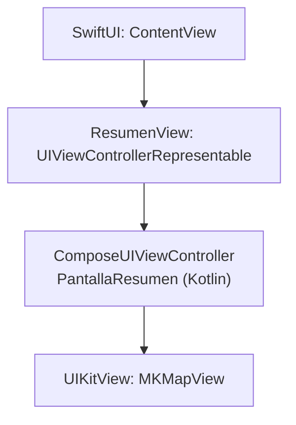

# Módulo 8: Interoperabilidad con iOS


## Aprende construyendo


### Tema 1: El framework generado para iOS · Avanzado · 40 min

<details open>
<summary><strong>Capa 1 — Lectura</strong></summary>

#### ► DE QUÉ TRATA
Al finalizar vas a identificar la estructura que debe tener el framework Shared para que Swift lo importe sin puentes manuales, y a verificarla con un script antes de abrir Xcode. Prerrequisitos: el apartado «Antes de comenzar» del módulo 0 y, para generar el binario real, JDK 25…

#### ► LA IDEA EN UNA FRASE
**Al finalizar vas a identificar la estructura que debe tener el framework Shared para que Swift lo importe sin puentes manuales, y a verificarla con un script antes de abrir Xcode.**

#### ► POR QUÉ EXISTE ESTO
Resuelve un problema real de diseño o implementación y evita decisiones a ciegas.

#### ► LA ANALOGÍA
Piensa en el framework generado para ios como una herramienta de taller: útil cuando conoces su propósito y sus límites.
**Dónde se rompe la analogía:** en software, los efectos dependen del contexto, la escala y los trade-offs.

#### ► CÓMO FUNCIONA


#### ► LO QUE PUEDE SALIR MAL
| Síntoma | Causa probable | Arreglo |
|---|---|---|
| El framework generado para iOS se aplica pero el resultado no mejora | Se usó sin medir el problema real | Mide antes y compara contra la alternativa simple |
| Aparece complejidad inesperada | Se adoptó la técnica sin comprender sus trade-offs | Vuelve a la sección de trade-offs y reduce el alcance |
| Falla en un caso límite | Se asumió un contexto que no se cumple | Prueba el caso límite y documenta cuándo NO usarlo |

#### ► TRADE-OFFS
| Opción | Cuándo usarla | Cuándo NO usarla |
|---|---|---|
| Usar El framework generado para iOS | Cuando el problema coincide con su propósito y el beneficio es observable | Cuando agrega complejidad sin resolver un problema real |
| Alternativa más simple | Cuando el contexto es pequeño, estable o fácil de razonar | Cuando ya demostró no escalar o no cumplir el requisito |
| Postergar la decisión | Cuando falta evidencia del problema | Cuando el costo de esperar es mayor que el costo de probar |

#### ► CUÁNDO NO USAR ESTO
No uses el framework generado para ios por defecto. Aplícalo cuando el problema lo justifique y puedas verificar el beneficio; si una alternativa más simple resuelve igual, prefiérela.

#### ► DE VUELTA A LA ANALOGÍA
Volviendo a la analogía: el framework generado para ios funciona como el modelo inicial, pero recuerda dónde se rompe: en producción importan la evidencia, la escala y el costo de equivocarte.

#### ► LO QUE DEBES RECORDAR
- El framework generado para iOS existe para resolver un problema específico.
- Mide antes de adoptar complejidad.
- Conoce el caso donde NO usarlo.
- Verifica con evidencia observable.

#### ► PREGUNTAS PARA PENSAR
1. ¿Qué problema concreto resuelve el framework generado para ios en tu contexto?
2. ¿Cómo sabrías que el framework generado para ios no está funcionando bien?
3. ¿Qué alternativa más simple considerarías antes de usar el framework generado para ios?

</details>

<details>
<summary><strong>Capa 2 — Construcción</strong></summary>

#### Código y verificación


```bash
mkdir ejemplo && cd ejemplo
mkdir -p Shared.framework/Headers Shared.framework/Modules
```

```xml
<?xml version="1.0" encoding="UTF-8"?>
<!DOCTYPE plist PUBLIC "-//Apple//DTD PLIST 1.0//EN" "http://www.apple.com/DTDs/PropertyList-1.0.dtd">
<plist version="1.0">
<dict>
  <key>CFBundleIdentifier</key><string>co.rutaflow.shared</string>
  <key>CFBundlePackageType</key><string>FMWK</string>
  <key>CFBundleName</key><string>Shared</string>
</dict>
</plist>
```

```text
framework module Shared {
  umbrella header "Shared.h"
  export *
}
```

```objc
#import <Foundation/Foundation.h>

@interface SharedTarea : NSObject
@property (nonatomic, copy) NSString *titulo;
@end
```

```python
import plistlib
from pathlib import Path

framework = Path("Shared.framework")
plist = plistlib.loads((framework / "Info.plist").read_bytes())
if plist.get("CFBundlePackageType") != "FMWK":
    raise SystemExit("fallo: Info.plist no declara un framework (FMWK)")

modulemap = (framework / "Modules/module.modulemap").read_text(encoding="utf-8")
if 'umbrella header "Shared.h"' not in modulemap:
    raise SystemExit("fallo: module.modulemap sin umbrella header")

cabeceras = sorted((framework / "Headers").glob("*.h"))
exportadas = {ruta.name for ruta in cabeceras if ruta.name in modulemap}
no_exportadas = [ruta.name for ruta in cabeceras if ruta.name not in exportadas]
if no_exportadas:
    raise SystemExit(f"fallo: cabeceras no exportadas: {', '.join(no_exportadas)}")

header = (framework / "Headers/Shared.h").read_text(encoding="utf-8")
if "@interface SharedTarea" not in header:
    raise SystemExit("fallo: falta la clase pública SharedTarea")

print(f"framework: {framework.name}")
print(f"paquete: {plist['CFBundlePackageType']}")
print('modulemap: umbrella header "Shared.h"')
print("clase pública: SharedTarea")
print(f"cabeceras exportadas: {len(exportadas)}")
```

</details>

### Tema 2: Mapeo de tipos Kotlin ↔ Swift · Avanzado · 40 min

<details open>
<summary><strong>Capa 1 — Lectura</strong></summary>

#### ► DE QUÉ TRATA
Al finalizar vas a exponer una sealed class de Kotlin hacia Swift y vas a confirmar que Swift NO verifica automáticamente la exhaustividad de un switch sobre ella, a diferencia de un when en Kotlin. Prerrequisitos: Tema 1 de este módulo.

#### ► LA IDEA EN UNA FRASE
**Al finalizar vas a exponer una sealed class de Kotlin hacia Swift y vas a confirmar que Swift NO verifica automáticamente la exhaustividad de un switch sobre ella, a diferencia de un when en Kotlin.**

#### ► POR QUÉ EXISTE ESTO
Resuelve un problema real de diseño o implementación y evita decisiones a ciegas.

#### ► LA ANALOGÍA
Piensa en mapeo de tipos kotlin ↔ swift como una herramienta de taller: útil cuando conoces su propósito y sus límites.
**Dónde se rompe la analogía:** en software, los efectos dependen del contexto, la escala y los trade-offs.

#### ► CÓMO FUNCIONA
1. Identifica el problema que mapeo de tipos kotlin ↔ swift resuelve.
2. Observa sus componentes y relaciones.
3. Aplica la opción más simple que funcione.
4. Verifica el resultado y los límites.

#### ► LO QUE PUEDE SALIR MAL
| Síntoma | Causa probable | Arreglo |
|---|---|---|
| Mapeo de tipos Kotlin ↔ Swift se aplica pero el resultado no mejora | Se usó sin medir el problema real | Mide antes y compara contra la alternativa simple |
| Aparece complejidad inesperada | Se adoptó la técnica sin comprender sus trade-offs | Vuelve a la sección de trade-offs y reduce el alcance |
| Falla en un caso límite | Se asumió un contexto que no se cumple | Prueba el caso límite y documenta cuándo NO usarlo |

#### ► TRADE-OFFS
| Opción | Cuándo usarla | Cuándo NO usarla |
|---|---|---|
| Usar Mapeo de tipos Kotlin ↔ Swift | Cuando el problema coincide con su propósito y el beneficio es observable | Cuando agrega complejidad sin resolver un problema real |
| Alternativa más simple | Cuando el contexto es pequeño, estable o fácil de razonar | Cuando ya demostró no escalar o no cumplir el requisito |
| Postergar la decisión | Cuando falta evidencia del problema | Cuando el costo de esperar es mayor que el costo de probar |

#### ► CUÁNDO NO USAR ESTO
No uses mapeo de tipos kotlin ↔ swift por defecto. Aplícalo cuando el problema lo justifique y puedas verificar el beneficio; si una alternativa más simple resuelve igual, prefiérela.

#### ► DE VUELTA A LA ANALOGÍA
Volviendo a la analogía: mapeo de tipos kotlin ↔ swift funciona como el modelo inicial, pero recuerda dónde se rompe: en producción importan la evidencia, la escala y el costo de equivocarte.

#### ► LO QUE DEBES RECORDAR
- Mapeo de tipos Kotlin ↔ Swift existe para resolver un problema específico.
- Mide antes de adoptar complejidad.
- Conoce el caso donde NO usarlo.
- Verifica con evidencia observable.

#### ► PREGUNTAS PARA PENSAR
1. ¿Qué problema concreto resuelve mapeo de tipos kotlin ↔ swift en tu contexto?
2. ¿Cómo sabrías que mapeo de tipos kotlin ↔ swift no está funcionando bien?
3. ¿Qué alternativa más simple considerarías antes de usar mapeo de tipos kotlin ↔ swift?

</details>

<details>
<summary><strong>Capa 2 — Construcción</strong></summary>

#### Código y verificación
```swift
import Shared
let usuario = SharedUsuario(nombre: "Ana", edad: 28)
```

```swift
import Shared
switch resultado {
case is ResultadoExito: mostrar(resultado)
case is ResultadoError: mostrarError(resultado)
default: break
}
```

```bash
./gradlew :shared:allTests
```

</details>

### Tema 3: Coroutines desde Swift, y distribución del framework · Avanzado · 40 min

<details open>
<summary><strong>Capa 1 — Lectura</strong></summary>

#### ► DE QUÉ TRATA
Al finalizar vas a invocar una función suspend de Kotlin desde Swift mediante el callback que Kotlin/Native genera automáticamente, y vas a decidir entre CocoaPods y Swift Package Manager para distribuir el framework. Prerrequisitos: Tema 2 de este módulo.

#### ► LA IDEA EN UNA FRASE
**Al finalizar vas a invocar una función suspend de Kotlin desde Swift mediante el callback que Kotlin/Native genera automáticamente, y vas a decidir entre CocoaPods y Swift Package Manager para distribuir el framework.**

#### ► POR QUÉ EXISTE ESTO
Resuelve un problema real de diseño o implementación y evita decisiones a ciegas.

#### ► LA ANALOGÍA
Kotlin/Native exporta funciones suspend mediante completion handlers; desde Swift 5.5 también pueden importarse como funciones async. Para recibir errores de negocio en Swift, la función Kotlin debe declarar las excepciones con `@Throws`. La analogía: traducir "esperá aquí hasta que el resultado esté listo" hacia "cuando el resultado esté listo, ejecutá esta acción específica" — mismo efecto final, sintaxis distinta según las capacidades del idioma destino.

**Conceptos clave:** funciones suspend expuestas como callback, CocoaPods frente a SPM.

`sharedRepository.obtenerTareas { tareas, error in if let tareas = tareas { mostrar(tareas) } }` demuestra cómo Kotlin/Native expone una función `suspend` (Módulo 2) hacia Swift: dado que Swift, en versiones anteriores a su propio soporte nativo de `async`/`await`, no tenía un concepto directamente equivalente a las funciones suspend de Kotlin, Kotlin/Native genera automáticamente una versión con callback tradicional para cada función suspend expuesta, cambiando la forma en que se invoca (con un cierre/callback que recibe el resultado o el error) en vez de la sintaxis lineal `await` que el mismo código tendría en Kotlin; con librerías más recientes y versiones más nuevas de Swift, esta interoperabilidad puede exponerse directamente como `async`/`await` nativo de Swift, acercando considerablemente la experiencia de uso entre ambos lenguajes.

CocoaPods fue históricamente la forma estándar y más común de distribuir el framework KMP compilado hacia un proyecto Xcode consumidor, integrándose con el sistema de gestión de dependencias específico de CocoaPods; Swift Package Manager (SPM) es la alternativa moderna recomendada actualmente por Apple, con integración nativa directamente dentro de Xcode sin necesidad de herramientas externas adicionales de gestión de dependencias, siendo generalmente la opción preferida para proyectos nuevos — el soporte oficial de CocoaPods para KMP ya está deprecado, así que para un proyecto nuevo SPM no es solo la opción preferida sino la única con mantenimiento activo.

**Analogía:** exponer una función suspend como callback hacia Swift es como traducir una instrucción que originalmente decía "espera aquí hasta que el resultado esté listo" hacia una instrucción equivalente que dice "cuando el resultado esté listo, ejecuta esta acción específica", logrando el mismo efecto final pero expresado con una sintaxis distinta según las capacidades nativas del idioma de destino.

**¿Por qué es importante?** Kotlin/Native expone funciones suspend hacia Swift mediante callbacks (o `async`/`await` nativo con librerías más recientes); SPM es la alternativa moderna recomendada por Apple para distribuir el framework, con mejor integración nativa en Xcode que CocoaPods, cuyo soporte oficial para KMP ya está deprecado.

**Casos de uso reales:**
- Invocar `obtenerTareasPendientesUseCase` (Módulo 4) desde una vista SwiftUI usando `async`/`await` nativo de Swift.
- Migrar la distribución del framework compartido de CocoaPods a SPM en un proyecto iOS existente.
- Envolver el callback generado por Kotlin/Native en una función `async` propia de Swift para integrarlo naturalmente con `Task {}`.

**Código del ejemplo:**

```swift
sharedRepository.obtenerTareas { tareas, error in
    if let tareas = tareas { mostrar(tareas) }
}
```

---

**Transferencia al proyecto integrador «Núcleo móvil compartido»:** Adapta la consulta suspend para el consumidor Swift y cubre éxito, error y cancelación. Una prueba iOS debe terminar también en el camino de error, sin dejar una continuación pendiente.
Como **siguiente** paso, lleva lo aprendido al próximo tema y conéctalo con el proyecto integrador del track.

**Dónde se rompe la analogía:** el modelo simplifica la realidad; en producción influyen escala, fallos, costo y contexto.

#### ► CÓMO FUNCIONA
1. Identifica el problema que coroutines desde swift, y distribución del framework resuelve.
2. Observa sus componentes y relaciones.
3. Aplica la opción más simple que funcione.
4. Verifica el resultado y los límites.

#### ► LO QUE PUEDE SALIR MAL
| Síntoma | Causa probable | Arreglo |
|---|---|---|
| Coroutines desde Swift, y distribución del framework se aplica pero el resultado no mejora | Se usó sin medir el problema real | Mide antes y compara contra la alternativa simple |
| Aparece complejidad inesperada | Se adoptó la técnica sin comprender sus trade-offs | Vuelve a la sección de trade-offs y reduce el alcance |
| Falla en un caso límite | Se asumió un contexto que no se cumple | Prueba el caso límite y documenta cuándo NO usarlo |

#### ► TRADE-OFFS
| Opción | Cuándo usarla | Cuándo NO usarla |
|---|---|---|
| Usar Coroutines desde Swift, y distribución del framework | Cuando el problema coincide con su propósito y el beneficio es observable | Cuando agrega complejidad sin resolver un problema real |
| Alternativa más simple | Cuando el contexto es pequeño, estable o fácil de razonar | Cuando ya demostró no escalar o no cumplir el requisito |
| Postergar la decisión | Cuando falta evidencia del problema | Cuando el costo de esperar es mayor que el costo de probar |

#### ► CUÁNDO NO USAR ESTO
No uses coroutines desde swift, y distribución del framework por defecto. Aplícalo cuando el problema lo justifique y puedas verificar el beneficio; si una alternativa más simple resuelve igual, prefiérela.

#### ► DE VUELTA A LA ANALOGÍA
Volviendo a la analogía: coroutines desde swift, y distribución del framework funciona como el modelo inicial, pero recuerda dónde se rompe: en producción importan la evidencia, la escala y el costo de equivocarte.

#### ► LO QUE DEBES RECORDAR
- Coroutines desde Swift, y distribución del framework existe para resolver un problema específico.
- Mide antes de adoptar complejidad.
- Conoce el caso donde NO usarlo.
- Verifica con evidencia observable.

#### ► PREGUNTAS PARA PENSAR
1. ¿Qué problema concreto resuelve coroutines desde swift, y distribución del framework en tu contexto?
2. ¿Cómo sabrías que coroutines desde swift, y distribución del framework no está funcionando bien?
3. ¿Qué alternativa más simple considerarías antes de usar coroutines desde swift, y distribución del framework?

</details>

<details>
<summary><strong>Capa 2 — Construcción</strong></summary>

#### Código y verificación
```swift
sharedRepository.obtenerTareas { tareas, error in
    if let tareas = tareas { mostrar(tareas) }
}
```

```kotlin
class TareasException(message: String) : Exception(message)

class TareasRepository {
    @Throws(TareasException::class)
    suspend fun obtenerTareas(simularFallo: Boolean): List<String> {
        if (simularFallo) throw TareasException("Servicio no disponible")
        return listOf("RF-4471")
    }
}
```

```bash
./gradlew :shared:allTests
```

```swift
import Foundation
import Shared

enum ErrorAdaptacion: Error { case respuestaInvalida }

func cargarTareas(_ repository: TareasRepository, simularFallo: Bool) async throws -> [String] {
    try await withCheckedThrowingContinuation { continuation in
        repository.obtenerTareas(simularFallo: simularFallo) { tareas, error in
            if let error {
                continuation.resume(throwing: error)
            } else if let tareas {
                continuation.resume(returning: tareas)
            } else {
                continuation.resume(throwing: ErrorAdaptacion.respuestaInvalida)
            }
        }
    }
}
```

```swift
import Testing
import Shared
@testable import iosApp

@Test func contratoDeExitoYError() async throws {
    let repository = TareasRepository()
    let tareas = try await cargarTareas(repository, simularFallo: false)
    #expect(tareas == ["RF-4471"])
    do {
        _ = try await cargarTareas(repository, simularFallo: true)
        Issue.record("Debía lanzar el error Kotlin declarado")
    } catch {
        #expect(String(describing: error).contains("Servicio no disponible"))
    }
}
```

</details>

### Tema 4: Compose Multiplatform dentro de SwiftUI y vistas UIKit dentro de Compose · Avanzado · 45 min

<details open>
<summary><strong>Capa 1 — Lectura</strong></summary>

#### ► DE QUÉ TRATA
Usa un proyecto KMP con Compose Multiplatform y la app iosApp de SwiftUI que genera el asistente. Necesitas macOS con Xcode.

#### ► LA IDEA EN UNA FRASE
**Usa un proyecto KMP con Compose Multiplatform y la app iosApp de SwiftUI que genera el asistente.**

#### ► POR QUÉ EXISTE ESTO
Resuelve un problema real de diseño o implementación y evita decisiones a ciegas.

#### ► LA ANALOGÍA
**Conceptos clave:** `ComposeUIViewController`, `UIViewControllerRepresentable`, `UIKitView`, `MKMapView`, ciclo de vida, `iosMain`.

**Compose dentro de SwiftUI:**

1. En `iosMain`, una función devuelve `ComposeUIViewController { PantallaResumen() }`: un `UIViewController` de UIKit que contiene Compose.
2. En Swift, un `UIViewControllerRepresentable` envuelve ese controlador para usarlo como vista de SwiftUI.

**UIKit dentro de Compose:**

- `UIKitView(factory = { MKMapView() }, update = { ... })` crea la vista nativa una vez (`factory`) y la actualiza cuando cambia el estado (`update`).

Las dos direcciones se pueden anidar: una pantalla de Compose dentro de SwiftUI que muestra un mapa de UIKit.

**Analogía:** es poner una ventana de otro edificio dentro de tu pared: se ve y funciona, pero tiene su propio marco. La analogía falla en que las dos ventanas comparten el mismo aire: los gestos y el teclado se reparten entre los dos sistemas.

**Límite de uso:** cada salto entre sistemas tiene un costo de rendimiento y de gestos (el scroll anidado puede comportarse distinto). No anides muchas vistas UIKit en una lista de Compose.



**Dónde se rompe la analogía:** el modelo simplifica la realidad; en producción influyen escala, fallos, costo y contexto.

#### ► CÓMO FUNCIONA


#### ► LO QUE PUEDE SALIR MAL
| Síntoma | Causa probable | Arreglo |
|---|---|---|
| Compose Multiplatform dentro de SwiftUI y vistas UIKit dentro de Compose se aplica pero el resultado no mejora | Se usó sin medir el problema real | Mide antes y compara contra la alternativa simple |
| Aparece complejidad inesperada | Se adoptó la técnica sin comprender sus trade-offs | Vuelve a la sección de trade-offs y reduce el alcance |
| Falla en un caso límite | Se asumió un contexto que no se cumple | Prueba el caso límite y documenta cuándo NO usarlo |

#### ► TRADE-OFFS
| Opción | Cuándo usarla | Cuándo NO usarla |
|---|---|---|
| Usar Compose Multiplatform dentro de SwiftUI y vistas UIKit dentro de Compose | Cuando el problema coincide con su propósito y el beneficio es observable | Cuando agrega complejidad sin resolver un problema real |
| Alternativa más simple | Cuando el contexto es pequeño, estable o fácil de razonar | Cuando ya demostró no escalar o no cumplir el requisito |
| Postergar la decisión | Cuando falta evidencia del problema | Cuando el costo de esperar es mayor que el costo de probar |

#### ► CUÁNDO NO USAR ESTO
No uses compose multiplatform dentro de swiftui y vistas uikit dentro de compose por defecto. Aplícalo cuando el problema lo justifique y puedas verificar el beneficio; si una alternativa más simple resuelve igual, prefiérela.

#### ► DE VUELTA A LA ANALOGÍA
Volviendo a la analogía: compose multiplatform dentro de swiftui y vistas uikit dentro de compose funciona como el modelo inicial, pero recuerda dónde se rompe: en producción importan la evidencia, la escala y el costo de equivocarte.

#### ► LO QUE DEBES RECORDAR
- Compose Multiplatform dentro de SwiftUI y vistas UIKit dentro de Compose existe para resolver un problema específico.
- Mide antes de adoptar complejidad.
- Conoce el caso donde NO usarlo.
- Verifica con evidencia observable.

#### ► PREGUNTAS PARA PENSAR
1. ¿Qué problema concreto resuelve compose multiplatform dentro de swiftui y vistas uikit dentro de compose en tu contexto?
2. ¿Cómo sabrías que compose multiplatform dentro de swiftui y vistas uikit dentro de compose no está funcionando bien?
3. ¿Qué alternativa más simple considerarías antes de usar compose multiplatform dentro de swiftui y vistas uikit dentro de compose?

</details>

<details>
<summary><strong>Capa 2 — Construcción</strong></summary>

#### Código y verificación


```kotlin
package co.rutaflow.ios

import androidx.compose.foundation.layout.Column
import androidx.compose.foundation.layout.fillMaxWidth
import androidx.compose.foundation.layout.height
import androidx.compose.material3.Text
import androidx.compose.ui.Modifier
import androidx.compose.ui.unit.dp
import androidx.compose.ui.viewinterop.UIKitView
import androidx.compose.ui.window.ComposeUIViewController
import kotlinx.cinterop.ExperimentalForeignApi
import platform.CoreLocation.CLLocationCoordinate2DMake
import platform.MapKit.MKCoordinateRegionMakeWithDistance
import platform.MapKit.MKMapView

@OptIn(ExperimentalForeignApi::class)
fun ResumenViewController(pendientes: Int) = ComposeUIViewController {
    Column {
        Text("Te quedan $pendientes entregas")
        // Vista nativa de UIKit dentro de Compose.
        UIKitView(
            factory = { MKMapView() },
            update = { mapa ->
                val bogota = CLLocationCoordinate2DMake(4.6097, -74.0817)
                mapa.setRegion(MKCoordinateRegionMakeWithDistance(bogota, 3_000.0, 3_000.0), animated = false)
            },
            modifier = Modifier.fillMaxWidth().height(240.dp),
        )
    }
}
```

```swift
import SwiftUI
import ComposeApp // framework generado por KMP

struct ResumenView: UIViewControllerRepresentable {
    let pendientes: Int32
    func makeUIViewController(context: Context) -> UIViewController {
        ResumenViewControllerKt.ResumenViewController(pendientes: pendientes)
    }
    func updateUIViewController(_ controlador: UIViewController, context: Context) {}
}

struct ContentView: View {
    var body: some View {
        NavigationStack {
            ResumenView(pendientes: 3)
                .ignoresSafeArea(.keyboard)
                .navigationTitle("Resumen") // título nativo de SwiftUI
        }
    }
}
```

```bash
./gradlew :composeApp:embedAndSignAppleFrameworkForXcode   # lo llama Xcode en el build
open iosApp/iosApp.xcodeproj   # ejecuta con ⌘R en un simulador
```

```text
La app de SwiftUI muestra la barra de navegación nativa «Resumen», el texto «Te quedan 3 entregas» dibujado por Compose y debajo un mapa de MapKit centrado en Bogotá.
El mapa responde a gestos de zoom y arrastre como cualquier mapa nativo.
```

</details>
