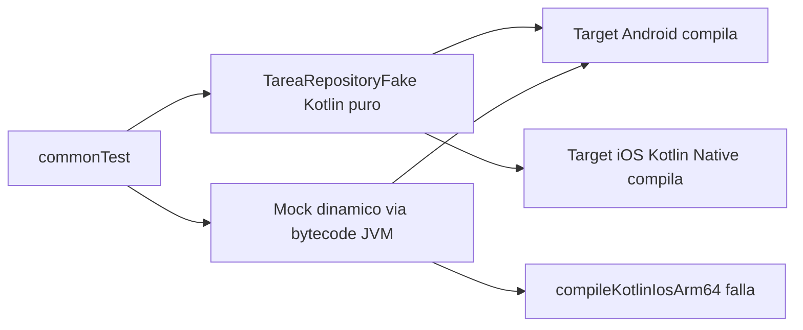
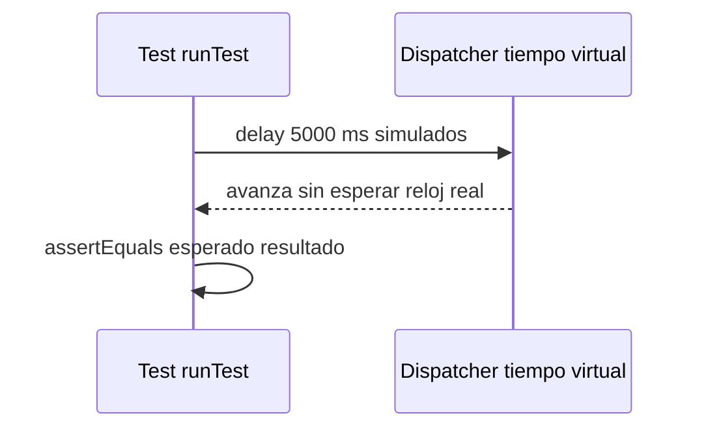
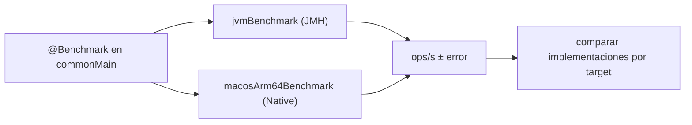

# Módulo 9: Testing multiplataforma


## Aprende construyendo


### Tema 1: kotlin.test en commonTest · Avanzado · 30 min

<details open>
<summary><strong>Capa 1 — Lectura</strong></summary>

#### ► DE QUÉ TRATA
Al finalizar vas a escribir un test en commonTest que verifique ObtenerTareasPendientesUseCase (Módulo 4) una sola vez y lo ejecutes contra el target Android y el target iOS sin duplicar código. Prerrequisitos: JDK 25 y el Gradle Wrapper del proyecto (módulo 0, «Antes de comenzar…

#### ► LA IDEA EN UNA FRASE
**Al finalizar vas a escribir un test en commonTest que verifique ObtenerTareasPendientesUseCase (Módulo 4) una sola vez y lo ejecutes contra el target Android y el target iOS sin duplicar código.**

#### ► POR QUÉ EXISTE ESTO
Resuelve un problema real de diseño o implementación y evita decisiones a ciegas.

#### ► LA ANALOGÍA
`kotlin.test` ofrece aserciones (`assertEquals`, `assertTrue`) que se compilan contra la implementación de testing de cada target, permitiendo escribir un único test en `commonTest` que corre de forma nativa en ambas plataformas. La analogía es una única inspección de calidad aplicada automáticamente a dos fábricas que siguen el mismo plano.

**Conceptos clave:** un único test, ejecutado contra ambos targets.

```kotlin
class ObtenerTareasPendientesUseCaseTest {
    @Test
    fun filtraSoloPendientes() = runTest {
        val repoFake = TareaRepositoryFake(listOf(
            Tarea("1", "A", completada = false),
            Tarea("2", "B", completada = true),
        ))
        val resultado = ObtenerTareasPendientesUseCase(repoFake)()
        assertEquals(1, resultado.size)
    }
}
```

Este test, escrito una única vez en el source set `commonTest` (el equivalente de `commonMain` pero para código de pruebas), se compila y ejecuta contra el target Android y contra el target iOS de forma completamente independiente, confirmando que la lógica del caso de uso `ObtenerTareasPendientesUseCase` (Módulo 4) se comporta de forma idéntica en ambas plataformas sin necesidad de duplicar el esfuerzo de escribir y mantener dos suites de pruebas separadas y potencialmente divergentes, una directa consecuencia de que la lógica bajo prueba en sí vive completamente en `commonMain` sin ningún código específico de plataforma que pudiera comportarse de forma distinta entre ambos targets.

Esta capacidad de "escribir una vez, probar en ambas plataformas" es el complemento natural de "escribir una vez, ejecutar en ambas plataformas" (el principio central de KMP estudiado desde el Módulo 3): si la lógica de negocio vive completamente en código compartido, las pruebas de esa lógica también pueden y deben vivir completamente en código compartido, obteniendo automáticamente el mismo beneficio de verificación dual sin trabajo adicional específico por plataforma.

**Analogía:** un test en `commonTest` es como una única inspección de calidad que se aplica automáticamente al producto fabricado en cualquiera de dos fábricas idénticas que siguen exactamente el mismo plano de fabricación, confirmando que ambas fábricas producen resultados consistentes sin necesidad de un inspector distinto y un criterio de evaluación separado para cada fábrica.

**¿Por qué es importante?** Un test escrito una única vez en `commonTest` confirma que la lógica compartida se comporta de forma idéntica en ambas plataformas, sin duplicar el esfuerzo de escribir y mantener suites de pruebas separadas por plataforma.

**Casos de uso reales:**
- Verificar `ObtenerTareasPendientesUseCase` (Módulo 4) una sola vez y confiar en que el resultado es idéntico en Android e iOS.
- Detectar en CI (Módulo 10) si un cambio en `commonMain` rompe la lógica compartida antes de compilar ambas apps completas.
- Cubrir reglas de negocio críticas (cálculo de precios, validaciones) con un único test suite mantenido por un solo equipo.

**Transferencia al proyecto integrador «Núcleo móvil compartido»:** Prueba en commonTest las reglas de confirmación con datos válidos, duplicados e incompletos. Ejecuta los targets disponibles y documenta las pruebas nativas adicionales que commonTest no sustituye.

**Dónde se rompe la analogía:** el modelo simplifica la realidad; en producción influyen escala, fallos, costo y contexto.

#### ► CÓMO FUNCIONA
1. Identifica el problema que kotlin.test en commontest resuelve.
2. Observa sus componentes y relaciones.
3. Aplica la opción más simple que funcione.
4. Verifica el resultado y los límites.

#### ► LO QUE PUEDE SALIR MAL
| Síntoma | Causa probable | Arreglo |
|---|---|---|
| kotlin.test en commonTest se aplica pero el resultado no mejora | Se usó sin medir el problema real | Mide antes y compara contra la alternativa simple |
| Aparece complejidad inesperada | Se adoptó la técnica sin comprender sus trade-offs | Vuelve a la sección de trade-offs y reduce el alcance |
| Falla en un caso límite | Se asumió un contexto que no se cumple | Prueba el caso límite y documenta cuándo NO usarlo |

#### ► TRADE-OFFS
| Opción | Cuándo usarla | Cuándo NO usarla |
|---|---|---|
| Usar kotlin.test en commonTest | Cuando el problema coincide con su propósito y el beneficio es observable | Cuando agrega complejidad sin resolver un problema real |
| Alternativa más simple | Cuando el contexto es pequeño, estable o fácil de razonar | Cuando ya demostró no escalar o no cumplir el requisito |
| Postergar la decisión | Cuando falta evidencia del problema | Cuando el costo de esperar es mayor que el costo de probar |

#### ► CUÁNDO NO USAR ESTO
No uses kotlin.test en commontest por defecto. Aplícalo cuando el problema lo justifique y puedas verificar el beneficio; si una alternativa más simple resuelve igual, prefiérela.

#### ► DE VUELTA A LA ANALOGÍA
Volviendo a la analogía: kotlin.test en commontest funciona como el modelo inicial, pero recuerda dónde se rompe: en producción importan la evidencia, la escala y el costo de equivocarte.

#### ► LO QUE DEBES RECORDAR
- kotlin.test en commonTest existe para resolver un problema específico.
- Mide antes de adoptar complejidad.
- Conoce el caso donde NO usarlo.
- Verifica con evidencia observable.

#### ► PREGUNTAS PARA PENSAR
1. ¿Qué problema concreto resuelve kotlin.test en commontest en tu contexto?
2. ¿Cómo sabrías que kotlin.test en commontest no está funcionando bien?
3. ¿Qué alternativa más simple considerarías antes de usar kotlin.test en commontest?

</details>

<details>
<summary><strong>Capa 2 — Construcción</strong></summary>

#### Objetivo observable
Al finalizar vas a escribir un test en `commonTest` que verifique `ObtenerTareasPendientesUseCase` (Módulo 4) una sola vez y lo ejecutes contra el target Android y el target iOS sin duplicar código. Prerrequisitos: JDK 25 y el Gradle Wrapper del proyecto (módulo 0, «Antes de comenzar»; comprueba con `./gradlew --version`).

</details>

### Tema 2: Fakes en vez de mocks · Avanzado · 30 min

<details open>
<summary><strong>Capa 1 — Lectura</strong></summary>

#### ► DE QUÉ TRATA
Al finalizar vas a reemplazar un mock generado dinámicamente por un TareaRepositoryFake escrito a mano, compatible con cualquier target de Kotlin Multiplatform. Prerrequisitos: Tema 1 de este módulo.

#### ► LA IDEA EN UNA FRASE
**Al finalizar vas a reemplazar un mock generado dinámicamente por un TareaRepositoryFake escrito a mano, compatible con cualquier target de Kotlin Multiplatform.**

#### ► POR QUÉ EXISTE ESTO
Resuelve un problema real de diseño o implementación y evita decisiones a ciegas.

#### ► LA ANALOGÍA
Piensa en fakes en vez de mocks como una herramienta de taller: útil cuando conoces su propósito y sus límites.
**Dónde se rompe la analogía:** en software, los efectos dependen del contexto, la escala y los trade-offs.

#### ► CÓMO FUNCIONA


#### ► LO QUE PUEDE SALIR MAL
| Síntoma | Causa probable | Arreglo |
|---|---|---|
| Fakes en vez de mocks se aplica pero el resultado no mejora | Se usó sin medir el problema real | Mide antes y compara contra la alternativa simple |
| Aparece complejidad inesperada | Se adoptó la técnica sin comprender sus trade-offs | Vuelve a la sección de trade-offs y reduce el alcance |
| Falla en un caso límite | Se asumió un contexto que no se cumple | Prueba el caso límite y documenta cuándo NO usarlo |

#### ► TRADE-OFFS
| Opción | Cuándo usarla | Cuándo NO usarla |
|---|---|---|
| Usar Fakes en vez de mocks | Cuando el problema coincide con su propósito y el beneficio es observable | Cuando agrega complejidad sin resolver un problema real |
| Alternativa más simple | Cuando el contexto es pequeño, estable o fácil de razonar | Cuando ya demostró no escalar o no cumplir el requisito |
| Postergar la decisión | Cuando falta evidencia del problema | Cuando el costo de esperar es mayor que el costo de probar |

#### ► CUÁNDO NO USAR ESTO
No uses fakes en vez de mocks por defecto. Aplícalo cuando el problema lo justifique y puedas verificar el beneficio; si una alternativa más simple resuelve igual, prefiérela.

#### ► DE VUELTA A LA ANALOGÍA
Volviendo a la analogía: fakes en vez de mocks funciona como el modelo inicial, pero recuerda dónde se rompe: en producción importan la evidencia, la escala y el costo de equivocarte.

#### ► LO QUE DEBES RECORDAR
- Fakes en vez de mocks existe para resolver un problema específico.
- Mide antes de adoptar complejidad.
- Conoce el caso donde NO usarlo.
- Verifica con evidencia observable.

#### ► PREGUNTAS PARA PENSAR
1. ¿Qué problema concreto resuelve fakes en vez de mocks en tu contexto?
2. ¿Cómo sabrías que fakes en vez de mocks no está funcionando bien?
3. ¿Qué alternativa más simple considerarías antes de usar fakes en vez de mocks?

</details>

<details>
<summary><strong>Capa 2 — Construcción</strong></summary>

#### Código y verificación


```kotlin
class TareaRepositoryFake(private val datos: List<Tarea>) : TareaRepository {
    override suspend fun obtenerTodas() = datos
}
```

```bash
./gradlew :shared:allTests
```

</details>

### Tema 3: runTest para coroutines · Avanzado · 30 min

<details open>
<summary><strong>Capa 1 — Lectura</strong></summary>

#### ► DE QUÉ TRATA
Al finalizar vas a escribir un test con runTest que verifique una función suspend con delay() interno, corriendo instantáneamente en tiempo real. Prerrequisitos: Tema 2 de este módulo.

#### ► LA IDEA EN UNA FRASE
**Al finalizar vas a escribir un test con runTest que verifique una función suspend con delay() interno, corriendo instantáneamente en tiempo real.**

#### ► POR QUÉ EXISTE ESTO
Resuelve un problema real de diseño o implementación y evita decisiones a ciegas.

#### ► LA ANALOGÍA
Piensa en runtest para coroutines como una herramienta de taller: útil cuando conoces su propósito y sus límites.
**Dónde se rompe la analogía:** en software, los efectos dependen del contexto, la escala y los trade-offs.

#### ► CÓMO FUNCIONA


#### ► LO QUE PUEDE SALIR MAL
| Síntoma | Causa probable | Arreglo |
|---|---|---|
| runTest para coroutines se aplica pero el resultado no mejora | Se usó sin medir el problema real | Mide antes y compara contra la alternativa simple |
| Aparece complejidad inesperada | Se adoptó la técnica sin comprender sus trade-offs | Vuelve a la sección de trade-offs y reduce el alcance |
| Falla en un caso límite | Se asumió un contexto que no se cumple | Prueba el caso límite y documenta cuándo NO usarlo |

#### ► TRADE-OFFS
| Opción | Cuándo usarla | Cuándo NO usarla |
|---|---|---|
| Usar runTest para coroutines | Cuando el problema coincide con su propósito y el beneficio es observable | Cuando agrega complejidad sin resolver un problema real |
| Alternativa más simple | Cuando el contexto es pequeño, estable o fácil de razonar | Cuando ya demostró no escalar o no cumplir el requisito |
| Postergar la decisión | Cuando falta evidencia del problema | Cuando el costo de esperar es mayor que el costo de probar |

#### ► CUÁNDO NO USAR ESTO
No uses runtest para coroutines por defecto. Aplícalo cuando el problema lo justifique y puedas verificar el beneficio; si una alternativa más simple resuelve igual, prefiérela.

#### ► DE VUELTA A LA ANALOGÍA
Volviendo a la analogía: runtest para coroutines funciona como el modelo inicial, pero recuerda dónde se rompe: en producción importan la evidencia, la escala y el costo de equivocarte.

#### ► LO QUE DEBES RECORDAR
- runTest para coroutines existe para resolver un problema específico.
- Mide antes de adoptar complejidad.
- Conoce el caso donde NO usarlo.
- Verifica con evidencia observable.

#### ► PREGUNTAS PARA PENSAR
1. ¿Qué problema concreto resuelve runtest para coroutines en tu contexto?
2. ¿Cómo sabrías que runtest para coroutines no está funcionando bien?
3. ¿Qué alternativa más simple considerarías antes de usar runtest para coroutines?

</details>

<details>
<summary><strong>Capa 2 — Construcción</strong></summary>

#### Código y verificación
```kotlin
@Test
fun pruebaConDelay() = runTest {
    val resultado = funcionConDelay() // el delay() interno se "salta" en tiempo virtual, el test corre instantáneo
    assertEquals(esperado, resultado)
}
```


```kotlin
@Test
fun pruebaConDelay() = runTest {
    val resultado = funcionConDelay() // el delay() interno se "salta" en tiempo virtual
    assertEquals(esperado, resultado)
}
```

```bash
./gradlew :shared:allTests
```

</details>

### Tema 4: Benchmarks multiplataforma con kotlinx-benchmark: medir el mismo código en cada target · Avanzado · 40 min

<details open>
<summary><strong>Capa 1 — Lectura</strong></summary>

#### ► DE QUÉ TRATA
Usa un proyecto KMP con el plugin org.jetbrains.kotlinx.benchmark y la librería kotlinx-benchmark-runtime. El plugin allopen es necesario para la JVM. Crea el source set de benchmarks en commonMain o en un módulo benchmarks.

#### ► LA IDEA EN UNA FRASE
**Usa un proyecto KMP con el plugin org.jetbrains.kotlinx.benchmark y la librería kotlinx-benchmark-runtime.**

#### ► POR QUÉ EXISTE ESTO
Resuelve un problema real de diseño o implementación y evita decisiones a ciegas.

#### ► LA ANALOGÍA
Piensa en benchmarks multiplataforma con kotlinx-benchmark: medir el mismo código en cada target como una herramienta de taller: útil cuando conoces su propósito y sus límites.
**Dónde se rompe la analogía:** en software, los efectos dependen del contexto, la escala y los trade-offs.

#### ► CÓMO FUNCIONA


#### ► LO QUE PUEDE SALIR MAL
| Síntoma | Causa probable | Arreglo |
|---|---|---|
| Benchmarks multiplataforma con kotlinx-benchmark: medir el mismo código en cada target se aplica pero el resultado no mejora | Se usó sin medir el problema real | Mide antes y compara contra la alternativa simple |
| Aparece complejidad inesperada | Se adoptó la técnica sin comprender sus trade-offs | Vuelve a la sección de trade-offs y reduce el alcance |
| Falla en un caso límite | Se asumió un contexto que no se cumple | Prueba el caso límite y documenta cuándo NO usarlo |

#### ► TRADE-OFFS
| Opción | Cuándo usarla | Cuándo NO usarla |
|---|---|---|
| Usar Benchmarks multiplataforma con kotlinx-benchmark: medir el mismo código en cada target | Cuando el problema coincide con su propósito y el beneficio es observable | Cuando agrega complejidad sin resolver un problema real |
| Alternativa más simple | Cuando el contexto es pequeño, estable o fácil de razonar | Cuando ya demostró no escalar o no cumplir el requisito |
| Postergar la decisión | Cuando falta evidencia del problema | Cuando el costo de esperar es mayor que el costo de probar |

#### ► CUÁNDO NO USAR ESTO
No uses benchmarks multiplataforma con kotlinx-benchmark: medir el mismo código en cada target por defecto. Aplícalo cuando el problema lo justifique y puedas verificar el beneficio; si una alternativa más simple resuelve igual, prefiérela.

#### ► DE VUELTA A LA ANALOGÍA
Volviendo a la analogía: benchmarks multiplataforma con kotlinx-benchmark: medir el mismo código en cada target funciona como el modelo inicial, pero recuerda dónde se rompe: en producción importan la evidencia, la escala y el costo de equivocarte.

#### ► LO QUE DEBES RECORDAR
- Benchmarks multiplataforma con kotlinx-benchmark: medir el mismo código en cada target existe para resolver un problema específico.
- Mide antes de adoptar complejidad.
- Conoce el caso donde NO usarlo.
- Verifica con evidencia observable.

#### ► PREGUNTAS PARA PENSAR
1. ¿Qué problema concreto resuelve benchmarks multiplataforma con kotlinx-benchmark: medir el mismo código en cada target en tu contexto?
2. ¿Cómo sabrías que benchmarks multiplataforma con kotlinx-benchmark: medir el mismo código en cada target no está funcionando bien?
3. ¿Qué alternativa más simple considerarías antes de usar benchmarks multiplataforma con kotlinx-benchmark: medir el mismo código en cada target?

</details>

<details>
<summary><strong>Capa 2 — Construcción</strong></summary>

#### Código y verificación


```kotlin
plugins {
    id("rutaflow.kmp.library")
    id("org.jetbrains.kotlinx.benchmark") version "0.4.14"
    kotlin("plugin.allopen") version "2.4.21"
}

allOpen { annotation("org.openjdk.jmh.annotations.State") }

kotlin {
    macosArm64()
    sourceSets.commonMain.dependencies { implementation("org.jetbrains.kotlinx:kotlinx-benchmark-runtime:0.4.14") }
}

benchmark {
    targets { register("jvm"); register("macosArm64") }
    configurations.named("main") { warmups = 3; iterations = 5; iterationTime = 1; iterationTimeUnit = "s" }
}
```

```kotlin
package co.rutaflow.bench

import kotlinx.benchmark.*

@State(Scope.Benchmark)
class ParadasBenchmark {
    private lateinit var codigos: List<String>
    private lateinit var buscados: List<String>

    @Setup fun preparar() {
        codigos = List(5_000) { "ENV-$it" }
        buscados = List(500) { "ENV-${it * 7}" }
    }

    @Benchmark fun buscarEnLista(): Int = buscados.count { it in codigos }  // O(n) por búsqueda

    @Benchmark fun buscarEnSet(): Int {
        val conjunto = codigos.toHashSet()                                  // O(1) por búsqueda
        return buscados.count { it in conjunto }
    }
}
```

```bash
./gradlew :shared:jvmBenchmark
./gradlew :shared:macosArm64Benchmark   # en una Mac con chip Apple
```

```text
Benchmark                            Mode  Cnt      Score     Error  Units
ParadasBenchmark.buscarEnLista      thrpt    5     ~260   ±   10  ops/s
ParadasBenchmark.buscarEnSet        thrpt    5   ~3 900   ±  120  ops/s
(las cifras dependen de la máquina; buscarEnSet debe ganar por un orden de magnitud en los dos targets)
```

</details>
