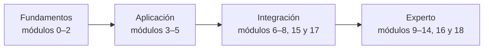
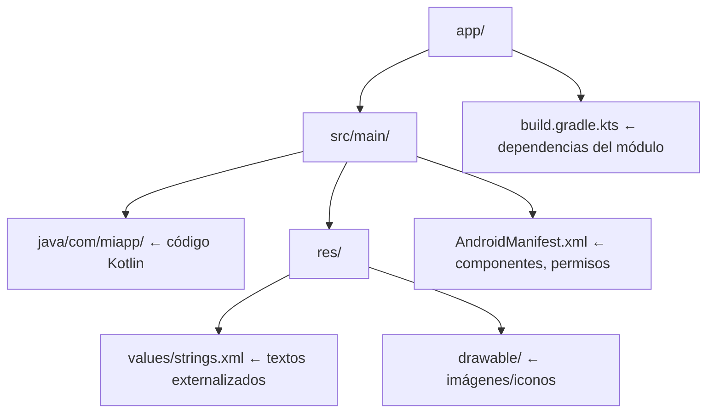
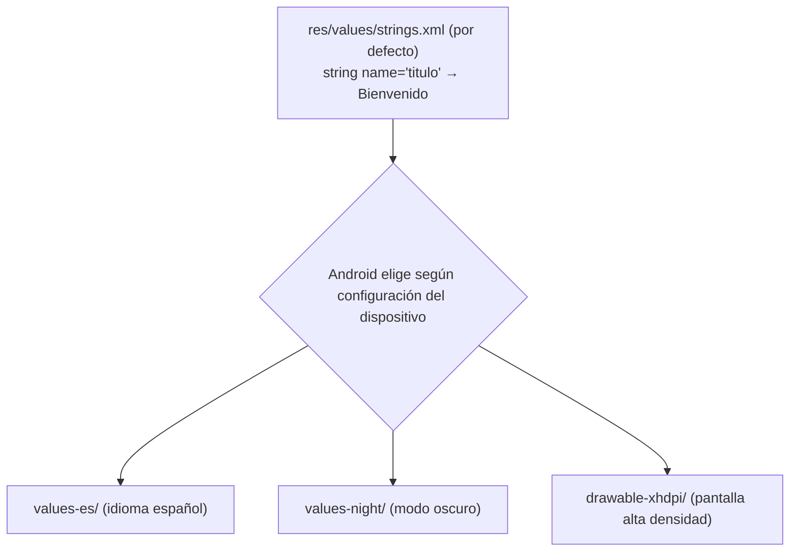
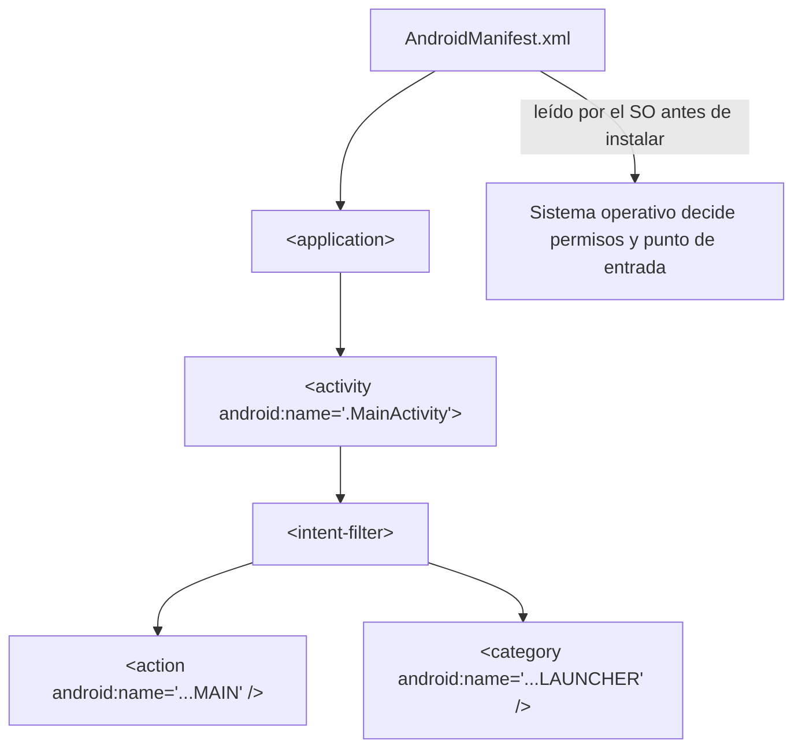
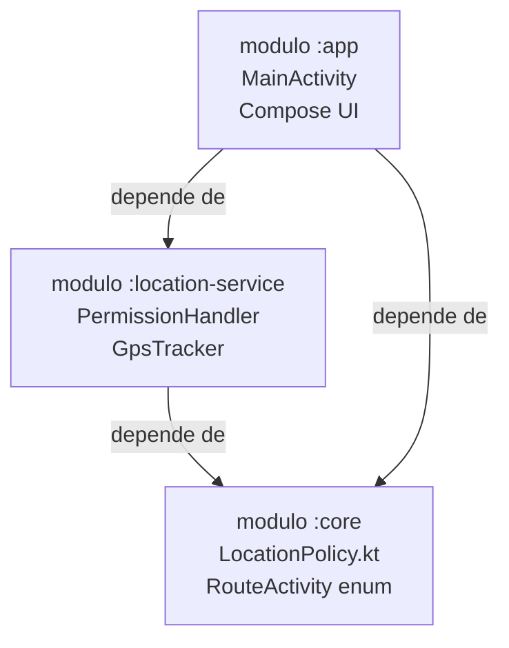

```mermaid
flowchart TD
    DEFAULT["res/values/strings.xml (por defecto)<br/>string name='titulo' → Bienvenido"]
    SEL{"Android elige según configuración del dispositivo"}
    ES["values-es/ (idioma español)"]
    NIGHT["values-night/ (modo oscuro)"]
    XHDPI["drawable-xhdpi/ (pantalla alta densidad)"]

    DEFAULT --> SEL
    SEL --> ES
    SEL --> NIGHT
    SEL --> XHDPI
```

# Módulo 0: Kotlin aplicado a Android

> **Requisitos de este curso:** [Fundamentos](/curso/foundations). Lo que esos cursos enseñan aquí se usa sin volver a explicarlo; si algo no te suena, vuelve a su capítulo antes de seguir.


## Antes de comenzar: instala Android Studio y un dispositivo de prueba

No necesitas un teléfono Android. Android Studio incluye el SDK, Gradle y un emulador. Descarga la versión estable desde [developer.android.com/studio](https://developer.android.com/studio) y conserva las opciones recomendadas del asistente.

- **Windows:** activa la virtualización en BIOS/UEFI; Android Studio puede solicitar Windows Hypervisor Platform. Evita carpetas de proyecto sincronizadas por OneDrive.
- **macOS:** elige la descarga para Apple Silicon o Intel según tu Mac. En Apple Silicon usa imágenes de emulador ARM64.
- **Linux:** instala los paquetes de virtualización/KVM de tu distribución, agrega tu usuario al grupo `kvm` y reinicia sesión.

En **SDK Manager** instala Android SDK Platform, Build-Tools y Platform-Tools. En **Device Manager** crea un dispositivo Pixel con una imagen estable. Crea un proyecto **Empty Activity**, Kotlin y Jetpack Compose, con nombre `academia-android` y *Package name* `com.academia.android` (los módulos siguientes escriben en ese paquete; con otro paquete, el manifiesto lanzaría una `MainActivity` distinta a la del curso); espera a que termine "Gradle Sync" y pulsa Run.

Comprueba también la terminal integrada:

```bash
./gradlew tasks          # macOS/Linux (invoca Gradle vía el wrapper)
.\gradlew.bat tasks      # Windows
adb devices
```

El emulador debe aparecer como `device`. Si figura `unauthorized`, acepta el diálogo del dispositivo; si no aparece, reinicia ADB desde Device Manager. La primera sincronización puede tardar porque descarga dependencias: no la canceles mientras haya actividad de red.

## Mapa de la ruta

«Android con Jetpack Compose» tiene 19 módulos en 4 etapas. Cada etapa se apoya en la anterior; usa la tabla para saltar a un módulo concreto.



| Módulo | Etapa | Qué aprendes |
|---|---|---|
| 0 | Fundamentos | [Kotlin aplicado a Android](/curso/kotlin/0) |
| 1 | Fundamentos | [Ciclo de vida: Activities y ViewModel](/curso/android/0) |
| 2 | Fundamentos | [Jetpack Compose: UI declarativa](/curso/android/1) |
| 3 | Aplicación | [Navegación con Navigation Compose y Predictive Back](/curso/android/2) |
| 4 | Aplicación | [Estado con StateFlow y Compose](/curso/android/3) |
| 5 | Aplicación | [Networking con Retrofit/Ktor](/curso/android/4) |
| 6 | Integración | [Persistencia local con Room](/curso/android/5) |
| 7 | Integración | [Inyección de dependencias con Hilt](/curso/android/6) |
| 8 | Integración | [Trabajo en segundo plano](/curso/android/7) |
| 9 | Experto | [Testing en Android](/curso/android/8) |
| 10 | Experto | [Performance, Material 3 y accesibilidad](/curso/android/9) |
| 11 | Experto | [Publicación en Google Play](/curso/android/10) |
| 12 | Experto | [Proyecto integrador: app Android completa](/curso/android/11) |
| 13 | Experto | [Android en producción: seguridad, sincronización y calidad](/curso/android/12) |
| 14 | Experto | [Compose Master: pruebas, accesibilidad y animación](/curso/android/13) |
| 15 | Integración | [Android como plataforma: Intents, broadcasts, servicios y content providers](/curso/android/14) |
| 16 | Experto | [Android profesional: privacidad, datos, escala e identidad](/curso/android/15) |
| 17 | Integración | [Compose profesional: layouts, formularios, listas y efectos](/curso/android/16) |
| 18 | Experto | [Build profesional: variantes, módulos, optimización y CI](/curso/android/17) |

## Aprende construyendo


### Tema 1: Estructura de un proyecto Android Studio · Básico · 45 min

<details open>
<summary><strong>Capa 1 — Lectura</strong></summary>

#### ► DE QUÉ TRATA
Al finalizar podrás ubicar dónde vive el código, los recursos y la configuración de build de cualquier proyecto Android, y explicar por qué esa separación existe.

#### ► CÓMO FUNCIONA


</details>

<details>
<summary><strong>Capa 2 — Construcción</strong></summary>

#### Código y verificación

```bash
mkdir -p academia-android
cd academia-android
# (genera el proyecto "Empty Activity" con Android Studio dentro de esta carpeta)
find app/src/main -maxdepth 3 -type d
cat app/build.gradle.kts | grep -A3 "^android {"
```

```bash
./gradlew assembleDebug
./gradlew test
```

```bash
grep -rn "app_name" app/src/main/res/values/strings.xml
grep -n "app_name\|ic_launcher" app/src/main/AndroidManifest.xml
```

```kotlin
package com.rutaflow.core

enum class RouteActivity { STILL, WALKING, DRIVING }

data class LocationPolicy(val intervalMs: Long, val minDistanceMeters: Float)

fun locationPolicy(activity: RouteActivity, batteryPercent: Int): LocationPolicy {
    require(batteryPercent in 0..100) { "La batería debe estar entre 0 y 100" }
    return when {
        batteryPercent < 20 -> LocationPolicy(intervalMs = 120_000, minDistanceMeters = 100f)
        activity == RouteActivity.DRIVING -> LocationPolicy(5_000, 10f)
        activity == RouteActivity.WALKING -> LocationPolicy(15_000, 25f)
        else -> LocationPolicy(60_000, 50f)
    }
}
```

</details>

### Tema 2: Recursos externalizados · Básico · 45 min

<details open>
<summary><strong>Capa 1 — Lectura</strong></summary>

#### ► DE QUÉ TRATA
Al finalizar podrás externalizar un texto a strings.xml y explicar cómo Android resuelve automáticamente variantes por idioma, tema y densidad de pantalla.

#### ► CÓMO FUNCIONA


</details>

<details>
<summary><strong>Capa 2 — Construcción</strong></summary>

#### Código y verificación


```bash
test -f settings.gradle.kts || cd academia-android   # entra solo si aún no estás en la raíz
mkdir -p app/src/main/res/values-en
# inserta el string dentro de <resources> (no después de </resources>) y no lo duplica si ya existe
python3 - <<'PY'
from pathlib import Path
ruta = Path('app/src/main/res/values/strings.xml')
xml = ruta.read_text(encoding='utf-8')
if 'name="titulo_bienvenida"' not in xml:
    xml = xml.replace('</resources>', '    <string name="titulo_bienvenida">Bienvenido</string>\n</resources>', 1)
    ruta.write_text(xml, encoding='utf-8')
print('values/strings.xml contiene titulo_bienvenida')
PY
```

Crea el archivo `app/src/main/res/values-en/strings.xml`:

```xml
<?xml version="1.0" encoding="utf-8"?>
<resources>
    <string name="titulo_bienvenida">Welcome</string>
</resources>
```

```bash
# python3 valida que el XML generado es válido antes de continuar
python3 -c "
import xml.etree.ElementTree as ET
ET.parse('app/src/main/res/values-en/strings.xml')
print('values-en/strings.xml es XML bien formado')
"
```

```bash
./gradlew assembleDebug
./gradlew test
```

```bash
python3 -c "
import xml.etree.ElementTree as ET
es = {s.get('name') for s in ET.parse('app/src/main/res/values/strings.xml').getroot()}
en = {s.get('name') for s in ET.parse('app/src/main/res/values-en/strings.xml').getroot()}
print('claves solo en español:', es - en)
print('claves solo en inglés:', en - es)
print('claves compartidas:', es & en)
"
```

</details>

### Tema 3: AndroidManifest.xml y módulos Gradle · Básico · 45 min

<details open>
<summary><strong>Capa 1 — Lectura</strong></summary>

#### ► DE QUÉ TRATA
Al finalizar podrás declarar un componente y un permiso en el manifiesto, y dividir un proyecto en módulos Gradle con una dependencia explícita entre ellos.

#### ► CÓMO FUNCIONA


</details>

<details>
<summary><strong>Capa 2 — Construcción</strong></summary>

#### Código y verificación




```bash
test -f settings.gradle.kts || cd academia-android   # sitúate en la raíz del proyecto del Módulo 0
mkdir -p core/src/main/kotlin/com/academia/core
```

Crea el archivo `core/build.gradle.kts`:

```kotlin
plugins { alias(libs.plugins.kotlin.jvm) }
```

Crea el archivo `core/src/main/kotlin/com/academia/core/Formateador.kt`:

```kotlin
package com.academia.core
fun formatearBienvenida(nombre: String): String = "Bienvenido, $nombre"
```

```bash
# registra el módulo en el settings.gradle.kts real (la plantilla ya trae include(":app"))
grep -q 'include(":core")' settings.gradle.kts || echo 'include(":core")' >> settings.gradle.kts
```

```toml
   kotlin-jvm = { id = "org.jetbrains.kotlin.jvm", version.ref = "kotlin" }
   ```

```bash
grep -n 'include(":core")' settings.gradle.kts
grep -n "project(\":core\")" app/build.gradle.kts
./gradlew :app:dependencies --configuration debugRuntimeClasspath | grep "project :core"
```

```toml
[versions]
lifecycleCompose = "2.11.1"
navigation = "2.10.2"
kotlinxSerialization = "1.13.0"
retrofit = "3.0.0"
okhttp = "4.12.0"
room = "2.8.5"
ksp = "2.3.14"
hilt = "2.60.1"
work = "2.12.0"
coroutines = "1.11.0"
datastore = "1.3.0"
paging = "3.5.3"
credentials = "1.6.0"
camerax = "1.6.2"
mlkitBarcode = "17.3.0"
mapsCompose = "9.0.1"
playServicesLocation = "21.4.0"
firebaseBom = "35.2.0"
googleServices = "4.6.0"
playIntegrity = "1.6.0"

[libraries]
androidx-lifecycle-viewmodel-compose = { group = "androidx.lifecycle", name = "lifecycle-viewmodel-compose", version.ref = "lifecycleCompose" }
androidx-lifecycle-runtime-compose = { group = "androidx.lifecycle", name = "lifecycle-runtime-compose", version.ref = "lifecycleCompose" }
androidx-navigation-compose = { group = "androidx.navigation", name = "navigation-compose", version.ref = "navigation" }
androidx-compose-material-icons-core = { group = "androidx.compose.material", name = "material-icons-core" }
kotlinx-serialization-json = { group = "org.jetbrains.kotlinx", name = "kotlinx-serialization-json", version.ref = "kotlinxSerialization" }
kotlinx-coroutines-test = { group = "org.jetbrains.kotlinx", name = "kotlinx-coroutines-test", version.ref = "coroutines" }
retrofit = { group = "com.squareup.retrofit2", name = "retrofit", version.ref = "retrofit" }
retrofit-kotlinx-serialization = { group = "com.squareup.retrofit2", name = "converter-kotlinx-serialization", version.ref = "retrofit" }
okhttp-logging = { group = "com.squareup.okhttp3", name = "logging-interceptor", version.ref = "okhttp" }
androidx-room-runtime = { group = "androidx.room", name = "room-runtime", version.ref = "room" }
androidx-room-compiler = { group = "androidx.room", name = "room-compiler", version.ref = "room" }
androidx-room-testing = { group = "androidx.room", name = "room-testing", version.ref = "room" }
hilt-android = { group = "com.google.dagger", name = "hilt-android", version.ref = "hilt" }
hilt-compiler = { group = "com.google.dagger", name = "hilt-compiler", version.ref = "hilt" }
hilt-android-testing = { group = "com.google.dagger", name = "hilt-android-testing", version.ref = "hilt" }
androidx-work-runtime-ktx = { group = "androidx.work", name = "work-runtime-ktx", version.ref = "work" }
androidx-work-testing = { group = "androidx.work", name = "work-testing", version.ref = "work" }
androidx-datastore-preferences = { group = "androidx.datastore", name = "datastore-preferences", version.ref = "datastore" }
androidx-paging-runtime = { group = "androidx.paging", name = "paging-runtime", version.ref = "paging" }
androidx-paging-compose = { group = "androidx.paging", name = "paging-compose", version.ref = "paging" }
androidx-credentials = { group = "androidx.credentials", name = "credentials", version.ref = "credentials" }
androidx-credentials-play-services-auth = { group = "androidx.credentials", name = "credentials-play-services-auth", version.ref = "credentials" }
androidx-camera-camera2 = { group = "androidx.camera", name = "camera-camera2", version.ref = "camerax" }
androidx-camera-lifecycle = { group = "androidx.camera", name = "camera-lifecycle", version.ref = "camerax" }
androidx-camera-view = { group = "androidx.camera", name = "camera-view", version.ref = "camerax" }
androidx-camera-mlkit-vision = { group = "androidx.camera", name = "camera-mlkit-vision", version.ref = "camerax" }
mlkit-barcode-scanning = { group = "com.google.mlkit", name = "barcode-scanning", version.ref = "mlkitBarcode" }
maps-compose = { group = "com.google.maps.android", name = "maps-compose", version.ref = "mapsCompose" }
play-services-location = { group = "com.google.android.gms", name = "play-services-location", version.ref = "playServicesLocation" }
firebase-bom = { group = "com.google.firebase", name = "firebase-bom", version.ref = "firebaseBom" }
firebase-messaging = { group = "com.google.firebase", name = "firebase-messaging" }
play-integrity = { group = "com.google.android.play", name = "integrity", version.ref = "playIntegrity" }

[plugins]
kotlin-serialization = { id = "org.jetbrains.kotlin.plugin.serialization", version.ref = "kotlin" }
ksp = { id = "com.google.devtools.ksp", version.ref = "ksp" }
hilt = { id = "com.google.dagger.hilt.android", version.ref = "hilt" }
room = { id = "androidx.room", version.ref = "room" }
google-services = { id = "com.google.gms.google-services", version.ref = "googleServices" }
secrets = { id = "com.google.android.libraries.mapsplatform.secrets-gradle-plugin", version = "2.0.1" }
```

</details>

### Tema 4: Kotlin esencial para Android — lo que usarás en cada pantalla · Básico · 45 min

<details open>
<summary><strong>Capa 1 — Lectura</strong></summary>

#### ► DE QUÉ TRATA
Al finalizar podrás modelar una tarea inmutable, transformar una colección y representar la ausencia de datos sin producir un NullPointerException. No se promete «dominar Kotlin» en un tema: aquí construirás la base que después reutilizan Compose, ViewModel, Room y Retrofit. Prer…

</details>

<details>
<summary><strong>Capa 2 — Construcción</strong></summary>

#### Objetivo observable
Al finalizar podrás modelar una tarea inmutable, transformar una colección y representar la ausencia de datos sin producir un `NullPointerException`. No se promete «dominar Kotlin» en un tema: aquí construirás la base que después reutilizan Compose, ViewModel, Room y Retrofit. **Prerrequisitos:** Temas 1–3 y el proyecto `academia-android` compilando.

</details>

### Tema 5: Lambdas y funciones de orden superior en Kotlin — contratos, captura y receptores · Básico · 45 min

<details open>
<summary><strong>Capa 1 — Lectura</strong></summary>

#### ► DE QUÉ TRATA
Al finalizar podrás leer y escribir tipos función, explicar cómo el contexto determina parámetros y retorno, distinguir una lambda de una conversión SAM, razonar sobre captura y receptores, elegir una referencia callable y diagnosticar retornos o sobrecargas ambiguas. Prerrequisi…

</details>

<details>
<summary><strong>Capa 2 — Construcción</strong></summary>

#### Código y verificación
```kotlin
package com.academia.lambdas

import org.junit.Assert.assertEquals
import org.junit.Assert.assertFalse
import org.junit.Assert.assertTrue
import org.junit.Test

data class Envio(val id: String, val peso: Int)
fun interface ReglaEnvio { fun acepta(envio: Envio): Boolean }

class RutaBuilder {
    private val pasos = mutableListOf<String>()
    fun paso(valor: String) { pasos += valor }
    fun resultado(): List<String> = pasos.toList()
}

fun ruta(configurar: RutaBuilder.() -> Unit): List<String> =
    RutaBuilder().apply(configurar).resultado()

fun normalizar(id: String): String = id.trim().uppercase()

class LambdasTest {
    @Test fun contratos_captura_referencias_sam_y_receptor_son_observables() {
        val maximo = 25
        val ligera: (Envio) -> Boolean = { envio -> envio.peso <= maximo }
        val etiqueta: (Envio) -> String = { "${normalizar(it.id)}:${it.peso}" }
        val referencia: (String) -> String = ::normalizar
        val sam = ReglaEnvio { it.peso <= maximo }
        val pasos = ruta {
            paso("validar")
            paso("etiquetar")
        }

        assertTrue(ligera(Envio(" rf-1 ", 10)))
        assertFalse(sam.acepta(Envio("RF-2", 30)))
        assertEquals("RF-1:10", etiqueta(Envio(" rf-1 ", 10)))
        assertEquals("RF-3", referencia(" rf-3 "))
        assertEquals(listOf("validar", "etiquetar"), pasos)
    }
}
```

```bash
./gradlew :app:testDebugUnitTest --tests com.academia.lambdas.LambdasTest
```

</details>

### Tema 6: Coroutines — asincronía sin bloquear la UI · Básico · 45 min

<details open>
<summary><strong>Capa 1 — Lectura</strong></summary>

#### ► DE QUÉ TRATA
Al finalizar podrás distinguir suspensión de bloqueo, ejecutar dos operaciones con concurrencia estructurada, cancelar trabajo cooperativamente y decidir qué dispatcher corresponde. Prerrequisitos: Tema 4 y su suite verde.

</details>

<details>
<summary><strong>Capa 2 — Construcción</strong></summary>

#### Código y verificación
```bash
test -f settings.gradle.kts || cd academia-android   # sitúate en la raíz del proyecto del Módulo 0
grep -q 'kotlinx-coroutines-test' app/build.gradle.kts || \
  sed -i.bak '/dependencies {/a\    testImplementation("org.jetbrains.kotlinx:kotlinx-coroutines-test:1.11.0")' app/build.gradle.kts
mkdir -p app/src/main/java/com/academia/envios app/src/test/java/com/academia/envios
```

```kotlin
package com.academia.envios

import kotlinx.coroutines.async
import kotlinx.coroutines.coroutineScope

interface EnviosRepository {
    suspend fun detalle(id: String): String
    suspend fun eventos(id: String): List<String>
}

data class ResumenEnvio(val detalle: String, val eventos: List<String>)

class CargarResumen(private val repository: EnviosRepository) {
    suspend operator fun invoke(id: String): ResumenEnvio = coroutineScope {
        val detalle = async { repository.detalle(id) }
        val eventos = async { repository.eventos(id) }
        ResumenEnvio(detalle.await(), eventos.await())
    }
}
```

```kotlin
package com.academia.envios

import kotlinx.coroutines.delay
import kotlinx.coroutines.test.runTest
import org.junit.Assert.assertEquals
import org.junit.Test

class CargarResumenTest {
    @Test
    fun detalle_y_eventos_se_cargan_concurrentemente() = runTest {
        val fake = object : EnviosRepository {
            override suspend fun detalle(id: String): String {
                delay(1_000)
                return "$id: en ruta"
            }

            override suspend fun eventos(id: String): List<String> {
                delay(1_000)
                return listOf("creado", "recogido")
            }
        }

        val resumen = CargarResumen(fake)("RF-4471")

        assertEquals("RF-4471: en ruta", resumen.detalle)
        assertEquals(listOf("creado", "recogido"), resumen.eventos)
        assertEquals(1_000L, testScheduler.currentTime)
    }
}
```

```bash
./gradlew :app:testDebugUnitTest --tests com.academia.envios.CargarResumenTest
```

</details>
