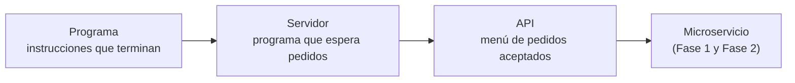
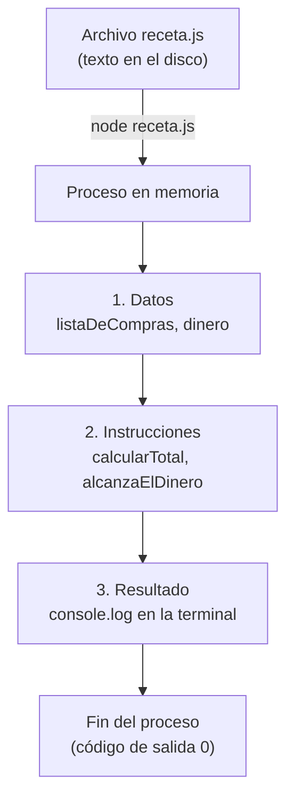
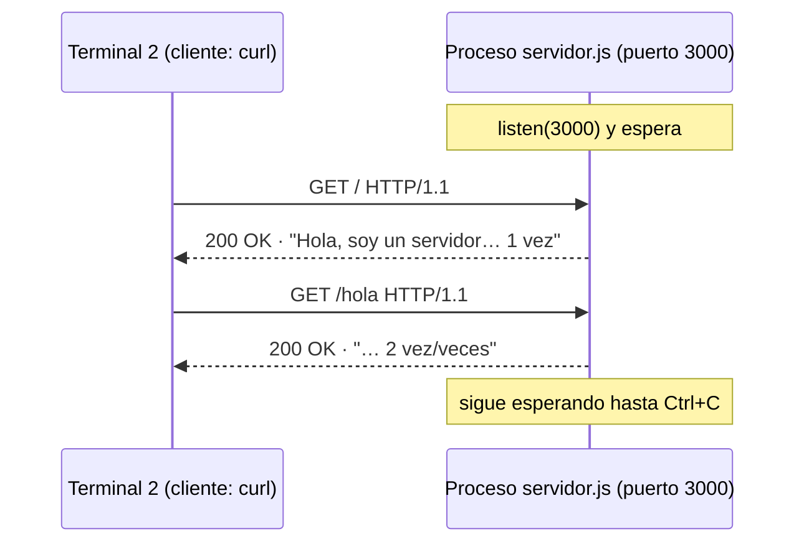
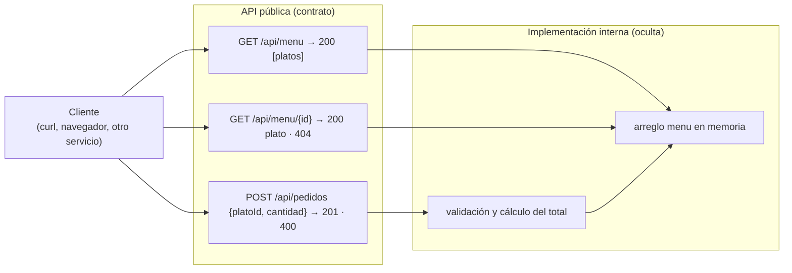

# Módulo 0.1 · Qué es un programa, un servidor y una API (analogías visuales)

**Fase 0 · Fundamentos absolutos** (semana 1 de 4). **Duración:** 6 h (3 temas de 2 h). **Dificultad:** 1 de 5,
para quien nunca ha programado. **Dependencias:** ninguna; solo necesitas un computador con terminal y
**Node.js 26.13.1 LTS** instalado (el Módulo 0.4 profundiza en la terminal y el 0.5 instala todo paso a paso; si aún
no tienes Node, ejecuta los comandos de este módulo cuando lo instales).

Al terminar este módulo podrás explicar con tus palabras, y demostrar en tu terminal, la diferencia entre un
programa que termina, un servidor que se queda esperando y una API que define qué se le puede pedir a ese
servidor. Son las tres piezas con las que, 30 semanas después, construirás microservicios.



**Texto alternativo:** cuatro cajas en línea de izquierda a derecha. «Programa» lleva a «Servidor», que lleva a
«API», que lleva a «Microservicio». Cada pieza se construye sobre la anterior.

---


### Qué es un programa

<details open>
<summary><strong>Capa 1 — Lectura</strong></summary>

#### ► DE QUÉ TRATA
Ejecutar un programa de 20 líneas, identificar en él sus tres partes (datos, instrucciones y resultado) y modificar un dato para predecir el nuevo resultado antes de ejecutarlo; lo compruebas cuando el test receta.test.js pasa con 3 de 3.

#### ► LA IDEA EN UNA FRASE
**Ejecutar un programa de 20 líneas, identificar en él sus tres partes (datos, instrucciones y resultado) y modificar un dato para predecir el nuevo resultado antes de ejecutarlo; lo compruebas cuando el test receta.test.js pasa con 3 de 3.**

#### ► POR QUÉ EXISTE ESTO
Un programa es un texto escrito en un idioma que la computadora sabe seguir. Ese texto vive en un archivo (como una carta guardada en un cajón) y no hace nada hasta que alguien lo ejecuta. Ejecutar es decirle a la computadora: «lee este archivo y haz lo que dice».

#### ► LA ANALOGÍA
Piensa en qué es un programa como una herramienta de taller: útil cuando conoces su propósito y sus límites.
**Dónde se rompe la analogía:** en software, los efectos dependen del contexto, la escala y los trade-offs.

#### ► CÓMO FUNCIONA


1. Un programa es un texto escrito en un idioma que la computadora sabe seguir.
2. Ese texto vive en un archivo (como una carta guardada en un cajón) y no hace nada hasta que alguien lo ejecuta.
3. Ejecutar es decirle a la computadora: «lee este archivo y haz lo que dice».

#### ► LO QUE PUEDE SALIR MAL
| Síntoma | Causa probable | Arreglo |
|---|---|---|
| Qué es un programa se aplica pero el resultado no mejora | Se usó sin medir el problema real | Mide antes y compara contra la alternativa simple |
| Aparece complejidad inesperada | Se adoptó la técnica sin comprender sus trade-offs | Vuelve a la sección de trade-offs y reduce el alcance |
| Falla en un caso límite | Se asumió un contexto que no se cumple | Prueba el caso límite y documenta cuándo NO usarlo |

#### ► TRADE-OFFS
| Opción | Cuándo usarla | Cuándo NO usarla |
|---|---|---|
| Usar Qué es un programa | Cuando el problema coincide con su propósito y el beneficio es observable | Cuando agrega complejidad sin resolver un problema real |
| Alternativa más simple | Cuando el contexto es pequeño, estable o fácil de razonar | Cuando ya demostró no escalar o no cumplir el requisito |
| Postergar la decisión | Cuando falta evidencia del problema | Cuando el costo de esperar es mayor que el costo de probar |

#### ► CUÁNDO NO USAR ESTO
Datos «quemados» mezclados con la lógica y sin funciones (*hardcoding*):

#### ► DE VUELTA A LA ANALOGÍA
Volviendo a la analogía: qué es un programa funciona como el modelo inicial, pero recuerda dónde se rompe: en producción importan la evidencia, la escala y el costo de equivocarte.

#### ► LO QUE DEBES RECORDAR
- Un programa es un texto escrito en un idioma que la computadora sabe seguir.
- Ese texto vive en un archivo (como una carta guardada en un cajón) y no hace nada hasta que alguien lo ejecuta.
- Ejecutar es decirle a la computadora: «lee este archivo y haz lo que dice».

#### ► PREGUNTAS PARA PENSAR
1. ¿Qué problema concreto resuelve qué es un programa en tu contexto?
2. ¿Cómo sabrías que qué es un programa no está funcionando bien?
3. ¿Qué alternativa más simple considerarías antes de usar qué es un programa?

</details>

<details>
<summary><strong>Capa 2 — Construcción</strong></summary>

#### Código y verificación


```json
{
  "name": "modulo-0-1-programa-servidor-api",
  "version": "1.0.0",
  "private": true,
  "type": "module",
  "engines": { "node": ">=26.13.1" },
  "scripts": { "test": "node --test" }
}
```

```javascript
// Módulo 0.1 · Qué es un programa
// Un programa es una lista de instrucciones que la computadora sigue en orden.
// Requisitos: Node.js 26.13.1 LTS (funciona desde Node 22). Sin dependencias.
// Ejecuta: node receta.js

// 1. DATOS: lo que el programa recibe (los ingredientes de la receta).
const listaDeCompras = [
  { producto: 'Arroz', precio: 4500 },
  { producto: 'Huevos', precio: 12000 },
  { producto: 'Tomates', precio: 3500 },
];
const dineroEnLaBilletera = 20000;

// 2. INSTRUCCIONES: una función es una receta con nombre que se puede repetir.
export function calcularTotal(lista) {
  let total = 0; // empezamos en cero
  for (const item of lista) { // repetimos para cada producto...
    total = total + item.precio; // ...y sumamos su precio
  }
  return total; // devolvemos el resultado
}

export function alcanzaElDinero(total, dinero) {
  return total <= dinero; // true (sí) o false (no)
}

// 3. RESULTADO: lo que el programa muestra al terminar.
// import.meta.main es true solo cuando ejecutas este archivo directamente
// (no cuando el test lo importa).
if (import.meta.main) {
  const total = calcularTotal(listaDeCompras);
  console.log(`Productos: ${listaDeCompras.length}`);
  console.log(`Total a pagar: ${total}`);
  console.log(`¿Alcanza con ${dineroEnLaBilletera}? ${alcanzaElDinero(total, dineroEnLaBilletera) ? 'Sí' : 'No'}`);
}
```

```text
Productos: 3
Total a pagar: 20000
¿Alcanza con 20000? Sí
```

```bash
   mkdir -p mi-programa
   cd mi-programa
   ```

```bash
   node receta.js
   echo "Código de salida: $?"
   ```

</details>

### Qué es un servidor

<details open>
<summary><strong>Capa 1 — Lectura</strong></summary>

#### ► DE QUÉ TRATA
Arrancar un servidor HTTP, enviarle pedidos desde otra terminal con curl y explicar por qué el proceso no termina; lo compruebas cuando el test servidor/servidor.test.js pasa y cuando puedes provocar e interpretar el error EADDRINUSE.

#### ► LA IDEA EN UNA FRASE
**Arrancar un servidor HTTP, enviarle pedidos desde otra terminal con curl y explicar por qué el proceso no termina; lo compruebas cuando el test servidor/servidor.test.js pasa y cuando puedes provocar e interpretar el error EADDRINUSE.**

#### ► POR QUÉ EXISTE ESTO
Un servidor es un programa que, en vez de terminar, se queda esperando pedidos y responde a cada uno. Piensa en él como un empleado de ventanilla: su trabajo no es hacer una cosa y marcharse, sino estar disponible.

#### ► LA ANALOGÍA
Piensa en qué es un servidor como una herramienta de taller: útil cuando conoces su propósito y sus límites.
**Dónde se rompe la analogía:** en software, los efectos dependen del contexto, la escala y los trade-offs.

#### ► CÓMO FUNCIONA


1. Un servidor es un programa que, en vez de terminar, se queda esperando pedidos y responde a cada uno.
2. Piensa en él como un empleado de ventanilla: su trabajo no es hacer una cosa y marcharse, sino estar disponible.

#### ► LO QUE PUEDE SALIR MAL
| Síntoma | Causa probable | Arreglo |
|---|---|---|
| Qué es un servidor se aplica pero el resultado no mejora | Se usó sin medir el problema real | Mide antes y compara contra la alternativa simple |
| Aparece complejidad inesperada | Se adoptó la técnica sin comprender sus trade-offs | Vuelve a la sección de trade-offs y reduce el alcance |
| Falla en un caso límite | Se asumió un contexto que no se cumple | Prueba el caso límite y documenta cuándo NO usarlo |

#### ► TRADE-OFFS
| Opción | Cuándo usarla | Cuándo NO usarla |
|---|---|---|
| Usar Qué es un servidor | Cuando el problema coincide con su propósito y el beneficio es observable | Cuando agrega complejidad sin resolver un problema real |
| Alternativa más simple | Cuando el contexto es pequeño, estable o fácil de razonar | Cuando ya demostró no escalar o no cumplir el requisito |
| Postergar la decisión | Cuando falta evidencia del problema | Cuando el costo de esperar es mayor que el costo de probar |

#### ► CUÁNDO NO USAR ESTO
Guardar datos importantes solo en la memoria del servidor. Se ve así:

#### ► DE VUELTA A LA ANALOGÍA
Volviendo a la analogía: qué es un servidor funciona como el modelo inicial, pero recuerda dónde se rompe: en producción importan la evidencia, la escala y el costo de equivocarte.

#### ► LO QUE DEBES RECORDAR
- Un servidor es un programa que, en vez de terminar, se queda esperando pedidos y responde a cada uno.
- Piensa en él como un empleado de ventanilla: su trabajo no es hacer una cosa y marcharse, sino estar disponible.

#### ► PREGUNTAS PARA PENSAR
1. ¿Qué problema concreto resuelve qué es un servidor en tu contexto?
2. ¿Cómo sabrías que qué es un servidor no está funcionando bien?
3. ¿Qué alternativa más simple considerarías antes de usar qué es un servidor?

</details>

<details>
<summary><strong>Capa 2 — Construcción</strong></summary>

#### Código y verificación


```javascript
// Módulo 0.1 · Qué es un servidor
// Un servidor es un programa que NO termina: se queda esperando pedidos
// en un "puerto" (como una ventanilla numerada) y responde a cada uno.
// Requisitos: Node.js 26.13.1 LTS (funciona desde Node 22). Usa solo el módulo 'node:http'.
// Ejecuta: node servidor.js   y en otra terminal: curl http://localhost:3000/

import http from 'node:http';

let pedidosAtendidos = 0;

// crearServidor() devuelve el servidor sin encenderlo; así el test puede encenderlo en un puerto libre.
export function crearServidor() {
  return http.createServer((pedido, respuesta) => {
    pedidosAtendidos++;
    // Cada vez que llega un pedido, el servidor anota quién pidió qué...
    console.log(`Pedido #${pedidosAtendidos}: ${pedido.method} ${pedido.url}`);
    // ...y responde con un código de estado (200 = todo bien) y un texto.
    respuesta.writeHead(200, { 'Content-Type': 'text/plain; charset=utf-8' });
    respuesta.end(`Hola, soy un servidor. Te he atendido ${pedidosAtendidos} vez/veces.\n`);
  });
}

if (import.meta.main) {
  const puerto = Number(process.env.PORT ?? 3000);
  crearServidor().listen(puerto, () => {
    console.log(`Servidor escuchando en http://localhost:${puerto} (Ctrl+C para apagarlo)`);
  });
}
```

```bash
   node servidor.js
   ```

```bash
   curl -i http://localhost:3000/
   curl http://localhost:3000/hola
   ```

```bash
   node servidor.js
   ```

```text
Servidor escuchando en http://localhost:3000 (Ctrl+C para apagarlo)
Pedido #1: GET /
Pedido #2: GET /hola
```

</details>

### Qué es una API

<details open>
<summary><strong>Capa 1 — Lectura</strong></summary>

#### ► DE QUÉ TRATA
Consumir las tres operaciones de una API REST pequeña con curl, distinguir una respuesta exitosa (200, 201) de un error del cliente (400, 404) y explicar qué es un contrato de API; lo compruebas cuando api/api.test.js pasa 4 de 4.

#### ► LA IDEA EN UNA FRASE
**Consumir las tres operaciones de una API REST pequeña con curl, distinguir una respuesta exitosa (200, 201) de un error del cliente (400, 404) y explicar qué es un contrato de API; lo compruebas cuando api/api.test.js pasa 4 de 4.**

#### ► POR QUÉ EXISTE ESTO
API significa *Application Programming Interface*: «interfaz para que un programa hable con otro». Es la lista de cosas que un servidor acepta que le pidas y la forma exacta de pedirlas y de responder.

#### ► LA ANALOGÍA
Piensa en qué es una api como una herramienta de taller: útil cuando conoces su propósito y sus límites.
**Dónde se rompe la analogía:** en software, los efectos dependen del contexto, la escala y los trade-offs.

#### ► CÓMO FUNCIONA


1. un **método** (el verbo): `GET` para leer, `POST` para crear algo;
2. una **ruta** (la dirección): `/api/menu`, `/api/pedidos`.

#### ► LO QUE PUEDE SALIR MAL
| Síntoma | Causa probable | Arreglo |
|---|---|---|
| Qué es una API se aplica pero el resultado no mejora | Se usó sin medir el problema real | Mide antes y compara contra la alternativa simple |
| Aparece complejidad inesperada | Se adoptó la técnica sin comprender sus trade-offs | Vuelve a la sección de trade-offs y reduce el alcance |
| Falla en un caso límite | Se asumió un contexto que no se cumple | Prueba el caso límite y documenta cuándo NO usarlo |

#### ► TRADE-OFFS
| Opción | Cuándo usarla | Cuándo NO usarla |
|---|---|---|
| Usar Qué es una API | Cuando el problema coincide con su propósito y el beneficio es observable | Cuando agrega complejidad sin resolver un problema real |
| Alternativa más simple | Cuando el contexto es pequeño, estable o fácil de razonar | Cuando ya demostró no escalar o no cumplir el requisito |
| Postergar la decisión | Cuando falta evidencia del problema | Cuando el costo de esperar es mayor que el costo de probar |

#### ► CUÁNDO NO USAR ESTO
Exponer la implementación interna como API (la «API anémica» que filtra la base de datos):

#### ► DE VUELTA A LA ANALOGÍA
Volviendo a la analogía: qué es una api funciona como el modelo inicial, pero recuerda dónde se rompe: en producción importan la evidencia, la escala y el costo de equivocarte.

#### ► LO QUE DEBES RECORDAR
- un **método** (el verbo): `GET` para leer, `POST` para crear algo;
- una **ruta** (la dirección): `/api/menu`, `/api/pedidos`.

#### ► PREGUNTAS PARA PENSAR
1. ¿Qué problema concreto resuelve qué es una api en tu contexto?
2. ¿Cómo sabrías que qué es una api no está funcionando bien?
3. ¿Qué alternativa más simple considerarías antes de usar qué es una api?

</details>

<details>
<summary><strong>Capa 2 — Construcción</strong></summary>

#### Código y verificación


```javascript
// Módulo 0.1 · Qué es una API
// Una API es el "menú" de un servidor: una lista fija de pedidos que acepta
// (rutas + métodos), con la forma exacta de lo que devuelve (JSON).
// Requisitos: Node.js 26.13.1 LTS (funciona desde Node 22). Usa solo 'node:http'.
// Ejecuta: node api.js  y prueba:
//   curl http://localhost:3001/api/menu
//   curl http://localhost:3001/api/menu/2
//   curl -X POST http://localhost:3001/api/pedidos -H 'Content-Type: application/json' -d '{"platoId":2,"cantidad":3}'

import http from 'node:http';

const menu = [
  { id: 1, nombre: 'Arepa', precio: 5000 },
  { id: 2, nombre: 'Empanada', precio: 3000 },
  { id: 3, nombre: 'Limonada', precio: 4000 },
];

// Ayudante: toda respuesta de esta API es JSON, con un código de estado.
function responderJson(respuesta, estado, cuerpo) {
  respuesta.writeHead(estado, { 'Content-Type': 'application/json; charset=utf-8' });
  respuesta.end(JSON.stringify(cuerpo));
}

// Lee el cuerpo del pedido (llega en trozos) y lo convierte de texto JSON a objeto.
async function leerJson(pedido) {
  let texto = '';
  for await (const trozo of pedido) texto += trozo;
  return JSON.parse(texto);
}

export function crearApi() {
  return http.createServer(async (pedido, respuesta) => {
    const { method, url } = pedido;

    // Contrato 1: GET /api/menu -> lista completa
    if (method === 'GET' && url === '/api/menu') {
      return responderJson(respuesta, 200, menu);
    }

    // Contrato 2: GET /api/menu/{id} -> un plato o 404
    const coincide = url.match(/^\/api\/menu\/(\d+)$/);
    if (method === 'GET' && coincide) {
      const plato = menu.find((p) => p.id === Number(coincide[1]));
      return plato
        ? responderJson(respuesta, 200, plato)
        : responderJson(respuesta, 404, { error: 'No existe ese plato' });
    }

    // Contrato 3: POST /api/pedidos {platoId, cantidad} -> 201 con el total, o 400 si el pedido está mal hecho
    if (method === 'POST' && url === '/api/pedidos') {
      let datos;
      try {
        datos = await leerJson(pedido);
      } catch {
        return responderJson(respuesta, 400, { error: 'El cuerpo no es JSON válido' });
      }
      const plato = menu.find((p) => p.id === datos.platoId);
      if (!plato || !Number.isInteger(datos.cantidad) || datos.cantidad < 1) {
        return responderJson(respuesta, 400, { error: 'Necesito platoId existente y cantidad entera mayor que 0' });
      }
      return responderJson(respuesta, 201, { plato: plato.nombre, cantidad: datos.cantidad, total: plato.precio * datos.cantidad });
    }

    // Cualquier otra cosa no está en el menú de la API.
    return responderJson(respuesta, 404, { error: `La API no ofrece ${method} ${url}` });
  });
}

if (import.meta.main) {
  const puerto = Number(process.env.PORT ?? 3001);
  crearApi().listen(puerto, () => console.log(`API escuchando en http://localhost:${puerto}/api/menu`));
}
```

```bash
   node api.js
   ```

```bash
   curl -s http://localhost:3001/api/menu; echo
   curl -s http://localhost:3001/api/menu/2; echo
   curl -s -i http://localhost:3001/api/menu/99
   curl -s -X POST http://localhost:3001/api/pedidos -H 'Content-Type: application/json' -d '{"platoId":2,"cantidad":3}' -w ' [%{http_code}]\n'
   ```

```bash
   curl -s -X POST http://localhost:3001/api/pedidos -H 'Content-Type: application/json' -d '{"platoId":2,"cantidad":3,}' -w ' [%{http_code}]\n'
   curl -s http://localhost:3001/api/Menu -w ' [%{http_code}]\n'
   curl -s -X DELETE http://localhost:3001/api/menu/1 -w ' [%{http_code}]\n'
   ```

```text
[{"id":1,"nombre":"Arepa","precio":5000},{"id":2,"nombre":"Empanada","precio":3000},{"id":3,"nombre":"Limonada","precio":4000}]
{"id":2,"nombre":"Empanada","precio":3000}
HTTP/1.1 404 Not Found
Content-Type: application/json; charset=utf-8
…
{"error":"No existe ese plato"}
{"plato":"Empanada","cantidad":3,"total":9000} [201]
```

</details>
