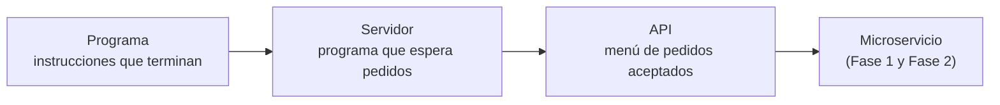
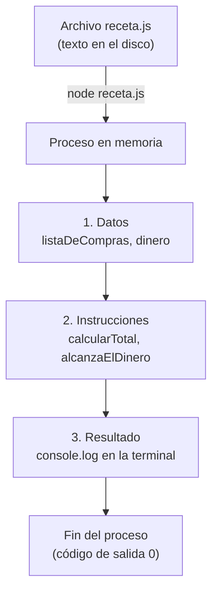
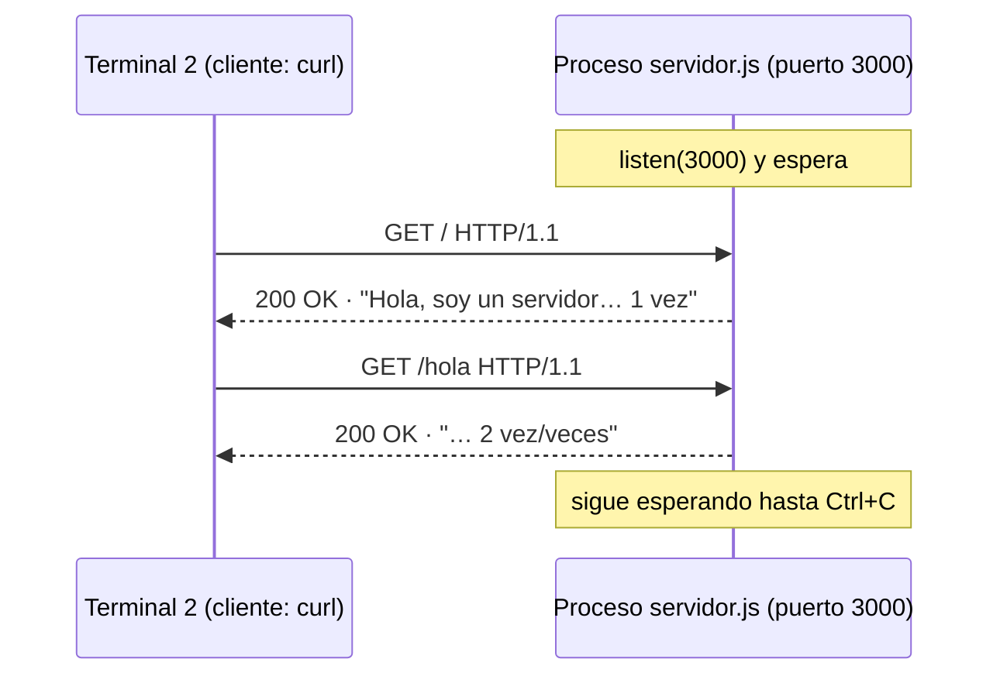
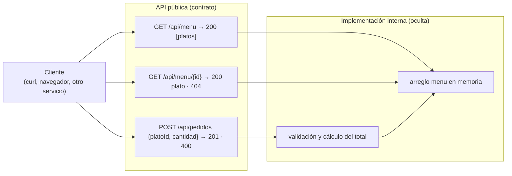

# Módulo 0.1 · Qué es un programa, un servidor y una API (analogías visuales)

**Fase 0 · Fundamentos absolutos** (semana 1 de 4). **Duración:** 6 h (3 temas de 2 h). **Dificultad:** 1 de 5,
para quien nunca ha programado. **Dependencias:** ninguna; solo necesitas un computador con terminal y
**Node.js 26.13.1 LTS** instalado (el Módulo 0.4 profundiza en la terminal y el 0.5 instala todo paso a paso; si aún
no tienes Node, ejecuta los comandos de este módulo cuando lo instales). **Laboratorio:**
`modulo-0` (se verifica con `./verificar.sh`).

Al terminar este módulo podrás explicar con tus palabras, y demostrar en tu terminal, la diferencia entre un
programa que termina, un servidor que se queda esperando y una API que define qué se le puede pedir a ese
servidor. Son las tres piezas con las que, 30 semanas después, construirás microservicios.



**Texto alternativo:** cuatro cajas en línea de izquierda a derecha. «Programa» lleva a «Servidor», que lleva a
«API», que lleva a «Microservicio». Cada pieza se construye sobre la anterior.

---

### Qué es un programa

#### 1. UBICACIÓN

Módulo 0.1, Lección 1 de 3 · Fase 0 · `web/public/content/microservices/modulo-0.md` · Laboratorio
`programa`.

#### 2. PRERREQUISITOS

- Saber abrir la terminal de tu computador (en macOS: aplicación **Terminal**; en Windows: **PowerShell** o
  **WSL**; en Linux: **Terminal**). No necesitas saber usarla: copiarás los comandos tal cual.
- Tener Node.js instalado (comprueba con `node -v`; debe empezar por `v26`, o como mínimo `v22`).
- Ningún conocimiento de programación.

#### 3. OBJETIVO DE APRENDIZAJE

**Ejecutar** un programa de 20 líneas, **identificar** en él sus tres partes (datos, instrucciones y resultado) y
**modificar** un dato para predecir el nuevo resultado antes de ejecutarlo; lo compruebas cuando el test
`programa/receta.test.js` pasa con 3 de 3.

#### 4. ANALOGÍA VISUAL

Imagina una **receta de cocina pegada en la puerta de la nevera**. Arriba, en un recuadro, la lista de
ingredientes con sus cantidades (arroz 4500, huevos 12000, tomates 3500). Debajo, pasos numerados con flechas
que bajan: «1. Pon el contador en cero», «2. Por cada ingrediente, suma su precio», «3. Compara con el dinero de
la billetera». Al final de la hoja, un plato servido con un cartel: «Total: 20000. ¿Alcanza? Sí». A un lado,
una persona (la computadora) lee la receta **en orden, de arriba abajo, sin saltarse ni inventar pasos**, y
cuando llega al último paso **se va de la cocina**: la receta terminó.

La imagen enseña tres cosas: un programa tiene **datos** (ingredientes), **instrucciones** (pasos) y
**resultado** (plato); la computadora es obediente pero literal; y un programa normal **termina**.

#### 5. DIAGRAMA TÉCNICO



**Texto alternativo:** diagrama vertical. Un archivo de texto llamado receta.js se convierte, con el comando
«node receta.js», en un proceso en memoria. El proceso pasa por tres cajas en orden (datos, instrucciones,
resultado) y termina en la caja «Fin del proceso, código de salida 0».

#### 6. EXPLICACIÓN NIVEL 0

Un **programa** es un texto escrito en un idioma que la computadora sabe seguir. Ese texto vive en un archivo
(como una carta guardada en un cajón) y no hace nada hasta que alguien lo **ejecuta**. Ejecutar es decirle a la
computadora: «lee este archivo y haz lo que dice».

En este curso usarás dos «idiomas» (lenguajes de programación): **JavaScript**, que ejecuta un programa llamado
**Node.js**, y **Java**, que ejecuta la **JVM** (los conocerás lado a lado en el Módulo 0.3). Hoy empiezas con
JavaScript porque se ejecuta con un solo comando.

Todo programa, por grande que sea, tiene las mismas tres partes que la receta:

1. **Datos**: la información con la que trabaja (una lista de compras, un precio).
2. **Instrucciones**: lo que hace con esos datos (sumar, comparar).
3. **Resultado**: lo que muestra o guarda al final (un mensaje en la pantalla).

Y casi todos los programas que escribirás al principio **terminan**: hacen su trabajo y se cierran.

#### 7. EXPLICACIÓN INTERMEDIA

Cuando escribes `node programa/receta.js`, el sistema operativo crea un **proceso**: un espacio de memoria
propio donde Node.js lee el archivo, lo traduce a instrucciones de máquina y las ejecuta en orden. Dentro del
programa:

- `const listaDeCompras = [...]` crea una **variable**: un nombre que apunta a un dato en memoria. `const`
  significa que el nombre no se reasignará; `let` (que verás en `let total = 0`) permite cambiarlo.
- `function calcularTotal(lista) { ... }` define una **función**: un bloque de instrucciones con nombre que
  recibe datos (parámetros) y devuelve un resultado con `return`. Separar la lógica en funciones permite
  **probarla** por separado: el test importa `calcularTotal` y la llama con datos conocidos.
- `export` hace que la función se pueda usar desde otro archivo (el test). `import.meta.main` vale `true` solo
  cuando ejecutas el archivo directamente; así, al importarlo desde el test, no se imprime nada.
- `console.log(...)` escribe una línea en la **salida estándar** (stdout), el canal de texto que ves en la
  terminal.

Cuando la última instrucción termina y no queda nada pendiente, el proceso finaliza con **código de salida 0**
(«todo bien»). Si ocurre un error no controlado, termina con un código distinto de 0. La terminal guarda ese
código en la variable `$?`.

#### 8. EXPLICACIÓN MAESTRA

Un microservicio también es «un programa», pero de los que **no terminan** (lo verás en el siguiente tema). Las
decisiones que tomas hoy, aunque parezcan pequeñas, se repiten a escala:

- **Script frente a programa con funciones.** Podrías escribir todo en 5 líneas sin funciones; funciona, pero no
  se puede probar por partes. Alternativa A: script lineal (rápido, imposible de probar y reutilizar).
  Alternativa B: funciones puras exportadas + un bloque de arranque (`import.meta.main`), como aquí: algo más de
  texto, pero cada regla tiene su test. En producción siempre B.
- **Interpretado frente a compilado.** Node.js compila JavaScript «justo a tiempo» (JIT) mientras se ejecuta;
  Java compila primero a *bytecode* (`javac`) y luego la JVM lo ejecuta con su propio JIT. Trade-off: Node arranca
  rápido y sin paso previo; Java detecta errores de tipos antes de ejecutar (Módulo 0.3).
- **Proceso efímero frente a proceso de larga vida.** Un programa que termina es ideal para tareas por lotes
  (*batch*), migraciones o *jobs* programados. No sirve para atender clientes: cada pedido tendría que arrancar
  el programa desde cero.

**Cuándo NO** escribir un programa: si la tarea se hace una sola vez y a mano tardas menos que en escribir y
probar el código (por ejemplo, sumar tres precios), no lo automatices. Programa lo que se repite o lo que debe
ser exacto siempre.

#### 9. CÓDIGO EJECUTABLE

Versiones: **Node.js 26.13.1 LTS** (también corre en Node 22). Sin dependencias externas. El `package.json` del
laboratorio solo declara `"type": "module"` para poder usar `import`/`export`:

```json
{
  "name": "modulo-0-1-programa-servidor-api",
  "version": "1.0.0",
  "private": true,
  "type": "module",
  "engines": { "node": ">=26.13.1" },
  "scripts": { "test": "node --test" }
}
```

Archivo `receta.js`:

```javascript
// Módulo 0.1 · Qué es un programa
// Un programa es una lista de instrucciones que la computadora sigue en orden.
// Requisitos: Node.js 26.13.1 LTS (funciona desde Node 22). Sin dependencias.
// Ejecuta: node programa/receta.js

// 1. DATOS: lo que el programa recibe (los ingredientes de la receta).
const listaDeCompras = [
  { producto: 'Arroz', precio: 4500 },
  { producto: 'Huevos', precio: 12000 },
  { producto: 'Tomates', precio: 3500 },
];
const dineroEnLaBilletera = 20000;

// 2. INSTRUCCIONES: una función es una receta con nombre que se puede repetir.
export function calcularTotal(lista) {
  let total = 0; // empezamos en cero
  for (const item of lista) { // repetimos para cada producto...
    total = total + item.precio; // ...y sumamos su precio
  }
  return total; // devolvemos el resultado
}

export function alcanzaElDinero(total, dinero) {
  return total <= dinero; // true (sí) o false (no)
}

// 3. RESULTADO: lo que el programa muestra al terminar.
// import.meta.main es true solo cuando ejecutas este archivo directamente
// (no cuando el test lo importa).
if (import.meta.main) {
  const total = calcularTotal(listaDeCompras);
  console.log(`Productos: ${listaDeCompras.length}`);
  console.log(`Total a pagar: ${total}`);
  console.log(`¿Alcanza con ${dineroEnLaBilletera}? ${alcanzaElDinero(total, dineroEnLaBilletera) ? 'Sí' : 'No'}`);
}
```

Salida real al ejecutarlo:

```text
Productos: 3
Total a pagar: 20000
¿Alcanza con 20000? Sí
```

#### 10. MINI-LABORATORIO

1. Entra a la carpeta del laboratorio:
   ```bash
   ```
2. Ejecuta el programa y mira cómo termina:
   ```bash
   node programa/receta.js
   echo "Código de salida: $?"
   ```
3. **Predice antes de ejecutar:** abre `programa/receta.js`, cambia el precio de los huevos de `12000` a `13000`,
   guarda y escribe en un papel qué crees que dirá. Luego ejecuta de nuevo `node programa/receta.js`.
4. Devuelve el precio a `12000`.

**Output esperado** (paso 2):

```text
Productos: 3
Total a pagar: 20000
¿Alcanza con 20000? Sí
Código de salida: 0
```

En el paso 3 la salida debe decir `Total a pagar: 21000` y `¿Alcanza con 20000? No`.

**Captura comentada:** la terminal muestra tres líneas del programa y, justo después, el *prompt* (`$`) vuelve a
aparecer: esa es la señal visual de que el proceso **terminó**. La cuarta línea, `Código de salida: 0`, la
imprime la terminal, no el programa.

#### 11. VERIFICACIÓN

Ejecuta el test (comprueba la suma, la lista vacía y el borde «total igual al dinero»):

```bash
node --test --test-reporter=spec programa/receta.test.js
```

Salida real:

```text
✔ suma los precios de la lista (0.593344ms)
✔ una lista vacía cuesta 0 (0.079215ms)
✔ alcanza cuando el total es igual al dinero (0.065909ms)
ℹ tests 3
ℹ pass 3
ℹ fail 0
```

(Los milisegundos cambian en cada ejecución.) **Pregunta de comprobación:** si la lista de compras estuviera
vacía, ¿qué imprimiría `Total a pagar:` y por qué? *(0, porque `total` empieza en 0 y el bucle no se repite
ninguna vez.)*

#### 12. ERROR COMÚN

**Síntoma:** escribes `node receta.js` desde la carpeta equivocada y ves:

```text
Error: Cannot find module '/…/modulo-0/receta.js'
  code: 'MODULE_NOT_FOUND'
```

**Cómo se ve:** un bloque rojo de varias líneas que termina en `MODULE_NOT_FOUND`, sin ninguna línea de tu
programa. **Diagnóstico:** Node buscó el archivo en la carpeta actual y no lo encontró; el programa ni siquiera
empezó. Ejecuta `pwd` (dónde estás) y `ls` (qué hay aquí). **Arreglo:** usa la ruta correcta
(`node programa/receta.js` desde `modulo-0`) o entra antes a la carpeta con `cd`.

#### 13. PREGUNTA DE ENTREVISTA

«¿Qué diferencia hay entre un programa y un proceso?»

**Respuesta modelo:** un programa es el código guardado en disco: texto o binario que no hace nada por sí
solo. Un proceso es una ejecución concreta de ese programa: tiene memoria propia, un identificador (PID), canales
de entrada y salida y un código de salida al terminar. Del mismo programa pueden existir varios procesos a la
vez; en microservicios eso es justo escalar horizontalmente: varias réplicas (procesos) del mismo servicio.

#### 14. ANTI-PATRÓN RELACIONADO

**Datos «quemados» mezclados con la lógica y sin funciones** (*hardcoding*):

```javascript
// ✖ Anti-patrón: todo en una línea, imposible de probar o reutilizar
console.log(4500 + 12000 + 3500 <= 20000 ? 'Sí' : 'No');
```

Se ve como un número mágico tras otro: nadie sabe qué es `20000`, y para probar otra lista hay que editar el
código. Haz lo contrario: datos con nombre, lógica en funciones que reciben esos datos y un test por regla.

---

### Qué es un servidor

#### 1. UBICACIÓN

Módulo 0.1, Lección 2 de 3 · Fase 0.

#### 2. PRERREQUISITOS

- Tema anterior: «Qué es un programa» (datos, instrucciones, resultado; un proceso que termina).
- Saber abrir **dos** ventanas o pestañas de terminal a la vez.
- Tener `curl` (viene instalado en macOS, Linux y Windows 10+; comprueba con `curl --version`).

#### 3. OBJETIVO DE APRENDIZAJE

**Arrancar** un servidor HTTP, **enviarle** pedidos desde otra terminal con `curl` y **explicar** por qué el
proceso no termina; lo compruebas cuando el test `servidor/servidor.test.js` pasa y cuando puedes provocar e
interpretar el error `EADDRINUSE`.

#### 4. ANALOGÍA VISUAL

Dibuja una **ventanilla de atención en un edificio**, con un número grande pintado encima: **3000**. Detrás del
vidrio hay una persona sentada (el servidor) con un cuaderno donde anota cada visita: «Pedido #1: GET /»,
«Pedido #2: GET /hola». Frente a la ventanilla, una fila de personas con papelitos (los clientes). Cada una
entrega su papel, recibe una respuesta impresa («Hola, soy un servidor») y se va. **La persona de la ventanilla no
se va nunca**: cuando no hay nadie, espera con los brazos cruzados. Solo cuando alguien apaga la luz
(**Ctrl+C**) cierra la ventanilla. En el edificio hay muchas ventanillas, cada una con su número (puerto), y dos
personas no pueden atender la misma ventanilla a la vez.

#### 5. DIAGRAMA TÉCNICO



**Texto alternativo:** diagrama de secuencia con dos participantes: a la izquierda la terminal 2, que actúa como
cliente con curl; a la derecha el proceso servidor.js escuchando en el puerto 3000. El cliente envía «GET /» y
recibe «200 OK» con el contador en 1; luego envía «GET /hola» y recibe el contador en 2. Una nota final indica
que el servidor sigue esperando hasta que se pulsa Ctrl+C.

#### 6. EXPLICACIÓN NIVEL 0

Un **servidor** es un programa que, en vez de terminar, **se queda esperando pedidos** y responde a cada uno.
Piensa en él como un empleado de ventanilla: su trabajo no es hacer una cosa y marcharse, sino estar disponible.

Para que los pedidos lleguen al programa correcto, cada servidor «se sienta» en un **puerto**: un número entre 1 y
65535 que funciona como el número de la ventanilla. Nuestro servidor usa el **3000**.

El que hace el pedido se llama **cliente**. Hoy el cliente será `curl`, un programa de terminal que envía pedidos
web. Mañana será tu navegador, una app del celular u otro microservicio.

La palabra «servidor» también se usa para la **máquina** donde corren estos programas. En este curso, cuando
digamos servidor, hablamos casi siempre del **programa**.

#### 7. EXPLICACIÓN INTERMEDIA

`http.createServer(manejador)` crea un objeto servidor y registra una función (`manejador`) que Node llamará
**una vez por cada pedido**. `servidor.listen(3000)` le pide al sistema operativo reservar el puerto 3000 y
avisar cuando llegue una conexión. Desde ese momento hay algo pendiente (un *socket* escuchando), y por eso el
proceso **no termina**: Node solo finaliza cuando no le queda nada por hacer.

Cada pedido trae un **método** (`GET`) y una **ruta** (`/hola`); la respuesta lleva un **código de estado**
(`200` = bien), **cabeceras** (`Content-Type`) y un **cuerpo** (el texto). Lo estudiarás a fondo en el tema HTTP
del Módulo 0.4.

La variable `pedidosAtendidos` vive en la memoria del proceso y **sobrevive entre pedidos**: por eso el segundo
pedido dice «2 vez/veces». Si apagas y enciendes el servidor, vuelve a 0: la memoria del proceso se perdió.

El test arranca el servidor con `listen(0)`: el 0 le pide al sistema operativo **cualquier puerto libre**, así el
test no choca con un servidor que ya tengas encendido.

#### 8. EXPLICACIÓN MAESTRA

- **Estado en memoria frente a estado externo.** El contador vive en RAM: rápido y simple, pero se pierde al
  reiniciar y **no se comparte entre réplicas**. Con dos procesos detrás de un balanceador, cada uno llevaría su
  propia cuenta. Alternativas: guardar el estado en una base de datos o en Redis (servidor *stateless*, como exige
  la 12-Factor App del Módulo 5) o aceptar estado local solo como caché. En microservicios, por defecto,
  servidores **sin estado**.
- **Servidor HTTP de la librería estándar frente a framework.** `node:http` (aquí) y `com.sun.net.httpserver`
  (Java, Módulo 0.5) no necesitan dependencias pero obligan a escribir a mano rutas, validación y errores. Express
  o NestJS (Fase 2) y Spring Boot (Fase 1) resuelven eso a cambio de dependencias y convenciones. Para aprender y
  para utilidades mínimas, la librería estándar; para servicios de negocio, un framework.
- **Modelo de concurrencia.** Node atiende muchos pedidos con un solo hilo y un *event loop*; un servidor Java
  clásico usa un hilo por pedido (y desde Java 21, hilos virtuales). Lo comparas en el Módulo 0.3.

**Cuándo NO** levantar un servidor: si el trabajo se dispara una vez al día (un reporte nocturno), un programa
que termina, lanzado por un planificador (`cron`, un *Job* de Kubernetes), cuesta menos y no ocupa un puerto ni
memoria las 24 horas.

#### 9. CÓDIGO EJECUTABLE

Versiones: **Node.js 26.13.1 LTS** (también corre en Node 22); solo el módulo `node:http` incluido en Node.
Usa el mismo `package.json` del tema anterior (`"type": "module"`). Archivo
`servidor.js`:

```javascript
// Módulo 0.1 · Qué es un servidor
// Un servidor es un programa que NO termina: se queda esperando pedidos
// en un "puerto" (como una ventanilla numerada) y responde a cada uno.
// Requisitos: Node.js 26.13.1 LTS (funciona desde Node 22). Usa solo el módulo 'node:http'.
// Ejecuta: node servidor/servidor.js   y en otra terminal: curl http://localhost:3000/

import http from 'node:http';

let pedidosAtendidos = 0;

// crearServidor() devuelve el servidor sin encenderlo; así el test puede encenderlo en un puerto libre.
export function crearServidor() {
  return http.createServer((pedido, respuesta) => {
    pedidosAtendidos++;
    // Cada vez que llega un pedido, el servidor anota quién pidió qué...
    console.log(`Pedido #${pedidosAtendidos}: ${pedido.method} ${pedido.url}`);
    // ...y responde con un código de estado (200 = todo bien) y un texto.
    respuesta.writeHead(200, { 'Content-Type': 'text/plain; charset=utf-8' });
    respuesta.end(`Hola, soy un servidor. Te he atendido ${pedidosAtendidos} vez/veces.\n`);
  });
}

if (import.meta.main) {
  const puerto = Number(process.env.PORT ?? 3000);
  crearServidor().listen(puerto, () => {
    console.log(`Servidor escuchando en http://localhost:${puerto} (Ctrl+C para apagarlo)`);
  });
}
```

#### 10. MINI-LABORATORIO

1. **Terminal 1** (desde `modulo-0`): enciende el servidor.
   ```bash
   node servidor/servidor.js
   ```
2. **Terminal 2**: haz dos pedidos.
   ```bash
   curl -i http://localhost:3000/
   curl http://localhost:3000/hola
   ```
3. **Terminal 2**: intenta encender un segundo servidor en el mismo puerto.
   ```bash
   node servidor/servidor.js
   ```
4. **Terminal 1**: pulsa `Ctrl+C`. Después, en la terminal 2: `curl http://localhost:3000/`.

**Output esperado.** Terminal 1 (el servidor no devuelve el *prompt*):

```text
Servidor escuchando en http://localhost:3000 (Ctrl+C para apagarlo)
Pedido #1: GET /
Pedido #2: GET /hola
```

Terminal 2, paso 2 (la fecha cambia):

```text
HTTP/1.1 200 OK
Content-Type: text/plain; charset=utf-8
Date: Fri, 20 Nov 2026 01:53:21 GMT
Connection: keep-alive
Keep-Alive: timeout=5
Transfer-Encoding: chunked

Hola, soy un servidor. Te he atendido 1 vez/veces.
Hola, soy un servidor. Te he atendido 2 vez/veces.
```

Paso 3: `Error: listen EADDRINUSE: address already in use 0.0.0.0:3000` (en macOS la dirección puede verse como
`:::3000`). Paso 4: `curl: (7) Failed to connect to localhost port 3000 after 0 ms: Couldn't connect to server`.

**Captura comentada:** en la terminal 1 el cursor se queda parpadeando bajo la última línea, sin `$`: el proceso
está vivo esperando. Cada `curl` de la terminal 2 hace aparecer una línea nueva en la terminal 1, al mismo
tiempo. Tras `Ctrl+C` vuelve el `$` y `curl` ya no encuentra a nadie en la ventanilla 3000.

#### 11. VERIFICACIÓN

El test enciende el servidor en un puerto libre, le hace dos pedidos y comprueba que el segundo lo atendió el
mismo proceso (contador en 2):

```bash
node --test --test-reporter=spec servidor/servidor.test.js
```

Salida real:

```text
Pedido #1: GET /
Pedido #2: GET /otra-vez
✔ el servidor responde y sigue esperando pedidos (21.241997ms)
ℹ tests 1
ℹ pass 1
ℹ fail 0
```

**Pregunta de comprobación:** si apagas el servidor y lo vuelves a encender, ¿qué número dirá el siguiente
pedido y por qué? *(1, porque el contador vivía en la memoria del proceso anterior, que ya no existe.)*

#### 12. ERROR COMÚN

**Síntoma:** al arrancar ves `Error: listen EADDRINUSE: address already in use 0.0.0.0:3000` y el programa se
cierra. **Cómo se ve:** un bloque de error que menciona `code: 'EADDRINUSE'` y `port: 3000`. **Diagnóstico:** ya
hay un proceso ocupando la ventanilla 3000 (otra terminal que olvidaste, o un servidor anterior que no apagaste).
Averigua cuál con:

```bash
lsof -i :3000
```

La columna `PID` te da el número del proceso. **Arreglo:** apágalo (`Ctrl+C` en su terminal o `kill <PID>`) o usa
otro puerto: `PORT=3005 node servidor/servidor.js`.

#### 13. PREGUNTA DE ENTREVISTA

«¿Por qué un proceso servidor no termina cuando llega al final de su código, y cómo se apaga correctamente?»

**Respuesta modelo:** porque `listen` registra un socket que espera conexiones; mientras exista ese recurso
pendiente, el *runtime* (el event loop de Node o los hilos no daemon de la JVM) mantiene vivo el proceso. Se
apaga con una señal del sistema operativo: `SIGINT` (Ctrl+C) o `SIGTERM` (lo que envían Docker y Kubernetes). Un
apagado correcto (*graceful shutdown*) deja de aceptar conexiones nuevas, termina las que están en curso y libera
recursos antes de salir; lo implementas en el Módulo 13.

#### 14. ANTI-PATRÓN RELACIONADO

**Guardar datos importantes solo en la memoria del servidor.** Se ve así:

```javascript
// ✖ Anti-patrón: los pedidos de los clientes viven solo en RAM
const pedidos = [];
// ... pedidos.push(nuevoPedido) en cada POST
```

Funciona en tu máquina, pero al reiniciar (un despliegue, una caída) se pierden todos los pedidos, y con dos
réplicas cada una ve una lista distinta. En el diagrama de la analogía, es como si la persona de la ventanilla
anotara los pedidos en una servilleta que tira al irse a casa. Lo correcto es guardar el estado en una base de
datos (Módulos 2 y 15).

---

### Qué es una API

#### 1. UBICACIÓN

Módulo 0.1, Lección 3 de 3 · Fase 0.

#### 2. PRERREQUISITOS

- Temas «Qué es un programa» y «Qué es un servidor» (puerto, cliente, `curl`).
- Haber visto un objeto JavaScript con llaves `{ "nombre": "Arepa" }`; el tema JSON del Módulo 0.4 lo
  profundiza, aquí basta con reconocerlo.

#### 3. OBJETIVO DE APRENDIZAJE

**Consumir** las tres operaciones de una API REST pequeña con `curl`, **distinguir** una respuesta exitosa (200,
201) de un error del cliente (400, 404) y **explicar** qué es un contrato de API; lo compruebas cuando
`api/api.test.js` pasa 4 de 4.

#### 4. ANALOGÍA VISUAL

Dibuja un **restaurante visto en corte**: a la izquierda el comedor con un cliente sentado; a la derecha, detrás
de una pared, la cocina (el servidor) con ollas y cocineros. En la mesa hay un **menú plastificado** con tres
líneas: «Ver todos los platos», «Ver un plato por su número», «Hacer un pedido (plato + cantidad)». Entre el
comedor y la cocina va y viene un **mesero** con una libreta: el cliente nunca entra a la cocina, solo pide lo que
está en el menú, con la forma que el menú indica. Si pide «el plato 99», el mesero vuelve con una nota roja: «No
existe ese plato» (404). Si pide «cero empanadas», otra nota roja: «Pedido mal hecho» (400). Si pide bien, vuelve
con una bandeja y la cuenta: «3 empanadas, total 9000» (201).

El **menú es la API**: la lista pública y estable de pedidos que acepta la cocina y la forma exacta de lo que
devuelve. La cocina puede cambiar sus recetas por dentro sin que el cliente se entere, siempre que el menú no
cambie.

#### 5. DIAGRAMA TÉCNICO



**Texto alternativo:** a la izquierda, una caja «Cliente». En el centro, un recuadro «API pública (contrato)» con
tres operaciones: GET /api/menu que responde 200 con la lista; GET /api/menu/{id} que responde 200 o 404; POST
/api/pedidos que responde 201 o 400. A la derecha, un recuadro «Implementación interna (oculta)» con los datos del
menú y la lógica de validación. El cliente solo toca el recuadro central.

#### 6. EXPLICACIÓN NIVEL 0

**API** significa *Application Programming Interface*: «interfaz para que un programa hable con otro». Es la
lista de cosas que un servidor acepta que le pidas y la forma exacta de pedirlas y de responder.

En la web, cada operación de la API se describe con dos datos:

- un **método** (el verbo): `GET` para leer, `POST` para crear algo;
- una **ruta** (la dirección): `/api/menu`, `/api/pedidos`.

La respuesta llega en **JSON**, un formato de texto con llaves y comillas que tanto personas como programas
pueden leer: `{"id":2,"nombre":"Empanada","precio":3000}`.

Y siempre trae un **código de estado**, un número que resume qué pasó: `200` (aquí tienes), `201` (creado), `400`
(pediste mal), `404` (no existe).

#### 7. EXPLICACIÓN INTERMEDIA

La API del laboratorio es una pequeña **API REST**: los recursos son sustantivos en la ruta (`/api/menu`,
`/api/pedidos`) y el método HTTP indica la acción. El servidor:

1. compara `method` y `url` de cada pedido con su lista de operaciones (el «enrutador», aquí unas cuantas `if`);
2. para `POST`, lee el **cuerpo** del pedido (llega por trozos), lo convierte de texto JSON a objeto con
   `JSON.parse` y lo **valida** (¿existe el plato?, ¿la cantidad es un entero mayor que 0?);
3. responde siempre JSON con `Content-Type: application/json` y el código adecuado.

El conjunto de rutas, métodos, formatos de entrada y salida y códigos de estado es el **contrato**. El test
`api.test.js` es una forma ejecutable del contrato: si alguien cambia el nombre de un campo o un código de estado,
el test falla antes de que se entere un cliente. En el Módulo 3 harás lo mismo entre servicios con *contract
testing* (Pact).

#### 8. EXPLICACIÓN MAESTRA

- **Estilos de API.** REST sobre HTTP+JSON (aquí) es simple, universal y fácil de depurar con `curl`, pero cada
  cliente recibe la forma que decide el servidor. **GraphQL** deja al cliente elegir los campos (útil con muchos
  clientes distintos, a cambio de caché HTTP más difícil). **gRPC** usa contratos binarios Protocol Buffers y
  HTTP/2 (rápido y tipado entre servicios, a cambio de no poder probarlo con `curl` a secas). Los verás en los
  Módulos 6 y 18. Regla de partida: REST para APIs públicas, gRPC para tráfico interno de alto volumen.
- **El contrato es más importante que la implementación.** Puedes reescribir la cocina de Node a Java sin romper
  a nadie si el contrato se mantiene. Cambiar el contrato (quitar un campo, cambiar un 201 por 200) rompe a los
  clientes: por eso se versiona (`/api/v2/...`) y se añaden campos sin quitar los viejos.
- **Validar en la frontera.** Toda entrada externa es sospechosa: la API devuelve 400 en vez de calcular con una
  cantidad 0 o un texto. Validar tarde produce datos corruptos difíciles de rastrear.

**Cuándo NO** crear una API: si dos piezas de código viven en el mismo programa y siempre se despliegan juntas,
una llamada a función es más rápida, más segura y más fácil de cambiar que una API por red. Una API por red tiene
sentido cuando hay otro programa (u otro equipo) al otro lado.

#### 9. CÓDIGO EJECUTABLE

Versiones: **Node.js 26.13.1 LTS** (también corre en Node 22); solo `node:http`. Mismo `package.json`
(`"type": "module"`). Archivo `api.js`:

```javascript
// Módulo 0.1 · Qué es una API
// Una API es el "menú" de un servidor: una lista fija de pedidos que acepta
// (rutas + métodos), con la forma exacta de lo que devuelve (JSON).
// Requisitos: Node.js 26.13.1 LTS (funciona desde Node 22). Usa solo 'node:http'.
// Ejecuta: node api/api.js  y prueba:
//   curl http://localhost:3001/api/menu
//   curl http://localhost:3001/api/menu/2
//   curl -X POST http://localhost:3001/api/pedidos -H 'Content-Type: application/json' -d '{"platoId":2,"cantidad":3}'

import http from 'node:http';

const menu = [
  { id: 1, nombre: 'Arepa', precio: 5000 },
  { id: 2, nombre: 'Empanada', precio: 3000 },
  { id: 3, nombre: 'Limonada', precio: 4000 },
];

// Ayudante: toda respuesta de esta API es JSON, con un código de estado.
function responderJson(respuesta, estado, cuerpo) {
  respuesta.writeHead(estado, { 'Content-Type': 'application/json; charset=utf-8' });
  respuesta.end(JSON.stringify(cuerpo));
}

// Lee el cuerpo del pedido (llega en trozos) y lo convierte de texto JSON a objeto.
async function leerJson(pedido) {
  let texto = '';
  for await (const trozo of pedido) texto += trozo;
  return JSON.parse(texto);
}

export function crearApi() {
  return http.createServer(async (pedido, respuesta) => {
    const { method, url } = pedido;

    // Contrato 1: GET /api/menu -> lista completa
    if (method === 'GET' && url === '/api/menu') {
      return responderJson(respuesta, 200, menu);
    }

    // Contrato 2: GET /api/menu/{id} -> un plato o 404
    const coincide = url.match(/^\/api\/menu\/(\d+)$/);
    if (method === 'GET' && coincide) {
      const plato = menu.find((p) => p.id === Number(coincide[1]));
      return plato
        ? responderJson(respuesta, 200, plato)
        : responderJson(respuesta, 404, { error: 'No existe ese plato' });
    }

    // Contrato 3: POST /api/pedidos {platoId, cantidad} -> 201 con el total, o 400 si el pedido está mal hecho
    if (method === 'POST' && url === '/api/pedidos') {
      let datos;
      try {
        datos = await leerJson(pedido);
      } catch {
        return responderJson(respuesta, 400, { error: 'El cuerpo no es JSON válido' });
      }
      const plato = menu.find((p) => p.id === datos.platoId);
      if (!plato || !Number.isInteger(datos.cantidad) || datos.cantidad < 1) {
        return responderJson(respuesta, 400, { error: 'Necesito platoId existente y cantidad entera mayor que 0' });
      }
      return responderJson(respuesta, 201, { plato: plato.nombre, cantidad: datos.cantidad, total: plato.precio * datos.cantidad });
    }

    // Cualquier otra cosa no está en el menú de la API.
    return responderJson(respuesta, 404, { error: `La API no ofrece ${method} ${url}` });
  });
}

if (import.meta.main) {
  const puerto = Number(process.env.PORT ?? 3001);
  crearApi().listen(puerto, () => console.log(`API escuchando en http://localhost:${puerto}/api/menu`));
}
```

#### 10. MINI-LABORATORIO

1. **Terminal 1** (desde `modulo-0`):
   ```bash
   node api/api.js
   ```
2. **Terminal 2**, recorre el menú de la API:
   ```bash
   curl -s http://localhost:3001/api/menu; echo
   curl -s http://localhost:3001/api/menu/2; echo
   curl -s -i http://localhost:3001/api/menu/99
   curl -s -X POST http://localhost:3001/api/pedidos -H 'Content-Type: application/json' -d '{"platoId":2,"cantidad":3}' -w ' [%{http_code}]\n'
   ```
3. **Rómpelo a propósito:** envía JSON inválido (coma final), una ruta con mayúscula y un método que no existe.
   ```bash
   curl -s -X POST http://localhost:3001/api/pedidos -H 'Content-Type: application/json' -d '{"platoId":2,"cantidad":3,}' -w ' [%{http_code}]\n'
   curl -s http://localhost:3001/api/Menu -w ' [%{http_code}]\n'
   curl -s -X DELETE http://localhost:3001/api/menu/1 -w ' [%{http_code}]\n'
   ```

**Output esperado** (paso 2; `-w ' [%{http_code}]'` le pide a curl mostrar el código al final):

```text
[{"id":1,"nombre":"Arepa","precio":5000},{"id":2,"nombre":"Empanada","precio":3000},{"id":3,"nombre":"Limonada","precio":4000}]
{"id":2,"nombre":"Empanada","precio":3000}
HTTP/1.1 404 Not Found
Content-Type: application/json; charset=utf-8
…
{"error":"No existe ese plato"}
{"plato":"Empanada","cantidad":3,"total":9000} [201]
```

Paso 3:

```text
{"error":"El cuerpo no es JSON válido"} [400]
{"error":"La API no ofrece GET /api/Menu"} [404]
{"error":"La API no ofrece DELETE /api/menu/1"} [404]
```

**Captura comentada:** todas las respuestas son una sola línea de JSON. Los éxitos traen datos; los errores
traen siempre un objeto con la clave `error` y un código 4xx: el cliente sabe que **él** pidió mal y no tiene
sentido repetir el mismo pedido. La ruta `/api/Menu` falla porque las rutas distinguen mayúsculas.

#### 11. VERIFICACIÓN

El test es el contrato ejecutable de la API (forma de la lista, 404, 201 con total y 400):

```bash
node --test --test-reporter=spec api/api.test.js
```

Salida real:

```text
✔ GET /api/menu devuelve 3 platos en JSON (26.955317ms)
✔ GET /api/menu/99 responde 404 (3.402152ms)
✔ POST /api/pedidos calcula el total y responde 201 (6.349675ms)
✔ POST /api/pedidos con cantidad inválida responde 400 (4.30047ms)
ℹ tests 4
ℹ pass 4
ℹ fail 0
```

Para comprobar el módulo completo: `./verificar.sh` (8 tests y la línea `RESULTADO: OK · Módulo 0.1 (programa,
servidor y API) verificado`). **Pregunta de comprobación:** cambia en `api.js` la clave `nombre` por `titulo` y
ejecuta el test: ¿qué test falla y qué le pasaría a una app que usara la API? *(Falla «GET /api/menu devuelve 3
platos en JSON» porque las claves ya no son `id, nombre, precio`; la app mostraría platos sin nombre: rompiste
el contrato.)*

#### 12. ERROR COMÚN

**Síntoma:** envías un pedido válido y recibes `{"error":"El cuerpo no es JSON válido"} [400]`. **Cómo se ve:**
una respuesta 400 aunque «el pedido parece bien». **Diagnóstico:** casi siempre son las comillas de la terminal.
En macOS/Linux, el JSON va entre comillas simples por fuera y dobles por dentro: `-d '{"platoId":2}'`. En
Windows PowerShell 5.1, `curl` es un alias de otro comando (escribe `curl.exe`) y las comillas dobles internas
pueden perderse al pasar a programas externos; mira lo que realmente envías añadiendo `-v` a curl (línea
`> Content-Length`) o guarda el JSON en un archivo y envíalo con `-d @pedido.json`. **Arreglo:** usa comillas
simples por fuera (o `@archivo`) y valida tu JSON antes de enviarlo.

#### 13. PREGUNTA DE ENTREVISTA

«¿Qué diferencia hay entre un 400 y un 404, y por qué importa elegir bien el código de estado?»

**Respuesta modelo:** ambos son errores del cliente (4xx). 404 dice que el recurso o la ruta no existe; 400 dice
que la ruta existe pero el contenido del pedido es inválido. Importa porque los clientes, los *proxies*, los
reintentos automáticos y el monitoreo toman decisiones con el código: un 4xx no se reintenta (repetir el mismo
pedido dará lo mismo), un 5xx sí puede reintentarse; y una alerta basada en tasa de 5xx no debe dispararse por
clientes que piden mal. Un código incorrecto (por ejemplo, 200 con `{"error":...}`) esconde fallos al monitoreo.

#### 14. ANTI-PATRÓN RELACIONADO

**Exponer la implementación interna como API** (la «API anémica» que filtra la base de datos):

```text
✖ GET /api/tabla_menu_v2?sql=SELECT * FROM menu   →  200 [{"MENU_ID":1,"NOM_PLT":"Arepa","PRC_CENT":500000,"FLG_DEL":0}]
```

Se ve como rutas con nombres de tablas, columnas crípticas y campos internos (`FLG_DEL`) en la respuesta. Cada
cambio en la base de datos rompe a los clientes, y aceptar SQL por parámetro es además una puerta a inyecciones.
En el diagrama técnico, sería borrar el recuadro «API pública» y conectar el cliente directo al recuadro interno.
Diseña la API desde lo que el cliente necesita (platos, pedidos), no desde cómo guardas los datos.
