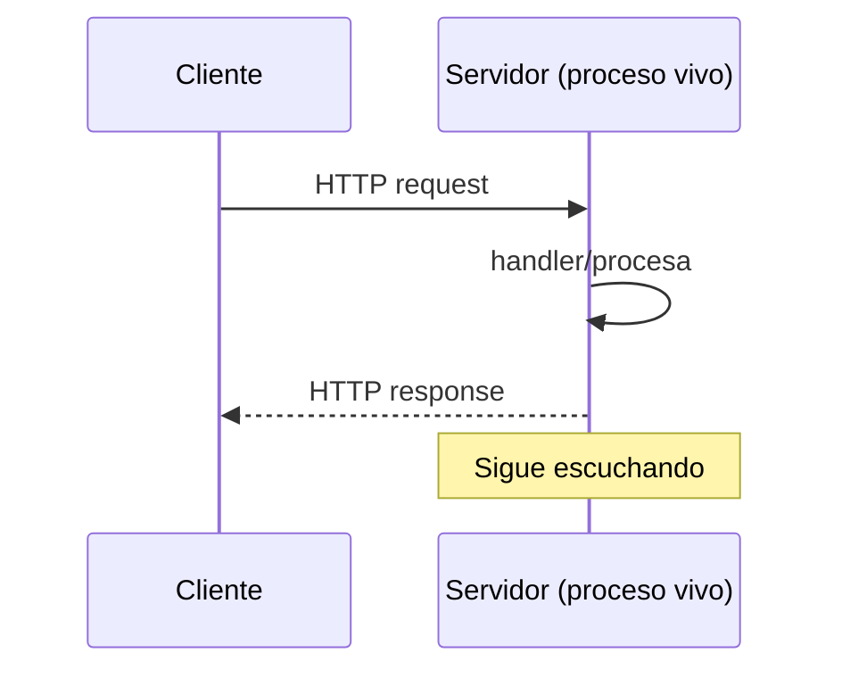
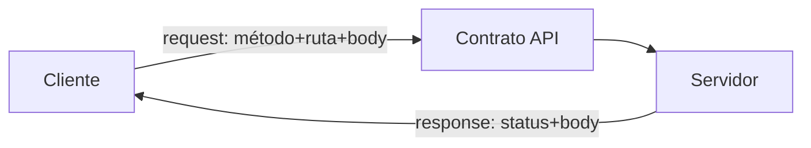

# Módulo 0.1 · Qué es un programa, un servidor y una API

Antes de hablar de microservicios, hay que tener el modelo mental correcto: un programa ejecuta instrucciones y termina; un servidor es un programa que permanece escuchando; una API es el contrato que define qué pedidos acepta y cómo responde. Si este modelo está borroso, el resto del track se vuelve memorización.

**Entorno de referencia verificado (2026-05-22):** Node.js v24.18.0 (npm 11.x), macOS. Los ejemplos usan módulos estándar de Node (`node:http`, `node:fs`, `node:assert/strict`) salvo que se indique.

## Aprende construyendo

### Tema 1: Qué es un programa · Básico · 120 min

Caso guía: calcular el total de una lista de compras y decidir si alcanza el dinero disponible.

#### Programa

**Definición formal.** Un programa es una especificación ejecutable de instrucciones que transforma entradas y estado en resultados observables, según la semántica del runtime.

**Para qué sirve.** Automatiza reglas repetibles con precisión y trazabilidad.

**Cuándo usarlo / cuándo no.** Úsalo cuando la regla sea clara y verificable. No escribas código antes de definir entrada, salida y criterio de corrección.

**Cómo funciona por dentro.** El runtime carga el archivo, parsea, compila/JIT según motor y ejecuta instrucciones. Las variables viven en memoria del proceso; al terminar el proceso, ese estado desaparece.


**Ejemplo mínimo enfocado (ejecutable).**

```bash
mkdir -p ms0-prog
cd ms0-prog
```

Crea el archivo `programa.mjs`:

```js
const items = [4500, 12000, 3500];
const total = items.reduce((a, b) => a + b, 0);
console.log(total);
```

```bash
node programa.mjs
```

**Caso de uso real.** Script de validación, job batch, CLI de migración, cálculo de totales en backend.

**Error común.** Mezclar entrada, lógica y salida en un bloque sin estructura. Síntoma: imposible probar la regla sin ejecutar todo. Corrección: extraer función pura para la regla y dejar I/O al borde.

**Verificación (Node 24.18.0, 2026-05-22).** Salida: `20000`.

#### Función pura y resultado observable

**Definición formal.** Una función pura devuelve el mismo resultado para los mismos argumentos y no produce efectos secundarios observables. El resultado observable puede ser un valor retornado, un log, un archivo, una respuesta HTTP o un exit code.

**Para qué sirve.** Permite probar y razonar sobre la regla sin infraestructura.

**Cuándo usarlo / cuándo no.** Úsala para reglas de negocio/cálculo. No fuerces pureza en código cuyo propósito es I/O; aísla el I/O en el borde.

**Ejemplo mínimo enfocado (ejecutable).**

```bash
mkdir -p ms0-fn
cd ms0-fn
```

Crea el archivo `calc.mjs`:

```js
export function calcularTotal(items) {
  return items.reduce((a, i) => a + i.precio, 0);
}

if (import.meta.main) {
  console.log(calcularTotal([{ precio: 4500 }, { precio: 12000 }, { precio: 3500 }]));
}
```

```bash
node calc.mjs
```

**Caso de uso real.** Cálculo de total de carrito antes de persistir o cobrar.

**Error común.** Leer estado global mutable dentro de la función. Síntoma: mismo input, distinto output. Corrección: pasar datos por parámetro.

**Verificación (Node 24.18.0, 2026-05-22).** Salida: `20000`.

#### Código de salida de proceso

**Definición formal.** El exit code es un entero que el proceso devuelve al sistema operativo al terminar; `0` indica éxito por convención y cualquier valor distinto indica fallo.

**Para qué sirve.** Permite a shells, CI, cron y orquestadores detectar fallos.

**Cuándo usarlo / cuándo no.** Úsalo en scripts, CLIs y jobs. No termines con `0` si hubo un error que el llamador debe conocer.

**Ejemplo mínimo enfocado (ejecutable).**

```bash
node -e "process.exit(0)"; echo $?
node -e "process.exit(2)"; echo $?
```

**Caso de uso real.** Un pipeline CI falla si la migración retorna exit code distinto de cero.

**Error común.** Atrapar un error, loguearlo y salir con `0`. Síntoma: CI en verde con job roto. Corrección: `process.exitCode = 1` o relanzar.

**Verificación (Node 24.18.0, 2026-05-22).** Salidas: `0` y `2`.

### Tema 2: Qué es un servidor · Básico · 120 min

Caso guía: mantener un proceso escuchando pedidos HTTP y responder cada vez.

#### Servidor HTTP

**Definición formal.** Un servidor HTTP es un proceso que escucha en IP:puerto, acepta conexiones, interpreta requests HTTP y emite responses.

**Para qué sirve.** Permite que múltiples clientes pidan operaciones a lo largo del tiempo.

**Cuándo usarlo / cuándo no.** Úsalo cuando necesitas atender pedidos continuos. No uses servidor para una tarea puntual que termina; un script basta.

**Cómo funciona por dentro.** El OS asigna el socket al puerto. El runtime recibe bytes, parsea HTTP, invoca tu handler y escribe la respuesta. El proceso queda vivo mientras el socket escucha.



**Ejemplo mínimo enfocado (ejecutable).**

```bash
mkdir -p ms0-srv
cd ms0-srv
```

Crea el archivo `server.mjs`:

```js
import http from 'node:http';

const server = http.createServer((req, res) => {
  res.writeHead(200, { 'Content-Type': 'text/plain; charset=utf-8' });
  res.end('ok');
});

server.listen(0, '127.0.0.1', async () => {
  const port = server.address().port;
  const r = await fetch(`http://127.0.0.1:${port}/`);
  console.log(r.status, await r.text());
  server.close();
});
```

```bash
node server.mjs
```

**Caso de uso real.** API backend, gateway, webhook receiver.

**Error común.** Esperar que el servidor termine solo. Síntoma: terminal “colgada”. Corrección: es comportamiento esperado; detener con señal o `close()`.

**Verificación (Node 24.18.0, 2026-05-22).** Salida: `200 ok`.

#### Puerto y `EADDRINUSE`

**Definición formal.** Un puerto TCP es un endpoint lógico numerado (0-65535) dentro de un host. `EADDRINUSE` indica que otro proceso ya está escuchando en ese puerto.

**Para qué sirve.** Permite múltiples servicios en el mismo host con puertos distintos.

**Cuándo usarlo / cuándo no.** Configura puertos por entorno. En tests, usa puerto `0` para que el OS asigne uno libre.

**Ejemplo mínimo enfocado (ejecutable).**

```bash
mkdir -p ms0-port
cd ms0-port
```

Crea el archivo `port.mjs`:

```js
import http from 'node:http';

const a = http.createServer((_, r) => r.end('a'));
a.listen(0, '127.0.0.1', () => {
  const port = a.address().port;
  const b = http.createServer((_, r) => r.end('b'));
  b.on('error', (e) => {
    console.log(e.code);
    a.close();
    b.close();
  });
  b.listen(port, '127.0.0.1');
});
```

```bash
node port.mjs
```

**Caso de uso real.** Dos instancias locales intentando usar 3000.

**Error común.** Matar el error y reintentar infinito sin diagnóstico. Corrección: loguear puerto y proceso, detener instancia anterior o cambiar puerto.

**Verificación (Node 24.18.0, 2026-05-22).** Salida: `EADDRINUSE`.

#### Estado en memoria y persistencia

**Definición formal.** El estado en memoria vive en el proceso; se pierde al reiniciar. La persistencia guarda datos en un medio externo (BD, archivo, cola) que sobrevive reinicios.

**Para qué sirve.** Distinguir caché efímera de datos durables.

**Cuándo usarlo / cuándo no.** Memoria para caché temporal o estado derivable. Persistencia para datos de negocio que deben sobrevivir.

**Ejemplo mínimo enfocado (ejecutable).**

```bash
mkdir -p ms0-state
cd ms0-state
```

Crea el archivo `state.mjs`:

```js
let count = 0;
count += 1;
console.log(count);
```

```bash
node state.mjs
node state.mjs
```

**Caso de uso real.** Un contador en memoria se reinicia; un pedido en BD permanece.

**Error común.** Guardar carrito/pedido crítico solo en memoria. Síntoma: al reiniciar se pierde. Corrección: persistir en DB y definir recuperación.

**Verificación (Node 24.18.0, 2026-05-22).** Dos ejecuciones imprimen `1` y `1`.

### Tema 3: Qué es una API · Básico · 120 min

Caso guía: exponer operaciones de menú con contrato HTTP claro.

#### API y contrato

**Definición formal.** Una API es un contrato que define operaciones disponibles, entradas, salidas, errores y semántica. En HTTP/REST, se expresa con métodos, rutas, códigos de estado y formatos.

**Para qué sirve.** Permite que clientes y servidores evolucionen con expectativas claras.

**Cuándo usarlo / cuándo no.** Siempre que otro sistema consuma tu servicio. No expongas detalles internos (tablas, clases privadas) como contrato accidental.



**Ejemplo mínimo enfocado (ejecutable).**

```bash
mkdir -p ms0-api
cd ms0-api
```

Crea el archivo `api.mjs`:

```js
import http from 'node:http';

const menu = [{ id: 1, nombre: 'Arroz', precio: 4500 }];

const server = http.createServer((req, res) => {
  if (req.method === 'GET' && req.url === '/api/menu') {
    res.writeHead(200, { 'Content-Type': 'application/json; charset=utf-8' });
    return res.end(JSON.stringify(menu));
  }
  res.writeHead(404, { 'Content-Type': 'application/json; charset=utf-8' });
  res.end(JSON.stringify({ error: 'not_found' }));
});

server.listen(0, '127.0.0.1', async () => {
  const p = server.address().port;
  const r = await fetch(`http://127.0.0.1:${p}/api/menu`);
  console.log(r.status);
  console.log(await r.text());
  server.close();
});
```

```bash
node api.mjs
```

**Caso de uso real.** Frontend consumiendo `/api/orders`; otro microservicio consultando `/api/products`.

**Error común.** Cambiar forma de respuesta sin versionar/avisar. Síntoma: clientes rotos. Corrección: contrato explícito, compatibilidad backward y versionado.

**Verificación (Node 24.18.0, 2026-05-22).** Salida: `200` y `[{"id":1,"nombre":"Arroz","precio":4500}]`.

#### Métodos HTTP y códigos de estado

**Definición formal.** El método HTTP indica intención (`GET` leer, `POST` crear, `PUT/PATCH` modificar, `DELETE` eliminar). El código de estado indica resultado (2xx éxito, 4xx error cliente, 5xx error servidor).

**Para qué sirve.** Hace el contrato predecible para humanos, clientes y caches.

**Cuándo usarlo / cuándo no.** Usa semántica HTTP consistente. No devuelvas `200` con `{error:...}` para un fallo; usa el status correcto.

**Ejemplo mínimo enfocado (ejecutable).**

```bash
mkdir -p ms0-status
cd ms0-status
```

Crea el archivo `status.mjs`:

```js
import http from 'node:http';
const server = http.createServer((req, res) => {
  if (req.method === 'GET' && req.url === '/ok') { res.writeHead(200); return res.end('ok'); }
  res.writeHead(404, { 'Content-Type': 'application/json' });
  res.end(JSON.stringify({ error: 'not_found' }));
});
server.listen(0, '127.0.0.1', async () => {
  const base = `http://127.0.0.1:${server.address().port}`;
  console.log((await fetch(`${base}/ok`)).status);
  console.log((await fetch(`${base}/nope`)).status);
  server.close();
});
```

```bash
node status.mjs
```

**Caso de uso real.** `404` para recurso inexistente, `400` para validación, `503` para dependencia caída.

**Error común.** Usar `500` para errores de validación. Corrección: 4xx para error del cliente, 5xx para falla del servidor.

**Verificación (Node 24.18.0, 2026-05-22).** Salida: `200`, `404`.

## Cierre

Un microservicio es, ante todo, un servidor con un contrato API. Antes de distribuir, domina: proceso, puerto, estado, request/response y códigos de estado.

## Checklist

- Distingo programa, servidor y API.
- Sé qué significa exit code y `EADDRINUSE`.
- Distingo estado en memoria vs persistencia.
- Uso métodos y status HTTP con semántica correcta.
